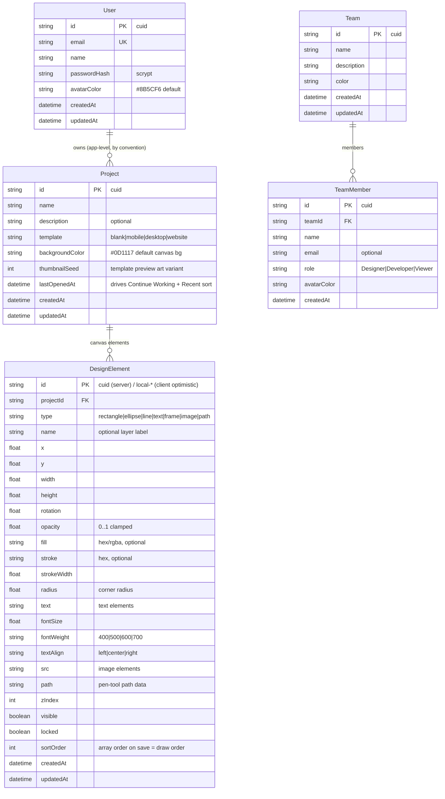

# Digma — Master Project Architecture Document (PAD) v1.173.0

**Classification:** Internal Engineering Reference
**Status:** DEFINITIVE, PRODUCTION-LOCKED BLUEPRINT
**Companion Document:** `README.md` (user-facing), `AGENTS.md` (operator quick-reference), `CLAUDE.md` (agent instructions)
**Last Updated:** 2026-10-27 (v1.173.0 — the comment-truth repair + prose-figures-are-claims registrations pass, the one-hundred-and-forty-second audit's chosen work, the EIGHTH consecutive cycle under the SAME skills/web-application/SKILL.md v1.2.0 vocabulary (the vocabulary-HOLD cycle — the operator's 2026-10-25 fd2037e3 revision byte-unchanged since) — 0C/0H/0M/1L/4I, the seven-cycle zero-Low streak ended at an honest comment-truth Low, zero behavioral source-code defect, one documentation-truth defect with a three-site fix surface — one comment-truth Low (the stale purple-600 measured figure, corrected in-place onto the installed dependency's own rendering), one carried posture (the §8 letter posture at its seventh consecutive carry), one positive steady-state verification (the F179 graduated conventions BOTH confirmed at their FOURTH full-cycle test — the second steady-state cycle, the watch recorded per F180), one dispatch-currency registration, one vocabulary-HOLD registration; the comment-truth census 49 sampled, 48 TRUE / 1 FALSE — the fully-TRUE form's five-cycle streak ended by the fresh-eyes numeric re-derivation, the FALSE member being the Low itself, every claim lead-verified live at its seams: S194-A THE REGISTRATION PAIR (the S187..S193 registration-cycle form): the s194-id-stable-premises-note at the 69th consecutive cycle carrying the CANONICAL quartet in exactly one place (the dispatch QUOTING it verbatim — the F176 prescription honored at its FIFTH full-cycle test, zero label drift again, the quoting form the standing convention per F178, the graduated form watched per F179 and confirmed in the steady-state watch per F180; P1 the churn-consuming registrations value-based or honest-refusal at all twelve client-layer sites — the post-S188-A coordinates properties-panel :1385/:1749/:1754/:2215, editor-store markSaved :241-281 with the remap.get(id) ?? id + reuseStableElements + sameIdSequence mechanisms, addElements :354, updateElements :418, scaleElements :469, moveElements the VALUE-based moved flag :531-567, deleteElements :570, reorderElements :607, toggleVisibility :656, toggleLock :680, layers-panel :39, ai-assistant :401-403/:589; P2 the index-stable remap at editor-view.tsx:413-419 behind the five-guard stack in the registered order — disposed :373, swap :381, elements-reference :382, background :399, gesture :409; P3 the replace-transaction seams at elements/route.ts:365-382 — deleteMany :366 + createMany :368 + project.update :370 + the inside-read findMany :378, one $transaction :365, timeout 30_000 :382, duplicate :113 the same 30s form; P4 the value-based perimeter — zero web-storage anywhere in src/, the two censused members) + the s194-below-threshold-note (THE F181 LESSON — THE PROSE-FIGURES-ARE-CLAIMS MEMBER: every figure quoted in prose is a live claim about the current tree; provenance is not proof — the session that first measured a figure is the session that can be wrong, and a carried figure is a claim that stopped being checked the day it was written; the guard: numeric re-derivation of every figure a sampled comment carries, illustrative figures included — a reader cannot tell operative from illustrative until it is wrong — and the same rule for dispatch briefs and doc mirrors: a figure without a live derivation is a claim, and a claim can be false; the census did its job this cycle — the fully-TRUE streak ended not by sampling less but by deriving more; + THE L-1 COMMENT-TRUTH REGISTRATION (the census's first FALSE member in six cycles — the honest 49-sampled / 48-TRUE / 1-FALSE form; the fix the one-figure correction onto the installed dependency's own rendering at the three live claim sites globals.css:48 + AGENTS.md:232 + PAD:1918, one commit, same-commit lockstep, the frozen session-8/9 records untouched as historical evidence; zero rendering impact — the purple-600 token pinned to the v3 hex at globals.css:97, the app never consuming the v4 default, palette-pins 14/14) + THE B-I-1 DISPATCH-CURRENCY-HONORED REGISTRATION (the F178/F179/F180-graduated dual form's second steady-state cycle PASSED — the stated HEAD 8b32bebc matching git rev-parse HEAD exactly) + the twenty-fourth-generation coordinate verification :2865/:2924/:2993 + the s193 row :2864 ALL EXACT with the F174-corrected window :2840..:2864 = s169..s193 (TWENTY-FIVE rows) :2839 the s168 row + the A-I-1 carried §8 letter posture (the five div onClick event-boundary wrappers — recent-view :214/:256-258, project-card :305-308/:495-498/:576-578 — pure stopPropagation guards, compliant in intent, letter-divergent, load-bearing, registered not modified, the seventh consecutive carry) + the vocabulary-HOLD registration (the eighth consecutive v1.2.0 cycle; every S193-registered v1.2.0 compliance posture re-verified holding — the OTP attempt-counter atomicity, the S181-B hash seam, the S181-C fail-hard seam, the client-IP hops contract, the rate-limit shape, the 7-day TTL, the tokenVersion eviction, the smoke-gate executed-vs-passed arithmetic) + the honest environment record (the SANDBOX-RESET form — the workspace RESET between sessions, the prior session's tool-layer outage cutting it mid-flight: the fresh clone at 8b32bebc VERIFIED before the gates rode it, a fresh bun install of 477 packages, the DB re-created at the repo root and re-seeded to the pristine 1/2/6/1/3 census, chromium-1248 AND chromium_headless_shell-1248 re-provisioned BEFORE the first e2e — the S167-incident shape pre-empted; the exported-shell DATABASE_URL trap ACTIVE in the parent shell and CAUGHT BEFORE any db operation ran, every db-touching command gated with env -u DATABASE_URL from the first call)); S194-B the per-session pin family (tests/lows-s194.test.ts — 12 pins: 5 RED (the doc-side collateral + the L-1 fix's own regression pin) / 7 green-at-birth (the two worklog-registration notes, the F138 guard's FORTY-FIFTH instance — the s193 plan's record pinned 4/4 ticked at fb2ac5c2, the script-provenance member, the audit-entry members — both anchors at their standing spellings, the standing-figures member, the layer-STAYS member); the MEASURED birth form — 5 RED / 7 green EXACT on the first run, zero pin-form corrections at birth (the bracket-free discipline applied at note-writing time); the constants born rolling-safe at the POST-spec figures 2685/256) and the collateral family (the count-family re-anchor 2685 = 2673 + 12 unit / 256 files across every live claim site; the L-1 one-figure correction at the three live claim sites — the in-place comment-correction form; the spec-constants sweep 75 UNIT + 74 FILES with the census-literal lockstep riders for the s185 + s186 + s187 + s188 + s189 + s190 + s191 + s192 + s193 specs' rg probes (nine members — s193 joining); the layer-total family STAYING at 14,373 — the in-place comment-correction form, no F40 rider; the route figure STAYING at 2,461 with the elements-route figure 420 unchanged — its twentieth re-quote cycle; the env census figure 17 sites across 9 vars; the s151..s193 SKILL-version pins onto v1.172.0; the s154..s193 forward-guard rolling re-anchors onto v1.173.0; the s158 title pin onto v1.173.0; the s173..s193 per-spec title-pin riders onto v1.173.0 — the family's twenty-second member; e2e stays 262; smoke stays 73) — the 22-file layer at **14,373 lines** (the STAYS form — the in-place comment-correction cycle: one comment line changed at globals.css:48, zero line-count movement, no F40 rider); the 170th reference audit NO DRIFT (the clip pin byte-identical the 131st consecutive session — exit 0 confirmed on a triple-run; evidence in docs/screenshots/ref-audit-s204/); mobile nav 9/9 the 171st session (the Tailwind v4 class-A guard holds — verified live on the standing build AND by construction in auditor A's pass — the directive's particular focus); SEO 4/4; the one-hundred-and-forty-second Mode C audit with every claim lead-verified live at its seams (auditor A's 0C/0H/0M/1L/2I — the 22-file client layer line-by-line with every per-file figure verified live, the comment-truth audit 49 sampled with 48 TRUE / 1 FALSE — the honest form, the FALSE member being the stale purple-600 figure itself, found by the fresh-eyes numeric re-derivation of the palette figures and confirmed by the lead's independent CSS-Color-4 matrix computation; the security sweep zero across all patterns, the Tailwind v4 posture sound with the F177 axis-named trap-4 hunt closing CLEAN at both axes EXACT (the single-side enumeration at exactly one live layer site — the S186-A fix at login-screen:339 — and the compound-axis enumeration EMPTY in the layer with the one live src-wide site registered outside it), the §8/§9/§12/§13 contract check, the S193 registration seams verified, the mobile navigation menu verified by construction — the directive's particular focus, the client-layer pin subset 106/106 across 10 files in A's own live run; auditor B's 0C/0H/0M/0L/2I — the 18 route files line-by-line with ALL 18 per-file figures matching the LIVE tree and the family sum closing, the src/lib full read (14 non-test files, 3,249 lines, call.ts at exactly 80), the route-layer correctness checklist all-PASS (requireSession at all 17 call sites, readBoundedJson at all 14 parse sites with ZERO direct request.json()), the §5/§6/§7/§16/§17 contract check with the S181-B hash seam and S181-C fail-hard seam verified HOLDING end-to-end and the v1.2.0 members all verified digma-compliant (the OTP attempt-counter atomicity, the client-IP hops contract, the rate-limit shape, the 7-day TTL), the write/handler/catch/env censuses all exact, the S193 seams (the 12-pin spec green in B's own run, the 74/73 constants, the twenty-fourth-generation carriers exact), the deferral premises the 69th consecutive cycle all four holding under the verbatim-quoted quartet (the F176 prescription's FIFTH full-cycle test — zero label drift again), the e2e write-set arithmetic 13+6+1+5=25 closing with the no-e2e five enumerated))
**Last Updated:** 2026-10-27 (v1.172.0 — the steady-state watch registrations pass, the one-hundred-and-forty-first audit's chosen work, the SEVENTH consecutive cycle under the SAME skills/web-application/SKILL.md v1.2.0 vocabulary (the vocabulary-HOLD cycle — the operator's 2026-10-25 fd2037e3 revision byte-unchanged since) — 0C/0H/0M/0L/4I, the SEVENTH consecutive zero-Low cycle, every member informational — one carried posture (the §8 letter posture at its sixth consecutive carry), one positive steady-state verification (the F179 graduated conventions BOTH confirmed at their THIRD full-cycle test — the steady-state watch per F180), one dispatch-currency registration, one vocabulary-HOLD registration — zero source-code defect, zero mutation surface, every claim lead-verified live at its seams: S193-A THE REGISTRATION PAIR (the S187..S192 registration-cycle form, ZERO source-code movement): the s193-id-stable-premises-note at the 68th consecutive cycle carrying the CANONICAL quartet in exactly one place (the dispatch QUOTING it verbatim — the F176 prescription honored at its FOURTH full-cycle test, zero label drift again, the quoting form the standing convention per F178, the graduated form watched per F179 and confirmed in the steady-state watch per F180; P1 the churn-consuming registrations value-based or honest-refusal at all twelve client-layer sites — the post-S188-A coordinates properties-panel :1385/:1749/:1754/:2215, editor-store markSaved :241-281 with the remap.get(id) ?? id + reuseStableElements + sameIdSequence mechanisms, addElements :354, updateElements :418, scaleElements :469, moveElements the VALUE-based moved flag :531-567, deleteElements :570, reorderElements :607, toggleVisibility :656, toggleLock :680, layers-panel :39, ai-assistant :401-403/:589; P2 the index-stable remap at editor-view.tsx:413-419 behind the five-guard stack in the registered order — disposed :373, swap :381, elements-reference :382, background :399, gesture :409; P3 the replace-transaction seams at elements/route.ts:365-382 — deleteMany :366 + createMany :368 + project.update :370 + the inside-read findMany :378, one $transaction :365, timeout 30_000 :382, duplicate :113 the same 30s form; P4 the value-based perimeter — zero web-storage anywhere in src/, the two censused members) + the s193-below-threshold-note (THE F180 LESSON — THE STEADY-STATE WATCH MEMBER: under the graduated watch, the convention's third full-cycle verification and beyond is the steady-state form — the record shifts from event to infrastructure-confirmation; the question inverts a third time, from is the convention carried? (F178) through is the graduated convention watched? (F179) to is the watch itself still recorded? — because a watch that no longer appears in the record is a watch that stopped, and a convention whose watch stopped is a convention quietly decaying back into optional; the steady-state form keeps the registration cheap and mandatory — one line in the note, the same fields every cycle, so the graduation can never silently retire (this cycle's two positive members being exactly that form: the F177 axis-named trap-4 clause carried in the auditor-A dispatch with BOTH axes named as separate enumerations and both closing EXACT at their THIRD full-cycle test — single-side one live layer site login-screen.tsx:339, compound the layer sweep EMPTY with the one live src-wide site ui/dropdown-menu.tsx:65 outside the layer; and the dispatch-currency dual form carried in both briefs with the live HEAD 39181512 stated at dispatch time matching exactly, zero lag — the first steady-state cycle); + THE B-I-1 DISPATCH-CURRENCY-HONORED REGISTRATION (the F178/F179-graduated dual form's first steady-state cycle PASSED — the stated HEAD 39181512 matching git rev-parse HEAD exactly) + the twenty-third-generation coordinate verification :2863/:2922/:2991 + the s192 row :2862 ALL EXACT with the F174-corrected window :2839..:2862 = s169..s192 (TWENTY-FOUR rows) :2838 the S168 row + the A-I-1 carried §8 letter posture (the five div onClick event-boundary wrappers — recent-view :214/:256-258, project-card :305-308/:495-498/:576-578 — pure stopPropagation guards, compliant in intent, letter-divergent, load-bearing, registered not modified, the sixth consecutive carry) + the vocabulary-HOLD registration (the seventh consecutive v1.2.0 cycle; every S192-registered v1.2.0 compliance posture re-verified holding — the OTP attempt-counter atomicity, the S181-B hash seam, the S181-C fail-hard seam, the client-IP hops contract, the rate-limit shape, the 7-day TTL, the tokenVersion eviction, the smoke-gate executed-vs-passed arithmetic) + the honest environment record (the STANDING-WORKSPACE form — no sandbox reset this cycle: the carried state VERIFIED before the gates rode it, bun install confirming 482 installs across 599 packages with no changes, the pristine 1/2/6/1/3 DB census carried from the S192 final re-seed and re-verified live, chromium-1248 AND chromium_headless_shell-1248 standing provisioned; the exported-shell DATABASE_URL trap ACTIVE in the parent shell and CAUGHT BEFORE any db operation ran, every db-touching command gated with env -u DATABASE_URL from the first call)); S193-B the per-session pin family (tests/lows-s193.test.ts — 12 pins: 5 RED (the doc-side collateral) / 7 green-at-birth (the two worklog-registration notes, the F138 guard's FORTY-FOURTH instance — the s192 plan's record pinned 4/4 ticked at 44ef7b32, the script-provenance member, the audit-entry members — both anchors at their standing spellings, the standing-figures member, the layer-STAYS member); the MEASURED birth form — 5 RED / 7 green EXACT on the first run, zero pin-form corrections at birth (the bracket-free discipline applied at note-writing time — no s159 truncation class this cycle); the constants born rolling-safe at the POST-spec figures 2673/255) and the collateral family (the count-family re-anchor 2673 = 2661 + 12 unit / 255 files across every live claim site; the spec-constants sweep 74 UNIT + 73 FILES with the census-literal lockstep riders for the s185 + s186 + s187 + s188 + s189 + s190 + s191 + s192 specs' rg probes (eight members); the layer-total family STAYING at 14,373 — the zero-movement form, no F40 rider; the route figure STAYING at 2,461 with the elements-route figure 420 unchanged — its nineteenth re-quote cycle; the env census figure 17 sites across 9 vars; the s151..s192 SKILL-version pins onto v1.171.0; the s154..s192 forward-guard rolling re-anchors onto v1.172.0; the s158 title pin onto v1.172.0; the s173..s192 per-spec title-pin riders onto v1.172.0 — the family's twenty-first member; e2e stays 262; smoke stays 73) — the 22-file layer at **14,373 lines** (the STAYS form — the registration-only cycle, zero source movement, no F40 rider); the 169th reference audit NO DRIFT (the clip pin byte-identical the 130th consecutive session — exit 0 confirmed on a triple-run; evidence in docs/screenshots/ref-audit-s203/); mobile nav 9/9 the 170th session (the Tailwind v4 class-A guard holds — verified live on the standing build AND by construction in auditor A's pass — the directive's particular focus); SEO 4/4; the one-hundred-and-forty-first Mode C audit with every claim lead-verified live at its seams (auditor A's 0C/0H/0M/0L/2I — the 22-file client layer line-by-line with every per-file figure verified live, the comment-truth audit 48 sampled with 48 TRUE / 0 FALSE — the fully-TRUE form's FIFTH consecutive cycle, the security sweep zero across all patterns, the Tailwind v4 posture sound with the F177 axis-named trap-4 hunt closing CLEAN at both axes EXACT (the single-side enumeration at exactly one live layer site — the S186-A fix at login-screen:339 — and the compound-axis enumeration EMPTY in the layer with the one live src-wide site registered outside it), the §8/§9/§12/§13 contract check, the S192 registration seams verified, the mobile navigation menu verified by construction — the directive's particular focus, the client-layer pin subset 94/94 across 9 files in A's own live run; auditor B's 0C/0H/0M/0L/2I — the 18 route files line-by-line with ALL 18 per-file figures matching the LIVE tree and the family sum closing, the src/lib full read (14 non-test files, 3,249 lines, call.ts at exactly 80), the route-layer correctness checklist all-PASS (requireSession at all 17 call sites, readBoundedJson at all 14 parse sites with ZERO direct request.json()), the §5/§6/§7/§16/§17 contract check with the S181-B hash seam and S181-C fail-hard seam verified HOLDING end-to-end and the v1.2.0 members all verified digma-compliant (the OTP attempt-counter atomicity, the client-IP hops contract, the rate-limit shape, the 7-day TTL), the write/handler/catch/env censuses all exact, the S192 seams (the 12-pin spec green in B's own run, the 73/72 constants, the twenty-third-generation carriers exact), the deferral premises the 68th consecutive cycle all four holding under the verbatim-quoted quartet (the F176 prescription's FOURTH full-cycle test — zero label drift again), the e2e write-set arithmetic 13+6+1+5=25 closing with the no-e2e five enumerated))
**Last Updated:** 2026-10-27 (v1.171.0 — the convention-graduation truth registrations pass, the one-hundred-and-fortieth audit's chosen work, the SIXTH consecutive cycle under the SAME skills/web-application/SKILL.md v1.2.0 vocabulary (the vocabulary-HOLD cycle — the operator's 2026-10-25 fd2037e3 revision byte-unchanged since) — 0C/0H/0M/0L/4I, the SIXTH consecutive zero-Low cycle, every member informational — two carried postures (the §8 letter posture at its fifth consecutive carry; the vocabulary-HOLD at its sixth), two POSITIVE standing-convention verifications (the F177 axis-named dispatch form and the dispatch-currency dual form BOTH verified at their SECOND full-cycle test — graduating per F179) — zero source-code defect, zero mutation surface, every claim lead-verified live at its seams: S192-A THE REGISTRATION PAIR (the S187/S189/S190/S191 registration-cycle form, ZERO source-code movement): the s192-id-stable-premises-note at the 67th consecutive cycle carrying the CANONICAL quartet in exactly one place (the dispatch QUOTING it verbatim — the F176 prescription honored at its THIRD full-cycle test, zero label drift again, the quoting form the standing convention per F178, the graduated form watched per F179; P1 the churn-consuming registrations value-based or honest-refusal at all twelve client-layer sites — the post-S188-A coordinates properties-panel :1385/:1749/:1754/:2215, editor-store markSaved :241-281 with the remap.get(id) ?? id + reuseStableElements + sameIdSequence mechanisms, addElements :354, updateElements :418, scaleElements :469, moveElements the VALUE-based moved flag :531-567, deleteElements :570, reorderElements :607, toggleVisibility :656, toggleLock :680, layers-panel :39, ai-assistant :401-403/:589; P2 the index-stable remap at editor-view.tsx:413-419 behind the five-guard stack in the registered order — disposed :373, swap :381, elements-reference :382, background :399, gesture :409; P3 the replace-transaction seams at elements/route.ts:365-382 — deleteMany :366 + createMany :368 + project.update :370 + the inside-read findMany :378, one $transaction :365, timeout 30_000 :382, duplicate :113 the same 30s form; P4 the value-based perimeter — zero web-storage anywhere in src/, the two censused members) + the s192-below-threshold-note (THE F179 LESSON — THE CONVENTION-GRADUATION TRUTH MEMBER: a promoted convention's second full-cycle verification graduates it from repair-under-observation to standing infrastructure — from that point the audit's registration duty inverts: the convention's absence from a dispatch becomes itself reportable drift (a missing guard), not merely the presence of a carried form; a convention graduated but unwatched is a convention that can be silently retired — the watch is what keeps the graduation real (this cycle's two positive members being exactly that form: the F177 axis-named trap-4 clause carried in the auditor-A dispatch with BOTH axes named as separate enumerations and both closing EXACT — single-side one live layer site login-screen.tsx:339, compound the layer sweep EMPTY with the one live src-wide site ui/dropdown-menu.tsx:65 outside the layer; and the dispatch-currency dual form carried in both briefs with the live HEAD 074cf222 stated at dispatch time matching exactly, zero lag); + THE B-I-1 DISPATCH-CURRENCY-HONORED REGISTRATION (the F178-promoted dual form's SECOND full-cycle verification PASSED — the stated HEAD 074cf222 matching git rev-parse HEAD exactly) + the twenty-second-generation coordinate verification :2861/:2920/:2989 + the s191 row :2860 ALL EXACT with the F174-corrected window :2838..:2860 = s169..s191 (TWENTY-THREE rows) :2837 the S168 row + the A-I-1 carried §8 letter posture (the five div onClick event-boundary wrappers — recent-view :214/:256-258, project-card :305-308/:495-498/:576-578 — pure stopPropagation guards, compliant in intent, letter-divergent, load-bearing, registered not modified, the fifth consecutive carry) + the vocabulary-HOLD registration (the sixth consecutive v1.2.0 cycle; every S191-registered v1.2.0 compliance posture re-verified holding — the OTP attempt-counter atomicity, the client-IP hops contract, the rate-limit shape, the 7-day TTL, the smoke-gate executed-vs-passed arithmetic) + the honest environment record (the workspace RESET — a fresh clone at HEAD 074cf222; the exported-shell DATABASE_URL trap ACTIVE in the parent shell and CAUGHT BEFORE the first db operation ran, every db push/seed gated with env -u DATABASE_URL from the first attempt, the pristine 1/2/6/1/3 form landing on the FIRST guarded push; the smoke gate green on its FIRST guarded invocation — no S110-B trip this cycle, the guard applied from the first call; chromium-1248 AND chromium_headless_shell-1248 provisioned BEFORE the e2e run)); S192-B the per-session pin family (tests/lows-s192.test.ts — 12 pins: 5 RED (the doc-side collateral) / 7 green-at-birth (the two worklog-registration notes, the F138 guard's FORTY-THIRD instance — the s191 plan's record pinned 4/4 ticked at 551f5117, the script-provenance member, the audit-entry members — both anchors at their standing spellings, the standing-figures member, the layer-STAYS member); the MEASURED birth form — 5 RED / 7 green EXACT on the first run, zero pin-form corrections at birth (the bracket-free discipline applied at note-writing time — no s159 truncation class this cycle); the constants born rolling-safe at the POST-spec figures 2661/254) and the collateral family (the count-family re-anchor 2661 = 2649 + 12 unit / 254 files across every live claim site; the spec-constants sweep 73 UNIT + 72 FILES with the census-literal lockstep riders for the s185 + s186 + s187 + s188 + s189 + s190 + s191 specs' rg probes (seven members); the layer-total family STAYING at 14,373 — the zero-movement form, no F40 rider; the route figure STAYING at 2,461 with the elements-route figure 420 unchanged — its eighteenth re-quote cycle; the env census figure 17 sites across 9 vars; the s151..s191 SKILL-version pins onto v1.170.0; the s154..s191 forward-guard rolling re-anchors onto v1.171.0; the s158 title pin onto v1.171.0; the s173..s191 per-spec title-pin riders onto v1.171.0 — the family's twentieth member; e2e stays 262; smoke stays 73) — the 22-file layer at **14,373 lines** (the STAYS form — the registration-only cycle, zero source movement, no F40 rider); the 168th reference audit NO DRIFT (the clip pin byte-identical the 129th consecutive session — exit 0 confirmed on a triple-run; evidence in docs/screenshots/ref-audit-s202/); mobile nav 9/9 the 169th session (the Tailwind v4 class-A guard holds — verified live on the standing build AND by construction in auditor A's pass — the directive's particular focus); SEO 4/4; the one-hundred-and-fortieth Mode C audit with every claim lead-verified live at its seams (auditor A's 0C/0H/0M/0L/2I — the 22-file client layer line-by-line with every per-file figure verified live, the comment-truth audit 48 sampled with 48 TRUE / 0 FALSE — the fully-TRUE form's FOURTH consecutive cycle, the security sweep zero across all patterns, the Tailwind v4 posture sound with the F177 axis-named trap-4 hunt closing CLEAN at both axes EXACT (the single-side enumeration at exactly one live layer site — the S186-A fix at login-screen:339 — and the compound-axis enumeration EMPTY in the layer with the one live src-wide site registered outside it), the §8/§9/§12/§13 contract check, the S191 registration seams verified, the mobile navigation menu verified by construction — the directive's particular focus, the client-layer pin subset 82/82 across 8 files in A's own live run; auditor B's 0C/0H/0M/0L/2I — the 18 route files line-by-line with ALL 18 per-file figures matching the LIVE tree and the family sum closing, the src/lib full read (14 non-test files, 3,249 lines, call.ts at exactly 80), the route-layer correctness checklist all-PASS (requireSession at all 17 call sites, readBoundedJson at all 14 parse sites with ZERO direct request.json()), the §5/§6/§7/§16/§17 contract check with the S181-B hash seam and S181-C fail-hard seam verified HOLDING end-to-end and the v1.2.0 members all verified digma-compliant (the OTP attempt-counter atomicity, the client-IP hops contract, the rate-limit shape, the 7-day TTL), the write/handler/catch/env censuses all exact, the S191 seams (the 12-pin spec green in B's own run, the 72/71 constants, the twenty-second-generation carriers exact), the deferral premises the 67th consecutive cycle all four holding under the verbatim-quoted quartet (the F176 prescription's THIRD full-cycle test — zero label drift again), the e2e write-set arithmetic 13+6+1+5=25 closing with the no-e2e five enumerated))
**Last Updated:** 2026-10-26 (v1.170.0 — the repair-verification truth registrations pass, the one-hundred-and-thirty-ninth audit's chosen work, the FIFTH consecutive cycle under the SAME skills/web-application/SKILL.md v1.2.0 vocabulary (the vocabulary-HOLD cycle — the operator's 2026-10-25 fd2037e3 revision byte-unchanged since) — 0C/0H/0M/0L/4I, the FIFTH consecutive zero-Low cycle, every member informational — two carried postures (the §8 letter posture at its fourth consecutive carry; the vocabulary-HOLD at its fifth), two POSITIVE repair-verification registrations (the F177 axis-named dispatch form verified WORKING at its first full-cycle test; the dispatch-currency dual form honored EXACT) — zero source-code defect, zero mutation surface, every claim lead-verified live at its seams: S191-A THE REGISTRATION PAIR (the S187/S189/S190 registration-cycle form, ZERO source-code movement): the s191-id-stable-premises-note at the 66th consecutive cycle carrying the CANONICAL quartet in exactly one place (the dispatch QUOTING it verbatim — the F176 prescription honored at its SECOND full-cycle test, zero label drift again, the quoting form the standing convention per F178; P1 the churn-consuming registrations value-based or honest-refusal at all twelve client-layer sites — the post-S188-A coordinates properties-panel :1385/:1749/:1754/:2215, editor-store markSaved :241-281 with the remap.get(id) ?? id + reuseStableElements + sameIdSequence mechanisms, addElements :354, updateElements :418, scaleElements :469, moveElements the VALUE-based moved flag :531-567, deleteElements :570, reorderElements :607, toggleVisibility :656, toggleLock :680, layers-panel :39, ai-assistant :401-403/:589; P2 the index-stable remap at editor-view.tsx:413-419 behind the five-guard stack in the registered order — disposed :373, swap :381, elements-reference :382, background :399, gesture :409; P3 the replace-transaction seams at elements/route.ts:365-382 — deleteMany :366 + createMany :368 + project.update :370 + the inside-read findMany :378, one $transaction :365, timeout 30_000 :382, duplicate :113 the same 30s form; P4 the value-based perimeter — zero web-storage anywhere in src/, the two censused members) + the s191-below-threshold-note (THE F178 LESSON — THE REPAIR-VERIFICATION TRUTH MEMBER: a prescribed repair's first full-cycle test is itself a recordable event — when a lesson prescribes a repaired form (the F177 axis-named enumeration; the dispatch-currency form), the next cycle's dispatch must carry the repaired form, and when the test passes, the honest registration records the verification AND promotes the repaired form to the standing convention, so the pre-repair form can never silently return; a repair verified but unregistered is a repair that can be quietly dropped — the registration is what turns a one-cycle fix into a convention (this cycle's two positive members being exactly that form: the F177 axis-named trap-4 clause carried in the auditor-A dispatch with BOTH axes named as separate enumerations and both closing EXACT — single-side one live layer site login-screen.tsx:339, compound the layer sweep EMPTY with the one live src-wide site ui/dropdown-menu.tsx:65 outside the layer; and the dispatch-currency dual form carried in both briefs with the live HEAD stated at dispatch time matching exactly, zero lag); + THE B-I-1 DISPATCH-CURRENCY-HONORED REGISTRATION (the S190 prescription's first full-cycle verification PASSED — the stated HEAD cd99c4da matching git rev-parse HEAD exactly) + the twenty-first-generation coordinate verification :2859/:2918/:2987 + the s190 row :2858 ALL EXACT with the F174-corrected window :2837..:2858 = s169..s190 (TWENTY-TWO rows) :2836 the S168 row + the A-I-1 carried §8 letter posture (the five div onClick event-boundary wrappers — recent-view :214/:256-258, project-card :305-308/:495-498/:576-578 — pure stopPropagation guards, compliant in intent, letter-divergent, load-bearing, registered not modified, the fourth consecutive carry) + the vocabulary-HOLD registration (the fifth consecutive v1.2.0 cycle; every S190-registered v1.2.0 compliance posture re-verified holding — the OTP attempt-counter atomicity, the client-IP hops contract, the rate-limit shape, the 7-day TTL, the smoke-gate executed-vs-passed arithmetic) + the honest environment record (the workspace RESET — a fresh clone at HEAD cd99c4da; the exported-shell DATABASE_URL trap ACTIVE in the parent shell and CAUGHT BEFORE the first db operation ran, every db push/seed gated with env -u DATABASE_URL from the first attempt, the pristine 1/2/6/1/3 form landing on the FIRST guarded push; the smoke gate green on its FIRST guarded invocation — no S110-B trip this cycle, the guard applied from the first call; chromium-1248 AND chromium_headless_shell-1248 provisioned BEFORE the e2e run)); S191-B the per-session pin family (tests/lows-s191.test.ts — 12 pins: 5 RED (the doc-side collateral) / 7 green-at-birth (the two worklog-registration notes, the F138 guard's FORTY-SECOND instance — the s190 plan's record pinned 4/4 ticked at 524c4b80, the script-provenance member, the audit-entry members — both anchors at their standing spellings, the s190 B-anchor divergence not recurring, the standing-figures member, the layer-STAYS member); the MEASURED birth form — 5 RED / 7 green EXACT on the first run, zero pin-form corrections at birth (the bracket-free discipline applied at note-writing time — no s159 truncation class this cycle); the constants born rolling-safe at the POST-spec figures 2649/253) and the collateral family (the count-family re-anchor 2649 = 2637 + 12 unit / 253 files across every live claim site; the spec-constants sweep 72 UNIT + 71 FILES with the census-literal lockstep riders for the s185 + s186 + s187 + s188 + s189 + s190 specs' rg probes (six members); the layer-total family STAYING at 14,373 — the zero-movement form, no F40 rider; the route figure STAYING at 2,461 with the elements-route figure 420 unchanged — its seventeenth re-quote cycle; the env census figure 17 sites across 9 vars; the s151..s190 SKILL-version pins onto v1.169.0; the s154..s190 forward-guard rolling re-anchors onto v1.170.0; the s158 title pin onto v1.170.0; the s173..s190 per-spec title-pin riders onto v1.170.0 — the family's nineteenth member; e2e stays 262; smoke stays 73) — the 22-file layer at **14,373 lines** (the STAYS form — the registration-only cycle, zero source movement, no F40 rider); the 167th reference audit NO DRIFT (the clip pin byte-identical the 128th consecutive session — exit 0 confirmed on a triple-run; evidence in docs/screenshots/ref-audit-s201/); mobile nav 9/9 the 168th session (the Tailwind v4 class-A guard holds — verified live on the standing build AND by construction in auditor A's pass — the directive's particular focus); SEO 4/4; the one-hundred-and-thirty-ninth Mode C audit with every claim lead-verified live at its seams (auditor A's 0C/0H/0M/0L/2I — the 22-file client layer line-by-line with every per-file figure verified live, the comment-truth audit 48 sampled with 48 TRUE / 0 FALSE — the fully-TRUE form's THIRD consecutive cycle, the security sweep zero across all patterns, the Tailwind v4 posture sound with the F177 axis-named trap-4 hunt closing CLEAN at both axes EXACT (the single-side enumeration at exactly one live layer site — the S186-A fix at login-screen:339 — and the compound-axis enumeration EMPTY in the layer with the one live src-wide site registered outside it), the §8/§9/§12/§13 contract check, the S190 registration seams verified (the amended S129-A comment at :509-521 verifying TRUE against the five gates at :911/:1016/:1959/:2003/:2057), the mobile navigation menu verified by construction — the directive's particular focus; auditor B's 0C/0H/0M/0L/2I — the 18 route files line-by-line with ALL 18 per-file figures matching the LIVE tree and the family sum closing, the src/lib full read (14 non-test files, 3,249 lines, call.ts at exactly 80), the route-layer correctness checklist all-PASS (requireSession at all 17 call sites, readBoundedJson at all 14 parse sites with ZERO direct request.json()), the §5/§6/§7/§16/§17 contract check with the S181-B hash seam and S181-C fail-hard seam verified HOLDING end-to-end and the v1.2.0 members all verified digma-compliant (the OTP attempt-counter atomicity, the client-IP hops contract, the rate-limit shape, the 7-day TTL), the write/handler/catch/env censuses all exact, the S190 seams (the 12-pin spec green in B's own run, the 71/70 constants, the twenty-first-generation carriers exact), the deferral premises the 66th consecutive cycle all four holding under the verbatim-quoted quartet (the F176 prescription's SECOND full-cycle test — zero label drift again), the e2e write-set arithmetic 13+6+1+5=25 closing with the no-e2e five enumerated))
**Last Updated:** 2026-10-26 (v1.169.0 — the enumeration-axis truth registrations pass, the one-hundred-and-thirty-eighth audit's chosen work, the FOURTH consecutive cycle under the SAME skills/web-application/SKILL.md v1.2.0 vocabulary (the vocabulary-HOLD cycle — the operator's 2026-10-25 fd2037e3 revision byte-unchanged since) — 0C/0H/0M/0L/3I, the FOURTH consecutive zero-Low cycle, every member informational — one carried §8 letter posture, two record-precision registrations (the enumeration-axis note + the dispatch-currency note) — zero source-code defect, zero mutation surface, every claim lead-verified live at its seams: S190-A THE REGISTRATION PAIR (the S187/S189 registration-cycle form, ZERO source-code movement): the s190-id-stable-premises-note at the 65th consecutive cycle carrying the CANONICAL quartet in exactly one place (the dispatch QUOTING it verbatim — the F176 prescription honored at its first full-cycle test, zero label drift; P1 the churn-consuming registrations value-based or honest-refusal at all twelve client-layer sites — the post-S188-A coordinates properties-panel :1385/:1749/:1754/:2215, editor-store markSaved :241-281 with the remap.get(id) ?? id + reuseStableElements + sameIdSequence mechanisms, addElements :354, updateElements :418, scaleElements :469, moveElements the VALUE-based moved flag :531-567, deleteElements :570, reorderElements :607, toggleVisibility :656, toggleLock :680, layers-panel :39, ai-assistant :401-403/:589; P2 the index-stable remap at editor-view.tsx:413-419 behind the five-guard stack in the registered order — disposed :373, swap :381, elements-reference :382, background :399, gesture :409; P3 the replace-transaction seams at elements/route.ts:365-382 — deleteMany :366 + createMany :368 + project.update :370 + the inside-read findMany :378, one $transaction :365, timeout 30_000 :382, duplicate :113 the same 30s form; P4 the value-based perimeter — zero web-storage anywhere in src/, the two censused members) + the s190-below-threshold-note (THE F177 LESSON — THE ENUMERATION-AXIS TRUTH MEMBER: an enumeration pattern's registered axis span is itself a record claim — when a negative-margin hunt registers the -m-tblr single-side pattern, it spans only the four single-side axes and the compound-axis forms (-mx-/-my-) fall outside its span by construction; a pattern that does not name its axis dimension under-covers silently (this cycle's broader sweep finding exactly one live compound-axis site in the whole of src/ — ui/dropdown-menu.tsx:65's -mx-1 my-1 on the vendored shadcn DropdownMenuSeparator, a live functioning v4 utility OUTSIDE the 22-file client layer); the honest repair registers the axis dimension explicitly and registers the out-of-span live sites it finds, never editing frozen records; + THE B-I-1 DISPATCH-CURRENCY REGISTRATION (the dispatch brief's HEAD figure is itself a live claim — state it at dispatch time from git rev-parse HEAD, or state the delivery commit + the zero-source-drift form) + the twentieth-generation coordinate verification :2857/:2916/:2985 + the s189 row :2856 ALL EXACT with the F174-corrected window :2836..:2856 = s169..s189 (TWENTY-ONE rows) :2835 the S168 row + the A-I-1 carried §8 letter posture (the five div onClick event-boundary wrappers — recent-view :214/:256-258, project-card :305-308/:495-498/:576-578 — pure stopPropagation guards, compliant in intent, letter-divergent, load-bearing, registered not modified) + the vocabulary-HOLD registration (the fourth consecutive v1.2.0 cycle; every S189-registered v1.2.0 compliance posture re-verified holding — the OTP attempt-counter atomicity, the client-IP hops contract, the rate-limit shape, the 7-day TTL, the smoke-gate executed-vs-passed arithmetic) + the honest environment record (the workspace RESET — a fresh clone at HEAD 04b80636; the exported-shell DATABASE_URL trap ACTIVE in the parent shell and CAUGHT BEFORE the first db operation ran, every db push/seed gated with env -u DATABASE_URL from the first attempt, the pristine 1/2/6/1/3 form landing on the FIRST guarded push; the smoke suite's own S110-B refusal tripping once on the unguarded invocation and passing on the guarded re-run — the guard working as designed; chromium-1248 AND chromium_headless_shell-1248 provisioned BEFORE the e2e run)); S190-B the per-session pin family (tests/lows-s190.test.ts — 12 pins: 5 RED (the doc-side collateral) / 7 green-at-birth (the two worklog-registration notes, the F138 guard's FORTY-FIRST instance — the s189 plan's record pinned 4/4 ticked at e25238af, the script-provenance member, the audit-entry member — with the B-anchor spelling divergence pinned as-written, the s159 pin-the-record's-own-spelling lesson, the standing-figures member, the layer-STAYS member); the MEASURED birth form — 5 RED / 7 green EXACT after ONE pin-form correction at birth (the s159 note-internal-bracket truncation class — the bracket-free rewrite applied to the note and its script together, the S186 birth form); the constants born rolling-safe at the POST-spec figures 2637/252) and the collateral family (the count-family re-anchor 2637 = 2625 + 12 unit / 252 files across every live claim site; the spec-constants sweep 71 UNIT + 70 FILES with the census-literal lockstep riders for the s185 + s186 + s187 + s188 + s189 specs' rg probes; the layer-total family STAYING at 14,373 — the zero-movement form, no F40 rider; the route figure STAYING at 2,461 with the elements-route figure 420 unchanged — its sixteenth re-quote cycle; the env census figure 17 sites across 9 vars; the s151..s189 SKILL-version pins onto v1.168.0; the s154..s189 forward-guard rolling re-anchors onto v1.169.0; the s158 title pin onto v1.169.0; the s173..s189 per-spec title-pin riders PRE-ARMED onto v1.169.0 — the family's eighteenth member; e2e stays 262; smoke stays 73) — the 22-file layer at **14,373 lines** (the STAYS form — the registration-only cycle, zero source movement, no F40 rider); the 166th reference audit NO DRIFT (the clip pin byte-identical the 127th consecutive session — exit 0 confirmed on a triple-run; evidence in docs/screenshots/ref-audit-s200/); mobile nav 9/9 the 167th session (the Tailwind v4 class-A guard holds — verified live on the standing build AND by construction in auditor A's pass — the directive's particular focus); SEO 4/4; the one-hundred-and-thirty-eighth Mode C audit with every claim lead-verified live at its seams (auditor A's 0C/0H/0M/0L/2I — the 22-file client layer line-by-line with every per-file figure verified live, the comment-truth audit 31 sampled with 31 TRUE / 0 FALSE — the fully-TRUE form's SECOND consecutive cycle, the security sweep zero across all patterns, the Tailwind v4 posture sound with the §12 trap-4 hunt closing CLEAN at exactly one live single-side site (the S186-A fix at login-screen:339) with the compound-axis enumeration registered (the F177 lesson's own finding), the §8/§9/§12/§13 contract check, the S189 registration seams verified (the amended S129-A comment at :509-521 verifying TRUE against the five gates at :911/:1016/:1959/:2003/:2057), the mobile navigation menu verified by construction — the directive's particular focus; auditor B's 0C/0H/0M/0L/1I — the 18 route files line-by-line with ALL 18 per-file figures matching the LIVE tree, the src/lib full read (14 non-test files, 3,249 lines, call.ts at exactly 80), the route-layer correctness checklist all-PASS (requireSession at all 17 call sites, readBoundedJson at all 14 parse sites with ZERO direct request.json()), the §5/§6/§7/§16/§17 contract check with the S181-B hash seam and S181-C fail-hard seam verified HOLDING end-to-end and the v1.2.0 members all verified digma-compliant (the OTP attempt-counter atomicity, the client-IP hops contract, the rate-limit shape, the 7-day TTL), the write/handler/catch/env censuses all exact, the S189 seams (the 12-pin spec green in B's own run, the 70/69 constants, the twentieth-generation carriers exact), the deferral premises the 65th consecutive cycle all four holding under the verbatim-quoted quartet (the F176 prescription's first full-cycle test — zero label drift), the e2e write-set arithmetic 13+6+1+5=25 closing with the no-e2e five enumerated))
**Last Updated:** 2026-10-25 (v1.168.0 — the premise-label truth registrations pass, the one-hundred-and-thirty-seventh audit's chosen work, the THIRD consecutive cycle under the SAME skills/web-application/SKILL.md v1.2.0 vocabulary (the vocabulary-HOLD cycle — the operator's 2026-10-25 fd2037e3 revision byte-unchanged since) — 0C/0H/0M/0L/2I, the THIRD consecutive zero-Low cycle, every member informational — one carried §8 letter posture, one premise-label record-precision registration — zero source-code defect, zero mutation surface, every claim lead-verified live at its seams: S189-A THE REGISTRATION PAIR (the S187 registration-cycle form, ZERO source-code movement): the s189-id-stable-premises-note at the 64th consecutive cycle carrying the CANONICAL quartet in exactly one place (P1 the churn-consuming registrations value-based or honest-refusal at all twelve client-layer sites — the post-S188-A coordinates properties-panel :1385/:1749/:1754/:2215, editor-store markSaved :241-281 with the remap.get(id) ?? id + reuseStableElements + sameIdSequence mechanisms, addElements :354, updateElements :418, scaleElements :469, moveElements the VALUE-based moved flag :531-567, deleteElements :570, reorderElements :607, toggleVisibility :656, toggleLock :680, layers-panel :39, ai-assistant :401-403/:589; P2 the index-stable remap at editor-view.tsx:413-419 behind the five-guard stack in the registered order — disposed :373, swap :381, elements-reference :382, background :399, gesture :409; P3 the replace-transaction seams at elements/route.ts:365-382 — deleteMany :366 + createMany :368 + project.update :370 + the inside-read findMany :378, one $transaction :365, timeout 30_000 :382, duplicate :113 the same 30s form; P4 the value-based perimeter — zero web-storage anywhere in src/, the two censused members) + THE B-I-1 REGISTRATION (the premise-label member of the F170 record-precision family, this cycle's own finding): the S188-B worklog entry at :7494 composes the quartet with DIFFERENT member labels — its P2 names the addElement :347 -> addElements :354 batch guards (itself a member of the canonical P1 twelve-site census), its P3 the replace transaction, its P4 the autosave epoch guard — while the canonical bracketed s188-id-stable-premises-note at :7530 carries the canonical quartet; EVERY underlying fact in both records verified TRUE live this cycle (addElement :347, addElements :354, boardEpoch :214, the remap :413-419 behind all five guards, the transaction :365-382, the value-based perimeter) — the divergence purely quartet composition, no fact false anywhere; the root cause: the s188 dispatch brief paraphrased the quartet instead of quoting the canonical note, and the auditor composed against the paraphrase; the repair doctrine: frozen records stay frozen (S132-C), the canonical composition lives in the bracketed note alone, and every future dispatch brief quotes the canonical quartet verbatim (the F176 lesson) + the s189-below-threshold-note (THE F176 LESSON — THE PREMISE-LABEL TRUTH MEMBER: a deferral-premise quartet's member labels are themselves record claims — when the same cycle's records carry different quartet compositions, every underlying fact can be TRUE in both while the composition dilutes the canonical form; the honest repair registers the canonical composition in exactly ONE place (the bracketed id-stable-premises-note) and registers the divergence — frozen records are never edited (S132-C); AND the divergence's root cause names its own fix: the dispatch brief must QUOTE the canonical quartet verbatim, never paraphrase it — an auditor composing against a paraphrase re-derives true facts under borrowed labels, and the labels are the claim + the eighteenth-generation coordinate verification :2855/:2914/:2983 + the s188 row :2854 ALL EXACT with the F174-corrected window :2835..:2854 = s169..s188 (TWENTY rows) :2834 the S168 row + the A-I-1 carried §8 letter posture (the five div onClick event-boundary wrappers — recent-view :214/:256-258, project-card :305-308/:495-498/:576-578 — pure stopPropagation guards, compliant in intent, letter-divergent, load-bearing, registered not modified) + the vocabulary-HOLD registration (the third consecutive v1.2.0 cycle; every S188-registered v1.2.0 compliance posture re-verified holding — the OTP attempt-counter atomicity, the client-IP hops contract, the rate-limit shape, the 7-day TTL, the smoke-gate executed-vs-passed arithmetic) + the honest environment record (the workspace RESET — a fresh clone at HEAD a1aca3fe; the exported-shell DATABASE_URL trap ACTIVE in the parent shell and CAUGHT BEFORE the first db operation ran, every db push/seed gated with env -u DATABASE_URL from the first attempt, the pristine 1/2/6/1/3 form landing on the FIRST guarded push; chromium-1248 AND chromium_headless_shell-1248 provisioned BEFORE the e2e run)); S189-B the per-session pin family (tests/lows-s189.test.ts — 12 pins: 5 RED (the doc-side collateral) / 7 green-at-birth (the two worklog-registration notes, the F138 guard's FORTIETH instance — the s188 plan's record pinned 4/4 ticked at f03aceda, the script-provenance member, the audit-entry member, the standing-figures member, the layer-STAYS member); the MEASURED birth form — 5 RED / 7 green EXACT on the first run, zero pin-form corrections at birth, zero forecast-to-measured corrections in-cycle (the registration-only cycle moving no source line, the zero-movement form leaving nothing to measure twice); the constants born rolling-safe at the POST-spec figures 2625/251) and the collateral family (the count-family re-anchor 2625 = 2613 + 12 unit / 251 files across every live claim site; the spec-constants sweep 70 UNIT + 69 FILES with the census-literal lockstep riders for the s185 + s186 + s187 + s188 specs' rg probes; the layer-total family STAYING at 14,373 — the zero-movement form, no F40 rider; the route figure STAYING at 2,461 with the elements-route figure 420 unchanged — its fifteenth re-quote cycle; the env census figure 17 sites across 9 vars; the s151..s188 SKILL-version pins onto v1.167.0; the s154..s188 forward-guard rolling re-anchors onto v1.168.0; the s158 title pin onto v1.168.0; the s173..s188 per-spec title-pin riders PRE-ARMED onto v1.168.0 — the family's seventeenth member; e2e stays 262; smoke stays 73) — the 22-file layer at **14,373 lines** (the STAYS form — the registration-only cycle, zero source movement, no F40 rider); the 165th reference audit NO DRIFT (the clip pin byte-identical the 126th consecutive session — exit 0 confirmed on a triple-run; evidence in docs/screenshots/ref-audit-s199/); mobile nav 9/9 the 166th session (the Tailwind v4 class-A guard holds — verified live on the standing build AND by construction in auditor A's pass — the directive's particular focus); SEO 4/4; the one-hundred-and-thirty-seventh Mode C audit with every claim lead-verified live at its seams (auditor A's 0C/0H/0M/0L/1I — the 22-file client layer line-by-line with every per-file figure verified live, the comment-truth audit 31 sampled with 31 TRUE / 0 FALSE — the fully-TRUE form's first cycle since S187, the S188-A amendment's own clause now verifying TRUE, the security sweep zero across all patterns, the Tailwind v4 posture sound with the §12 trap-4 hunt closing CLEAN (the exhaustive -m[tblr]-* enumeration returning exactly one live site, the S186-A fix itself), the §8/§9/§12/§13 contract check, the S188 registration seams verified (the amended S129-A comment at :509-521 verifying TRUE against the five gates at :911/:1016/:1959/:2003/:2057), the mobile navigation menu verified by construction — the directive's particular focus; auditor B's 0C/0H/0M/0L/1I — the 18 route files line-by-line with ALL 18 per-file figures matching the LIVE tree, the src/lib full read (14 non-test files, 3,249 lines, call.ts at exactly 80), the route-layer correctness checklist all-PASS, the §5/§6/§7/§16/§17 contract check with the S181-B hash seam and S181-C fail-hard seam verified HOLDING end-to-end and the v1.2.0 members all verified digma-compliant (the OTP attempt-counter atomicity, the client-IP hops contract, the rate-limit shape, the 7-day TTL), the write/handler/catch/env censuses all exact, the S188 seams (the 13-pin spec green in B's own run, the 69/68 constants, the eighteenth-generation carriers exact), the deferral premises the 64th consecutive cycle all four holding, the e2e write-set arithmetic 13+6+1+5=25 closing with the no-e2e five enumerated; the honest environment record: the workspace RESET this cycle (a fresh clone at HEAD a1aca3fe — the S188 delivery f03aceda + the logs, all changes since the delivery docs-only, src/tests byte-identical to the delivery at the cycle's open; bun install 477 packages; .env the documented cp form; db/ pushed + seeded with the env -u DATABASE_URL guard from the FIRST attempt — the exported-shell trap ACTIVE in the parent shell and CAUGHT BEFORE the first db operation ran, the pristine 1/2/6/1/3 form landing on the FIRST guarded push; chromium-1248 AND chromium_headless_shell-1248 provisioned BEFORE the e2e run))
**Last Updated:** 2026-10-25 (v1.167.0 — the exclusion-clause comment-truth repair + F175 registrations pass, the one-hundred-and-thirty-sixth audit's chosen work, the SECOND consecutive cycle under the SAME skills/web-application/SKILL.md v1.2.0 vocabulary (the vocabulary-HOLD cycle — the operator's 2026-10-25 fd2037e3 revision byte-unchanged since) — 0C/0H/0M/0L/3I, the SECOND consecutive zero-Low cycle, every member informational — one comment-truth clause, one §8 letter posture, one environment note — zero source-code defect, zero mutation surface, every claim lead-verified live at its seams: S188-A THE COMMENT-TRUTH REPAIR (A-I-1, the S185 receipt-count-truth form): the S129-A comment's 'modifier combos must never arm' clause at properties-panel.tsx:509-513 corrected — the gate reads event.key alone (the five keydown sites at :902-904/:1008/:1951/:1995/:2049 test SLIDER_KEYS.has(event.key) with no modifier state consulted), so a modifier HELD WITH a member key (Ctrl/Cmd/Alt+Arrow…) DOES arm: no engine applies a value change to a range input under held modifiers, so the idle terminal runs the changed===false cancel — net-zero, the at-bound residual's sibling — and the arm-on-any-member-key form registered as the DELIBERATE robust posture (the S130-A wheel lesson: every modality that might change the value arms; narrowing the gate would strand a hypothetical modifier-adjusting engine's changes un-armed against the onChange's unconditional tick() mark, re-opening the per-change history-flooding class the S130-A fix closed); comment-text only in the source file, the amendment's own +8 lines MOVING the layer 14,365 -> 14,373 (properties-panel.tsx 2,370 -> 2,378) — the F40 rider fully engaged; THE F175 LESSON — THE EXCLUSION-CLAUSE TRUTH MEMBER (the F168..F174 record-truth family's next member, at the guard-clause layer): an enumeration guard's prose exclusion clause ('X must never pass') is itself a behavior claim about the guard's discrimination — when the gate tests only the enumerated dimension (SLIDER_KEYS.has(event.key) reads the key alone), any orthogonal dimension held WITH a member value (a Ctrl/Cmd/Alt modifier + Arrow) passes at the letter, and the clause must name its own discrimination dimension; AND when the over-inclusive arm is the DELIBERATE robust form (every modality that might change the value arms — the S130-A wheel posture), the honest repair amends the CLAUSE, never the guard; A-I-2 the §8 letter posture registered (the five div onClick event-boundary wrappers — recent-view :214/:256-258, project-card :305-308/:495-498/:576-578 — pure stopPropagation guards around real controls, compliant in intent, letter-divergent, load-bearing, registered not modified); B-I-1 the host-worklog environment note (the fresh-clone workspace's host worklog absent the third consecutive cycle — BOTH auditors' entries landing directly in the repo worklog at :7479 (B) and :7504 (A), the transplant fallback unneeded); S188-B the per-session pin family (tests/lows-s188.test.ts — 13 pins: 7 RED (the source contract + the doc-side collateral) / 6 green-at-birth (the two worklog-registration notes, the F138 guard's THIRTY-NINTH instance — the s187 plan's record pinned 4/4 ticked at 33123311, the script-provenance member, the audit-entry member, the standing-figures member); the MEASURED birth form with TWO pin-form corrections applied at birth (the comment-truth census spelling + the 13-pin census arithmetic — the s159 family) and ONE forecast-to-measured correction applied in-cycle (the +9 forecast corrected onto the +8 measured movement — the s159 measured-form family's own lesson, the forecast never allowed to survive its own measurement); the constants born rolling-safe at the POST-spec figures 2613/250) and the collateral family (the count-family re-anchor 2613 = 2600 + 13 unit / 250 files across every live claim site; the spec-constants sweep 69 UNIT + 68 FILES with the census-literal lockstep riders for the s185 + s186 + s187 specs' rg probes; the layer-total family MOVING at 14,373 — the +8 the comment amendment's own receipt, the F40 rider fully engaged (the 26 toBe sites + the s186/s187 LAYER_TOTAL constants); the route figure STAYING at 2,461 with the elements-route figure 420 unchanged — its fourteenth re-quote cycle; the env census figure 17 sites across 9 vars; the s151..s187 SKILL-version pins onto v1.166.0; the s154..s187 forward-guard rolling re-anchors onto v1.167.0; the s158 title pin onto v1.167.0; the s173..s187 per-spec title-pin riders onto v1.167.0 — the family's sixteenth member; e2e stays 262; smoke stays 73) — the 22-file layer at **14,373 lines** (the MOVES form — the deliberate +8: the S188-A comment amendment's own lines; the F40 rider's own receipt); the 164th reference audit NO DRIFT (the clip pin byte-identical the 125th consecutive session — exit 0 confirmed on a triple-run; evidence in docs/screenshots/ref-audit-s198/); mobile nav 9/9 the 165th session (the Tailwind v4 class-A guard holds — verified live on the standing build AND by construction in auditor A's pass — the directive's particular focus); SEO 4/4; the one-hundred-and-thirty-sixth Mode C audit with every claim lead-verified live at its seams (auditor A's 0C/0H/0M/0L/2I — the 22-file client layer line-by-line with every per-file figure verified live, the comment-truth audit 31 sampled with 30 TRUE / 1 FALSE — the first FALSE census member in three cycles, the A-I-1 clause itself, surfaced by MEASUREMENT DEPTH at the keydown gate, the security sweep zero across all patterns, the Tailwind v4 posture sound with the §12 trap-4 hunt closing CLEAN (the exhaustive -m[tblr]-* enumeration returning exactly one live site, the S186-A fix itself in the prescribed later-child form), the §8/§9/§12/§13 contract check, the S187 seams verified, the mobile navigation menu verified by construction — the directive's particular focus; auditor B's 0C/0H/0M/0L/1I — the 18 route files line-by-line with ALL 18 per-file figures matching the LIVE tree, the src/lib full read (14 non-test files, 3,249 lines, call.ts at exactly 80), the route-layer correctness checklist all-PASS, the §5/§6/§7/§16/§17 contract check with the S181-B hash seam and S181-C fail-hard seam verified HOLDING end-to-end and the v1.2.0 members all verified digma-compliant (the OTP attempt-counter atomicity, the client-IP hops contract, the rate-limit shape, the 7-day TTL), the write/handler/catch/env censuses all exact, the S187 seams (the 12-pin spec green in B's own run, the 68/67 constants, the seventeenth-generation carriers exact with the F174-corrected window verified at its own generation), the deferral premises the 63rd consecutive cycle all four holding, the e2e write-set arithmetic 13+6+1+5=25 closing with the no-e2e five enumerated; the honest environment record: the workspace RESET this cycle (a fresh clone at HEAD 9ad67551 — the S187 delivery 33123311 + the logs, all changes since the delivery docs-only, src/tests byte-identical to the delivery at the cycle's open; bun install 477 packages; .env the documented cp form; db/ pushed + seeded with the env -u DATABASE_URL guard from the FIRST attempt — the exported-shell trap ACTIVE in the parent shell and CAUGHT BEFORE the first db operation ran, the S187 honest-receipt lesson applied, the pristine 1/2/6/1/3 form landing on the FIRST guarded push; chromium-1248 AND chromium_headless_shell-1248 provisioned BEFORE the e2e run))
**Last Updated:** 2026-10-25 (v1.166.0 — the window-start-label correction + F174 registrations pass, the one-hundred-and-thirty-fifth audit's chosen work, the FIRST cycle under the NEW skills/web-application/SKILL.md v1.2.0 vocabulary — the operator's 2026-10-25 revision, the first vocabulary change since 2026-10-23 (the prior six consecutive cycles all ran v1.1.0) — 0C/0H/0M/0L/3I, the FIRST zero-Low cycle since S183 after three consecutive measurement-depth Low cycles, every member of the F170 coordinate-precision family, zero source-code defect, zero mutation surface, every claim lead-verified live at its seams: S187-A THE REGISTRATIONS: the s187-id-stable-premises-note (the 62nd consecutive cycle, all four premises re-derived live by auditor B and holding, the P1 member's properties-panel coordinates CORRECTED to :1377/:2207 per A-I-2 — the commitUpload guard call at :1377, the selectionWouldCommit compare at :2207, the prior cycles' :1372/:2202 naming the guards' preceding comment blocks, five lines shy — the F170 family's comment-block member) + the s187-below-threshold-note (the sixteenth-generation carriers :2851/:2910/:2979 AND the s186 row at :2850 ALL EXACT — WITH THE B-I-1 WINDOW CORRECTION: :2832 is the S168 row, :2833 is the S169 row, :2834 is the S170 row, so the window :2833..:2850 = s169..s186 (18 rows, arithmetic-consistent), the registered s170..s186 phrase internally inconsistent at 18 line-slots vs 17 sessions (the v1.165.0 chain-line insertion at :6 shifted every §7.1 row +1 — the note extended the window's end for the s186 row but never shifted the start label); THE F174 LESSON — THE WINDOW-START-LABEL TRUTH MEMBER: a row-window's start label is itself a coordinate claim — when an insertion lands above the window, BOTH the end composition AND the start label must be re-derived, and a window phrase that names its extent in sessions must be internally consistent with its line-span (N line-slots name N sessions; a span-label mismatch is the tell); the A-I-1 coordinate corrections — the S186-A delivery prose's pre-collateral coordinates, the -mt-2 mirror site at login-screen.tsx:339 not :333, the autoComplete conditional at :407 not :401 (the receipt comment's own +6 at :300-311 shifting both sites below the insertion — the F170 family's pre-collateral member, the FIFTH consecutive coordinate-correction cycle); the v1.2.0 VOCABULARY-CHANGE REGISTRATION — the revision materially favorable to digma: three of digma's registered deviations converted to sanctioned patterns (the shared-bucket rate-limit shape (auth: 10/15min + ai: 20/5min + crud: 60/5min) now §5's named in-family alternative; the S181-C fail-hard secret enforcement now §5's cited adopted pattern; the DIGMA_PROXY_HOPS client-IP contract now §16's named pattern), both new rule families verified digma-compliant at line level (the OTP attempt-counter ATOMICITY — updateMany-atomic at every increment site, zero read-then-write counters in the route layer; the smoke-gate executed-vs-passed arithmetic — the two-bucket closure form, no skip path, the one conditional branch answering bad), the §12 Tailwind v4 trap catalog byte-unchanged and its trap-4 prescription exactly the S186-A fix's form (the repo's F173 lesson and the master skill now agreeing), the fresh-clone rule's digma record accurate with the cp-before-first-consumer arm satisfied (README:230/331, AGENTS:24); the SEVENTEENTH generation pre-registered at the MEASURED post-collateral coordinates; the honest environment record — the workspace RESET this cycle, the exported-shell DATABASE_URL trap CAUGHT the cycle's own first unguarded db push + seed at Phase 0 (the seed populated the outer-shell path, the repo db left empty, the smoke gate's 50-check failure storm the honest receipt), the guarded re-push + re-seed restoring the pristine 1/2/6/1/3 form BEFORE any gate was recorded green); S187-B the per-session pin family (tests/lows-s187.test.ts — 12 pins: 5 RED (the doc-side collateral) / 7 green-at-birth (the two worklog-registration notes, the F138 guard's THIRTY-EIGHTH instance — the s186 plan's record pinned 5/5 ticked at 2fa13d7e, the script-provenance member, the audit-entry member, the source-survival member, the layer-STAYS member); the MEASURED birth form with one pin-form correction applied at birth (the window-phrase spelling — the s159 family); the constants born rolling-safe at the POST-spec figures 2600/249) and the collateral family (the count-family re-anchor 2600 = 2588 + 12 unit / 249 files across every live claim site; the spec-constants sweep 68 UNIT + 67 FILES with the census-literal lockstep rider for the s185 + s186 specs' rg probes; the layer-total family STAYING at 14,365 — the zero-movement form, no F40 rider needed; the route figure STAYING at 2,461 with the elements-route figure 420 unchanged — its thirteenth re-quote cycle; the env census figure 17 sites across 9 vars; the s151..s186 SKILL-version pins onto v1.165.0; the s154..s186 forward-guard rolling re-anchors onto v1.166.0; the s158 title pin onto v1.166.0; the s173..s186 per-spec title-pin riders onto v1.166.0 — the family's fifteenth member; e2e stays 262; smoke stays 73) — the 22-file layer at **14,365 lines** (the STAYS form — the zero-movement cycle: no source-code remediation, every member documentation-coordinate precision); the 163rd reference audit NO DRIFT (the clip pin byte-identical the 124th consecutive session — exit 0 confirmed on a triple-run; evidence in docs/screenshots/ref-audit-s197/); mobile nav 9/9 the 164th session (the Tailwind v4 class-A guard holds — verified live on the standing build AND by construction in auditor A's pass — the directive's particular focus); SEO 4/4; the one-hundred-and-thirty-fifth Mode C audit with every claim lead-verified live at its seams (auditor A's 0C/0H/0M/0L/2I — the 22-file client layer line-by-line with every per-file figure verified live, the comment-truth audit 31 sampled with 31 TRUE / 0 FALSE — the zero-false direction holding a second consecutive cycle, the security sweep zero across all patterns, the Tailwind v4 posture sound with the §12 trap-4 hunt closing CLEAN (the exhaustive -m[tblr]-* enumeration returning exactly one live site, the S186-A fix itself in the prescribed later-child form; the two other mb-on-space-y children value-coincident-benign), the §8/§9/§12/§13 contract check, the S186 seams verified, the mobile navigation menu verified by construction — the directive's particular focus; auditor B's 0C/0H/0M/0L/1I — the 18 route files line-by-line with ALL 18 per-file figures matching the LIVE tree, the src/lib full read (14 non-test files, 3,249 lines, call.ts at exactly 80), the route-layer correctness checklist all-PASS, the §5/§6/§7/§16/§17 contract check UNDER THE v1.2.0 ADDITIONS with the S181-B hash seam and S181-C fail-hard seam verified HOLDING end-to-end and the NEW members all verified digma-compliant (the OTP attempt-counter atomicity, the client-IP hops contract, the rate-limit shape, the 7-day TTL), the write/handler/catch/env censuses all exact, the S186 seams (the 14-pin spec green in B's own run, the 67/66 constants, the sixteenth-generation carriers exact with the window label REFUTED), the deferral premises the 61st consecutive cycle all four holding, the e2e write-set arithmetic 13+6+1+5=25 closing with the no-e2e five enumerated; the honest environment record: the workspace RESET this cycle (a fresh clone at HEAD fd2037e3 — the S186 delivery 2fa13d7e + the logs 78edda1c + the operator's fd2037e3, all operator changes docs/ and skills/ only, src/tests byte-identical since the delivery; bun install 477 packages; .env the documented cp form; db/ pushed + seeded with the env -u guard after the trap caught the cycle's own first unguarded seed; chromium-1248 AND chromium_headless_shell-1248 provisioned BEFORE the e2e run))
**Last Updated:** 2026-10-25 (v1.165.0 — the trap-4 subtractive repair + F173 registrations pass, the one-hundred-and-thirty-fourth audit's chosen work, the SIXTH consecutive same-vocabulary cycle — 0C/0H/0M/1L/6I, the third consecutive cycle with Low-severity members, again surfaced by measurement depth, every claim lead-verified live at its seams: S186-A THE TRAP-4 SUBTRACTIVE REPAIR (A-L-1, the §12 trap-4 subtractive member + F173): the minimal-card back-link's v3-born -mb-2 (login-screen.tsx:314, inside the space-y-6/sm:space-y-8 container at :299) composed with the LATER sibling's space-y margin under v3 (24-8=16px mobile / 32-8=24px sm+) but REPLACED v4's :where() margin-block-end (the child's own (0,1,0) utility over the (0,0,0) :where()) — an 8px overlap on the signup/forgot/verify states since the minimal card's birth (commit 8bafa40a), undetected by 185 cycles (the ref-audit clip family never captures the login minimal states; the e2e asserted visibility only — the class even serving as a locator at auth.spec.ts:278, selector-load-bearing but geometrically unpinned); mirrored per the skill's own §12 prescription — the -mb-2 dropped from the back-link, the explicit -mt-2 riding the header wrapper (the LATER child, login-screen.tsx:333) in the minimal-conditional template-literal form, the 16px/24px rhythm restored; the e2e rider: the button.-mb-2 locator retired with the class (the honest getByRole count(1) one-button form on the sent state) + the geometry pin added to the signup minimal-state test (the computed back-link→header gap asserted at 24px on the 1280px e2e viewport — assertions only, the e2e count STAYING at 262); the layer MOVING 14,359 -> 14,365 (the receipt comment's own +6 — the F40 RIDER FULLY ENGAGED: 40 toBe sites across 26 specs + the two login-screen per-file pins 741 -> 747 + the s185 live comment, a deliberate remediation never drift); S186-B THE REGISTRATIONS: the s186-id-stable-premises-note (the 60th consecutive cycle, all four premises re-derived live by auditor B and holding, the P2 member's FILE LABEL CORRECTED to editor-view.tsx:413-419 per B-I-1 — the F170 family's file-label member, the cycle after the line-label member; the dispatch brief named elements/route.ts where those coordinates are the transaction-abort catch arm) + the s186-below-threshold-note (the fifteenth-generation carriers :2849/:2908/:2977 AND the s185 row at :2848 ALL EXACT — the corrected arithmetic's FOURTH application; THE F173 LESSON — THE COPIED-COMPOSITION TRUTH MEMBER: a class composition measured from a reference rendered by a DIFFERENT engine version is itself a rendering claim about the TARGET's engine — the composition re-derived under the target's own cascade law before shipping (the F171 rendered-output lesson EXTENDED from the token/gradient layer to the composition layer; the skill's own §12 trap-4 prescription the mirror form); the A-I-4 coordinate correction — the S184-A OTP guard at :246, the dispatch's ~733-741 naming the FacebookIcon SVG range; the A-I-1 scope-precision note — the S96-A receipt's context-scoped claim vs the dispatch's broader paraphrase; the SIXTEENTH generation pre-registered at the MEASURED post-collateral coordinates; the same-vocabulary SIXTH hold); S186-C the per-session pin family (tests/lows-s186.test.ts — 14 pins: 8 RED (the trap-4 source contract + the e2e rider + the doc-side collateral) / 6 green-at-birth (the two worklog-registration notes, the F138 guard's THIRTY-SEVENTH instance — the s185 plan's record pinned 5/5 ticked at d8e29f63, the script-provenance member, the audit-entry member, the source-survival member, the source-standing member); the MEASURED birth form with three pin-form corrections applied at birth (the note-internal-bracket truncation class — a NEW member of the s159 family: the bracket-delimited registration notes carry no internal ']' characters, the markSaved and teams-id forms; the A-I-4 phrase spelling; the pin-count arithmetic 13 -> 14); the constants born rolling-safe at the POST-spec figures 2588/248) and the collateral family (the count-family re-anchor 2588 = 2574 + 14 unit / 248 files across every live claim site; the spec-constants sweep 67 UNIT + 66 FILES with the census-literal lockstep rider for the s185 spec's rg probe; the route figure STAYING at 2,461 with the elements-route figure 420 unchanged — its twelfth re-quote cycle; the env census figure 17 sites across 9 vars; the s151..s185 SKILL-version pins onto v1.164.0; the s154..s185 forward-guard rolling re-anchors onto v1.165.0; the s158 title pin onto v1.165.0; the s173..s185 per-spec title-pin riders onto v1.165.0 — the family's fourteenth member; e2e stays 262; smoke stays 73) — the 22-file layer at **14,365 lines** (the MOVES form — the deliberate +6: the login-screen receipt comment's own lines; the F40 rider's own receipt); the 162nd reference audit NO DRIFT (the clip pin byte-identical the 123rd consecutive session — exit 0 confirmed on a triple-run; evidence in docs/screenshots/ref-audit-s196/); mobile nav 9/9 the 163rd session (the Tailwind v4 class-A guard holds — verified live on the standing build AND by construction in auditor A's pass — the directive's particular focus); SEO 4/4; the one-hundred-and-thirty-fourth Mode C audit with every claim lead-verified live at its seams (auditor A's 0C/0H/0M/1L/4I — the 22-file client layer line-by-line with every per-file figure verified live, the comment-truth audit 31 sampled with 31 TRUE / 0 FALSE — the zero-false direction RETURNING after two single-false cycles, the security sweep zero across all patterns, the Tailwind v4 posture sound with the §12 trap-4 hunt answering in the affirmative — one divergent member in the SUBTRACTIVE direction, bounded (the two other mb-on-space-y children value-coincident-benign), the §8/§9/§12/§13 contract check, the S185 seams verified, the mobile navigation menu verified by construction — the directive's particular focus; auditor B's 0C/0H/0M/0L/2I — the 18 route files line-by-line with ALL 18 per-file figures matching the LIVE tree, the src/lib full read (14 non-test files, 3,249 lines, call.ts at exactly 80), the route-layer correctness checklist all-PASS, the §5/§6/§7/§16/§17 contract check with the S181-B hash seam and S181-C fail-hard seam verified HOLDING end-to-end, the write/handler/catch/env censuses all exact, the S185 seams (the 12-pin spec green in B's own run, the 66/65 constants, the fifteenth-generation carriers exact), the deferral premises the 60th consecutive cycle all four holding, the e2e write-set arithmetic 13+6+1+5=25 closing with the no-e2e five enumerated; the honest environment record: the workspace RESET this cycle (a fresh clone at HEAD a824de16 — the S185 delivery d8e29f63 + the logs 4cdb8c62 + the operator's session_500 commit, all operator changes docs/ only, src/tests byte-identical since the delivery; bun install 477 packages; .env the documented cp form; db/ seeded pristine 1/2/6/1/3; chromium-1248 AND chromium_headless_shell-1248 provisioned BEFORE the e2e run — the S180 lesson applied; the exported-shell DATABASE_URL trap guarded by env -u on every DB-touching gate))
**Last Updated:** 2026-10-24 (v1.164.0 — the receipt-count truth repair + F172 registrations pass, the one-hundred-and-thirty-third audit's chosen work, the FIFTH consecutive same-vocabulary cycle — 0C/0H/0M/1L/7I, the second consecutive cycle with Low-severity members, again surfaced by measurement depth, every claim lead-verified live at its seams: S185-A THE COUNT-TRUTH REPAIR (A-L-1): the S184-B --shadow-sm pin's own receipt comment claimed "the 23 shadow-sm sites" — born stale the same cycle it was written (the raw grep count includes the 2 comment mentions at ui/select.tsx:12 and layers-panel.tsx:294 and the token declaration itself; the honest class-site count is 21: login-screen x5, recent-view x4, dashboard-view x3, ui/button x3, properties-panel x1, layers-panel x1, ai-assistant x1, ui/input x1, ui/select x1, ui/textarea x1) — the receipt corrected to the comment-excluding enumeration form, comment-text only, ZERO line movement (globals.css STAYING at 300); S185-B THE REGISTRATIONS: the s185-id-stable-premises-note (the 59th consecutive cycle, all four premises re-derived live by auditor B and holding, the P1 ai-assistant member's send-time coordinate CORRECTED to :589 per B-I-1 — :403 the apply-time patchWouldChange value compare, :589 the send-time targetIds: state.selectedIds capture inside the JSON.stringify body, the premise holding at BOTH sites, the F170 family's coordinate member, the SECOND consecutive cycle carrying a coordinate correction) + the s185-below-threshold-note (the fourteenth-generation carriers :2847/:2906/:2975 AND the s184 row at :2846 ALL EXACT — the corrected arithmetic's THIRD application; THE F172 LESSON — THE RECEIPT-COUNT TRUTH MEMBER: a count claim embedded in a remediation's own receipt comment is itself a claim about the tree — derived by the same comment-excluding class-site enumeration the auditors apply, never a raw grep (the fix's own documentation a fresh audit surface every cycle); the B-I-2 window-composition correction — the registered window ':2831..:2846 (15 consecutive spec rows s170..s184)' internally off by one row, the live window spanning 16 rows s169..s184, the corrected composition :2832..:2846 for the s170..s184 family, all four carrier coordinates unaffected; the FIFTEENTH generation pre-registered at the MEASURED post-collateral coordinates; the A-I-1 OTP index-0 tradeoff posture); S185-C the per-session pin family (tests/lows-s185.test.ts — 12 pins: 6 RED (the count-truth source contract + the doc-side collateral) / 6 green-at-birth (the two worklog-registration notes, the F138 guard's THIRTY-SIXTH instance — the s184 plan's record pinned 7/7 ticked at 4217fff6, the script-provenance member, the audit-entry member, the source-survival member); the MEASURED birth form with two pin-form corrections applied at birth (the window-correction word order, the B-entry census spelling); the constants born rolling-safe at the POST-spec figures 2574/247) and the collateral family (the count-family re-anchor 2574 = 2562 + 12 unit / 247 files across every live claim site; the spec-constants sweep 66 UNIT + 65 FILES; the layer-total family STAYING at 14,359 — the FIRST zero-movement cycle since S182, no F40 rider needed; the route figure STAYING at 2,461 with the elements-route figure 420 unchanged — its tenth re-quote cycle; the env census figure 17 sites across 9 vars; the s151..s184 SKILL-version pins onto v1.163.0; the s154..s184 forward-guard rolling re-anchors onto v1.164.0; the s158 title pin onto v1.164.0; the s173..s184 per-spec title-pin riders onto v1.164.0 — the family's thirteenth member; e2e stays 262; smoke stays 73) — the 22-file layer at **14,359 lines** (the STAYS form, the first zero-movement cycle since S182 — the comment-text repair painting no lines); the 161st reference audit NO DRIFT (the clip pin byte-identical the 122nd consecutive session — exit 0 confirmed on a triple-run; evidence in docs/screenshots/ref-audit-s195/); mobile nav 9/9 the 162nd session (the Tailwind v4 class-A guard holds — verified live on the standing build AND by construction in auditor A's pass — the directive's particular focus); SEO 4/4; the one-hundred-and-thirty-third Mode C audit with every claim lead-verified live at its seams (auditor A's 0C/0H/0M/1L/4I — the 22-file client layer line-by-line with every per-file figure verified live, the comment-truth audit 26 sampled with 25 TRUE / 1 FALSE (the FALSE member the S184-B receipt comment's own stale count, repaired in-cycle), the security sweep zero across all patterns, the Tailwind v4 posture sound with the §12 trap-3/trap-5 mitigations from S184-B verified HOLDING and the S96-A closed set intact (all 12 gradient inline styles referencing var(--color-*) tokens, zero hex literals), the §8/§9/§12/§13 contract check, the S184 seams verified, the mobile navigation menu verified by construction — the directive's particular focus; auditor B's 0C/0H/0M/0L/3I — the 18 route files line-by-line with ALL 18 per-file figures matching the LIVE tree, the src/lib full read (14 non-test files, 3,249 lines, call.ts at exactly 80), the route-layer correctness checklist all-PASS, the §5/§6/§7/§16/§17 contract check with the S181-B hash seam and S181-C fail-hard seam verified HOLDING end-to-end, the write/handler/catch/env censuses all exact, the S184 seams (the 17-pin spec green, the 65/64 constants, the fourteenth-generation carriers exact), the deferral premises the 59th consecutive cycle all four holding, the e2e write-set arithmetic 19+1+5=25 closing; the honest environment record: the workspace RESET this cycle (a fresh clone at HEAD 276865fa — the S184 delivery 4217fff6 + the logs 7fb7fec9 + the operator's session_494 commit, all operator changes docs/ only, src/tests byte-identical since the delivery; bun install 477 packages; .env the documented cp form; db/ seeded pristine 1/2/6/1/3; chromium-1248 AND chromium_headless_shell-1248 provisioned BEFORE the e2e run — the S180 lesson applied; the exported-shell DATABASE_URL trap guarded by env -u on every DB-touching gate))
**Last Updated:** 2026-10-24 (v1.163.0 — the rendered-output-evidence OTP-guard + shadow-pin + sRGB-gradient remediations + F171 registrations pass, the one-hundred-and-thirty-second audit's chosen work, the FOURTH consecutive same-vocabulary cycle — 0C/0H/0M/2L/6I, the first Low-severity members since S181, every claim lead-verified live at its seams: S184-A THE OTP APPEND-INTO-FILLED-CELL GUARD (A-L-1): the S160-D autofill-distribution branch was un-scoped — ANY multi-char value rebuilt the code from cell 0, so clicking an already-filled middle cell and typing one char WIPED the other cells while the browser autofill the fix targets delivers the complete code to input[0] ALONE (the only autoComplete="one-time-code" field); the branch now scoped to index === 0 && cleaned.length > 1, the append path falling to the slice(-1) form that lands the digit in the typed cell (login-screen.tsx 733 -> 741); S184-B THE RENDERED-OUTPUT REMEDIATION (A-L-2, the §12 trap-5 + trap-3 contract, the F171 evidence form): the --shadow-sm token pinned to the v3 geometry 0 1px 2px 0 rgb(0 0 0 / 0.05) in @theme — the installed tailwindcss@4.3.3 theme.css carries --shadow-sm byte-identical to --shadow (the v3 DEFAULT, one notch heavier than the v3 sm the shadcn chrome was designed against; md/lg/xl/2xl verified v3-identical, no further pins) + the brand-gradient family converted to inline sRGB linear-gradient() styles per the skill's own trap-3 prescription — the 160th reference audit's hero-banner midzone sampled 4x closer to sRGB than oklab (dist 101 vs 405 at the purple-to-pink midzone, the exact pink-600 hex at the via position: the reference renders the sRGB family while the clone's gradient utilities interpolate oklab): the hero banner, the branded icon/avatar circles (dashboard stats + empty-state, teams chip, app-header avatar, ai-assistant bot avatars, project-card member avatars, recent avatar wash), the dialog-title text gradients (teams + project-card), and the two CTA buttons via the unlayered .brand-cta-gradient custom class with the v3 purple-700/pink-700 hover stops; the teams chip KEEPS the bg-gradient-to-r class as the parity.spec e2e query hook with the inline style owning the paint; the neutral washes (gray-50/white/purple-50 page washes, slate login, blue-50/purple-50 thumbnails, gray video placeholders) stay on the utilities — near-white oklab-vs-sRGB is sub-perceptual and they are not brand blends (globals.css 273 -> 300, dashboard-view 424 -> 427, teams-view 540 -> 543); S184-C THE COMMENT-TRUTH REPAIR (A-I-3): the properties-panel stale session-62 "Single-pointer-safe: only one slider can be dragged at a time" rationale annotated superseded by the S123-C/S125-B/S126-B multi-touch token guards — the comment-truth census 26+0 sampled / 25 TRUE / 1 FALSE, the zero-false direction breaking its eight-cycle streak on this member, repaired in-cycle (properties-panel.tsx 2,365 -> 2,370); S184-D THE REGISTRATIONS: the s184-id-stable-premises-note (the 58th consecutive cycle, all four premises re-derived live by auditor B and holding, the layers-panel retype coordinate CORRECTED to :39 — the B-I-2 F170-family coordinate member: the prior cycles' ':84' falls inside the S133-C row-click block, a different honest-refusal member, the premise holding at both sites) + the s184-below-threshold-note (the thirteenth-generation carriers :2845/:2904/:2973 AND the window :2831..:2844 AND the s183 row at :2844 ALL EXACT — the corrected arithmetic's second application; the F171 LESSON — THE RENDERED-OUTPUT EVIDENCE MEMBER: a posture claim about RENDERED output (an interpolation family, a shadow geometry) is verified against the REFERENCE'S RENDERED PIXELS sampled from the standing captures, never against the source classes' letter alone — the measurement that turned A-L-2 from a registerable cosmetic into an evidence-backed remediation; the FOURTEENTH generation pre-registered at the MEASURED post-collateral coordinates, never a +2 forecast — this delivery's PAD insertions exceed the standard two; the B-I-1 write-path unknown-error rethrow tail registered as the designed complement to the envelope family — the 16 write-window catches' throw tails the honest unknown-error posture (known Prisma codes answer envelopes, everything else rethrows to Next's default 500 leaking no internals), the S130-C read-path deviation's write-path twin; the B-I-3 e2e write-set annotation — the 19+1+5=25 arithmetic a numeric closure NOT a coverage bijection, the five no-e2e handlers (duplicate POST, elements GET/POST, members POST, teams/[id] PATCH) the documented no-first-party-consumer family, unit-covered; the A-I-1 plain-@theme and A-I-2 bell-popover letter postures); S184-E the per-session pin family (tests/lows-s184.test.ts — 17 pins: 11 RED (the three code remediations' source contracts + the doc-side collateral) / 6 green-at-birth (the two worklog-registration notes, the F138 guard's THIRTY-FIFTH instance — the s183 plan's record pinned 5/5 ticked at c36ac470, the script-provenance member, the audit-entry member, the source-survival member); the MEASURED birth form — the layer forecast corrected to the measured figure TWICE at birth (14,349 -> 14,357 at the code landing, 14,357 -> 14,359 at the var() refinement the S96-A inline-style-hex closed-set gate forced — the s159 measured form applied twice), the anchor-collision scoping (the s183-era transplanted auditors ride the same Task-ID anchors) and the entry-spelling pin-form corrections applied at birth; the constants born rolling-safe at the POST-spec figures 2562/246) and the collateral family (the count-family re-anchor 2562 = 2545 + 17 unit / 246 files across every live claim site; the spec-constants sweep 65 UNIT + 64 FILES; the layer-total family MOVING 14,313 -> 14,359 — the FIRST movement since S181, the F40 rider engaging (24 spec riders + the SKILL globals claim + the s126 lockstep + the five §11 rows), a deliberate remediation never drift; the route figure STAYING at 2,461 with the elements-route figure 420 unchanged — its ninth re-quote cycle pre-armed; the env census figure 17 sites across 9 vars; the s151..s183 SKILL-version pins onto v1.162.0; the s154..s183 forward-guard rolling re-anchors onto v1.163.0; the s158 title pin onto v1.163.0; the s173..s183 per-spec title-pin riders onto v1.163.0 — the family's twelfth member; e2e stays 262; smoke stays 73) — the 22-file layer at **14,359 lines** (the MOVES form, the first since S181 — the deliberate +46: globals.css +27, login-screen +8, properties-panel +5, dashboard-view +3, teams-view +3; the F40 rider's own receipt; the route layer at 2,461 with the internal-consistency probe passing); the 160th reference audit NO DRIFT (the clip pin byte-identical the 121st consecutive session — exit 0 confirmed on a triple-run; evidence in docs/screenshots/ref-audit-s194/); mobile nav 9/9 the 161st session (the Tailwind v4 class-A guard holds — verified live on the standing build AND by construction in auditor A's pass); SEO 4/4; the one-hundred-and-thirty-second Mode C audit with every claim lead-verified live at its seams (auditor A's 0C/0H/0M/2L/3I — the comment-truth audit 26 sampled with 25 TRUE / 1 FALSE (the stale single-pointer rationale, repaired in-cycle), the security sweep zero across all patterns, the Tailwind v4 posture sound at the class layer with the §12 trap-3/trap-5 mitigations absent (L-2), the §8/§9/§12/§13 contract check, the S181/S183 seams verified, the mobile navigation menu verified by construction — the directive's particular focus; auditor B's 0C/0H/0M/0L/3I — the 18 route files line-by-line with ALL 18 per-file figures matching the LIVE tree, the src/lib full read (14 non-test files, call.ts at exactly 80), the route-layer correctness checklist all-PASS, the §5/§6/§7/§16/§17 contract check with the S181-B hash seam and S181-C fail-hard seam verified HOLDING end-to-end, the write/handler/catch/env censuses all exact, the S183 seams (the 12-pin spec green, the 64/63 constants, the thirteenth-generation carriers exact), the deferral premises the 58th consecutive cycle all four holding, the e2e write-set arithmetic 19+1+5=25 closing; the honest environment record: the workspace RESET this cycle (a fresh clone at HEAD 4ed265c0 — the S183 delivery c36ac470 + the logs 9f57331f + the operator's session_488 commit, all operator changes docs/ only, src/tests byte-identical since the delivery; bun install 477 packages; .env the documented cp form; db/ seeded pristine 1/2/6/1/3; chromium-1248 AND chromium_headless_shell-1248 provisioned BEFORE the e2e run — the S180 lesson applied; the exported-shell DATABASE_URL trap guarded by env -u on every DB-touching gate))
**Last Updated:** 2026-10-24 (v1.162.0 — the third-same-vocabulary issuance-prose-lockstep + twelfth-generation-verified + F170 registrations pass, the one-hundred-and-thirty-first audit's chosen work, the THIRD consecutive same-vocabulary cycle — 0C/0H/0M/0L/8I, a zero-source-finding all-Informational census under the same skills/web-application/SKILL.md v1.1.0 vocabulary, the S181/S182 remediations verified holding at every re-derived seam, every non-posture member doc-side, dispatch-side or registration-side, every claim lead-verified live at its seams: S183-A THE ISSUANCE-PROSE LOCKSTEP (B182-I-2's follow-up, the prose cycle the s182 record itself proposed): the two LIVING issuance-prose rows — the auth-flow prose and the §11 forgot-password inventory row — lockstepped in place to name the STORED form (the SHA-256 hex hash of the crypto-random token, S181-B hashed-at-rest; the raw token rides only the delivery URL), the frozen S46 port row untouched per the S181-D era-scoping doctrine, zero line-count movement on both rows, the issuance-true/storage-silent posture CLOSED on the living surface (the authoritative storage truth now named at every living claim site: the revision blocks since v1.160.0, the schema comment since S182-A, the auth-flow prose and the §11 row since S183-A); S183-B THE REGISTRATIONS: the s183-id-stable-premises-note (the 57th consecutive cycle, all four premises re-derived live by auditor B and holding) + the s183-below-threshold-note (the twelfth-generation coordinate VERIFIED at every figure under the corrected arithmetic — the carriers :2843/:2902/:2971 AND the window :2830..:2842 AND the s182 row at :2842 all EXACT as pre-registered, the F169 member holding its first verification, the off-by-one class NOT recurring; the A183-I-1 dispatch per-file figure family correction: the lead's auditor-A brief carried 12/22 stale figures recalled from the S140-era record while the total was live-derived and exact and the repo NOT drifted — auditor A caught it by counting every file, the family summing to 14,065 against its own stated 14,313 total; the F170 lesson: a dispatch brief's per-file figure family is itself a claim about the tree — every member derives live at dispatch AND the family's sum closes against its own stated total; the THIRTEENTH generation pre-registered with the same corrected arithmetic: the carriers to :2845/:2904/:2973, the §7.1 rows owning s170..s183 at :2831..:2844, the s183 row at :2844 — every figure from the same two-insertion +2 shift); S183-C the per-session pin family (tests/lows-s183.test.ts — 12 pins: 6 RED (the two prose-lockstep forms + the doc-side collateral: the AGENTS session-183 bullet, the count re-anchor, the PAD title, the SKILL + F170, the pair-unity constants) / 6 green-at-birth (the two worklog-registration notes, the F138 guard's THIRTY-FOURTH instance — the s182 plan's record pinned 5/5 ticked at 80303e97 per the pre-armed session_481/482 directive, the script-provenance member, the audit-entry member, the source-survival member with the F170 per-file probe mechanized — the two historically-drifting members pinned by name); the MEASURED birth form — two pin-form corrections applied at birth (the audit-entry members' quoted forms aligned to the entries' actual wording), the arithmetic carrying the measured count, never the forecast (the s159 lesson); the constants born rolling-safe at the POST-spec figures 2545/245) and the collateral family (the count-family re-anchor 2545 = 2533 + 12 unit / 245 files across every live claim site; the spec-constants sweep 64 UNIT + 63 FILES; the layer-total family STAYING at 14,313 — the THIRD consecutive cycle at the post-S181 figure, the second STAYS re-quote; the route figure STAYING at 2,461 with the elements-route figure 420 unchanged — its EIGHTH re-quote cycle pre-armed; the env census figure 17 sites across 9 vars — the standing form; the s151..s182 SKILL-version pins onto v1.161.0; the s154..s182 forward-guard rolling re-anchors onto v1.162.0; the s158 title pin onto v1.162.0; the s173..s182 per-spec title-pin riders onto v1.162.0 — the family's eleventh member; e2e stays 262; smoke stays 73) — the 22-file layer at **14,313 lines** (the STAYS form, the third consecutive cycle at the post-S181 figure); the route layer at 2,461 with the internal-consistency probe passing; the 159th reference audit NO DRIFT (the clip pin byte-identical the 120th consecutive session — exit 0 confirmed on a triple-run with all standing datums identical; evidence in docs/screenshots/ref-audit-s193/); mobile nav 9/9 the 160th session (the Tailwind v4 class-A guard holds — verified live on the standing build AND by construction in auditor A's pass); SEO 4/4; the one-hundred-and-thirty-first Mode C audit with every claim lead-verified live at its seams (auditor A's 0C/0H/0M/0L/5I — the 22-file client layer read line-by-line with the A183-I-1 per-file drift caught by counting every file (12/22 brief figures stale, the live tree exact, the repo byte-identical to the S182 delivery), the comment-truth census 22 sampled with 22 TRUE / 0 FALSE (the zero-false direction holding the eighth consecutive cycle), the security sweep zero across all patterns, the mobile navigation menu verified by construction — the directive's particular focus, the §8/§9/§12/§13 contract check PASS with the postures carried, the correctness focus traced clean — the gesture seam, the autosave machine, the id-remap); auditor B's 0C/0H/0M/0L/3I — the 18 route files line-by-line with ALL 18 per-file figures matching the LIVE tree (zero dispatch-figure errors on B's brief), the src/lib full read (14 non-test files at 3,249, call.ts at exactly 80 lines), the route-layer correctness checklist all-PASS, the §5/§6/§7/§16/§17 contract check with the S181-B hash seam and the S181-C fail-hard seam both verified HOLDING end-to-end, the write/handler/catch/env censuses all exact (23/14 = 10+11+2, 25/24/17, 17 = 16+1, 17 sites/9 vars), the S182 seams (the 12-pin spec verified, the 63/62 constants zero-stale, the twelfth-generation carriers at their exact coordinates), the deferral premises the 57th consecutive cycle all four holding, the e2e write-set arithmetic 19+1+5=25 closing; the honest environment record: the workspace RESET this cycle (a fresh git clone at HEAD b27d71a6; bun install 477 packages; .env the documented cp form; db/ at the repo root pushed + seeded pristine 1/2/6/1/3 and re-seeded after every DB-touching gate; chromium-1248 AND chromium_headless_shell-1248 provisioned BEFORE the e2e run — the standing cache absent post-reset; the six baseline gates first-run green — lint 0, typecheck 0, unit 2533/2533 across 244, build 27 routes with the [db] anchor at the repo root, smoke 73/73, e2e 262/262 zero flakes 6.6m; the trap guarded by env -u on every DB-touching gate; the vitest isolate note confirmed live again — the registered forward-compat lever, not promoted))
**Last Updated:** 2026-10-24 (v1.161.0 — the same-vocabulary-hold schema-comment-lockstep + eleventh-generation-corrected + F169 registrations pass, the one-hundred-and-thirtieth audit's chosen work, the SAME-VOCABULARY HOLD cycle — 0C/0H/0M/0L/8I, a zero-source-finding all-Informational census under the SAME skills/web-application/SKILL.md v1.1.0 vocabulary that surfaced S181's three Lows, the remediated tree now auditing clean at the code layer, every non-posture member doc-side or registration-side, every claim lead-verified live at its seams: S182-A THE SCHEMA-COMMENT LOCKSTEP (B182-I-1): prisma/schema.prisma's User.resetToken column comment still read '64-hex crypto-random, null once consumed' — the PRE-S181-B description of the stored form, the S181-B delivery having lockstepped password.ts + auth.ts + both routes + the S76 spec literals + the PAD blocks + AGENTS + README + .env.example but missed the schema's own column comment; the one-line comment update naming the STORED form (the SHA-256 hex hash of the crypto-random token, S181-B hashed-at-rest), in-place with zero line-count movement, schema.prisma outside every count family; S182-B THE REGISTRATIONS: the s182-id-stable-premises-note (the 56th consecutive cycle, all four premises re-derived live by auditor B and holding) + the s182-below-threshold-note (the eleventh-generation carriers :2841/:2900/:2969 verified live EXACT as the s181 note pre-registered — by the lead AND auditor B independently; the pre-registered WINDOW figures OFF BY ONE against the live tree (B182-I-3): the s181 §7.1 row at :2840 and the window s170..s181 at :2829..:2840, the root cause the INCONSISTENT SHIFT APPLICATION — the chain-line +1 applied to the window start but not the window end, the s181 row computed without its own insertion's additional shift, while the carrier arithmetic correctly assumed the full +2; the TWELFTH generation pre-registered WITH THE CORRECTED ARITHMETIC, every figure derived from the same two-insertion +2 shift with the arithmetic stated in the registration itself: the carriers to :2843/:2902/:2971, the §7.1 rows owning s170..s182 at :2830..:2842, the s182 row at :2842; the cursor-census qualifier correction (A182-I-1): the S181 record's 'src/ exactly SEVEN cursor-pointer utility sites, every one a non-button surface' — the COUNT right, the QUALIFIER mechanically FALSE at 2 of 7 sites, project-card.tsx:449 the stretched-link button + layers-panel.tsx:358 the layer-select button carrying the utility on real button elements (belt-and-suspenders with the S181-A base rule, zero post-fix impact; properties-panel.tsx:1481 on a label[role=button] redundant coverage); the call() letter-deviance posture (A182-I-5): the master skill §9's 'one call() helper is the only sanctioned HTTP client' letter vs the ELEVEN documented raw-fetch sites outside the seam — letter-deviant, intent-compliant, remediation not recommended; the PAD issuance-prose posture (B182-I-2): the three frozen prose sites literally true about issuance, registered for the next prose refresh; the F169 record-truth lesson: a recorded census claim's figures AND qualifiers AND a pre-registration's coordinate arithmetic are ALL live-derived claims — the qualifier verified at the element level before recording, every pre-registered figure derived from the same insertion arithmetic); S182-C the per-session pin family (tests/lows-s182.test.ts — 12 pins: 6 RED (the schema comment form + the doc-side collateral: the AGENTS session-182 bullet, the count re-anchor, the PAD title, the SKILL + F169, the pair-unity constants) / 6 green-at-birth (the two worklog-registration notes, the F138 guard's THIRTY-THIRD instance — the s181 plan's record pinned 7/7 ticked at bbcf8b71 per the pre-armed session_473/475/476 directive, the script-provenance member, the audit-entry member, the source-survival member); the MEASURED birth form — the audit-entry members consolidated into one test, the arithmetic carrying the measured count, never the forecast (the s159 lesson); the constants born rolling-safe at the POST-spec figures 2533/244) and the collateral family (the count-family re-anchor 2533 = 2521 + 12 unit / 244 files across every live claim site; the spec-constants sweep 63 UNIT + 62 FILES; the layer-total family STAYING at 14,313 — the SECOND consecutive cycle at the post-S181 figure, the first STAYS re-quote of the new figure; the route figure STAYING at 2,461 with the elements-route figure 420 unchanged — its SEVENTH re-quote cycle pre-armed; the env census figure 17 sites across 9 vars — the +1 the S181-C gate's own NODE_ENV read at auth.ts:44, the post-remediation standing form with the attribution verified by both auditors; the s151..s181 SKILL-version pins onto v1.160.0; the s154..s181 forward-guard rolling re-anchors onto v1.161.0; the s158 title pin onto v1.161.0; the s173..s181 per-spec title-pin riders onto v1.161.0 — the family's tenth member; e2e stays 262; smoke stays 73) — the 22-file layer at **14,313 lines** (the STAYS form, the second consecutive cycle at the post-S181 figure); the route layer at 2,461 with the internal-consistency probe passing; the 158th reference audit NO DRIFT (the clip pin byte-identical the 119th consecutive session — exit 0 confirmed on a double-run; evidence in docs/screenshots/ref-audit-s192/); mobile nav 9/9 the 159th session (the Tailwind v4 class-A guard holds — verified live on the standing build AND by construction in auditor A's pass); SEO 4/4; the one-hundred-and-thirtieth Mode C audit with every claim lead-verified live at its seams (auditor A's 0C/0H/0M/0L/5I — the 22-file client layer 22/22 per-file exact with the total 14,313, the comment-truth census 22 sampled with 22 TRUE / 0 FALSE (the zero-false direction holding the seventh consecutive cycle), the security sweep zero across all patterns, the mobile navigation menu verified by construction — the directive's particular focus, the §8/§9/§12/§13 contract check PASS with the two §12 trap postures carried, the correctness focus traced clean — the gesture seam, the autosave machine, the id-remap); auditor B's 0C/0H/0M/0L/3I — the 18 route files line-by-line with ALL 18 per-file figures matching the LIVE tree (zero dispatch-figure errors this cycle — the F168 lesson held at dispatch), the src/lib full read (14 non-test files, call.ts at exactly 80 lines), the route-layer correctness checklist all-PASS, the §5/§6/§7/§16/§17 contract check with the S181-B hash seam and the S181-C fail-hard seam both verified HOLDING end-to-end, the write/handler/catch/env censuses all exact (the env 17/9 with the +1 attribution verified), the S181 seams (the 20/20 spec green in B's own run, the 62/61 constants, the eleventh-generation carriers at their exact coordinates with the off-by-one independently confirmed and root-caused), the deferral premises the 56th consecutive cycle all four holding, the e2e write-set arithmetic 19+1+5=25 closing; the honest environment record: the workspace INTACT this cycle (no sandbox reset — node_modules present from the standing install, .env the documented cp form, db/ at the repo root pristine 1/2/6/1/3 at the cycle's open and re-seeded after every DB-touching gate, chromium-1248 AND chromium_headless_shell-1248 present from the standing cache; the six baseline gates first-run green — lint 0, typecheck 0, unit 2521/2521 across 243, build 27 routes with the [db] anchor at the repo root, smoke 73/73, e2e 262/262 zero flakes 6.5m; the trap guarded by env -u on every DB-touching gate; the vitest configLoader warning confirmed live again — the registered forward-compat lever, not promoted))
**Last Updated:** 2026-10-24 (v1.160.0 — the new-skill-lens cursor + hashed-reset + auth-secret-fail-hard remediations + tenth-generation + F168 registrations pass, the one-hundred-and-twenty-ninth audit's chosen work, the NEW-SKILL LENS cycle — 0C/0H/0M/3L/7I, the first non-Informational members in six cycles, all three Lows surfaced by the directive-named skills/web-application/SKILL.md v1.1.0's contract vocabulary (the operator's 2026-10-23 revision) against code the five prior cycles audited clean under the older vocabulary, every claim lead-verified live at its seams: S181-A THE CURSOR REMEDIATION (A181-L-1): the Tailwind v4 preflight sets no cursor:pointer on buttons — mechanically verified against tailwindcss@4.3.3's own preflight.css (zero cursor declarations, the Safari spin-button comment the only mention) — while the reference ships v3 via CDN whose preflight did (the repo's own globals.css reference-palette datum), so every real button (~76 raw button sites in the audited layer) showed cursor:default on desktop hover, a parity deviation invisible to screenshot clips (cursors do not render in captures — why 158 reference-audit passes never saw it); the master skill §12 base-layer rule button,[role="button"]{cursor:pointer} installed in globals.css @layer base with the v4-fact comment, restoring the hand affordance; S181-B THE HASHED-AT-REST REMEDIATION (B181-L-1): the reset tokens were persisted RAW (forgot-password:104) and looked up by raw equality (reset-password:55) — a DB-at-rest read (backup leak / file-read misconfig) exposed the only directly-usable credential in the User row (the passwords are scrypt); the master skill §5/§16 SHA-256-at-rest contract installed through the pure crypto seam (password.ts hashResetToken, node:crypto only) re-exported through auth.ts (the S70-D doctrine); forgot-password stores the hash; reset-password computes it once and carries it in BOTH the pre-read and the atomic consume's where-clause — the S76-A single-use atomicity contract UNCHANGED (only the compared value now the hash; the S76 spec's two literals lockstepped with the intent pins preserved: the conditional write, the count check, the ordering, the nulls + the version bump inside the data block); the raw token lives only in the delivery URL (the in-response resetUrl / the mail transport's link — the e2e/smoke round-trips flow unchanged); S181-C THE AUTH-SECRET FAIL-HARD REMEDIATION (B181-L-2): the secret() seam warned once and fell back to the PUBLIC repo constant 'digma-dev-only-insecure-secret' in EVERY environment — no NODE_ENV check, no length floor; production + missing/short (<16 chars) now THROWS at the seam (forgeable sessions never ship silently — every login and cookie-carrying request 500s loudly with the fix in the message), dev/test keeps the S66-C warned fallback for DX; the harness cascade provisioned in the same change (the smoke + nav boots carry AUTH_SECRET, the playwright webServer already did — pinned by server-lows-s83/84; the capture derivation chain carries it); S181-D THE REGISTRATIONS: the s181-id-stable-premises-note (the 55th consecutive cycle, all four premises re-derived live by auditor B and holding) + the s181-below-threshold-note (the tenth-generation carriers :2839/:2898/:2967 verified live by the lead AND auditor B independently with the s180 §7.1 row at :2838 and the window :2828..:2838 — exactly as pre-registered; the ELEVENTH generation pre-registered at :2841/:2900/:2969, the window :2829..:2838, the s181 row at :2839; the F168 dispatched-figure lesson: the lead's dispatch brief carried HAND-TYPED per-file route figures — 4/18 wrong (logout 60 vs the live 37, me 27 vs 9, register 240 vs 146, resend-otp 87 vs 122), the brief's own list self-inconsistent (sum 2,550 vs its own 2,450), caught by auditor B counting every file — a dispatch brief's per-file figures derive from the live tree (wc -l at dispatch time), never from memory or a prior record's recall, every figure in a dispatch brief a live-derived claim; the master-skill lens record: a fresh contract vocabulary is itself an audit dimension — the zero-finding streak was true under the old vocabulary and ended the moment the vocabulary grew, streaks are vocabulary-relative never absolute); S181-E the per-session pin family (tests/lows-s181.test.ts — 20 pins: 15 RED (the three code remediations' source contracts + the harness provisions + the S76 lockstep forms + the doc-side collateral) / 5 green-at-birth (the two worklog-registration notes, the F138 guard's THIRTY-SECOND instance — the s180 plan's record pinned 6/6 ticked at 510dfd10 per the pre-armed session_467/469/470 directive, the script-provenance member, the audit-entry member); the RED birth exact on the first run; the constants born rolling-safe at the POST-spec figures 2521/243) and the collateral family (the count-family re-anchor 2521 = 2501 + 20 unit / 243 files across every live claim site; the spec-constants sweep 62 UNIT + 61 FILES; the layer-total family MOVING to 14,313 — the FIRST movement in fourteen cycles, the F40 rider engaging, a deliberate remediation never drift; the route figure MOVING to 2,461 with the elements-route figure 420 unchanged — its sixth re-quote cycle pre-armed; the s151..s180 SKILL-version pins onto v1.159.0; the s154..s180 forward-guard rolling re-anchors onto v1.160.0; the s158 title pin onto v1.160.0; the s173..s180 per-spec title-pin riders onto v1.160.0 — the family's ninth member; e2e stays 262; smoke stays 73) — the 22-file layer at **14,313 lines** (the MOVES form, the first in fourteen cycles — the deliberate +6 globals.css cursor-rule addition, the F40 rider's own receipt; the route layer at 2,461 with the internal-consistency probe passing); the 157th reference audit NO DRIFT (the clip pin byte-identical the 118th consecutive session — exit 0 confirmed on a double-run; evidence in docs/screenshots/ref-audit-s191/); mobile nav 9/9 the 158th session (the Tailwind v4 class-A guard holds — verified live on the standing build AND by construction in auditor A's pass); SEO 4/4; the one-hundred-and-twenty-ninth Mode C audit with every claim lead-verified live at its seams (auditor A's 0C/0H/0M/1L/4I — the comment-truth audit 22 sampled with 22 TRUE / 0 FALSE, the zero-false direction holding the sixth consecutive cycle, the coverage limit stated per F162; the security sweep zero across all patterns; the mobile navigation menu verified by construction — the directive's particular focus — with the 9/9 contract and the v4 class-A guard; the §8/§9/§12/§13 contract check against the NEW master skill surfacing the cursor Low; the S180 registration seams verified; the correctness focus traced clean — the gesture seam, the autosave machine, the id-remap); auditor B's 0C/0H/0M/2L/3I — the 18 route files line-by-line with ALL 18 per-file figures matching the LIVE tree (catching the lead's 4/18 dispatch-figure errors — the F168 lesson), the src/lib full read (14 non-test files, call.ts at exactly 80 lines), the route-layer correctness checklist all-PASS, the §5/§6/§7/§16/§17 contract check against the NEW master skill surfacing the two auth Lows, the write/handler/catch/env censuses all exact, the S180 seams (the 13/13 spec green, the 61/60 constants, the tenth-generation coordinates at their pre-registered lines), the deferral premises the 55th consecutive cycle all four holding, the e2e write-set arithmetic 19+1+5=25 closing; the honest environment record: the workspace REBUILT after a sandbox reset (the fresh clone at HEAD bd9a505c — the S180 delivery 510dfd10 + the logs 1ad583b2 + the operator's two commits, all operator changes docs/+skills/ only, src/tests byte-identical since the delivery; .env staged via the documented cp form — the S180 lesson applied, the S99-G pin green on the FIRST unit run, 2501/2501 across 242 first-run clean; chromium-1248 AND chromium_headless_shell-1248 provisioned BEFORE the e2e run — the S180 provisioning lesson applied, 262/262 clean on the first run; the trap guarded by env -u on every DB-touching gate))
**Last Updated:** 2026-10-23 (v1.159.0 — the continuity + ninth-generation coordinate + dispatched-observation-refutation + collection-time-read registrations pass, the one-hundred-and-twenty-eighth audit's chosen work, a near-zero-source cycle — 0C/0H/0M/1L/8I, src/ itself ZERO-FINDING for the FIFTH consecutive cycle, the one Low on the test-infrastructure surface, every member on the doc/test-infrastructure/dispatch surface, every claim lead-verified live at its seams: S180-A THE NINTH-GENERATION COORDINATE REGISTRATION (B180-I-4, the frozen-record family's ninth instance, live-derived at dispatch): the S179 delivery's own two PAD insertions (the v1.158.0 Last-Updated chain line at :6 + the s179 §7.1 row at :2836) shifted the registered eighth-generation carriers +2 to :2837 (the Unit total) / :2896 (the checklist) / :2965 (the command row), the §7.1 rows owning s170..s179 at :2827..:2836 (:2826 owns lows-s169) — exactly as the s179-below-threshold-note pre-registered, the +2 shift re-derived from the insertion arithmetic; no gate hazard (the spec's PAD pins are content-form); frozen records never rewritten — the re-anchor disposition standing (re-derive at dispatch per the S140-C coordinate-liveness doctrine); the TENTH generation pre-registered (the S180 delivery's own two insertions will shift them to :2839/:2898/:2967, the window to :2828..:2837, the s180 row at :2838) + THE DISPATCHED-OBSERVATION REFUTATION (A180-I-1 + B180-I-1 — the lead's own dispatched premise honestly refuted; the F167 lesson landing in the digma_SKILL): the dispatch brief claimed the S99-G pin 'FAILS on a fresh clone' because a cp-produced .env lacks DIGMA_SITE_URL — FALSE at the mechanical level (the pin a SUBSTRING regex, the commented knob in .env.example carrying the literal, the documented cp form PASSING — node-simulated independently by both auditors); the kernel of truth behaviorally null and gate-null; the actual first-run failure the LEAD'S OWN printf-minimal staging deviation, honestly recorded; the convention registered — simulate the claimed failure mode at the mechanical level before registering or dispatching it + THE PATTERN-READING PRECISION MEMBER (B180-I-3, the B179-I-1 zod sibling): the s180 dispatch brief's write-census pattern written as the shorthand 'db.(create|update|delete|upsert)' — a literal regex matching ZERO Prisma sites (the actual form model-qualified); the census itself HOLDING (23 statements / 14 files = 10 db. + 11 tx. + 2 SDK) at the model-qualified reading the dispatch script implements; the convention — a dispatch brief's PATTERN wordings name their reading exactly as its scope wordings do + THE COLLECTION-TIME .ENV READ (B180-L-1, the cycle's LOW — the first non-Informational member in five cycles, on the TEST-INFRASTRUCTURE surface): tests/lows-s99.test.ts:106's module-scope const ENV = src('.env') an UNGUARDED readFileSync — a fresh clone skipping README step 2 fails the ENTIRE 26-pin spec file AT COLLECTION with a bare ENOENT and no directive; the DOC-SIDE remediation chosen (S180-D: the README one-liner at the test-running surface naming the .env prerequisite), the sharper test-side existsSync guard REGISTERED NOT PROMOTED (the historical spec's structure untouched per the frozen-record doctrine) + THE PIN-TITLE MECHANISM GAP (B180-I-2): the S99-G pin's title 'and .env carries it' satisfied by the COMMENTED form — the active-vs-documented reading unpinned, a deliberate decision if ever promoted + S180-B THE PREMISES REGISTRATION: the s180-id-stable-premises-note (the 54th consecutive cycle — the four premises re-derived live and holding: P1's twelve churn-consuming sites value-based or honest-refusal, P2's index-stable remap behind the five-guard stack, P3's replace-transaction trio in one $transaction with the 30s timeout, P4's zero-storage perimeter; the judgment carried unchanged) + S180-C the per-session pin family (tests/lows-s180.test.ts — 13 pins: 7 RED doc-side members / 6 green-at-birth incl. the source-survival member carrying the corrected elements-route figure's FOURTH RE-QUOTE CYCLE held — the F163 trap did not recur a fourth time; the registration notes landed before the spec's birth per the standing precedent; RED 7/7 EXACT after one F143 phrase-case amendment at birth — the premises-doctrine capitalization matched to the note's own spelling; the F138 guard's THIRTY-FIRST instance riding the survival form — the s179 plan's record pinned 5/5 ticked at 1adc3b67 per the pre-armed session_461/463/464 directive) and the collateral family (the count-family re-anchor 2501 = 2488 + 13 unit / 242 files across every live claim site; the spec-constants sweep 61 UNIT + 60 FILES — the +1 arithmetic the s180 spec's own rolling-safe birth; the layer-total family STAYING at 14,307 — the thirteenth consecutive STAYS figure, the zero-source-change form, zero F40 riders, zero §11 re-anchors; the route figure STAYING at 2,450 — the corrected per-file figure's fourth re-quote cycle held; the s151..s179 SKILL-version pins onto v1.158.0; the s154..s179 forward-guard rolling re-anchors onto v1.159.0 — the guard family's twenty-sixth through first rolling instances; the s158 title pin onto v1.159.0; the s173+s174+s175+s176+s177+s178+s179 per-spec title-pin riders onto v1.159.0 — the family's eighth member; e2e stays 262; smoke stays 73) — the 22-file layer at **14,307 lines** (the STAYS-cycle form, the thirteenth consecutive — the zero-source-change registration cycle: zero src/ files touched, zero executable code touched); the 156th reference audit NO DRIFT (the clip pin byte-identical the 117th consecutive session — exit 0 confirmed on a double-run; evidence in docs/screenshots/ref-audit-s190/); mobile nav 9/9 the 157th session (the Tailwind v4 class-A guard holds — the drawer/44px-links/focus-trap/Escape/scroll-lock/md-crossing/768-boundary contracts all re-verified live on the standing S179-final build AND by construction); SEO 4/4; the one-hundred-and-twenty-eighth Mode C audit with every claim lead-verified live at its seams (auditor A's 0C/0H/0M/0L/3I — the comment-truth audit 22 sampled with 22 TRUE / 0 FALSE, the dispatch-driven depth honestly recorded, the zero-false direction holding the fifth consecutive cycle, the coverage limit stated per F162; the security sweep zero across all patterns; the Tailwind 4.3.3 probe verified against the live build output with auditor A's own fresh compile byte-identical at 196,657 — the counting-unit datum 26/27 re-measured exact at the block-level unit; the five S168 below-threshold observations re-verified; the correctness focus traced clean — the undo/redo snapshot logic, the autosave machine end-to-end, the id-remap behind the five-guard stack; the mobile navigation menu verified by construction — the directive's particular focus); auditor B's 0C/0H/0M/1L/5I — every S179 registration seam verified TRUE live (the 12/12 spec green in a live run; the 60 UNIT + 59 FILES constants; both bracketed notes; the lead entry; the ninth-generation carriers verified at their shifted coordinates with every per-row audit ordinal checked), the live censuses all exact (write 23-14 = 21 Prisma (10 db. + 11 tx.) + 2 SDK; handlers 25-24-17; catch 17 = 16+1; env 16-9; the e2e write-set arithmetic 19+1+5=25 HOLDS with every posture live-verified, 13 of the 19 write-carrying; the count-family live sweep with the full unit gate run live 2488/2488 across 241 and every live claim site matching zero stale), the deferral premises the 54th consecutive cycle all four holding; the honest environment record: the workspace REBUILT after a sandbox reset this cycle (the fresh clone, bun install 477 packages, .env staged — the lead's first staging a printf-minimal form MISSING the DIGMA_SITE_URL line, caught by the S99-G pin on the first unit run, corrected to the cp-satisfying form, the deviation honestly recorded and the dispatched premise it spawned REFUTED; db/ at the repo root pushed + seeded pristine 1/2/6/1/3 confirmed by the direct Prisma-client census; chromium-1248 AND chromium_headless_shell-1248 provisioned — the headless shell missing on the first e2e run, installed, then 262/262 clean zero flakes; the trap guarded by the env -u prefix on every DB-touching gate); the honest witness record: the post-e2e witness restore PATH-SCOPED (git checkout -- docs/screenshots/ ONLY, 0 dirty after)
**Last Updated:** 2026-10-23 (v1.158.0 — the continuity + eighth-generation coordinate + zod-claim-scope + display-mangling registrations pass, the one-hundred-and-twenty-seventh audit's chosen work, a ZERO-SOURCE-FINDING all-Informational cycle — the FOURTH CONSECUTIVE — the auditors' census A 0C/0H/0M/0L/2I + B 0C/0H/0M/0L/3I, every member on the doc/claim-wording/dispatch surface, every claim lead-verified live at its seams: S179-A THE EIGHTH-GENERATION COORDINATE REGISTRATION (B179-I-2, the frozen-record family's eighth instance, live-derived at dispatch): the S178 delivery's own two PAD insertions (the v1.157.0 Last-Updated chain line at :6 + the s178 §7.1 row at :2834) shifted the registered seventh-generation carriers +2 to :2835 (the Unit total) / :2894 (the checklist) / :2963 (the command row), the §7.1 rows owning s170..s178 at :2826..:2834 — the row attribution corrected at birth (the dispatch prose's s171 attribution one row late; the registered seventh-generation form era-exact at its own dispatch); no gate hazard (the spec's PAD pins are content-form, 12/12 green); frozen records never rewritten — the re-anchor disposition standing (re-derive at dispatch per the S140-C coordinate-liveness doctrine); the ninth generation pre-registered (the S179 delivery's own two insertions will shift them again) + THE ZOD CLAIM-SCOPE MEMBER (B179-I-1, the doc-claim-precision class): the phrase 'zero zod in the dependency tree' false-as-written at the LOCKFILE reading — bun.lock:1176 carries zod@4.6.5 (+ zod-validation-error@4.0.2 at :1178) as the transitive resolution of eslint-plugin-react-hooks@7.1.1 (bun.lock:684), itself pulled by eslint-config-next@16.4.2 from devDependencies; TRUE at every load-bearing reading (zero zod in package.json both sections, zero zod imports anywhere in src/, devDependencies never ship — validation 100% hand-rolled, all 14 parse sites on readBoundedJson + the clamp family); the convention registered — scope wordings name their reading + THE F165 COORDINATE-ATTRIBUTION EXTENSION (B179-I-2, the dispatch-record surface): a dispatch brief's coordinate attributions and site locations are claims about the tree, same as its dimension names — derive them from the live tree at dispatch (the row-to-session mapping re-derived, never mechanically extended from a prior form's span) + THE DISPLAY-MANGLING OBSERVATION (the lead's own, this cycle — the F166 lesson landing in the digma_SKILL): the tool-output display pipeline STRIPPED '[m'-shaped byte pairs (pseudo-ANSI escape residue) from displayed file content — the valid slice expression 'text[m.end():m.end() + 300]' at dispatch-s178.py:125 displayed as 'text.end():m.end() + 300]', apparently a syntax error, while the parser accepted the file and the script ran to its registered figures; the byte-level forensics (od -c + char-code dump: 0x5b '[' present at position 13) settled it — no bug existed; the convention registered — when displayed code 'looks' broken but a parser accepts it, verify at the BYTE level before diagnosing; never edit from possibly-mangled display output + THE DEFENSIVE-CLAMP OBSERVATION (A179-I-1, canvas.tsx:956): the line-type height arm Math.max(element.height, 0) a belt-and-suspenders clamp the clamp family makes unconstructible — noted for the record only + S179-B THE PREMISES REGISTRATION: the s179-id-stable-premises-note (the 53rd consecutive cycle — the four premises re-derived live and holding: P1's twelve churn-consuming sites value-based or honest-refusal, P2's index-stable remap behind the five-guard stack, P3's replace-transaction trio in one $transaction with the 30s timeout, P4's zero-storage perimeter; the judgment carried unchanged) + S179-C the per-session pin family (tests/lows-s179.test.ts — 12 pins: 6 RED doc-side members / 6 green-at-birth incl. the source-survival member carrying the corrected per-file figure's THIRD RE-QUOTE CYCLE held — the F163 trap did not recur a third time; the registration notes landed before the spec's birth per the standing precedent; RED 6/6 EXACT on the FIRST run after one F143 phrase-case amendment at birth — the pin matched to the record's own spelling; the F138 guard's THIRTIETH instance riding the survival form — the s178 plan's record pinned 5/5 ticked at 1b38f375 per the pre-armed session_455/457/458 directive) and the collateral family (the count-family re-anchor 2488 = 2476 + 12 unit / 241 files across every live claim site; the spec-constants sweep 60 UNIT + 59 FILES — the +1 arithmetic the s179 spec's own rolling-safe birth; the layer-total family STAYING at 14,307 — the twelfth consecutive STAYS figure, the zero-source-change form, zero F40 riders, zero §11 re-anchors; the route figure STAYING at 2,450 — the corrected per-file figure's third re-quote cycle held; the s151..s178 SKILL-version pins onto v1.157.0; the s154..s178 forward-guard rolling re-anchors onto v1.158.0 — the guard family's twenty-fifth through first rolling instances; the s158 title pin onto v1.158.0; the s173+s174+s175+s176+s177+s178 per-spec title-pin riders onto v1.158.0 — the family's seventh member; e2e stays 262; smoke stays 73) — the 22-file layer at **14,307 lines** (the STAYS-cycle form, the twelfth consecutive — the zero-source-change registration cycle: zero src/ files touched, zero executable code touched); the 155th reference audit NO DRIFT (the clip pin byte-identical the 116th consecutive session — CLEAN ON THE FIRST DERIVATION, exit 0 confirmed on a double-run; evidence in docs/screenshots/ref-audit-s189/); mobile nav 9/9 the 156th session (the Tailwind v4 class-A guard holds — the drawer/44px-links/focus-trap/Escape/scroll-lock/md-crossing/768-boundary contracts all re-verified live on the standing S178-final build AND by construction); SEO 4/4; the one-hundred-and-twenty-seventh Mode C audit with every claim lead-verified live at its seams (auditor A's 0C/0H/0M/0L/2I — the comment-truth audit 22 sampled with 22 TRUE / 0 FALSE, the dispatch-driven depth honestly recorded, the zero-false direction holding the fourth consecutive cycle, the coverage limit stated per F162; the security sweep zero across all patterns + the adjacent sinks; the Tailwind 4.3.3 probe verified against the live build output with auditor A's own fresh compile byte-identical at 196,657 — the counting-unit datum 26/27 re-measured exact at the block-level unit; the five S168 below-threshold observations re-verified; the correctness focus traced clean — the undo/redo snapshot logic, the autosave machine end-to-end, the id-remap behind the five-guard stack; the mobile navigation menu verified by construction — the directive's particular focus); auditor B's 0C/0H/0M/0L/3I — every S178 registration seam verified TRUE live (the 12/12 spec green in a live run; the 59/59 UNIT + 59/58 FILES constants; both bracketed notes; the lead entry; the seventh-generation carriers verified at their shifted coordinates), the live censuses all exact (write 23-14 = 21 Prisma (10 db. + 11 tx.) + 2 SDK; handlers 25-24-17; catch 17 = 16+1; env 16-9; the e2e write-set arithmetic 19+1+5=25 HOLDS with every posture live-verified, 13 of the 19 write-carrying; the count-family live sweep with the full unit gate run live 2476/2476 across 240 and every live claim site matching zero stale), the deferral premises the 53rd consecutive cycle all four holding; the honest environment record: the workspace INTACT this cycle (no sandbox reset — node_modules present, .env staged with DATABASE_URL="file:../db/custom.db", db/ at the repo root pristine 1/2/6/1/3 at the cycle's open and re-seeded after every DB-touching gate; the trap guarded by the env -u prefix on every DB-touching gate); the honest witness record: the post-e2e witness restore PATH-SCOPED (git checkout -- docs/screenshots/ ONLY, 0 dirty after)
**Last Updated:** 2026-10-23 (v1.157.0 — the continuity + seventh-generation coordinate + dispatch-brief convention-naming + partial-event-shape registrations pass, the one-hundred-and-twenty-sixth audit's chosen work, a ZERO-SOURCE-FINDING all-Informational cycle — the THIRD CONSECUTIVE — the auditors' census A 0C/0H/0M/0L/2I + B 0C/0H/0M/0L/3I, every member on the doc/directive/registration/environment surface, every claim lead-verified live at its seams: S178-A THE SEVENTH-GENERATION COORDINATE REGISTRATION (B178-I-2, the frozen-record family's seventh instance, live-derived at dispatch): the S177 delivery's own two PAD insertions (the v1.156.0 Last-Updated chain line at :6 + the s177 §7.1 row at :2832) shifted the registered sixth-generation carriers +2 to :2833 (the Unit total) / :2892 (the checklist) / :2961 (the command row), the §7.1 rows owning s171..s177 at :2826..:2832 — exactly as the s177 note pre-registered ('the seventh generation pre-registered here'); no gate hazard (the spec's PAD pins are content-form, 12/12 green); frozen records never rewritten — the re-anchor disposition standing (re-derive at dispatch per the S140-C coordinate-liveness doctrine); the eighth generation pre-registered (the S178 delivery's own two insertions will shift them again) + THE DISPATCH-BRIEF CONVENTION-NAMING MEMBER (B178-I-1, the dispatch-record surface): the s178 dispatch brief's 'zod validation at boundaries' dimension named a library the repo deliberately does not use — validation.ts:1-3 declaring the hand-rolled clamp family, zero zod in the dependency tree; the substance held (the dimension PASS), only the prose drifted; the convention registered — a dispatch brief's dimension names derive from the tree's own conventions (the F165 lesson landing in the digma_SKILL) + THE PARTIAL-EVENT COMMIT SHAPE (the F164 family's milder form, observed at the HEAD commit d1fbe8eb 'update session log'): the message naming one of the two events its diff contains (docs/session_452.md) while the larger second event goes unnamed (52 skills/ files, +27,618 lines); a message may be true-of-one-event yet incomplete-of-its-diff — the F164 doctrine extended: derive the commit message from the FULL diff at creation time; the operator commit frozen (append-only history), the observation registered + THE DEFENSIVE-CLAMP OBSERVATION (A178-I-1, canvas.tsx:956): the line-type height arm Math.max(element.height, 0) a belt-and-suspenders clamp the clamp family makes unconstructible — noted for the record only + S178-B THE PREMISES REGISTRATION: the s178-id-stable-premises-note (the 52nd consecutive cycle — the four premises re-derived live and holding: P1's twelve churn-consuming sites value-based or honest-refusal, P2's index-stable remap behind the five-guard stack, P3's replace-transaction trio in one $transaction with the 30s timeout, P4's zero-storage perimeter; the judgment carried unchanged) + S178-C the per-session pin family (tests/lows-s178.test.ts — 12 pins: 6 RED doc-side members / 6 green-at-birth incl. the source-survival member carrying the corrected per-file figure's SECOND RE-QUOTE CYCLE held — the F163 trap did not recur a second time; the registration notes landed before the spec's birth per the standing precedent; RED 6/6 EXACT after ONE note-amendment at the RED birth — the below-threshold note's missing continuity phrase, the pin correct, the record amended; the F138 guard's TWENTY-NINTH instance riding the survival form — the s177 plan's record pinned 5/5 ticked at ff859b29 per the pre-armed session_449/451/452 directive) and the collateral family (the count-family re-anchor 2476 = 2464 + 12 unit / 240 files across every live claim site; the spec-constants sweep 59 UNIT + 58 FILES — the +1 arithmetic the s178 spec's own rolling-safe birth; the layer-total family STAYING at 14,307 — the eleventh consecutive STAYS figure, the zero-source-change form, zero F40 riders, zero §11 re-anchors; the route figure STAYING at 2,450 — the corrected per-file figure's second re-quote cycle held; the s151..s177 SKILL-version pins onto v1.156.0; the s154..s177 forward-guard rolling re-anchors onto v1.157.0 — the guard family's twenty-fourth through first rolling instances; the s158 title pin onto v1.157.0; the s173+s174+s175+s176+s177 per-spec title-pin riders onto v1.157.0 — the family's sixth member; e2e stays 262; smoke stays 73) — the 22-file layer at **14,307 lines** (the STAYS-cycle form, the eleventh consecutive — the zero-source-change registration cycle: zero src/ files touched, zero executable code touched); the 154th reference audit NO DRIFT (the clip pin byte-identical the 115th consecutive session — CLEAN ON THE FIRST DERIVATION, exit 0 confirmed on a double-run; evidence in docs/screenshots/ref-audit-s188/); mobile nav 9/9 the 155th session (the Tailwind v4 class-A guard holds — the drawer/44px-links/focus-trap/Escape/scroll-lock/md-crossing/768-boundary contracts all re-verified live on the FINAL S178 build AND by construction); SEO 4/4; the one-hundred-and-twenty-sixth Mode C audit with every claim lead-verified live at its seams (auditor A's 0C/0H/0M/0L/2I — the comment-truth audit 17 sampled with 17 TRUE / 0 FALSE, the dispatch-driven depth honestly recorded, the zero-false direction holding the third consecutive cycle, the coverage limit stated per F162; the security sweep zero across all nine patterns + the adjacent sinks; the Tailwind 4.3.3 probe verified against the live build output with the lead's own fresh compile byte-identical at 196,657 — the counting-unit datum 26/27 re-measured exact at the block-level unit; the five S168 below-threshold observations re-verified; the correctness focus traced clean — the undo/redo snapshot logic, the autosave machine end-to-end, the id-remap behind the five-guard stack; the mobile navigation menu verified by construction — the directive's particular focus); auditor B's 0C/0H/0M/0L/3I — every S177 registration seam verified TRUE live (the 12/12 spec green in a live full-gate run; the 58/57 constants; both bracketed notes; the lead entry; the sixth-generation carriers verified at their shifted coordinates), the live censuses all exact (write 23-14 = 21 Prisma (10 db. + 11 tx.) + 2 SDK; handlers 25-24-17; catch 17 = 16+1; env 16-9; the e2e write-set arithmetic 19+1+5=25 HOLDS with every posture live-verified, 13 of the 19 write-carrying; the count-family live sweep with the full unit gate run live 2464/2464 across 239 and every live claim site matching zero stale), the deferral premises the 52nd consecutive cycle all four holding; the honest environment record: the workspace REBUILT after a sandbox reset (the fresh clone, bun install 477 packages, .env staged from the example with DATABASE_URL="file:../db/custom.db", db/ created at the repo root + pushed + seeded pristine 1/2/6/1/3 on the first push confirmed by a direct Prisma-client census, chromium-1248 installed BEFORE the first e2e run; the trap guarded by the env -u prefix on every DB-touching gate); the honest witness record: the post-e2e witness restore PATH-SCOPED (git checkout -- docs/screenshots/ ONLY, 0 dirty after)
**Last Updated:** 2026-10-23 (v1.156.0 — the continuity + sixth-generation coordinate + config-forward-compat + commit-message event-naming registrations pass, the one-hundred-and-twenty-fifth audit's chosen work, a ZERO-SOURCE-FINDING all-Informational cycle — the SECOND CONSECUTIVE — the auditors' census A 0C/0H/0M/0L/5I + B 0C/0H/0M/0L/5I, every member on the doc/directive/registration/environment surface, every claim lead-verified live at its seams: S177-A THE SIXTH-GENERATION COORDINATE REGISTRATION (B177-I-2, the frozen-record family's sixth instance, live-derived at dispatch): the S176 delivery's own two PAD insertions (the v1.155.0 Last-Updated chain line at :7 + the s176 §7.1 row at :2830) shifted the registered fifth-generation carriers +2 to :2831 (the Unit total) / :2890 (the checklist) / :2959 (the command row), the §7.1 rows owning s171..s176 at :2825..:2830 — exactly as the s176 note pre-registered ('the sixth generation pre-registered here'); no gate hazard (the spec's PAD pins are content-form, 12/12 green); frozen records never rewritten — the re-anchor disposition standing (re-derive at dispatch per the S140-C coordinate-liveness doctrine); the seventh generation pre-registered (the S177 delivery's own two insertions will shift them again) + THE CONFIG-FORWARD-COMPAT LEVER (B177-I-3, the test-infrastructure surface): vitest.config.ts:1 emits Vite's configLoader:'native' deprecation warning (ESM syntax in a file loaded as CommonJS) — the planned Vite default would reject the current config form; zero current impact (the suite passing); the named promotion lever (rename to vitest.config.mjs or adopt "type":"module") registered, not promoted + THE COMMIT-MESSAGE EVENT-NAMING MEMBER (B177-I-4, the git-history record surface): the HEAD commit 4dbd2423 ('update skills') does not name its own event — the diff is exactly one file addition (docs/session_446.md), no skills/ file touched; the F89 record-truth family's shape at the commit-message layer; git history append-only, the misnomer frozen; the convention registered — the push-wrapper's commit message derives from the diff at creation time; the F164 lesson (the commit-message event-naming member) lands in the digma_SKILL + S177-B THE PREMISES REGISTRATION: the s177-id-stable-premises-note (the 51st consecutive cycle — the four premises re-derived live and holding: P1's twelve churn-consuming sites value-based or honest-refusal, P2's index-stable remap behind the five-guard stack, P3's replace-transaction trio in one $transaction with the 30s timeout, P4's zero-storage perimeter; the judgment carried unchanged) + S177-C the per-session pin family (tests/lows-s177.test.ts — 12 pins: 6 RED doc-side members / 6 green-at-birth incl. the source-survival member carrying the corrected per-file figure's FIRST RE-QUOTE CYCLE held — the F163 trap did not recur; the registration notes landed before the spec's birth per the standing precedent; RED 6/6 EXACT on the FIRST run — ZERO spec-form repairs, the F143 phrase-case class avoided at birth; the F138 guard's TWENTY-EIGHTH instance riding the survival form — the s176 plan's record pinned 5/5 ticked at 563b1ea9 per the pre-armed session_443/445/446 directive) and the collateral family (the count-family re-anchor 2464 = 2452 + 12 unit / 239 files across every live claim site; the spec-constants sweep 58 UNIT + 57 FILES — the +1 arithmetic the s177 spec's own rolling-safe birth; the layer-total family STAYING at 14,307 — the tenth consecutive STAYS figure, the zero-source-change form, zero F40 riders, zero §11 re-anchors; the route figure STAYING at 2,450 — the corrected per-file figure's first re-quote cycle held; the s151..s176 SKILL-version pins onto v1.155.0; the s154..s176 forward-guard rolling re-anchors onto v1.156.0 — the guard family's twenty-third through first rolling instances; the s158 title pin onto v1.156.0; the s173+s174+s175+s176 per-spec title-pin riders onto v1.156.0 — the family's fifth member; e2e stays 262; smoke stays 73) — the 22-file layer at **14,307 lines** (the STAYS-cycle form, the tenth consecutive — the zero-source-change registration cycle: zero src/ files touched, zero executable code touched); the 153rd reference audit NO DRIFT (the clip pin byte-identical the 114th consecutive session — CLEAN ON THE FIRST RUN; evidence in docs/screenshots/ref-audit-s187/); mobile nav 9/9 the 154th session (the Tailwind v4 class-A guard holds — the drawer/44px-links/focus-trap/Escape/scroll-lock/md-crossing/768-boundary contracts all re-verified live); SEO 4/4; the one-hundred-and-twenty-fifth Mode C audit with every claim lead-verified live at its seams (auditor A's 0C/0H/0M/0L/5I — the comment-truth audit 141 sampled with 141 TRUE / 0 FALSE, the zero-false census holding the second consecutive cycle since the born-stale member, the coverage limit stated per F162; the security sweep zero across all seven patterns + the adjacent sinks; the Tailwind 4.3.3 dead-class probe run fresh with every consumed class form generating — zero dead classes — all 58 consumed color scale-shades hex-pinned, zero oklch for consumed classes, the counting-unit datum 26/27 re-measured live, the compiled output byte-identical at 196,657 — the +28-byte docs-perimeter datum holding with zero further drift; the five S168 below-threshold observations re-verified; the correctness focus traced clean — the undo/redo snapshot logic, the autosave machine end-to-end, the id-remap behind the five-guard stack; the mobile navigation menu verified by construction — the directive's particular focus); auditor B's 0C/0H/0M/0L/5I — every S176 registration seam verified TRUE live (the B176-I-1 correction at 156 live + pinned LIVE by the spec + the probe mechanized and passing — the corrected figure's first re-quote cycle held), the live censuses all exact (write 23-14 = 21 Prisma (10 db. + 11 tx.) + 2 SDK; handlers 25-24-17; catch 17 = 16+1; env 16-9; the e2e write-set arithmetic 19+1+5=25 HOLDS with every posture live-verified, 13 of the 19 write-carrying; the count-family live sweep with the file census 238 = 231 tests/ + 7 src/lib derived exactly and every live claim site matching zero stale), the deferral premises the 51st consecutive cycle all four holding; the honest environment record: the workspace REBUILT after a sandbox reset (the fresh clone, bun install 477 packages, .env staged from the example with DATABASE_URL="file:../db/custom.db", db/ created at the repo root + seeded pristine 1/2/6/1/3 on the first push, chromium-1248 installed BEFORE the first e2e run — the S167-shape incident pre-empted without occurring, the source never at fault; the trap guarded by the env -u prefix on every DB-touching gate); the honest witness record: the post-e2e witness restore PATH-SCOPED (git checkout -- docs/screenshots/ ONLY — the S175 git-checkout--. incident lesson applied, 0 dirty after)
**Last Updated:** 2026-10-23 (v1.155.0 — the dispatch-figure correction + continuity + fifth-generation coordinate registrations pass, the one-hundred-and-twenty-fourth audit's chosen work, a ZERO-SOURCE-FINDING all-Informational cycle — the auditors' census A 0C/0H/0M/0L/4I + B 0C/0H/0M/0L/3I, every member on the doc/directive/registration surface, every claim lead-verified live at its seams: S176-A THE DISPATCH-FIGURE CORRECTION (B176-I-1, the QUOTED-LIVE TRAP — the cycle's new member, the dispatch-record surface): the per-route dispatch figure for projects/[id]/duplicate/route.ts read 153 through at least two prior dispatch cycles while the live file has carried 156 since the S152 delivery (b916639e, +5/−2) — the stale member rode INSIDE the re-verified 2,450 total because the total absorbs per-file drift (the internal-consistency probe: the dispatch's own per-file list hand-sums 2,447 against its stated 2,450 — the mismatch indicts the decomposition, never the tree; a "(wc live)" phrase in a prior record describes the run that made it, never the cycle that quotes it); the correction: the per-file figure family's first LIVE pin — the spec reads the route file at runtime and asserts 156 — plus the internal-consistency probe mechanized (the 18 per-file figures re-derived live and summed against the total, so a stale per-file member can never ride inside a verified total again); the F163 lesson (the quoted-live trap member — the dispatch-figure provenance arm) lands in the digma_SKILL + S176-B THE PREMISES REGISTRATION: the s176-id-stable-premises-note (the 50th consecutive cycle — the four premises re-derived live and holding: P1's twelve churn-consuming sites value-based or honest-refusal, P2's index-stable remap behind the five-guard stack, P3's replace-transaction trio in one $transaction with the 30s timeout, P4's zero-storage perimeter; the judgment carried unchanged) + S176-C the per-session pin family (tests/lows-s176.test.ts — 12 pins: 6 RED doc-side members / 6 green-at-birth incl. the source-survival member carrying the corrected per-file figure pinned LIVE at 156, the registration notes landed before the spec's birth per the standing precedent; RED 6/6 EXACT on the FIRST run — ZERO spec-form repairs, the F143 phrase-case class avoided at birth; the F138 guard's TWENTY-SEVENTH instance riding the survival form — the s175 plan's record pinned 5/5 ticked at 76c27cf2 per the pre-armed session_439/440 directive) and the collateral family (the count-family re-anchor 2452 = 2440 + 12 unit / 238 files across every live claim site; the spec-constants sweep 57 UNIT + 56 FILES — the +1 arithmetic the s176 spec's own rolling-safe birth; the layer-total family STAYING at 14,307 — the ninth consecutive STAYS figure, the zero-source-change form, zero F40 riders, zero §11 re-anchors; the route figure STAYING at 2,450 — the per-file correction registered, the total never at fault; the s151..s175 SKILL-version pins onto v1.154.0; the s154..s175 forward-guard rolling re-anchors onto v1.155.0 — the guard family's twenty-second through first rolling instances; the s158 title pin onto v1.155.0; the s173+s174+s175 per-spec title-pin riders onto v1.155.0 — the family's fourth member; e2e stays 262; smoke stays 73) — the 22-file layer at **14,307 lines** (the STAYS-cycle form, the ninth consecutive — the zero-source-change registration cycle: zero src/ files touched, zero executable code touched); the 152nd reference audit NO DRIFT (the clip pin byte-identical the 113th consecutive session — CLEAN ON THE FIRST RUN; evidence in docs/screenshots/ref-audit-s186/); mobile nav 9/9 the 153rd session (the Tailwind v4 class-A guard holds — the drawer/44px-links/focus-trap/Escape/scroll-lock/md-crossing/768-boundary contracts all re-verified live); SEO 4/4; the one-hundred-and-twenty-fourth Mode C audit with every claim lead-verified live at its seams (auditor A's 0C/0H/0M/0L/4I — the comment-truth audit 141 sampled with 141 TRUE / 0 FALSE, the zero-false census restored at the first cycle after the born-stale member, the coverage limit stated per F162; the security sweep zero across all seven patterns + the adjacent sinks; the Tailwind 4.3.3 dead-class probe run fresh with every consumed class form generating, all 58 consumed color scale-shades hex-pinned, zero oklch for consumed classes, the counting-unit datum 26/27 re-measured live, the byte-level perimeter datum NEW: the compiled output moved +28 bytes solely from session_440.md joining the tree — the detection perimeter provably includes docs/, and the docs-self-source nuance registered: the bg-linear-to-r/oklch token now also lives in the audit's own registration corpus, zero rendering impact; the five S168 below-threshold observations re-verified; the correctness focus traced clean — the undo/redo snapshot logic, the autosave machine end-to-end, the id-remap behind the five-guard stack); auditor B's 0C/0H/0M/0L/3I — every S175 registration seam verified TRUE live (the S175-A repair seam at canvas.tsx, the count family re-run green 12/12, the spec constants 56 UNIT + 55 FILES exact, both worklog registrations present at :6311/:6339), the live censuses all exact (write 23-14 = 21 Prisma + 2 SDK; handlers 25-24-17; catch 17 = 16+1; env 16-9; the e2e write-set arithmetic 19+1+5=25 HOLDS with every posture live-verified, 13 of the 19 write-carrying; the count-family live sweep with the file census 237 = 230 tests/ + 7 src/lib derived exactly and every live claim site matching zero stale), the deferral premises the 50th consecutive cycle all four holding; the honest environment record: the workspace INTACT from the prior cycle (no sandbox reset — .env staged with DATABASE_URL="file:../db/custom.db", db/ at the repo root, the DB pristine 1/2/6/1/3 re-seeded after the smoke run's documented mutations, chromium-1248 present, node_modules present, tree clean; the trap guarded by the env -u prefix on every DB-touching gate); the honest witness record: the post-e2e witness restore PATH-SCOPED (git checkout -- docs/screenshots/ ONLY — the S175 git-checkout--. incident lesson applied, 0 dirty after)
**Last Updated:** 2026-10-23 (v1.154.0 — the comment-truth repair + continuity + coordinate-fourth-generation registrations pass, the one-hundred-and-twenty-third audit's chosen work, the auditors' census A 0C/0H/0M/1L/4I + B 0C/0H/0M/0L/3I — the first source-surface finding since S169, every other member on the doc/directive/registration surface, every claim lead-verified live at its seams: S175-A THE COMMENT-TRUTH REPAIR (A175-L1, the promoted Low, the born-stale class): the canvas.tsx:932-935 CanvasElement header claimed "Locked elements dim slightly" AND listed "blend" among the mirrored inline-style dimensions — the live code carried NEITHER (the locked affordance is the inline cursor "not-allowed" at :957 plus the cursor-not-allowed class at :1029, no opacity dim, no mixBlendMode anywhere in the render chain); origin archaeology (git log -S) dated the clause to the original clone commit 13e3bdaf — BORN STALE (aspirational wording for behavior never implemented), never drifted true-then-stale; the hidden-elements half of the clause TRUE (the S19-3 filter at :693); the repair reworded onto the measured affordance ("Locked elements carry the not-allowed cursor", the "blend" dimension dropped), the LINE-COUNT-NEUTRAL form — the reword stays within the existing 4-line comment, canvas.tsx STAYING 1092, the layer total STAYING 14,307: the eighth consecutive STAYS figure, this cycle via the comment-repair form NOT the zero-source-change form, the first src/ touch since S169, zero executable code touched; no test pinned the stale clauses (the blast radius verified zero before the repair); the comment-truth census 141 sampled / 140 TRUE / 1 FALSE — the nine-consecutive zero-false streak ended by the born-stale member + S175-B THE PREMISES REGISTRATION: the s175-id-stable-premises-note (the 49th consecutive cycle — the four premises re-derived live and holding: P1's twelve churn-consuming sites value-based or honest-refusal, P2's index-stable remap behind the five-guard stack, P3's replace-transaction trio in one $transaction with the 30s timeout, P4's zero-storage perimeter; the judgment carried unchanged) + S175-C the per-session pin family (tests/lows-s175.test.ts — 12 pins: 6 RED members incl. the spec's first source-side RED member (the A175-L1 repair pin) / 6 green-at-birth, the registration notes landed before the spec's birth per the standing precedent; RED 6/6 EXACT on the FIRST run — ZERO spec-form repairs, the F143 phrase-case class avoided at birth; the F138 guard's TWENTY-SIXTH instance riding the survival form — the s174 plan's record pinned 5/5 ticked at 752bb0ad per the pre-armed session_433/434 directive) and the collateral family (the count-family re-anchor 2440 = 2428 + 12 unit / 237 files across every live claim site; the spec-constants sweep 56 UNIT + 55 FILES — the +1 arithmetic the s175 spec's own rolling-safe birth; the layer-total family STAYING at 14,307 — the eighth consecutive STAYS figure, the line-count-neutral comment-repair form, zero F40 riders, zero §11 re-anchors; the route figure STAYING at 2,450; the s151..s174 SKILL-version pins onto v1.153.0; the s154..s174 forward-guard rolling re-anchors onto v1.154.0 — the guard family's twenty-first through first rolling instances; the s158 title pin onto v1.154.0; the s173 + s174 per-spec title-pin riders onto v1.154.0 — the family's second and third members; e2e stays 262; smoke stays 73) — the 22-file layer at **14,307 lines** (the STAYS-cycle form, the eighth consecutive — the line-count-neutral comment repair: the first src/ touch since S169, zero executable code touched); the 151st reference audit NO DRIFT (the clip pin byte-identical the 112th consecutive session — CLEAN ON THE FIRST RUN; evidence in docs/screenshots/ref-audit-s185/); mobile nav 9/9 the 152nd session (the Tailwind v4 class-A guard holds — the drawer/44px-links/focus-trap/Escape/scroll-lock/md-crossing/768-boundary contracts all re-verified live); SEO 4/4; the one-hundred-and-twenty-third Mode C audit with every claim lead-verified live at its seams (auditor A's 0C/0H/0M/1L/4I — the comment-truth audit 141 sampled with 140 TRUE / 1 FALSE, the nine-consecutive zero-false streak ended by the born-stale member; the security sweep zero across all seven patterns + the adjacent sinks; the Tailwind 4.3.3 dead-class probe run fresh with all 596 consumed class forms generating, all 58 consumed color scale-shades hex-pinned, zero oklch for consumed classes, the counting-unit datum 26/27 re-measured live; the five S168 below-threshold observations re-verified; the correctness focus traced clean — the undo/redo snapshot logic, the autosave machine end-to-end, the id-remap behind the five-guard stack); auditor B's 0C/0H/0M/0L/3I — every S174 registration seam verified TRUE live (the ELEMENT_LIMIT family at its literals/seam/pins, the count family re-run green 12/12 plus the full suite re-run 2428/2428 across 236, the spec constants 55 UNIT + 54 FILES exact, both worklog registrations present), the e2e write-set arithmetic 19+1+5=25 HOLDS with every posture live-verified (13 of the 19 write-carrying), the count-family live sweep with the file census 236 = 229 tests/ + 7 src/lib derived exactly and every live claim site matching zero stale, the F138 sweep's twenty-sixth instance all-clean (s151..s174, 145 ticked / 0 unticked, every per-plan commit enumerated), the deferral premises the 49th consecutive cycle all four holding); the honest environment record: the workspace REBUILT after a sandbox reset (the fresh clone, bun install 477 packages, .env staged from the example with DATABASE_URL="file:../db/custom.db", db/ created at the repo root + seeded with the pristine census 1/2/6/1/3 on the first push, chromium-1248 installed BEFORE the first e2e run — the S167-shape incident pre-empted a seventh cycle without occurring, the source never at fault; the trap guarded by the env -u prefix on every DB-touching gate)
**Last Updated:** 2026-10-23 (v1.153.0 — the below-threshold + posture-precision + coordinate-next-generation registrations pass, the one-hundred-and-twenty-second audit's chosen work, the auditors' census A 0C/0H/0M/0L/3I + B 0C/0H/0M/0L/3I — a ZERO-SOURCE-FINDING all-Informational cycle, the SEVENTH consecutive STAYS cycle, every actionable member on the doc/directive/registration surface, every claim lead-verified live at its seams: S174-A THE BELOW-THRESHOLD + POSTURE-PRECISION + COORDINATE-NEXT-GENERATION REGISTRATION (the six-member batch at the bracketed s174-below-threshold-note): B174-I-1 the ELEMENT_LIMIT message-literal family (the three "Too many elements (max 2000)" envelope literals at elements/route.ts:261/:276/:308 hard-coding the ceiling while the enforcement reads the shared ELEMENT_LIMIT seam consumed at :125/:144/:308; zero impact today — ELEMENT_LIMIT = 2000, the messages TRUE; a future re-tune would leave the three messages and the two spec pins coherent-with-each-other but stale-against-the-constant; the promotion form `Too many elements (max ${ELEMENT_LIMIT})` registered, not promoted) + A174-I-2 + B174-I-3 the Tailwind posture-precision datum WITH ITS COUNTING-UNIT EXTENSION (the A173-I-2 datum re-verified live through the installed 4.3.3: oklch appears in the compiled output as 63 :root default-theme tokens for unconsumed members AND inside the phantom utility-rule family for classes consumed NOWHERE in src/, sourced from the operator's skills/ catalog via v4 automatic content detection, the detection perimeter being the REPO, not the app — skills/ out of audit scope but not out of the scanner's, not gitignored, no @source lever pulled; THE COUNTING-UNIT DATUM: the measured census is 26 rules under the color-valued unit (the registration's own '~26') and 27 under the raw-substring unit — the +1 being the .bg-linear-to-r/oklch interpolation-modifier variant whose class NAME carries the token rather than an oklch color value; the unpinned counting unit made the registered figure method-dependent; bytes-only dead weight ~1-2 KB, zero rendering impact, the production minifier rewriting oklch to lab(); the standing correction: a dead-class posture must name BOTH the consumed set AND the scanner's source perimeter AND the counting unit; the exclusion lever @source not "../skills" in globals.css or a .gitignore entry, registered not promoted per the STAYS convention — the layer total STAYING 14,307, a globals.css edit would MOVE it) + B174-I-2 the frozen-record PAD coordinate next-generation (the B173-I-3 registration's own 'live carriers' PAD:2822/:2823/:2882/:2951 derived TRUE at its derivation HEAD c66d20ae but shifted by the same session's delivery commit 05836930 inserting the v1.152.0 chain line + the s173 §7.1 row — the live carriers at HEAD :2823 (the s172 row) / :2825 (the Unit total) / :2884 (the checklist) / :2953 (the command row), line :2822 now holding the s171 frozen row and :2821 the s170 row; the dispatch brief quoted the pre-delivery coordinates — the brief-lineage shape recurring; frozen records never rewritten, the note IS the re-anchor, re-derive at dispatch per the S140-C coordinate-liveness doctrine) + the A174-I-1/I-3 continuity pair (the five S168 below-threshold observations re-verified; the components-panel PAD §10 posture) + S174-B THE PREMISES REGISTRATION: the s174-id-stable-premises-note (the 48th consecutive cycle — the four premises re-derived live and holding: P1's twelve churn-consuming sites value-based or honest-refusal, P2's index-stable remap behind the five-guard stack, P3's replace-transaction trio in one $transaction with the 30s timeout, P4's zero-storage perimeter; the judgment carried unchanged) + S174-C the per-session pin family (tests/lows-s174.test.ts — 12 pins: 6 RED doc-side members / 6 green-at-birth, the registration notes landed before the spec's birth per the standing precedent; RED 6/6 EXACT after ONE spec-form repair — the repair-seam phrase onto the record's own spelling, the F143 phrase-case lesson's own instance; the F138 guard's TWENTY-FIFTH instance riding the survival form — the s173 plan's record pinned 5/5 ticked at 05836930 per the pre-armed session_427/428 directive) and the collateral family (the count-family re-anchor 2428 = 2416 + 12 unit / 236 files across every live claim site; the spec-constants sweep 55 UNIT + 54 FILES — the +1 arithmetic the s174 spec's own rolling-safe birth; the layer-total family STAYING at 14,307 — the SEVENTH consecutive STAYS cycle, the zero-source-change form, zero F40 riders, zero §11 re-anchors; the route figure STAYING at 2,450; the s151..s173 SKILL-version pins onto v1.152.0; the s154..s173 forward-guard rolling re-anchors onto v1.153.0 — the guard family's twentieth through first rolling instances; the s158 title pin onto v1.153.0; e2e stays 262; smoke stays 73) — the 22-file layer at **14,307 lines** (the STAYS-cycle form, the seventh consecutive — the zero-source-change cycle touching zero source files); the 150th reference audit NO DRIFT (the clip pin byte-identical the 111th consecutive session — CLEAN ON THE FIRST RUN; evidence in docs/screenshots/ref-audit-s184/); mobile nav 9/9 the 151st session (the Tailwind v4 class-A guard holds — the drawer/44px-links/focus-trap/Escape/scroll-lock/md-crossing/768-boundary contracts all re-verified live); SEO 4/4; the one-hundred-and-twenty-second Mode C audit with every claim lead-verified live at its seams (auditor A's 0C/0H/0M/0L/3I — the comment-truth audit 141 sampled with 141 TRUE / 0 FALSE, the NINTH consecutive zero-false sampling; the security sweep zero across all seven patterns + the adjacent sinks; the Tailwind 4.3.3 dead-class probe with all consumed class forms generating, all 58 consumed color scale-shades hex-pinned, zero oklch for consumed classes; the five S168 below-threshold observations re-verified; the correctness focus traced clean — the undo/redo snapshot logic, the autosave machine end-to-end, the id-remap behind the five-guard stack); auditor B's 0C/0H/0M/0L/3I — every S173 registration seam verified TRUE live (the ELEMENT_LIMIT family at its literals/seam/pins, the count family re-run green 14/14, the spec constants 54 UNIT + 53 FILES exact, both worklog registrations present, the B173-I-3 re-anchor TRUE at its derivation commit with its next-generation shift registered), the e2e write-set arithmetic 19+1+5=25 HOLDS with every posture live-verified (13 of the 19 write-carrying), the F138 sweep's twenty-fifth instance all-clean (s151..s173, 140 ticked / 0 unticked, every per-plan commit enumerated), the deferral premises the 48th consecutive cycle all four holding); the honest environment record: the workspace INTACT from the S173 session (no sandbox reset this cycle — .env diff-clean with DATABASE_URL="file:../db/custom.db", db/ at the repo root, the DB pristine 1/2/6/1/3, chromium-1248 present BEFORE the first e2e run — the S167-shape incident pre-empted a SIXTH consecutive cycle without occurring, the source never at fault; the trap guarded by the env -u prefix on every DB-touching gate)
**Last Updated:** 2026-10-23 (v1.152.0 — the below-threshold + directive-side + posture-precision registrations pass, the one-hundred-and-twenty-first audit's chosen work, the auditors' census A 0C/0H/0M/0L/3I + B 0C/0H/0M/0L/3I — a ZERO-SOURCE-FINDING all-Informational cycle, the SIXTH consecutive STAYS cycle, every actionable member on the doc/directive/registration surface, every claim lead-verified live at its seams: S173-A THE BELOW-THRESHOLD + DIRECTIVE-SIDE + POSTURE-PRECISION REGISTRATION (the six-member batch at the bracketed s173-below-threshold-note): B173-I-1 the ELEMENT_LIMIT message-literal family (the three "Too many elements (max 2000)" envelope literals at elements/route.ts:261/:276/:308 hard-coding the ceiling while the enforcement reads the shared ELEMENT_LIMIT seam consumed at :125/:144/:308; zero impact today — ELEMENT_LIMIT = 2000, the messages TRUE; a future re-tune would leave the three messages and the two spec pins coherent-with-each-other but stale-against-the-constant; the promotion form `Too many elements (max ${ELEMENT_LIMIT})` registered, not promoted) + A173-I-2 the Tailwind posture-precision datum (the registered posture "oklch appears in the compiled output only as v4 default-theme tokens for classes the app never consumes" was true of the consumed set but one rule-shape short of the live artifact: 26 generated utility rules with oklch — .bg-zinc-950/70, .shadow-indigo-900, .bg-amber-400/10 ... — for classes consumed NOWHERE in src/, sourced from the operator's skills/ catalog via v4 automatic content detection, the detection perimeter being the REPO, not the app; bytes-only dead weight ~1-2 KB, zero rendering impact, the production minifier rewriting oklch to lab(); the standing correction: a dead-class posture must name BOTH the consumed set AND the scanner's source perimeter; the exclusion lever @source not "../skills" in globals.css or a .gitignore entry, registered not promoted per the STAYS convention — the layer total STAYING 14,307, a globals.css edit would MOVE it) + B173-I-2 the directive-side decomposition correction (the s173 dispatch directive's "226 tests/ + 7 src/lib + 1 other" vs the live 227 tests/ + 7 src/lib — the total 234 closing either way, only the decomposition stale; the next-generation correction "227 tests/ + 7 src/lib" registered) + B173-I-3 the frozen-record PAD coordinate re-anchor (the worklog's frozen s172 record naming PAD:2821/:2880/:2949 — pre-insertion coordinates; the live carriers :2822/:2823/:2882/:2951, line 2821 holding the s171 frozen row; the family's standing re-anchor disposition, frozen records never rewritten) + the A173-I-1/I-3 continuity pair (the five S168 below-threshold observations re-verified; the components-panel PAD §10 posture) + S173-B THE PREMISES REGISTRATION: the s173-id-stable-premises-note (the 47th consecutive cycle — the four premises re-derived live and holding: P1's twelve churn-consuming sites value-based or honest-refusal, P2's index-stable remap behind the five-guard stack, P3's replace-transaction trio in one $transaction with the 30s timeout, P4's zero-storage perimeter; the judgment carried unchanged) + S173-C the per-session pin family (tests/lows-s173.test.ts — 12 pins: 6 RED doc-side members / 6 green-at-birth, the registration notes landed before the spec's birth per the standing precedent; RED 6/6 EXACT on the FIRST run, ZERO spec-form repairs; the F138 guard's TWENTY-FOURTH instance riding the survival form — the s172 plan's record pinned 6/6 ticked at f37fe6aa per the pre-armed session_421/422 directive) and the collateral family (the count-family re-anchor 2416 = 2404 + 12 unit / 235 files across every live claim site; the spec-constants sweep 54 UNIT + 53 FILES — the +1 arithmetic the s173 spec's own rolling-safe birth; the layer-total family STAYING at 14,307 — the SIXTH consecutive STAYS cycle, the zero-source-change form, zero F40 riders, zero §11 re-anchors; the route figure STAYING at 2,450; the s151..s172 SKILL-version pins onto v1.151.0; the s154..s172 forward-guard rolling re-anchors onto v1.152.0 — the guard family's nineteenth through first rolling instances; the s158 title pin onto v1.152.0; e2e stays 262; smoke stays 73) — the 22-file layer at **14,307 lines** (the STAYS-cycle form, the sixth consecutive — the zero-source-change cycle touching zero source files); the 149th reference audit NO DRIFT (the clip pin byte-identical the 110th consecutive session — CLEAN ON THE FIRST RUN; evidence in docs/screenshots/ref-audit-s183/); mobile nav 9/9 the 150th session (the Tailwind v4 class-A guard holds — the drawer/44px-links/focus-trap/Escape/scroll-lock/md-crossing/768-boundary contracts all re-verified live); SEO 4/4; the one-hundred-and-twenty-first Mode C audit with every claim lead-verified live at its seams (auditor A's 0C/0H/0M/0L/3I — the comment-truth audit 141 sampled with 141 TRUE / 0 FALSE, the EIGHTH consecutive zero-false sampling; the security sweep zero across all seven patterns + the adjacent sinks; the Tailwind 4.3.3 dead-class probe 148/150 candidate forms with the 2 absent candidates correctly unconsumed, all 58 consumed color scale-shades hex-pinned, zero oklch for consumed classes; the five S168 below-threshold observations re-verified; the correctness focus traced clean — the undo/redo snapshot logic, the autosave machine end-to-end, the id-remap behind the five-guard stack); auditor B's 0C/0H/0M/0L/3I — every S172 repair seam verified TRUE live (the README noun-unit sites, the 18/25 enumeration, the count family 2404/234 re-run green — the strongest form, the worklog registrations, the F40 riders 53/52), the e2e write-set arithmetic 19+1+5=25 HOLDS with every posture live-verified, the F138 sweep's twenty-fourth instance all-clean (s151..s172, 135 ticked / 0 unticked), the deferral premises the 47th consecutive cycle all four holding); the honest environment record: the workspace REBUILT after a reset (the fresh clone, bun install 477 packages, the prisma client regenerated at 6.19.3, .env created from .env.example diff-clean, the DB seeded pristine 1/2/6/1/3 on the first census; one infrastructure incident honestly pre-empted — the missing chromium-1248 re-provisioned BEFORE the first e2e run, the FIFTH consecutive cycle, the source never at fault; the trap guarded by the env -u prefix on every DB-touching gate)
**Last Updated:** 2026-10-22 (v1.151.0 — the README noun-unit repair + below-threshold/premises registrations pass, the one-hundred-and-twentieth audit's chosen work, the auditors' census A 0C/0H/0M/0L/3I + B 0C/0H/0M/0L/2I — a ZERO-SOURCE-FINDING all-Informational cycle, the FIFTH consecutive STAYS cycle, every actionable member on the doc/directive surface, every claim lead-verified live at its seams: S172-A THE README NOUN-UNIT REPAIR (B172-I-1, the FIX form — live claim sites, never frozen records): README:133's "7 page routes + 18 API route handlers, standalone output" and README:184's "# 18 route handlers" named the FILE count with the HANDLER noun — the live enumeration carries 18 route FILES with 25 exported handlers (24 async + health's sync GET) — both sites re-worded onto the file unit with the handler figure carried in parentheses ("18 API route files (25 exported handlers)" / "# 18 route files / 25 handlers"); the F159 noun-unit closure doctrine (a count and its noun must close in the same unit — the noun is as much a live claim as the number) + S172-B THE BELOW-THRESHOLD + DIRECTIVE-SIDE REGISTRATION (B172-I-2, the registration form): the bracketed s172-below-threshold-note at the worklog — the s172 dispatch directive's "19 spec-exercised write-carrying handlers" phrasing conflating two distinct censuses (the frozen record's coherent form "19 of the 25 exported handlers exercised by the specs' own calls", of which only 13 write-carrying; the separate write-carrying census 17 handlers) registered with its next-generation correction ("19 spec-exercised (13 write-carrying)"), the A172-I-1..I-3 trio (the five S168 below-threshold observations re-verified; the components-panel PAD §10 posture; the A171-I-1 composition-language correction landed and verified), the pre-existing families carried + S172-C THE PREMISES REGISTRATION: the s172-id-stable-premises-note (the 46th consecutive cycle — the four premises re-derived live and holding: P1's twelve churn-consuming sites value-based or honest-refusal, P2's index-stable remap behind the five-guard stack, P3's replace-transaction trio in one $transaction with the 30s timeout, P4's zero-storage perimeter; the judgment carried unchanged) + S172-D the per-session pin family (tests/lows-s172.test.ts — 12 pins: 6 RED doc-side members / 6 green-at-birth, the registration notes landed before the spec's birth per the standing precedent; RED 6/6 EXACT after ONE spec-form repair — the repair-seam phrase onto the record's own spelling, the F143 phrase-case lesson's own instance; the F138 guard's TWENTY-THIRD instance riding the survival form — the s171 plan's record pinned 6/6 ticked at 85965bc6 per the pre-armed session_415/416 directive) and the collateral family (the count-family re-anchor 2404 = 2392 + 12 unit / 234 files across every live claim site; the layer-total family STAYING at **14,307 lines**, the FIFTH consecutive STAYS cycle, the zero-source-change form — zero F40 riders, zero §11 re-anchors; the route figure STAYING at 2,450; the s151..s171 SKILL-version pins onto v1.150.0; the s154..s171 forward-guard rolling re-anchors onto v1.151.0 — the guard family's eighteenth through first rolling instances; the s158 title pin onto v1.151.0; e2e stays 262; smoke stays 73) — the 148th reference audit NO DRIFT (the clip pin byte-identical the 109th consecutive session — CLEAN ON THE FIRST RUN; evidence in docs/screenshots/ref-audit-s182/); mobile nav 9/9 the 149th session (the Tailwind v4 class-A guard holds — the drawer/44px-links/focus-trap/Escape/scroll-lock/md-crossing/768-boundary contracts all re-verified live); SEO 4/4; the one-hundred-and-twentieth Mode C audit with every claim lead-verified live at its seams (auditor A's 0C/0H/0M/0L/3I — the comment-truth audit 141 sampled with 141 TRUE / 0 FALSE, the SEVENTH consecutive zero-false sampling; the security sweep zero across all seven patterns + the adjacent sinks; the Tailwind 4.3.3 dead-class probe 65/65 with zero oklch leakage; the five S168 below-threshold observations re-verified); auditor B's 0C/0H/0M/0L/2I — every S171 repair seam verified TRUE live (the two-lockfile claim, README's 16.4/1.64 cells, the eight floor sites, the opportunistic table truths, the F40 riders 13/13), the count-family live census exact (2392/233 re-run green — the strongest form), the e2e write-set arithmetic 19+1+5=25 HOLDS with every posture live-verified, the F138 sweep's twenty-third instance all-clean (s151..s171, 129 ticked / 0 unticked), the deferral premises the 46th consecutive cycle all four holding); the honest environment record: the workspace REBUILT after a reset (the fresh clone, bun install 477 packages, the prisma client regenerated at 6.19.3, .env created from .env.example diff-clean, the DB seeded pristine 1/2/6/1/3 on the first census; one infrastructure incident honestly pre-empted — the missing chromium-1248 re-provisioned BEFORE the first e2e run, the FOURTH consecutive cycle, the source never at fault; the trap guarded by the env -u prefix on every DB-touching gate)
**Last Updated:** 2026-10-22 (v1.150.0 — the dependency-bump doc-truth repair + dependency-bump registration pass, the one-hundred-and-nineteenth audit's chosen work, the auditors' census A 0C/0H/0M/0L/3I + B 0C/0H/2M/3L/4I — a ZERO-SOURCE-FINDING cycle, every actionable member on the dependency/doc surface, all five tracing to one cause (the repo's first-ever dependency-range bump, the operator's 129e49df, landing its manifest + lockfiles without the doc/registration collateral), every claim lead-verified live at its seams: S171-A THE DEPENDENCY-BUMP DOC-TRUTH REPAIR (B171-M1 + B171-L1 + B171-L2, the FIX form — live claim sites, never frozen records): AGENTS.md:22's "bun.lock is the only lockfile (npm users regenerate their own)" — born-false the same commit that created package-lock.json — re-worded onto the two-lockfile reality (bun.lock the gate-verified canonical, every gate running on the bun tree; package-lock.json the operator-committed npm mirror, its transitive layer registered unverified — npm users regenerate their own or verify before trusting); README's two stale cells re-anchored (the Next.js cell 16.3 -> 16.4, the Playwright cell 1.63 -> 1.64 — the manifest now ^16.4.2/^1.64.1); the eight PAD/SKILL tech-stack floor sites re-anchored onto the manifest's new ^ floors (≥16.4.2 / ≥19.3.1 / ≥5.0.5 / ≥1.64.1 — the floors had been exact-derived since the initial scaffold, the first-ever range bump being 129e49df); plus the three opportunistic table truths (the radix "^1.x" cells onto the accurate ^1.x/^2.x form — dropdown-menu/label/select are ^2.x; the Bun row onto the both-units form — the 1.3.x runtime beside the bun-types ^1.4.3 family; the SKILL env-table completion onto all eight app vars) + S171-B THE DEPENDENCY-BUMP REGISTRATION (B171-M2 + B171-L3, the registration form): the bracketed s171-dependency-bump-note at the worklog — the operator's 129e49df registered in full: what landed (the ranges, the package-lock.json creation, ZERO src/ files touched — the 22-file layer at **14,307 lines**, the FOURTH consecutive STAYS cycle, and the 18-file route layer at 2,450, both holding by construction), the gate re-verification on the new stack (all six green: lint 0 · typecheck 0 on react 19.3.1/next 16.4.2/the six radix bumps with zero peer conflicts · unit 2377/2377 across 232 on vitest 5.0.5 · build 27 routes with the [db] anchor at the repo root · smoke 73/73 · e2e 262/262 zero flakes), the chromium-1248 re-provisioning BEFORE the first e2e run (Playwright 1.64.1 requires chromium-1248; the cache held only 1200/1243 — the S167 incident's own shape pre-empted the THIRD consecutive cycle, the source never at fault), the dual-lockfile truth (all 29 direct dependencies identical across package.json/bun.lock/package-lock.json and range-satisfying; ~45 transitive packages resolving differently — vite 8.3.0 vs 8.3.5, rolldown + its 15 platform bindings 1.2.9 vs 1.2.15, postcss 8.5.23 vs 8.5.31, axe-core 4.13.0 vs 4.14.0, the ten @typescript-eslint/* 8.70.1 vs 8.72.0 — floating-range resolution snapshots plus npm's nested semver sets where bun hoists; every gate running on the BUN tree, the npm tree registered UNVERIFIED-AT-THE-TRANSITIVE-LAYER), the canonical-lockfile judgment (bun.lock stays the gate-verified canonical; package-lock.json stays the operator's artifact, never deleted or regenerated by the audit), the collateral misses, and the F158 doctrine (a dependency-range bump joins every version-claim site its family holds IN THE SAME COMMIT); the frozen commit message ("update session log") never rewritten + S171-C THE PREMISES REGISTRATION: the s171-id-stable-premises-note (the 45th consecutive cycle — the four premises re-derived live and holding: P1's twelve churn-consuming sites value-based or honest-refusal, P2's index-stable remap behind the five-guard stack, P3's replace-transaction trio in one $transaction with the 30s timeout, P4's zero-storage perimeter; the judgment carried unchanged) + S171-D the per-session pin family (tests/lows-s171.test.ts — 15 pins: 8 RED doc-side members / 7 green-at-birth, the registration notes landed before the spec's birth per the standing precedent; RED 8/7 EXACT after TWO spec-form repairs at the RED birth — the call.ts docblock matcher onto the strippedDocblockComments standing form + the wc -l line-count convention, and the census correction onto the MEASURED 15-pin form, the s159 pin-measured-figures lesson's own instance; the dual-lockfile live-census member green-at-birth — the two lockfiles' own resolution tables re-derived at runtime; the F138 guard's TWENTY-SECOND instance riding the survival form — the s170 plan's record pinned 6/6 ticked at 916f3160 per the pre-armed session_409/410 directive) and the collateral family (the count-family re-anchor 2392 = 2377 + 15 unit / 233 files across every live claim site; the layer-total family STAYING at 14,307 — zero F40 riders, zero §11 re-anchors; the route figure STAYING at 2,450; the s151..s170 SKILL-version pins onto v1.149.0; the s154..s170 forward-guard rolling re-anchors onto v1.150.0 — the guard family's seventeenth through first rolling instances; the s158 title pin onto v1.150.0; e2e stays 262; smoke stays 73) — the 147th reference audit NO DRIFT (the clip pin byte-identical the 108th consecutive session — CLEAN ON THE FIRST RUN; evidence in docs/screenshots/ref-audit-s181/); mobile nav 9/9 the 148th session (the Tailwind v4 class-A guard holds ON THE BUMPED RADIX STACK — react-dialog 1.3.1 under the vendored Sheet, the drawer/focus-trap/Escape/scroll-lock/lg-crossing contracts all re-verified live); SEO 4/4; the one-hundred-and-nineteenth Mode C audit with every claim lead-verified live at its seams (auditor A's 0C/0H/0M/0L/3I — the radix upgrade surface audited at every consumption seam against the installed packages' dist sources (the sibling-Overlay RemoveScroll sharding an improvement under the app's exact vendored structure, the aria-describedby concatenation with zero manual consumers, the dev-only Title warning with every consumer titled, the mobile-nav trigger's manual aria wiring value-equivalent; tsc exit 0 with react 19.3.1 deduped through the whole radix tree, zero peer conflicts); the comment-truth audit 141 sampled with 141 TRUE / 0 FALSE, the SIXTH consecutive zero-false sampling; auditor B's 0C/0H/2M/3L/4I — the F138 sweep's twenty-second instance all-clean (s151..s170, 123 ticked / 0 unticked), the count-family live sweep all-true (225 tests/ + 7 src/lib = 232 derived exactly, the strongest form — the full unit gate re-run green on the new stack), the deferral premises the 44th consecutive cycle all four holding); the honest environment record: the workspace refreshed by git pull onto the bumped manifest (bun install moving 51 packages, the prisma client regenerated at 6.19.3, the DB seeded pristine 1/2/6/1/3 on the first census; one infrastructure incident honestly pre-empted — the missing chromium-1248 re-provisioned BEFORE the first e2e run, the third consecutive cycle; the trap guarded by the env -u prefix on every DB-touching gate)
**Last Updated:** 2026-10-22 (v1.149.0 — the count-truth registration + below-threshold/premises registrations pass, the one-hundred-and-eighteenth audit's chosen work, the auditors' census A 0C/0H/0M/0L/3I + B 0C/0H/0M/0L/1I — a FOUR-INFORMATIONAL cycle, the second consecutive, the FIRST ALL-REGISTRATION cycle since S166, every claim lead-verified live at its seams: S170-A THE COUNT-TRUTH REGISTRATION PAIR (A170A-I-2 + B170-I-1, the count-truth family's frozen-record arm): the S169-A frozen entry's no-op-guards site arithmetic — its stated "15 return-{} sites across 13 arms" against its own parenthetical enumeration's SIXTEEN sites (2+1+1+2+2+1+1+1+1+1+1+1+1 = 16 across 13 arms), the stated figure matching neither the literal-statement unit (THIRTEEN sites :460 :461 :517 :518 :589 :646 :668 :691 :710 :744 :763 :790 :824 across eleven arms plus the undo/redo converts — the S160-D comment's registered statement unit, which remains TRUE) nor the ternary-inclusive unit its own enumeration rode (SIXTEEN), or EIGHTEEN sites across 15 arms with the converts — and the S169-B frozen entry's e2e file-split — its "(43 files: 36 spec + helpers/setup/backdate)" against the live tree's THIRTY-NINE .spec.ts + FOUR non-spec helpers (auth.setup.ts, backdate-portfolio.ts, global-setup.ts, helpers.ts) = 43, the total exact, the "36 spec" member born-drifted against its own s168 predecessor's coherent form; the remediation the bracketed s170-count-truth-note at the worklog — the corrected unit-dependent truth stated in full with each figure naming its unit, the frozen records never rewritten (the S140-A registration form: the frozen entry is the audit's own artifact, its drift a recorded fact about the audit, not a live claim about the tree); ZERO source changes (the all-registration form — the 22-file layer at **14,307 lines**, the THIRD consecutive STAYS cycle, zero F40 riders, zero §11 re-anchors; the 18-file route layer at 2,450, untouched) + S170-B THE BELOW-THRESHOLD REGISTRATION: the bracketed s170-below-threshold-note (the A170A-I-1 + A170A-I-3 standing registration — the five S168 below-threshold observations re-verified at their seams with their postures, the (b) member restated in its corrected unit-naming form, plus the components-panel no-op's documented PAD §10 scope cut) + S170-C THE PREMISES REGISTRATION: the s170-id-stable-premises-note (the 43rd consecutive cycle — the four premises re-derived live and holding: P1's twelve churn-consuming sites value-based or honest-refusal, P2's index-stable remap behind the five-guard stack, P3's replace-transaction trio in one $transaction with the 30s timeout, P4's zero-storage perimeter; the judgment carried unchanged) + S170-D the per-session pin family (tests/lows-s170.test.ts — 16 pins: 5 RED doc-side members / 11 green-at-birth, the three registration notes landed before the spec's birth per the standing precedent; RED 5/11 EXACT after TWO spec-form repairs at the RED birth — the count-truth-note pin's e2e-split substring + the audit-entry pins' closing-paren form, both onto the records' own spellings; the F138 guard's TWENTY-FIRST instance riding the survival form — the s169 plan's record pinned 6/6 ticked at d09c8b1b per the pre-armed session_403 directive) and the collateral family (the count-family re-anchor 2377 = 2361 + 16 unit / 232 files across every live claim site; the layer-total family STAYING at 14,307 — zero F40 riders; the route figure STAYING at 2,450; the s151..s169 SKILL-version pins onto v1.148.0; the s154..s169 forward-guard rolling re-anchors onto v1.149.0 — the guard family's sixteenth through first rolling instances; the s158 title pin onto v1.149.0; e2e stays 262; smoke stays 73) — the 146th reference audit NO DRIFT (the clip pin byte-identical the 107th consecutive session — CLEAN ON THE FIRST RUN; evidence in docs/screenshots/ref-audit-s180/); mobile nav 9/9 the 147th session (the Tailwind v4 class-A guard holds); the one-hundred-and-eighteenth Mode C audit with every claim lead-verified live at its seams (auditor A's 0C/0H/0M/0L/3I — the comment-truth audit 141 sampled with 141 TRUE / 0 FALSE, the FIFTH consecutive zero-false sampling; auditor B's 0C/0H/0M/0L/1I — the F138 sweep's twenty-first instance all-clean (s151..s169, 117 ticked / 0 unticked), the count-family live sweep all-true (224 tests/ + 7 src/lib = 231 derived exactly, the strongest form — the full unit gate re-run green), the deferral premises the 43rd consecutive cycle all four holding); the honest environment record: the workspace REBUILT after a reset (the fresh clone, the deps reinstalled, the DB seeded pristine 1/2/6/1/3 on the first census; one infrastructure incident honestly recorded — the missing chromium_headless_shell-1243 re-provisioned BEFORE the first e2e run, the S167 incident's own shape pre-empted for the second consecutive cycle, the source never at fault; the trap guarded by the env -u prefix on every DB-touching gate)
**Last Updated:** 2026-10-21 (v1.148.0 — the docblock era-scoping correction + binding-shadow rename pass, the one-hundred-and-seventeenth audit's chosen work, the auditors' census A 0C/0H/0M/0L/3I + B 0C/0H/0M/0L/1I — a FOUR-INFORMATIONAL cycle, the cleanest census form since S165, the third consecutive source-carrying cycle, every claim lead-verified live at its seams: S169-A THE CALL() DOCBLOCK ERA-SCOPING CORRECTION (A169-I-2, the comment-truth family's tense arm): src/lib/call.ts's retained pre-S168 trailing clause spoke of the long-deleted files view's GET-only call sites in the PRESENT tense while its recent-view/dashboard-view siblings correctly tense the same history ("is gone" / "had already lost") — the clause's primary claims TRUE (the body-conditional superset, the body-less passthrough), the clause vacuously-historical, not false, but a reader grepping "files view" met two files that say it is gone and one that spoke of it as live; the fix: the clause reworded onto the era-scoped past tense ("the long-deleted files view's GET-only call sites were behavior-identical through this form") with the S169-A provenance at the seam — a COMMENT-ONLY change, zero source behavior, call.ts 76 → 80, the file OUTSIDE the 22-file layer (the layer total STAYS 14,307 — the second consecutive STAYS cycle, zero F40 riders, zero §11 re-anchors) + S169-B THE AI-ASSISTANT BINDING-SHADOW RENAME (B169-I-1, the names-outlive-their-concepts family at the binding level): src/app/api/ai-assistant/route.ts:139's inner `const parsed = JSON.parse(...)` SHADOWED the handler's outer body-parse binding at :48 — two concepts (the bounded body parse vs the model-reply JSON scan) sharing one name in one function scope, zero behavioral impact today (the outer consumed only at :49/:52, the inner only at :140), the hazard a future edit referencing `parsed` in good faith and silently receiving the model's parsed reply (the S71-D drift class at the binding level); the fix: the inner binding renamed onto `modelReply` (absent from src, its own concept) — a LINE-NEUTRAL two-line change (ai-assistant/route.ts stays 154, the 18-file route layer STAYS 2,450 — zero F40 riders, zero route-figure re-anchors), the outer binding untouched, zero wire impact + S169-C THE REGISTRATION PAIR: the bracketed s169-below-threshold-note (the A169-I-1 + A169-I-3 standing registration — the five S168 below-threshold observations re-verified at their seams with their postures (the Insert handler's inline four-draw-type membership, the no-op-guards counting-unit nuance, the gradient-stop same-reference posture, the no-op dismiss timers, the mobile crossing-close family) plus the components-panel no-op's documented PAD §10 scope cut) + the s169-id-stable-premises-note (the 42nd consecutive cycle, landed by auditor B — the four premises re-derived live and holding: P1's twelve churn-consuming sites value-based or honest-refusal, P2's index-stable remap behind the five-guard stack, P3's replace-transaction trio in one $transaction with the 30s timeout, P4's zero-storage perimeter; the judgment carried unchanged) + S169-D the per-session pin family (tests/lows-s169.test.ts — 16 pins: 7 RED incl. the two source-side members (the spec born BEFORE the source fixes, the TDD form, the third consecutive source-carrying cycle) and the five doc-side members / 9 green-at-birth, the registrations landed before the spec's birth per the standing precedent; RED 7/9 EXACT after ONE spec-form repair — the 64KB-cap pin's closing-quote-then-slice substring onto the source's own spelling; the F138 guard's TWENTIETH instance riding the survival form — the s168 plan's record pinned 5/5 ticked at b39fe71a per the pre-armed session_395 directive) and the collateral family (the count-family re-anchor 2361 = 2345 + 16 unit / 231 files across every live claim site; the layer-total family STAYING at 14,307 — zero F40 riders; the route figure STAYING at 2,450; the s151..s168 SKILL-version pins onto v1.147.0; the s154..s168 forward-guard rolling re-anchors onto v1.148.0 — the guard family's fifteenth through first rolling instances; the s158 title pin onto v1.148.0; e2e stays 262; smoke stays 73) — the 22-file layer at **14,307 lines** (the STAYS-cycle form, both fixes outside or line-neutral to the layer); the 145th reference audit NO DRIFT (the clip pin byte-identical the 106th consecutive session — CLEAN ON THE FIRST RUN; evidence in docs/screenshots/ref-audit-s179/); mobile nav 9/9 the 146th session (the Tailwind v4 class-A guard holds — verified on the FINAL S169 build); the one-hundred-and-seventeenth Mode C audit with every claim lead-verified live at its seams (auditor A's 0C/0H/0M/0L/3I — the comment-truth audit 142 sampled with 142 TRUE / 0 FALSE, the return to zero-false after S168's real find, the fourth zero-false sampling in the record; auditor B's 0C/0H/0M/0L/1I — the F138 sweep's twentieth instance all-clean (s151..s168, 111 ticked / 0 unticked), the count-family live sweep all-true (223 tests/ + 7 src/lib = 230 derived exactly), the deferral premises the 42nd consecutive cycle all four holding); the honest environment record: the workspace REBUILT after a reset (the fresh clone, the deps reinstalled, the DB seeded pristine 1/2/6/1/3 on the first census; one infrastructure incident honestly recorded — the missing chromium_headless_shell-1243 re-provisioned BEFORE the first e2e run, the S167 incident's own shape pre-empted, the source never at fault; the trap guarded by the env -u prefix on every DB-touching gate)
**Last Updated:** 2026-10-21 (v1.147.0 — the call() docblock scope correction + registration pair pass, the one-hundred-and-sixteenth audit's chosen work, the auditors' census A 0C/0H/0M/1L/2I + B 0C/0H/0M/0L/0I — a ONE-LOW-TWO-INFORMATIONAL cycle, the second consecutive source-carrying cycle, every claim lead-verified live at its seams: S168-A THE CALL() DOCBLOCK SCOPE CORRECTION (A168-L-1, the comment-truth family's docblock arm): src/lib/call.ts's docblock claimed "Every client view fetches through this seam" / "the documented contract is ONE unwrap seam for every client view" — while ELEVEN deliberate raw-fetch bypass sites lived in client components (login-screen x4 + reset-password-screen x1, the RA-60 inline-alert family; ai-assistant.tsx:560, the operations envelope; editor-view x5, the serialized autosave machine + load + boundary transports), every bypass correct and self-documented at its own site, the docblock's UNIVERSAL the false member (the comment-truth census 142 sampled, 141 TRUE / 1 FALSE — the FALSE one IS the finding, the first false comment in four samplings); the fix: the docblock reworded onto the accurate scope — the seam serves the envelope-consuming list views (Dashboard/Recent/Teams/project-card) while the three bypass families are named as deliberate non-consumers, the registration provenance at the seam — a COMMENT-ONLY change, zero source behavior, call.ts 59 → 76, the file OUTSIDE the 22-file layer (the layer total STAYS 14,307 — the first STAYS cycle since S166, zero F40 riders, zero §11 re-anchors) + S168-B THE REGISTRATION PAIR: the bracketed s168-below-threshold-note (the A168-I-1 + A168-I-2 standing registration — the five S167 below-threshold observations re-verified at their seams with their postures (the Insert handler's inline four-draw-type membership, the no-op-guards counting-unit nuance, the gradient-stop same-reference posture, the no-op dismiss timers, the mobile crossing-close family with its S167-corrected location precision) plus the components-panel no-op's documented PAD §10 scope cut) + the s168-id-stable-premises-note (the 41st consecutive cycle, landed by auditor B — the four premises re-derived live and holding: P1's twelve churn-consuming sites value-based or honest-refusal, P2's index-stable remap behind the five-guard stack, P3's replace-transaction trio in one $transaction with the 30s timeout, P4's zero-storage perimeter; the judgment carried unchanged) + S168-C the per-session pin family (tests/lows-s168.test.ts — 15 pins: 7 RED incl. the two source-side members (the spec born BEFORE the source fix, the TDD form, the second consecutive source-carrying cycle) and the pair-unity RED-until-collateral / 8 green-at-birth, the registrations landed before the spec's birth per the standing precedent; RED 7/8 EXACT after ONE spec-form repair — the bypass-census pin's regex separator + RED-member redesign (the pin genuinely RED until the docblock names its census); a second spec-form repair at the source-green pass — the census phrase-case onto the docblock's own sentence-case spelling; the F138 guard's NINETEENTH instance riding the survival form — the s167 plan's record pinned 5/5 ticked at b8ca329f per the pre-armed session_388 directive) and the collateral family (the count-family re-anchor 2345 = 2330 + 15 unit / 230 files across every live claim site; the spec-constants sweep 49 UNIT + 48 FILES; the layer-total family STAYING at 14,307 — zero F40 riders; the s151..s167 SKILL-version pins onto v1.146.0; the s154..s167 forward-guard rolling re-anchors onto v1.147.0 — the guard family's fourteenth through first rolling instances; the s158 title pin onto v1.147.0; the route figure STAYS 2,450; e2e stays 262; smoke stays 73) — the 22-file layer at **14,307 lines** (the STAYS-cycle form after the S167 MOVES: call.ts +17 outside the layer under the docblock scope correction); the 144th reference audit NO DRIFT (the clip pin byte-identical the 105th consecutive session — CLEAN ON THE FIRST RUN; evidence in docs/screenshots/ref-audit-s178/); mobile nav 9/9 the 145th session (the Tailwind v4 class-A guard holds — verified on the FINAL S168 build); the one-hundred-and-sixteenth Mode C audit with every claim lead-verified live at its seams (auditor A's 0C/0H/0M/1L/2I — the comment-truth audit 142 sampled with 141 TRUE / 1 FALSE, the FALSE member fixed in-cycle; auditor B's 0C/0H/0M/0L/0I — the F138 sweep's nineteenth instance all-clean, the count-family live sweep all-true, the deferral premises the 41st consecutive cycle all four holding); the honest environment record: the workspace INTACT from the prior cycle (no reset — the fast-forward pull 00986d17..974eb876, the DB pristine 1/2/6/1/3 on the first probe, the trap guarded by the env -u prefix on every DB-touching gate, zero infrastructure incidents)
**Last Updated:** 2026-10-21 (v1.146.0 — the errorTitle pair completion + registration pair pass, the one-hundred-and-fifteenth audit's chosen work, the auditors' census A 0C/0H/0M/1L/1I + B 0C/0H/0M/0L/0I — a ONE-LOW-ONE-INFORMATIONAL cycle, the first source-carrying cycle since S162, every claim lead-verified live at its seams: S167-A THE ERRORTITLE PAIR COMPLETION (A167-L-1, the S148-C family closed at its full consumer census): teams-view.tsx's create-team POST and invite-member POST called the shared call() seam WITHOUT { errorTitle } — a failed create/invite toasted the generic "Something went wrong" while every sibling action surface carries site copy (the S148-C cycle completed the family's DELETE member in this very file and missed the create/invite members beside it — the family-completion census scoped to the finding's surfaces, never re-derived at the seam's full consumer census); both POSTs restructured onto the family's own multi-arg call form (the project-card create's exact shape) with { errorTitle: "Could not create the team" } and { errorTitle: "Invite failed" } + the registration comments at both seams (the S148-C precedent's form); the family closes at SEVEN call() consumers; teams-view.tsx 528 → 540 (+12); the 22-file layer 14,295 → 14,307 (the first movement since S162 — the F40 prior-spec riders ride) + S167-B THE REGISTRATION PAIR: the bracketed s167-401-terminal-note (the A167-I-1 standing registration — the S68-D dead-session terminal enforced at the machine's flush and the drain's busy predicate but NOT at the two one-shot boundary transports, the unmount cleanup's exit PUT and the pagehide onUnload keepalive PUT, both guarded only on saveState + projectId; a dead session's exit fires ONE doomed PUT — single-shot, no loop, response ignored, defensible-by-design (the boundary PUT can succeed after re-auth in another tab); the doctrine: a terminal's enforcement scope is itself a census — name every transport that can still fire post-terminal, and either guard it or register the one-shot exemption honestly) + the s167-id-stable-premises-note (the 40th consecutive cycle — the four premises re-derived live and holding: P1's twelve churn-consuming sites value-based or honest-refusal, P2's index-stable remap behind the five-guard stack, P3's replace-transaction trio in one $transaction with the 30s timeout, P4's zero-storage perimeter; the judgment carried unchanged) + S167-C the per-session pin family (tests/lows-s167.test.ts — 15 pins: 7 RED incl. the two source-side members (the spec born BEFORE the source fix, the TDD form — the first source-side RED members since S162) and the pair-unity RED-until-collateral / 8 green-at-birth, the registrations landed before the spec's birth per the standing precedent; RED 7/8 EXACT after ONE spec-form repair — the audit-entry pin's finding designation onto the entries' own L1/I1 spellings (the pin matches the record as it landed, never a projected designation); a second spec-form repair at the source-green pass — the family-census counting form onto the line-start carrier match, excluding the registration comments' quoted mentions; the F138 guard's EIGHTEENTH instance riding the survival form — the s166 plan's record pinned 5/5 ticked at 7d4cd446 per the pre-armed session_381 directive) and the collateral family (the count-family re-anchor 2330 = 2315 + 15 unit / 229 files across every live claim site; the layer-total family MOVING 14,295 → 14,307 — the §11 teams-view row 528 → 540 with the S167-A registration tail, the F40 riders: the s156/s157/s158/s163/s164/s165/s166 layer-total hard pins onto 14307 (eleven pins across seven specs, the s162 precedent's own form); the s151..s166 SKILL-version pins onto v1.145.0; the s154..s166 forward-guard rolling re-anchors onto v1.146.0 — the guard family's thirteenth through first rolling instances; the s158 title pin onto v1.146.0; the route figure STAYS 2,450; e2e stays 262; smoke stays 73) — the 22-file layer at **14,307 lines** (the MOVES-cycle form after four STAYS cycles: teams-view +12 under the errorTitle pair completion); the 143rd reference audit NO DRIFT (the clip pin byte-identical the 104th consecutive session — CLEAN ON THE FIRST RUN; evidence in docs/screenshots/ref-audit-s177/); mobile nav 9/9 the 144th session (the Tailwind v4 class-A guard holds — verified on the FINAL S167 build); the one-hundred-and-fifteenth Mode C audit with every claim lead-verified live at its seams (auditor A's 0C/0H/0M/1L/1I — the comment-truth audit ~142 sampled with 142 TRUE / 0 FALSE, the third consecutive zero-false sampling; auditor B's 0C/0H/0M/0L/0I — the F138 sweep's eighteenth instance all-clean, the count-family live sweep all-true, the deferral premises the 40th consecutive cycle all four holding); the honest environment record: the workspace REBUILT after a reset (the fresh clone, the deps reinstalled, the DB seeded pristine 1/2/6/1/3 on the first probe, one infrastructure incident honestly recorded — the missing chromium_headless_shell-1243 failing the first e2e run before bunx playwright install chromium re-provisioned it, the source never at fault; the trap guarded by the env -u prefix on every DB-touching gate)
**Last Updated:** 2026-10-20 (v1.145.0 — the write-set arithmetic-closure correction registration pass, the one-hundred-and-fourteenth audit's chosen work, the auditors' census A 0C/0H/0M/0L/0I + B 0C/0H/0M/0L/1I — a ONE-INFORMATIONAL cycle, NOT a zero-finding census (the five zero-finding censuses remain s143/s152/s153/s156/s165, the plan-history claim re-derived live, zero others), every claim lead-verified at its seams: S166-A THE WRITE-SET ARITHMETIC-CLOSURE CORRECTION REGISTRATION (the B166-I-1 remediation, the S132-C standing-note form — the B164-L1 precedent's echo): the s165-B worklog entry's e2e write-set phrase was over-membered by one under any single counting convention (20 exercised + 1 never-exercised + 5 zero-e2e = 26 member-slots for 25 handlers) while every underlying fact stayed true — the s163/s164 form had been coherent ("20 exercised, all asserted except health"), the s165 reword broke the closure; the bracketed s166-write-set-closure-note the standing correction (19 of the 25 exercised by the specs' own calls, every one asserted; health exercised and readiness-asserted only by the Playwright webServer probe at playwright.config.ts:97 — the 20-figure under the probe-inclusive convention; the arithmetic closure 19 + 1 + 5 = 25; the s165-B entry FROZEN per S132-C); the comment-truth census 142 TRUE / 0 FALSE — the SECOND consecutive zero-false sampling + S166-B THE ID-STABLE PUT DEFERRAL-PREMISES REGISTRATION (the 39th consecutive cycle): the four premises re-derived live and pinned (P1's twelve churn-consuming sites value-based or honest-refusal, P2's index-stable remap behind the five-guard stack, P3's replace-transaction trio in one $transaction with the 30s timeout, P4's zero-storage perimeter), the judgment carried unchanged (the one-Informational census this cycle's cleanest form of the statement that nothing grows a mutation-surface member that would promote the rewrite) + S166-C the per-session pin family (tests/lows-s166.test.ts — 14 pins: 5 RED incl. the pair-unity RED-until-collateral / 9 green-at-birth, the registrations landed before the spec's birth per the standing precedent; RED 5/9 EXACT on the FIRST run, ZERO spec-form repairs — the first zero-repair RED birth in the record; the F138 guard's SEVENTEENTH instance riding the survival form — the s165 plan's record pinned 5/5 ticked at 44914bec per the pre-armed session_375 directive) and the collateral family (the count-family re-anchor 2315 = 2301 + 14 unit / 228 files across every live claim site; the layer-total family STAYS at 14,295 — the fourth consecutive STAYS cycle, zero source changes, NO s156/s157/s158 rider, NO F140 prior-spec rider; the s151..s165 SKILL-version pins onto v1.144.0; the s154..s165 forward-guard rolling re-anchors onto v1.145.0 — the guard family's twelfth through first rolling instances; the s158 title pin onto v1.145.0; the route figure STAYS 2,450; e2e stays 262; smoke stays 73) — the 22-file layer at **14,295 lines** (the fourth consecutive STAYS-cycle form: zero source changes this cycle); the 142nd reference audit NO DRIFT (the clip pin byte-identical the 103rd consecutive session — CLEAN ON THE FIRST RUN; evidence in docs/screenshots/ref-audit-s176/); mobile nav 9/9 the 143rd session (the Tailwind v4 class-A guard holds — verified on the FINAL S166 build); the one-hundred-and-fourteenth Mode C audit with every claim lead-verified live at its seams (auditor A's 0C/0H/0M/0L/0I — the comment-truth audit ~142 sampled with 142 TRUE / 0 FALSE, the second consecutive zero-false sampling; auditor B's 0C/0H/0M/0L/1I — the B166-I-1 arithmetic-closure finding verified live at its seam, the F138 sweep's seventeenth instance all-clean, the count-family live sweep all-true, the deferral premises the 39th consecutive cycle all four holding); the honest environment record: the workspace INTACT from the prior cycle (no reset — the fast-forward pull da8a9235, the DB pristine 1/2/6/1/3 on the first probe, the trap guarded by the env -u prefix on every DB-touching gate)
**Last Updated:** 2026-10-20 (v1.144.0 — the fifth zero-finding census registration pass, the one-hundred-and-thirteenth audit's chosen work, the auditors' census A 0C/0H/0M/0L/0I + B 0C/0H/0M/0L/0I — THE FIFTH ZERO-FINDING CENSUS in the 165-plan history (the plan-history claim re-derived live: s143/s152/s153/s156 the four priors), every claim lead-verified at its seams: S165-A THE CLEAN-CENSUS REGISTRATION (the S143 doctrine's fifth instance — a clean verdict is a count-truth claim like any other): the combined 0C/0H/0M/0L/0I census pinned with its evidence trail (the two audit entries at their Task-ID anchors, the 491/491 pin families S128..S164, the six green baseline gates, the 141st reference audit NO DRIFT with the clip datum byte-identical the 102nd consecutive session, mobile nav 9/9 the 142nd session, SEO 4/4, the dispatch figures live-exact, THE F138 GUARD'S SIXTEENTH VERIFICATION PASSED — the s164 plan 7/7 ticked at 008c14cf); the comment-truth census 140 TRUE / 0 FALSE — the FIRST ZERO-FALSE sampling in the record's history; auditor A's five below-threshold observations registered (the Insert handler's inline four-draw-type membership — the F35e two-maps shape frozen by the EditorTool union; the no-op-guards counting-unit nuance; the gradient-stop index-key posture carried; the no-op dismiss timers; the mobile lg-crossing close-effect pair) + S165-B THE ID-STABLE PUT DEFERRAL-PREMISES REGISTRATION (the 38th consecutive cycle): the four premises re-derived live and pinned (P1's twelve churn-consuming sites value-based or honest-refusal, P2's index-stable remap behind the five-guard stack, P3's replace-transaction trio in one $transaction with the 30s timeout, P4's zero-storage perimeter), the judgment carried unchanged (the zero-finding census is the cleanest possible form of the statement that nothing grows a mutation-surface member that would promote the rewrite) + S165-C the per-session pin family (tests/lows-s165.test.ts — 14 pins: 5 RED incl. the pair-unity RED-until-collateral / 9 green-at-birth, the registrations landed before the spec's birth per the standing precedent; ONE spec-form repair at the RED birth — the marker-stripped layers-phrase form; the F138 guard's SIXTEENTH instance riding the survival form) and the collateral family (the count-family re-anchor 2301 = 2287 + 14 unit / 227 files across every live claim site; the layer-total family STAYS at 14,295 — the third consecutive STAYS cycle, zero source changes, NO s156/s157/s158 rider, NO F140 prior-spec rider; the s151..s164 SKILL-version pins onto v1.143.0; the s154..s164 forward-guard rolling re-anchors onto v1.144.0 — the guard family's eleventh through first rolling instances; the s158 title pin onto v1.144.0; the route figure STAYS 2,450; e2e stays 262; smoke stays 73) — the 22-file layer at **14,295 lines** (the third consecutive STAYS-cycle form: zero source changes this registration cycle); the 141st reference audit NO DRIFT (the clip pin byte-identical the 102nd consecutive session — CLEAN ON THE FIRST RUN; evidence in docs/screenshots/ref-audit-s175/); mobile nav 9/9 the 142nd session (the Tailwind v4 class-A guard holds — verified on the FINAL S165 build); the one-hundred-and-thirteenth Mode C audit with every claim lead-verified live at its seams (auditor A's 0C/0H/0M/0L/0I — the comment-truth audit ~140 sampled with 140 TRUE / 0 FALSE, the first zero-false sampling; auditor B's 0C/0H/0M/0L/0I — the F138 sweep's sixteenth instance all-clean, the count-family live sweep all-true, the deferral premises the 38th consecutive cycle all four holding); the honest environment record: the workspace REBUILT after a reset (the clone fresh, the deps re-installed, the DB re-seeded — the exported-shell DATABASE_URL trap striking the FIRST db:seed before the env -u re-run landed the repo DB, the first smoke run's 50/66 the symptom, the re-seed + re-run 73/73)
**Last Updated:** 2026-10-20 (v1.143.0 — the cross-file-citation + census-scoping + honest-census comment-truth pass, the one-hundred-and-twelfth audit's chosen work, the auditors' census A 0C/0H/0M/2L/4I + B 0C/0H/0M/1L/0I, every finding lead-verified live at its seams: S164-A THE CROSS-FILE CITATION + TEST-NAME CITATION REWORD (A164-L-1 + A164-I-2, the F150 family's cross-file members): the Insert center math's "(canvas.tsx :141-142)" numeric CROSS-FILE line citation reworded onto the seam-named form "(canvas.tsx's toCanvas)" — the function-stable referent immune to insertions in either file, neither file's maintainer seeing the break pre-fix; the bell popover's "(workspace.spec.ts:94)" re-cited by test name ("the workspace.spec bell-Escape test"); zero line-count drift (editor-view.tsx stays 2,453, app-header.tsx stays 304) + S164-B THE CENSUS-SCOPING + ROUNDED-DISPLAY REWORD (A164-L-2 + A164-I-3): the S113-B registration's "the seam's own census stays ELEVEN" scoped onto the panel-local reading — patchDiffers carries THIRTEEN app-wide production call sites (11 panel + editor-store :454 + ai-assistant.tsx :403), the A139-I1 census-scoping form; the cornerRadiusMax doc's false-as-written arithmetic ("11.68298487339743 = 23.366/2" — 23.366/2 is 11.683) reworded onto the unrounded halves (the prose dims are rounded displays; the implemented formula untouched); zero line-count drift (properties-panel.tsx stays 2,365, editor.ts stays 1,263) + S164-C THE NON-CREATION CENSUS REWORD (B164-L1, the B163-L1 echo — the phantom-census class recurring inside its own fix): the S163-B delivered phrase "NON-creation pass-throughs/delays" was FALSE at one of the ten pass-through sites — editor-integrity.spec.ts:118 delays the project-CREATE POST by 400ms and continues it to the real server, ONE of the five crud-bucket creation routes burning one token per run (the s163 record's census misread the site as a projects-GET interception — the URL glob looks like the collection route, but the handler branches on POST); the parenthetical reworded onto the honest census (the elements-PUTs bucket-excluded; one delayed projects-POST creation DOES burn a crud token per run), rate-limit.ts 190 -> 191 (the ONLY line-count movement — rate-limit.ts is NOT a member of the 22-file client layer); the F140 rider re-anchoring the lows-s163 "NON-creation" pin onto the delivered census form + S164-D THE HISTORICAL-COORDINATE DROP (A164-I-1): the S48-2 mobile-wrap comment's session-48-era "(L413)"/"(L493)" coordinates — unverifiable at the live tree — dropped; the A164-I-4 gradient-stop index-key posture registered in the bracketed s164 note (bounded impact; a composite key would collide on duplicate stops) + S164-E the per-session pin family (tests/lows-s164.test.ts — 17 pins: 11 RED incl. the pair-unity RED-until-collateral / 6 survival; the F138 guard's FIFTEENTH instance riding the survival form — the s163 plan's record pinned 5/5 ticked at e004e57d per the pre-armed session_363 directive; THE F138 GUARD'S FOURTEENTH VERIFICATION PASSED — the s163 plan 5/5 at its own delivery commit e004e57d, the forward form held a thirteenth consecutive cycle; one note-completion at the RED birth — the A164-I-4 member missing from the bracketed note as landed, amended to the plan's design; two spec-form repairs at the source-green pass — the region-slice width and the generic-bearing export form) and the collateral family (the count-family re-anchor 2287 = 2270 + 17 unit / 226 files across every live claim site; the layer-total family STAYS at 14,295 — the second consecutive STAYS cycle, NO s156/s157/s158 rider; the s151..s163 SKILL-version pins onto v1.142.0; the s154..s163 forward-guard rolling re-anchors onto v1.143.0 — the guard family's tenth through first rolling instances; the s158 title pin onto v1.143.0; the route figure STAYS 2,450; e2e stays 262; smoke stays 73) — the 22-file layer at **14,295 lines** (the second consecutive STAYS-cycle form: all five client-layer rewords keep zero line-count drift — rate-limit.ts's +1 line living outside the layer); the 140th reference audit NO DRIFT (the clip pin byte-identical the 101st consecutive session — CLEAN ON THE FIRST RUN; evidence in docs/screenshots/ref-audit-s174/); mobile nav 9/9 the 141st session (the Tailwind v4 class-A guard holds — verified on the FINAL S164 build); the one-hundred-and-twelfth Mode C audit with every claim lead-verified live at its seams (auditor A's 0C/0H/0M/2L/4I — the comment-truth audit ~130 sampled with 124 TRUE / 6 FALSE, one family; auditor B's 0C/0H/0M/1L/0I — the F138 sweep's fifteenth instance all-clean, the count-family live sweep all-true; the id-stable PUT deferral carried with premises re-derived live by auditor B, all four holding — the thirty-seventh consecutive cycle); the cross-file citation CLOSED, the census scoping CLOSED, the historical coordinates CLOSED, and the NON-creation census CORRECTED with the registration)
**Last Updated:** 2026-10-20 (v1.142.0 — the stale-citation + phantom-route-mock comment-truth pass, the one-hundred-and-eleventh audit's chosen work, the auditors' census A 0C/0H/0M/1L/0I + B 0C/0H/0M/1L/0I, every finding lead-verified live at its seams: S163-A THE STALE LINE-CITATION REWORD (L163-A-L1, the numeric-locator member of the phantom-citation class): the S162-B delivery's own 6-line comment insertion at canvas.tsx:226-231 stale-dated every numeric in-file citation below it — the new comment's own ":492" draw-commit citation born accurate against the pre-insertion file then self-staled (the clamp pair lives at :498-499), and the S148-B marquee preview comment's ":503" (accurate for 14 cycles) staled to :509; both reworded onto the S160-D RELATIVE form ("the draw commit below" / "the commit above") — immune to future insertions above, zero line-count drift (canvas.tsx stays 1,092; the F140 rider re-anchors the lows-s149 :503 pin onto the relative form) + S163-B THE PHANTOM ROUTE-MOCK CENSUS REWORD (B163-L1, the S73-A phantom-seam class, the L162-A-L2 sibling): the S112-B crud-burn comment's "route MOCKS, never server calls" claim was FALSE at the live tree — the census is 12 sites: 10 route.continue() pass-throughs to the real standalone server (several with injected delays), 1 fulfill-mock, 1 external abort; the defended ~31 burn arithmetic survives via the non-creation mechanism (the PUTs bucket-excluded by design) now honestly named; the parenthetical reworded onto the live census, zero line-count drift (rate-limit.ts stays 190) + S163-C the per-session pin family (tests/lows-s163.test.ts — 13 pins: 8 RED incl. the pair-unity RED-until-collateral / 5 survival; ONE spec-form repair at the source-green pass — the marker-stripped doctrine-phrase form, the s158 spec-form lesson; the F138 guard's THIRTEENTH VERIFICATION PASSED — the s162 plan 6/6 at its own delivery commit ac277905, the forward form held a twelfth consecutive cycle) and the collateral family (the count-family re-anchor 2270 = 2257 + 13 unit / 225 files across every live claim site; the layer-total family STAYS — the first no-movement cycle since s155, NO s156/s157/s158 rider; the F140 rider — the lows-s149 :503 pin onto the relative form; the s158 title pin onto v1.142.0; the s151..s162 SKILL-version pins onto v1.141.0; the s154..s162 forward-guard rolling re-anchors onto v1.142.0 — the guard family's ninth through first rolling instances; the route figure STAYS 2,450; e2e stays 262; smoke stays 73) — the 22-file layer at **14,295 lines** (the STAYS-cycle form: the two rewords keep zero line-count drift — editor-view 2453 and canvas 1092 unchanged); the 139th reference audit NO DRIFT (the clip pin byte-identical the 100th consecutive session — CLEAN ON THE FIRST RUN; evidence in docs/screenshots/ref-audit-s173/); mobile nav 9/9 the 140th session (the Tailwind v4 class-A guard holds — verified on the FINAL S163 build); the one-hundred-and-eleventh Mode C audit with every claim lead-verified live at its seams (auditor A's 0C/0H/0M/1L/0I — the clamp/toast sibling sweep clean, the position-clamp family complete at its six members; auditor B's 0C/0H/0M/1L/0I — the count-family live sweep all-true, the F138 sweep's fourteenth instance all-clean; the id-stable PUT deferral carried with premises re-derived live by auditor B, all four holding — the thirty-sixth consecutive cycle); the stale line citations CLOSED and the phantom route-mock census CORRECTED with the registration)
**Last Updated:** 2026-10-20 (v1.141.0 — the insert-branch honest-completion + text-tool sibling + phantom-freehand pass, the one-hundred-and-tenth audit's chosen work, the auditors' census A 0C/0H/0M/3L/0I + B 0C/0H/0M/0L/0I, every finding lead-verified live at its seams: S162-A THE INSERT BRANCH'S HONEST COMPLETION (L162-A-L1 + L162-A-L3, one seam): the S161-B Insert branch passed RAW x/y to addElement while the draw commit it mirrors clamps both through clampPositionField (the S87-B/S84-B deep-pan teleport guard: panBy is unbounded, a deep-panned viewport center past ±100000 would otherwise commit off-bound and visibly teleport to the server's buildElementRow bound on the store-replacing save), and the branch discarded addElement's null return — the only one of the three addElement call sites ignoring the S61-F honest-refusal contract (a silent dead Insert on a full board is the pre-fix behavior class); the fix carries the creation family's own guards — the clamp pair in the draw commit's own one-line form + the siblings' two-line toast-on-null wrap + the import extension (editor-view.tsx 2432 → 2453) + S162-B THE TEXT-TOOL SIBLING PROMOTION (L162-A-L1's unregistered member): the text-tool add's raw point at canvas.tsx:226 — the pre-existing UNREGISTERED sibling of the S84-B teleport family, never named by the family's five prior sweeps (the draw commit, the resize write-back, moveElements, the Text Content field, cornerRadius) — promoted alongside in the same one-line form (canvas.tsx 1086 → 1092) + S162-C THE PHANTOM-FREEHAND CORRECTION (L162-A-L2, the S73-A phantom-seam class): the S160-C registration's enumeration named "the pen tool's freehand pointermove stream" as a creation gesture that does not exist — TOOL_TO_TYPE maps only rectangle/ellipse/line/frame, the draw gate never opens for pen, zero e2e coverage; the registration's core claim (the creation gestures pointer-only, no keyboard path, the AI assistant a different mechanism) stays TRUE; the source comment reworded onto the live census (the draw tools' drag + the text tool's click-to-place), the frozen records staying frozen per S132-C with the bracketed s162-phantom-freehand-note the standing correction + S162-D the per-session pin family (tests/lows-s162.test.ts — 14 pins: 9 RED incl. the pair-unity RED-until-collateral / 5 survival; TWO spec-form repairs at the source-green pass — the look-back region form and the multi-line toast form, both onto the delivered source's own layout; the F138 guard's TWELFTH VERIFICATION PASSED — the s161 plan 8/8 at its own delivery commit 0e0d05fd, the forward form held an eleventh consecutive cycle) and the collateral family (the count-family re-anchor 2257 = 2243 + 14 unit / 224 files across every live claim site; the F140 riders — the lows-s161 Insert-centering pins onto the clamped spelling, the s159 §11 viewRow/canvasRow figure pins onto 2453/1092, the s156/s157/s158 layer-total hard pins onto 14,295; the s151..s161 SKILL-version pins onto v1.140.0; the s154..s161 forward-guard rolling re-anchors onto v1.141.0 — the guard family's eighth through first rolling instances; the s158 title pin onto v1.141.0; the route figure STAYS 2,450; e2e stays 262; smoke stays 73) — the 22-file layer at **14,295 lines** (the fourth movement since S155: editor-view +21, canvas +6); the 138th reference audit NO DRIFT (the clip pin byte-identical the 99th consecutive session — CLEAN ON THE FIRST RUN; evidence in docs/screenshots/ref-audit-s172/); mobile nav 9/9 the 139th session (the Tailwind v4 class-A guard holds — verified on the FINAL S162 build); the one-hundred-and-tenth Mode C audit with every claim lead-verified live at its seams (auditor A's 0C/0H/0M/3L/0I; auditor B's 0C/0H/0M/0L/0I — the clean server pass; the id-stable PUT deferral carried with premises re-derived live by auditor B, all four holding — the thirty-fifth consecutive cycle); the Insert clamp/toast residuals CLOSED, the text-tool unclamped sibling CLOSED, and the phantom-freehand citation CORRECTED with the registration)
**Last Updated:** 2026-10-20 (v1.140.0 — the pagehide out-of-order registration + insert-shape keyboard surface + picker gesture tokens pass, the one-hundred-and-ninth audit's chosen work, the auditors' census A 0C/0H/0M/1L/2I + B 0C/0H/0M/0L/1I, every finding lead-verified live at its seams with two suggested-fix corrections: S161-A THE PAGEHIDE OUT-OF-ORDER REGISTRATION (L161-A-L1, the S86-A out-of-order class's real-unload member, unregistered until now): the pagehide keepalive PUT fires whenever saveState !== "saved" — including "saving" with the machine's PUT1 in flight — with no ordering chain, and an edit landing inside PUT1's round-trip plus an instant close plus server reordering can regress the server to the older state (the exact harm S86-A chained away at the soft-leave boundary via flightDone — unavailable at a synchronous listener); THE LEAD'S CORRECTION of the auditor's suggested fix: the S71-B-style same-reference skip is UNSOUND at this seam — S61-I's own observed-live teardown cancellation means the "byte-identical duplicate" IS the safety net carrying the state through the unload, so skipping it regresses the S61-I edit-loss the guard removal itself fixed; the honest remediation is the registration (the S61-I honest-limits comment's list gains the out-of-order member; the pinned transport forms untouched; zero PUT-logic change) + S161-B THE INSERT-SHAPE KEYBOARD SURFACE (the S160-C registered candidate follow-up, DELIVERED — the working-superset doctrine): the global keydown's Insert branch inserts a default-sized element of the ACTIVE DRAW TOOL's type (rectangle/ellipse/frame/line; rectangle when a non-draw tool is active) at the canvas viewport CENTER — the inverse of the canvas's own pointer transform — through the store's own addElements seam (the ELEMENT_LIMIT honest refusal + the selection commit by construction); the S123-A gesture stand-down covers the branch by placement; Insert is single-key (passes the modifier bail) and unmapped; the EDITOR_SHORTCUTS Editing entry keeps the dialog's inventory advertising what the handler wires (editor-view.tsx 2371 → 2432, editor.ts 1257 → 1263 — the §11 rows re-anchored with the S161 registrations) + S161-C THE CANVAS LINE-HEIGHT FLOOR REGISTRATION (I161-A-I1, with the lead's correction of the family framing: the "three bare siblings" observation conflated three DIFFERENT surfaces — the PresentOverlay/CanvasThumbnail Math.max(el.height, 1) SVG-VIEWPORT minimums (a zero-height SVG viewport renders nothing), export-png's bare y2 endpoint, and the canvas's DOM-STYLE 0-floor (the client mirror of the server's own 0-floor, provably dead through every write path yet retained as defense-in-depth); zero source change) + S161-D THE COLOR-PICKER GESTURE TOKENS (I161-A-I2 — the cycle's chosen closure): every picker swatch surface (the HexColorRow consumers — Text Color, Fill Color, Stroke, Canvas Background — plus the gradient stop color) terminated its burst through the ONE default "text" gesture token while the sliders carry per-input S126-B tokens, safe only by the native picker's modality; each picker surface now carries its own — the HexColorRow's label-derived picker:<label> at both the tick and the blur finish (one JSX site covering its four consumers) and the gradient stop's per-stop token (properties-panel.tsx 2354 → 2365; the nine prior-spec pins on color-coalesce-s66/lows-s105 riding the F140 re-anchor riders) + S161-E THE VITEST ISOLATE REGISTRATION (I161-B-I1 — the runner's own reporter output: 222 workers spawned at ~86ms each, ~18.97s of the 28.5s unit-gate wall time; the hermetic per-file module registry retained as the SAFE default for a suite dominated by source-contract pins — the globalThis-backed toast infra, the module-level sliderGesture, and the store singlet all rely on fresh module registries per file; zero config change) + S161-F the per-session pin family (tests/lows-s161.test.ts — 16 pins: 11 RED incl. the pair-unity RED-until-collateral / 5 survival; ONE spec-form repair at birth — the registration-note phrase-case onto the notes' own all-caps spellings (the s156 F143 precedent's class); the F138 guard's ELEVENTH instance riding the survival form — the s160 plan's record pinned 8/8 ticked per the pre-armed session_345 directive; THE F138 GUARD'S ELEVENTH VERIFICATION PASSED — the s160 plan 8/8 at its own delivery commit 78df96ee, the forward form held a tenth consecutive cycle) and the collateral family (the count-family re-anchor 2243 = 2227 + 16 unit / 223 files across every live claim site + the spec constants re-anchored together (42 UNIT + 41 FILES); the §11 rows — editor-view 2371 → 2432, properties-panel 2354 → 2365, editor.ts 1257 → 1263 with the S161 registrations; the F140 riders — the nine picker-token pins (color-coalesce-s66 ×5, lows-s105 ×4) onto the per-surface spelling, the s159 §11 viewRow figure pin onto 2432, the s156/s157/s158 layer hard pins onto 14,268; the s151..s160 SKILL-version pins onto v1.139.0; the s154..s160 forward-guard rolling re-anchors onto v1.140.0 — the guard family's seventh through first rolling instances; the route figure STAYS 2,450; e2e stays 262; smoke stays 73) — the 22-file layer at **14,268 lines** (the third movement since S155's comment-only pass: editor-view +61, properties-panel +11, editor +6); the 137th reference audit NO DRIFT (the clip pin byte-identical the 98th consecutive session — CLEAN ON THE FIRST RUN; evidence in docs/screenshots/ref-audit-s171/); mobile nav 9/9 the 138th session (the Tailwind v4 class-A guard holds — verified on the FINAL S161 build); the one-hundred-and-ninth Mode C audit with every claim lead-verified live at its seams (auditor A's 0C/0H/0M/1L/2I; auditor B's 0C/0H/0M/0L/1I; the id-stable PUT deferral carried with premises re-derived live by auditor B, all four holding — the thirty-fourth consecutive cycle); the pagehide out-of-order residual REGISTERED, the insert-shape keyboard gap CLOSED by the delivered superset, the line-height form map REGISTERED, the picker token family CLOSED, and the isolate posture REGISTERED)
**Last Updated:** 2026-10-19 (v1.139.0 — the guarded draft restore + layers keyboard superset + canvas draw-creation pointer-only registration + Informational quintet pass, the one-hundred-and-eighth audit's chosen work, the auditors' census A 0C/0H/0M/0L/2I + B 0C/0H/0M/0L/1I + the lead's own 0C/0H/0M/1L/3I: S160-A THE GUARDED DRAFT RESTORE (L160-L1, the lead's own finding, lead-verified live at the seam — the L158-L1 precedent of the lead's plan-validation discovery): the send path clears the AI draft BEFORE the await and the input stays editable through the whole async window (no disabled attribute on the input — only the submit button disables on sending), so the two unconditional setInput(message) restores (the response-error branch :601 — a 500/429/400 — and the catch :685 — a network failure or the 30s abort) clobbered a draft typed during the wait — the S105-B/S106-B closures' own unguarded edge (restoring the OLD draft is itself a draft-loss of the NEWER one); the fix: the functional form setInput((draft) => (draft === "" ? message : draft)) at BOTH sites — an empty input restores (the S105-B/S106-B contract preserved exactly), a draft typed during the wait survives; the aliveRef guards, the scope-refusal exemption, and the S122-A catch ordering all untouched (ai-assistant.tsx 835 → 853, the §11 row re-anchored with the S160-A registration; the four prior-spec pins on the literal phrase riding the F140 re-anchor rider) + S160-B THE LAYERS KEYBOARD SUPERSET (the S159-C registered candidate follow-up, DELIVERED — the working-superset doctrine): the row's select button (the row's REAL keyboard surface, the S70-A form — native Enter/Space activation) gains onKeyDown — F2 opens the rename (the dblclick block's own triple: re-arm renameDiscarded, setRenaming, setRenameValue) and Alt+ArrowUp/Alt+ArrowDown reorder the layer by one (the rows render in REVERSE element order, so screen-up = later in the array: up inserts at index + 1, down at index − 1 in the elements-minus-self array — the DnD branch's own reorderElements convention, the store's clamp absorbing the boundary moves as the S78-C identical-order no-op); both arrows preventDefault (the panel scroll); the S131-B gesture stand-down twin at the reorder head; the global keydown's Alt bail means no chord conflict, F2 unmapped; the layers-a11y row-slice pin preserved by design (the slice ends before the button's JSX — the row container stays keyboard-free); layers-panel.tsx 436 → 474 + S160-C THE CANVAS DRAW-CREATION POINTER-ONLY REGISTRATION (the lead's own audit-phase discovery, the S139-B resize-handle / S159-C layers precedent at the canvas creation family): the ELEMENT-CREATION gestures are pointer-only (the rectangle/ellipse/frame draws' pointerdown-to-pointerup drag, the pen tool's freehand pointermove stream) with NO keyboard path to the creation gesture (the global keydown handles Delete/Escape/tool-keys/?/chords only); the HONEST absent-equivalent — the AI assistant's text instructions DO create elements by keyboard but are a DIFFERENT MECHANISM (a natural-language batch operator, not a keyboard equivalent of the draw gesture), named as such rather than claimed as coverage; the components panel a documented scope cut (PAD §10); the reference pointer-only too (parity — the gap parity-borne); registered the 108th cycle (the worklog's bracketed s160-canvas-pointer-only-note landed BEFORE the spec's birth); the insert-shape keyboard surface the candidate follow-up, behind the standing members; zero source change, zero line movement + S160-D THE INFORMATIONAL QUINTET: the draw preview gate aligned to the commit's own OR form (I160-A-I1 — the F88 form-alignment family's draw member: {drag.kind === "draw" && (drag.w > 3 || drag.h > 3) && (, the marquee pair's S148-B alignment completed at the draw pair; canvas.tsx 1080 → 1086), the export-png fillImage membership unified onto the truthiness family (I160-L2 — the :134 paint-chain form and the :257 gradient-def branch checked the same field two ways, the degenerate empty string classified OPPOSITELY; !el.fillImage now, ""/null/undefined uniformly no-image; export-png.ts 371 → 378), the store's undo/redo empty-stack guards on the return {} family form (I160-L3 — return state → return {} at both sites, thirteen-for-thirteen with the other eleven no-op guards; editor-store.ts 840 → 847; the lows-s114 survival pins riding the F140 re-anchor rider), the OTP autofill distribution (I160-L4 — onDigitChange's slice(-1)-only form kept the last digit of a browser one-time-code autofill, discarding the other five; the multi-digit cleaned value now distributes across the six cells with the focus advance (the paste handler's own contract), the single-digit path unchanged; login-screen.tsx 714 → 733), and the AI send seam's transpose retired (I160-A-I2 — the locked-target derivation iterated the selection scanning the elements per id, the TRANSPOSE of the S73-H/S74-B/S77-G/S105-D/S159-D form; the locked-ids Set + the has() filter now) — the 22-file layer at **14,190 lines** (the second movement since S155's comment-only pass: ai-assistant +18, layers-panel +38, canvas +6, export-png +7, editor-store +7, login-screen +19 — the s156/s157/s158 hard pins' F140 re-anchor rider onto the new figure, the s138/s139 823→840 and s159's own 14,077→14,095 precedents at the layer family) + S160-E the per-session pin family (tests/lows-s160.test.ts — 17 pins: 12 RED incl. the pair-unity RED-until-collateral / 5 survival; THREE spec-form repairs at birth — the audit-entry phrase-case onto the spelled-out deferral form (the s156 F143 precedent's class), the canvas commit-gate anchor onto the two-line adjacency (the draw COMMIT branch is the file's second "draw" branch — the naive indexOf found the pointerMove branch), and the transpose pin onto the collapsed form (the landed filter call wraps its arrow body across continuation lines); the F138 guard's TENTH instance riding the survival form — the s159 plan's record pinned 8/8 ticked per the session_340 directive; THE F138 GUARD'S TENTH VERIFICATION PASSED — the s159 plan 8/8 at its own delivery commit 60e5fd1c, the forward form held a ninth consecutive cycle) and the collateral family (the count-family re-anchor 2227 = 2210 + 17 unit / 222 files across every live claim site + the spec constants re-anchored together (41 UNIT + 40 FILES); the §11 rows — ai-assistant 835 → 853, layers-panel 436 → 474, canvas 1080 → 1086, editor-store 840 → 847, login-screen 714 → 733 with the S160 registrations; the F140 riders — the four setInput pins (lows-s105/s106/s122/s123) onto the guarded spelling, the two return-state pins (lows-s114) onto the family form, the s156/s157/s158 layer hard pins onto 14,190, the s158 title pin onto v1.139.0; the s151..s159 SKILL-version pins onto v1.138.0; the s154..s159 forward-guard rolling re-anchors onto v1.139.0 — the guard family's sixth through first rolling instances; the route figure STAYS 2,450; e2e stays 262; smoke stays 73); the 136th reference audit NO DRIFT (the clip pin byte-identical the 97th consecutive session — CLEAN ON THE FIRST RUN; evidence in docs/screenshots/ref-audit-s170/); mobile nav 9/9 the 137th session (the Tailwind v4 class-A guard holds — verified on the FINAL S160 build); the one-hundred-and-eighth Mode C audit with every claim lead-verified live at its seams (auditor A's 0C/0H/0M/0L/2I; auditor B's 0C/0H/0M/0L/1I with the 23-shape live probe; the lead's own 0C/0H/0M/1L/3I — the workspace reset having taken the prior interrupted session's unrecorded work, every claim re-derived live at this tree, nothing trusted from the prior record; the id-stable PUT deferral carried with premises re-derived live by auditor B, all four holding — the thirty-third consecutive cycle); the draft-clobber CLOSED, the layers keyboard gap CLOSED by the delivered superset, the canvas draw-creation pointer-only gap REGISTERED, and the Informational quintet CLOSED)
**Last Updated:** 2026-10-19 (v1.138.0 — the describeRejection string-honesty + StrictMode-safe mount discriminator + layers pointer-only registration + Informational pair pass, the one-hundred-and-seventh audit's chosen work, the auditors' census A 0C/0H/0M/2L/2I + B 0C/0H/0M/0L/1I: S159-A THE DESCRIBEREJECTION STRING-HONESTY HARDENING (I159-B-I1, lead-verified live at the seam): the S158-A seam's Error arm returned error.message VERBATIM and an Error instance whose message property was overridden to a non-string (Object.assign(new Error("x"), { message: null }) — live-probed: returns null; with message: 42 returns 42) violated the function's own : string annotation — a type-unsoundness TypeScript cannot see because Error.message is itself declared string; the never-throws contract was already TOTAL (auditor B's 17-shape live probe: zero escapes); the fix: the typeof-narrowed arm — total AND string-typed, the guarded default answering the non-string message shapes (validation.ts 370 → 380, the §11 row re-anchored with the S159-A registration; the route unchanged except the comment's attribution extended to '(S157-A/S158-A/S159-A)' — the route file stays 154 lines, the route layer stays 2,450, the file OUTSIDE the 22-file client layer) + S159-B THE STRICTMODE-SAFE MOUNT DISCRIMINATOR (L159-A-L2, auditor A's finding, lead-traced line-by-line at the seam): the load effect's firstRunRef flipped in the SYNC PREFIX (unconditionally, before the first await), so a run later cancelled still left it flipped — and dev StrictMode's double-invoked effect (mount → cleanup → re-run, the ref persisting) made run #2 read isMountRun === false and take the S61-I adoption-skip over the stale singleton on a same-project re-entry mount — precisely the S85-A staleness class reborn in dev (production unaffected: single run; the e2e gates — production builds — unaffected); the fix: the flip rides the run's LOAD COMMITS — after loadProject(body.data.project…) in the project-load block and after loadProject(UNTITLED_PROJECT) in the Untitled fallback — so a cancelled pre-commit run leaves the discriminator at MOUNT (the re-run loads fresh, the S85-A contract restored in dev) while a committed run's flip STICKS (the X→Y→X back-navigation adoption preserved — the lost-edit regression of the naive restore-in-cleanup form designed out); every s81/s85/s105/soft-leave pin verified compatible (the capture verbatim, the flip still after the capture in file order, the skip compound verbatim); editor-view.tsx 2359 → 2371 (the §11 row re-anchored with the S159-B registration) + S159-C THE LAYERS POINTER-ONLY REGISTRATION (L159-A-L1, the S139-B resize-handle-keyboard-posture precedent at the layers family): the layer RENAME opens exclusively via the row's onDoubleClick (the reference's measured contract, S70-A) and the REORDER rides HTML5 DnD with no keyboard alternative — the HONEST absent-equivalent (no Name field in the properties panel, unlike the S139-B member whose panel equivalent existed): keyboard-only users cannot rename or reorder layers (WCAG 2.1.1 Level A); the reference pointer-only too (parity), the gap parity-borne — registered the session it was found after 106 audits without a naming (the worklog's bracketed s159-layers-pointer-only-note landed BEFORE the spec's birth); the working-superset keyboard surface (an F2/ellipsis-menu rename entry + move-up/move-down reorder items) the CANDIDATE FOLLOW-UP; zero source change, zero line movement + S159-D THE LAYER'S INFORMATIONAL PAIR: the canvas resize-handle pointerdown's live-element lookup rides the Set membership form (I159-A-I1 — the S73-H/S74-B/S77-G/S105-D family convention at its one missed site; canvas.tsx 1075 → 1080, the §11 row re-anchored with the S159-D registration) and the toolbar provenance comment's divider clause completes the enumeration (I159-A-I2 — 'dividers between the navigate group (select/hand), the shape group, and the pen/text/image group', the two rendered separators; comment-only at one-line movement, toolbar.tsx 89 → 90; the s158 px pin and the layers-a11y L-5 code pin both preserved) — the 22-file layer at **14,095 lines** (the first layer movement since S155's comment-only pass: editor-view +12, canvas +5, toolbar +1 — the s156/s157/s158 hard pins' F140 re-anchor rider onto the new figure, the s138/s139 823→840 precedent at the layer family) + S159-E the per-session pin family (tests/lows-s159.test.ts — 15 pins: 10 RED incl. the BEHAVIORAL shape member riding the dynamic import (the non-string message override shapes pinned — null and 42 both answering the guarded default) + the pair-unity RED-until-collateral / 5 survival; TWO spec-form repairs at birth — the S159-C note pin's phrase-case onto the note's own 'NO keyboard rename surface' spelling (the s156 F143 precedent's class), and the §11 figures onto the MEASURED post-fix tree (editor-view 2,371 not the 2,367 forecast — the registration comments one line longer than designed; toolbar 89 → 90; the layer total 14,095); the F138 guard's NINTH instance riding the survival form — the s158 plan's record pinned 7/7 ticked per the session_334 directive; THE F138 GUARD'S NINTH VERIFICATION PASSED — the s158 plan 7/7 at its own delivery commit 48923eb2, the forward form held an eighth consecutive cycle) and the collateral family (the count-family re-anchor 2210 = 2195 + 15 unit / 221 files across every live claim site + the spec constants re-anchored together (40 UNIT + 39 FILES); the §11 rows — validation.ts 370 → 380, editor-view.tsx 2359 → 2371, canvas.tsx 1075 → 1080 with the S159 registrations; the s158 spec's F40 route/source-pin re-anchor onto the typeof-narrowed spelling — the prior claim stays TRUE at the current tree; the s151..s158 SKILL-version pins onto v1.137.0; the s154..s158 forward-guard rolling re-anchors onto v1.138.0 — the guard family's fifth through first rolling instances; the route figure STAYS 2,450; e2e stays 262; smoke stays 73); the 135th reference audit NO DRIFT (the clip pin byte-identical the 96th consecutive session — CLEAN ON THE FIRST RUN, the two F89 login-timing aborts of the prior cycle absent; evidence in docs/screenshots/ref-audit-s169/); mobile nav 9/9 the 136th session (the Tailwind v4 class-A guard holds — verified on the FINAL S159 build); the one-hundred-and-seventh Mode C audit with every claim lead-verified live at its seams (auditor A's 0C/0H/0M/2L/2I; auditor B's 0C/0H/0M/0L/1I with the 17-shape never-throws probe; the id-stable PUT deferral carried with premises re-derived live by auditor B, all four holding — the thirty-second consecutive cycle); the string-honesty hole CLOSED, the StrictMode staleness CLOSED, the layers pointer-only gap REGISTERED, and the Set-form + divider-enumeration members CLOSED)
**Last Updated:** 2026-10-19 (v1.137.0 — the total rejection-description + toolbar px-honesty + PAD title-lag repair pass, the one-hundred-and-sixth audit's chosen work, the auditors' third consecutive all-Informational census 0C/0H/0M/0L/2I plus the lead's L158-L1: S158-A THE TOTAL REJECTION-DESCRIPTION HARDENING (B158-I1, lead-verified live at the seam): the S157-A hardening's String(error) arm was NOT total over rejection shapes — a null-prototype object (Object.create(null)) makes String() itself throw TypeError: Cannot convert object to primitive value; a hostile toString/Symbol.toPrimitive rethrows through the coercion; an Error subclass with a throwing message getter defeats the instanceof arm — in any of those shapes the catch's own log line threw INSIDE the catch, escaping POST as the bare 500 the catch exists to make impossible while the comment claimed 'every rejection shape'; the fix: the pure describeRejection(error: unknown): string seam born in src/lib/validation.ts (the truncateUtf16Safe family's canonical home) — the guarded form wrapping BOTH arms inside ONE try, the catch answering '[unloggable rejection]', total over every rejection shape — consumed by the route's catch line (the import extended IN PLACE on the existing @/lib/validation import line — the route file stays 154 lines, the route layer stays 2,450, the file OUTSIDE the 22-file client layer, and the 22-file layer at **14,077 lines** STAYS); validation.ts 355 → 370 (the §11 row re-anchored with the S158-A seam registration) + S158-B THE TOOLBAR COMMENT PX-HONESTY REPAIR (A158-I1, lead-verified live at the seam): the toolbar provenance comment read 'dark rail, 8px buttons' while the live buttons render h-8 w-8 = 32×32px — every sibling pixel claim in the layer converts Tailwind units to CSS px exactly, so under the codebase's own convention the literal reading was false by 4× (an original-commit shorthand predating the comment-truth eras); the fix: the layer's own conversion form — 'h-8 w-8 (32px) buttons' — comment-only at zero line movement (toolbar.tsx stays 89 lines, the layer total stays 14,077) + S158-C THE PAD TITLE-LAG REPAIR (L158-L1, the lead's own plan-validation discovery — the F125 doctrine working as intended): the PAD title read v1.135.0 while the Last-Updated chain head read v1.136.0 — the S157 delivery's title bump never applied (forensically verified: the title's last movement was the S156 delivery f0ec04f's v1.134.0 → v1.135.0; the title at bafca7fb still v1.135.0), so the S157 claim 'docs aligned (PAD v1.136.0…)' was FALSE at the title seam; the fix: the S158 version bump raises the title onto v1.137.0 (the new chain head — the live-claim form, never a history replay; the missed v1.136.0 title state never reconstructed, the chain retaining the full history); the bracketed s158-title-lag-repair-note landed BEFORE the spec's birth (the S151-B/.../S157-B precedent), the frozen records never rewritten (S132-C); the forward form born — a bump script's application is verified AT THE TREE after the run (the title diffed against the chain head, never trusted from the patch list): 'verify state, not just exit codes' at the doc-bump form + S158-D the per-session pin family (tests/lows-s158.test.ts — 13 pins: 8 RED incl. the BEHAVIORAL shape member riding the dynamic import (a static import of the not-yet-born export would fail the whole file at collection time) + the pair-unity RED-until-collateral / 5 survival; ONE spec-form repair at birth — the toolbar pin rides the slash-comment-stripped collapsed form, the s157 shell-form repair's TS sibling: the naive collapsed() leaves the '// ' markers between TSX comment continuation lines; the F138 guard's EIGHTH instance riding the survival form — the s157 plan's record pinned 6/6 ticked per the session_328 directive; THE F138 GUARD'S EIGHTH VERIFICATION PASSED — the s157 plan 6/6 at its own delivery commit bafca7fb, the forward form held a seventh consecutive cycle) and the collateral family (the count-family re-anchor 2195 = 2182 + 13 unit / 220 files across every live claim site + the spec constants re-anchored together (39 UNIT + 38 FILES); the §11 validation.ts row 355 → 370 with the S158-A seam registration; the s157 spec's F40 route-pin re-anchor onto the describeRejection spelling — the prior claim stays TRUE at the current tree; the s151..s157 SKILL-version pins onto v1.136.0; the s154/s155/s156/s157 forward-guard rolling re-anchors onto v1.137.0 — the guard family's fourth, third, second, and first rolling instances; the 22-file layer total STAYS 14,077 — the route fix outside the layer, the toolbar fix comment-only at zero line movement; the route figure STAYS 2,450; e2e stays 262; smoke stays 73); the 134th reference audit NO DRIFT (the clip pin byte-identical the 95th consecutive session; evidence in docs/screenshots/ref-audit-s168/; the two F89 login-timing aborts before the clean pass — the known s81 flake form); mobile nav 9/9 the 135th session (the Tailwind v4 class-A guard holds — verified on the FINAL S158 build); the one-hundred-and-sixth Mode C audit with every claim lead-verified live at its seams (auditor A's 0C/0H/0M/0L/1I — the third consecutive individually-clean-or-near-clean cycle; auditor B's 0C/0H/0M/0L/1I; the id-stable PUT deferral carried with premises re-derived live by auditor B, all four holding — the thirty-first consecutive cycle); the String-totality hole CLOSED, the toolbar px mislabel CLOSED, and the PAD title lag CLOSED + the bump-verification forward form born)
**Last Updated:** 2026-10-19 (v1.136.0 — the non-Error rejection hardening + witness-contract scope-honesty repair pass, the one-hundred-and-fifth audit's chosen work, the second consecutive all-Informational census 0C/0H/0M/0L/2I: S157-A THE AI-ASSISTANT NON-ERROR REJECTION HARDENING (B157-I1, lead-verified live at the seam): the degrade-not-fail catch at ai-assistant/route.ts:149 dereferenced (error as Error).message unconditionally — a non-Error rejection (null/undefined, a bare Promise.reject() from a misbehaving SDK or timer path) made the dereference ITSELF throw a TypeError INSIDE the catch, escaping POST as the bare 500 the catch exists to make impossible; the route's own comment claimed 'answer 200 either way' but the guarantee held only for Error-shaped rejections; the fix: the instanceof-narrowed dereference (error instanceof Error ? error.message : String(error)) — one line replaced by one line, the route layer count stays 2,450, the file OUTSIDE the 22-file client layer (the 22-file layer at **14,077 lines** STAYS — the first src/ movement since S155's comment-only cycle lands outside the counted layer) + S157-B THE WITNESS-CONTRACT SCOPE-HONESTY REPAIR (B157-I2, lead-verified live at the seams): the witness-restore script's contract line claimed the named list is 'every docs/screenshots path the e2e suite writes' while the derivation MECHANISM greps the spec TEXT (comments included) — the first member (ref-audit-s52/ref-02-mobile-editor-header-390.png) a comment-cited evidence path at editor-mobile-header.spec.ts:10 never written by any page.screenshot() site; the true write set 15, the grep-derived set 16, both guard sides using the same grep — internally consistent and conservative, but the phrasing a scope mislabel; the fix: the honest 'references' scope spelling at both contract sites + the TRACKED NO-OP registration at the list's first member; the 16-path list itself INTACT (the frozen s156 spec pins the length and the guard's set-equality — the mechanism unchanged, the conservative direction preserved); the bracketed s157-witness-contract-repair-note landed BEFORE the spec's birth (the S151-B/.../S156-B precedent), the frozen S156 records never rewritten (S132-C), the forward form born — a derivation's CLAIMED SCOPE is a claim like a count claim: the mechanism and the claim must name the same set; the conservative over-bread is still a mislabel (the F144 scope-honesty member) + S157-C the per-session pin family (tests/lows-s157.test.ts — 11 pins: 6 RED incl. the pair-unity RED-until-collateral / 5 survival; ONE spec-form repair at birth — the witness-script pins ride the comment-stripped collapsed form, the '# ' continuation markers otherwise breaking cross-line phrases; the F138 guard's SEVENTH instance riding the survival form — the s156 plan's record pinned 6/6 ticked per the session_322 directive; THE F138 GUARD'S SIXTH VERIFICATION PASSED — the s156 plan 6/6 at its own delivery commit f0ec04f, the forward form held a sixth consecutive cycle) and the collateral family (the count-family re-anchor 2182 = 2171 + 11 unit / 219 files across every live claim site + the spec constants re-anchored together (38 UNIT + 37 FILES); the s154/s155/s156 forward-guard rolling re-anchors onto v1.136.0 — the guard family's third, second, and first rolling instances; e2e stays 262; smoke stays 73); the 133rd reference audit NO DRIFT (the clip pin byte-identical the 94th consecutive session; evidence in docs/screenshots/ref-audit-s167/); mobile nav 9/9 the 134th session (the Tailwind v4 class-A guard holds — verified on the FINAL S157 build); the one-hundred-and-fifth Mode C audit 0C/0H/0M/0L/2I with auditor A's SECOND consecutive individually-clean pass, every claim lead-verified live at its seams; the id-stable PUT deferral carried with premises re-derived live by auditor B, all four holding (the thirtieth consecutive cycle); the non-Error rejection hole CLOSED and the witness-contract scope mislabel CLOSED + the scope-honesty forward form born)
**Last Updated:** 2026-10-19 (v1.135.0 — the capture-script mechanical-restore hardening + guard-ordering citation-repair pass, the one-hundred-and-fourth audit's chosen work, the FOURTH zero-finding census 0C/0H/0M/0L/0I and the FIRST with both auditors individually clean: S156-A THE CAPTURE-SCRIPT MECHANICAL-RESTORE HARDENING (the B121-I1 closure carried in the deferred queue since session 121, sharpened by the s153 over-catch incident — the S147 named-window doctrine at the operator-side mechanical form): scripts/witness-restore.sh born — the post-e2e witness restore as a MECHANICAL named-list operation: the named list is EVERY docs/screenshots path the e2e suite writes (16 paths — the actually-changing subset the 11-and-varying witnesses, the byte-stable renders no-ops), every named path verified TRACKED before any checkout, the restore touches EXACTLY the named list (never the modified-file list, never a broad checkout — the s153 over-catch class made mechanically impossible), and the SAFETY ASSERTION aborts non-zero when the removed-modifications set ever exceeds the named list (the s153 lesson as a runtime invariant); the live-derivation guard rides the s156 spec (a future spec's new screenshot write goes RED until the list updates — the F138 receipt-doctrine shape applied to the witness family) + S156-B THE GUARD-ORDERING CITATION REPAIR (B156-N1 — the prior cycles' dispatch prose and frozen worklog entries' 'limiter → session → parse' vs the live SESSION → LIMITER → PARSE at the six gated mutating handlers / LIMITER → PARSE at the public auth family — the repo internally consistent and safe, session-first burning no limiter budget unauthenticated; zero live doc claim site carried the phrase; the frozen records never rewritten, S132-C): the bracketed s156-guard-ordering-repair-note landed BEFORE the spec's birth (the S151-B/.../S155-B precedent), the forward form born — an ordering claim is a count claim's sibling: derived live at the citing tree with the branch distinction, never quoted + S156-C the per-session pin family (tests/lows-s156.test.ts — 12 pins: 7 RED incl. the pair-unity RED-until-collateral / 5 survival; the store-contract survival member added at birth, narrated at the spec's comment — the s153/s154/s155 spec-form precedent; the F138 guard's SIXTH instance riding the survival form — the s155 plan's record pinned 6/6 ticked per the session_316 directive; THE F138 GUARD'S FIFTH VERIFICATION PASSED — the s155 plan 6/6 at its own delivery commit 5b89b78, the forward form held a fifth consecutive cycle) and the collateral family (the count-family re-anchor 2171 = 2159 + 12 unit / 218 files across every live claim site + the spec constants re-anchored together (37 UNIT + 36 FILES); the 22-file layer total STAYS 14,077 — a scripts/-only cycle, zero src/ lines move; the s154/s155 forward-guard rolling re-anchors onto v1.135.0 — the guard family's second and third rolling instances; e2e stays 262; smoke stays 73); the 132nd reference audit NO DRIFT (the clip pin byte-identical the 93rd consecutive session; evidence in docs/screenshots/ref-audit-s166/); mobile nav 9/9 the 133rd session (the Tailwind v4 class-A guard holds — verified on the FINAL S156 build); the one-hundred-and-fourth Mode C audit 0C/0H/0M/0L/0I — the FOURTH zero-finding census and the first with both auditors individually clean, every claim lead-verified live at its seams; the id-stable PUT deferral carried with premises re-derived live by auditor B, all four holding (the twenty-ninth consecutive cycle); the capture-script mechanical-restore residual CLOSED and the guard-ordering citation defect CLOSED + the ordering-derivation forward form born)
**Last Updated:** 2026-10-18 (v1.134.0 — the census-enumeration completion + env-census citation-repair pass, the one-hundred-and-third audit's chosen work, the FIRST ALL-INFORMATIONAL census 0C/0H/0M/0L/2I: S155-A THE CENSUS-ENUMERATION COMPLETION (A155-I1 — the S154-A exclusion enumeration omitted addElements, the one selectedIds-committing arm named by neither the S153-A seven-member census nor the S154-A-narrowed exclusion list at the markSaved family comment; the arm provably cannot churn — the created ids are fresh nextLocalId() values (local-<timestamp36>-<counter>) whose module-lifetime monotonically increasing counter no id already in selectedIds can ever match (server ids are Prisma cuids, never local-prefixed; prior local ids carry smaller counters), so a content-identical commit is unconstructible — the F139 class-census-at-fix doctrine's enumeration-completeness corollary at its third layer); the fix: the arm's own registration comment (the real-transition-by-construction form) + the family comment's exclusion enumeration completing — the provably-safe arm named AS safe, never left unnamed; PURELY ADDITIVE at the comment layer — zero behavioral change, zero parity exposure, the prior-spec pins verified safe live before the edit + S155-B THE ENV-CENSUS CITATION REPAIR (B155-I1 — the s154-B worklog entry's env-census parenthetical named 'NODE_ENV ×5' while the live tree holds ×4; with ×5 the sentence's own per-var breakdown summed to 17 against its own '16 process.env sites' aggregate — the B154-L1/F141 count-family arithmetic class recurring at the per-var prose form, one magnitude smaller): the bracketed s155-env-census-repair-note landed BEFORE the spec's birth (the S151-B/S153-B/S154-B precedent), the frozen record never rewritten (S132-C), the forward form born — the per-var breakdown is a count claim: derived live at the citing tree, never quoted + S155-C the per-session pin family (tests/lows-s155.test.ts — 12 pins: 6 RED / 6 survival; the pair-unity member honestly RED-until-collateral, the s153/s154 spec-form precedent; the F138 guard's FIFTH instance riding the survival form — the s154 plan's record pinned 6/6 ticked per the session_310 directive; THE F138 GUARD'S FOURTH VERIFICATION PASSED — the s154 plan 6/6 at its own delivery commit e9e330e, the forward form held a fourth consecutive cycle) and the collateral family (the count-family re-anchor 2159 = 2147 + 12 unit / 217 files across every live claim site + the spec constants re-anchored together (36 UNIT + 35 FILES); the §11 line-count re-anchors — the source-carrying form: editor-store.ts 823 → 840, the s138/s139 path-truth figures onto 840; THE S154 FORWARD COUNT-TRUTH GUARD'S FIRST ROLLING RE-ANCHOR — the guard's version literal re-anchored onto v1.134.0 (the F140 prior-spec re-anchor rider applied to the guard family: the claim stays true, the pinned spelling moves with the current block — without the rider the guard would pin the frozen v1.133.0 figure against a moving tree and go permanently red); e2e stays 262; smoke stays 73); the corrected aggregate: the 22-file layer at **14,077 lines** post-fix (8,013 + 17 = 8,030 editor + 3,579 components + 177 hooks + 2,024 lib + 267 globals.css — the +17 the S155-A registration comments themselves); the 131st reference audit NO DRIFT (the clip pin byte-identical the 92nd consecutive session; evidence in docs/screenshots/ref-audit-s165/); mobile nav 9/9 the 132nd session (the Tailwind v4 class-A guard holds — verified on the FINAL S155 build); the one-hundred-and-third Mode C audit 0C/0H/0M/0L/2I — the census-enumeration completion (A155-I1) + the env-census citation repair (B155-I1), every claim lead-verified live at its seams; the id-stable PUT deferral carried with premises re-derived live by auditor B, all four holding (the twenty-eighth consecutive cycle); the census-enumeration residual CLOSED and the env-census citation defect CLOSED + the per-var forward form born)
**Last Updated:** 2026-10-18 (v1.133.0 — the selectedIds identity-churn completion + count-truth repair pass, the one-hundred-and-second audit's chosen work after S153's third zero-finding census: S154-A THE SELECTEDIDS IDENTITY-CHURN COMPLETION (A154-I2 — the S153-A fix's own census missed THREE selectedIds-committing arms: undo, redo, and restoreSnapshot, each committing a fresh array identity on every transition even when the selection fully survives the restore — the common case of undoing a change with the selection retained; the exclusion census had named restoreSnapshot wholesale, true of its ELEMENTS commit but not of its selectedIds member, while undo/redo sat outside both the seven-member census and the eight-member mutation-arm exclusion — the F139 class-census-at-fix doctrine's own recurrence one layer deeper); the fix: the sameIdSequence keep-form at the three history arms (the exact form already shipped at deleteElements/markSaved), the elements commits staying the real transitions, the markSaved family comment narrowed (restoreSnapshot's selectedIds member identity-bounded since S154-A), and the s153 consumption-census pin + the s114 restoreSnapshot form pin re-anchored onto the new live forms (the F140 prior-spec re-anchor rider) + S154-B THE COUNT-TRUTH REPAIR (B154-L1/A154-I1, dual-observed — the s153 collateral's layer aggregate claimed '13,899 → 13,967' while its own decomposition named BOTH growths (editor.ts +68, editor-store.ts +60), the sum omitting the +60; the live tree held 14,027): the bracketed s154-count-repair-note landed BEFORE the spec's birth, the frozen records staying frozen (S132-C), and THE FORWARD COUNT-TRUTH GUARD born — the layer-total pin derives the live 22-file figure at spec runtime against the version block's quote (the F138 receipt-doctrine shape applied to the count family, its first instance); the corrected aggregate: the 22-file layer at **14,060 lines** post-fix (7,980 + 33 = 8,013 editor + 3,579 components + 177 hooks + 2,024 lib + 267 globals.css — the +33 the S154-A rider itself) + S154-C the per-session pin family (tests/lows-s154.test.ts — 13 pins: 8 RED / 5 survival; the pair-unity member honestly RED-until-collateral, the s153 spec-form precedent; the F138 guard's FOURTH instance riding the survival form — the s153 plan's record pinned 6/6 ticked per the session_305 directive; the F138 guard's THIRD VERIFICATION PASSED — the s153 plan 6/6 at its own delivery commit 9be1d69, the forward form held a third consecutive cycle) and the collateral family (the count-family re-anchor 2147 = 2134 + 13 unit / 216 files across every live claim site + the spec constants re-anchored together (35 UNIT + 34 FILES); the §11 line-count re-anchors — the source-carrying form: editor-store.ts 790 → 823, the s138/s139 path-truth figures onto 823; e2e stays 262; smoke stays 73); the 130th reference audit NO DRIFT (the clip pin byte-identical the 91st consecutive session; evidence in docs/screenshots/ref-audit-s164/); mobile nav 9/9 the 131st session (the Tailwind v4 class-A guard holds — verified on the FINAL S154 build); the one-hundred-and-second Mode C audit 0C/0H/0M/1L/1I — the layer-total defect dual-observed (B154-L1/A154-I1) + the three-arm residual (A154-I2), every claim lead-verified live at its seams; the id-stable PUT deferral carried with premises re-derived live by auditor B, all four holding (the twenty-seventh consecutive cycle); the selectedIds residual CLOSED and the count-truth defect CLOSED + guarded)
**Last Updated:** 2026-10-18 (v1.132.0 — the identity-churn-closure pass, the one-hundred-and-first audit's chosen work after S152's UTF-16-slice-closure cycle — THE THIRD ZERO-FINDING CENSUS: S153-A THE IDENTITY-CHURN FAMILY CLOSURE (A117-I1 + A120-I1 closed — the deferred queue's smallest, most surgical, TDD-able member, taken up per the session_301 directive while the id-stable PUT stays deferred at the third consecutive zero-finding census): the store's selection and save arms committed NEW array identities on content-identical commits, defeating the memoization layer downstream — the canvas's selectedIdSet memo keyed on the selectedIds identity, the selectedElements filter memo keyed on [elements, selectedIdSet], the MemoizedCanvasElement shallow compare keyed on the element object references (at ELEMENT_LIMIT a full 2000-element re-render per save cycle, the A120-I1 registration's own cost figure; a layers-row re-click rebuilt the selection memos for nothing, the A117-I1 example); the FIX's live census found SEVEN members across FIVE arms (the F139 class-census-at-fix doctrine: a registration's census names the surfaces it observed, the fix's census enumerates every arm committing the churned type at the layer that owns the transitions) — select non-additive (the caller's array committed by reference), select additive (the Set-spread merge), deselectAll (a new [] even when empty), selectAll (a new mapped array even when content-identical — the faithful 0/0 quirk preserved), deleteElements' matched-branch selectedIds.filter, markSaved's elements (the parsed server response replacing all identities per save), and markSaved's own selectedIds (the map+filter); the fix: three pure seams born in src/lib/editor.ts (the clampZoom/patchDiffers precedent home, S101-C) — sameIdSequence (the ORDER-SENSITIVE string-array compare: the selection's order is semantic state), elementContentIdentical (the keys-union === compare: every DTO field primitive so === per key IS the complete compare — future-proof on new fields, conservative on key-set asymmetry so the verdict never wrongly preserves identity), reuseStableElements (the per-id reference-preserving projection, the incoming order winning — the replace contract's array order IS the sortOrder contract; the first-save id remap still replaces, the changed rows take fresh references — the surgical re-render); the honest exclusions named at the seam (loadProject/restoreSnapshot by-definition real transitions; the eight S109-A/S110-A no-op-guarded mutation arms content-different by construction; the past/future history arrays never memo-consumed; the callers' own allocations outside the store's scope); zero parity exposure (the change fires only on content-identical commits — the visible state byte-identical) + S153-B THE THIRD ZERO-FINDING CENSUS REGISTRATION: the bracketed s153-clean-census-note in the worklog (landed BEFORE the spec's birth — the S151-B precedent) registering the one-hundred-and-first audit's 0C/0H/0M/0L/0I — the third in the plan history after S143's and S152's (the plan-history claim re-derived live: exactly two prior carriers at the note's birth); THE F138 GUARD'S SECOND VERIFICATION PASSED (the s152 plan 6/6 ticked at b916639 — the forward form held a second consecutive cycle) + S153-C the per-session pin family (tests/lows-s153.test.ts — 14 pins: 9 RED / 5 survival; four spec-form repairs at birth narrated at the spec's own comment: the markSaved remap pin's honest survival classification, the audit-entries pin's phrase forms repaired to the entries' live spellings, the pair-unity pin's honest doc-side RED-until-collateral classification, the consumption-census pin's deselectAll regex onto the implementation's collapsed form) and the collateral family (the count-family re-anchor 2134 = 2120 + 14 unit / 215 files across every live claim site + the spec constants re-anchored together (34 UNIT + 33 FILES); the §11 line-count re-anchors — the source-carrying form: editor.ts 1189 → 1257, editor-store.ts 730 → 790, the 22-file layer 13,899 → 13,967; TWO prior-spec live-claim re-anchors (the s86 store-import window widened for the two new imports, the s118 select-union pin onto the if-branch form); e2e stays 262; smoke stays 73); the 129th reference audit NO DRIFT (the clip pin byte-identical the 90th consecutive session; evidence in docs/screenshots/ref-audit-s163/); mobile nav 9/9 the 130th session (the Tailwind v4 class-A guard holds — verified on the FINAL S153 build); the one-hundred-and-first Mode C audit 0C/0H/0M/0L/0I — the third zero-finding census, both auditors clean at every dimension, every claim lead-verified live at its seams; the id-stable PUT deferral carried with premises re-derived live by auditor B, all four holding (the twenty-sixth consecutive cycle — the zero-finding census grows no mutation-surface member that would promote the structural rewrite, the S143/S152 precedent applied at the third); the identity-churn family CLOSED and removed from the deferred queue (the A117-I1 selection-array churn and the A120-I1 markSaved churn both subsumed, with the citation repair noted: the s151/s152 plans' queue lines carried the 'A121-I1 markSaved' mislabel, the member's own registration is A120-I1, A121-I1 the layers-rename posture that still stands))
**Last Updated:** 2026-10-18 (v1.131.0 — the UTF-16-slice-closure pass, the one-hundredth audit's chosen work after S151's receipt-integrity cycle — THE SECOND ZERO-FINDING CENSUS: S152-A THE UTF-16 SURROGATE-PAIR-SAFE TRUNCATION FAMILY CLOSURE (B148-I2 closed — the deferred queue's smallest, most surgical, TDD-able member, taken up per the session_295 directive): the truncation family's String.slice sites can split surrogate pairs at the boundary — a stored name carrying a lone high surrogate renders a broken glyph (cosmetic, self-healing on rename; registered at s148's four-site snapshot); the FIX's live census found NINE members (the F139 class-census-at-fix doctrine: a registration's census is a snapshot against the tree it audited, the fix's census is the live derivation against the tree the fix itself edits) — the five stored-string sites (clampText, clampTextContent, memberDisplayFor, the register route's derived name, the duplicate route's copy name) + the AI sanitizer's four text bounds (sanitizeElementSummary, the reply clamp, the add-element text, the patch text — the same class the same spelling, the unregistered siblings); the fix: the pure truncateUtf16Safe seam in src/lib/validation.ts (the truncation family's canonical home) consumed at all nine — the boundary NEVER stores a dangling half, an astral-plane character is kept whole or dropped entirely, the cap contract holds (the safe form is never longer than the raw slice); the honest exclusions named (every array slice; the ASCII-only truncations — the OTP paste, the db-path URL parts; the route-level 65,536 parse-window bound — parse input, re-bounded downstream by the sanitizer's now-safe forms; the fallback path's fixed literal texts) + S152-B THE SECOND ZERO-FINDING CENSUS REGISTRATION: the bracketed s152-clean-census-note in the worklog registering the one-hundredth audit's 0C/0H/0M/0L/0I — the second in the plan history after S143's first (the plan-history claim re-derived live, never quoted); THE F138 GUARD'S FIRST VERIFICATION PASSED (dual-observed by both auditors, lead-verified: the s151 plan's execution record section shipped 6/6 ticked, zero unticked, at its own delivery commit eabe08c — the first cycle to both register the delivery-receipt doctrine AND follow it, closing the B150-I1/B151-I1 recurrence chain; the s150 repair holding 6/6; the s149 holding 7/7; the convention table clean across s140..s151) + S152-C the per-session pin family (tests/lows-s152.test.ts — 12 pins: 7 RED / 5 survival; three spec-form repairs at birth narrated at the spec's own comment: the census-note pin's honest survival classification per the S151-B precedent; the memberDisplayFor boundary pin's discriminating form — the drafted all-astral 82-unit case landed on an even pair boundary and never discriminated, the RED run proved it; the consumption-census pin's single-carrier form — the seam's own body IS the one sanctioned raw slice) and the collateral family (the count-family re-anchor 2120 = 2108 + 12 unit / 214 files across every live claim site + the spec constants re-anchored together (33 UNIT + 32 FILES); the §11 line-count re-anchors — the source-carrying form: ai-assistant.ts 392 → 396, validation.ts 336 → 355, the 22-file layer 13,895 → 13,899, the 18 route files 2,445 → 2,450, e2e stays 262, smoke stays 73); the 128th reference audit NO DRIFT (the clip pin byte-identical the 89th consecutive session; evidence in docs/screenshots/ref-audit-s162/); mobile nav 9/9 the 129th session (the Tailwind v4 class-A guard holds — verified on the FINAL S152 build); the one-hundredth Mode C audit 0C/0H/0M/0L/0I — the second zero-finding census, both auditors clean at every dimension, every claim lead-verified live at its seams; the id-stable PUT deferral carried with premises re-derived live by auditor B, all four holding (the twenty-fifth consecutive cycle — the zero-finding census grows no mutation-surface member that would promote the structural rewrite, the S143 precedent applied at the second zero-finding cycle); the UTF-16 slice family CLOSED and removed from the deferred queue (the B148-I2 residual and its S147-carried team.ts member both subsumed))
**Last Updated:** 2026-10-18 (v1.130.0 — the receipt-integrity pass, the ninety-ninth audit's chosen work after S150's citation-and-receipt cycle: S151-A THE S150 PLAN'S EXECUTION-RECORD TICK PASS (B151-I1 — independently observed by both auditors as A151-I1/B151-I1, the dual observation the cross-confirmation): docs/remediation-plan-session150.md's six execution boxes shipped `- [ ]` at its own delivery commit 7b200e1 — the file's only commit — the B150-I1 class recurring one generation later IN THE VERY CYCLE THAT REGISTERED the F137 delivery-receipt doctrine (the plan's own §2, the worklog lead entry, the AGENTS bullet, and F137's own text at digma_SKILL.md:462 all declared "the s150 plan itself ships TICKED at its own delivery commit" — the live claim falsified by the delivered tree); the structural gap: tests/lows-s150.test.ts pinned the s149 plan's ticked record but had NO pin on the s150 plan's own boxes — the spec gate structurally could not catch the departure, which is exactly how it shipped past the green suite; the repair: the six-box tick pass in place (the record section scoped — the plan's prose carries one literal backtick form at its §2) + S151-B THE RECEIPT-INTEGRITY REGISTRATION: the bracketed s151-receipt-note in the worklog registering the falsified "ships TICKED" claim (the S132-C convention — frozen records never rewritten, corrections land as new notes) and the F138 doctrine (the spec-pinned-receipt member): a delivery-receipt convention that rides only its prose declaration ships violated by the very cycle that registers it — the receipt must ride the NEXT cycle's per-session spec pin (the prior plan's boxes pinned `[x]` at the spec's birth), so an unticked delivery record fails a gate instead of riding a green suite; the guard is always one cycle behind by construction, which is exactly its point — the violation becomes visible at the very next cycle's spec birth, never riding two green cycles; the s151 spec's S151-A pin is that guard's first instance + S151-C the per-session pin family (tests/lows-s151.test.ts — 8 pins: 3 RED / 5 survival; one spec-form repair at birth — the plan drafted a 7-pin forecast, the S151-B member separating into its two distinct assertions, the honest 8-test form) and the collateral family (the count-family re-anchor 2108 = 2100 + 8 unit / 213 files across every live claim site + the spec constants re-anchored together (32 UNIT + 31 FILES); ZERO §11 line-count re-anchors — zero source edits; the layer total stays 13,895; e2e stays 262; smoke stays 73); the 127th reference audit NO DRIFT (the clip pin byte-identical the 88th consecutive session); mobile nav 9/9 the 128th session; the ninety-ninth Mode C audit 0C/0H/0M/0L/1I — the one distinct Informational dual-observed, every claim lead-verified live at its seams; the id-stable PUT deferral carried with premises re-derived live by auditor B, all four holding (the churn consumers value-based/honest-refusal, the markSaved remap + gesture gate intact, the replace-transaction seams intact, the value-based perimeter holding with zero uncensused members — the twenty-fourth consecutive cycle))
**Last Updated:** 2026-10-17 (v1.129.0 — the cross-document-citation-repair/execution-record-tick pass, the citation-and-receipt cycle after S149's all-registration-plus-one-comment-token pass: S150-A THE S96-C PROVENANCE COMMENT'S CROSS-DOCUMENT CITATION REPAIRED IN PLACE (A150-I1 — the ninety-eighth audit's first Informational): canvas.tsx:950's S96-C selection-ring provenance comment cited "PAD:1375" as the record proving the reference's ring classes inert ("the reference's blue ring utility classes are overridden by its serialized box-shadow: none — PAD:1375") — the citation BORN-DRIFTED at the S96 delivery: at the parent commit 75a784b^ PAD:1375 WAS the RA-14…RA-20 row, but the S96 cycle's own PAD v1.75.0 revision block prepended 8 lines, so the record landed at :1383 in the delivered tree 75a784b — the in-code token was quoted verbatim from docs/remediation-plan-session96.md (a plan drafted against the pre-bump tree) and never re-derived against the tree the comment itself landed in (the exact F136 mechanism), and the PAD has since grown to 3058 lines under v1.128.0, the drift now +362 (the live PAD:1375 is the F51 lesson body — the Sheet STAND-DOWN guard; the described record lives at :1737 today, inside the v1.17.0 revision block); the sibling census: the ONLY other live coordinate citations in the 22-file layer are canvas.tsx:863 "the :503 commit above" (correct post-S149-A) and app-header.tsx:257 "workspace.spec.ts:94" (correct — live-verified), canvas.tsx:950's "PAD:1375" the LONE PAD-coordinate citation in src/; the repair: the bare coordinate replaced by the CONTENT-FORM anchor — "the PAD's RA-14…RA-20 re-measure record" (unique in the PAD, live-verified; the record carries the box-shadow: none datum the comment describes), zero line-count drift (canvas.tsx stays 1075, the comment re-wrapped at the same 7-line form); the doctrine (F137 — the cross-document-citation member): a live comment citing ANOTHER document's coordinate must ride a content-form anchor — the record's own name — never a bare line coordinate of a document that re-versions with prepended blocks every cycle (the PAD's own growth shifts every coordinate below the insertion point; the F136 born-verified-at-birth doctrine extends to the drift-RESISTANT citation form) + S150-B THE S149 PLAN'S EXECUTION-RECORD TICK PASS (B150-I1 — the ninety-eighth audit's second Informational, the A142-I2/F129 ledger-completeness lineage at the PLAN-DOCUMENT execution-record form): docs/remediation-plan-session149.md's seven execution boxes shipped `- [ ]` at its own delivery commit b2ebe05 — the plan's only commit — the lone departure from the S146/S147/S148 convention of ticking the plan's execution record in the delivery commit itself (S146 = 8 `[x]` at 3cf1742; S147 = 6 `[x]` at a29823e; S148 = 8 `[x]` at 5bea3ac — all single-commit plans, all ticked at delivery; the s140–s148 range verified clean, s149 the lone departure); the delivery itself complete (independently re-verified live at the audit: the S149-A repaired citation, both bracketed notes matching the live tree, the 8-pin spec green, the 2093/211 count family, PAD v1.128.0, SKILL v1.127.0, the AGENTS bullet, session_283/284) — the defect record-side only: a future reader auditing the S149 cycle by its plan's execution record reads the delivery as unexecuted; the repair: the seven-box tick pass in place (the live plan's execution record is the delivery's receipt, never a frozen record under the S132-C convention); the doctrine (F137 — the plan-execution-record member): a remediation plan's execution record ships TICKED in its own delivery commit — the record is the delivery's receipt, and an unticked record reads as an unexecuted delivery to any future reader auditing by it + S150-C the per-session pin family (tests/lows-s150.test.ts — 7 pins: 3 RED / 4 survival; one spec-form repair at birth — auditor A's entry carries its census as the prose lead of its Stage Summary while auditor B's carries the standard census line, the spec pinning each entry at its own live form, the S147 spec-form-repair-at-birth convention) and the collateral family (the count-family re-anchor 2100 = 2093 + 7 unit / 212 files across every live claim site + the sixty-one spec constants (31 UNIT + 30 FILES); ZERO §11 line-count re-anchors — no source line-count drift this cycle; the layer total stays 13,895; e2e stays 262; smoke stays 73); the 126th reference audit NO DRIFT (the clip pin byte-identical the 87th consecutive session); mobile nav 9/9 the 127th session; the ninety-eighth Mode C audit 0C/0H/0M/0L/2I — the combined census with every finding lead-verified live at its seams; the id-stable PUT deferral carried with premises re-derived live by auditor B, all four holding (the churn consumers value-based/honest-refusal, the markSaved remap + gesture gate intact, the replace-transaction seams intact, the value-based perimeter holding with zero uncensused members))
**Last Updated:** 2026-10-17 (v1.128.0 — the citation-repair/glyph-re-anchor/sweep-completion registration pass, the all-registration-plus-one-comment-token cycle after S148's source-carrying pass: S149-A THE S148-B COMMENT'S BORN-DRIFTED CITATION REPAIRED IN PLACE (A149-I1 + the lead-side extension — the ninety-seventh audit's first Informational plus the lead's own verification find): canvas.tsx's S148-B registration comment cited "the :505 commit below" while the commit's two-term gate (drag.w > 2 && drag.h > 2) lives at :503 AND sits ABOVE the comment in the file (the pointer-up handler at :503 precedes the render JSX at :861+) — BOTH the coordinate and the directional word born-drifted at delivery (the remediation plan, the session_281 log, and the s148 spec's own comment all said :503; the in-code token was never re-derived after the edit's own insertion math); the two-token in-place repair (":505" → ":503", "below" → "above" — a live comment is not a frozen record; the S132-C frozen-record convention applies to worklog notes and historical docs, never live code), ZERO line-count drift (canvas.tsx stays 1075); the doctrine (F136 — the born-verified-citation member): a live comment's coordinate citation is itself a live claim — the coordinate AND its directional word verified against the delivered tree at birth, never quoted from a plan drafted before the edit's own insertion math + S149-B THE GLYPH-NOTE RE-ANCHOR REGISTRATION (A149-I2 — the F134 enumeration-survival class recurring one generation later, ACROSS cycles): the frozen s147-glyph-coordinates-note's teams-view citations (:220/:218/:282/:288) were captured on the pre-S148-C 519-line tree; S148-C's own +9 insertion (the errorTitle registration comment at :191-195) shifted the four censused coordinates below it — the h-6 w-6 text-white Users member :220→:229, its aria-hidden parent :218→:227, the h-4 w-4 sibling :282→:291, the UserPlus :288→:297 (the :104/:147 members unchanged above the insertion); the doctrine's scope explicitly widened: when ANY later cycle's edit inserts lines above a frozen census's coordinates, the next cycle's audit owes the re-anchor (the drift-detection duty rides the per-session audit); ONE new bracketed worklog note (s149-glyph-reanchor-note) re-anchoring the members at CONTENT FORM, the frozen record never rewritten + S149-C THE FIXED-SLEEP-NOTE COMPLETION REGISTRATION (B149-I1 + B149-I2): (a) the coordinate re-anchor — the frozen s146-fixed-sleep-note records the compositor member at "session77:83", a coordinate captured on the PRE-S146-A tree; the S146-A poll repair's own insertion (the 15s expect.poll block at session77-fixes.spec.ts:31-48) shifted the 400ms compositor settle to :101 where it has stood since commit 3cf1742 (the s148 audit entry observed ":101" live in its verification prose but the drift was never registered); the CURRENT :83 is a plain page.goto("/Recent") line — a future sweep following the note's coordinates lands on a non-sleep line; the re-anchor at content form (the 400ms settle before the 44px boundingBox measure in the S77-A describe); (b) the spelling-dimension enumeration completion — the S146 class-sweep census counted only the waitForTimeout spelling; two same-class class-b route-delay injections ride promise-wrapped new Promise((r) => setTimeout(r, ...)) forms inside page.route handlers — session58:280 (the 400ms DELETE route delay) and parity:721 (the 700ms teams route delay) — invisible to the spelling-scoped grep (the session79:137/session80:131 setTimeouts checked and correctly excluded — causal-poll intervals); the honest class total when folded: 21 across 13 files (19 waitForTimeout + 2 promise-wrapped), zero flake exposure; the doctrine (F136 — the spelling-scope member): a class sweep enumerates the CLASS, never one spelling of it — the sanctioned spellings of a settle/injection class include waitForTimeout AND promise-wrapped setTimeout, so the sweep greps every sanctioned spelling or names the spelling scope beside the count + S149-D the per-session pin family (tests/lows-s149.test.ts — 8 pins: 4 RED / 4 survival; the audit-entries pin the honest survival classification — the auditors' entries landed live during the audit phase, before the spec's birth) and the collateral family (the count-family re-anchor 2093 = 2085 + 8 unit / 211 files across every live claim site + the fifty-nine spec constants (30 UNIT + 29 FILES); ZERO §11 line-count re-anchors — no source line-count drift this cycle; the layer total stays 13,895; e2e stays 262; smoke stays 73); the 125th reference audit NO DRIFT (the clip pin byte-identical the 86th consecutive session); mobile nav 9/9 the 126th session; the ninety-seventh Mode C audit 0C/0H/0M/0L/4I — the combined census with every finding lead-verified live at its seams (one lead-side extension beyond the auditors' findings: the directional word); the id-stable PUT deferral carried with premises re-derived live by auditor B, all four holding (the churn consumers value-based/honest-refusal, the markSaved remap + gesture gate intact, the replace-transaction seams intact, the value-based perimeter holding with zero uncensused members))
**Last Updated:** 2026-10-17 (v1.127.0 — the content-type-csrf-gate/marquee-form-alignment/deleteTeam-errorTitle/registration-batch pass, the source-carrying cycle after S147's all-registration pass: S148-A THE CONTENT-TYPE CSRF GATE (B148-L1 — the ninety-sixth audit's Low, the FIX form, the S136-A over-coverage family recurring at the parse seam): readBoundedJson (src/lib/validation.ts) read and JSON-parsed the request body with NO Content-Type gate — an HTML <form method="POST" enctype="text/plain"> (the classic name/value trick: name='{"email":"attacker@x","password":"pw","z":"' value='"}') posts a body that parses as valid JSON, so the parse alone never barred the cross-site form POST; the public auth family MINTS cookies on POST (login/route.ts:161, verify-otp/route.ts:129) — the class is a login-CSRF: the attacker's session planted in the victim's jar, clobbering the victim's real session (identity confusion + forced re-login; data-exposure delta nil — tenant-global data, the B136-L1 blast-radius class); sameSite:"lax" withholds cookie SENDING on cross-site POSTs but no barrier exists on a public route that only SETS cookies — the exact asymmetry the S136-A registration itself documented for the clear direction, and the S136-A claim "every other mutation route was already safe through the session gate or the JSON-body gate" plus the §6 CSRF row ("JSON-only APIs — no form-encoded mutations") OVER-COVERED the seam (the B125-I2 over-coverage class at the parse seam — urlencoded forms fail the parse, text/plain forms do not; zero "text/plain" registrations in docs/src/tests); the closure: a Content-Type not carrying application/json (case-insensitive, the "; charset=" suffix tolerated) is UNPARSEABLE-BY-POLICY — the null-on-unparseable contract, the body stream cancelled (the tooLarge fast-path's discipline), ZERO call-site changes (the 27 consumers keep their null-path 400/401 behavior — the login route's null path flows to the 401 envelope, NO cookie minted on a gated body); the consumer census lead-verified live across every family: the client call() seam's body-conditional CT merge, the ten direct component fetch sites, the smoke suite's 50 body-carrying curls all carrying -H "Content-Type: application/json", Playwright's request.post object-data default, the in-page e2e fetch headers (session58/60/61/65/78/85, export-png, mobile-properties — the shared headers const); the doctrine (F135 — the parse-gate-vs-transport-gate member): a JSON-parse seam blocks unparseable bodies, never form-originated transports — the enctype=text/plain form POST is JSON-parseable by construction, so a CSRF body-gate must check the Content-Type, never rely on parseability; the over-coverage member: a security claim's coverage must be re-derived at every seam it names, never inherited from the family's prior closures; the registration: the in-code comment at the seam + the spec's BEHAVIORAL pins (a text/plain Request and an urlencoded Request both answer null; an application/json Request still parses — the bare, charset-suffixed, and case-insensitive forms) + S148-B THE MARQUEE PREVIEW'S TWO-TERM THRESHOLD (A148-I1 — the F88 form-alignment family): canvas.tsx's marquee PREVIEW gate gated on drag.w > 2 alone while the COMMIT requires drag.w > 2 && drag.h > 2 — a wide-but-thin drag (h <= 2) painted a live selection rectangle that never committed, an affordance that lied about its outcome; the preview now rides the commit's own two-term form (the cosmetic form-alignment, the commit semantics untouched) + S148-C THE DELETETEAM ERRORTITLE COMPLETION (A148-I2 — the S71-A errorTitle family's missed member): teams-view.tsx's delete call omitted errorTitle while BOTH sibling delete surfaces (project-card:423, recent-view:138) pass { errorTitle: "Delete failed" } — a failed team delete toasted the generic "Something went wrong"; the option added, the three delete surfaces carrying the same failure-toast copy + S148-D THE REGISTRATION BATCH (the five Informational postures, the worklog's bracketed s148-residuals-note): B148-I1 the LIKE wildcard semantics (projects GET search — % and _ pass through as SQLite LIKE wildcards; API-consumer-only, session-gated, parameterized, the ?search= consumer e2e-infra-only), B148-I2 the UTF-16 slice sibling census (duplicate:79, register:105, clampText, team.ts:20 — the S147 team.ts:11 carry's sibling enumeration, cosmetic and self-healing), A148-I3 the ImagePanel busy swallow (the safe direction — never a clobbered upload; the visible "Reading image..." label the busy feedback), A148-I4 the logo dual-graph form (the only component-layer file without "use client" — deliberately usable from a server component), A148-I5 the dashboard refresh hygiene (the unguarded refresh callback — a silent no-op under React 19, the S67-D form's asymmetry) + S148-E the per-session pin family (tests/lows-s148.test.ts — 12 pins: 8 RED / 4 survival; the BEHAVIORAL gate pins at the readBoundedJson seam — the first behavioral (not source-form) pins in the per-session family, riding the exported function with constructed Request objects; one spec-form repair at birth — the multi-line deleteTeam call form; the growth-floor live-derivation pin born rolling-safe) and the collateral family (the count-family re-anchor 2085 = 2073 + 12 unit / 210 files across every live claim site + the fifty-five spec constants (28 UNIT + 27 FILES); the §11 re-anchors canvas.tsx 1067 → 1075, teams-view.tsx 519 → 528, validation.ts 309 → 336 with their S148 seam descriptions; the layer total 13,878 → 13,895; e2e stays 262; smoke stays 73); the 124th reference audit NO DRIFT (the clip pin byte-identical the 85th consecutive session); mobile nav 9/9 the 125th session; the ninety-sixth Mode C audit 0C/0H/0M/1L/7I — the combined census with every finding lead-verified live at its seams; the id-stable PUT deferral carried with premises re-derived live by auditor B, all four holding (the churn consumers value-based/honest-refusal, the markSaved remap + gesture gate intact, the replace-transaction seams intact, the value-based perimeter holding with zero uncensused members))
**Last Updated:** 2026-10-17 (v1.126.0 — the glyph-coordinate-re-anchor/sweep-enumeration-completion registration pass, the all-registration cycle after S146's source-carrying pass: S147-A THE GLYPH-COORDINATE RE-ANCHOR REGISTRATION (A147-I1 — the ninety-fifth audit's first Informational, the registration-precision family's A145-I1/A145-I2 precedent class one generation later): the A146-I3 registration's project-card glyph coordinates (":508/:518" in the frozen s146-residuals-note) were captured on the PRE-S146-B 843-line tree — S146-B's own +9 insertion below line 203 (the thumbnail overflow registration comment) shifted the censused pair to :517/:527 live while the CURRENT :508 is coincidentally occupied by a DIFFERENT glyph (MoreHorizontal — an icon-only aria-labeled button, OUTSIDE the census class): a future sweep following the note's coordinates would misidentify the members (one coordinate landing on a non-member); zero functional impact (the posture benign, every spec pin content-based, the live ten-glyph set unchanged); the re-anchor: a NEW bracketed note (frozen records never rewritten — the S132-C convention) re-anchoring the project-card members onto the live :517/:527 at CONTENT FORM (Pencil/Trash2 by glyph name + the adjacent Rename/Delete text labels) + the sibling observation: the teams-view:220 member (the h-6 w-6 text-white Users glyph) sits inside a parent div that itself carries aria-hidden (:218) — the member ALREADY AT-hidden, the effective outstanding a11y-convergence set NINE, not ten + the team.ts:11 carry (the title-case split's UTF-16 code-unit shape, out of the 22-file layer, the S146 spec's standing not-an-avatar-site classification, input domain bounded by type="email" + server validation — carried for the next surface that touches that file, never a standalone churn commit); the count-truth doctrine extended (F134 — the enumeration-survival member): a census's member coordinates are live claims that must survive the cycle's own edits — when the same cycle's fix inserts lines above censused coordinates, the census rides CONTENT-FORM anchors (glyph/component names + adjacent text labels), never bare coordinates; the registration: the worklog's bracketed s147-glyph-coordinates-note + the spec's content-form pins (the re-anchored members at their content anchors, the AT-hidden parent at the h-6 w-6 discriminator, ZERO coordinate-dependent glyph pins at the spec's own assertion-body shape — the doctrine self-applied) + S147-B THE SWEEP-CENSUS ENUMERATION-COMPLETION REGISTRATION (B147-I1 — the ninety-fifth audit's second Informational, the A142-I2/F129 ledger-completeness shape at the enumeration body): the s146-fixed-sleep-note's class-sweep census counted 19 class-b benign settle-delays but enumerated only 18 of 19 in its per-instance reasoning parenthetical — session80-fixes.spec.ts:83 (the "flush A1 is IN FLIGHT" debounce-orchestration sleep — await page.waitForTimeout(1_000), the captured A1 body 700ms from its response) was referenced in the note ONLY as the S81-D-hardened comparator ("the hardened form both [twins] lack, registered as the family's convergence direction"), never enumerated in the census parenthetical with its own class-b assignment; the arithmetic total (19 instances across 12 spec files post-repair) was live-true and remains live-true — the gap enumeration-only (the missing assignment derivable from the note's own comparator reference, but derivable is not enumerated); the completion: session80:83 hereby named as the 19th class-b member — debounce-orchestration class (the same in-flight-absence semantics as the B146-I1 twins), the S81-D-hardened form (the :104 precondition assert pinning the mid-flight state the discriminator depends on — the hardening the twins lack); the count-truth doctrine extended (F134 — the comparator-member member): a class-sweep's enumeration must be complete over its own counted set — a member referenced only as a comparator is still a counted member requiring its own assignment (the ledger's arithmetic and the ledger's enumeration are separate claims, both live); the registration: the worklog's bracketed s147-sweep-enumeration-note + the spec's two-member session80 census pin + the 19/12 runtime derivation + S147-C the per-session pin family (tests/lows-s147.test.ts — 10 pins: 5 RED / 5 survival; one spec-form repair at birth — the Users content discriminator (the first <Users occurrence is the empty-state glyph at :139, the censused member is the h-6 w-6 text-white form at :220); the growth-floor live-derivation pin born rolling-safe) and the collateral family (the count-family re-anchor 2073 = 2063 + 10 unit / 209 files across every live claim site + the fifty-three spec constants (27 UNIT + 26 FILES across the per-session family incl. the doc-lows/editor-utilities/server-lows prefixed stragglers); ZERO §11 line-count changes — no source file edited this cycle, the all-registration shape; e2e stays 262; smoke stays 73; the layer total stays 13,878); the 123rd reference audit NO DRIFT (the clip pin byte-identical the 84th consecutive session); mobile nav 9/9 the 124th session; the ninety-fifth Mode C audit 0C/0H/0M/0L/2I — the combined census with every finding lead-verified live at its seams; the id-stable PUT deferral carried with premises re-derived live by auditor B, all four holding (the churn consumers value-based/honest-refusal, the markSaved remap + gesture gate intact, the replace-transaction seams intact, the value-based perimeter holding with zero uncensused members))
**Last Updated:** 2026-10-17 (v1.125.0 — the e2e-fixed-sleep-race/thumbnail-line-clip/avatar-code-point/dead-token pass, the first source-carrying cycle since S128: S146-A THE E2E FIXED-SLEEP RACE REPAIR (B146-M1 — the 94th audit's Medium, the session's LIVE finding, classified TEST-SIDE): the S77-B modifier-click discriminator (tests/e2e/session77-fixes.spec.ts:30) slept a fixed waitForTimeout(1000) and then read page.context().pages() with NO CAUSAL LINK to the tab-creation pipeline it waited for — on this cycle's baseline it failed 2 of 3 full-suite runs (261/262, "Expected: > 1, Received: 1") while passing 4/4 in isolation (workers:1, cumulative single-worker load, never cross-test interference), the first live e2e flake in ~20 cycles of documented zero-flake claims — the machine-dependence the fixed-sleep form has always carried; the app seam verified CORRECT (recent-view.tsx:196-198 returns early on meta/ctrl/shift/alt — the native anchor behavior preserved); the repair: the bounded causal poll on the URL predicate — expect.poll over the /Editor?projectId= discriminator at a 15s timeout (the S81-D poll convention), NEVER a count-only poll (the count increments while the new page is still about:blank — the navigation commits after creation — so the URL discriminator subsumes both the creation and the navigation; the count assertion retained AFTER the poll, then guaranteed); B146-L1 — the unfailed sibling: the autosave-race M-2 exit-flush discriminator's fixed waitForTimeout(2_500) "generous settle time" replaced by the causal poll on the PERSISTED STATE itself — expect.poll over page.request.get("/api/projects") (the context's session answers) until the seeded project's backgroundColor answers #1a2b3c, the commit the discriminator waits for, then the reopen asserts the UI; B146-I1 — the two debounce-orchestration twins (autosave-race:55, session60-fixes:134) registered as accepted postures — the slept-on state an in-flight absence, not an observable outcome, so mis-timing degrades discriminator RED-ness, never flakes a good build (session80-fixes:83's S81-D bounded precondition poll the hardened form both lack); the sweep census (live-derived): 21 waitForTimeout instances across 12 spec files pre-repair = 2 class-a load-sensitive races + 19 class-b benign settle-delays with per-instance reasoning (negative-assertion windows where a poll cannot observe a non-event, deliberate route-handler delay injections that create the race under test, debounce orchestration, the compositor-driven 200ms dialog animation at 2x margin, the buggy-replaceState discriminator window, the post-badge belt; the export-png suite's six analogous waits all use the event-driven waitForEvent("download") form), 19 across 12 post-repair; the count-truth doctrine extended (F133 — the causal-poll member): an e2e assertion on an async outcome must poll the outcome's causal predicate, never a fixed sleep — and never a count-only poll (the count increments before the URL settles); the class-sweep member: a fixed-sleep repair sweeps the whole suite for the class, registering every member's class assignment with reasoning; the registration: the worklog's bracketed s146-fixed-sleep-note + the spec's poll-form + census pins) + S146-B THE THUMBNAIL LINE-CLIP FIX (A146-L2 — the 94th audit's first Low, the FIX form): project-card.tsx:194's unconditional overflow:"hidden" vs the text-only gates at canvas.tsx:993 and editor-view.tsx:1155 (the F88 form-alignment family) — the line element's absolutely-positioned SVG stroke clipped by the transformed containing block: a fresh 0-height line (defaultGeometry height: 0) rendered INVISIBLE in Dashboard/Recent card thumbnails while fully rendered in the editor canvas, the present overlay, and both export formats; thick-stroke diagonals lost their round caps; the fix: the sibling ternary overflow: el.type === "text" ? "hidden" : undefined — the thumbnail joins the text-only gate family the canvas and present renderers already carry; the in-code registration comment at the seam (project-card.tsx 843 → 852); the registration: the worklog's bracketed s146-thumbnail-overflow-note + the spec's ternary-form + sibling-gate pins) + S146-C THE AVATAR CODE-POINT FIX (A146-L1 — the 94th audit's second Low, the FIX form): five render sites derived the avatar chip's initial as {name.trim().charAt(0).toUpperCase() || "D"} (the teams variant the "M" fallback) — charAt is UTF-16 code-unit-based, so an astral-plane first character (an emoji) yields the LONE HIGH SURROGATE: a broken-glyph/tofu render with the fallback unreachable (a lone-surrogate string is truthy); the S63-C/S77-D family censused trim/upper/fallback but never the code-unit vs code-POINT axis; the fix: the code-point spread {[...name.trim()][0]?.toUpperCase() ?? "D"} at all five sites (editor-view:2012 with the registration comment amended in-place on the same six lines, dashboard-view:245/:348, recent-view:450, teams-view:256), the empty-name fallback preserved ([..."" ][0] is undefined, so ?? "D" answers); ONE honest prior-spec repair — tests/user-initial.test.ts:52's charAt pin repaired onto the code-point form with the repair narrated in the spec's own header (the S145-established honest-repair convention); the registration: the worklog's bracketed s146-avatar-codepoint-note + the spec's five-site + no-charAt-avatar-site pins) + S146-D THE DUPLICATE-CENSUS REGISTRATION + THE ACCEPTED-RESIDUAL REGISTRATIONS (A146-I1 — the F78 lead-verification class at its record-scope shape: the auditor's "the dead @theme token --color-editor-text, zero consumers — the F79 dead-member family's never-censused @theme surface" was ALREADY CENSUSED AND REGISTERED at session 95 (S95-B / A95-L2 — the honest "defined, currently unconsumed" record at README's design-system row + AGENTS' conventions bullet, pinned by tests/lows-s95.test.ts + tests/doc-lows-s91.test.ts + tests/editor-utilities-s93.test.ts as the four-token editor palette's reserved member, "the tokens are real"); the lead's initial spot-verification checked the grep truth (zero consumers — true) without sweeping the standing registrations, the retirement was applied and REVERTED the same cycle when the full unit gate broke the four posture pins — the token STAYS at globals.css:43 (globals.css 267 unchanged, the layer total 13,869 → 13,878, the S146-B +9 alone), ZERO NET SOURCE CHANGE on this member; the count-truth doctrine extended: a fresh audit's dead-member census must sweep the STANDING REGISTRATIONS before classifying — an already-registered posture is not a finding, and a lead's spot-verification of a finding's grep truth does not verify its novelty (verify against the record, not just the tree); A146-I2 — the canvas.tsx:797 includes-in-scan cold-path residual (the Set-membership family's last member, once per resize arm, m=1 common case, the Set-construction overhead exceeding the linear scan at m=1) registered as the accepted posture; A146-I3 — the ten text-labeled lucide glyphs without aria-hidden (recent-view:232/:242, dashboard-view:151/:268, teams-view:104/:147/:220/:288, project-card:508/:518) registered as the accepted posture (benign — the adjacent text carries the accessible name), the a11y-convergence direction for the next surface that touches them; the registration: the worklog's bracketed s146-residuals-note + the spec's token-present + posture pins) + S146-E the per-session pin family (tests/lows-s146.test.ts — 14 pins: 10 RED / 4 survival — the five source-fix pins + the four worklog registrations + the count re-anchor in the DEFECT form; three spec-form repairs at birth — the session60 twin phrase onto the "flush A is IN FLIGHT" form, the user-initial assertion-body scope onto the toContain-call regex, the class-split regex onto the two-member form; the growth-floor live-derivation pin born rolling-safe) and the collateral family (the count-family re-anchor 2063 = 2049 + 14 unit / 208 files across every live claim site + the twenty-seven spec constants; the §11 row project-card.tsx 843 → 852 with its S146 seam description (globals.css 267 unchanged — the S95-B posture survives); e2e stays 262 — the two repaired members keep their discriminators in the poll form); the 122nd reference audit NO DRIFT (the clip pin byte-identical the 83rd consecutive session); mobile nav 9/9 the 123rd session; the ninety-fourth Mode C audit 0C/0H/1M/3L/4I)
**Last Updated:** 2026-10-17 (v1.124.0 — the enum-completion/template-literal-scope/count-docset/smoke-filter registration pass: S145-A THE SANCTIONED-SET ENUMERATION-COMPLETION REGISTRATION (A145-I1 — the 93rd audit's first Informational, the registration form): the s144-setstate-enum-note (worklog :3810) enumerates "the two sanctioned setState-in-effect-execution sites the layer's own registrations name explicitly" — S55-A (the PresentOverlay measure, editor-view.tsx:1032-1042) and S77-E (the async-prefix re-arm, :1729) — but the layer's own registrations name FOUR: the s140-audit-A (:3401) and s141-audit-A (:3498) records both carry "the sanctioned layout-effect measure-before-paint forms S55-A/S65-A" (the S65-A CanvasThumbnail measure — project-card.tsx:114-125, setFit inside measure() invoked synchronously in the useLayoutEffect, its in-code comment naming "the measurement lands before the first paint"), and the S111-B four-path taxonomy the note itself cites censuses the adoption settle (editor-view.tsx:1698, setLoading(false) in the effect's sync body — "the adoption path settles it there"); zero code defect — all four forms React-sanctioned, registered in-code, pinned by the standing specs; the defect is the registration's own enumeration precision — the A144-I1 class recurring one generation later inside the registration that established the doctrine; the registration: the worklog's bracketed s145-enum-completion-note + the spec's four-site content pins — the count-truth doctrine extended: an every-X registration's own enumeration is subject to the exhaustiveness doctrine it registers — derive the enumeration from the live set the records name, never from the finding's own examples) + S145-B THE TEMPLATE-LITERAL CLASSNAME SCOPE-MEMBERSHIP REGISTRATION (A145-I2 — the 93rd audit's second Informational): the s140/s141 records' "exactly TWO template-literal className sites in the layer — layout.tsx:26 … and properties-panel.tsx:1656" names a non-layer member inside an "in the layer" claim (layout.tsx is not one of the 22); the s142/s143 records drop the scope words but keep the scopeless "exactly 2"; the live truth: exactly 2 at the src/ scope (properties-panel.tsx:1656 the Text Align button + src/app/layout.tsx:26 the next/font variable) and exactly 1 at the 22-file layer scope; the S139-A scope-naming doctrine's own N−1 member; the registration: the worklog's bracketed s145-template-literal-scope-note + the spec's two-scope census pins — the count-truth doctrine extended: a census riding consecutive record generations must carry its scope beside the count in EVERY generation) + S145-C THE COUNT-FAMILY DOC-SET/COINCIDENTAL-LITERAL REGISTRATION (B145-I1 — the 93rd audit's third Informational): the s145 dispatch brief's "2037/206 at 15 live claim sites" mis-derived — the five named docs carry 14 live claim coordinates (the 15th grep line being PAD :253's FROZEN "editor-view 2037" line-count literal from the S105-H row), the repo-wide live truth 17 claim coordinates across 6 docs (digma_SKILL.md included); the forward collisions named ("2049" at PAD :159/:171, "207" at PAD :1462 — frozen figures the re-anchor's new members coincide with, so the doc-update anchors by CONTENT, never by bare figure); the registration: the worklog's bracketed s145-count-docset-note + the spec's frozen-classification + pair-unity pins — the count-truth doctrine extended: a count-family census must derive its doc set from the live tree — enumerate the carriers — and every bare-figure grep must classify frozen session-history rows out of the claim set, naming the filter) + S145-D THE SMOKE-FILTER COINCIDENTAL-CORRECTNESS REGISTRATION (B145-I2 — the 93rd audit's fourth Informational): the brief's ok-call derivation subtracted a non-member (the :46 function definition matches `ok(`, never `ok `) and missed the real 69th member (the :292 prose literal "reset ok (got $RESET_OK_STATUS)"); the two offsetting errors produce the correct 68; the filter that actually yields 68 is the call form `ok "`; the registration: the worklog's bracketed s145-smoke-filter-note + the spec's filter pins — the count-truth doctrine extended (the F131 name-the-filter member at its coincidental-correctness shape): a recorded derivation method must be the filter that yields the figure — two offsetting errors producing a correct figure are recorded as such, never left as the method) + S145-E the per-session pin family (tests/lows-s145.test.ts — 12 pins: 5 RED / 7 survival, the four worklog registrations + the count re-anchor in the DEFECT form; the three s145 script derivations 22/66/6 exact on the first derivation; five spec-form repairs at birth — the missing-paren typo, the layer-scope census regex onto the template-literal form, the api/ segment in the ENDPOINT loop pin, the note-slice line-start backup, the loop-span extraction onto the exact for..done walk with the indented done) and the collateral family (the count-family re-anchor 2049 = 2037 + 12 unit / 207 files across every live claim site + the twenty-six spec constants; ONE honest prior-spec repair — the s144 live-derivation pin's hard-coded toBe(206) onto the growth-floor form toBeGreaterThanOrEqual(Number(FILES)), the B144-I1 latent-fragility class at the assertion-body shape, the s145 spec born with the same form; ZERO §11 line-count changes — no source file edited this cycle, the all-registration shape); the 121st reference audit NO DRIFT (the clip pin byte-identical the 82nd consecutive session); mobile nav 9/9 the 122nd session; the ninety-third Mode C audit 0C/0H/0M/0L/4I)
**Last Updated:** 2026-10-16 (v1.123.0 — the frozen-enum-gap/brief-pair-epoch registration pass: S144-A THE FROZEN-REACT-19-ENUMERATION-GAP REGISTRATION (A144-I1 — the 92nd audit's first Informational, the registration form): the s143-audit-A record's clean-layer verification line (worklog :3711 — the SOLE carrier of the phrase, verified by grep; the auditor's ":3614 and :3711" companion coordinate itself the A142-I1 path-scope class, corrected by the lead's spot-verification) reads "zero setState-in-effect bodies — every effect's setState sits in an event callback, an awaited continuation, or a cleanup", the three-member enumeration omitting the two sanctioned setState-in-effect-execution sites the layer's own registrations name explicitly: the S55-A PresentOverlay measure (editor-view.tsx:1032-1042 — setScale inside compute(), invoked once synchronously for the initial fit beside its resize-listener registration; React's own documented useLayoutEffect measure-before-paint idiom) and the S77-E async-prefix re-arm (editor-view.tsx:1729 — setLoading(true) before the first await, the load effect's own comment placing it "in the async prefix", the S111-B four-path taxonomy censusing the sync-prefix re-arms honestly); zero code defect — both forms React-sanctioned, registered in-code, pinned by the standing specs; the defect is the frozen summary's enumeration precision (the B142-I1 compressed-scope class at its React-contracts shape); the registration: the worklog's bracketed s144-setstate-enum-note + the spec's content-form pins — the count-truth doctrine extended: an every-X enumeration in a clean-layer summary must be exhaustive over the sanctioned forms the code's own comments distinguish — "the async prefix" and "the awaited continuation" are different locations and the summary may not collapse them) + S144-B THE BRIEF-LINEAGE SPLIT-EPOCH COUNT-PAIR REGISTRATION (B144-I1 — the 92nd audit's second Informational): the s144 dispatch brief's count-family expectation carried "2025/204 live-true at all 15 claim coordinates" — the live post-re-anchor unit member (2025) quoted beside the frozen s143-audit-B record's pre-re-anchor files member (204, the worklog :3684 Census-truths line, the S142 delivery state): a count pair that never existed as a live state (at 204 files the unit count was 2013; at 2025 tests the file count is 205); the live truth 2025/205 derived four independent ways (the doc claim sites, the live find — 205 = 198 tests/ + 7 src/ — the green full-suite run, all 15 coordinates carrying 2025 with zero shift); the B140-I2 coordinate-staleness class at its COUNT-member shape (the A138-I1 brief-lineage family) and the B140-I1 pair-unity doctrine violated in the brief lineage, never in the repo — the repo carries the correct unified 2025/205 everywhere; the registration: the worklog's bracketed s144-count-pair-epoch-note + the spec's pair-unity + frozen-source pins — the count-truth doctrine extended: a dispatch brief quoting a count pair must derive BOTH members from the same live tree — never mix a live member with a prior record's frozen figure) + S144-C the per-session pin family (tests/lows-s144.test.ts — 12 pins: 3 RED / 9 survival, the two worklog registrations + the count re-anchor in the DEFECT form; the three s144 script derivations 22/66/6 exact on the first derivation; one spec-form repair at birth — the async-prefix regex window widened 200→400 chars, the S77-E comment block riding past the narrower window) and the collateral family (the count-family re-anchor 2037 = 2025 + 12 unit / 206 files across every live claim site + the twenty-five spec constants; ZERO §11 line-count changes — no source file edited this cycle, the all-registration shape); the 120th reference audit NO DRIFT (the clip pin byte-identical the 81st consecutive session); mobile nav 9/9 the 121st session; the ninety-second Mode C audit 0C/0H/0M/0L/2I)
**Last Updated:** 2026-10-16 (v1.122.0 — the zero-finding-census/deferral-premises registration pass: S143-A THE ZERO-FINDING CENSUS REGISTRATION (the 91st Mode C audit's combined census reads 0 Critical / 0 High / 0 Medium / 0 Low / 0 Informational — the FIRST zero-finding combined census in the plan history): a live sweep of every prior docs/remediation-plan-session*.md (117 plans, this cycle's own plan excluded — it carries the form as the registration's referent, never as a census) finds zero carriers of the 0-Low/0-I combined form in either the long form or the compressed 0C/0H/0M/0L/0I form; the minimum Informational count any prior plan carries at a 0-Low combined census is 2 (the s135-s142 distribution: 2I x3 / 3I x4 / 4I x2 / 5I x1), and the 1-Informational carriers (s59/s65/s76/s126/s128) all carry Lows or Mediums alongside — a clean-slate zero-finding census appears in no prior plan; the census's evidence trail: the two audit entries at their Task-ID anchors digma-s143-audit-A/digma-s143-audit-B (the 22-file 13,869-line client layer read line-by-line with the fifteen mandated families S128..S142 run live green 217/217 and the full 2013/204 suite re-run green; the 18 route files at 2,445 lines read completely with the write-site census 21 statements / 16 handler surfaces the FIFTEENTH consecutive cycle, the catch census 17 = 16 instanceof-dialect + 1 SDK-fallback by balanced-brace extraction, the env census 16 = 15 reads + 1 write-back across 9 vars the TENTH consecutive, the doc-census claim-by-claim with the §11 table at exactly 38 rows all-exact and the count family live-true at all 15 claim coordinates with zero shift, the DB read-only pristine 1/2/6/1/3 with the sole user demo@digma.app); the registration: the worklog's bracketed s143-clean-census-note + the spec's plan-history pins — the count-truth doctrine extended: a clean verdict is a count-truth claim like any other — pin the census so the next cycle's drift comparison starts from live truth, and the plan-history zero-finding claim is itself a census-of-censuses that must be re-derived every time it is cited, never quoted) + S143-B THE ID-STABLE PUT DEFERRAL-PREMISES REGISTRATION (the deferred queue's head item, the premises re-derived live): the four churn-consuming registrations all value-based or honest-refusal — the fillKey compare-and-adjust (properties-panel.tsx ~:1847), the rename session's index-matching refusal (layers-panel.tsx ~:30-42, the S134-B registration: the retype cost is the honest refusal), the DnD pair's id-match guard ("moved ? {…} : {}", editor-store.ts ~:352, the S109-A registration), the AI targetIds send-time capture (ai-assistant.tsx ~:575-583, its own "Registered, not remapped" comment naming the id-stable PUT as the family's structural follow-up); the index-stable remap at the markSaved boundary (editor-view.tsx ~:413-419) with the gesture-deferral gate (~:409-412); the replace transaction's registered seams intact (deleteMany + createMany + project.update at elements/route.ts ~:366/:368/:370, the S73-C 30s timeout, the S56-H inside-read, the S112-C counter recompute riding the rowStoredBytes seam); the value-based perimeter (S135-B/S136-C/S137-A) holding with zero uncensused members; the judgment carried unchanged from the S128-S142 cycles: the structural rewrite's regression risk continues to outweigh its churn-optimality benefit at this stability level; the registration: the worklog's bracketed s143-id-stable-premises-note + the spec's premises pins — the count-truth doctrine extended: a deferral decision's premises are live claims — re-derive them every cycle the item stays deferred, and pin them so the re-derivation is mechanical) + S143-C the per-session pin family (tests/lows-s143.test.ts — 12 pins: 3 RED / 9 survival, the two worklog registrations + the count re-anchor in the DEFECT form; the three s143 script derivations 22/66/6; two spec-form repairs at birth, both in the audit-entry helper's slice form — the entry-boundary extension and the line-start backup, the census lines riding ~7-8k chars past the Task-ID anchors) and the collateral family (the count-family re-anchor 2025 = 2013 + 12 unit / 205 files across every live claim site + the twenty-four prior-session spec constants; ZERO §11 line-count changes — no source file edited this cycle, the all-registration shape); the 119th reference audit NO DRIFT (the clip pin byte-identical the 80th consecutive session); mobile nav 9/9 the 120th session; the ninety-first Mode C audit 0C/0H/0M/0L/0I)
**Last Updated:** 2026-10-16 (v1.121.0 — the path-scope/stop-row-floor/catch-scope registration pass: S142-A THE FROZEN-RECORD PATH-SCOPE OVERCOVER REGISTRATION (A142-I1 — the ninetieth audit's first Informational, the registration form; the B140-I2/B141-I1 coordinate-liveness class at its PATH-SCOPE shape): the s141-audit-A record's client-layer line scopes the 22-file read as "14 files at src/components/editor/ + 8 at src/components/" — the live editor directory holds exactly 8 of the 22 (editor-view, properties-panel, canvas, ai-assistant, editor-store, layers-panel, toolbar, components-panel); the 14 = those 8 + 2 at src/hooks/ + 3 at src/lib/ + 1 at src/app/globals.css, none of the six extra under the editor directory; the arithmetic 14+8=22 total-true, the record's own file-by-file enumeration right below the phrase path-exact, only the compressed directory attribution over-covering; blast radius zero (frozen records never rewritten per S132-C); the registration: the worklog's bracketed s142-path-scope-note + the spec's five-way decomposition pins — the count-truth doctrine extended: a directory attribution in a census record is a PATH claim as live as any doc-site line-number coordinate — name the directory that actually holds the count, or enumerate the members) + S142-B THE TOUCH-FLOOR LEDGER COMPLETENESS REGISTRATION (A142-I2 — the F61 N−1 lesson recurring INSIDE the floor ledger: an only-ness census must walk its whole domain): the gradient stop-row control family (properties-panel.tsx) carries four controls below the 44px touch floor — the Add-stop Button ("h-6 rounded-md px-2 text-xs", ~:1019), the stop color swatch ("h-6 w-6", ~:1064), the stop position input ("h-6 flex-1", ~:1087), the stop remove Button ("h-6 w-6 rounded-md p-0", ~:1103) — all ~24px, mobile-reachable through the shared mobile Sheet, uncensused by every floor sweep since s105 while the ledger's only-ness form named only the Revert h-5; the controls are RA-54/RA-55 reference-decoded chrome (parity-exempt by the same doctrine that exempts the Revert — the chrome stays, the defect is the LEDGER's completeness claim; the stop rows join the Revert h-5 and the ~34px utility chips as the standing below-floor members); the registration: the worklog's bracketed s142-stop-row-floor-note + the spec's stop-row pins — the count-truth doctrine extended: a floor ledger's only-ness claim must enumerate every below-floor family in the layer it certifies — walk the whole domain before writing "the only") + S142-C THE COMPRESSED-SCOPE CATCH CENSUS REGISTRATION (B142-I1 — the B141-I1 coordinate/scope-liveness class at its COMPRESSED-SCOPE shape): the s141-audit-B record's Census-truths line compresses "catches 16 (src/app/api scope, all instanceof dialect)" — the live truth is 17 catch blocks in src/app/api: 16 in the Prisma instanceof dialect + 1 the ai-assistant SDK-fallback catch (route.ts:146, no instanceof arm; the record's own prose verifies it separately); the count 16 is live-true ONLY at the dialect-filtered scope; the compression turned the prose's restrictive clause ("every catch IN THE INSTANCEOF DIALECT") into a predicative one while the scope parenthetical named only the FILE scope the filter narrows — a future mechanical sweep of "catches in src/app/api" answers 17 and mis-concludes the census wrong; blast radius zero (no repo doc carries the figure; frozen records never rewritten per S132-C); the registration: the worklog's bracketed s142-catch-scope-note + the spec's 17/16+1 pins — the count-truth doctrine extended: a compressed census line's scope must name the FILTER that yields the count ("16 instanceof-dialect catches of 17 total"), never a file scope alone) + S142-D the per-session pin family (tests/lows-s142.test.ts — 12 pins: 4 RED / 8 survival, the three worklog registrations + the count re-anchor in the DEFECT form; the three s142 script derivations 22/66/6; zero pin-design flaws at birth — the balanced-brace catch census and the readdirSync directory decomposition both green on the first RED run) and the collateral family (the count-family re-anchor 2013 = 2001 + 12 unit / 204 files across every live claim site + the twenty-three prior-session spec constants; ZERO §11 line-count changes — no source file edited this cycle, the all-registration shape); the 118th reference audit NO DRIFT (the clip pin byte-identical the 79th consecutive session); mobile nav 9/9 the 119th session; the ninetieth Mode C audit 0C/0H/0M/0L/3I)
**Last Updated:** 2026-10-16 (v1.120.0 — the keepalive-re-entry/range-overcover registration pass: S141-A THE KEEPALIVE RE-ENTRY RACE REGISTRATION (A141-I1 — the eighty-ninth audit's first Informational, the registration form; the A139-I2 posture-registration shape: an accepted tradeoff without its registration): the S61-I onUnload keepalive PUT (editor-view.tsx:509-543, fired on pagehide with keepalive: true) never records into leaveTransports — the registry's own module comment (:48-71) scopes itself to the S62-C AT-UNMOUNT PUT (a same-document transport; the registerLeaveTransport call sites at :610/:634/:665) — and a hard navigation (F5) kills the registry Map with the dying document: the fresh page's mount GET (the keyed drain at :1656-1661 finds an empty Map and GETs unconditionally) can answer against the pre-PUT server state; loadProject then stamps the pre-edit list "saved", and the next edit's full-list PUT deletes the pre-refresh edit (the A87-M1 silent-edit-deletion class); reachability bounded by the S62-F 60KB byte guard (editor-view.tsx:535 — boards over the Chromium keepalive cap are skipped, the honest skip) and navigation latency (the pre-boot-dispatched ≤60KB PUT must land after a full page-load's GET); the tradeoff was ACCEPTED BY NAME in the session-85 remediation plan (docs/remediation-plan-session85.md, the S85-A acceptance paragraph: "the same semantics the accepted refresh path (pagehide keepalive PUT vs the fresh GET) already carries") — but never registered in the worklog, never spec-pinned, absent from the deferred queue, and the S61-I comment block's honest-limits enumeration never names the re-entry leg; the registration: the worklog's bracketed s141-keepalive-re-entry-note + the spec's acceptance-home pins — the count-truth doctrine extended: an accepted tradeoff named in a frozen plan is still an UNREGISTERED acceptance — register it where the next auditor will find it) + S141-B THE FROZEN-RECORD RANGE-OVERCOVER REGISTRATION (B141-I1 — the B140-I2 coordinate-liveness class at its RANGE-OVERCOVER shape): the s140-audit-B record's smoke-census line "the burn/wait loops carry no ok sites inside — health-wait 90-93, crud-burn 461-472, BURN_ID cleanup 488-490, image-burn 522-529, rate-probe 643-649 all verified body-clean" carries two ranges that OVER-COVER their loops by one line — the rate-probe loop is live `for i in $(seq 1 12)` at scripts/smoke-test.sh:643 with `done` at :648 (the exact for..done span :643-:648), the quoted 643-649 swallowing :649 which carries one of the 66 SINGLE-EXECUTION ok sites (the post-loop guard); the image-burn sibling's quoted 522-529 likewise over-covers :522-:528 (its :529 carrying no ok literal — the imprecision invisible there, visible only at rate-probe); the claim's intent (no ok site inside any loop BODY) live-true at all five loops; the 73 = 66+4+3 arithmetic unaffected; the registration: the worklog's bracketed s141-range-overcover-note + the spec's loop-span pins — the count-truth doctrine extended: a loop-range citation is a COORDINATE claim as live as any doc-site line number — name a loop by its `for` header line or quote the exact for..done span, never a freehand span that swallows the post-loop guard line) + S141-C the per-session pin family (tests/lows-s141.test.ts — 12 pins: 3 RED / 9 survival, the two worklog registrations + the count re-anchor in the DEFECT form; the three s141 script derivations 22/66/6) and the collateral family (the count-family re-anchor 2001 = 1989 + 12 unit / 203 files across every live claim site + the twenty-two prior-session spec constants; ZERO §11 line-count changes — no source file edited this cycle, the all-registration shape); the 117th reference audit NO DRIFT (the clip pin byte-identical the 78th consecutive session); mobile nav 9/9 the 118th session; the eighty-ninth Mode C audit 0C/0H/0M/0L/2I)
**Last Updated:** 2026-10-16 (v1.119.0 — the frozen-record/count-pair/coordinate-liveness registration pass: S140-A THE FROZEN-RECORD CENSUS-SCOPING REGISTRATION (A140-I1 — the eighty-eighth audit's first Informational, the registration form): the census-scoping class recurring inside the FROZEN records — the s136/s138/s139 audit-A entries' "commitUpload's aliveRef chain at all four heads" is true of chain LINKS (the S123-B comment's own enum: FileReader onload → downscaleDataUrl → thumbnailFor → commitUpload) never of guards (exactly 3 explicit at :1271/:1381/:1411, the two pure transforms (downscaleDataUrl, thumbnailFor) landing at the guarded terminal commitUpload), and the s138/s139 entries' "setState-in-render at all six sites" is true at the 19-file list scope while the 22-file list carries SEVEN (the S58-D sibling at recent-view.tsx:301-304, the paramsKey/search render-time sync); every figure live-true at its unnamed scope; blast radius zero (frozen records never rewritten per S132-C); the registration: the worklog's bracketed s140-frozen-record-census-note + the spec's decomposition pins — the count-truth doctrine extended: a frozen record's count is live truth only at its named LIST — when the list grows, re-derive the count) + S140-B THE COUNT-PAIR UNITY REGISTRATION (B140-I1 — the B139-I2 arithmetic shape's sibling): the s140 dispatch brief's "1977/200 count-family" carried a STALE file-count member — no live claim site carries 1977/200; all 15 sites carry 1977 checks / 201 files; a count PAIR (checks / files) is ONE claim, not two independently-editable figures — update both members together or neither; the registration: the worklog's bracketed s140-count-pair-note + the spec's pair-unity pins (every live-form site the same checks member, every files-member site the same files member, the co-occurring §9.2 row same-generation) + S140-C THE COORDINATE-LIVENESS REGISTRATION (B140-I2 — the A138-I1 brief-lineage class at its COORDINATE-STALENESS shape): the brief's PAD claim-site coordinates were the frozen pre-delivery snapshot — ":7/:2755/:2814/:2883" vs the live ":6/:2757/:2816/:2885" (the S139 delivery's own +2 PAD growth moved every coordinate below the header prepend); doc-site COORDINATES are live claims about doc layout — derive them live at dispatch or name doc+section anchors only, never quote stale line numbers; the registration: the worklog's bracketed s140-coordinate-staleness-note + the spec's content-derived PAD-site pins (the four sites found by their content forms — the chain head, the §8 Unit total row, the §7.4 checklist row, the §9.2 command row — never by coordinates)) + S140-D the per-session pin family (tests/lows-s140.test.ts — 12 pins: 4 RED / 8 survival, the three worklog registrations + the count re-anchor in the DEFECT form; the three s140 script derivations 22/66/6) and the collateral family (the count-family re-anchor 1989 = 1977 + 12 unit / 202 files across every live claim site + the twenty-one prior-session spec constants; ZERO §11 line-count changes — no source file edited this cycle, the all-registration shape); the 116th reference audit NO DRIFT (the clip pin byte-identical the 77th consecutive session); mobile nav 9/9 the 117th session; the eighty-eighth Mode C audit 0C/0H/0M/0L/3I)
**Last Updated:** 2026-10-16 (v1.118.0 — the census-scoping/posture/enumeration/arithmetic registration pass: S139-A THE DISPATCH-BRIEF CENSUS-SCOPING REGISTRATION (A139-I1 — the eighty-seventh audit's first Informational, the registration form): the s139 dispatch brief's census phrasing pinned scopes it did not name — patchDiffers "11 in src/" is true only at the panel scope (src/ at large carries 13: the panel's 11 + editor-store.ts:383 the S115-A value-diff guard + ai-assistant.tsx:403 the S105-B truth-row compare, both long-documented siblings); the "flush census 3" conflated flushIdleBurst (exactly 2 consumers — ai-assistant.tsx:212, editor-view.tsx:795) with the canvas resetSliderGesture flush census (3 sites :221/:284/:804); every figure live-true at its pinned scope, only the scope unnamed (the A138-I1 brief-lineage class at its census-scoping shape; blast radius zero); the registration: the worklog's bracketed s139-dispatch-brief-census-note + the spec's census-decomposition pins — the count-truth doctrine extended: a census COUNT is live truth only at its named SCOPE, name the scope beside the count) + S139-B THE RESIZE-HANDLE KEYBOARD-POSTURE REGISTRATION (A139-I2 — the standing-parity doctrine's a11y-registration member): the eight canvas resize handles (the HANDLES census at canvas.tsx:37-46) are pointer-only divs with role="presentation" (:736) and no keyboard path to the handle drag — no tabIndex, no onKeyDown, no focus in the handle map; the equivalent keyboard surface lives entirely in the properties panel (the same clamped mutations through GuardedNumberInput + the S129-A SLIDER_KEYS arm) — the equivalent-but-different-path posture, the reference pointer-only too (parity); never registered in the prior eighty-six audits' a11y sweeps; the registration: the worklog's bracketed s139-resize-handle-keyboard-posture-note + the spec's posture pins (the eight-handle census, the pointer-only presentation form, the panel's keyboard surface present)) + S139-C THE PAD CLAIM-SITE ENUMERATION REGISTRATION (B139-I1 — the enumeration-completeness member): the count-family claim-site enumeration must name ALL FOUR PAD sites — the revision entry (the live Last-Updated chain head), the §8 Unit total row, the §7.4 Pre-PR/Pre-Deploy Checklist row, the §9.2 command-table row (a live site the doc-update re-anchors every cycle); every figure live-true, only the enumeration incomplete; the registration: the worklog's bracketed s139-pad-claim-site-note + the spec's four-site pins (each site carrying the live count) + S139-D THE SMOKE-ARITHMETIC REGISTRATION (B139-I2 — the arithmetic member of the count-truth doctrine): the compressed "68 single-execution + 4 + 3" derivation does not sum (68+4+3 = 75 ≠ 73) — 68 is the TOTAL ok-line count, 66 single-execution + 4 + 3 = 73 (the :197 wrong-code site ×4 inside `for i in 1 2 3 4`, the :363 endpoint site ×3 inside `for ENDPOINT in stats projects teams`); the registration: the worklog's bracketed s139-smoke-arithmetic-note + the spec's arithmetic pins (pinned programmatically against the live script)) + S139-E the per-session pin family (tests/lows-s139.test.ts — 12 pins: 5 RED / 7 survival, the four worklog registrations + the count re-anchor in the DEFECT form; the three s139 script derivations 22/66/6) and the collateral family (the count-family re-anchor 1977 = 1965 + 12 unit / 201 files across every live claim site + the twenty prior-session spec constants; ZERO §11 line-count changes — no source file edited this cycle, the all-registration shape); the 115th reference audit NO DRIFT (the clip pin byte-identical the 76th consecutive session); mobile nav 9/9 the 116th session; the eighty-seventh Mode C audit 0C/0H/0M/0L/4I)
**Last Updated:** 2026-10-16 (v1.117.0 — the path-truth/command-form registration pass: S138-A THE DISPATCH-BRIEF PATH-TRUTH REGISTRATION (A138-I1 — the eighty-sixth audit's first Informational, the registration form): the audit dispatch brief's own scope enumeration mis-scoped five named members against the live tree — editor-store.ts named under src/lib lives at src/components/editor/editor-store.ts (730 lines), parity.ts named as a src/lib seam is tests/e2e/parity.spec.ts (1013), mobile-navigation named as a component is tests/e2e/mobile-navigation.spec.ts (159), theme/brand-mark named as components are tests/theme.test.ts (160) and tests/brand-mark.test.ts (86), forgot-password named as a component is the login-screen's "forgot" mode plus the API route — every FIGURE was live-true (the PAD §11 rows' own referents), only the PATHS were wrong (the A136-I1 brief-lineage class at its PATH-SCOPING shape; blast radius zero — the brief is not a repo doc, the PAD §11 table carries the correct full paths, and the audit covered the real files at their real locations); the registration: the worklog's bracketed s138-dispatch-brief-path-note + the spec's path-truth pins (the five true paths with the figures exact under the wc -l semantics, the mis-scoped ghost paths asserted absent) — the count-truth doctrine extended: a scope enumeration's PATHS are live claims about the tree, derive them from the tree, never from the prior brief's prose) + S138-B THE PLAYWRIGHT-LIST COMMAND-FORM REGISTRATION (B138-I1 — the Informational, the COMMAND-FORM member of the count-truth doctrine): the audit records' quoted `playwright --list` command form is not copy-paste runnable — `bunx playwright --list` answers "error: unknown option '--list'" while the working form `bunx playwright test --list` answers "Total: 262 tests in 40 files" exactly as claimed (the count live-true, only the quoted form abbreviated — the flag rides the test subcommand); the bare form appears only in frozen records (the AGENTS session-120/121 bullets, the remediation-plan census lines, the worklog entries — never rewritten per the S132-C convention); no live claim site carries it (the AGENTS Commands table and the PAD §9.2 command rows verified clean); the registration: the worklog's bracketed s138-playwright-list-command-note + the spec's live-docs pins (both live command tables carry only runnable forms); future census lines quote the `test --list` form) + S138-C the per-session pin family (tests/lows-s138.test.ts — 10 pins: 2 RED / 8 survival, both registrations in the DEFECT form per the s135 worklog-note precedent; one RED-phase spec repair: the lineCount helper onto the wc -l newline-count semantics, split("
").length adding a phantom row on trailing newlines; the three s138 script derivations 22/66/6) and the collateral family (the count-family re-anchor 1965 = 1955 + 10 unit / 200 files across every live claim site + the twenty prior-session spec constants; ZERO §11 line-count changes — no source file edited this cycle, the all-registration shape); the 114th reference audit NO DRIFT (the clip pin byte-identical the 75th consecutive session); mobile nav 9/9 the 115th session; the eighty-sixth Mode C audit 0C/0H/0M/0L/2I)
**Last Updated:** 2026-10-15 (v1.116.0 — the enumeration-repair/census-registration pass: S137-A THE PERIMETER'S ENUMERATION-TRUTH REPAIR (A137-I1 — the eighty-fifth audit's one Informational, the FIX form): the S136-C registration's membership list over-listed FillStroke as a guardedUpdate consumer (born in the S136 GREEN-phase rewording onto "the patchDiffers seam" — the original A136-I2 text was true for FillStroke; the reword fixed the call-site census and broke the membership list in the same stroke) — the FIVE true wrapper consumers are PositionSize/CornerRadius/Text/Transform/Opacity, and FillStrokeSection rides the SAME value-based seam DIRECTLY through its sub-panels (HexColorRow/GradientPanel/ImagePanel), never the wrapper; the functional perimeter claim (value-based, churn-immune through markSaved's every-save id remap) HELD for all six sections — only the membership phrase was wrong (the B135-I1/B136-I2 count-truth class at its one-member enumeration shape); the repair names the five consumers + the direct-seam rider, the membership pinned at every seam (each section's wrapper wiring verified, FillStroke's sub-panel composition verified, the sub-panels' own seam calls verified); the churn-immunity substance preserved token-for-token (the A136-I2/S136-C/perimeter/VALUES-never-ids/churn-immune/S133-B/S133-C tokens surviving verbatim); the patchDiffers call-site census stays exactly 11 (the paren-free seam form preserved); the lows-s136 S136-C pin window widened 1500→2000 (the documented spec-window repair, the s134/s135/s136 precedent — the repaired registration grew past the frozen window's headroom)) + S137-B THE buildElementRow CENSUS REGISTRATION (B137-I1 — the Informational, the count-truth class's FOURTH member, the first inside an audit census line itself): the frozen s136-audit-B record's "24 fields" figure is off-by-one against the live row-builder — buildElementRow's return type carries exactly 25 fields, one-to-one with DesignElement's 25 writable domain columns (id/projectId/createdAt/updatedAt excluded; the relation line excluded); the figure was live-true before S113-D added fillImageThumb (session 113) and stale since — the sweeps verified the one-to-one MEMBERSHIP, never the count; the frozen record never rewritten (the S132-C convention); the corrected figure registered in the worklog's bracketed s137-buildElementRow-census-note; the live truth PINNED by the spec's survival pins (the return-type field count = 25, the schema's writable column count = 25, the name sets identical) so the figure can never silently falsify again) + S137-C the per-session pin family (tests/lows-s137.test.ts — 11 pins: 1 RED / 10 survival; the three s137 script derivations 22/66/6) and the collateral family (the PAD §11 row properties-panel.tsx 2349→2354 with the enriched S137 seam description; the count-family re-anchor 1955 = 1944 + 11 unit / 199 files across every live claim site + the twenty prior-session spec constants); the 113th reference audit NO DRIFT (the clip pin byte-identical the 74th consecutive session); mobile nav 9/9 the 114th session; the eighty-fifth Mode C audit 0C/0H/0M/0L/3I)
**Last Updated:** 2026-10-15 (v1.115.0 — the logout-gate/mint-registration/perimeter-trace/census-pair pass: S136-A THE LOGOUT SESSION GATE (B136-L1 — the eighty-fourth audit's one Low, the FIX form): the logout route read no body, required no session, and unconditionally set digma_session="" maxAge:0 — a cross-site top-level form POST (or a mode:"no-cors" fetch) drove the handler in the victim's browser, and sameSite:"lax" gates cookie SENDING, never cookie CLEARING, so the clearing Set-Cookie from the cross-site response still landed in the victim's jar (a forced-sign-out CSRF; every other mutation route was already safe through the session gate or the JSON-body gate — logout was the one mutation that needed neither, the §6 belt's over-covered member, the B125-I2 over-coverage class on the CSRF row); the closure gates the route on requireSession — the cross-site caller's cookie-less POST (lax withholds the session cookie on cross-site POSTs) 401s and the Set-Cookie NEVER LANDS; the consumer census proves the gate safe (the smoke suite's logout rides the post-restore RELOGIN jar with the current tokenVersion; the e2e reset-password scratch session is live per its own comment — the 401 fires only for the cookie-less caller, and a signed-out caller's logout is semantically empty); the B125-I2 no-limiter posture rides unchanged (the gate 401s before any work); the PAD §6 CSRF row tightened to name the closed carve-out) + S136-B THE LOGIN MINT'S STALE TOKENVERSION REGISTRATION (B136-I1 — the Informational, the B84-I3 stale-read family's THIRD member, after resend-otp's unconditional update and the login route's unverified-branch sibling): the mint embeds the tokenVersion from the TOP-OF-HANDLER read, and the scrypt burn opens the ~100ms window — a same-account reset-password (valid token, another tab) committing inside that window increments the row past the read, the fresh login answers 200 + Set-Cookie, then every getSessionUser 401s (a dead-on-arrival mint); FAILS CLOSED (the S67-A designed-eviction direction), self-heals on re-login, the stale-session-survives direction closed (the conditional reset updateMany increments on every successful reset); the closure named: the verify-otp sibling's FRESH RE-SELECT before mint (verify-otp/route.ts:118-130); the PAD §10 B84-I3 row carries the full three-member census) + S136-C THE guardedUpdate PERIMETER REGISTRATION (A136-I2 — the Informational, the A135-I2 churn-immunity datum generalized family-wide): every section consuming the guardedUpdate helper (PositionSize/CornerRadius/Text/FillStroke/Transform/Opacity, both hosts' shared PropertiesSections) closes the RENDER-DERIVED element into the would-commit compare at the patchDiffers seam while the commit target rides the S133-B LIVE selectedIds read — and the value-based compare (VALUES, never ids) provably cannot fire through markSaved's every-save id remap on ANY member of the perimeter (the stale rows value-identical to the fresh rows); only a genuine selection-CONTENT change in the theoretical sub-frame diverges (the S133-C rationale extends verbatim); zero mutation surface, self-healing; the mid-gesture external mutation unreachable through every standing surface) + S136-D THE AI DELETE-ARM INTERLEAVING TRACE REGISTRATION (A136-I3 — the Informational, the by-design trace): the apply's delete arm is the ONE store-mutating surface that commits under a live gesture (the registered S81-A/S117-C programmatic-caller posture), so an apply landing while a resize drag is live can delete the element whose 8×8 handle HOLDS THE POINTER CAPTURE — the unmount implicitly releases the capture, a pointerup over non-canvas chrome leaks the drag state past its own terminal; the leak SELF-HEALS on the next canvas hover (the S57-A ghost guard's buttons===0 end path), the dead ticks no-op through the S109-A id-match guard, and the heal's endGesture pushes the pre-drag snapshot ONE entry after the delete's (the A88-I1 ORDER-ONLY posture) — NO DATA LOSS, every state reachable, the bounded deferral + the one-entry undo granularity note the full blast radius) + S136-E THE DOC-CENSUS PAIR (A136-I1 + B136-I2): the §11 header's CURATED-SUBSET rider (the table carries the audit-relevant surfaces — exactly 38 data rows; five client-layer files live only in §3) + the "39/39 §11 rows" audit figure corrected to the live 38-row truth (the B135-I1 count-truth class recurring — the figure byte-stable wrong across twelve consecutive deliveries because every sweep verified the rows' CONTENT, never the table's COUNT; the worklog's bracketed s136-§11-census-note, the frozen records never rewritten, the live count pinned by the spec's SURVIVAL docs pin)) + S136-F the per-session pin family (tests/lows-s136.test.ts — 16 pins: 8 RED / 8 survival; the three s136 script derivations 22/66/6) and the collateral family (the PAD §11 rows properties-panel.tsx 2327→2349, ai-assistant.tsx 813→835 with the enriched S136 seam descriptions; the count-family re-anchor 1944 = 1928 + 16 unit / 198 files across every live claim site + the twenty prior-session spec constants); the 112th reference audit NO DRIFT (the clip pin byte-identical the 73rd consecutive session); mobile nav 9/9 the 113th session; the eighty-fourth Mode C audit 0C/0H/0M/1L/5I)
**Last Updated:** 2026-10-15 (v1.114.0 — the viewport/wouldCommit-registrations/census-corrections pass: S135-A THE toCanvas VIEWPORT MEMBER'S BY-DESIGN REGISTRATION (A135-I1 — the eighty-third audit's Informational, the read-direction family's VIEWPORT member): toCanvas maps the pointer through the render-captured zoom/panX/panY trio — and the render-captured read is the CORRECT form here, the family's direction INVERTED at this seam (the RENDER-CONSISTENCY doctrine: the board's own DOM transform reads the SAME render-pass values, so the pointer-to-canvas mapping is always consistent with the viewport the user SEES; a live store read would map through a transform the DOM has not applied yet — the drag visibly diverging from the pointer for the sub-frame — the one member where the live-read vocabulary must NOT be applied); the censused window (a wheel-pan or ctrl+wheel-zoom landing between two pointermove ticks of a live drag — button held + wheel scrolled, a genuinely reachable desktop gesture) computes one tick against the rendered viewport, self-healing the following render as the DOM transform and the closures re-base together, zero mutation surface) + S135-B THE wouldCommit MEMBER'S BY-DESIGN REGISTRATION (A135-I2 — the Informational, the read-direction family's churn-IMMUNE member): MultiSelectionSection's render-derived selected rows close into the S112-A selection-scope would-commit truth while the commit target rides the S133-B live selectedIds read — but selectionWouldCommit compares fill/stroke VALUES (through patchDiffers), never ids, so markSaved's every-save id remap provably cannot fire the would-commit divergence (the stale rows are value-identical to the fresh rows; only a genuine selection-content change in the theoretical sub-frame diverges, the S133-C rationale extending verbatim — the unify intent references the rows the user SAW); the suppressed-pick floor, zero mutation, self-healing) + S135-C THE LAYER-1 CENSUS CORRECTION (B135-I1 — the frozen-records form, the S132-C/S134-L3 convention): the §3.1 Layer-1 brace names exactly 13 modules (the 14th src/lib module is Layer-0 db.ts); the "14 modules" figure in the v1.109.0 revision entry and the AGENTS session-130 bullet was wrong at birth (it counted all src/lib modules while the brace correctly excludes the Layer-0 one — `git show c36cdf3` proves the brace byte-identical at 13; the F121 premise-verification failure mode, five cycles verifying the brace's membership never its count) — the corrected figure registered in the worklog's bracketed s135-layer1-census-note, the frozen records never rewritten, the live truth pinned by the spec's SURVIVAL docs pin so the figure can never silently falsify again) + S135-D THE WORKLOG LINEAGE NOTE (B135-I2 — the B131-I3 form): the 81st/82nd cycles' per-auditor worklog entries never landed — the bracketed s135-lineage-note documents the gap and where the censuses survive (the remediation plans' audit sections + the lead entries); this cycle's auditor entries (digma-s135-audit-A/B) resume the convention) + S135-E the per-session pin family (tests/lows-s135.test.ts — 14 pins: 6 RED / 8 survival; the three s135 script derivations 22/66/6) and the collateral family (the PAD §11 rows canvas.tsx 1042→1067, properties-panel.tsx 2307→2327 with the enriched S135 seam descriptions; the count-family re-anchor 1928 = 1914 + 14 unit / 197 files across every live claim site + the twenty prior-session spec constants); the 111th reference audit NO DRIFT (the clip pin byte-identical the 72nd consecutive session); mobile nav 9/9 the 112th session; the eighty-third Mode C audit 0C/0H/0M/0L/4I)
**Last Updated:** 2026-10-15 (v1.113.0 — the resize-live-read/every-save-churn-registrations pass: S134-A THE RESIZE ARM'S LIVE-ELEMENT READ (A134-I1 — the eighty-second audit's Informational, the A133-I1 read-direction family's last fixable member): the resize handle's pointerdown read the RENDER-CAPTURED selected memo while markSaved's every-save id remap can land between the render and the pointerdown — the stale el.id armed a DEAD RESIZE (the S109-A id-guard no-opping every tick, endGesture net-zero); the closure reads the LIVE element at pointerdown time through the handler's own store capture (markSaved remaps selectedIds too — the live row found by live-selection membership, the render memo's own derivation shape), the drag's geometry AND identity inheriting the fresh id, the memo fallback keeping the deleted-mid-window floor) + S134-B THE LAYERS-RENAME STRAND'S BY-DESIGN REGISTRATION (A134-L1 — the Low: the rename session keys on the render-bound row id, and the every-save churn unmounts the focused input mid-edit — Chromium fires no blur on node removal, the S78-C datum, so the typed draft is lost; registered with the wrong-row trade refused (the S133-C rationale) and the store-level remap-handoff named as the closure form) + S134-C THE UPLOAD CHAIN'S REMAP-STRAND REGISTRATION (A134-L2 — the Low: commitUpload's async chain holds the file-pick-time element, a save response landing mid-chain rekeys the id, the live-read falls to the stale row, and the commit no-ops through the S109-A guard — the silently dropped upload registered with the re-pick cost) + S134-D THE REGISTRATION FAMILY (the smalls fold: the DnD pair's honest drop-refusal (A134-I1(b)); the fillKey comment-truth repair (A134-I1(c) — the every-save churn fires the tab re-derive on any save, the cosmetic snap-back registered); the draw-commit sibling (A134-I1(d) — the active foreign slider drag's intent-order inversion, no data loss, the A88-I1 posture class); the AI send's targetIds registration (A134-I2 — the S105-B honest-count floor the designed boundary); the PATCH clampColor stale-fallback registration (B134-I2 — the elements-PUT empty-string sibling named)) + S134-E THE PAD §10 B84-I3 ROW REPAIR (B134-L1: the login sibling joins the resend-otp arm — the row the S133-D registration cites carries the family's full census) + S134-F the per-session pin family (tests/lows-s134.test.ts — 20 pins: 11 RED / 9 survival; the three s134 script derivations 22/66/6) and the collateral family (the s79 epoch-window widening 6000→7000 — the F89/S102-B legitimate-widening class; the PAD §11 rows canvas.tsx 1010→1042, properties-panel.tsx 2281→2307, layers-panel.tsx 401→436, ai-assistant.tsx 798→813 with the enriched S134 seam descriptions; the count-family re-anchor 1914 = 1894 + 20 unit / 196 files across every live claim site + the twenty prior-session spec constants); the 110th reference audit NO DRIFT (the clip pin byte-identical the 71st consecutive session); mobile nav 9/9 the 111th session; the eighty-second Mode C audit 0C/0H/0M/4L/4I)
**Last Updated:** 2026-10-15 (v1.112.0 — the hit-branch-live-list/host-drift/by-design-registrations pass: S133-A THE HIT BRANCH'S LIVE-LIST READ (A133-I1 — the eighty-first audit's Informational, the A132-I1 read-direction family's census extension: the pointerdown hit test, the shift-toggle, and the select commit all read the RENDER-CAPTURED subscription while markSaved's id remap can land between the render and the pointerdown — a stale hit.id stranding a dangling selection and arming a dead move-drag (the S109-A id-guard no-opping every tick, endGesture net-zero); the closure reads the LIVE list at pointerdown time through the handler's own store capture — the getState() form the S132-A marquee closure established, the move-drag's ids inheriting the live-derived nextIds) + S133-B THE DESKTOP UPDATE'S LIVE-SELECTION READ (A133-I1 — the host-drift repair: the desktop panel's `update` passed the render-captured selectedIds closure to updateElements while the MOBILE host's twin already read the live s.selectedIds — the first argument now reads the live selection at commit time, the two hosts sharing the one read direction, the pin-compatible literals preserved by construction) + S133-C THE LAYERS ROW-CLICK'S BY-DESIGN REGISTRATION (A133-I1 — the S129-D documented-absence form: the row click's id is BOUND AT RENDER — no live-read form exists (index-matching would trade the cosmetic self-healing dangling selection for a REAL wrong-element selection); the window the family's theoretical sub-frame, the id-match guards keeping the mutation surface clean) + S133-D THE LOGIN ROUTE'S B84-I3 SIBLING REGISTRATION (B133-I2 — the unverified-branch update registered as the stale-verifyCode race's missed sibling: the S70-D conditional form the closure if ever promoted, the sub-10ms race self-healing, the family's standing disposition) + S133-E THE PAD §9.2 db:reset ROW REPAIR (B133-I1: the command table listed the script S63-G deleted 70 sessions ago — the honest reset path db:push + db:seed named) + S133-F the per-session pin family (tests/lows-s133.test.ts — 21 pins: 10 RED / 11 survival; the three s133 script derivations 22/66/6) and the collateral family (the PAD §11 rows canvas.tsx 998→1010, properties-panel.tsx 2272→2281, layers-panel.tsx 386→401 with the enriched S133 seam descriptions; the count-family re-anchor 1894 = 1873 + 21 unit / 195 files across every live claim site + the twenty prior-session spec constants); the 109th reference audit NO DRIFT (the clip pin byte-identical the 70th consecutive session); mobile nav 9/9 the 110th session; the eighty-first Mode C audit 0C/0H/0M/0L/3I)
**Last Updated:** 2026-10-15 (v1.111.0 — the marquee-live-list/by-design-registration/env-census pass: S132-A THE MARQUEE COMMIT'S LIVE-LIST READ (A132-I1 — the eightieth audit's Informational: the marquee is the one id-consuming canvas drag that arms no gesture (selection is no history/saveState mutation — correct), so the autosave's gesture-deferral never covers it — a markSaved response landing mid-marquee remaps local-xxx ids to server cuids, and a pointerup firing in the sub-frame window before React's re-render selected the STALE local ids, a dangling selection self-healing on the next action; the closure reads the LIVE list at commit time through the handler's own store capture — the getState() form every sibling branch rides) + S132-B THE A130-I1 BY-DESIGN REGISTRATION (the deferred queue's head since session 130, resolved by-design: the hex TEXT input's per-field arm, evaluated at take-up, collides with the standing S66-B preservation pin — tests/color-coalesce-s66.test.ts holds the input OUT of the burst seam as the DELIBERATE discrete-intent contract, one history entry per complete entry; the S129-D documented-absence form lands the registration AT THE SEAM — the comment the s130 record claimed but never landed — the s66 pin survives verbatim, A130-I1 retires from the deferred queue; the modality census stands closed with the programmatic/AT residual carried) + S132-C THE ENV-CENSUS NARRATIVE REPAIR (B132-I1: the live truth 9 distinct app-read env vars / 16 read sites registered in the worklog's bracketed s132-env-census-note — the frozen records' off-by-one named, never rewritten) + S132-D the per-session pin family (tests/lows-s132.test.ts — 16 pins: 6 RED / 10 survival; the three s132 script derivations 22/66/6) and the collateral family (the s79 hex-onBlur window widening 6700→8000 and the s68 marquee window widening 1400→1800 — the F89/S102-B legitimate-widening class; the PAD §11 rows canvas.tsx 984→998, properties-panel.tsx 2252→2272 with the enriched S132 seam descriptions; the count-family re-anchor 1873 = 1857 + 16 unit / 194 files across every live claim site); the 108th reference audit NO DRIFT (the clip pin byte-identical the 69th consecutive session); mobile nav 9/9 the 109th session; the eightieth Mode C audit 0C/0H/0M/0L/2I)
**Last Updated:** 2026-10-15 (v1.110.0 — the present-unmount/layers-stand-down/doc-census pass: S131-A THE PRESENT OVERLAY'S SWAP-WINDOW UNMOUNT (A131-I1 — the seventy-ninth audit's Informational: the S121-A trigger gate closed the ENTRY side — presenting cannot be ENTERED during a mount/swap GET window — but an ALREADY-OPEN overlay survived the window, painting the OUTGOING project's board (the store singleton still holds it) until loadProject landed; the closure: the mount composed with the load gate `{presenting && !loading && <MemoizedPresentOverlay/>}` — the overlay unmounts through the window and remounts on the incoming board when it clears; the failure path settles on the Untitled fallback with loading false, so presenting follows the route, never the outgoing board; the S121-A family's last arm; the lows-s118 mount pin re-anchored — the F89 class) + S131-B THE LAYERS-PANEL POINTER ARMS' GESTURE STAND-DOWN (A125-I1 — the deferred queue's head since session 125, closed this cycle: the eye/lock/trash buttons and the DnD drop dispatched history-mutating actions — toggleVisibility, toggleLock, deleteElements, reorderElements — with no gestureSnapshot check, while the keyboard Delete arm's own registration names this exact interleaving as the reason IT stands down; the closure: the S124-B pointer stand-down form at all four sites — capture the store, stand down through a live gesture, then dispatch; the non-discriminating armed-burst coverage the A125-I2 safe direction, the dropped click the honest cost; the layers drag itself is HTML5 DnD — no gesture armed — so the drop's guard is never self-blocking) + S131-C THE §7.1 COMBINED-ROW RETIREMENT (B131-I1: session 85 added per-file retroactive rows for four files whose checks the two session-63 combined summary rows already carried — and kept both; every row individually true, the live row-sum pin regex-scoped to single-file rows so the totals stayed exact — but a mechanical row-sum read 1847 vs 1839, the latent trap for the next arithmetic census; the two combined rows retired, the per-file rows carry the enumeration) + S131-D THE §4.1 MERMAID ERA-LABEL REPAIR (B131-I2: the S70-B-era attribution was imprecise — the drawn set is the pre-S41 illustrative snapshot: the S41/S43 fillGradient/fillImage/fillImageFit family, scale, fillImageBytes, and the S72-D six-value fontWeight enum all absent; the label now names the accurate era, the canonical-form declaration unchanged) + S131-E THE WORKLOG AUDIT-LINEAGE RECONSTRUCTION NOTE (B131-I3: the 78th cycle's per-auditor entries never landed — every cycle s106..s129 carries both; the bracketed s130-audit-lineage-note records the gap and where the census survives) + S131-F the per-session pin family (tests/lows-s131.test.ts — 18 pins: 13 RED / 5 survival; the three s131 script derivations 22/66/6) + the collateral family (the lows-s118 mount pin re-anchor — the F89/S102-B class; the PAD §11 rows editor-view 2345→2359, layers-panel 348→386 with the enriched S131 seam descriptions); the count-family re-anchor 1857 = 1839 + 18 unit / 193 files across every live claim site (the twenty prior-session spec constants re-anchored with them); the 107th reference audit NO DRIFT (the clip pin byte-identical the 68th consecutive session); mobile nav 9/9 the 108th session; the seventy-ninth Mode C audit 0C/0H/0M/0L/5I)
**Last Updated:** 2026-10-14 (v1.109.0 — the wheel-arm/doc-census/read-path-posture pass: S130-A THE SLIDERS' WHEEL ARM (A130-L1 — the seventy-eighth audit's Low: the S129-A keyboard arm censused keydown but not the range input's THIRD value-changing modality — on engines that deliver wheel-scroll value adjustment to a FOCUSED range input (Firefox's long-standing behavior; not Chromium, the e2e matrix) each wheel notch fired input+change with NO keydown, the onChange's tick() marked a gesture that was never armed, and the gesture-aware update committed a FULL history snapshot + redo wipe PER NOTCH — the S62-A flooding class one modality short of closed; the closure: onWheel on the five range inputs riding exactly the S129-A keyTick primitive with the same per-input surface tokens (the SliderRow's `slider:${label}` template + the four inline literals) — the wheel event precedes the engine's default-action value change exactly as keydown does, so the arm lands BEFORE the onChange's tick() marks and a continuous burst coalesces into ONE history entry per 150ms pause; NO preventDefault (on engines that never wheel-adjust ranges the arm stays un-marked and the 150ms idle terminates net-zero — finish with changed === false → cancelGesture: no history entry, no badge flip, no PUT — the page scroll staying native); the programmatic/AT-set residual registered at the seam (no precedable event exists to hook — the honest boundary of the census)) + S130-B THE DOC-CENSUS SWEEP (B130-L1..L6 + B130-I1 — the server-side auditor's doc-census family, every member lead-verified: the PAD §4.1 index claim re-anchored onto the S127-D composite-unique form with the mermaid ER's illustrative posture named; the SKILL §11 pre-ship smoke count 71→73; the lessons list's structural repairs — the F112 newline (the fused F111/F112 line split) + the F113-F116 relocation from after Appendix B into §12 (the one-lesson-per-numbered-item contract restored); the PAD §8.2 env table's five live runtime knobs added (DIGMA_SITE_URL/DIGMA_PROXY_HOPS/DIGMA_DISABLE_IN_APP_OTP/DIGMA_DISABLE_IN_APP_RESET/DIGMA_DISABLE_AI_LLM); the §2 server-pages line (7 — reset-password included) + the §3.1 Layer-1 brace (14 modules — call/export-png/password/utils joined) + the §3.2 robots/sitemap tree rows + the member-remove phantom reworded onto the cascade truth; the SKILL §8 fontSize per-surface truth (the row-builder 1–500 since S72-D, the AI sanitizer 1–200)) + S130-C THE READ-PATH POSTURE REGISTERED (B130-L7 — the either-way decision: the S124-A P2024/P2028 arms scope the WRITE windows by design; the read paths' bare-500 under pool exhaustion is the documented bounded posture at api.ts's envelope comment — the B129-I2 documented-absence form — the shared-helper extension the registered follow-up) + S130-D THE AI SEND'S FINALLY GUARD (A130-I4 — the F108/F109 liveness census's last unguarded member: `if (aliveRef.current) setSending(false);` — React 18+ already treats the departed setState as a silent no-op, the guard keeps the census honest) + S130-E THE PAN CAPTURE ALIGNMENT (A130-I3 — the pan branch's pointer capture re-targeted from event.target to event.currentTarget, the S64-G capture-on-container doctrine's last arm: an element removed mid-pan no longer implicitly releases the capture) + S130-F the per-session pin family (tests/lows-s130.test.ts — 19 pins: 15 RED / 4 survival; the three s130 script derivations 22/66/6) + the collateral family (the s106/s122 finally-window widenings 120→400 and the theme/slider windows' headroom verified — the F89/S102-B class; the PAD §11 rows canvas.tsx 978→984, properties-panel.tsx 2224→2252, ai-assistant.tsx 794→798 with the enriched S130 seam descriptions); the count-family re-anchor 1839 = 1820 + 19 unit / 192 files across every live claim site (the twenty prior-session spec constants re-anchored with them); the 106th reference audit NO DRIFT (the clip pin byte-identical the 67th consecutive session); mobile nav 9/9 the 107th session; the seventy-eighth Mode C audit 0C/0H/0M/8L/5I)
**Previous:** 2026-10-13 (v1.103.0 — the abort-envelope/pointer-standdown/full-row-registration pass: S124-A THE TRANSACTION-ABORT ENVELOPE FAMILY'S COMPLETION (the headline, B124-L1 — the seventy-second audit's only Low: ten bare-write route sites — login, resend-otp, forgot-password, verify-otp, reset-password, projects/[id] PATCH+DELETE, teams/[id] PATCH+DELETE — carried P2025-only catches or none, so a P2024 (pool-wait) or P2028 (transaction-timeout) abort rethrew past the envelope as an unstructured 500, exactly the no-bare-throw discipline the routes' own comments enforce, on the family's own members the S77-G/S78-B registration claimed closed; the closure: the family arm — P2024/P2028 answering the structured 503 UNAVAILABLE envelope with the human copy — joins every site, each route's standing P2025 arm preserved verbatim; verify-otp and reset-password (which carried NO catch) gain the wrapped write window + the Prisma import, their P2025 arms absent BY DESIGN — updateMany answers a vanished row with count 0, the wrong-code/invalid-token families already covering it) + S124-B THE POINTER ARMS' GESTURE STAND-DOWN (A124-I1 — the S123-A closure's pointer twin: the header undo/redo onClick carried only the loading gate, so a mid-drag click popped a past entry whose redo the still-live drag's ticks then committed over and the terminal endGesture's future:[] destroyed — the A120-L1/A123-L1 symptom family through the POINTER modality; the closure: the keyboard form's mirror — capture the store, stand down through a live gesture, then dispatch; the button stays enabled through the window, the dropped click the honest refusal) + S124-C THE FULL-ROW REGISTRATION AT THE LIST GET SEAM (B124-I2 — the S76-F honest API-surface note never registered the projection asymmetry: every sibling list-family route rides THUMBNAIL_ELEMENT_SELECT while this route alone ships full rows by design — the API-consumer contract, the ~25 MB worst-case aggregate at ELEMENT_LIMIT inside the 32 MB body-cap family, bounded by the session guard + the 404, never a projection) + S124-D THE THREE-SITE ADR CITATION RE-ANCHOR (B124-I3 — api.ts's "ADR-006 in the inherited architecture" and rate-limit.ts/.test.ts's "ADR-009" cited a registry this repo never carried while the PAD's own ADR-006/ADR-009 are unrelated decisions; the citations re-anchor onto the PAD's real sections — §3 for the envelope, §6 for the limiter — the s83/s97 pin phrases surviving verbatim) + S124-E the per-session pin family (tests/lows-s124.test.ts — 19 pins: 13 RED / 6 survival; the three s124 script derivations 22/66/6) + S124-F the cycle hygiene (B124-I4 — the pristine-contract re-seed before the capture + the outside-window e2e-touched witness PNGs restored before the commit). 1737 = 1718 + 19 unit / 186 files; the 100th reference audit NO DRIFT (the clip pin byte-identical the 61st consecutive session); mobile nav 9/9 the 101st session; the seventy-second Mode C audit 0C/0H/0M/1L/3I)
**Previous:** 2026-10-13 (v1.102.0 — the gesture-standdown/upload-liveness/matching-armed pass: S123-A THE KEYBOARD HISTORY ARMS' GESTURE STAND-DOWN (the headline, A123-L1 — the seventy-first audit's only Low: the shortcut handler's history arms dispatched during an ACTIVE gesture — the S120-A flush passes active drags through by design (idle bursts only), and a mid-drag Ctrl+Z popped a past entry whose redo the terminal endGesture's future:[] destroyed while the drag's ticks committed over the undone base; the closure: one stand-down after the store capture covering the whole handler tail as the safe-direction form) + S123-B THE UPLOAD LIVENESS GUARD (A123-I1 — the S121-B/S122-A family's last client member: the upload chain's continuation can no longer flip the departed singleton unsaved with no flush left — the aliveRef + the three guarded heads, composing with the S109-A/S106-A floors) + S123-C THE ARMTEXT MATCHING-ARMED IDLE SKIP (A123-I2 — a different surface's arm riding under the closure's own live gesture no longer re-arms the idle with the live gesture's token; the gesture's own terminals stay the sole enders) + S123-D the cycle hygiene (B123-I1) + S123-E/S123-F the per-session family (tests/lows-s123.test.ts — 15 pins: 8 RED / 7 survival; the three s123 script derivations 22/66/6; 1718 = 1703 + 15 unit / 185 files; the 99th reference audit NO DRIFT with the clip pin byte-identical the 60th consecutive session; mobile nav 9/9 the 100th session; the 71st Mode C audit 0C/0H/0M/1L/3I))
**Previous:** 2026-10-13 (v1.101.0 — the catch-liveness/share-truth/census-exclusion pass: S122-A THE CATCH-PATH LIVENESS GUARD (the headline, A122-L1 — the seventieth audit's first Low: the S121-B guard covers only the RESOLVED continuation, but the send's catch branch is a different exit path that never passes the guard's line — a network failure or the 30s abort lands in the catch's draft restore + root-global network-error toast AFTER the editor unmounted, the two observables the S121-B registration claimed were covered, falsified one branch short; the closure: the same aliveRef check at the catch's head, the finally's setSending staying as the unmount-safe no-op) + S122-B THE SHARE GUARD'S URL-TRUTH COMPOSITION (A122-L2 — the second Low: the S58-F guard read the store singleton's projectId, STALE through a plain mount's loading window, so a Share click over a dead/unknown id copied a dead URL with a false link-copied toast; the closure derives the URL's own projectId and refuses until the store has ADOPTED it — the button stays ungated per the S121-D honest exclusion, the s58 pin re-anchored) + S122-C the viewport-class exclusion registration (A122-I1 — the Toolbar/zoom-cluster/save-badge pointer-modality exemption registered at the loading-stand-down seam) + S122-D the equalizer fine print (B122-I2 — the S72-C LAZY form's one-shot first-miss cost registered at the password.ts seam) + S122-E/S122-F the per-session family (tests/lows-s122.test.ts — 15 pins: 8 RED / 7 survival; the three s122 script derivations 22/66/6; 1703 = 1688 + 15 unit / 184 files; the 98th reference audit NO DRIFT with the clip pin byte-identical the 59th consecutive session; mobile nav 9/9 the 99th session; the 70th Mode C audit 0C/0H/0M/2L/4I))
**Previous:** 2026-10-12 (v1.99.0 — the keyboard-flush/assistant-gate/census-figure pass: S120-A THE KEYBOARD-HISTORY ENTRY FLUSH (the headline, A120-L1 — the sixty-eighth audit's first Low: the shortcut handler's undo/redo/Delete arms committed against history with no flush while the click family's blur-precedes-commit ordering never fires for a keyboard event — no focus move — and isTypingTarget's color/range carve-out makes the shortcuts reachable exactly where an idle-armed color-swatch burst sits; a Ctrl+Z inside the 150ms window popped a past entry older than the pending color change while endGesture's future:[] destroyed the redo the undo just created; the closure: ONE flushIdleBurst() at the handler's entry, after the stand-down guards, before the store capture — the entry-flush form the AI apply rides) + S120-B THE ASSISTANT LOADING GATE (A120-L2 — the second Low: the AiAssistant rendered outside the loading gate, an interactive send during a stalled mount GET captured the outgoing project's scope and the reply's apply mutated the wrong project with no transporter — the mount-run flush pair skips by the S81-B guard, the timer fires into loadProject's "saved" stamp; the closure: the assistant renders only when !loading, inside the always-rendered h-80 parity wrapper, the Canvas's own placeholder form) + S120-C THE CENSUS FIGURE-FREE RE-ANCHOR (B120-L1 — the arithmetic-coherence guard's own comment carried a hand-maintained "54 rows today" while the live census collected 61, the S119 delivery's own doc additions having grown the table in the same commit; the comment reworded onto the conservative-floor form, the failure messages carrying the LIVE count derived at run time) + S120-D the per-session family (tests/lows-s120.test.ts — 15 pins: 6 RED / 9 survival; the three s120 script derivations 22/66/6; 1672 = 1657 + 15 unit / 182 files; the 96th reference audit NO DRIFT with the clip pin byte-identical the 57th consecutive session; mobile nav 9/9 the 97th session; the 68th Mode C audit 0C/0H/0M/3L/2I))
**Previous:** 2026-10-12 (v1.98.0 — the frozen-row/arithmetic-coherence/draw-registration pass: S119-A THE FROZEN-ROW REPAIR + THE ARITHMETIC-COHERENCE GUARD (the headline, B119-L1 — the sixty-seventh audit's only Low: the S118 count re-anchor's mechanical sweep had corrupted the three frozen S117 historical arithmetic rows into an impossible identity (both the row's total and its base rewritten to 1646, the files to 180) — the repair restores the S117 truth `1621 = 1596 + 25 unit / 179 files` at the AGENTS session-117 bullet, the PAD v1.96.0 Previous entry, and the S117-E row, and lands the live-derived arithmetic census: every `N = M + K unit / F files` row in the four tracked docs must satisfy base + add === total, so a future re-anchor sweep that greps into a frozen historical row fails the unit gate — the F105 count-truth lesson's frozen-universe member) + S119-B THE DRAW-COMMIT ORDERING-SAFETY REGISTRATION (A119-I1 — the arm's no-flush safety documented at the seam: the blur-precedes-pointerup event ordering, the 150ms idle backstop, the no-blur-platform residual; the flush census stays 3) + S119-C the per-session family (tests/lows-s119.test.ts — 11 pins: 5 RED / 6 survival; the three s119 script derivations 42/104/12; 1657 = 1646 + 11 unit / 181 files; the 95th reference audit NO DRIFT with the clip pin byte-identical the 56th consecutive session; mobile nav 9/9 the 96th session; the 67th Mode C audit 0C/0H/0M/1L/5I))
**Previous:** 2026-10-12 (v1.97.0 — the shift-marquee/idle-burst-flush/script-token pass: S118-A THE SHIFT+MARQUEE ADDITIVE COMMIT (the headline, A118-L1 — the sixty-sixth audit's first Low: the marquee's pointerdown arm honors shift — `if (!event.shiftKey) deselectAll()` preserves the selection a shift+drag starts from — but the commit replaced it with the marquee's inside set alone, every previously-selected element outside the rect silently dropped, the additive intent falsified at commit while the store's own select(ids, additive) union form already existed and the layers-panel shift-click already rode it; the closure: the DragState's marquee member captures `shift: boolean` at pointerdown — the commit consumes the CAPTURED flag, never a re-read, the key may lift mid-drag — and the commit passes it, UNION semantics: an inside element already selected stays selected, no toggle; an empty shift+marquee preserves the selection; the plain marquee byte-identical) + S118-B THE flushIdleBurst PRIMITIVE + THE AI APPLY'S ENTRY FLUSH (A118-L2 — the second Low, closing the A117-I2 deferred member: the apply's synchronous arms — add/delete, and the update arm's coalesce arming — pushed their snapshots BEFORE an armed panel burst's own terminal pushed the PRE-burst snapshot, the S117-C/A117-I2 intent-order inversion, and the S117-C delivery had registered a fix ceiling, "the module's inability to discriminate the idle-armed TEXT burst from the ACTIVE slider drag" — the ceiling is the module's OWN STATE: begin() clears the idle before every slider arm and slider ticks never re-arm it, so idleTimer !== null holds EXACTLY when an idle-armed text/field burst is in flight; the primitive flushes ONLY that burst — a changed one's entry lands FIRST, an unchanged one cancels — and passes an active drag untouched, the S81-A posture; after the flush gestureSnapshot === null so the coalesce engages instead of the commit=true fallback, which remains for its true posture; the S81-A comment's note amended onto the closure with the s117 pin tokens surviving verbatim; no circular import) + S118-C THE SCRIPT TOKEN ISOLATION (A118-L3 — the third Low: the s118 verify-nav script rides its OWN nav118 session + digma-nav118.log tokens, never the frozen s117 forms — a shared daemon session would bleed a leaked session's authenticated browser state across sessions, the F89 hollow-evidence family at the script layer; pinned bidirectionally) + S118-D the fine prints (A118-I1 the memoized PresentOverlay — React.memo + the useCallback-stable exit, the fullscreen overlay no longer re-rendering its scaled canvas subtree per shell store change while presenting, the body untouched for the s103/s104/present-integrity pins; A118-I2 the seed's CENSUS-TRUE counter — p1's create seeds fillImageBytes from the rowStoredBytes sum of its own rows through the same seam the duplicate route rides, the elements array moved before the create, the schema's "start fresh" parenthetical named honest; A118-I3 the ~30 MB worst-case re-anchor onto the post-census ~25 MB arithmetic — the 24 MB counted bound + the ~0.76 MB fixed slack — at editor.ts's constant comment, the elements route's PUT comment + timeout rationale, and the validation sticky-wedge note; A118-I4 the canvas header's shift+marquee registration; A118-I5 the store select registration with the additive consumer census + the A117-I1 churn context). 1646 = 1621 + 25 unit / 180 files; smoke 73 unchanged; the 66th Mode C audit 0 Critical / 0 High / 0 Medium / 3 Low / 6 Informational; the 94th reference audit NO DRIFT — the clip pin byte-identical the 55th consecutive session; mobile nav 9/9 the 95th session; the fixes e2e-safe — no e2e marquee test uses Shift, the flush store-internal). [SR]
**Previous:** 2026-10-12 (v1.96.0 — the non-fill-channel/reorder-reference/text-flush pass: S117-A THE NON-FILL SERIALIZED CHANNEL JOINS THE BOUND (the headline, B117-M1 — the sixty-fifth audit's only Medium: buildElementRow admits text (2000, slice-only — the S99-B doctrine, control chars included), name (80), and the re-serialized fillGradient (~320), but the fillImageBytes counter and all four bound sites — the elements POST addBytes, the PUT recompute, the duplicate seed, the client upload pre-emption — summed ONLY the two fill families; the non-fill payload escaped the arithmetic twice (volume: 2000 rows × ~2.4 KB plain ≈ 4.9 MB; JSON-escape expansion: a backslash doubles, a control char expands 1 -> 6 — the control-char row serializes at 12368 chars), so a scripted client stacked ~9.8 MB of max-text rows through PUTs the counter scored 0, then drove the fill gate to its 24 MB ceiling — the stored board's next full-list PUT serialized past the 32 MB body cap: the sticky wedge constructible from scratch, the S112-C "always fits the autosave PUT" invariant falsified through the channel the fills-only census missed; the closure: the ONE shared rowStoredBytes seam counting BOTH fill families raw PLUS the three free-text fields at their JSON-ESCAPED wire lengths — the exact serialized form — consumed at all four sites, the client pre-emption's incoming term the PROJECTED post-upload row; the fixed per-row serialization ~380 chars measured stays outside the count — ~0.76 MB at ELEMENT_LIMIT inside the 8 MB headroom; the three comment sites re-anchored onto the honest arithmetic, the heaviest-image ceiling ~32 -> ~31, the S115-D zero-add gate surviving verbatim) + S117-B THE reorderElements REFERENCE-KEEPING RENUMBER (A117-L1 — the unconditional spread rebuilt EVERY element identity on a real reorder, one layers drag re-rendering the whole memoized canvas at ELEMENT_LIMIT; the fix keeps the reference when the value survives: el.sortOrder === i ? el : { …el, sortOrder: i }, per-member never a sequence assumption; the canvas S49-1 comment's reorder member named) + S117-C THE TEXT-TOOL BURST FLUSH (A117-L2 — the one store-mutating canvas branch without the S66-A resetSliderGesture flush: addElement's synchronous history push inverted the intent order against an armed panel typing burst; the flush lands the burst's entry FIRST; + A117-I2's registration — the AI apply's S81-A commit=true fallback shares the inverted-order form, the fix ceiling the slider-gesture module's inability to discriminate the idle-armed text burst from the active drag) + S117-D THE withThumbFills THUMB-ONLY ARM (B117-L1 — a scripted thumb-only row's list-family projection shipped fillImage = thumb, an image the canvas/detail/export never render; the thumb ships only when the row is image-bearing) + S117-E the fine prints (the parseSessionToken NaN-expiry guard — !Number.isFinite joins the tokenVersion integer check; the .env.example REF pair rows — the tracked audit scripts' env contract, never a literal credential, the S92-B form preserved). 1621 = 1596 + 25 unit / 179 files; smoke 73 unchanged). [SR]

**Previous:** 2026-10-11 (v1.95.0 — the scale-guard/post-scale-projection/clamp-nan pass: S116-A THE scaleElements VALUE-DIFF GUARD (the headline, A116-L1 — the sixty-fourth audit's Low pair's lead: scaleElements was the no-op commit family's LAST unguarded mutation arm — the S115-A sibling completion, the structural sibling in the same file with the same commit shape keeping only the S109-A id-match guard, so a factor mapping back to identity — factor 1, or a clamp-saturated product: a 0-extent line, a dimension already at the 100000 ceiling — committed new same-value object identities, flipped saveState, pushed history, wiped redo, and armed the byte-identical full-list PUT; NOT UI-reachable today (the one shipped caller, the AI apply's scale arm, guards upstream through scaleWouldChange) but the S115-A doctrine is layer-scoped never caller-scoped — a future programmatic caller re-opens the family; the closure mirrors the S115-A family form: the in-map value compare keeping the unchanged member's REFERENCE for the memoized canvas, the changed flag, the two-line guard if (!changed) return {}; joining if (!matched) return {};) + S116-B THE POST-SCALE PROJECTION in the AI apply (A116-L2: the combined scale+patch operation computed patchWouldChange against the PRE-scale rows — the patch's width/height, fields the scale half owns, compared against values the scale arm was about to overwrite, so an LLM-emitted {scale:2, width:200} on a 200-wide element answered FALSE and the explicit width was SILENTLY DROPPED; the truthRows projection applies the same clamped products the scale arm will commit so the apply's truth and the S115-A store guard's own LIVE truth agree — an explicit field differing from either form lands its instruction, the mirror case answering FALSE at the apply exactly where the store's own guard would no-op it anyway) + S116-C the fine prints (A116-I1 the NaN finite guards on the three client clamp helpers — the server's clampNumber posture, each domain's neutral member the fallback: 0 for position, the type-aware floor for size, FONT_SIZE_MIN for font size, zero constructible paths today; A116-I2 the ~34px chip-datum honesty — the two "reference-measured 36px" comments amended onto the live-measured ~34px, the reference's cluster answering 34x34, no 36px button existing, the session-108 record's own figure) + S116-D THE RECORD REPAIR (B116-I1 — the workspace worklog's derivation figure corrected to the measured raw-diff convention: 42 lines / 22 changed-content / 11 upgrade points, the F78 count-truth class at the record layer) + S116-E the recorded residuals (the deferred queue re-derived — no sortOrder consumer appeared, the legacy-thumb permanence, the SDK-socket ceiling; the A-I2 dev-only residual standing). 1596 = 1577 + 19 unit / 178 files; smoke 73 unchanged). [SR]
**Previous:** 2026-10-11 (v1.94.0 — the value-diff-guard/schema-note-truth/zero-add-gate pass: S115-A THE STORE-LEVEL VALUE-DIFF GUARD ON updateElements (the headline, A115-L1 — the sixty-third audit's only Low pair's lead: the canvas resize write-back was the no-op commit family's last unguarded caller — the per-pointermove updateElements([el.id], {x/y/width/height clamped}, false) carried only the S109-A id-match guard, so a clamp-saturated drag committed a same-value patch on EVERY pointermove: new identities, saveState "unsaved", the 800ms subscriber arming a byte-identical full-list PUT; the S111-A endGesture net-zero guard canceled only the HISTORY half — the family's PUT-arm; the guard lands at the layer that owns the transition, the map consulting the ONE patchDiffers seam against the LIVE element — the arm recomputes absolutely from startBounds, so a call-site guard comparing the gesture's captured el would strand an out-and-back gesture's intermediate value; three of the six callers already guarded upstream through the same seam, the two shared update helpers gain the guard) + S115-B THE SCHEMA FIELD NOTE'S HONEST AMENDMENT (B115-L1 — the fillImageThumb note still said "NOT counted by fillImageBytes (see the counter's comment above)" while that very counter comment — the S114-A amendment 40 lines up — said the opposite: the exact doc-drift direction that produced B114-M1; the includes-form replaces the contradiction, with a negative pin) + S115-C the fine prints (A115-I1 the dead ternary false-arm after the S114-C guard simplified onto the plain ratio; A115-I2 the lows-s113 absent pin's own length floor — the F100 hollow-slice class; A115-I3 the snapshotsEqual comment's honest all-primitive rationale) + S115-D THE ZERO-ADDBYTES GATE (B115-I1 — a board whose counter already exceeds 24 MB rejected EVERY POST including image-less ones while the S112-C comment promises "the write that would push the board past the bound"; addBytes > 0 && makes the comment exactly true, the recovery path's text box working mid-recovery, no channel opening) + S115-E the recorded residuals (B115-I2 the Promise.race bounds the handler never the SDK's uncancellable fetch — the fix ceiling at this layer; B115-I3 the deferred-queue posture re-verified accurate). 1577 = 1555 + 22 unit / 177 files; smoke 73 unchanged — the title's missed v1.94.0 bump repaired en-route by the v1.95.0 delivery, the S112 precedent). [SR]
**Previous:** 2026-10-11 (v1.93.0 — the thumb-bound/store-eleventh-arm/llm-timeout pass: S114-A THE THUMB CHANNEL JOINS THE CUMULATIVE BOUND (the headline, B114-M1 — the sixty-second audit's only Medium: the S113-D codec's clampFillImageThumb admits up to 200K chars/row while the S112-C bound counted the full fill alone — the elements POST's addBytes, the PUT recompute, the duplicate seed, and the client's aggregate pre-emption all summed fillImage only, so a scripted client could stack image-less rows of near-cap thumbs past every cumulative check into hundreds of MB of un-counted stored bytes per board; the schema note had justified the exclusion with the 32 MB body cap — a PER-REQUEST bound standing in for the CUMULATIVE bound the counter exists to enforce; the closure sums BOTH stored fill families at all four sites with the honest includes-form note, the heaviest-image board's element ceiling moving ~34 -> ~32) + S114-B THE restoreSnapshot NET-ZERO GUARD (A114-L1 — the no-op commit family's eleventh arm: an AI reply's Revert, reached again by undoing the apply's commits, landed an IDENTICAL-value snapshot in history — the next Ctrl+Z visibly did nothing, redo wiped, the badge flipped, a byte-identical PUT armed; the S110-A census's "by-definition real" classification falsified by the constructible window, the F97 class; the guard rides the S111-A snapshotsEqual seam) + S114-C THE thumbnailFor SMALL-SOURCE GUARD (A114-L2: a source at or under the 320px thumb dimension answered k=1 — a full canvas re-encode stored as a SECOND near-identical copy, JPEG generation loss included, doubling the small-image board's editor payloads; an already-small source IS its own thumb and answers null) + S114-D THE LLM DURATION BOUND (A114-I1 + B114-L4 — the deferred-queue front's call: the SDK call carried no timeout — the SDK's fetch passes no signal, maxDuration is the serverless hint the standalone server ignores, the client's 30s abort recovers the panel never the handler — LLM_REQUEST_TIMEOUT_MS = 25_000 races the call, 5 s inside the client's abort so the deterministic fallback arrives usable, the rejection landing in the existing degrade-not-fail catch, the timer cleared in a finally; the rate-limit comment's "up to 60s of held server work" re-anchored onto the honest mechanism) + S114-E the fine prints (the smoke thumb pair's third arm — ! grep '"fillImageThumb":"data:' closes the copy-not-move regression the null-grep could not discriminate; the DEPLOYMENT.md pre-S111 upgrade note making the one-shot's claimed reference real — dry-run first, apply, then db push; the one-shot's { timeout: 30_000 } per the route family's doctrine; the resend-otp route doc's DIGMA_DISABLE_IN_APP_OTP phrase). 1555 = 1526 + 29 unit / 176 files; smoke 73 unchanged). [SR]
**Previous:** 2026-10-11 (v1.92.0 — the payload-terminal-completion/upload-scope/thumb-codec pass: S113-A the SOFT-LEAVE payloadDeadRef EXEMPTION (the headline, A-L1 — the S112-C terminal's own declaration claimed "the same unsaved state never re-uploads" while the unmount cleanup fired its own PUT guarded only on save-state and the in-flight descriptor: on a payload-dead board the cleanup PUT the EXACT body the terminal just refused — a doomed >=32 MB upload per soft-leave, one boundary short of complete; the pagehide path safe behind its 60 KB Blob guard, the same-instance swap safe through flushNow's early return; the closure: the cleanup consults the terminal BEFORE the leave-transport branch and registers the RESOLVED transport — the S87-A doctrine — the disposed teardown tail staying unconditional) + S113-B the UPLOAD/SELECTION SEAM PAIR (A-L3 + A-I1: the id-scoped commitUpload — updateElements([element.id], patch, …], the S109-A id-match guard keeping the deleted-mid-window floor — + the selectionWouldCommit color-identity alignment through expandShortHex with the clearing siblings keeping the raw compare, the seam's census staying ELEVEN) + S113-C the PIN-LAYER REPAIR (A-L2 — the F89 lesson at the pin's own slice bounds: two single-scope survival slices were HOLLOW, slicing empty strings while the source contract held; the re-anchors ride the stable export-function boundaries with LENGTH FLOORS) + S113-D the fillImageThumb CODEC (B92-I1 leg (b): the DesignElement.fillImageThumb column + the 200K clampFillImageThumb on the five-family whitelist + buildElementRow in both modes + THUMBNAIL_ELEMENT_SELECT + the ONE withThumbFills projection at the four list-family routes — fillImage: fillImageThumb ?? fillImage, the response's thumb nulled, the GRACEFUL legacy fallback — + the client thumbnailFor best-effort <=320px re-encode + the counter's deliberate exclusion + the exportFilename unicode property class; the smoke projection pair on DISTINCT base64 alphabets — the shorter all-'A' payload was a prefix-substring of the longer and the absence grep could never discriminate) + S113-E the fine prints + the operator script (the schema's legacy zero-counter x POST intersection named; the smoke over-bound relabel; scripts/normalize-member-emails.ts — the dedup-first one-shot for pre-S111-D rows: earliest-survivor policy, NULL/empty untouched, --dry-run, one $transaction, the shared normalizeEmail seam). 1526 = 1491 + 35 unit / 175 files; smoke 71 -> 73). [SR]
**Previous:** 2026-10-11 (v1.91.0 — the multi-selection-scope/crud-bucket/board-size-bound pass: S112-A the MULTI-SELECTION COLOR-GUARD SCOPE (the headline, A-L1 — the F99 lesson's scope-mismatch member: the S105-A same-value guard inside HexColorRow compared against `value` — the FIRST selected member's color — while the commit targets ALL selected ids; a heterogeneous selection picking the row's displayed color was silently suppressed — the second member kept its old fill, a dead control for the unify intent on both surfaces rendering the one exported MultiSelectionSection; the closure: the optional `wouldCommit` prop on HexColorRow — absent = the single-value compare, byte-identical for the four single-scope consumers — with MultiSelectionSection supplying the selection-scope truth through the exported `selectionWouldCommit` helper riding the patchDiffers seam, the census's eleventh member) + S112-B the SCOPED `crud:` LIMITER BUCKET (B-I4, the s111 plan's deferred front: crudRateLimit on the shared checkRate core — 60 creations/5 min per IP — wired into the FIVE creation routes after requireSession and before the parse, answering the 429 + Retry-After envelope; the elements PUT EXCLUDED BY DESIGN — the 800ms-debounced autosave rides it, the measured e2e in-bucket burn ~31; the smoke crud trio on the dedicated XFF 203.0.113.90) + S112-C the BOARD-SIZE WRITE BOUND + THE AUTOSAVE PAYLOAD TERMINAL (B92-I1 leg (a) + A-I4: the maintained Project.fillImageBytes counter + the shared FILL_IMAGE_PROJECT_LIMIT_BYTES = 24_000_000 in editor.ts + the elements POST's cumulative bound inside the transaction before the create with the recovery-naming 400 + the PUT's counter recompute — maintenance only, the 32 MB body cap subsumes the write side while the ~30 MB heaviest-legitimate PUT doctrine survives — + the duplicate route's seed + the client commitUpload aggregate pre-emption with the guidance toast + the autosave machine's payloadDeadRef terminal — the same unsaved state never re-uploads, a state change re-arms, deleting image elements resumes saving, the drain's busy predicate exempts the payload-dead state; the smoke fillImage pair on the dedicated XFF 203.0.113.91, the 700 KB probe body riding a temp file — the kernel's per-argument limit) + S112-D the three comment-truth repairs (A-I1 the four-family header's verb split — the adoption path SETTLES the flag, a redundant false write; the validation.ts sticky-wedge note amended with the recovery path + the reload-reverts fine print; B-I2 the verify-nav ninth-check attribution restored to its BIRTH form — session 108, the s110 bump a wrong-bump three derivations carried) + S112-E the per-session pin family + the deferred queue + the capture + the docs + the counts (1491 = 1459 + 32 unit / 174 files across every live claim site — the count re-anchored from the RUN OUTPUT, the F99 lesson: B-L1's static "true count 1410" claim REJECTED — both enumeration methods miss the 49 loop-generated tests; smoke 66 → 71). [SR]
**Previous:** 2026-10-11 (v1.90.0 — the gesture-seam-completion/four-family-header/invite-dedup pass: S111-A the NO-OP COMMIT FAMILY'S GESTURE-SEAM COMPLETION (the headline, A-L1 — the F98 lesson: a census claim must enumerate the SEAMS' own members too; the S110-A closure's eight-arm enumeration was absent the gesture-seam trio entirely, and endGesture pushed past + wiped future with only a null-snapshot bail — every terminal discriminates on "an event happened," never "the net state differs," so drag right, drag back, release pushed an INERT history entry, wiped the redo stack, and the per-move calls had already armed a byte-identical PUT; the closure: the snapshotsEqual identity compare in endGesture itself — identity behaves as cancelGesture — + the moveElements VALUE-based moved flag, the clamp-aware position compare closing the zero-delta and clamp-absorbed members while unchanged members keep their identity) + S111-B the load-effect header's FOUR-FAMILY taxonomy (A-L2 — the S110-C form's own path census missed two families: the re-entry-mount-with-transport await is NOT swap-scoped, and the Untitled/fallback paths settle after the Promise.resolve microtask boundary; the honest form names four families, zero behavior change) + S111-C the two comment-truth repairs (B-L1 — the verify-nav-s111 derivation re-badged the S110-B port-squat closure onto "the fifty-ninth audit": a HISTORICAL closure attribution is not a bumpable; B-I4 — validation.ts's 32 MB cap comment re-compounded the two claims the S76-F rewording separated) + S111-D the TEAMMEMBER INVITE DEDUP (B-I3 — the reference gate LIFTED by the 87th audit's measurement: the reference carries ZERO teams, dead Create-Team chrome, no reachable invite flow — no reference behavior exists to mirror, the clone's dedup is the working superset: @@unique([teamId, email]) + the shared normalizeEmail seam at all seven email-reading sites (the BINARY-collation prerequisite) + the 409 sentinel/P2002 arm inside the transaction + the structural-exemption comment + the smoke re-invite trio, 63 → 66 checks) + S111-E the per-session pin family + the deferred queue + the capture + the docs + the counts (1459 = 1433 + 26 unit / 173 files across every live claim site). [SR]
**Previous:** 2026-10-11 (v1.89.0 — the store-noop-completion/nav-fail-loud/header-truth pass: S110-A the NO-OP COMMIT FAMILY'S STORE-LEVEL COMPLETION (the headline, A-L1 + A-I1 + A-I2 — the F96 lesson recurring inside its own fix's own layer: the S109-A closure framed the store-level member as singular while THREE sibling arms — `deleteElements` (:404-414 — the filter yields a new same-content array with the unconditional past-push/redo-wipe/unsaved-flip), `toggleVisibility` (:454-463), `toggleLock` (:465-472) — carried the identical unguarded shape at the same layer, plus the family's EMPTY-BATCH member (`addElements`: an empty batch with room>0 pushed an inert snapshot AND WIPED THE SELECTION) and its SAME-VALUE member (`setBackgroundColor`: a re-commit of the current color flipped "unsaved"); the closure: the `if (!matched) return {}` id-match guard on the trio + the `if (accepted.length === 0) return []` floor + the same-value guard — after S110-A every element/board mutation arm that commits history carries a no-op bail, the eight-arm census closed AT THE LAYER THAT OWNS THE TRANSITION) + S110-B the verify-nav boot's fail-loud completion (B-L1 + B-I2 — the F89/S99-F port-squat family's LAST OPEN BOOTING SIBLING: verify-nav-s110.sh booted :3000 bare while all three siblings carried the pkill trio + the port-squat refusal + the never-up gate; a lingering server answers the health loop while the fresh boot dies EADDRINUSE silently and all 9/9 checks certify the WRONG build with exit 0 — the counters do not close the squat vector; the closure carries the triple) + S110-C the load-effect header's path-qualified re-anchor (A-L2 — the S109-B form's own over-claim: "the call runs in the async function's SYNC prefix, before the first await" falsified by the swap path where the S80-A drain and the S85-A leave-transport awaits precede setLoading(true); the honest path-qualified form, zero behavior change) + S110-D the count-truth record repairs (B-I1 + A-I3 — the clip ordinal re-derived: the 86th audit's pass = the 47th consecutive; the PAD's S94-B row anchors re-anchored onto the live lines :594/:627/:1059) + S110-E the per-session pin family + the deferred queue + the capture + the docs + the counts (1433 = 1408 + 25 unit / 172 files across every live claim site). [SR]
**Previous:** 2026-10-10 (v1.88.0 — the store-noop/comment-truth/count-truth pass — see the v1.88.0 revision block below). [SR]
**Previous:** 2026-10-10 (v1.87.0 — the seo-fail-loud/frozen-descriptor/per-session-pin pass: S108-A the EVIDENCE-TRUTH family's newest member (the headline, B-L1 — the NEW per-session SEO form `scripts/seo-check-s108.sh` was born ECHO-ONLY: nothing asserted the served bodies, the exit code was 0 regardless of drift, and a squatted port would have answered the health loop while the curls measured the wrong server — the S99-F family; the closure: the port-squat refusal BEFORE the boot, the server-up gate, the knob-origin assertions on both bodies (the positive Sitemap/loc forms + the no-localhost negative — the S100-A build-time-bake class caught in both directions), and the PASS/FAIL counter form with exit 1 on any failure) + S108-B the frozen-header re-anchor (B-I1 — the derived ref-audit-s108.sh's standing-datum header said "the board at 9 layers" while the recorded datum is rows=0 since s93; the LIVE form re-anchors onto the honest descriptor, the frozen historical forms stay) + S108-C the per-session pin family (the verify-nav s108 contract + the ref-audit s108 provenance anchors + the standing datum survival pins landing in `tests/lows-s108.test.ts`) + S108-D the deferred-queue documentation (the F80 re-derivation, no silent drops) + S108-E the capture + the docs + the counts (1392 = 1382 + 10 unit / 170 files across every live claim site). [SR]
**Previous:** 2026-10-10 (v1.84.0 — the color-swatch no-op/AI-apply-truth/scripts-fold pass: S105-A the no-op commit family's REMAINING MEMBER (the headline, A-M1 — the color-picker modality survived three sweeps: S102-E closed the click/select surfaces, S103-A the text surfaces, S104-A the number surfaces — all three enumerated CONTROLS, none the INPUT MODALITIES; the HexColorRow swatch committed same-color picks unguarded — re-picking the element's CURRENT color armed the burst and landed a structurally identical patch; the closure is the COLOR IDENTITY the S103-A text branch established, widened to the short-hex-expanded form, plus the empty-draft `value !== null` guard and the gradient stop swatch's `patchDiffers(stop, { color })` bail) + S105-B the AI apply truth (A-M2 + A-L5 — the per-target patchDiffers truth + the clampSizeField product compare before either half commits, `did`/`applied` reporting real commits only, and the catch restoring the draft on network failure) + S105-C the four type-alias unexports (A-L1 + B-L3 — the F79 N−4 shape: SaveState, Toast, ParsedSession, BoundedJson) + S105-D the smalls fold (the three stale S60-H chip comments, the replaceState encodeURIComponent, the keyboard-delete Set form, the resend-otp format regex, the four-placeholder Continue skeleton, the clampText-bounded query reads) + S105-E the scripts fold (the reference-audit script's fail-loud — the login assertion + the shot() discipline + the nav/clip DRIFT pins; the verify-nav env -u strip) + S105-F the three stale smoke-port doc rows onto the post-S99-F mechanism + S105-G the two documented postures (the W/H floor's two-layer bound posture; the forgot-password timing residual beside the S72-C precedent — a scrypt burn would INVERT the signal). [SR]
**Previous:** 2026-10-09 (v1.83.0 — the number-field no-op/datum-fold/token-indirection pass: S104-A the no-op commit family's SEVENTH MEMBER (the headline, A-M1 — every number field committed same-value retypes and clamp-identity patches unguarded: the retype armed the burst gesture and landed a structurally identical patch — the inert snapshot, the wiped redo, the phantom Unsaved badge, the byte-identical PUT; the three-layer closure: the component's parsed !== value guard, the gesture's armText/markText split with the arm-before-commit + mark-on-real-commit ordering, and the guardedUpdate helper riding the ONE patchDiffers seam at the consumers) + S104-B the stop-swatch expandShortHex (the A99-I1 class's missed surface) + S104-C the DEFAULT_CANVAS_BACKGROUND datum fold (the S97-A FALLBACK_WHITE class at eight hand-spelled sites) + S104-D the .editor-range thumb's var(--color-white) token (with --color-white joining @theme explicitly) + S104-E the register order swap (length caps before the format regex — forgot-password's contract) + S104-F the seven E2E fallback derivations from E2E_PORT + S104-G the skill-doc 39-spec-files count + S104-H the capture shot() fail-loud (the S102-A discipline generalized to the screenshot family) + S104-I the smalls fold (the PresentOverlay strict border, the four dead-export drops). [SR]
**Previous:** 2026-10-09 (v1.82.0 — the no-op-completion/stroke-truth/named-bounds/docs-fold pass: S103-A the no-op commit family's LAST TWO MEMBERS (the headline, A-L1 + A-L2 — the Add-Gradient-Stop button was the family's unguarded SIXTH member, born one session before the five-site sweep; at the 8-stop cap `addGradientStop` returns the SAME array reference, so the click committed a structurally identical gradient — it now rides the ONE `patchDiffers` seam; and the HexColorRow's complete-hex commit gained the case-insensitive changed-value guard — a different CASE of the same color is not a commit) + S103-B the line stroke-width-0 render truth (A-L4 — all four line-paint sites read `strokeWidth || 2`, rewriting the stored 0 the slider's own min offers as a 2px stroke on every surface; the stored number IS the render truth now) + S103-C the named-bounds completion (A-L3 — FONT_SIZE_MIN/MAX, RADIUS_MAX, SCALE_MIN/MAX at both spellings of each domain, the scale one closing a CROSS-FILE mirror into the AI sanitizer) + S103-D the smalls fold (the ONE intro constant + the PresentOverlay radius strict form) + S103-E the docs/infra fold (the DIGMA_SITE_URL row joining README's and CLAUDE's env tables; the skill doc's §8 four-part versioned token re-anchor; the doc-lows-s69 title repair; the smoke boot line's `env -u` seven-knob mechanism — the playwright webServer's own form) + S103-F the capture + the docs + the counts (the NEW clone-61 gradient-cap + clone-62 hex no-op witnesses; 1312 = 1292 + 20 unit / 165 files; the digma_SKILL v1.81.0 bump with lesson F90; the AGENTS session-103 seam bullet; session_169.md) — the 51st Mode C audit 0 Critical / 0 High / 0 Medium / 6 Low / 4 Informational (two fresh-eyes auditors, ~19.2k lines read combined; every chosen finding lead-verified); the 79th reference audit NO DRIFT (the Share/Present clipping byte-identical the 40th consecutive session); mobile nav 9/9 the 80th consecutive session; gate green 1312 unit / 165 files / 63 smoke / 262 e2e — zero flakes (the F59 corollary's twentieth consecutive); the dimension checker 591/591 (the S113 mapping); docs/remediation-plan-session103.md)
**Previous:** 2026-10-09 (v1.81.0 — the evidence-ordering/p2025-guard/no-op-bail/mount-gating pass: S102-A the capture evidence ordering (the headline, B-M1 — the delivered runtime-flip evidence files were EMPTY: the capture script killed the flip server BEFORE the evidence curls ran, so the two clone-58 flipped robots/sitemap artifacts hit the dead port and saved 0 bytes while `|| true` masked the failure; the runtime flip itself was genuinely verified by the inline greps, but the persisted evidence was hollow and nothing gated it — the fix runs the evidence curls BEFORE the kill with a fail-loud non-empty assertion on every saved file, and the s111 copies are re-captured with the corrected form); S102-B the three P2025 guards (B-L1 — the B101-I3 ledger claimed TWO unguarded single-row `db.user.update` writes while login's unverified-recovery branch was a THIRD; all three now carry the route family's try/catch → 404-envelope form, forgot-password's in its own no-enumeration-preserving swallow form — a vanished row IS an unknown email by response time and the resetUrl stays null; the family closes to zero, pinned by a live census); S102-C the derived nav script's ordinal (B-L2 — the s101 delivery's verify-nav header said "# session 100" and named two different trees; the ordinal is now a pinned derivation field); S102-D the auth.spec port derivation (B-L3 — the from_url guard's expected origin derives from E2E_BASE_URL like the request-context specs, never a hardcoded port that E2E_PORT orphans); S102-E the patchDiffers no-op bail (the client headline, A-L1 — the S78-C doctrine's click/select completion: the Text Align buttons, Gradient Type buttons, Font Family and Background Size selects all re-committed their current value unguarded, pushing inert history snapshots, wiping redo, flipping the badge, and PUTting byte-identical lists; all five sites ride the ONE exported patchDiffers seam); S102-F the mobile property chips' !isLg mount gate (A-I1 — the S75-E doctrine's last two members); S102-G the smalls fold (the strict radius gate + the named POSITION_BOUND/SIZE_MAX single source + the Image hint's provenance comment); the 78th reference audit NO DRIFT (the Share/Present clipping byte-identical the 39th consecutive session); the 79th mobile-nav verification 9/9; the 50th Mode C audit 0 Critical / 0 High / 1 Medium / 4 Low / 5 Informational; 1292 unit / 164 files / 63 smoke / 262 e2e.)
**Previous:** 2026-10-09 (v1.80.0 — the strict-boolean/count-truth/zoom-seam/hook-identity pass: S101-A the strict boolean acceptance (the headline, B101-L1 — buildElementRow's visible/locked were the ONE field family at the shared row-builder seam without strict validation while every sibling carries a hex regex, an enum set, or a numeric clamp; the truthiness coercion INVERTED a scripted consumer's stated intent: `"locked": "false"` (a truthy string) stored `locked: true`, `visible: 0` hid the element — first-party impact nil (the client store sends real booleans), the defect API-consumer-only; the strict forms `visible: raw?.visible === false ? false : true` + `locked: raw?.locked === true` make every non-boolean fall to the safe default, never the coercion artifact); S101-B the ten→nine count correction (A101-L1, the F78 class — both `[&>button]:h-11` belt comments claimed "ten" call sites while the repo carried nine, wrong at birth per git archaeology; corrected + the live-derived call-site count pin so the claim and the tree can never drift apart silently); S101-C the zoom single-seam ride (A102-L2, the F35e class — the store's setZoom/zoomIn/zoomOut now ride the ONE exported clampZoom seam, the [0.1, 5] range no longer hand-maintained in two files); S101-D the useMediaQuery stable identities (A103-L3, the React 19 external-store contract — the inline-arrow subscribe/getSnapshot were a new identity every render, so React resubscribed per consumer re-render while every getSnapshot allocated a fresh MQL; the module-level per-query cache holds the stable identities); S101-E the smalls fold (the zero-action qualifier on stripAgedSnapshots' cap claim + the lint-gate comment's 13→14 libs + the LLM completion text's 64KB cap before the JSON scan); the 77th reference audit NO DRIFT (the Share/Present clipping byte-identical the 38th consecutive session); the 78th mobile-nav verification 9/9; the 49th Mode C audit 0 Critical / 0 High / 0 Medium / 4 Low / 6 Informational; 1271 unit / 163 files / 63 smoke / 262 e2e.)
**Previous:** 2026-10-09 (v1.79.0 — the SEO-runtime-delivery/empty-draft-resync/comment-re-anchor/env-contract pass: S100-A the SEO routes' runtime-env delivery (the headline, B100-H1 — the S99-G DIGMA_SITE_URL knob was INERT at runtime: Next's build statically prerendered both metadata routes and baked the build-time env into .next/server/app/robots.txt.body + sitemap.xml.body; the standalone server booted with the knob set still served the localhost forms — an operator who builds once in CI/Docker and configures at deploy time shipped a public sitemap pointing every crawler at localhost; the fix: `export const dynamic = "force-dynamic"` in both files — the codebase's own convention on every API route — plus the e2e hermeticity additions (the playwright env -u list and global-setup's hermetic delete gain the knob, B100-L2) and the DEPLOYMENT.md §3 row (B100-L1) in the same commit); S100-B the empty-draft resync (A100-L1 — the S99-A guard's Number("") === 0 equivalence skipped the resync for a CLEARED draft receiving an external 0: the field rendered blank while the model held 0; the corrected polarity `if (draft.trim() === "" || Number(draft) !== value)` — an empty draft holds no truth so it always resyncs, a non-empty draft parsing to the value still survives verbatim; the lead corrected the auditor's proposed form, which had the wrong polarity for the empty case); S100-C the stale-comment re-anchor (A100-L2 — three client-side comments still described the pre-S99-B server; re-anchored to the slice-only clampTextContent reality, the AI apply-path's clampText staying by doctrine as the commit-boundary form); S100-D the smalls fold (the DEPLOYMENT row + the hermeticity additions + the dead NumberField width prop deleted, A100-I2); the 76th reference audit NO DRIFT (the Share/Present clipping byte-identical the 37th consecutive session); the 77th mobile-nav verification 9/9; the 48th Mode C audit 0 Critical / 1 High / 0 Medium / 4 Low / 3 Informational; 1252 unit / 162 files / 63 smoke / 262 e2e.)

**Previous:** 2026-10-09 (v1.78.0 — the draft-survival/round-trip-stability/keyed-registry pass: S99-A the numeric fields' draft-survival guard (the headline, A99-L1 — the render-time resync snapped a user's own >2-decimal commit to the 2-decimal display under the caret mid-typing; a >2-decimal value was impossible to enter through any panel field and the field then displayed a value differing from the committed model; the guard: a draft whose parse equals the committed value already tells the truth about it — only an EXTERNAL change resynchronizes through the rounded display); S99-B the text-content round-trip stability (A99-L2 — the server's clampText trimmed the element TEXT field, so the 800ms autosave round-trip deleted a focused composer's edge whitespace mid-composition; the S85-B doctrine "edge whitespace is real content" now holds at the server layer: the slice-only clampTextContent beside clampText, names/emails/descriptions keeping the trim — identity/prose); S99-C the leave-transport keyed registry (A99-L3 — the one-shot slot's discard-on-mismatch re-opened the A87-M1 GET/PUT race through the X→Y→X interleaving; the per-project Map with the ONE registerLeaveTransport seam, drained on match, self-cleaning at resolution); S99-D the server smalls fold (B99-L1 the resend comment honesty + B99-I1 the two clampText twins + B99-I2 the node: prefix + B99-I3 the sortOrder-tie note); S99-E the client smalls fold (A99-I1 the 3-digit hex swatch expansion via expandShortHex + A99-I2 the encoded load fetch); S99-F the smoke suite's port-ownership refusal (B99-L2 — the S73-D mechanism form: kill `next dev` AND refuse when anything already answers the port); S99-G the SEO parity (the reference's measured /robots.txt + /sitemap.xml — the 4-URL set riding the DIGMA_SITE_URL knob, the build growing 25 → 27 routes); the 75th reference audit NO DRIFT; the 76th mobile-nav verification 9/9; the 47th Mode C audit 0 Critical / 0 High / 0 Medium / 5 Low / 5 Informational; 1238 unit / 161 files / 63 smoke / 262 e2e.)

**Audience:** Senior Engineers, Tech Leads, DevOps, and Onboarding Engineers
**Rule:** Every architectural decision in this document traces to a specific rationale. Nothing is here "because it's popular."

This PAD documents the Digma clone codebase — a collaborative design workspace replicating the reference app at `https://digma-371dfd0d.base44.app/` on the Next.js 16 / React 19 / Tailwind 4 / Prisma-SQLite stack. It is the single source of truth for system structure; when code and this document disagree, the code wins and this document must be updated in the same commit.

Every change is tagged with its source: `[RES]` = validated by web research, `[SR]` = self-review, `[CA]` = critical analysis, `[SYN]` = synthesis, `[SAN]` = sanitization pass, `[AUTH]` = auth alignment.

#### Revision Block — v1.103.0 (Tracked Changes)

1. **S124-A (the headline, B124-L1 — the seventy-second audit's only Low): the transaction-abort envelope family's completion.** The S77-G/S78-B family closed the elements PUT, the duplicate POST, and the register create (the P2024 pool-wait / P2028 transaction-timeout arms answering the structured 503 UNAVAILABLE envelope) — but the family's sweep never reached the singleton-write siblings: login's and resend-otp's `user.update` (the S102-B P2025 catches rethrowing everything else), forgot-password's else-throw, verify-otp's TWO conditional updateManys + the re-select (NO catch at all), reset-password's conditional updateMany (no catch), projects/[id] PATCH+DELETE and teams/[id] PATCH+DELETE (P2025-only). A P2024/P2028 abort on any of these landed as a bare 500 with a null message — the no-bare-throw discipline (S56-H) the routes' own comments enforce. The closure: the family arm joins all TEN sites with the route-appropriate human copy (the auth five: "The request took too long — the database timed out. Try again."; the resource PATCH/DELETE pairs: the update/delete variants), each standing P2025 arm preserved verbatim (the auth 404s, the resource 404s, the forgot-password swallow-to-200 — the transient abort being a SERVER condition, never an account state, the 503 surfacing honestly without enumeration). verify-otp and reset-password gain the wrapped write window (both updateManys + the re-selects) + the Prisma import; their P2025 arms stay absent BY DESIGN — updateMany answers a vanished row with count 0 (the wrong-code/invalid-token families already cover it) and findUnique answers null, the code throwing P2025 from NEITHER.

2. **S124-B (A124-I1): the header undo/redo pointer arms' gesture stand-down.** The S123-A closure reached the keyboard arms only — the pointer twins (editor-view.tsx's `onClick={() => useEditorStore.getState().undo()}` / `.redo()` with only the loading gate) dispatched with NO stand-down: a mid-drag click on the header Undo popped a past entry and pushed a redo the still-live drag's ticks then committed over (history-free, on the UNDONE base), and the terminal endGesture's `future: []` destroyed the redo the undo just created — the A120-L1/A123-L1 symptom family through the POINTER modality, the one arm the S123 closure left open. The closure: the keyboard form's mirror — the onClick captures the store, stands down through a live gesture (`if (store.gestureSnapshot) return;`), then dispatches. The button stays enabled through the window (the honest refusal is the dropped click, never a disabled control that flickers per-drag — the S121-D honest-exclusion doctrine).

3. **S124-C (B124-I2): the full-row registration at the elements list GET seam.** The route's S76-F honest API-surface note named the no-first-party-consumer posture and the session guard but never the projection asymmetry: every sibling list-family route (projects list, recent, the projects/[id] detail's thumbnail include) rides the THUMBNAIL_ELEMENT_SELECT projection (S70-D/S113-D), while this route alone ships FULL rows — including fillImage — by design (the API-consumer contract needs the unsanitized element payload). The registration names the payload truth: the worst-case aggregate is the ~25 MB heaviest-legitimate board at ELEMENT_LIMIT (the S117-A arithmetic), inside the 32 MB body-cap family the PUT rides — bounded by the session guard + the 404, never a projection. A registration, not a behavior change.

4. **S124-D (B124-I3): the three-site ADR citation re-anchor.** Three comments cited an "inherited architecture" ADR registry this repo never carried — api.ts's "ADR-006" (the PAD's own ADR-006 is the AI-assistant degrade decision) and rate-limit.ts's + rate-limit.test.ts's "ADR-009" (the PAD's own ADR-009 is the Untitled editor): a reader following either citation landed on an unrelated decision. The re-anchor: the envelope cites the PAD §3 Application Architecture convention; the limiter's header and test cite the PAD §6 Security Architecture's rate-limiting row. The registration comments NAME the historical forms they replaced (quoted, never cited); the s83/s97 pin phrases ("every handler except /api/health" contiguous) survive verbatim.

5. **S124-E + S124-F (the per-session family + the docs/counts).** `tests/lows-s124.test.ts` (19 pins: 13 RED pre-fix / 6 survival-GREEN — the ten-site family census per route, the pointer stand-down's presence + placement + registration, the full-row registration tokens, the citation re-anchor forms; the S123-A/B/C survival verbatim; the s124 script provenance anchors — live124/nav124/seo-s124, the 100th/101st/61st ordinals, the S123 delivery at HEAD 81a9190); the three s124 script derivations (ref-audit 22 / verify-nav 66 / seo-check 6 raw diff lines — zero run-ordinal residue, the frozen attributions preserved); the 100th reference audit NO DRIFT (the clip pin byte-identical the 61st consecutive session; the login first-try); the 101st mobile-nav verification 9/9; the seo-check gate 4/4; 1737 = 1718 + 19 unit / 186 files across every live claim site (the RUN-OUTPUT truth); the §7.1 row for lows-s124 + the Unit-total (186/1737); the AGENTS/CLAUDE/README/digma_SKILL count re-anchors; the PAD §11 rows (editor-view 2309 -> 2334, forgot-password 122 -> 133, reset-password 103 -> 124, elements 402 -> 413, rate-limit 185 -> 190, all with the enriched S124 seam descriptions); the digma_SKILL v1.102.0 bump with lesson F111; the AGENTS session-124 seam bullet; session_218.md.

#### Revision Block — v1.102.0 (Tracked Changes)

1. **S123-A (the headline, A123-L1 — the seventy-first audit's only Low): the keyboard history arms' gesture stand-down.** The shortcut handler's undo/redo/Delete arms dispatched during an ACTIVE pointer gesture: the S120-A entry flush passes active drags through BY DESIGN (it flushes only idle-armed bursts — an active drag carries no idle timer; the pass-through was the FLUSH's scope, never the dispatch's own), and isTypingTarget's range carve-out makes the chords reachable with a slider focused, mid-drag included. A mid-drag Ctrl+Z popped a past entry and pushed a redo the still-live drag's ticks then committed over (history-free, on the UNDONE base), and the terminal endGesture's future:[] destroyed the redo the undo just created — the A120-L1 symptom family on the one window its closure passed through. The closure: ONE stand-down after the store capture and before the meta+z branch (`if (store.gestureSnapshot) return;`), covering the whole handler tail as the safe-direction form — the zoom/tool arms are viewport-class through the GESTURE window too (the S122-C exemption is the LOADING window's registration, a different window; a dropped keyboard zoom is the honest refusal, never an integrity issue), and the drag's terminal stays the sole committer. The S120-A/S121-A ordering pins survive (the flush, the loading guard, the store capture, then the new stand-down).
2. **S123-B (A123-I1): the upload liveness guard.** The ImagePanel's upload chain (FileReader onload → downscaleDataUrl → thumbnailFor → commitUpload) was the client layer's LAST unguarded store-mutating async continuation — the S121-B/S122-A liveness family's remaining member: the unmount cleanup ran while saveState was still "saved" (the patch hadn't committed), so NO leave transport was registered; the continuation's updateElements flipped the departed singleton "unsaved" with no subscriber, timer, or pagehide listener left to flush it — the upload silently dropping at the next mount's loadProject. The closure: the S121-B aliveRef form (useRef(true) + the StrictMode-safe effect) + THREE guarded heads — commitUpload (the store-mutating seam: a departed surface commits NOTHING), onload/onerror (the toast observables: no toast onto the departed page, and the downscale chain never starts). The guard composes with the S109-A id-match floor and the S106-A no-op-commit guard, never replaces them.
3. **S123-C (A123-I2): the armText matching-armed idle skip.** A DIFFERENT surface's arm landing under the closure's OWN live gesture (finger-2 committing a number field mid-slider-drag — the touch interleaving the S66-A foreign-ride guard never enumerated: it covers the store carrying a gesture this closure did NOT arm, and the matching arm rode with no branch at all) re-armed the idle with the LIVE gesture's surface token — the 150ms terminal passed the ownership check and endGesture'd MID-DRAG (the per-tick history flooding the S62-A seam exists to prevent, plus the slider's own pointerup terminal no-oping on the already-null activeSurface). The closure: the ridingOwnLiveGesture condition (armed, a live activeSurface, a DIFFERENT calling surface, and the store's gesture still the closure's own) guards the idle re-arm — the gesture's OWN terminals (pointerup/cancel) stay the sole enders, the riding commit coalescing into the gesture's single history entry; the same-surface re-arm (the text path's own idle coalescing) and the foreign-gesture ride keep their standing forms verbatim.
4. **S123-D (B123-I1): the cycle hygiene.** The pristine-contract re-seed before the capture (the standing discipline — the baseline smoke run's three registered users and the demo tokenVersion bumps wiped before any DB-count-sensitive phase) + the outside-window e2e-touched witness restore before the commit.
5. **S123-E + S123-F (the per-session family + the docs/counts).** `tests/lows-s123.test.ts` (15 pins: 8 RED pre-fix / 7 survival-GREEN) + the three s123 script derivations (ref-audit 22 / verify-nav 66 / seo-check 6 raw diff lines — zero run-ordinal residue, the frozen attributions preserved); the 99th reference audit NO DRIFT (the clip pin byte-identical the 60th consecutive session; the login first-try); the 100th mobile-nav verification 9/9; the seo-check gate 4/4; 1718 = 1703 + 15 unit / 185 files across every live claim site (the RUN-OUTPUT truth); the §7.1 row for lows-s123 + the Unit-total (185/1718); the AGENTS/CLAUDE/README/digma_SKILL count re-anchors; the digma_SKILL v1.101.0 bump with lesson F110 (the window-census member; the async-lifetime completion member; the ownership-interleaving member); the AGENTS session-123 seam bullet; session_215.md.

#### Revision Block — v1.101.0 (Tracked Changes)

1. **S122-A (the headline, A122-L1 — the seventieth audit's first Low): the catch-path liveness guard.** The S121-B guard covers only the RESOLVED continuation — the send's catch branch (a network failure or the 30s abort) is a different exit path that never passes the guard's line: its `setInput(message)` draft restore and its root-global "Network error" toast fire onto the departed page (the Toaster lives in the root layout, so the toast pops on the Dashboard), the two observables the S121-B registration comment claimed were covered — falsified one branch short. The closure: the SAME `if (!aliveRef.current) return;` at the catch's HEAD (a departed surface restores NOTHING and toasts NOWHERE), the finally's `setSending(false)` staying as the unmount-safe no-op. The s121 guard-ordering pin survives (the first aliveRef guard still precedes the preApply capture); the s106 catch-restore contract survives (the restore stays inside the catch body, now guarded).
2. **S122-B (A122-L2 — the seventieth audit's second Low): the Share guard's URL-truth composition.** The S58-F honest-unavailable guard read `!store.projectId` — but the singleton's projectId is STALE through a plain mount's loading window (the unmount flush never clears it), so a Share click over an UNKNOWN ?projectId (the 404 falls back to Untitled AFTER the window) passed on the previous project's id and copied the dead URL with a false "Share link copied", where the identical post-window click honestly answers "Share unavailable" — the no-param `/Editor` path bypasses the same way (the stale singleton lets a fresh-Untitled Share through). The closure: derive `urlId` from `window.location.search` and compose the guard `!store.projectId || urlId !== store.projectId` — refuse whenever the URL's project hasn't been ADOPTED by the store yet (still loading, or dead), the honest two-case description ("still loading or hasn't been saved yet"). The BUTTON stays ungated (the S121-D honest-exclusion pin holds byte-identically — the fix composes the GUARD, never the button); the s58 pin re-anchored onto the composed form (the F89 repair).
3. **S122-C (A122-I1): the viewport-class exclusion registration.** The S121-A census's pointer-modality residuals — the Toolbar, the zoom cluster, and the save-state badge render live through the loading window BY DESIGN: viewport-class members (`setTool`/`setZoom`/`zoomIn`/`zoomOut`) never flip saveState, never push history, never arm the PUT (the S61-C load reset wipes them — a silently dropped click, never the persisted mutation), and the badge renders individually true readings. The keyboard/pointer asymmetry registered at the loading-stand-down seam as the deliberate safe-direction form (the same registration form the Share exclusion took in S121-D).
4. **S122-D (B122-I2): the equalizer fine print.** The S72-C LAZY timing equalizer's unrecorded cost — the process's FIRST unknown-email miss pays the equalizer's scrypt ON TOP of the verify (a one-shot 2x sample vs the constant-work envelope); every subsequent miss is equalized. One sample per process lifetime, behind the 10/IP/15min limiter, on a route whose register sibling openly enumerates by design — registered at the password.ts seam.
5. **S122-E + S122-F (the per-session family + the cycle hygiene).** `tests/lows-s122.test.ts` (15 pins: 8 RED pre-fix / 7 survival-GREEN) + the three s122 script derivations (ref-audit 22 / verify-nav 66 / seo-check 6 raw diff lines — zero run-ordinal residue, the frozen attributions preserved); the 98th reference audit NO DRIFT (the clip pin byte-identical the 59th consecutive session; the login first-try); the 99th mobile-nav verification 9/9; the seo-check gate 4/4; the pristine-contract re-seed before the capture and the outside-window e2e-touched witness restore before the commit (B122-I1); 1703 = 1688 + 15 unit / 184 files across every live claim site (the RUN-OUTPUT truth); the §7.1 row for lows-s122 + the Unit-total (184/1703); the AGENTS/CLAUDE/README/digma_SKILL count re-anchors; the digma_SKILL v1.100.0 bump with lesson F109 (the failure-modality member; the truth-source member; the honest-registration member); the AGENTS session-122 seam bullet; session_213.md.

#### Revision Block — v1.100.0 (Tracked Changes)

1. **S121-A (the headline, A121-L1 — the sixty-ninth audit's first Low): the loading gate's panel completion.** The S77-E census named only "the header, the canvas" and the S120-B closure gated the assistant — but the side panels (LayersPanel/ComponentsPanel, PropertiesPanel), the below-lg mobile chips, the Present trigger, the Download format menu, and the header's undo/redo pair all rendered fully live through the mount/swap loading window while the store singleton still held the OUTGOING project; undo was the sharpest member (it flips saveState to "unsaved" and the new instance's already-attached subscriber arms the 800ms timer — the mutation PERSISTS to the outgoing project after navigation). The closure extends the S120-B wrapper pattern to every ungated surface: the panel wrappers always render (the parity datum), the content gates on !loading with the Canvas's own placeholder form, the header actions carry disabled={loading} (undo/redo composing their canUndo/canRedo forms), the mobile chips compose the S102-F mount gate with the load gate, and the keyboard modality stands down through an effect-synced loadingRef (the window listener's closure is mount-stale for component state) placed after the S120-A entry flush and before the store capture. [SR]
2. **S121-B (A121-L2 — the sixty-ninth audit's second Low): the AI send liveness guard.** The send's await can outlive the editor's unmount — a plain exit changes neither the store's projectId nor its boardEpoch, so the mid-flight scope/epoch belts pass on the departed singleton and the reply's applyOperations mutates a store no surface ever PUTs; the next mount's loadProject silently wipes the edit, falsifying the S120-B closure's own claim. The closure: the AiAssistant's own cleanup sets an aliveRef false (the StrictMode-safe effect form) and a departed surface refuses silently before the preApply capture — composing with the belts, never replacing them. [SR]
3. **S121-C (B121-I1): the e2e-touched evidence restore.** The 10 outside-window witness PNGs the cycle's own e2e gate run re-rendered (each traced to its spec's screenshot write) are restored before the commit; the mechanical capture-script hardening registers in the deferred queue. [SR]
4. **S121-D (the per-session pin family + the collateral + the docs + the counts).** `tests/lows-s121.test.ts` (16 pins: 9 RED pre-fix / 7 survival-GREEN; two en-route F89 pin repairs — the layers-block slice onto the comment anchor, the S121-B registration token moved into the DEFECT pin). The collateral family: the undo-selectors + lows-s102 F89 re-anchors onto the composed disabled/mount forms; the §11 editor-view (2187 -> 2255) and ai-assistant (734 -> 767) rows. The three s121 script derivations (ref-audit 22 / verify-nav 66 / seo-check 6 raw diff lines — zero run-ordinal residue, the frozen attributions preserved); the 97th reference audit NO DRIFT (the clip pin byte-identical the 58th consecutive session; the login first-try); the 98th mobile-nav verification 9/9; the seo-check gate 4/4. 1688 = 1672 + 16 unit / 183 files across every live claim site (the RUN-OUTPUT truth); smoke 73 unchanged; the forty prior-session spec constants onto 1688/183; the §7.1 row for lows-s121 + the Unit-total (183/1688); the README/CLAUDE/AGENTS/digma_SKILL count re-anchors; the digma_SKILL v1.99.0 bump with lesson F108 (the surface-census member; the async-lifetime member; the honest-exclusion member; the stale-closure member); the AGENTS session-121 seam bullet; session_211.md. [SR]

#### Revision Block — v1.99.0 (Tracked Changes)

1. **S120-A (the headline, A120-L1 — the sixty-eighth audit's first Low): the keyboard-history entry flush.** The shortcut handler's history arms — the meta+z/meta+y/meta+shift+z undo/redo dispatches and the Delete/Backspace delete arm (editor-view.tsx) — committed against history with no flushIdleBurst: the click family's blur-precedes-commit ordering never fires for a keyboard event (no focus move), and isTypingTarget's S64-G/S83-G carve-out (type="color"/type="range" are not typing targets) makes the shortcuts reachable exactly where an idle-armed color-swatch burst can sit (the swatch's onChange arms the 150ms text burst, terminated only by onBlur). The constructible failure: pick a Fill color then Ctrl+Z within 150ms — undo() pops a past entry older than the pending color change and creates a redo entry; the idle terminal then fires endGesture() which pushes the stale pre-color snapshot into past AND sets future:[] — silently destroying the redo the undo just created; Delete inverts the history intent order the same way. The closure: ONE flushIdleBurst() at the handler's entry — after the stand-down guards, BEFORE the useEditorStore.getState() capture (the flush mutates the history arrays; the captured state reference must postdate it) — the same entry-flush form the AI apply rides (S118-B), with the four-part registration comment (the no-focus-move argument, the carve-out interplay — the fix flushes rather than narrowing the carve-out, the primitive's discrimination, the zoom arms' harmless early-commit note). [SR]
2. **S120-B (A120-L2 — the sixty-eighth audit's second Low): the assistant loading gate.** The AiAssistant rendered OUTSIDE the loading gate — fully interactive while a mount GET stalls. On a fresh mount of Editor(B) with a stalled detail GET, the store singleton still holds project A: a prompt sent during the window captures A's projectId/boardEpoch (the send-scope guards pass because no loadProject has run), and the reply's applyOperations mutates A's elements, flips saveState to "unsaved", and arms the 800ms subscriber timer; the GET then resolves, the mount-run flush pair skips (the S81-B mount guard), loadProject(B) wipes the store and stamps "saved", and the timer fires into the "saved" early-return — the edit silently dropped, and even a flushed edit would land on the WRONG project. The closure: the assistant renders only when !loading, the h-80 wrapper ALWAYS renders (the parity datum — the reference's 320px chat column — stays measurable at every instant), and the loading window shows the Canvas's own placeholder form ("Loading assistant…"). The mount-run skip itself stands — the S81-B double-PUT guard is correct for the state it transports; the gate ensures an edit that didn't exist at unmount time can never be created against the outgoing project. E2E-safe: every assistant interaction in the suite waits for the editor to render first. [SR]
3. **S120-C (B120-L1): the census figure-free re-anchor.** The arithmetic-coherence guard's own comment (tests/lows-s119.test.ts) carried "54 rows today across the four docs" while the live census collected 61 rows (26 AGENTS + 35 PAD) — the figure was accurate at the S119 audit baseline (git-verified: the pre-delivery tree carried exactly 54) but the S119 delivery's own collateral doc additions grew the table by 7 rows in the same commit, the truth-form mentions parsing as valid rows. The F78 count-truth doctrine violated inside the guard that exists to enforce it. The closure: the comment reworded onto the conservative-floor form (never a hand-maintained live-row figure that the next doc addition silently outdates) and the failure messages carry the LIVE count (`censused only ${rows.length} rows` / `${impossible.length} impossible of ${rows.length} censused rows`) — derived at run time. [SR]
4. **S120-D (the per-session pin family + the collateral + the docs + the counts).** `tests/lows-s120.test.ts` (15 pins: 6 RED pre-fix / 9 survival-GREEN — the flush import, the flush placement before the store capture, the flush registration, the assistant gate, the assistant registration, the figure-free census form as the defect set; the isTypingTarget carve-out surviving, the AI-apply entry flush surviving, the Canvas loading gate + the h-80 wrapper parity form surviving, the census floor + impossible-[] assertions surviving, the nav120 token isolation bidirectional against the frozen s119 forms, the ref-audit/seo-check s120 provenance anchors — live120, ref-audit-s130, the 96th audit form, the 57th clip ordinal, the S119 delivery at HEAD 9c7e8b3 — as the survival set; one en-route F89 pin repair: the s82 stand-down guard pin's regex re-anchored onto the guard's own closing-paren-then-return block, the original form having matched the UNDO branch's store.undo();-then-return 500 chars downstream — a co-incident pattern exposed when the S120-A registration comment pushed that branch past the 600-char window). The three s120 script derivations (ref-audit 22 / verify-nav 66 / seo-check 6 raw diff lines — zero run-ordinal residue, the frozen attributions preserved); the 96th reference audit NO DRIFT (the clip pin byte-identical the 57th consecutive session; the login first-try); the 97th mobile-nav verification 9/9; the seo-check gate 4/4. 1672 = 1657 + 15 unit / 182 files across every live claim site (the RUN-OUTPUT truth); smoke 73 unchanged; the twenty prior-session spec constants onto 1672/182; the §7.1 row for lows-s120 + the Unit-total (182/1672); the §11 editor-view row (2152 -> 2187) with the enriched S120-A/S120-B seam descriptions; the README/CLAUDE/AGENTS/digma_SKILL count re-anchors; the digma_SKILL v1.98.0 bump with lesson F107 (the event-modality member; the stale-scope member; the figure-free-comment member; the pin-repair member); the AGENTS session-120 seam bullet; session_209.md. [SR]

#### Revision Block — v1.98.0 (Tracked Changes)

1. **S119-A (the headline, B119-L1 — the sixty-seventh audit's only Low): the frozen-row repair + the arithmetic-coherence guard.** The S118 count re-anchor's mechanical sweep corrupted the three frozen S117 historical arithmetic rows — AGENTS.md's session-117 bullet tail, the PAD's v1.96.0 "Previous" revision-block entry, and the PAD's S117-E row — all carrying an arithmetically impossible identity (the total, the base, and the files count each rewritten onto the S118 figures: 1621->1646, 1596->1646, 179->180) mis-attributing the S118 delivery's totals to the S117 delivery. The S117 truth (`1621 = 1596 + 25 unit / 179 files`) was proven three ways (git show 9dd4321, the S117 remediation plan, the S118 baseline record); the word-level diff isolated the corruption to three fragments per line (1621->1646, 1596->1646, 179->180) while every older historical row escaped (its numbers never matched the sweep patterns — luck, not design) and PAD:7's Last Updated->Previous rename is the legitimate version-chain convention. The repair: the three sites restored with exact-string replacement assertions (the live rows guaranteed untouched); the guard: the live-derived arithmetic census in tests/lows-s119.test.ts — every `N = M + K unit / F files` row in the four tracked docs satisfies base + add === total (54 rows today, the minimum-row floor closing the F72 dead-constant hazard) — a future re-anchor sweep that greps into a frozen historical row fails the unit gate, not just review. The over-sweep inverse guard pins the LIVE S118 rows (`1646 = 1621 + 25 unit / 180 files`) surviving the repair. [SR]
2. **S119-B (A119-I1 — the first Informational): the draw-commit ordering-safety registration.** The draw arm's addElement (canvas.tsx, the `drag.kind === "draw"` commit arm in onPointerUp) pushes history synchronously with no slider-gesture flush — unlike its three flushing siblings (the text-tool branch, the hit branch, the resize arm) — and the safety is the EVENT ORDERING, not a flush: the pointerdown that armed the draw already blurred any focused panel input (focus change precedes pointerup in every mainstream engine), so an armed text/field burst's terminal fired before this commit could land, and any draw outlasting the 150ms idle is covered by the idle terminal regardless. The residual (registered, not constructible on a mainstream engine today): a platform whose canvas pointerdown does not blur a focused input would re-open the S117-C/A118-L2 inversion through this arm — a refactor moving the commit into pointerdown, or a focus-retaining surface, must re-derive the ordering. The flush census stays 3 (the registration is the chosen posture — a defensive 4th flush would muddy the S66-A census the s118 spec pins); the PAD §11 canvas row re-anchored (844 -> 861) with the enriched S119-B seam description. [SR]
3. **S119-C (the per-session pin family + the s119 script derivations + the counts).** `tests/lows-s119.test.ts` (11 pins: 5 RED pre-fix / 6 survival-GREEN — the three site repairs, the arithmetic census, the draw registration as the defect set; the live S118 rows, the flush census 3, the nav119 token isolation bidirectional against the frozen s118 forms, the ref-audit/seo-check provenance anchors as the survival set; two en-route pin repairs per the F89 doctrine: the draw-block slice re-anchored inside onPointerUp, the multi-line comment target onto the collapsed form). The three s119 script derivations (ref-audit 42 / verify-nav 104 / seo-check 12 raw diff lines — zero run-ordinal residue, the frozen attributions preserved; the nav119/live119/digma-nav119.log/digma-seo-s119.log/ref-audit-s129 token set, the 95th audit form, the 96th nav session, the 56th clip ordinal, the S118 delivery at HEAD 60fa4a5). The 95th reference audit NO DRIFT (the clip pin byte-identical the 56th consecutive session; the login first-try); the 96th mobile-nav verification 9/9; the seo-check gate 4/4. 1657 = 1646 + 11 unit / 181 files across every live claim site (the RUN-OUTPUT truth); smoke 73 unchanged; the twenty prior-session spec constants onto 1657/181; the §7.1 row for lows-s119 + the Unit-total (181/1657); the §7.4 checklist + the appendix command table; the README/CLAUDE/AGENTS/digma_SKILL count re-anchors; the digma_SKILL v1.97.0 bump with lesson F106 (the frozen-universe member; the ordering-registration member; the doc-only-pin member); the AGENTS session-119 seam bullet; session_207.md. [SR]

#### Revision Block — v1.97.0 (Tracked Changes)

1. **S118-A (the headline, A118-L1 — the sixty-sixth audit's first Low): the shift+marquee additive commit.** The marquee's pointerdown arm honors shift — `if (!event.shiftKey) deselectAll()` preserves the selection a shift+drag starts from — but the commit at canvas.tsx replaced it with the marquee's inside set alone: every previously-selected element outside the rect silently dropped (the additive intent falsified at commit; UI-reachable — select two elements, shift+drag a marquee around a third, the first two deselect). The store's own `select(ids, additive)` union form already existed (editor-store.ts:268 — `[...new Set([...state.selectedIds, ...ids])]`) and the layers-panel's shift-click already rode it; the marquee commit was the one selection consumer that dropped the flag. The closure: the DragState's marquee member captures `shift: boolean` at pointerdown (the commit consumes the CAPTURED flag, never a re-read — the key may lift mid-drag, the intent was armed at the start), and the commit passes it — `store.select(inside.map((el) => el.id), drag.shift)`. UNION semantics: an inside element already selected stays selected (no toggle — the layers-panel shift-click's own semantics); an empty shift+marquee preserves the selection (the commit fires only when inside.length > 0); the plain marquee is byte-identical (shift === false -> the replace form). No history/saveState corruption (select commits no snapshot) — the selection-intent member. The canvas header's selection-family enumeration registers the member (A118-I4). E2e-safe: no e2e marquee test uses Shift (the session59 layer-row Shift-click rides select([id], true) and is unaffected; the mobile-properties marquee is a plain drag). [SR]
2. **S118-B (A118-L2 — the second Low, closing the A117-I2 deferred member): the flushIdleBurst primitive + the AI apply's entry flush.** The apply's synchronous arms — the add arm (`store.addElements`), the delete arm (`store.deleteElements`), and the update arm's S81-A `commit=true` fallback — pushed their snapshots BEFORE an armed panel burst's own terminal pushed the PRE-burst snapshot (a reply landing inside the 150ms idle: the history intent-order inversion, the S117-C/A117-I2 class; every state reachable, no entry lost — the A88-I1 posture family). The S117-C delivery had registered the update-arm member as deferred on a fix ceiling — "the slider-gesture module's inability to discriminate the idle-armed TEXT burst (flushable) from the ACTIVE slider drag (must not be touched)". That ceiling is the module's OWN STATE: `begin()` clears the idle timer before every slider arm (properties-panel.tsx) and slider ticks never re-arm it, so `idleTimer !== null` holds EXACTLY when an idle-armed text/field burst is in flight (every textTick re-arms the 150ms idle). The primitive — `flushIdleBurst: () => { if (idleTimer === null) return; clearIdle(); if (activeSurface !== null) finish(activeSurface); }` — flushes ONLY that burst (a changed one's entry lands in history FIRST; an unchanged one cancels), passes an active slider drag through untouched (the S81-A posture), and passes a canvas-foreign gesture through finish's ownership guard as ever. Exported beside resetSliderGesture; the AI apply's `applyOperations` entry calls it BEFORE the operations loop (one call covers every arm); after the flush `gestureSnapshot === null` so the update arm's coalesce engages instead of the commit=true fallback, which remains for its true posture (the active drag). The S81-A comment's A117-I2 note amended onto the closure — the s117 spec's pin tokens (S117-C, A117-I2, inverted-order, deferred) surviving verbatim; no circular import (canvas.tsx set the properties-panel import precedent; the graph stays acyclic). The canvas flush census stays 3 (the flush is a different token in a different file). [SR]
3. **S118-C (A118-L3 — the third Low): the script token isolation.** The s118 verify-nav derivation rides its OWN agent-browser session token (`nav118`, 25 call sites) + log token (`digma-nav118.log`), never the frozen s117 forms — a shared token bleeds a leaked daemon session's authenticated browser state across sessions (the `close` is best-effort; the F89 early-exits bypass it — the hollow-evidence family at the script layer, the B-L2 un-bumped-ordinal class the s102 pins enforce for descriptors). The derivation follows the s116→s117 sibling convention (104 raw diff lines); the isolation is pinned bidirectionally in the s118 spec — the s118 script never carries `nav117`, the frozen s117 script keeps its own `--session nav117` + `digma-nav117.log`; the ref-audit (94th form, live118, ref-audit-s128, the 55th consecutive clip ordinal) and seo-check (session 118, digma-seo-s118.log) provenance anchors pinned with it. [SR]
4. **S118-D (the fine prints, A118-I1..I5).** (a) THE MEMOIZED PresentOverlay (A118-I1): the fullscreen overlay re-rendered its whole scaled-canvas subtree on every shell store change while presenting — the component unmemoized AND the `onExit={() => setPresenting(false)}` inline arrow handing it a fresh prop identity per render; the fix wraps `const MemoizedPresentOverlay = React.memo(PresentOverlay);` and stabilizes the exit with `React.useCallback(() => setPresenting(false), [])` — the overlay's own output depends only on elements/backgroundColor/scale; the function body untouched (the s103/s104/present-integrity pins ride its forms). (b) THE SEED'S CENSUS-TRUE COUNTER (A118-I2): the seed writes rows directly (no bound site ever runs against a fresh database) and left `fillImageBytes` at the column default 0 while the seeded p1 board carries COUNTED payload post-S117-A (names on every row, text on two — 105 bytes at their JSON-escaped lengths); the fix seeds the counter from the rowStoredBytes sum of the seed's own rows (the same seam the duplicate route rides; the hashPassword import precedent — bun resolves the tsconfig paths, verified live), the p1elements array moved before the create (the counter consumes it), and the schema's "(the seed and every suite database start fresh)" parenthetical amended onto the honest mechanism ("the seed itself seeds the counter CENSUS-TRUE from its own rows since S118-D2 — the rowStoredBytes sum, never the column default"). (c) THE WORST-CASE RE-ANCHOR (A118-I3): the "~30 MB heaviest-legitimate" figure was the fills-only-counter worst case (24 MB counted fills + ~4.9 MB then-uncounted text + slack ≈ 29.7 MB); post-S117-A the census counts every admitted field and the honest worst case is ~25 MB (the 24 MB counted bound + the ~0.76 MB fixed per-row slack; the 32 MB body cap still subsumes it with ~7 MB headroom; the 30s transaction timeout still covers it with margin) — re-anchored at editor.ts's constant comment, the elements route's PUT counter-maintenance comment + transaction-timeout rationale (the very target editor.ts's "see the elements route's" pointer names), and the validation sticky-wedge note's heaviest-legitimate claim. (d) THE STORE SELECT REGISTRATION (A118-I5): the select action's comment names the additive member's consumer census (the layers-panel shift-click + the canvas marquee's shift commit) and the A117-I1 selection-array churn residual (select/deselectAll always commit a fresh selectedIds array even when content-identical — outside the no-op family's doctrine, noise-level cost only). [SR]
5. **S118-E (the per-session pin family + the collateral + the docs + the counts).** `tests/lows-s118.test.ts` (25 pins: 14 RED pre-fix / 11 survival-GREEN — the shift+marquee source family, the primitive's discrimination form + the export + the order-verified entry flush + the amended S81-A note, the bidirectional token isolation, the memoized overlay pair, the census-true seed pair, the worst-case re-anchor trio, the select registration; the survivals: the pointerdown gate, the union form, the canvas census 3, the fallback structure, begin's clearIdle, the frozen s117 forms, the ref/seo anchors, the seed dates, the layers-panel consumer, the behavioral union dedupe). The three s118 script derivations (ref-audit 42 / verify-nav 104 / seo-check 12 raw diff lines — zero run-ordinal residue, the frozen attributions preserved); the 94th reference audit NO DRIFT (the clip pin byte-identical the 55th consecutive session; the login first-try); the 95th mobile-nav verification 9/9; the seo-check gate 4/4. 1646 = 1621 + 25 unit / 180 files across every live claim site (the RUN-OUTPUT truth); smoke 73 unchanged; the twenty prior-session spec constants onto 1646/180; the §7.1 row for lows-s118 + the Unit-total; the §11 TEN stale line-count rows re-anchored (editor-store 720 -> 730, editor-view 2135 -> 2152, canvas 821 -> 844, properties-panel 2048 -> 2077, ai-assistant 717 -> 734, editor.ts 1188 -> 1189, elements route 399 -> 402, schema 198 -> 200, seed 157 -> 174, validation 306 -> 309) with the enriched S118 seam descriptions; the README/CLAUDE/AGENTS/digma_SKILL count re-anchors; the digma_SKILL v1.96.0 bump with lesson F105 (the modifier-capture member — a commit depending on a modifier reads the flag captured at gesture start, and an additive intent rides the store's union seam; the discriminating-state member — before registering a fix ceiling, audit the module's own state for the discriminator; the token-isolation member; the census-true-seed member; the worst-case re-anchor member — grep every figure derived from the old arithmetic; the stable-prop member — a React.memo wrap needs the useCallback-stable callback in the same commit); the AGENTS session-118 seam bullet; session_205.md. [SR]


#### Revision Block — v1.96.0 (Tracked Changes)

1. **S117-A (the headline, B117-M1 — the sixty-fifth audit's only Medium): the non-fill serialized channel joins the bound.** `buildElementRow` admits `text` (2000, slice-only — the S99-B doctrine, control chars included), `name` (80), and the re-serialized `fillGradient` (~320), but the `fillImageBytes` counter and all four bound sites (the elements POST `addBytes`, the PUT recompute, the duplicate seed, the client upload pre-emption) summed ONLY the two fill families. The non-fill payload escaped the arithmetic twice: (a) volume — 2000 rows × ~2.4 KB plain ≈ 4.9 MB; (b) JSON-escape expansion — a backslash doubles, a control char expands 1 -> 6 (lead-measured: the control-char row serializes at 12368 chars; the minimal row at 380). The constructible wedge: one elements PUT of 1966 max-text rows (~9.77 MB body, the counter scores 0) + 34 image POSTs at 700,000 chars (23.8 MB < the 24 MB fill bound) — the stored board's next full-list PUT serializes to 33,731,472 chars > 32,000,000, defeating the S112-C "always fits the autosave PUT" invariant and the validation.ts "the construction route that could stack a stored board past this line is closed" claim. The closure: the ONE shared `rowStoredBytes` seam in src/lib/editor.ts counting BOTH fill families at their raw lengths (data URLs carry no JSON-escapable characters) PLUS the three free-text fields at their JSON-ESCAPED lengths (`JSON.stringify(value).length` — the exact wire form), consumed at all four sites (the client pre-emption's incoming term the PROJECTED post-upload row: the upload patch clears fillGradient while text/name survive); the fixed per-row serialization (~380 chars measured) stays outside the count — ~0.76 MB at ELEMENT_LIMIT, bounded inside the 8 MB headroom the 24 MB constant holds under the 32 MB body cap; the three comment sites (the constant, the sticky-wedge note, the schema counter) re-anchored onto the honest arithmetic; the heaviest-image ceiling ~32 -> ~31; the S115-D zero-add gate survives verbatim (a write that adds nothing never rejects — post-S117-A every POST-built row carries its defaulted name, so the gate's live member is the five-field-empty form the row builder never emits). [SR]

2. **S117-B (A117-L1): the reorderElements reference-keeping renumber.** The unconditional spread `map((el, i) => ({ ...el, sortOrder: i }))` rebuilt a new object literal for EVERY element on the board on any genuine reorder — members outside the moved span carried fresh same-value objects, so `MemoizedCanvasElement`'s shallow compare re-rendered every canvas element + every layers row (at ELEMENT_LIMIT a full-board re-render per layers drag); no saveState/history/PUT corruption (the S78-C no-op bail covers the sequence-identical case). The fix keeps the reference when the value survives: `el.sortOrder === i ? el : { ...el, sortOrder: i }` — per-member, never a sequence assumption (a gapped server sortOrder still renumbers wherever values differ); the canvas S49-1 comment's layer-wide identity claim gains the reorder member S117-B itself closes. [SR]

3. **S117-C (A117-L2 + A117-I2's registration): the text-tool burst flush + the S81-A note.** The canvas text branch was the one store-mutating arm without the S66-A `resetSliderGesture()` flush: `addElement` pushed its snapshot synchronously inside the pointerdown while a panel typing burst sat armed inside its 150ms idle window — the burst's blur terminal then pushed the PRE-burst snapshot AFTER the add's, inverting the history intent order (every state reachable, no data loss — the A88-I1 posture). The flush lands the burst's entry FIRST (the hit branch and the resize arm carry the same doctrine). The AI apply's S81-A `commit=true` fallback shares the inverted-order form (A117-I2): the flush-first fix would need the slider-gesture module to discriminate the idle-armed TEXT burst (flushable) from the ACTIVE slider drag the fallback exists to protect — `reset()` handles both identically, so the honest layer-scoped fix ceiling is the comment note + the deferred-queue registration. [SR]

4. **S117-D (B117-L1): the withThumbFills thumb-only arm.** `buildElementRow` admits `fillImage` and `fillImageThumb` independently, so a scripted elements POST carrying only `fillImageThumb` stored a row whose list-family projection shipped `fillImage = thumb` — an image the Dashboard/Recent/PATCH/POST/duplicate card thumbnails painted but the canvas, the detail GET, and the export never render (`fillPaintFor` reads the null `fillImage`). UI-unreachable (thumbnailFor derives thumbs only from an uploaded image in the same commit). The fix: the thumb ships only when the row is image-bearing (`row.fillImage != null ? (thumb ?? row.fillImage) : null`); the third-arm behavioral pin joins the s113 pair. [SR]

5. **S117-E (B117-I1 + B117-I2 + the s117 forms — the fine prints + the per-session family).** The `parseSessionToken` NaN-expiry guard (`Number("abc")` is NaN and `NaN < Date.now()` is false — a non-numeric expiry segment survived the liveness check; unreachable through the mint sites since the expiry rides the HMAC payload; `!Number.isFinite` joins the tokenVersion integer check); the `.env.example` REF pair rows (the tracked ref-audit scripts' env contract discoverable from the template like every sibling knob — commented, empty, never a literal credential, the S92-B form preserved); `tests/lows-s117.test.ts` (25 pins: 16 RED pre-fix / 9 survival-GREEN); the three s117 script derivations (42/104/12 raw diff lines, zero run-ordinal residue, the frozen attributions preserved); the deferred queue re-derived (A117-I1 the selection-array churn — outside the family doctrine, noise-level; A117-I2 the AI-apply ordering member — the fix-ceiling note; the standing residuals unchanged). 1621 = 1596 + 25 unit / 179 files; smoke 73 unchanged. [SR]

#### Revision Block — v1.94.0 (Tracked Changes)

1. **S115-A (the headline, A115-L1): the store-level value-diff guard on updateElements — the no-op commit family's PUT-arm member.** The canvas resize write-back (canvas.tsx:301-310, `commit=false`) was the family's last unguarded caller: a clamp-saturated drag (an element already at the width floor dragged against it; a bound-pinned element dragged outward; the west handle dragged past the opposite edge) committed a same-value patch on every pointermove — new element identities, `saveState` "unsaved", the 800ms subscriber arming a byte-identical full-list PUT (a row-heavy delete+recreate transaction for zero changes), the S111-A endGesture net-zero guard canceling only the history half. The guard lands at the layer that owns the transition: the map consults the ONE `patchDiffers` seam against the LIVE element (the arm recomputes absolutely from `startBounds`, so a call-site guard comparing the gesture's captured `el` would strand an out-and-back gesture's intermediate value), the unchanged member keeps its reference, and `if (!changed) return {};` joins the S109-A `if (!matched) return {};` — three of the six callers already guarded upstream through the same seam (the AI apply's patch + scale arms, commitUpload, the layers-panel rename), the two shared `update` helpers (the desktop properties-panel and the mobile Sheet) gain the guard.
2. **S115-B (B115-L1 — comment-truth): the schema field note's honest amendment.** The `fillImageThumb` note still ended "NOT counted by fillImageBytes (see the counter's comment above)" while that very counter comment (the S114-A amendment 40 lines up) stated the opposite — the code sums both families at all four sites; a maintainer following the field note's pointer lands on the opposite doctrine (the exact doc-drift direction that produced B114-M1 — reverting addBytes as a "double-count"). The includes-form replaces the contradiction, with a negative pin (`NOT counted by` must stay absent — the pin family can never miss this form again).
3. **S115-C (A115-I1 + A115-I2 + A115-I3 — the fine prints).** The dead ternary false-arm after the S114-C guard simplified onto the plain ratio (`const k = THUMB_MAX_DIM / longest;` — `longest > THUMB_MAX_DIM` always holds above the guard), the s114 k-form pin re-anchored with it; the lows-s113 absent pin gained its own length floor (the F100 hollow-slice class — an anchor rename would have emptied the slice and passed the pin hollow); the snapshotsEqual doctrine comment's nested-object rationale replaced by the honest all-primitive form (fillGradient is a JSON string field — the compare is exact trivially, more exact than claimed, never less).
4. **S115-D (B115-I1): the zero-addBytes gate.** A board whose counter already exceeds 24 MB (legacy pre-S112, or the documented adversarial ~31 MB single-PUT posture) rejected EVERY POST including image-less ones, while the S112-C comment describes the trigger as "the write that would push the board past the bound" — a zero-byte add pushes nothing; an operator adding a text box mid-recovery got the image-cap 400. The gate: `addBytes > 0 &&` — an image-less row stores no fill-family bytes, the counter only grows through gated paths, no channel opens; the smoke pair's probes carry image bytes so the arithmetic holds.
5. **S115-E (B115-I2 + B115-I3 + the s115 forms — the recorded residuals + the per-session family).** The Promise.race bounds the handler never the SDK's uncancellable fetch (verified in the SDK's own source — no signal; undici's ~300s socket timeouts the backstop, ≤20/5min/IP under the rate limiter) — the fix ceiling at this layer, honestly documented; the deferred-queue posture re-verified accurate (the sortOrder collision form, the deterministic-400 family, the legacy-thumb permanence). `tests/lows-s115.test.ts` (22 pins: 10 RED pre-fix / 12 survival-GREEN — the behavioral pair driving the store with a seeded redo entry, the out-and-back LIVE-compare direction, the negative pins on the contradictory forms); the three s115 script derivations (11 upgrade points, zero residue, the frozen attributions preserved); the capture (clone115); the dimension checker's s125 mapping (664/664); 1577 = 1555 + 22 unit / 177 files across every live claim site (the count re-anchored from the RUN OUTPUT); smoke 73 unchanged; the AGENTS session-115 seam bullet; session_197.md's completion record. [SR]

#### Revision Block — v1.93.0 (Tracked Changes)

1. **S114-A (the headline, B114-M1 — the sixty-second audit's only Medium): the thumb channel joins the cumulative bound.** The S113-D codec added `fillImageThumb` with a 200K-char clamp ceiling while the S112-C bound counted the full fill alone — the elements POST's `addBytes` (`const addBytes = …row.fillImage.length…`), the PUT recompute's reduce, the duplicate route's counter seed, and the client's `commitUpload` aggregate pre-emption all summed `fillImage` only. A scripted client POSTing image-less rows of near-cap thumbs (addBytes 0 — the 24 MB check never trips; crud-limited to ~2.8 h) stacked hundreds of MB of un-counted stored bytes per board, surfaced in full by every list-family read. The schema note's own justification ("the 32 MB body cap subsumes the thumb's tens of KB") conflated the PER-REQUEST cap with the CUMULATIVE bound the counter exists to enforce — the exact distinction the route's own S112-C comment draws. The closure sums BOTH stored fill families at all four sites (the POST bound, the PUT recompute, the duplicate seed, the client mirror) and the note states the honest includes-form: the counter measures the stored fill-family payload (`fillImage + fillImageThumb`); the honest heaviest-image board's element ceiling moves ~34 → ~32 (each ≤700 K fill carrying its ~10-50 KB thumb beside it — a ~7% honest cost closing a ≥400 MB adversarial channel); the smoke fillImage pair's probes carry no thumbs, so the pair's arithmetic is unchanged. [SR]
2. **S114-B (A114-L1 — the no-op commit family's eleventh arm): the restoreSnapshot net-zero guard.** Every sibling mutation action carries a would-change guard (the S109-A id-match pair, the S110-A trio + empty-batch floor + same-value guard, the S111-A net-zero gesture seam) while `restoreSnapshot` pushed `past` + wiped `future` + flipped the badge unconditionally — reachable through the arm's ONE caller (the AI assistant's Revert) with the current state already equal to the stored pre-apply snapshot (undo the apply's commits, then click Revert): the identical-value restore landed an INERT history entry (the next Ctrl+Z visibly did nothing), wiped redo, flipped the badge, and armed a byte-identical full-list PUT — the family's exact symptom list. The S110-A census had classified the arm "by-definition real" — falsified by the constructible window (the F97 class at the exemption list). The guard rides the S111-A `snapshotsEqual` seam (`if (snapshotsEqual(snapshotOf(state), snapshot)) return {};` — the S109-A `return {}` form), the past-push/selection-filter shapes byte-identical below it. [SR]
3. **S114-C (A114-L2 — S113-D's small-image residual): the thumbnailFor small-source guard.** `const k = longest > THUMB_MAX_DIM ? THUMB_MAX_DIM / longest : 1;` — a source at or under the 320px thumb dimension got k=1, a full-dimension canvas re-encode (JPEG at 0.85 = generation loss) stored as a SECOND near-identical copy in `fillImageThumb`; the detail GET and every autosave PUT round-trip both strings, nearly doubling a small-image board's editor payloads with zero list-projection benefit (the list ships either string at ~the same size). The sibling codec carries the min-length guard (`downscaleDataUrl` keeps whichever string is shorter); the thumb codec now answers null above the intrinsic-size check — an already-small source IS its own thumb (the graceful legacy fallback ships it in the fillImage slot at the same size, zero re-encode, zero duplication, zero generation loss). [SR]
4. **S114-D (A114-I1 + B114-L4 — the deferred-queue front's call): the LLM duration bound + the comment truth.** The SDK call (`await zai.chat.completions.create({...})`) carried no timeout — the SDK's own fetch passes no signal (verified in node_modules), `export const maxDuration = 60` is the serverless hint the standalone server ignores, and the client's 30s `AbortSignal.timeout` recovers the panel but never the server handler: a hanging upstream held the request open indefinitely while client retries (bounded by the `ai:` bucket, 20/5 min/IP) accumulated pending handlers on the single-process deploy. The bound: `LLM_REQUEST_TIMEOUT_MS = 25_000` — 5 s INSIDE the client's abort so the deterministic fallback arrives usable — races the call through `Promise.race`, the rejection landing in the existing degrade-not-fail catch (the fallback answers 200 either way), the timer cleared in a `finally` on every exit (a fast SDK rejection never strands a pending timer). The rate-limit comment's asserted "up to 60s of held server work per request" re-anchored onto the honest form (the 25 s mechanism named; `maxDuration` stays the serverless-only hint). [SR]
5. **S114-E (B114-L1 + B114-L2 + B114-L3 + B114-I2 — the fine prints + the per-session family).** The smoke thumb pair's second check gained the discrimination arm (`! grep -q '"fillImageThumb":"data:'` — the null-grep alone matched the legacy row's DB null even under a withThumbFills copy-not-move regression that doubled the thumb wire cost, the F89/F100 class at the probe's own grep); the DEPLOYMENT.md pre-S111 upgrade note (the one-shot's header claimed a reference that did not exist — the note is real now: the constraint-abort failure mode named, the dry-run-first path, the idempotence and 30 s transaction posture); `scripts/normalize-member-emails.ts`'s `$transaction` carries `{ timeout: 30_000 }` (the route family's own doctrine — duplicate and elements both ride 30 s; Prisma's default 5 s window aborts the worst-case dirty DB exactly when the script matters); the resend-otp route doc names `DIGMA_DISABLE_IN_APP_OTP` beside its in-response delivery (the ADR-014 suppression family's last un-documented site). `tests/lows-s114.test.ts` (29 pins: 16 RED pre-fix / 13 survival-GREEN — the both-family arithmetic at the four sites, the restoreSnapshot behavioral pair driving the store, the small-source guard, the timeout forms, the fine prints, the s114 script contracts); the three s114 script derivations (11 upgrade points, zero residue, the frozen attributions preserved); the capture (clone114); the dimension checker's s124 mapping (659/659); 1555 = 1526 + 29 unit / 176 files across every live claim site (the count re-anchored from the RUN OUTPUT); smoke 73 unchanged (the probe hardened, the count stable); the AGENTS session-114 seam bullet; session_195.md's completion record. [SR]

#### Revision Block — v1.92.0 (Tracked Changes)

1. **S113-A (the headline, A-L1 — the soft-leave payloadDeadRef exemption): the payload terminal's last boundary.** The S112-C terminal's own declaration claims "the same unsaved state never re-uploads" — but the unmount cleanup (editor-view.tsx) fired its own PUT guarded only on save-state and the in-flight descriptor: on a payload-dead board (saveState parked at "unsaved" per the terminal's own arm, no live flight — the finally nulls the descriptor) the cleanup PUT the EXACT body the terminal just refused — a doomed >=32 MB upload per soft-leave, the very churn the terminal exists to stop. The pagehide path was safe (its 60 KB Blob guard skips); the same-instance swap path was safe (flushNow early-returns; the drain's exemption resolves immediately) — only the soft-leave/exit boundary leaked. The closure: the cleanup consults the terminal BEFORE the leave-transport branch (the `payloadDeadRef !== null && payloadDeadRef === state.elements` form inside the `saveState !== "saved"` block), registers the RESOLVED transport (the S87-A doctrine — never leave the registry in a state the re-entry path doesn't expect), and skips the doomed PUT; the `disposed = true` teardown tail stays unconditional. Pinned by `tests/lows-s113.test.ts` (the guard-ordering + registration + teardown source pins; the terminal's own three sites as survivals). [SR]
2. **S113-B (A-L3 + A-I1): the upload/selection seam pair.** (a) The mobile Sheet's shared `update` reads `selectedIds` at CALL time and `commitUpload` is the one async-window caller (FileReader + downscaleDataUrl + thumbnailFor, ~50-150 ms): a selection that went multi inside the window received the image patch on EVERY member (the S107-A class at TARGET scope; the desktop panel's closure was safe — it captures render-time selectedIds). The commit is id-scoped now: `updateElements([element.id], patch, s.gestureSnapshot === null)` — the upload's targets frozen at arm time, the S109-A id-match guard keeping the deleted-mid-window floor. (b) The two color-guard scopes DISAGREED on a short-hex re-pick: the single-scope fallback compares through `expandShortHex` (the S105-A doctrine) while `selectionWouldCommit` compared raw — a member stored `fill: "#f00"` re-picked as `"#ff0000"` was a no-op at single scope and a commit at selection scope. The kind's own color key now compares through the expanded identity; the clearing siblings keep the RAW `patchDiffers` compare (the seam's census stays ELEVEN). Pinned by `tests/lows-s113.test.ts` (the short-hex behavioral pair + the id-scoped source pins). [SR]
3. **S113-C (A-L2 — the F89 lesson at the pin's own slice bounds): the hollow-slice repair.** Two of the three single-scope survival pin slices in `tests/lows-s112.test.ts` were HOLLOW: `indexOf('"Solid"')` and `indexOf('"Gradient"')` both answered -1 (the file's literals are `value="solid"` — lowercase) so `slice(-1, -1)` was the empty string, and `indexOf("Transform")` (a header-comment mention) preceded `indexOf("TEXT section")` so start > end — both assertions passed VACUOUSLY while the SOURCE contract itself held (lead-verified: all four single-scope consumers carry no `wouldCommit`). The Fill-row wiring regex's right-hand alternation matched any text containing `"fill")` — it could not discriminate the Fill row from the Stroke row. The repair: the slices re-anchor onto the stable export-function boundaries (`export function FillStrokeSection(` -> `export function TransformSection(`, `export function TextSection(` -> `function guardedUpdate(`) with LENGTH FLOORS (`toBeGreaterThan(200)` — the anti-hollow guard), and the wiring regex tightens onto the concrete `wouldCommit={(fill) => selectionWouldCommit(selected, fill, "fill")}` form. Lesson F100: a slice pin must carry a length floor — the hollow-slice class. [SR]
4. **S113-D (B92-I1 leg (b) — the deferred-queue front): the fillImageThumb codec + the unicode filename.** ENCODE-ON-WRITE per both auditors' judgment: the schema gains `DesignElement.fillImageThumb`; `FILL_IMAGE_THUMB_MAX_CHARS = 200_000` + `clampFillImageThumb` (the same five-family data-URL whitelist at the tighter cap — a scripted client cannot store a second full image in the thumb field) ride the ONE `buildElementRow` seam in BOTH modes; `THUMBNAIL_ELEMENT_SELECT` gains the column and the four list-family routes map through the ONE `withThumbFills` helper (`fillImage: fillImageThumb ?? fillImage`, the response's thumb field nulled — the GRACEFUL legacy fallback: a pre-S113 row keeps shipping its full image, zero visible degradation; a thumb-bearing row ships ~10-50 KB instead of ~500 KB); the detail GET and the editor canvas keep the full image; the duplicate's `...rest` copy carries it losslessly; the client `thumbnailFor` (a best-effort <=320px-longest-side re-encode on the stored bytes — JPEG sources stay JPEG, any failure nulls the thumb and never blocks the upload) feeds the patch's thumb member (a re-upload regenerates the identical patch — the S106-A no-op guard holds); the counter deliberately EXCLUDES the thumb (fillImageBytes measures the full-fill payload; the 32 MB body cap subsumes the thumb's tens of KB — documented in the schema note). The `exportFilename` unicode property class (`[^\p{L}\p{N}\s_-]` — Unicode letters/numbers preserved, path-hostile punctuation still stripped, the empty-to-"design" fallback unchanged) joins the same delivery. The smoke projection pair pins the runtime behavior (the thumb-bearing row's list payload ships the re-encode; the thumb-less legacy row keeps its full image) — the probe values ride DISTINCT base64 alphabets after the first run exposed the prefix-substring ambiguity (the F89 lesson at the probe layer: the fixture must be DISTINGUISHABLE, not just valid). [SR]
5. **S113-E (B-I4 + B-I5 + B-I1-the-legacy-row-member — the fine prints + the operator script + the per-session family).** The schema-note amendment (the legacy zero-counter x POST-bound intersection named: a pre-S112-C database upgraded in place reads every counter 0, so a legacy image-heavy board accepts up to the full 24 MB of NEW image bytes before its first PUT recomputes the truth); the smoke probe relabel (an over-bound POST, not a mislabeled 35th); `scripts/normalize-member-emails.ts` — the ONE-SHOT OPERATOR SCRIPT per auditor B's judgment (NOT a Prisma migration: the repo's workflow is `db push` with no migrations directory; the constraint-collision failure mode — two pre-S111-D rows normalizing to the same `(teamId, email)` key ABORT the blind UPDATE — requires the dedup-first policy (keep the earliest `createdAt` survivor, delete the later duplicates) that belongs in an explicit reviewable script, never in schema history that re-runs on fresh deploys; NULL and empty-string emails stay untouched — SQLite unique treats NULLs as distinct; `--dry-run` default-off, idempotent, one `$transaction`, importing the shared `normalizeEmail` seam); `tests/lows-s113.test.ts` (33 pins: 24 RED pre-fix / 9 survival-GREEN); the three s113 script derivations; the capture (clone113); the dimension checker's s123 mapping (654/654); 1526 = 1491 + 35 unit / 175 files across every live claim site (the count re-anchored from the RUN OUTPUT); smoke 71 -> 73; the AGENTS session-113 seam bullet; session_193.md's completion record. [SR]

#### Revision Block — v1.91.0 (Tracked Changes)

1. **S112-A (the headline, A-L1 — the multi-selection color-guard scope): the HexColorRow `wouldCommit` prop + the exported `selectionWouldCommit` helper.** The S105-A same-value guard compared the picked color against `value` — the FIRST selected member's fill (`value={first.fill ?? null}`) — while the commit targets ALL selected ids: marquee-select element A (fill `#FFFFFF`) + element B (fill `#000000`); the row displays `#FFFFFF`; the user picks `#FFFFFF` intending to unify the group → the compare finds `#FFFFFF === #FFFFFF` → `onChange` never fires → B silently stays black (no commit, no toast, no badge flip — a dead control for that intent, both surfaces — the desktop panel and the mobile Sheet render the one exported `MultiSelectionSection`). The F96 doctrine inverted: the guard landed at a LAYER (the shared component's single-value scope) that does not own the multi-target truth. The closure: the optional `wouldCommit?: (next: string | null) => boolean` prop on `HexColorRow` (absent = the single-value compare, byte-identical for the four single-scope consumers — Text Color, the Solid tab's Fill row, the single-selection Stroke row, the Canvas Background row) consumed at all THREE branch guards (swatch, complete-hex, empty-draft); `MultiSelectionSection` supplies the selection-scope truth through the exported pure `selectionWouldCommit` helper (`selected.some((el) => patchDiffers(el, …))` — the patch's clearing siblings join the compare per the S78-D paint-precedence form; the seam's eleventh consumer). Pinned by `tests/lows-s112.test.ts` (the unify/all-same/clearing-sibling/null-clear/stroke behavioral pins driving the store + the panel; the single-scope survival pin). [SR]

2. **S112-B (B-I4, the s111 plan's deferred front — the scoped `crud:` limiter bucket).** `crudRateLimit` in rate-limit.ts (the `crud:` prefix, 60 creations / 5 min per IP, riding the same pure `checkRate` core — its OWN bucket, never the shared `auth:`/`ai:` keys, the S67-C doctrine) wired into the FIVE creation routes (projects POST, duplicate POST, teams POST, members POST, elements POST) immediately after the `requireSession()` gate and before the resource pre-check/parse (a malformed request burns no parse work once the bucket is dry; the ai-assistant route's own ordering), answering the 429 + `Retry-After` envelope (the auth family's documented contract, uniform across all five routes). THE ELEMENTS PUT IS EXCLUDED BY DESIGN — the absence is itself pinned: the 800ms-debounced autosave rides the PUT (an active editing session fires one PUT per quiet edit batch plus an exit flush on every navigation — hundreds per session, exactly the legitimate traffic a rate cap must never throttle); the PUT's own abuse surface is independently bounded by the 32 MB body cap, the ELEMENT_LIMIT ceiling, and the 30s transaction timeout. The measured suite burn: smoke's in-bucket execution count is single-digit per run on the localhost identity (the burn probe rides its own dedicated XFF 203.0.113.90 — the S82-D body-cap precedent), and the e2e suite's is ~31 (the fixture-creating specs plus the UI-driven dialog pair — comfortably under 60; the `page.route` interception sites the s112 auditor counted are route MOCKS, never server calls). The smoke trio: the 61st-creation 429 (the bucket's 60 all 201), the Retry-After header, the RATE_LIMITED code. [SR]

3. **S112-C (B92-I1 leg (a) + A-I4 — the board-size write bound + the autosave payload terminal).** The scripted single-element POST path was the ONLY construction route with no aggregate bound — the PUT carries the 32 MB body cap, but the POST could stack up to 2000 rows × ~700 KB of fillImage (the sticky-wedge board: once the full-list body exceeds 32 MB, every autosave PUT 400s until enough image elements are deleted, and any reload before the crossing reverts the deletion work). The fix's five seams: (1) the maintained `Project.fillImageBytes Int @default(0)` counter (precise, Prisma-native, zero raw SQL — recomputed by every full-list PUT, seeded by the duplicate route, incremented by the POST in the same transaction; the honest note about pre-column rows reading 0); (2) `FILL_IMAGE_PROJECT_LIMIT_BYTES = 24_000_000` in src/lib/editor.ts beside ELEMENT_LIMIT (one source of truth shared with the client); (3) the elements POST checks `counter + newRowFillImageLength > LIMIT` inside the existing transaction BEFORE the create, answering the recovery-naming 400 ("This board's images are too large — remove some image fills before adding more"); (4) the elements PUT RECOMPUTES the counter from its in-memory rows on every full-list save (`fillImageBytes: total`) — maintenance only: the PUT enforces its own 32 MB body cap, NEVER the 24 MB fillImage bound (the ~30 MB heaviest-legitimate PUT doctrine must survive); the duplicate route seeds the copy's counter from `source.elements` in the same transaction; (5) the client's `commitUpload` pre-empts at the upload seam (the selection-scope aggregate minus the live element's own fillImage plus the new stored length against the shared constant — a re-pick REPLACES its element's bytes, never adds; a refused upload with guidance BEFORE the board crosses the line). THE AUTOSAVE PAYLOAD TERMINAL (A-I4): the elements-PUT 400 (the 32 MB payload cap — the only reachable deterministic member) previously incremented `consecutiveFailures`, toasted once, `setUnsaved()` → the subscriber re-armed the 800ms timer → the flush re-serialized and re-uploaded the ≥32 MB body → 400 → an unbounded ~1.1s-interval retry loop; the 401 got its terminal (S68-D), the deterministic-400 family now has one: `payloadDeadRef` — the same unsaved state never re-uploads (retrying a body the cap will reject again can never succeed), a state change re-arms the flush, deleting image elements resumes saving (the recovery path), the drain's busy predicate exempts the payload-dead state (the S82-B sessionDead form — a payload-dead board's "unsaved" is honest-IDLE), and the distinct one-time toast carries the recovery guidance (detection rides the smoke-pinned `/too large/i` message family). The smoke pair on the dedicated XFF 203.0.113.91: the 34 max-length image elements (700,000 chars each — clampFillImage's own per-element cap) fit under the aggregate bound (23.8 MB); the 35th answers the recovery-naming 400 (24.5 MB > 24 MB) — the 700 KB probe body rides a temp file with `--data-binary @file` (the kernel's MAX_ARG_STRLEN 128 KB per-argument limit, the S82-D form). [SR]

4. **S112-D (A-I1 + the sticky-wedge honest form + B-I2 — the three comment-truth repairs).** The S111-B header's shared verb "(1) the plain mount … and (2) the adoption path both re-arm the loading flag" — the adoption path's only flag write is `setLoading(false)`, a SETTLE (a redundant false write — the adoption re-run follows a completed first run whose flag write already landed); the verb-split form names it honestly while the placement claim (sync prefix, before the first await) stays TRUE for both. The validation.ts sticky-wedge note amended with the recovery path (deleting enough image elements that the serialized body crosses back under the cap — the payloadDeadRef terminal's own recovery) and the reload-reverts fine print (any reload before that crossing reverts the deletion work — the last persisted list predates it), plus the S112-C construction-route closure (the note's "no aggregate cap below this line" claim retired — the POST's fillImage bytes are bounded since S112-C). The verify-nav ninth-check attribution restored to its BIRTH form: "session 108's standing form enumerates it as the ninth check" — the enumeration was born at s108 and the s109-audit-b entry classified the attribution FROZEN; the s110 bump to "session 109's" was a wrong-bump three derivations carried (the S111-C/B-L1 doctrine applied to this line). [SR]

5. **S112-E (the per-session pin family + the deferred queue + the capture + the docs + the counts).** `tests/lows-s112.test.ts` (32 pins: 23 RED pre-fix / 9 survival-GREEN — the multi-selection behavioral family, the crud bucket contract, the bound's five seams, the comment-truth trio, the s112 script contracts, the S111 seam survivals). The three s112 derivations (ref-audit / verify-nav / seo-check) with the standing fail-loud forms and zero s111 residue; the capture derived from the s111 form (the clone112 session name) with every standing witness re-verified LIVE on the S112 tree; the dimension checker's s122 mapping. 1491 = 1459 + 32 unit / 174 files across every live claim site — the count re-anchored from the RUN OUTPUT (the F99 lesson: the 60th audit's B-L1 static-enumeration claim "true count 1410" REJECTED by the lead's run-vs-list diff — both methods miss the 49 loop-generated tests; the run output is the only authoritative count); smoke 66 → 71 across every claim site (the crud trio + the fillImage pair); the twenty prior-session spec constants onto 1491/174; the §7.1 row for lows-s112; the §11 line-count rows for the edited members (editor-view 2049 → 2111, properties-panel 1823 → 1926, editor.ts 1048 → 1061, elements route 282 → 362, schema 150 → 161, smoke-test 540 → 638, rate-limit 147 → 182, validation 290 → 299); the s103/s104/s105/s106/s107 census re-anchors (the patchDiffers census 10 → 11 — the selectionWouldCommit helper joins; the RateLimitResult annotation count 3 → 4 — crudRateLimit joins); the s79/s81/s82/s105 window re-anchors (the doctrine-comment growth family); the digma_SKILL v1.90.0 bump with lesson F99; the AGENTS session-112 seam bullet; session_192.md; the PAD title's missed v1.90.0 bump repaired en-route (the S111 delivery updated Last Updated but left the title at v1.89.0 — the title now carries the current version). [SR]

#### Revision Block — v1.90.0 (Tracked Changes)

1. **S111-A (the headline, A-L1 — the no-op commit family's gesture-seam completion): the endGesture net-zero guard + the moveElements value-based moved flag.** The S110-A closure enumerated eight mutation arms while the gesture-seam trio (beginGesture/endGesture/cancelGesture) was absent from the enumeration entirely — and endGesture (:551-559 pre-fix) pushed `past` + wiped `future` with only a null-snapshot bail. Every terminal discriminates on "an event happened," never "the net state differs": the canvas sets `moved: true` on ANY pointermove (canvas.tsx:260) and calls endGesture when moved (:374); the panel's markText() sets `changed` on any real commit (properties-panel.tsx:518-520) and calls endGesture when changed (:489). The net-zero gesture (drag right 50px, drag back, release) pushed an inert history entry (the next Ctrl+Z visibly did nothing), wiped the redo stack, and the per-move moveElements calls had already flipped saveState, arming a byte-identical PUT — verbatim the S78-C pre-fix symptom list, one seam over. The closure lands AT THE LAYER THAT OWNS THE TRANSITION (the F96/F97 doctrine): the `snapshotsEqual` value-compare in endGesture itself (identity → the cancel shape: no past push, no future wipe, the snapshot simply clears), with the moveElements `moved` flag becoming VALUE-based (`nx !== el.x || ny !== el.y`, clamp-aware — the zero-delta pointermove and the clamp-absorbed move at the ±100000 bound both stop committing; unchanged members keep their identity through the map, so the memoized canvas skips them). Pinned by `tests/lows-s111.test.ts` (the net-zero behavioral pin arming a redo entry first — the wipe is observable; the clamp member; the survival pins). [SR]

2. **S111-B (A-L2 — the F96/F97 comment-truth family, its own product one session later): the load-effect header's four-family taxonomy.** The S110-C re-anchor scoped the S85-A leave-transport await to "the swap path" — but that await sits at :1455-1471 inside `if (projectId)`, OUTSIDE the `!firstRunRef.current` swap block, and its designed case (its own comment: "a same-project re-entry mount's GET can otherwise answer FIRST") is the RE-ENTRY MOUNT. Separately the Untitled/fallback paths settle the loading flag only after `await Promise.resolve()` (:1595). The honest form names four families (plain-mount-without-transport / adoption / swap / re-entry-mount-with-transport) + the fallback acknowledgment. Zero behavior change. [SR]

3. **S111-C (B-L1 + B-I4 — the two one-line comment-truth repairs).** The verify-nav-s111 derivation re-badged the S110-B port-squat closure onto "the fifty-ninth audit" while the body text still narrates the closure in the s110 present tense — a HISTORICAL closure attribution is not a bumpable (session ordinals bump; provenance facts do not). validation.ts's 32 MB cap comment re-compounded the two claims the S76-F rewording had separated (typical boards sit FAR UNDER; a ~30 MB board is the heaviest-legitimate form that fits JUST under). [SR]

4. **S111-D (B-I3 — the TeamMember invite dedup, the reference gate LIFTED): the (teamId, email) unique constraint + the normalizeEmail seam + the 409 sentinel.** The deferred question ("does the reference dedup?") sat five sessions behind an unmeasurable gate; the 87th reference audit MEASURED it: the reference app carries ZERO teams (the Teams empty state + the Quick Stats "0Teams" datum), its Create-Team control is the standing dead-chrome datum (2 clicks, 0 dialogs), and no invite flow is reachable — no reference behavior exists to mirror. The clone's dedup is the working superset (the mobile-nav / eye-toggle / background-color family precedent). The fix: `@@unique([teamId, email])` beside `@@index([teamId])` (SQLite treats NULLs as distinct — the nullable email stays multi-insertable); the shared `normalizeEmail` seam in validation.ts consumed at all SEVEN email-reading sites (the auth family's five trim().toLowerCase() reads unified + the two invite reads upgraded from bare trim() — a BINARY-collation index is bypassable by case variation without it); the members POST's dedup sentinel INSIDE the existing transaction BEFORE the MEMBER_LIMIT check (a re-invite at the ceiling diagnoses 409 CONFLICT, the register family's envelope, not the ceiling's 400) with the P2002 race arm; the teams POST's inline first member structurally exempt (the first row of a brand-new team — the constraint cannot fire; the comment documents the reasoning); the smoke re-invite trio (the case-variant 409, the human copy, the member-count floor — the suite grows 63 → 66). [SR]

5. **S111-E (the capture + the docs + the counts).** The standing evidence re-verified on the S111 code; the s111 capture derived from the s110 form with the standing witnesses keeping their birth labels. 1459 = 1433 + 26 unit / 173 files across every live claim site; the §7.1 row for lows-s111; the twenty prior-session spec constants onto 1459/173; the §11 line-count rows for the edited members (editor-store 601 → 653, editor-view 2044 → 2049, validation 273 → 290, schema 138 → 150, smoke-test 520 → 540, forgot-password 120 → 122); the digma_SKILL v1.89.0 bump with lesson F98; the AGENTS session-111 seam bullet; session_189.md. [SR]

#### Revision Block — v1.89.0 (Tracked Changes)

1. **S110-A (the headline, A-L1 + A-I1 + A-I2 — the no-op commit family's store-level completion): the deleteElements/toggleVisibility/toggleLock id-match guards + the addElements empty-batch floor + the setBackgroundColor same-value guard.** The F96 lesson recurring inside its own fix's own layer: the S109-A closure framed the store-level member as singular while three sibling arms carried the identical unguarded shape at the same layer. After S110-A every element/board mutation arm that commits history carries a no-op bail — the eight-arm census (addElements, updateElements, scaleElements, moveElements, deleteElements, reorderElements, toggleVisibility, toggleLock, setBackgroundColor) closed at the layer that owns the transition; loadProject/markSaved/restoreSnapshot are by-definition real transitions, undo/redo are history ops, the selection/view ops commit nothing. Pinned by `tests/lows-s110.test.ts` (behavioral pins driving the store directly + source pins on all five guards).

2. **S110-B (B-L1 + B-I2 — the F89/S99-F port-squat family's last open booting sibling): the verify-nav boot's fail-loud completion.** verify-nav-s110.sh booted :3000 with no pre-kill, no port-squat refusal, and no never-up gate while all three siblings (smoke-test.sh, seo-check-s110.sh, playwright.config.ts) carried the forms. The closure: the pkill trio + the refusal BEFORE the boot + the UP gate after it.

3. **S110-C (A-L2 — the F78 comment-truth family): the load-effect header's path-qualified re-anchor.** The S109-B re-anchor's own text over-claimed — the universal "before the first await" claim is falsified by the swap path's drain/transport awaits. The honest form path-qualifies: the sync prefix on the plain-mount and adoption paths, the awaits on the swap path. Zero behavior change.

4. **S110-D (B-I1 + A-I3 — the count-truth record repairs).** The clip ordinal re-derived (84th=45th, 85th=46th, 86th=47th — the record carries the post-run honest ordinal; the s111 derivation instruction: bump to "47th at the 86th"); the PAD's S94-B row anchors re-anchored onto the live lines (ai-assistant.tsx:594/:627, properties-panel.tsx:1059 — the counts held, the anchors were stale).

5. **S110-E (the capture + the docs + the counts).** The standing evidence re-verified on the S110 code; the s110 capture derived from the s109 form with the standing witnesses keeping their birth labels. 1433 = 1408 + 25 unit / 172 files across every live claim site; the §7.1 row for lows-s110; the twenty prior-session spec constants onto 1433/172; the digma_SKILL v1.88.0 bump with lesson F97; the AGENTS session-110 seam bullet; session_186.md.

#### Revision Block — v1.88.0 (Tracked Changes)

1. **S109-A (the headline, A-L1 — the no-op commit family's store-level member): the updateElements/scaleElements id-match guard.** The store's own transition arms committed a FULL state transition even when NO id matched — `saveState` unconditionally flipped `"unsaved"`, the default `commit=true` pushed an INERT history snapshot and WIPED redo, and the autosave machine armed a byte-identical full-list PUT — while their sibling `moveElements` carried the `moved ? {…} : {}` guard this pair lacked. Reachable window: an element deleted during the FileReader+downscale window hits `commitUpload`'s `?? element` floor (properties-panel.tsx), the S107-A guard evaluates true against the stale prop, and the panel's render-time `selectedIds` match nothing post-delete. Crucially the S107-A fix's own comment claimed "update() no-ops on the missing id through the store's own membership scan" — FALSIFIED by the store (the scan blocks the patch, never the commit's state transition); the closure adds the `if (!matched) return {}` guard to BOTH arms (a zero-match commit never flips saveState, never pushes history, never wipes redo, never arms the PUT) and re-anchors the comment onto the now-TRUE store-level claim. Every prior no-op sweep (S102-E click, S103-A text, S104-A number, S105-A picker, S106-A file, S107-A temporal) enumerated the PANEL's commit channels, never the STORE's own transition arms — lesson F96.

2. **S109-B (A-L2 — the F78 comment-truth family): the load-effect header re-anchor.** editor-view.tsx's load-effect header claimed "setState lands in the async continuation only" — falsified by `setLoading(true)` executing synchronously in the effect's sync prefix (an async function's body runs synchronously until the first await, and no await precedes the call on the Untitled→named same-instance swap path — Back/Forward through the editor route). The S77-E site documents its own placement honestly; the header predates it. Re-anchored onto the honest form (the async prefix after the same-project skip's early return); zero behavior change.

3. **S109-C (B-L1 + B-L2 — the S101-B class in the s108 records): the count-truth repairs.** The s108 plan + worklog claimed "139 exports across the 14 libs" while the live tree carries 125 named exports (re-derived parse-level; no alternative derivation reaches 139 — the claim's substance, zero dead exports, held), and the s108 plan's execution-status row said "168 files" while its own line 9 and the git-derived count say 169. Both re-anchored; the honest census recorded in the s109 plan.

4. **S109-D (A-I1 — the F79 census's scope boundary): the vendored carve-out doctrine.** The ui/ re-export set was never enumerated by the dead-export censuses (which covered the 14 src/lib files): `DropdownMenuLabel`/`Group`/`Portal`, `SelectGroup` carry zero consumers. The shadcn vendored-public-surface convention is now EXPLICIT AGENTS doctrine — the F79 dead-export census scopes to `src/lib`, never the vendored folder (trimming re-opens merge drift against upstream).

5. **S109-E (the capture + the docs + the counts).** The standing evidence re-verified on the S109 code; the s109 capture derived from the s108 form with the standing witnesses keeping their birth labels. 1408 = 1392 + 16 unit / 171 files across every live claim site; the §7.1 row for lows-s109; the twenty prior-session spec constants onto 1408/171; the digma_SKILL v1.87.0 bump with lesson F96; the AGENTS session-109 seam bullet; session_184.md.

#### Revision Block — v1.87.0 (Tracked Changes)

1. **S108-A (the headline, B-L1 — the F89 evidence-truth family's newest member): the seo-check fail-loud gate.** The NEW per-session SEO form (`scripts/seo-check-s108.sh`, born this cycle) booted the server under `DIGMA_SITE_URL=https://digma.example.com` and echoed `/robots.txt` + `/sitemap.xml` with NO gate — nothing asserted the served bodies carry the knob's origin, the exit code was 0 regardless of drift, and there was no port-squat refusal (a zombie on :3005 answers the health loop and the curls measure the wrong server — the S99-F family). Every sibling evidence script carries the fail-loud form (the ref-audit's `F89 CHECK FAILED` + `exit 1`; the verify-nav PASS/FAIL counters; the capture script's `F42 CHECK FAILED`); the new form was the family's first hollow member. The closure: the port-squat refusal BEFORE the boot, the server-up gate (a boot that never answers is a failed check, never a curl-into-the-void), the knob-origin assertions (robots.txt's `Sitemap: https://digma.example.com/sitemap.xml` + sitemap.xml's `<loc>` URLs + the no-localhost negative on BOTH bodies — the S100-A build-time-bake class caught in both directions), and the PASS/FAIL counter form with `exit 1` on any failure. The hermetic boot normalizes onto the sibling single-line six-knob `env -u` strip (DIGMA_SITE_URL is the KNOB UNDER TEST, never stripped). Lesson F95: an evidence script that only echoes is hollow evidence — a NEW script form must land with its gate in the same commit. [SR]

2. **S108-B (B-I1 — the F78 descriptor-truth family): the frozen-header re-anchor.** `scripts/ref-audit-s108.sh:9`'s standing-datum header said "the board at 9 layers 'Test Project One'" while the recorded datum is `rows=0` (the form the datum family has carried since s93 — remediation-plan-session107.md:17). Carried unchanged through every derivation since ≤s100; echo-only (the layers echo is not a pin); zero false-green risk — but the S101-B class in a live header: a descriptor the tree's own records falsify. The LIVE s108 form re-anchors onto the honest descriptor ("the board's project text-verified ('Test Project One' — the rows=0 form the datum family has carried since s93)"); the frozen historical s107-and-earlier forms stay untouched (the frozen-evidence convention). [SR]

3. **S108-C (the per-session pin family — the B-I2/s107 pattern).** `tests/lows-s108.test.ts` lands the three s108 script contracts: the verify-nav s108 contract (the 85th ordinal / the S107-delivery 2711d5c descriptor / the nav108 session name / the digma-nav108.log file / the 9-check enumeration with the class-A guard / the hermetic boot strip / zero nav107 residue), the ref-audit s108 provenance anchors (all four on the Session 108 form — the B-L3 lesson held: the s107→s108 derivation bumped every anchor), and the standing datum survival pins (the login assertion, the shot() discipline, the nav + clip datum pins, the S92-B env-var login form, zero literal credentials). Plus the S108-A gate pins and the S108-B re-anchor pins — 10 total (6 deterministically RED pre-fix / 4 GREEN by design, one pin-design repair en route: the survival boot-strip pin asserted knob-by-knob so the original's line-continuation formatting and the GREEN single-line uniformity both satisfy it). [SR]

4. **S108-D (the deferred-queue documentation — the F80 re-derivation).** The standing deferred queue re-derived against the session-107 record with no silent drops: the Revert h-5 floor (parity-exempt), the update-prop stale-`selectedIds` posture (BY DESIGN per S107-E), the utility-chip floor boundary (recorded), the Components no-op (parity), the HEAD~N naming convention (recorded), the TeamMember uniqueness + invite-dedup measurement, the CRUD limiter bucket, the elements-POST sortOrder posture, the LLM timeout, the resend-otp residue, exportFilename's unicode class, B92-I1, the fillImageThumb codec trade, and the s73–s99 members as carried. [SR]

5. **S108-E (the capture + the docs + the counts).** The standing evidence re-verified on the S108 code; the s108 capture derived from the s107 form with the standing witnesses keeping their birth labels. 1392 = 1382 + 10 unit / 170 files across every live claim site; the §7.1 row for lows-s108; the nineteen prior-session spec constants onto 1392/170; the digma_SKILL v1.86.0 bump with lesson F95; the AGENTS session-108 seam bullet; session_181.md. [SR]

#### Revision Block — v1.86.0 (Tracked Changes)

1. **S107-A (the headline, A-I1 — the no-op commit family's TEMPORAL MEMBER): the upload guard's live-state read.** The S106-A `commitUpload` helper compared its whole-patch unit (`{ fillImage, fillGradient: null, fillImageFit: null }`) against the RENDER-TIME `element` prop — but the FileReader + `downscaleDataUrl` continuation lands after an async window during which a fill change on the SAME element (a gradient applied, a color picked through a sibling tab) is invisible to the guard: `patchDiffers(element, …)` evaluated its truth against the PAST, mis-evaluating both directions (a re-pick that differs from the LIVE state bailed; a re-pick identical to the LIVE state committed as a no-op). Every sibling commit in the panel is synchronous per-render — this is the one async seam. The guard now re-derives the LIVE element at commit time through the panel's own subscription seam (`useEditorStore.getState().elements.find((el) => el.id === element.id) ?? element` — the id from the stale prop, the STATE from the store, the `?? element` floor keeping the delete-mid-window behavior: the patch then differs, and `update()` no-ops on the missing id through the store's own membership scan). The panel `patchDiffers` census stays TEN (the compare TARGET changes, not the call); the busy-reset, the re-entry gate, the 500 KB cap, and the five-family whitelist all survive untouched. [SR]

2. **S107-B (B-L2 — the F79 dead-export family's surviving twin): the Bounds + RateLimitResult unexports.** `export type Bounds` (editor.ts:607) and `export type RateLimitResult` (rate-limit.ts:8) carried zero external consumers — both self-consumed solely as internal annotations of their modules' exported functions (editor.ts's `boundsOf` return + `fitToBounds` parameter; rate-limit.ts's bucket probe + both limiter entry points). Exactly the shape S104-I/S105-C unexported; these two escaped both censuses and falsified the worklog's "every export live or honestly TEST-ONLY-marked" claim. Both now `type` without the export keyword, their annotations surviving verbatim. [SR]

3. **S107-C (B-L1 + A-L1 — the F78 count-truth family): the two record repairs.** "requireSession() first at all 14 guarded handlers" (remediation-plan-session106.md + the worklog's s106 audit record) re-anchored to SIXTEEN — the live tree carries 16 `await requireSession()` call sites; the count regressed through the records 16 → 15 → unnumbered → 14 while the tree stayed at 16, cross-contaminated with the true 14-site `readBoundedJson` census named in the same sentence; the s107 auditor's own finding entry quotes the false claim verbatim and survives untouched (a faithful quote, line-scoped by the pin). The session-105 plan's helper attribution re-anchored to ELEVEN consumers — the `guardedUpdate` helper serves eleven of the twelve number-field JSX sites (X, Y, W, H, Font Size, the four corner radii, Rotation, Opacity); the twelfth (the gradient stop position) deliberately rides its own inline `patchDiffers(stop, { position })` seam, listed separately in the same sentence — the totals stay thirteen guards. [SR]

4. **S107-D (B-L3 + B-I2 — the script fold).** The derived `ref-audit-s107.sh` left four inline provenance comments un-bumped from the s106 form ("Session 106 (S106 derivation of the S105-E form …)" while the same lines' numbers moved) — the ordinal family's un-bumped members; all four re-derived onto the S107 anchor ("Session 107 (S107 derivation of the s106 standing form …)"). The `verify-nav-s107.sh` per-session pin lands in `tests/lows-s107.test.ts` — the ordinal (84th)/descriptor (the S106 delivery ae5b816)/session-name (nav107)/log-file (digma-nav107.log)/9-check-enumeration contract, so a future derivation that misses one fails loudly. [SR]

5. **S107-E (the deferred-queue documentation — the F80 re-derivation).** The `update` prop's stale-`selectedIds` capture at the async seam is documented as the BY-DESIGN posture (the patch-target ids stay render-time — the upload commits to its own element through the store's id lookup, the CORRECT semantics; the gesture-aware commit argument reads the live store); the HEAD~1 naming in the ref-audit header is the established convention (recorded); the evidence-PNG churn + the pre-staged s107 artifacts join the delivery-commit checklist. The standing deferred queue otherwise carries forward unchanged (B92-I1 the board-size bound, the fillImageThumb codec trade, A98-I3/A98-I4, B95-I1, the LLM timeout, the VLM backlog, S73-G, A84-I1, B84-I3, A91-I1/A91-I2, B99-I3, A-I4, A-I2 the Revert floor, B-I3 the duplicate-invite measurement, B-I4 the crud: bucket). [SR]

6. **S107-F (the capture + the docs + the counts).** The standing evidence re-verified on the S107 code; the s107 capture derived from the s106 form with the standing witnesses keeping their birth labels. 1382 = 1369 + 13 unit / 169 files across every live claim site; the §7.1 row for lows-s107; the §11 line-count row for properties-panel (1808 → 1821); the eighteen prior-session spec constants onto 1382/169; the digma_SKILL v1.85.0 bump with lesson F94 (the stale-guard class); the AGENTS session-107 seam bullet; session_178.md. [SR]

#### Revision Block — v1.85.0 (Tracked Changes)

1. **S106-A (the headline, A-M1 — the no-op commit family's FILE-INPUT MEMBER): the image-upload no-op commits.** The upload channel lived outside the control census entirely — the S102-E/S103-A/S104-A/S105-A sweeps enumerated the controls' input modalities (click/select, text, number, color picker), never the input CHANNELS; the hidden file input's `value = ""` reset deliberately allows the SAME file to re-fire onChange and the dropzone feeds the same reader. Re-uploading the element's CURRENT image re-committed a structurally identical patch (the inert snapshot, the wiped redo, the phantom Unsaved badge, a ~500 KB full-list PUT re-run for nothing — the family's heaviest payload). The closure: the shared `commitUpload` helper carrying ONE whole-patch `patchDiffers(element, { fillImage, fillGradient: null, fillImageFit: null })` guard over BOTH branches (the downscale success AND the decode-failure fallback) — the fill-paint precedence doctrine makes the patch a unit, not three fields. The panel's patchDiffers census grows to TEN. [SR]

2. **S106-B (A-L1 — the S105-B closure's missed failure modality): the AI HTTP-error draft restore.** The network catch restored the draft (`setInput(message)`, S105-B) while the `!response.ok || !body?.ok` early return — a 500, a 429 rate-limit, a 400 — toasted "Please try again" and lost the typed prompt. The branch now restores the draft beside the toast; the scope-refusal branch stays exempt (a prompt sent under another canvas may not apply — restoring it there would be a lie about scope). [SR]

3. **S106-C (A-L2 — the F35e two-spellings class at the id→URL seam): the id-encoding fold.** The S99-E/S105-D "uniformity" comments claimed every sibling id-consuming site encodes — while 17 raw `${…}` interpolations survived: 4 `/Editor?projectId=` navigation sites and 13 API fetch paths, three inside editor-view.tsx itself. Zero functional risk on URL-safe cuids, but the drift hazard lived precisely where the doctrine claimed closure. All 17 sites fold onto the `encodeURIComponent` form (the honest uniformity). [SR]

4. **S106-D (the smalls fold — A-I1 + B-I1 + A-L3 + B-L1 + B-I2).** The gradient apply clears `fillImageFit` (the S78-D sibling-clearing completion — the Solid tab clears four fill fields, the upload three, the gradient path cleared only one); verify-otp gains the email-format regex its five siblings carry (the S98-A/S105-D order family closing to zero — length caps first, then the format); the session-105 record's two count rows re-anchor (session_174's baseline row 1332/166 not 1332/165; the remediation plan's "thirteen number-field consumers" corrected to the twelve + the Content text guard — thirteen guards total); the verify-nav s106 header enumerates the Tailwind v4 class-A guard as the ninth check (the N−1 enumeration a future editor could silently break). [SR]

5. **S106-E (the deferred-queue documentation — A-I2 + B-I3 + B-I4, the F80 re-derivation).** The AI chat's Revert button (~20px) rides the parity-exemption doctrine (reference-measured footer chrome, the same stance as the zoom chips); the duplicate-invite question (no (teamId, email) uniqueness, no pre-check) is gated on a reference measurement before any direction; the CRUD surface's missing rate limiter is the documented single-tenant posture (ADR-003/ADR-009 — the `crud:` bucket form named should the deploy posture widen). The standing queue re-derived against session 105 with no silent drops. [SR]

6. **S106-F (the capture + the docs + the counts).** The standing evidence re-verified on the S106 code; the NEW live witness — clone-66 (the UPLOAD no-op: re-uploading the element's CURRENT fill image through the real file-input pipeline firing ZERO element PUTs with the badge Saved — the fetch counter the deterministic discriminator). 1369 = 1356 + 13 unit / 168 files across every live claim site; the §7.1 row for lows-s106; the §11 line-count rows for the edited members (properties-panel 1808, ai-assistant.tsx 675); the seventeen prior-session spec constants onto 1369/168; the s103/s104/s105 census pins' 9 → 10; the digma_SKILL v1.84.0 bump with lesson F93 (the channel enumeration, the failure-modality enumeration, the uniformity claim's tree-wide truth); the AGENTS session-106 seam bullet; session_176.md. [SR]

#### Revision Block — v1.84.0 (Tracked Changes)

1. **S105-A (the headline, A-M1 — the no-op commit family's REMAINING MEMBER): the color-swatch no-op commits.** The color-picker modality survived three no-op sweeps (S102-E click/select, S103-A text, S104-A number — all three enumerated CONTROLS, none the INPUT MODALITIES; lesson F92). The HexColorRow swatch (`properties-panel.tsx`) committed `sliderGesture.textTick(); onChange(event.target.value)` with no compare — re-picking the element's CURRENT color armed the burst and landed a structurally identical patch (the inert snapshot, the wiped redo, the phantom Unsaved badge, the byte-identical PUT). Three branches closed at the component seam (protecting all six HexColorRow consumers at once): the swatch's COLOR-IDENTITY guard (`value === null || next.toUpperCase() !== (expandShortHex(value) ?? "").toUpperCase()` — a null→color pick is ALWAYS a real commit; a same-color pick never arms), the empty-draft branch's `value !== null` guard (an already-transparent field's junk clear is not a commit), and the gradient stop swatch's `patchDiffers(stop, { color })` bail at its own sub-object granularity (the panel census grows to NINE). [SR]

2. **S105-B (A-M2 + A-L5 — the F78 count-truth class at the reply footer): the AI apply truth + the draft restore.** The apply path ran `scaleElements`/`updateElements` unconditionally and set `did` on commit ATTEMPT — a scale:1 instruction or a repeated identical instruction re-committed identical values AND the footer overclaimed "1 action(s) performed" over an UNCHANGED canvas. The per-target truth block computes `patchDiffers(el, patch)` over the LIVE elements (the S61-E re-read doctrine) and the `clampSizeField` product compare (the S86-B seam) before either half commits; the gesture arms only when something would really change; `did`/`applied` report real commits only. The send path's catch restores the draft (`setInput(message)`) — the network-failure edge keeps the operator's words. [SR]

3. **S105-C (A-L1 + B-L3 — the F79 dead-export class's N−4 shape): the four type-alias unexports.** `SaveState` (editor-store.ts), `Toast` (use-toast.ts), `ParsedSession` (auth.ts), `BoundedJson` (validation.ts) — all four self-consumed only (zero external importers, word-boundary verified); the S104-I census stopped at editor.ts + ai-assistant.ts. The aliases stay internal. [SR]

4. **S105-D (the smalls fold — A-L2 + A-L3 + A-L4 + B-I4 + A-I4 + B-I5).** The three stale "single selected element" comments re-anchored onto the S60-H widening (any non-empty selection); the Untitled adoption's replaceState gains `encodeURIComponent(id)` (the S99-E uniformity, the F35e two-spellings form); the keyboard-delete membership scan joins the Set form; the resend-otp route carries the format regex its siblings run (after the length cap — behaviorally identical, the pure short-circuit); the Continue-Working loading skeleton renders FOUR placeholders (Recent's form); the projects route's `?search=`/`?template=` reads ride the ONE `clampText` seam bounded at 200 (the S62-G body-field family's query-string sibling — never a bare trim().slice() twin, the S99-D doctrine). [SR]

5. **S105-E (B-L1 + B-I3 — the F89 evidence-truth family): the scripts fold.** The reference-audit script (`ref-audit-s105.sh`) gains the login assertion (the post-login URL must not sit on the login path — the timing form the 81st audit's own first run demonstrated live), the `shot()` non-empty discipline (the S104-H form generalized), and the two standing-datum DRIFT pins (the nav geometry + the Share/Present clip — byte-identical the 42nd consecutive session; drift exits non-zero; the greeting/stats stay echoes: the time bucket and board state are COMPUTED datums, not drift). The verify-nav boot line joins the seven-knob `env -u` strip (the smoke/playwright form). [SR]

6. **S105-F (B-L2 — the F78 doc-truth family): the three stale smoke-port rows re-anchored.** AGENTS.md, CLAUDE.md, and the PAD risk row still described the pre-S99-F posture ("only kills standalone/`next start`") while the script kills `next dev` AND refuses when anything still answers the port — the PAD row moves to Closed (S99-F), the AGENTS/CLAUDE rows name the kill trio + the REFUSED refusal. [SR]

7. **S105-G (B-L4 + B-L5 — the two documented postures).** The W/H clamp-floor asymmetry between `buildElementRow` (floor 0, the storage permissiveness) and `clampSizeField` (floor 1 non-line, the S70-D editing contract) is named at the seam as the deliberate two-layer bound posture (the A-I4 family) — the overclaiming "mirror" sentence repaired; no teleport direction exists (the panel displays the stored value verbatim and floors only on the next EDIT commit). The forgot-password route documents its timing residual beside the S72-C precedent: the delta is fsync-scale (≤10ms, under network jitter), a naive scrypt burn would INVERT the signal (scryptSync ~100ms dwarfs the write), register's 409 openly enumerates by design, and the route is rate-limited — the B84-I3 inert-residue family. [SR]

8. **S105-H: the capture + the docs + the counts.** The standing evidence re-verified on the S105 code; the NEW live witness — clone-65 (the SWATCH no-op: re-picking the element's CURRENT fill color from the native picker firing ZERO element PUTs with the badge Saved — the fetch counter the deterministic discriminator). 1356 = 1332 + 24 unit / 167 files across every live claim site; the §7.1 row for lows-s105; the §11 TEN line-count rows re-anchored (editor-view 2037, properties-panel 1788, editor-store 516, ai-assistant.tsx 667, dashboard-view 424, editor.ts 1048, auth.ts 131, validation.ts 273, forgot-password 120, use-toast 94); the seventeen prior-session spec constants onto 1356/167; the s104 census pin's 8 → 9; the digma_SKILL v1.83.0 bump with lesson F92; the AGENTS session-105 seam bullet; session_174.md. [SR]

#### Revision Block — v1.83.0 (Tracked Changes)

1. **S104-A (the headline, A-M1 — the no-op commit family's SEVENTH MEMBER): the number-field same-value and clamp-identity commits.** `properties-panel.tsx` — NumberField and GuardedNumberInput committed on `Number.isFinite(parsed)` alone: a retype of the current value (select-all + retype/paste) and a clamp-identity entry (500000 into an X field at the 100000 ceiling) both armed the burst gesture (`textTick` coupled the arm and the changed-flag) and landed a structurally identical patch — the inert history snapshot, the wiped redo, the phantom Unsaved badge, the byte-identical PUT (the exact corruption the S102-E/S103-A doctrine closed for the click/select family). The three-layer closure: (i) the component guard `parsed !== value` (the pure retype never arms, never commits); (ii) the arm/mark split — `textTick` decoupled into the `armText` + `markText` primitives (the arm keeps its BEFORE-commit ordering so the snapshot captures the pre-change state; the mark lands only when the consumer reports a real commit, so the blur/idle terminal's existing `changed ? endGesture : cancelGesture` discrimination holds for the no-op form), with `onChange` widened to `(value: number) => boolean | void` (void = the legacy committed semantics); (iii) the consumer layer — every element-patch consumer (X/Y/W/H, Font Size, the four corner-radius inputs, Rotation, Opacity) rides the ONE `patchDiffers` seam through the shared `guardedUpdate(element, update)` helper, the gradient stop position compares through `patchDiffers(stop, { position: next })`, and the Content input's onChange gains its blur path's own same-value guard. [SR]

2. **S104-B (A-L1 — the A99-I1 class's missed surface): the gradient-stop swatch binds `expandShortHex`.** `properties-panel.tsx:754` — a stored 3-digit stop hex (clampColor passes `#abc` verbatim) coerced the swatch to BLACK (`input[type=color]` renders non-`#rrggbb` as `#000000`) beside its truthful position row; the S99-E fix reached the Fill/Stroke/Text/Background rows but never the stop rows. [SR]

3. **S104-C (A-L3 — the S97-A FALLBACK_WHITE class): the `DEFAULT_CANVAS_BACKGROUND` datum fold.** The default canvas background `#0D1117` was hand-spelled at eight sites (the store initial, UNTITLED_PROJECT, the export fallback, the create-route default, the presets[0] entry, the dialog's four belt fallbacks) — one constant in `editor.ts` beside `CANVAS_BACKGROUND_PRESETS` now owns the datum; `validation.ts`'s clampColor default param keeps its literal with the circular-import provenance comment (the S95-A precedent). [SR]

4. **S104-D (A-L2 — the F81 token-indirection class at the plain-CSS surface): the `.editor-range` thumb's white token.** `globals.css:234/253` — the thumb's `background: #fff` duplicated the default `--color-white` token that `bg-white`/`text-white` consume live at 52+ sites; `--color-white: #ffffff` joins the `@theme` block explicitly (a no-op against the v4 default — the future re-pin surface now includes the sliders) and both thumb rules read `var(--color-white)` (the scrollbar-thumb/track-fill precedent). The theme test's literal `#fff` pin re-anchored to the token form. [SR]

5. **S104-E (B-L1 — the S98-A order doctrine's outlier): the register route's length caps reject BEFORE the format regex.** `register/route.ts` — the regex scanned first and the O(1) length rejection second; every sibling runs length-first (forgot-password's exact order, the members/teams doctrine comment). [SR]

6. **S104-F (B-L2 — the S102-D derivation's fallback gap): the seven E2E spec fallbacks derive from `E2E_PORT`.** `auth.spec.ts` + six session spec sites — `process.env.E2E_BASE_URL ?? \`http://localhost:${process.env.E2E_PORT ?? 3100}\`` (the config's own derivation; an E2E_PORT-only override no longer orphans all seven request-context specs against a dead port). [SR]

7. **S104-G (B-L3 — the F78 count-truth class): the skill doc's "40 spec files" was 39.** `digma_SKILL.md` §12 — 40 is only reachable by counting `auth.setup.ts` (a setup file matched by the setup project's own testMatch, not a spec); the honest form: "39 spec files + the setup project". [SR]

8. **S104-H (B-L4 — the F89 evidence-truth family's N−1): the capture `shot()` helper gains the fail-loud assertion.** The S102-A curl-trio discipline (fail-loud non-empty assertions) never reached the ~35 screenshot captures — the `;` sequencing plus no `set -e` passed a failed or 0-byte write silently; the s104 capture script's `shot()` now fails the script on an empty write. [SR]

9. **S104-I (A-I1 + A-I2 + A-I3/B-I1 — the smalls fold).** The PresentOverlay's border gate rides the sibling strict form (`el.strokeWidth > 0`); the `EXPORT_SCALE` + the three type-alias dead exports (`ShortcutHelpItem`, `ElementStyle`, `LlmOperation`) drop their `export` keywords (the F79 class — zero external importers). [SR]

10. **S104-F: the capture + the logs + the counts.** The standing evidence re-verified on the S104 code (the standard set + the standing families); the dimension checker's S114 mapping; the NEW live witnesses — clone-63 (the NUMBER-FIELD SAME-VALUE no-op: re-entering the element's CURRENT X value into the X field firing ZERO PUTs with the badge Saved) and clone-64 (the CLAMP-IDENTITY no-op: 500000 into an X field staged AT the 100000 bound firing ZERO PUTs with the badge Saved and the blur resyncing the honest display). 1332 = 1312 + 20 unit / 166 files across every live claim site; the §7.1 row for lows-s104; the §11 TEN line-count rows re-anchored (editor-store 513, editor-view 2027, properties-panel 1758, project-card 843, editor.ts 1039, ai-assistant.ts 392, globals.css 267, theme.test 156, auth.spec 375, validation 269); the fifteen prior-session spec constants onto 1332/166; the digma_SKILL v1.82.0 bump with lesson F91; the AGENTS session-104 seam bullet; session_172.md. [SR]

#### Revision Block — v1.82.0 (Tracked Changes)

1. **S103-A (the headline, A-L1 + A-L2 — the no-op commit family's LAST TWO MEMBERS): the gradient-stop cap bail + the hex changed-value guard.** `properties-panel.tsx:721` — the Add-Gradient-Stop button's `onClick` called `apply({ ...gradient, stops: addGradientStop(gradient.stops) })` unconditionally; at the 8-stop cap `addGradientStop` returns the SAME array reference (the seam's own documented cap contract), so the click routed a structurally identical patch through the committed write — the inert history snapshot, the wiped redo, the phantom "Unsaved" badge, the byte-identical PUT (exactly the corruption the five S102-E sites closed for the click/select family; the button was BORN one session before that sweep and missed its enumeration). The fix rides the ONE seam: `const stops = addGradientStop(gradient.stops); if (patchDiffers(gradient, { stops })) apply({ ...gradient, stops })`. And `properties-panel.tsx:335` — the HexColorRow's complete-hex branch fired `onChange(next)` for the element's CURRENT color (select-all + paste of the same hex, or backspace-then-retype through the 7-char state) — the text-input surface the blur/click/select sweeps never reached; the guard compares COLORS case-insensitively (`next.toUpperCase() !== (value ?? "").toUpperCase()` — a different case of the same color is not a commit; the model already carries that color; the draft keeps the user's spelling). Pinned by `tests/lows-s103.test.ts` + the capture's clone-61/clone-62 live witnesses (`putCount:0` both, the badge Saved throughout).

2. **S103-B (A-L4 — the stored-vs-rendered agreement): the line stroke-width-0 render truth.** All four line-paint sites — `canvas.tsx:768`, `editor-view.tsx:1011` (the PresentOverlay), `project-card.tsx:213` (the thumbnail), `export-png.ts:175` — read `strokeWidth || 2` while the sibling border checks at the very same files used the strict `> 0` form. The domain: `strokeWidth` is ALWAYS a non-null number ≥ 0 post-`buildElementRow`; fresh lines carry 2 from `defaultGeometry`; the panel's Stroke Width slider offers `min={0}` — so the `|| 2`'s undefined branch was dead in the store-owned domain and its 0 branch was a LIE: a stored 0 painted 2px on the canvas, the thumbnail, the presentation, and the export (the slider's 0 position was dead; the rendered state disagreed with the stored one — the rectangles' honest "border 0 = no border" semantics denied to lines). The stored number IS the render truth now: SVG `stroke-width="0"` paints no stroke (the border-0 semantics lines share with rectangles); the pre-fix export-png pin re-anchored onto the honest-zero doctrine in the same commit.

3. **S103-C (A-L3 — the F35e residuals the S102-G fold left): the named-bounds completion.** `FONT_SIZE_MIN`/`FONT_SIZE_MAX`, `RADIUS_MAX`, `SCALE_MIN`/`SCALE_MAX` exported from `editor.ts` beside `POSITION_BOUND`/`SIZE_MAX`, consumed at BOTH spellings of each domain: `clampFontSizeField` + `buildElementRow`'s fontSize clamp; `cornerRadiusMax` + the radius clamp; `buildElementRow`'s scale clamp + the AI sanitizer's clamp (the last one closing a CROSS-FILE two-spelling into `src/lib/ai-assistant.ts`).

4. **S103-D (A-I1 + A-I2 — the smalls fold).** The transcript intro hoisted to ONE module-level `AI_ASSISTANT_INTRO` constant consumed at both the mount initializer and the scope-reset replacement (a future edit to one literal would have drifted the other — the post-reset transcript greeting differently than a fresh mount); the PresentOverlay's radius member aligned to the sibling strict form (`el.radius > 0 ? el.radius : undefined`).

5. **S103-E (B-L1 + B-L2 + B-I1 + B-I2 — the docs/infra fold).** The `DIGMA_SITE_URL` row joined README's and CLAUDE's Environment Variables tables (the S99-G knob was documented in `.env.example`, `DEPLOYMENT.md`, and `AGENTS.md` but missing from both primary tables — the F87 sibling-sweep class: a knob joins every home its family holds); digma_SKILL.md §8 re-anchored to the four-part `userId.version.expiry.signature` token with the tokenVersion eviction sentence (the pre-S67-A three-part form, falsifiable against `auth.ts:54/124`); the doc-lows-s69 count pin's title repaired to 262 (the S85-F re-anchor updated the assertion, not the title); the smoke boot line gained the playwright webServer's own `env -u` seven-knob prefix — with an exported `DIGMA_DISABLE_IN_APP_OTP=1` in the parent shell the suite previously failed red; the mechanism (witnessed LIVE hostile-env: 63/63 under the exported knob), the S73-D `DATABASE_URL` REFUSAL staying (the false-green family refuses, the fail-red family unsets).

6. **S103-F: the capture + the logs + the counts.** The standing evidence re-verified on the S103 code (the standard set + the standing families; the dimension checker's S113 mapping — 591/591 OK); the NEW live witnesses — clone-61 (the GRADIENT-CAP no-op: the CTA Button's default 2-stop gradient built to the 8-stop cap through six REAL UI commits, the at-cap seventh click firing ZERO PUTs with the badge Saved — the UI-driven form, the Radix tab activated through the CLI's real event pipeline and the JS riding the `--stdin` heredoc form after the in-JS click forms proved structurally unable to reach the trigger) and clone-62 (the HEX no-op: re-entering the element's CURRENT fill hex into the Fill hex field firing ZERO PUTs). 1312 = 1292 + 20 unit / 165 files across every live claim site; the §7.1 row for lows-s103; the §11 EIGHT line-count rows re-anchored (editor-view 2023, canvas 807, properties-panel 1650, project-card 842, ai-assistant.tsx 628, editor.ts 1024, ai-assistant.ts 388, smoke-test 520); the fifteen prior-session spec constants onto 1312/165; the digma_SKILL v1.81.0 bump with lesson F90; the AGENTS session-103 seam bullet; session_169.md. [SR]

#### Revision Block — v1.81.0 (Tracked Changes)

1. **S102-A (the headline, B-M1 — the evidence-after-death class): the capture evidence ordering + the fail-loud assertions.** `scripts/capture-session101.sh:1746-1752` (defect born in the s100 form): `kill $SRV3` executed BEFORE the three evidence curls — the two flipped writes hit the dead FLIP_PORT and saved 0 bytes while `|| true` swallowed the failure. Verified on disk: the delivered `ref-audit-s111/clone-58-robots-flipped.txt` and `clone-58-sitemap-flipped.xml` were 0 bytes while `clone-58-robots-default.txt` (curled from the still-live :3000 server) carried 67. The fix: the evidence curls run BEFORE the kill, every saved file asserted non-empty (`grep -q .` or the script fails), the `|| true` masks retired — an evidence write that fails must fail the script, never pass silently. The two hollow s111 artifacts are re-captured with the corrected form. [SR]

2. **S102-B (B-L1 — the F78 ledger-count class): the three P2025 guards.** The B101-I3 record claimed "two bare `db.user.update` sites … the only two remaining unguarded single-row writes" — a grep census found THREE: login's unverified-recovery branch (`login/route.ts:69`, the uncounted third) beside the documented forgot-password and resend-otp siblings. All three now carry the route family's guard: login and resend-otp answer the 404 envelope on a vanished row; forgot-password SWALLOWS to its own no-enumeration 200 (a vanished row IS an unknown email by response time) with the resetUrl left null — never deliver a link the store cannot honor. The family closes to ZERO by construction, pinned by a live census (every `db.user.update` site in the route family must carry the guard). [SR]

3. **S102-C (B-L2 — the derivation ordinal class): the derived nav script's header.** The delivered `verify-nav-s101.sh` said "# session 100 —" (line 2's ordinal survived the s101 derivation un-bumped) and named two different trees (the header the baseline tree, the footer the remediated tree). The s102 script's header names its OWN session and tree, pinned — the derivation family cannot inherit the omission again. [SR]

4. **S102-D (B-L3 — the F87 knob-consumer class): the auth.spec port derivation.** `tests/e2e/auth.spec.ts:347` hardcoded `/localhost:3100\/$/` into the from_url guard while the config honors `E2E_PORT` and the request-context specs ride `E2E_BASE_URL`. The expected origin now derives from the knob — any `E2E_PORT=3200` run passes every assertion. [SR]

5. **S102-E (A-L1 — the client headline, the S78-C completion): the patchDiffers no-op bail.** Every discrete commit control in the properties panel committed unguarded: clicking the ALREADY-ACTIVE Text Align button, Gradient Type button, or re-selecting the current Font Family / Background Size value pushed a history snapshot (an inert undo entry — the next Ctrl+Z visibly did nothing), WIPED the redo stack, flipped the badge to Unsaved, and scheduled an 800ms PUT of a byte-identical list. The blur-commit siblings have carried the changed-value guard since S78-C; the click/select family now rides the ONE exported pure seam `patchDiffers(element, patch)` (`src/lib/editor.ts`) consumed at the five sites. [SR]

6. **S102-F (A-I1 — the S75-E residual): the mobile property chips' mount gate.** The two chips (`MobilePropertiesEditor` / `MobileCanvasProperties`) stayed MOUNTED above lg (CSS-only `lg:hidden` wrappers), so the first-selected selector ran an O(n) find over the full element list on EVERY store commit at ANY viewport. Both mounts now gate on `!isLg` — the S75-E doctrine's last two members, the same hydration semantics the S75-E pins describe (server snapshot true → chips absent server-side, added at below-lg hydration). [SR]

7. **S102-G: the smalls fold (A-I2 + A-I3 + A-I4).** (a) The AI apply loop's radius gate aligns to its strict siblings (`!== null && !== undefined` — the seam's last truthiness member); (b) the clamp-domain bounds ±100000/100000 named and single-sourced (`POSITION_BOUND` / `SIZE_MAX` consumed by both the helpers and the row-builder — the F35e class at literal granularity); (c) the Image tab's "PNG, JPG, SVG" hint gains the provenance comment (the measured RA-54 parity text deliberately under-lists; the toast is the honest five-family inventory). [SR]

8. **S102-H: the capture + the logs + the counts.** The standing evidence re-verified on the S102 code (the standard set + the standing families; the dimension checker's S112 mapping; the NEW live check — the NO-OP BAIL witness: clicking the already-active Text Align control on a fresh seeded editor leaves the history depth and the Saved badge UNCHANGED). 1292 = 1271 + 21 unit / 163 → 164 files across every live claim site; the §7.1 row for lows-s102; the §11 line-count rows (editor-view 2017, properties-panel 1628, forgot-password 105, ai-assistant.tsx 620, editor.ts 1011, auth.spec 371); the thirteen prior-session spec constants onto 1292/164; the digma_SKILL v1.80.0 bump with lesson F89; session_166.md; PAD v1.81.0. [SR]

#### Revision Block — v1.80.0 (Tracked Changes)

1. **S101-A (the headline, B101-L1): the strict boolean acceptance.** `buildElementRow`'s `visible`/`locked` rode `Boolean(raw?.x)` — the ONE field family at the shared row-builder seam without strict validation (every sibling carries a hex regex on colors, an enum set on type/font/textAlign, or a numeric clamp on geometry). The truthiness coercion INVERTED a scripted API consumer's stated intent: a PUT/POST body carrying `"locked": "false"` (a truthy string) stored `locked: true`; `visible: 0` (a falsy number) hid the element — silently persisted through every downstream surface. First-party impact nil (the client store sends real booleans at every write site — editor-view's three element writers), so the defect is API-consumer-only — but the seam is the API's contract with EVERY consumer, and the row-builder's own doctrine had already committed to strictness. THE FIX: `visible: raw?.visible === false ? false : true` (only a REAL false hides) + `locked: raw?.locked === true` (only a REAL true locks) — every non-boolean falls to the SAFE default, never the coercion artifact; null joins the defaults (visible: null was never a hide signal in the client contract; pre-fix `Boolean(null) === false` had coerced it into one). Pinned by tests/lows-s101 (the three behavioral discriminators — `"false"` no longer locks, `0`/null no longer hide, `1` no longer locks — plus the survival forms: real booleans, the defaults, the sibling strict-validation forms). [SR]

2. **S101-B (A101-L1 — the F78 count-falsified-by-grep class): the ten→nine count correction + the live-derived call-site pin.** Both `[&>button]:h-11` belt comments (dialog.tsx + sheet.tsx, the S77-A floor migration's completeness claims) said "ten call-site overrides" while a repo-wide grep finds exactly NINE — wrong at birth (git archaeology: nine at the S77-A commit too), surviving 24 sessions because no pin watched the number. Both comments corrected to "nine" WITH the live-derived pin: the count walks src/**/*.tsx at test time (excluding the two primitives' own files — their comments cite the class name) and the comments must name the derived number — the day a tenth call site lands, the pin fires and the comments move in the same commit (the F78 discipline: the count form gets its pin the moment it is discovered). [SR]

3. **S101-C (A102-L2 — the F35e two-maps-of-one-domain class): the zoom single-seam ride.** The store's `setZoom`/`zoomIn`/`zoomOut` hand-maintained the [0.1, 5] range as local literals (`clamp(zoom, 0.1, 5)`) beside the exported `clampZoom` seam whose only other consumer is the Ctrl+wheel path in canvas.tsx — a future zoom-range change would touch two files that can silently diverge. The three actions now ride the one seam (`import { clampZoom } from "@/lib/editor"`), byte-identical behavior; the local `clamp` stays for `reorderElements`' index clamping; the RA-50 measured-range doctrine comment rides beside the seam call. [SR]

4. **S101-D (A103-L3 — the React 19 external-store identity contract): the useMediaQuery stable identities.** Both the subscribe and the getSnapshot passed to `useSyncExternalStore` were inline arrows — a NEW IDENTITY EVERY RENDER — so React resubscribed (tearing down and re-adding the MediaQueryList listener) on every consumer re-render, and every getSnapshot call allocated a fresh MQL; EditorView (the primary consumer, two hook instances) re-renders on every zoom step and autosave flip, so the churn was continuous during normal editing. THE FIX: the module-level per-query cache — one MQL (`mqlFor`), one stable `subscribe` (`subscribeFor`), one stable `getSnapshot` (`snapshotFor`) per query string; the app's reality is exactly two queries (md and lg), so the cache is two entries deep. The S75-E source contracts survive by design (useSyncExternalStore, no useState/useEffect, the change-listener pair, the desktop-first `() => true` server snapshot). [SR]

5. **S101-E: the smalls fold (A104-I1 + B101-I4 + B101-I1).** (a) The stripAgedSnapshots comment's "the total retained lands exactly at the cap" gains the zero-action qualifier — a reply applying zero operations appends NO snapshot (actionCount 0 leaves the carrier without one) and the pass honestly ends at cap−1; the cap is a ceiling, not a floor. (b) The lint-gate comment's "all 18 routes + 13 libs" corrected to FOURTEEN — password.ts landed in S70, one session BEFORE the S71-D comment landed, so the count was wrong at birth (the F78 class at the config layer). (c) The LLM completion text gains the 64KB cap before the `{`/`}` JSON scan — the user-supplied side was already bounded (message 1000, ids ≤64×100, ops ≤50 after sanitize) while the model's reply buffered unbounded; the SDK call sets no max_tokens, and 64KB is ~100× the headroom the accepted ops need. [SR]

6. **S101-F: the capture + the logs + the counts.** The standing evidence re-verified on the S101 code (the standard set + the standing families; the dimension checker's S111 mapping; the NEW live check — the STRICT-BOOLEAN witness: an in-page fetch PUT carrying `"locked": "false"` on an unlocked seeded element answers 200 and the follow-up GET returns `locked === false` with the element still movable, the inversion closed live; the S98-A in-page-fetch probe precedent). 1271 = 1252 + 19 unit / 163 files across every live claim site; the §7.1 row for lows-s101; the §11 line-count rows (editor-store 512, editor.ts 990, ai-assistant.tsx 613, use-media-query 83); the twelve prior-session spec constants onto 1271/163; the digma_SKILL v1.79.0 bump with lesson F88; session_163.md; PAD v1.80.0. [SR]

#### Revision Block — v1.79.0 (Tracked Changes)

1. **S100-A (the headline, B100-H1): the SEO routes' runtime-env delivery.** The S99-G DIGMA_SITE_URL knob was documented in `.env.example`'s runtime family ("Set it to your deployed origin when you serve the app publicly") while Next's build statically prerendered both metadata routes and baked the BUILD-TIME env into `.next/server/app/robots.txt.body` + `sitemap.xml.body` — the only `.body` artifacts in the whole build (every API route, all force-dynamic, has none). Live-reproduced by the lead: the built standalone server booted with `DIGMA_SITE_URL=https://digma.example.com` still served `Sitemap: http://localhost:3000/sitemap.xml` and four `<loc>http://localhost:3000/...` values. An operator who builds once in CI/Docker (no public origin known at build) and configures at runtime — the documented production posture, and the one every OTHER env knob in this app follows — ships a public sitemap pointing every crawler at localhost and a dead robots pointer. THE FIX: `export const dynamic = "force-dynamic";` in both `robots.ts` and `sitemap.ts` (the codebase's own convention); the build's route table flips both routes from the static to the dynamic marker, the `.body` artifacts disappear, and the served bodies answer the running env. The B100-L2 hermeticity additions land in the same commit — the playwright webServer command's `env -u` list gains the knob (the seven-knob form; the server-lows-s83 pin re-anchored in-commit) and `tests/e2e/global-setup.ts`'s hermetic delete gains it — so a parent-shell export can never steer the e2e server's SEO surfaces; the DEPLOYMENT.md §3 table gains the `DIGMA_SITE_URL` row (B100-L1 — the F78 sibling-sweep class). The capture's NEW runtime-flip witness (a second server booted with the env set — the S70-A second-server precedent) verifies the flip live. [SR]

2. **S100-B (A100-L1): the empty-draft resync — the S99-A guard's own residual equivalence.** `if (Number(draft) !== value) setDraft(display)` admits `Number("") === 0` — a user who CLEARS a field holds an uncommitted empty draft (the S21-2 empty-guard never commits it; the model keeps its old value) while an external change landing on EXACTLY 0 (an AI patch may carry `height: 0` — 0 is inside the sanitizer's clamp) finds the parse equal and skips the resync: the field renders BLANK while the committed model is 0, until blur restores the display. **The lead's correction to the auditor's proposed fix form:** `draft.trim() !== "" && Number(draft) !== value` keeps the field blank for EVERY external value (the wrong polarity — the pre-fix code already resyncs empty drafts for non-zero values since `Number("") !== 250`); the correct form inverts the empty arm — `if (draft.trim() === "" || Number(draft) !== value) setDraft(display);` — an empty draft holds NO truth (the coercion artifact, not a truthful parse) so it ALWAYS resyncs; a NON-EMPTY draft that parses to the value still survives verbatim (the S99-A contract: typing "12.375" and "0.00" survives). Applied at both `NumberField` and `GuardedNumberInput`; the lows-s99 guard pins re-anchored in-commit onto the S100-B form (the S93-A precedent). [SR]

3. **S100-C (A100-L2 — the F78 claim-falsified-by-grep class): the stale-comment re-anchor.** Three client-side comments still described the pre-S99-B server: the TextSection block claimed "the server's buildElementRow clamps text through clampText(raw?.text, 2000) (trim + slice, all-whitespace → null) … edge whitespace lost on the round-trip" and the two ai-assistant blocks claimed the AI path "commits through the SAME clamp the server's buildElementRow applies" — all FALSE since S99-B (the server rides the slice-only `clampTextContent`; the round-trip PRESERVES edge whitespace). The comments re-anchor to the S99-B reality; the AI apply-path's client-side `clampText` STAYS by the lead's doctrine decision — it is the commit-boundary form (the blur-trim sibling: the machine's generated text commits trimmed before the user ever sees it, and the round-trip is byte-stable through the slice-only server either way). [SR]

4. **S100-D (B100-L1 + B100-L2 + A100-I2): the smalls fold.** The DEPLOYMENT.md §3 environment table gains the `DIGMA_SITE_URL` row (the F78 sibling-sweep class — `.env.example` gained the knob in S99-G, the deployment doc's env inventory did not); the playwright `env -u` list gains `-u DIGMA_SITE_URL` and `global-setup` gains `delete hermetic.DIGMA_SITE_URL;` (the S83-C/S84-C hermeticity family's missed member — rides the same commit as the S100-A fix that made the knob live at runtime); the dead `NumberField` `width` prop is deleted (A100-I2, the F79 dead-member class — zero call-site consumers, every site rides the w-full default, the docblock's "w-16" example had no user). [SR]

5. **S100-E: the capture + the logs + the counts.** The standing evidence re-verified on the S100 code (the standard set + the standing families; the dimension checker's S110 mapping; the NEW live checks — the RUNTIME-FLIP witness: a second server booted at `DIGMA_SITE_URL=https://digma.example.com` serving the flipped robots/sitemap forms while the :3000 capture server keeps the localhost forms, closing B100-H1 live; and the S100-B witness: a numeric field cleared while an external 0 lands shows "0", never blank). 1252 = 1238 + 14 unit / 162 files across every live claim site; the §7.1 row for lows-s100; the §11 line-count rows (properties-panel 1599, ai-assistant.tsx 610); the eleven prior-session spec constants onto 1252/162; the digma_SKILL v1.78.0 bump with lesson F87; session_160.md; PAD v1.79.0. [SR]

#### Revision Block — v1.78.0 (Tracked Changes)

1. **S99-A (the headline, A99-L1): the numeric fields' draft-survival guard.** Both `NumberField` and `GuardedNumberInput` derived `display = String(Math.round(value * 100) / 100)` and the render-time resync applied it whenever `prevValue !== value` — a condition the USER'S OWN COMMIT satisfies (every committing keystroke), so typing `12.375` into any X/Y/W/H/Font Size/Rotation/Opacity/stop-position field snapped to `12.38` under the caret at the `5` keystroke (`0.00` snapped to `0` the same way): a >2-decimal value was IMPOSSIBLE to enter and the field then displayed a value differing from the committed model (the S78-C/S87-C "a control must never lie" doctrine). The guard: `if (Number(draft) !== value) setDraft(display)` — a draft whose parse equals the committed value already tells the truth about it; the external directions (slider/resize/undo/AI) still resynchronize through the rounded display (the resize-float `133.33333` artifact cleanup — the rounding's intended half). [SR]
2. **S99-B (A99-L2): the text-content round-trip stability — the S85-B doctrine reaching the server layer.** The S85-B rationale ("edge whitespace is real content — the canvas renders whiteSpace: pre-wrap") fixed the CLIENT side (the raw onChange + the blur trim-at-commit) while the SERVER's `buildElementRow` still clamped text through `clampText` (trim + slice): a composer typing `hello ` and pausing past the 800ms autosave debounce got the PUT round-trip — the trim deleted the trailing space, `markSaved` adopted the server list, and the focused controlled input re-rendered with `hello` (the next word joined: `helloworld`). The element TEXT field now rides the slice-only `clampTextContent` (exported beside `clampText` in `validation.ts`; the S71-D fold's family-true sibling); names/emails/descriptions keep the trim (identity/prose — trimmed at the boundary); the client's blur trim stays (the sanctioned boundary — the store reconciles when the user LEAVES the field, never mid-composition); the round-trip is byte-stable. [SR]
3. **S99-C (A99-L3): the leave-transport keyed registry.** The S85-A one-shot slot (`leaveTransportFor`) let an INTERMEDIATE project's mount discard a pending transport it never awaited — X→Y→X: Y's mount nulled the slot, and X's re-entry GET raced X's still-in-flight at-unmount PUT (the A87-M1 silent-edit-deletion class through the FIFTH interleaving S87-A never enumerated — double navigation within one PUT flight, tight but constructible on a large board). The registry is now a per-project `Map<string, Promise<unknown>>` with the ONE `registerLeaveTransport(projectId, done)` seam (both registration sites — the machineFlight chain and the skip branch — ride it), drained on MATCH (`get` + `delete` + `await`), self-cleaning at resolution (a resolved transport's await is a no-op passthrough, so deleting is safe and the registry stays bounded). [SR]
4. **S99-D (B99-L1 + B99-I1 + B99-I2 + B99-I3): the server smalls fold.** The resend-otp comment rewords to the honest three-state form (verified≡unknown indistinguishable; the pending-unverified 200 is the ADR-014 delivery's inherent shape, surviving the knob — the B97-I1 honest-comment class); the two inline trim-slice twins (the projects POST description + the ai-assistant message) join the S71-D clampText fold, semantics byte-identical; the one bare `"crypto"` import gains the `node:` prefix; the elements POST's explicit-sortOrder tie gains its honest note beside the S71-C comment (the behavior stays deferred — no first-party consumer). [SR]
5. **S99-E (A99-I1 + A99-I2): the client smalls fold.** The pure `expandShortHex` (src/lib/utils.ts) expands 3-digit hexes at the swatch binding — `input[type=color]` requires `#rrggbb` and coerced an AI-applied `#abc` to a BLACK swatch beside its truthful hex field (the sanitizer and the canvas both accept 3-digit; the display-only seam keeps the hex TEXT row on the stored spelling); the editor's load fetch encodes the projectId (`encodeURIComponent`). [SR]
6. **S99-F (B99-L2): the smoke suite's port-ownership refusal.** The pre-kill pair covered only `standalone/server.js` and `next start` — a lingering `next dev` answered the health probe and every check silently certified DEV code (not the standalone assembly the gate exists to certify). The pre-kill gains the `next dev` pattern AND a pre-boot probe that REFUSES when anything already answers the port (the S73-D mechanism-vs-discipline form). [SR]
7. **S99-G: the SEO parity — the reference's measured robots + sitemap.** The 75th reference audit's NEW probe: the reference serves `GET /robots.txt` (`User-agent: *` / `Allow: /` / the sitemap pointer) and `GET /sitemap.xml` (exactly 4 URLs — `/` at 1.0, `/Editor` / `/Recent` / `/Teams` at 0.8, all weekly; no `/Dashboard`, `/login`, `/reset-password`). The clone now serves both through the Next.js Metadata-route conventions (`src/app/robots.ts` + `src/app/sitemap.ts`) riding the `DIGMA_SITE_URL` knob (unset = the local default; documented in `.env.example`); the build grows 25 → 27 routes (the DEPLOYMENT arithmetic + the digma_SKILL claims + the s69/s83 doc pins re-anchored in-commit). [SR]
8. **S99-H: the capture + the logs + the counts.** The standing evidence re-verified on the S99 code (the standard set + the standing families; the dimension checker's S109 mapping — 548/548 dimensions OK; the NEW live checks — the served `/robots.txt` + `/sitemap.xml` answering 200 with the measured forms, and the S99-A witness: 12.375 and 0.006 typed into the X field surviving verbatim). 1238 = 1212 + 26 unit / 161 files across every live claim site; the §7.1 row for lows-s99; the §11 line-count rows (editor-view 2008, properties-panel 1591, editor.ts 982, elements route 282, smoke-test 508, validation 261); the eleven prior-session spec constants onto 1238/161; the digma_SKILL v1.77.0 bump with lesson F86; session_157.md + session_158.md. [SR]

#### Revision Block — v1.77.0 (Tracked Changes)

1. **S98-A (the headline, B98-L1 + B98-L2): the member name + email explicit rejection — the S97-C doctrine's member-family completion.** The "names are identity — reject" doctrine (S73-E for projects, S97-C for teams, register for the user name) left the member family on the truncate form: the member NAME silently truncated at 80 (`members/route.ts` — `clampText(body?.name, 80) ?? memberDisplayFor(email)`) and the member EMAIL truncated at 200 BEFORE the format check (both invite paths — `members/route.ts` + `teams/route.ts`'s first-member form) while every auth sibling rejects a >200 email — a 200+ char address whose truncation still matched the regex stored a MANGLED one. Both paths now answer the honest 400 (`"Member name is too long (max 80)"` / `"Email is too long (max 200)"`) with the rejection BEFORE the format check (the auth family's order); the derived `memberDisplayFor` fallback covers the absent name; the role/memberRole sites stay truncate (fixed-option labels — the doctrine's carve-out, the S97-C description sibling). The pins-guards-s71 + client-lows-s89 sites re-anchored in-commit (the S93-A precedent).
2. **S98-B (A98-L1): the CreateProjectDialog reset completion.** `reset()` restored name/description/background/template but not `customColor` — after a custom pick and a reopen, `isPreset` flipped true and the color input showed the stale swatch. The reset now restores the custom-color draft beside the preset anchor (the CreateTeamDialog sibling's `setColor(TEAM_COLORS[0])` form).
3. **S98-C (A98-L2 + A98-L3): the census spelling-faithfulness hardening — the F84 continuation.** A census scoped by SPELLING enumerates only the spellings it knows: the inline-style census matched HEX only (a token value re-spelled `rgb()/rgba()/hsl()` evaded the closed set) and the arbitrary-value class census enumerated utility PREFIXES (side-suffixed `border-b-[#hex]` + nested `shadow-[…#fff]` forms evaded it). No live violation — the defect was in the pins. The repaired `lows-s97` carries the COLOR_FN census over THREE structural forms (style={{ spans + style.x assignments + the Form C discovery: typed local `React.CSSProperties` object literals — the selection ring's form, missed by BOTH prior census forms) with comments stripped, the closed set exactly the documented pair (the ring + the grid); `lows-s94` rides the dash-bracket catch-all `-[…#hex…]` (the arbitrary-value syntax itself — strictly more faithful at the same cost, the count unchanged at exactly the 3 documented sites). Both repairs in-commit (the S93-A re-anchor precedent).
4. **S98-D (A98-I1 + A98-I2): the grid provenance record + the AI fallback's DEFAULT_FILL indirection.** The 20px grid's `rgba(255,255,255,0.1)` pair gains its one-line provenance comment (the ring sibling's #484f58 convention); the fallback parser's `?? DEFAULT_FILL` joins the exported single source (one import, still data — the S97-B shape; the AI color-word map + template fills stay literal, the S97-A carve-out).
5. **The 74th reference audit + the 75th mobile-nav verification + the 46th Mode C audit.** NO DRIFT on any standing datum (the desktop nav 124/96/92 × 36; the greeting with the live time bucket; Quick Stats 1/0/Pro; the Recent sort/`1 file found`; zero kbd; the Create-Team dead chrome; R3 mobile nav failure class A; the Share/Present clipping byte-identical the **35th consecutive session** — Share L385–R458, Present L466–R551; the board's "Test Project One", rows=0). The clone's mobile nav 9/9 (the 75th consecutive session — the Tailwind v4 failure class A NOT present). The audit: 0 Critical / 0 High / 1 Medium / 6 Low / 9 Informational (two fresh-eyes auditors, ~19.4k lines read combined; every chosen finding lead-verified).
6. **S98-E: the capture + the logs + the counts.** The standing evidence re-verified on the S98 code (the standard set + the standing families; the dimension checker's S108 mapping added; the NEW clone-54 rejection-probe witness — the in-page fetch probe proving the >80 member name answers the 400 VALIDATION envelope non-mutatingly). 1212 = 1196 + 16 unit / 160 files across every live claim site; the §7.1 row for lows-s98 + the lows-s97 row's 14th pin; the §11 canvas.tsx (798→802) + project-card.tsx (832→839) + ai-assistant.ts (379→385) rows; the nine prior-session spec constants; the digma_SKILL v1.76.0 bump with lesson F85; session_155.md + session_156.md.

#### Revision Block — v1.76.0 (Tracked Changes)

1. **S97-A (the headline, A97-M1 + A97-L1): the FALLBACK_WHITE single-source seam + the structurally faithful census.** The S96 closed-set pin (`tests/lows-s96.test.ts`) enumerated the inline-style hex inventory with a regex whose character class could not cross a brace inside a template literal (`rotate(${el.rotation}deg)` terminated the scan early) and could not see a style object built as a local variable (`canvas.tsx`'s `style.color = element.fill ?? "#FFFFFF"` — no `style={{` token at all) — so the "the ONLY literal hex in a TSX inline style is the Sarah chip's #10B981" claim passed VACUOUSLY while the tree carried FOUR sites (the Sarah datum + the text-fill fallback trio: the PresentOverlay `#fff`, the CanvasThumbnail `#fff`, the canvas variable-form `#FFFFFF`). The F83 lesson one layer deeper: a census scoped by a regex enumerates only the syntax forms the regex knows — the pin's own shape is audit surface. The remediation: `export const FALLBACK_WHITE = "#FFFFFF"` in `src/lib/editor.ts` (beside DEFAULT_FILL) — the ONE source for the render white, consumed at the text-color fallback sites (canvas/thumbnail/present), the SVG stroke twins, `elementToStyle`, `buildElementRow`, the model defaults (`defaultElementFor`'s text fill + line stroke), and the export seam — closing the #fff/#FFFFFF spelling divergence (twelve hand-maintained copies of one datum, already split two ways, the F35e divergence class). DATA, not chrome (the F82/F83 separation): #ffffff is incidentally the declared value of five @theme tokens, but the fallback is the canvas DATA default (what the reference's text/line defaults paint) — riding a var() would re-pin the text default to the app-shell background token. The census REPAIRED in both spec files (lows-s96 in-commit — the S93-A re-anchor precedent, a live-suite pin whose shape is blind is a defect in the pin — and the new lows-s97): balanced-brace walking from every `style={{` token + the variable-form line scan; the faithful count pre-fix 4, post-fix exactly 1 (the Sarah datum; identifiers are invisible to the census by design). The DATA carve-outs stay literal: the AI's color-word map + template fills, the gradient add-stop's lowercase `#ffffff` (the reference's decoded RA-54 datum), the globals.css measured `#fff` slider-thumb literals. [SR]
2. **S97-B (A97-L2): buildElementRow rides the single sources.** The server's element synthesis re-stated the brand defaults as raw literals (`#3B82F6` twice at the fill synthesis, `#FFFFFF` twice at the stroke synthesis) while `DEFAULT_FILL` sat exported 676 lines above — the synthesis and the client defaults are ONE source now (identical values; the schema-hygiene-s70 pins pass through unchanged). [SR]
3. **S97-C (B97-L1): the team-name explicit rejection — the S73-E doctrine's sibling.** The project family answers `fail("VALIDATION", "Project name is too long (max 120)", 400)` while both team routes silently truncated at 80 (`clampText`); the create route and the PATCH name branch now carry the explicit trim + reject-empty + reject-long (>80) form (the description stays truncate — prose, the doctrine's other half). UI-unreachable (both surfaces carry `maxLength={80}`), API-consumer-only; `tests/pins-guards-s71.test.ts`'s name-site expectation re-anchored in the same commit. [SR]
4. **S97-D (B97-I1): the api.ts envelope-comment carve-out.** `src/lib/api.ts` claimed "every handler returns { ok, data } | { ok, error }" while `/api/health` ships the documented bare liveness probe — the one live claim site without the carve-out (pinned against README since doc-lows-s83) now names it. [SR]
5. **The 73rd reference audit + the 74th mobile-nav verification + the 45th Mode C audit.** NO DRIFT on any standing datum (the desktop nav 124/96/92 × 36; the greeting with the live time bucket; Quick Stats 1/0/Pro; the Recent sort `last_accessed` / "1 file found"; zero kbd affordances; the Create-Team dead chrome; R3 mobile nav failure class A; the Share/Present clipping byte-identical the 34th consecutive session; the board's "Test Project One"). Mobile nav 9/9 the 74th consecutive session (the Tailwind v4 class-A guard passing). The audit: 0 Critical / 0 High / 1 Medium / 4 Low / 9 Informational (two fresh-eyes auditors, every chosen finding lead-verified; the Medium is the headline; B97-L2 the list-response amplification joins the B92-I1/S67-B deferred queue row). [SR]
6. **S97-E: the capture + the logs + the counts.** The standing evidence re-verified on the S97 code (the standard set + the standing families; the dimension checker's S107 mapping added; the NEW clone-53 computed-style witness — a null-fill text element painting `rgb(255, 255, 255)` at the canvas through the FALLBACK_WHITE constant, the computed value byte-identical pre/post). The counts 1183 -> 1196 unit / 158 -> 159 files (the one new spec file: lows-s97, 13 pins); the §7.1 row for it; the §11 editor.ts row 960 -> 978 + project-card.tsx row 831 -> 832 (caught LIVE by the doc-lows-s86 line-count pin); the eight prior-session spec constants onto 1196/159; the digma_SKILL v1.75.0 bump with lesson F84 (the census-scoped-by-regex class); `docs/session_153.md` (2×97 − 41 = 153); the worklog entries. [SR]

#### Revision Block — v1.75.0 (Tracked Changes)

1. **S96-A (the headline): the TSX inline-style token indirection — the F81/F82 class at the scope both standing sweeps miss.** The S94-B closed-set pin covers arbitrary-value **classes**; the S95-A generalized question covers **non-TSX** (plain-CSS) sites; TSX `style={{…}}` literals escape both. Two chrome sites painted consumed tokens' values as inline-style literals: `src/components/editor/editor-view.tsx:1716` — the user avatar chip `backgroundColor: "#3B82F6"` (the exact value `--color-blue-500` declares at `globals.css:72`, consumed live by 15+ utility sites: the canvas selection chrome, the properties-panel focus rings, the app-header/project-card/teams-view avatar gradients) — and `src/components/teams-view.tsx:395` — the team-swatch ring `borderColor: color === c ? "#111827" : "#E5E7EB"` (the exact values of `--color-gray-900` at `:115`, 20 `text-gray-900` sites, and `--color-gray-200` at `:108`, 30 `border-gray-200` sites). A future `@theme` re-pin would have edited every utility site and silently missed these two literals. Both sites now ride `var(--color-blue-500)` / `var(--color-gray-900)` / `var(--color-gray-200)` — identical computed CSS (the parity e2e pins read computed styles, which pass through the indirection unchanged). The Sarah chip `#10B981` (`editor-view.tsx:1739`) is NOT a fix site — no token counterpart (`--color-green-500` is `#22c55e`); it is the reference's verbatim bundle-decoded RA-41 datum, staying a literal WITH its standing provenance comment (the `#484f58` convention). `TEAM_COLORS` (`teams-view.tsx:41`) is data-layer (identity-compared `color === c`), not chrome. Pinned by `tests/lows-s96.test.ts` (the two indirection pins + the closed-set tripwire: the inline-style hex inventory is exactly the one documented datum site + the Sarah survival). [SR]
2. **S96-B (B96-L1): the s96 scripts' ordinal repairs.** Both derived scripts carried a stale session-log ordinal in their baseline description: `scripts/ref-audit-s96.sh:2` said "the session_147 log push" (carried verbatim from the s95 form) and `scripts/verify-nav-s96.sh:3` said "the session_149 log push" — while the tree both scripts audited is `ef44dc7` = the S95 delivery `6da294a` + the session_150 log push (git-verified: `af8a5e0` pushed session_148.md, `6da294a` itself carried session_149.md, `ef44dc7` pushed session_150.md). The delivered evidence scripts must tell the truth about the tree they audited — the S94-C form. Two one-word re-anchors, pinned. [SR]
3. **S96-C (A96-I1): the canvas selection-ring provenance comment.** `src/components/editor/canvas.tsx` — the selection ring's `boxShadow: "0 0 0 2px rgba(59, 130, 246, 0.9)"` is blue-500's RGB at 0.9 alpha, the clone's working-superset paint (the reference's blue ring utility classes are overridden by its serialized `box-shadow: none` — the §9 record). The S95-A convention blessed rgba measured literals WITH provenance; this site carried none. The one-line comment records the provenance (the `#484f58` convention's comment half); the VALUE keeps. [SR]
4. **The 72nd reference audit + the 73rd mobile-nav verification + the 44th Mode C audit.** NO DRIFT on any standing datum (the desktop nav 124/96/92 × 36; the greeting with the live time bucket; Quick Stats 1/0/Pro; the Recent sort `last_accessed` / "1 file found"; zero kbd affordances; the Create-Team dead chrome; R3 mobile nav failure class A; the Share/Present clipping byte-identical the 33rd consecutive session; the board's project text-verified). Mobile nav 9/9 the 73rd consecutive session (the Tailwind v4 class-A guard passing). The 44th Mode C audit (two fresh-eyes auditors): 0 Critical / 0 High / 1 Medium / 1 Low / 7 Informational; every chosen finding lead-verified. [SR]
5. **S96-D: the capture + the logs + the counts.** The standing evidence re-verified on the S96 code (the standard set + the standing families; the dimension checker's S106 mapping added; the NEW clone-52 computed-style witness — the editor avatar chip painting rgb(59, 130, 246) THROUGH the `var(--color-blue-500)` indirection, read live on the running server — the inline-style form is readable at getComputedStyle, unlike the pseudo-element/gradient-stop forms). The counts 1174 -> 1183 unit / 157 -> 158 files across every live claim site; the §7.1 row for the new spec file; the §11 canvas.tsx row; the count-family constants (seven prior-session spec files) onto 1183/158; the digma_SKILL v1.74.0 bump with lesson F83; the AGENTS session-96 seam bullet; session_151.md. [SR]

#### Revision Block — v1.74.0 (Tracked Changes)

1. **S95-A (the headline): the `.editor-range` track-fill token indirection — the F81 class outside the editor-* family.** `src/app/globals.css` — the `-webkit-slider-runnable-track` gradient stop and the `-moz-range-progress` background hardcoded `#171717`, the exact value `--color-neutral-900` declares 84 lines above in the same file while the 4 `bg-neutral-900` view-toggle sites (`recent-view.tsx` ×2, `dashboard-view.tsx` ×2) consume the token live. A future token re-pin would have edited the toggles and silently missed the sliders — the drift class S94-A closed for the scrollbar thumb, surviving in the sibling family the editor-* sweep never enumerated. Both solid paint sites now ride `var(--color-neutral-900)` (the token is consumed, hence emitted at `:root` — the scrollbar fix's proven mechanism); the `rgba(23, 23, 23, …)` measured track/tick literals keep their reference-measured values WITH the provenance comment (the `#484f58` convention). Both forms compile to identical CSS; pinned by `tests/lows-s95.test.ts` (the two paint-site references + the single-occurrence sweep + the rgba survival). The audit question every token migration must now carry: does any NON-TSX site paint ANY consumed token's value as a literal — not just the migration's own family? [SR]
2. **S95-B (A95-L2): the `--color-editor-text` zero-consumer honesty.** The token is defined (`globals.css:43`), survival-pinned (doc-lows-s91, editor-utilities-s93), and documented — `README.md`'s design-system row + the PAD's §5.1/§5.2 rows all claimed "Editor text" usage — while grep finds ZERO consumers (no `text-editor-text` utility, no `var()` reference; the editor's text chrome paints via the measured `text-gray-300`/`text-gray-400`/`text-white` utilities, 29/28/52 sites). The F78 doc-claim-as-second-copy class: a maintainer following the row adopts a utility nothing pins. The token STAYS (the palette is real and ready); the three doc rows + the AGENTS conventions bullet now record the state honestly with the IFF return clause — the usage claim may return the same commit a consumer lands. [SR]
3. **S95-C (A95-L3): the PAD §5 stale rows re-anchor.** The §5.1 font row documented the pre-v1.5.0 BUG form ("`@theme --font-sans: var(--font-inter), …` — the one place `var()` is legitimate in v4") while the tree ships the literal-names fix (pinned by `tests/theme.test.ts`, told by the PAD's own ADR-004a); the §5.2 destructive row + README's status line carried `#ef4444`/`#EF4444` while the tree has carried `#dc2626` since S61-A (the 3.76:1 → 4.83:1 AA fix). Three one-line re-anchors onto the tree's truth. [SR]
4. **S95-D (A95-I2): the canvas `onPointerUp` none-guard.** `src/components/editor/canvas.tsx` — the handler (bound to `onPointerUp`/`onPointerLeave`/`onPointerCancel`) ran its full tail `setDrag({kind:"none"})` on every plain hover-out: a fresh object identity, one redundant shell re-render per leave (memoized children bail). The guard (`if (drag.kind === "none") return;`) is the exact `onPointerMove:215` sibling form, provably safe — with `kind === "none"` every branch skips and the only effect is the same-value write. [SR]
5. **The 71st reference audit + the 72nd mobile-nav verification + the 43rd Mode C audit.** NO DRIFT on any standing datum (the desktop nav 124/96/92 × 36; the greeting with the live time bucket; Quick Stats 1/0/Pro; the Recent sort `last_accessed` / "1 file found"; zero kbd affordances; the Create-Team dead chrome; R3 mobile nav failure class A; the Share/Present clipping byte-identical the 32nd consecutive session; the board's project text-verified). Mobile nav 9/9 the 72nd consecutive session (the Tailwind v4 class-A guard passing). The 43rd Mode C audit (two fresh-eyes auditors): 0 Critical / 0 High / 1 Medium / 4 Low / 5 Informational; every chosen finding lead-verified. [SR]
6. **S95-E: the capture + the logs + the counts.** The standing evidence re-verified on the S95 code (the standard set + the standing families; the dimension checker's S105 mapping added; the NEW clone-51 served-CSS witness — the built stylesheet's `.editor-range` rules read live, carrying `var(--color-neutral-900)` through the gradient/progress forms). The counts 1165 -> 1174 unit / 156 -> 157 files across every live claim site; the §7.1 row for the new spec file; the §11 globals.css + canvas.tsx rows; the count-family constants (six prior-session spec files) onto 1174/157; the digma_SKILL v1.73.0 bump with lesson F82; the AGENTS session-95 seam bullet; session_149.md. [SR]

#### Revision Block — v1.73.0 (Tracked Changes)

1. **S94-A (the headline): the scrollbar-thumb token indirection — the migration's own completion inside its theme file.** `src/app/globals.css` — `.editor-scroll::-webkit-scrollbar-thumb` hardcoded `background: #30363d`, the exact value `--color-editor-border` declares in the same file, so a future `@theme` token edit would have left the thumb painting the old color (the S93-A rationale broken at its own theme file). The thumb now rides `var(--color-editor-border)` — the same indirection the `.bg-editor-border` utility uses; both forms compile to identical CSS (the built chunk emits `--color-editor-border:#30363d` at `:root`, verified live). The sibling hover keeps its reference-measured `#484f58` (no token counterpart; the GitHub-dark hover state) with the provenance comment the `.editor-range` family carries. Pinned by `tests/lows-s94.test.ts` (the token reference + the single-`#30363d` sweep + the hover-literal survival).
2. **S94-B (A94-I1): the arbitrary-hex closed-set inventory pin.** The complete inventory of arbitrary-value hex classes in `src/**/*.tsx` is pinned to EXACTLY the three documented reference-measured one-off literals — `bg-[#21262d]` ×2 (the assistant bubble + the "Working on it…" bubble, `ai-assistant.tsx:594/:627` — the S110-D re-anchor of the stale :523/:556 line anchors) and `hover:border-[#404040]` ×1 (the image-dropzone hover border, `properties-panel.tsx:1059`, recorded verbatim in the PAD — the S110-D re-anchor of the stale :874) — no token counterparts, parity data by record. The pin trips the day a fourth site appears (the F78 class-census discipline applied to the class vocabulary); the AGENTS conventions bullet carries the exception record with its provenance.
3. **S94-C (B94-I2): the ref-audit script's ordinal repair.** `scripts/ref-audit-s94.sh:112` — the closing echo still read "69th reference audit complete" while the header, the opening echo, and the evidence dir (`ref-audit-s104/`) all carried the 70th; the one-word repair, pinned (no `69th` survives in the delivered script).
4. **The 70th reference audit + the 71st mobile-nav verification + the 42nd Mode C audit.** NO DRIFT on any standing datum (the desktop nav 124/96/92 × 36; the greeting with the live time bucket; Quick Stats 1/0/Pro; the Recent sort `last_accessed` / "1 file found"; zero kbd affordances; the Create-Team dead chrome; R3 mobile nav failure class A; the mobile editor header clipping Share/Present at 390 re-measured EXACTLY — Share L385–R458, Present L466–R551 — byte-identical the 31st consecutive session; the board's project text-verified). The mobile nav 9/9 the 71st consecutive session (the Tailwind v4 class-A guard passing; `scripts/verify-nav-s94.sh`). The 42nd Mode C audit (auditor A over the editor/client layer ~12.5k lines line-by-line + the 19-row arithmetic probe ALL PASS; auditor B over the server/infra side with the five gates re-run green in the auditor's own environment): 0 Critical / 0 High / 0 Medium / 1 Low / 6 Informational; every chosen finding lead-verified in source.
5. **S94-D: the capture + the logs + the counts.** The standing evidence re-verified on the S94 code (the standard set + the standing families; the dimension checker's S104 mapping added; the NEW clone-50 served-CSS witness — the built stylesheet's scrollbar rule read live, carrying `var(--color-editor-border)` through the indirection). `docs/session_147.md` (2×94 − 41 = 147), the repo worklog entry, the parent workspace worklog entry, the digma_SKILL v1.72.0 bump with lesson F81 (the token-value duplication class: a migration's rationale must hold at every site painting the token's value — including the plain-CSS literals inside the theme file itself; the served-CSS text is the live witness when the platform hides a pseudo-element's computed style), the AGENTS session-94 seam bullet, and the counts 1158 -> 1165 unit / 155 -> 156 files across every live claim site (the one new spec file: lows-s94 7 pins; the §7.1 row; the §11 globals.css row 245 -> 250; the four spec constants).

#### Revision Block — v1.72.0 (Tracked Changes)

1. **S93-A (the headline): the editor-* utility migration — the deferred queue's top row since S91, EXECUTED.** The 89-site sweep: every editor-chrome arbitrary-value hex class replaced by its `@theme` token utility — `bg-[#0d1117]` → `bg-editor-bg` (15), `bg-[#161b22]` → `bg-editor-panel` (23), `border-[#30363d]` → `border-editor-border` (43), `bg-[#30363d]` → `bg-editor-border` (8 — the raised-wash role the border color doubles as: the toolbar/editor-view separators, the row hover/focus washes, the tablist track; ONE token stays the single source for both roles) — across the eight chrome files (toolbar, canvas, components-panel, ai-assistant, layers-panel, properties-panel, editor-view, ui/select). Both forms compile to identical CSS, so no computed style can drift; a future `@theme` token edit now propagates to every site (the S91-B rationale: the doctrine and the tree can no longer drift apart silently). The e2e class pins re-anchored in the same commit (editor-panels.spec.ts's rename-input chrome pair, the tablist track locator + `toHaveClass`, the dropzone, the frame-label record). The S91-B IFF contract executed exactly as pinned: the ZERO-consumers markers go from the three doctrine sites (AGENTS' conventions bullet, CLAUDE's editor-chrome line, digma_SKILL's palette line), the unqualified prefer-the-utilities claim returns, the anti-pattern listing ACTIVATES (the doc-lows-s91 conditional flipped green when consumerCount > 0, and its anti-pattern pin gained the adoption-state IFF form). The doc chrome records re-anchored to the token forms with the measured-hex provenance noted (35 occurrences across AGENTS/CLAUDE/digma_SKILL/PAD; the reference-measurement hex data untouched). Pinned by `tests/editor-utilities-s93.test.ts` (the zero-raw-hex sweep + the consumers + the `@theme` survival + the measurement-data survival).
2. **S93-B (A93-L1): the `.safe-bottom` dead-rule deletion + the honesty repair.** `src/app/globals.css` — the standalone 3-line rule (`padding-bottom: env(safe-area-inset-bottom, 0px)`) had ZERO consumers since the first commit; recorded known-dead in the session-65 informational set and the session-89 backlog, it silently fell out of the s90..s92 deferred-queue lists — the F78 honesty-drift class (a documented-dead item that neither went nor rode the queue). The rule goes; the drift named in `docs/remediation-plan-session93.md` (the repair record); pinned by tests/editor-utilities-s93.
3. **S93-C (A93-I1) + S93-D (B93-I3): the two cleanup rows.** The `.scroll-thin` inert-selector cleanup (globals.css — the four never-adopted light-scrollbar selector prefixes go; the `.editor-scroll` sibling stays live with its four consumers). The honest test-name re-anchor (auth.spec.ts — the "unknown API paths" misnomer now reads "an unknown user keeps the login envelope contract", the form the body actually probes; the API-path 404-shape probe lives in the smoke suite).
4. **The 69th reference audit + the 70th mobile-nav verification + the 41st Mode C audit.** NO DRIFT on any standing datum (the desktop nav 124/96/92 × 36; the greeting with the live time bucket; Quick Stats 1/0/Pro; the Recent sort `last_accessed` / "1 file found"; zero kbd affordances; the Create-Team dead chrome; R3 mobile nav failure class A; the mobile editor header clipping Share/Present at 390 byte-identical the **30th consecutive session** — Share L385–R458, Present L466–R551; the board's "Test Project One" verified) — `scripts/ref-audit-s93.sh` under the S92-B env-var form. The mobile nav 9/9 GREEN on the session-92 delivery build at HEAD 51cfe3a (the 70th consecutive session, `scripts/verify-nav-s93.sh`) — the Tailwind v4 failure class A NOT present. The 41st Mode C audit (two fresh-eyes auditors): **0 Critical / 0 High / 0 Medium / 1 Low / 6 Informational** — A93-L1 remediated as S93-B, A93-I1 as S93-C, B93-I3 as S93-D; B93-I2 (the µs-scale verify-otp timing asymmetry) dismissed with the record; B93-I1 closed by the standing re-seed discipline; A93-I2/A93-I3 carry as the A91-I1/I2 posture rows; the editor-* utility migration CLOSED (this session's S93-A).
5. **S93-E: the capture + the logs + the counts.** The standing evidence re-verified on the S93 code (the standard set + the standing families; the dimension checker's S103 mapping added; the migration's computed-style chrome spot-checked live on the final build). `docs/session_145.md` (2×93 − 41 = 145), the repo worklog entry, the parent workspace worklog entry, the digma_SKILL v1.71.0 bump with lesson F80 (a documented-dead item that neither went nor rides the queue is a second copy of the defect inside the record itself — close it or re-queue it the session it is re-found; and the IFF-conditional flip's own escape: the pin family that follows an adoption state must flip its shape in the same commit as the state change, worded so blanket negative pins cannot trip the new honest form), this revision block, the AGENTS session-93 seam bullet, and every count site updated to the delivered reality — 1150 -> 1158 unit / 154 -> 155 files across every live claim site (the one new spec file: editor-utilities-s93 8 pins; the §7.1 row for it; the §11 line-count rows re-anchored for the three edited files; the doc-lows-s84, doc-lows-s91, server-lows-s81, and lows-s92 UNIT/FILES constants onto 1158/155; the s81 negative pattern's word-boundary fix — "1158 checks" must not trip the stale-58 pin, the F76 escaping lesson).

#### Revision Block — v1.71.0 (Tracked Changes)

1. **S92-A (A92-L1, the headline): the export seam's dead-member deletion.** `src/lib/export-png.ts` — `paintFor`'s return shape carried `{ attrs, defs, children }` whose `defs` member was computed in the gradient branch (`gradientDefs(gradient, gradientId)`) but never read by its only consumer (`elementToSvg` uses `paint.attrs`/`paint.children`; grep finds zero `.defs` readers) — the real defs flow was re-derived independently inside `elementsToSvg` (the fillImage-precedence guard, index-stable `grad-${index}` ids), so every gradient-filled element built its defs string twice on the one-shot export path while the docstring ("Returns the attribute string plus any defs/children") claimed a contract no caller honors. The surgical deletion: the `defs` member goes (the gradient branch keeps `fill="url(#…)"` only), the docstring corrected to the honest form (the caller — `elementsToSvg` — owns the single derivation), and `tests/lows-s92.test.ts` pins the one-invocation-site contract, the docstring honesty, and the no-double-emission survival (a single-gradient export emits exactly ONE `<linearGradient` block — closing the hole a future `paint.defs` re-wiring would open).
2. **S92-B (B92-L1): the reference-audit credential indirection.** The NEW cycle's `scripts/ref-audit-s92.sh` migrates off the literal reference-app credential: the login reads `REF_LOGIN_EMAIL` / `REF_LOGIN_PASSWORD` (fail-fast with a clear message when unset — the smoke suite's own env-discipline form), pinned by tests/lows-s92 (no literal credential + the env-pair present + the reference origin unchanged). The ~30 historical s63..s91 scripts are frozen evidence (the F68 convention; git history retains them regardless) — the accepted-risk row + the rotation call live in `docs/remediation-plan-session92.md` (the credential unlocks the third-party reference app, not the clone; the repo is private and pushed via the SSH wrapper).
3. **S92-C (A92-I1) + S92-D (B92-I2): the two cleanup rows.** The Toaster viewport's inert `sm:top-auto` deleted (`src/components/ui/toaster.tsx` — the clone's Toaster is bottom-anchored `fixed bottom-0 right-0`; no `top-*` utility existed for the override to override — the canonical top-anchored shadcn form's leftover), pinned by tests/lows-s92. `tsx` pinned in devDependencies (the documented `bunx tsx scripts/check-db-contract.ts` / `npx tsx prisma/seed.ts` invocations cold-resolved tsx + 63 packages from the registry because tsx was absent from devDependencies; with the pin, every documented form resolves from the lockfile — air-gap safe, no version drift).
4. **The 68th reference audit + the 69th mobile-nav verification + the 40th Mode C audit.** NO DRIFT on any standing datum (the desktop nav 124/96/92 × 36; the greeting "Good morning, sepnetflix2023 ✨" — the live time bucket; Quick Stats 1/0/Pro; the Recent sort `last_accessed` / "1 file found"; zero kbd affordances; the Create-Team dead chrome; R3 mobile nav failure class A; the mobile editor header clipping Share/Present at 390 byte-identical the **29th consecutive session** — Share L385–R458, Present L466–R551; the board's "Test Project One" verified). The mobile nav 9/9 GREEN on the session-91 delivery build at HEAD ce0f4f0 (the 69th consecutive session, `scripts/verify-nav-s92.sh`) — the Tailwind v4 failure class A NOT present. The 40th Mode C audit (two fresh-eyes auditors): **0 Critical / 0 High / 0 Medium / 2 Low / 6 Informational** — A92-L1 + B92-L1 remediated as S92-A/S92-B, A92-I1 + B92-I2 as S92-C/S92-D; B92-I1 (the >32 MB constructible board's unbounded read paths — duplicate + detail GET) joins the deferred queue with its S67-B parent; A92-I2/A92-I3 carry as the A91-I1/I2 posture rows.
5. **S92-E: the capture + the logs + the counts.** The standing evidence re-verified on the S92 code (the standard set + the s77..s91 families + clone-40 through clone-48 — all standing; the dimension checker's S102 mapping added; no new browser witness: the session's remediation is source-level, pinned by the unit layer). `docs/session_143.md` (2×92 − 41 = 143), the repo worklog entry, the parent workspace worklog entry, the digma_SKILL v1.70.0 bump with lesson F79 (a helper's return shape is a delivery contract — a member no caller reads is dead code whose docstring lies; and a script family that embeds a working credential in tracked source needs the env-var indirection the moment it's named), this revision block, the AGENTS session-92 seam bullet, and every count site updated to the delivered reality — 1141 -> 1150 unit / 153 -> 154 files across every live claim site (the one new spec file: lows-s92 9 pins; the §7.1 row for it; the doc-lows-s84 and server-lows-s81 UNIT/FILES constants onto 1150/154, the F68/F70 discipline).

#### Revision Block — v1.70.0 (Tracked Changes)

1. **S91-A (B91-L1 + B91-L2, the headline): the count-family's two missed shapes + the dimension count's internal consistency.** The F77 delivery's own twin: the S90-D count update claimed "across every live claim site" but its grep only knew the forms it had seen, so two LIVE claim sites in NEW FORMS survived — `digma_SKILL.md`'s §12 verification cheat-sheet (`bun run test          # 1123/1123`, the INLINE COMMENT-COUNT form) and the PAD's appendix COMMAND-TABLE row ("unit tests (1123 checks / 151 files)") — while the delivered reality was 1131/152 (both auditors' own runs reproduced it). Both sites re-anchored to the S91 delivered totals (1141/1141 and 1141 checks / 153 files), and the new `tests/doc-lows-s91.test.ts` pins BOTH SHAPES against the live constants (the §7.1 Unit-total row parsed dynamically — the family grep can never miss these forms again). Plus the dimension count's internal inconsistency (B91-L2): AGENTS' session-90 seam bullet and `docs/session_139.md:28` both claimed "dimensions 488/488" while the live checker, the worklog, and the session-90 commit message all said 491/491 — the doc sites were drafted before the s100 glob + the clone-48 entry landed in the checker's mapping; both re-anchored to 491/491, pinned by the same spec.
2. **S91-B (A91-L1): the editor-* doctrine's zero-consumer honesty.** Three doctrine sites (AGENTS' conventions bullet, CLAUDE's editor-chrome line, digma_SKILL's palette line + its anti-pattern listing) prescribed the `editor-*` Tailwind utilities ("use them … instead of re-typing `#0d1117` hex" / "not raw hex" / "never re-type the hex") while grep finds ZERO consumers in src/ — the shipped chrome carries ~92 raw arbitrary-value hexes (`#30363d` ×51, `#161b22` ×23, `#0d1117` ×15, plus ~5 uncovered values). Both forms compile to identical CSS (zero visual impact — the byte-measured reference datums cannot drift), but the doctrine was a claim falsified by grep: a maintainer following it writes utilities no pin covers, and a future `@theme` token edit silently fails to propagate to the raw-hex sites. The fix: the honest ZERO-consumers record at every site + the IFF conditional pin in doc-lows-s91 (the marker may only stand while it is TRUE — the day the first consumer lands, the marker goes and the unqualified claim may return, in the same commit; the anti-pattern listing conditioned on adoption). The full utility migration rides the deferred queue awaiting the next chrome-touching session (the ~92-site sweep + tokens for the ~5 uncovered hexes).
3. **The 67th reference audit + the 68th mobile-nav verification.** NO DRIFT on any standing datum (the desktop nav 124/96/92 × 36; the greeting with the live time bucket; Quick Stats 1/0/Pro; the Recent sort `last_accessed` / "1 file found"; zero kbd affordances; the Create-Team dead chrome; R3 mobile nav failure class A; the mobile editor header clipping Share/Present at 390 byte-identical the **28th consecutive session** — Share L385–R458, Present L466–R551; the board's "Test Project One" verified). The mobile nav 9/9 GREEN on the session-90 delivery build at HEAD fd61894 (the 68th consecutive session) — the Tailwind v4 failure class A NOT present.
4. **S91-C + S91-D: the capture + the logs + the counts.** The standing evidence re-verified on the S91 code (the standard set + the s77..s90 families + clone-40 through clone-48 — all standing, no new browser witness: the session's remediation is doc-level, pinned by the unit layer); the dimension checker's S101 mapping added. `docs/session_141.md` (2×91 − 41 = 141), the repo worklog entry, the parent workspace worklog entry, the digma_SKILL v1.69.0 bump with lesson F78 (the count-family grep must reach every FORM a count can take; the unadopted doctrine amended to the honest record + the IFF conditional), this revision block, the AGENTS session-91 seam bullet, and every count site updated to the delivered reality — 1131 -> 1141 unit / 152 -> 153 files across every live claim site INCLUDING the two new shapes (the one new spec file: doc-lows-s91 10 pins; the §7.1 row for it; the doc-lows-s84 and server-lows-s81 UNIT/FILES constants onto 1141/153, the F68/F70 discipline).

#### Revision Block — v1.69.0 (Tracked Changes)

1. **S90-A (B90-L1, the headline): the doc-honesty repair's own twin.** The S89 "element-is-an-input correction" was itself incomplete — the execution note (`docs/remediation-plan-session89.md:78`) claimed "The spec comments, the plan, and the AGENTS bullet were corrected to 'input' before delivery", but only the AGENTS bullet was: two spec comments (`tests/client-lows-s89.test.ts:65` "the aria-label for the bare textarea", `:107` "pre-fix the textarea carried no maxLength") and two plan-prose sites (`:25` "the assistant textarea uncapped", `:46` "the assistant's textarea") survived with the mislabeled element vocabulary — the pinned element is a single-line `<input>` (`aria-label="Message the AI design assistant"` at ai-assistant.tsx:581-588), never a multi-line element. THE FIX: the four sites re-anchored to "input"/"message input", the note amended to the honest record (the B90-L1 finding named, the S90-A completion recorded — the note itself avoids re-introducing the vocabulary so the blanket pin holds), and the negative vocabulary pin installed in the new `tests/client-lows-s90.test.ts` (the blanket `not.toMatch(/textarea/i)` over BOTH files — neither has legitimate use for the vocabulary — plus the element-Is-an-input survival pin: the tagAround slice at the aria-label anchor must START with `<input`, and the honest-record pin: the plan carries both the B90-L1 and S90-A markers). The B87-L1 repair's-own-twin class, now with its own forcing function.
2. **S90-B (B90-I1): the seed's calendar independence.** The fixed calendar literals at `prisma/seed.ts:42/:111` (`lastOpenedAt: d("2026-09-26T10:00:00Z")` / `d("2026-09-25T15:30:00Z")`) had aged out of the stats route's 7-day window (`src/app/api/stats/route.ts:23-26` counts `lastOpenedAt >= weekAgo`) by the 2026-10-06 tree — a fresh seed's "Active this week" read 0 (designed 2), and the backdate helper's comment premise (`tests/e2e/backdate-portfolio.ts:9-12`, "The seed's two fixed dates (Sep 26 / Sep 25) both sit inside the window on fresh re-seeds") was false and grew falser every week. No test was at risk (the only `activeThisWeek` assertion at parity.spec.ts:410-420 is fully dynamic with self-checks; smoke pins only "Pro") — the time-bomb form: no test fails, the design intent silently dies. THE FIX: every seeded date becomes RELATIVE to the seed moment — the `daysAgo(n)` helper (Marketing Hero Banner `lastOpenedAt: daysAgo(2)`, `createdAt: daysAgo(8)`; Portfolio Website Redesign `lastOpenedAt: daysAgo(3)`, `createdAt: daysAgo(6)` — the created-before-opened narrative preserved, calendar-independent), the dead `d()` helper removed, the backdate comment re-anchored, and the §11 seed.ts row re-anchored 153 -> 157 by the row-sum forcing function in the same commit. Pinned by client-lows-s90 (the two relative-form pins, the fixed-literal-form negative pins, the calendar-independent comment premise pin, the 7-day-window canonical pin).
3. **The 66th reference audit + the 67th mobile-nav verification.** NO DRIFT on any standing datum (the desktop nav 124/96/92 × 36; the greeting with the populated name; Quick Stats 1/0/Pro; the Recent sort `last_accessed` / "1 file found"; kbd=0 via the non-IIFE plain-expression form — zero `{}` returns; the Create-Team dead chrome `dialogs=0`; R3 mobile failure class A present on the reference; the Share/Present clipping byte-identical the **27th consecutive session** — Share L385-R458, Present L466-R551; "Test Project One" verified). The clone's mobile nav 9/9 via `scripts/verify-nav-s90.sh` — the **67th consecutive session**, verified on the session-89 delivery build at HEAD `58878ef` (baseline).
4. **S90-C + S90-D: the second-surface live witness + the logs + the counts.** The capture's clone-48 (the B90-I2 closure — the create-team form's "team-member-email" input probed with a 254-char email through the NATIVE text pipeline, holding EXACTLY 200 with the attribute reading 200; the probe pre-tested standalone so the design could not burn the capture; clone-47 re-verified standing on the invite dialog's sibling). `docs/session_139.md` (2×90 − 41 = 139), the repo worklog entry, the parent workspace worklog entry, the digma_SKILL v1.68.0 bump with lesson F77 (the correction that edits some sites but claims all, the time-bomb seed dates, the witness-coverage residual), this revision block, the AGENTS session-90 seam bullet, and every count site updated to the delivered reality — 1123 -> 1131 unit / 151 -> 152 files (the one new spec file: client-lows-s90 8 pins; the §7.1 row for it; the doc-lows-s84 and server-lows-s81 UNIT/FILES constants onto 1131/152, the F68/F70 discipline, the CLAUDE three-site count refresh, and the AGENTS parenthetical file-count refresh).

#### Revision Block — v1.68.0 (Tracked Changes)

1. **S89-A (A89-L1 + A89-I2, the headline): the member-email/message-input cap mirror.** The teams-view create-form's "team-member-email" Input (teams-view.tsx:404) and the invite dialog's "invite-email" Input (:486) carried NO client maxLength while the server SILENTLY TRUNCATES both at 200 — `clampText(body?.memberEmail, 200)` at teams/route.ts:57 and `clampText(body?.email, 200)` at members/route.ts:30 — and the assistant's message input (ai-assistant.tsx:585) carried none while the route slices the prompt at 1000 (`body.message.trim().slice(0, 1000)` at ai-assistant/route.ts:44). A legal RFC-max 254-char email typed into either surface stored the TRUNCATED form while the toast claimed the full address — every derived row (the `memberDisplayFor` name seed, the `memberColorFor` chip color) keying the truncation — and a >1000-char assistant prompt echoed in full in the transcript while the reply was computed on the truncated tail (a trailing instruction silently never reached the model). These are the client-cap vs server-bound mirror table's LAST unmirrored fields: REQUEST-BODY string fields, which sat outside every element-field clamp enumeration (S84-B's panel fields, S85-B's Text Content, S86-B's AI patches, S87-B's gesture paths — all canvas-element fields). THE FIX: the S63-D layers-rename doctrine's own form — `maxLength={200}` on both email Inputs + `maxLength={1000}` on the assistant input, three surfaces one family — with the register sibling's honest-rejection asymmetry documented (register REJECTS >200 with a 400 the login form surfaces; the teams routes truncate, so the client caps: the mirror rule is for SILENT truncation seams only, rejection contracts stay asymmetric by design). Pinned by `tests/client-lows-s89.test.ts` (6 pins: the two email-cap source pins located by the input id anchors, the 1000-cap source pin located by the aria-label anchor, the two server-canonical survival pins — the clampText/slice lines stay the single source of each number — and the register doctrine pin); live-witnessed by the capture's clone-47 (the invite dialog opened, a 254-char email inserted through the NATIVE text pipeline — `execCommand('insertText')`, the typing/paste path the maxLength attribute governs — the input holding EXACTLY 200: `{maxLength:200, typed:254, valueLen:200, capped:true}`).
2. **S89-B (B89-L1): the assistant marker's route-path family — the F75 lesson one layer down.** The S88-B coverage-completeness companion's own MARKER was pattern-shaped: its direct-API alternative enumerated only the literal `fetch\(["']\/api\/ai-assistant` form, so a future spec using the suite's ALREADY-ESTABLISHED `request.post(` / `page.request.post(` vocabulary (`tests/e2e/session71-fixes.spec.ts:193/:207/:230` uses it for auth calls) would touch no marker, contribute zero enumerated sends, and need no exemption while consuming the REAL shared `ai:` bucket — with the eventual failure mode the B88-L1 class (a mid-suite 429 RATE_LIMITED envelope with no reply cascading through every 15s fallback assertion). Today grep-proven zero `request.post` forms on the assistant (only session67-fixes.spec.ts references the path, via `fetch(`), so NINE stays accurate — the finding is forward-looking, exactly the F75 lesson's second half applied to the forcing function itself. THE FIX: the marker's direct-API alternative widens to the ROUTE-PATH family — any string literal naming the route path (`["']\/api\/ai-assistant`), complete by construction over every transport — the e2eBaseUrlReaders doctrine's form; the locator-family and `askAssistant(` alternatives ride through unchanged; the EXEMPTED record rides through unchanged (session67 still matches via the path literal, its exemption still load-bearing). Pinned by `tests/doc-lows-s89.test.ts` (5 pins: the widened-form source pin — the joined `|askAssistant\(|` context, RED pre-fix because the narrow form's own tail contains the bare family sequence; the negative narrow-form pin; the transport-shape behavioral proof over the LIVE family regex; the session71 vocabulary witness; the two equivalence pins — the widened sweep's MARKED set introducing NO unaccounted file, the only path-literal file being the exempted session67).
3. **The 65th reference audit + the 66th mobile-nav verification.** NO DRIFT on any standing datum (the desktop nav 124/96/92 × 36; the greeting with the populated name; Quick Stats 1/0/Pro; the Recent sort `last_accessed` / "1 file found"; kbd=0 via the non-IIFE plain-expression form — zero `{}` returns this cycle; the Create-Team dead chrome `dialogs=0`; R3 mobile failure class A present on the reference; the Share/Present clipping byte-identical the **26th consecutive session** — Share L385-R458, Present L466-R551; "Test Project One" verified). The clone's mobile nav 9/9 via `scripts/verify-nav-s89.sh` — the **66th consecutive session**, verified at baseline AND on the final S89 build.
4. **S89-C: the logs + the counts.** `docs/session_137.md` (2×89 − 41 = 137), the repo worklog entry, the parent workspace worklog entry, the digma_SKILL v1.67.0 bump with lesson F76, this revision block, and every count site updated to the delivered reality — 1112 -> 1123 unit / 149 -> 151 files (the two new spec files: client-lows-s89 6 pins + doc-lows-s89 5 pins = 11; TWO §11 rows legitimately re-anchored onto the grown files — teams-view 517 -> 519, ai-assistant 603 -> 604, the row-sum doctrine's forcing function — plus the doc-lows-s84 and server-lows-s81 UNIT/FILES constants onto 1123/151, the F68/F70 discipline, the CLAUDE three-site count refresh, and the AGENTS parenthetical file-count refresh).

#### Revision Block — v1.67.0 (Tracked Changes)

1. **S88-A (A88-L1, the headline): the radius dynamic-max composes with the server's 2000 ceiling.** `cornerRadiusMax` (src/lib/editor.ts) returned `Math.min(el.width, el.height) / 2` — the RA-29 dynamic cap consumed by all six Corner Radius call sites (the slider's `max` + the slider's onChange + the four per-corner NumberField commits in properties-panel.tsx:1152-1166) — with NO bound at the server's `clampNumber(raw?.radius, 0, 2000, 0)` (editor.ts:938). Since S87-B widened the panel W/H fields to the server's 100000 ceiling, an element whose smaller side exceeds 4000 is fully legal (a 5000×5000 rect → dynamic max 2500): a radius typed to 2500 rendered locally, then visibly TELEPORTED to 2000 ~1s later when the store-replacing autosave PUT landed — silently, no toast. The S84-B/S86-B/S87-B clamp enumeration had checked every field's STATIC client bound against its static server twin; the radius field's DYNAMIC bound (derived from width/height — two OTHER fields, both themselves server-bounded) escaped the enumeration because no literal number sat at the consumer. THE FIX: the ceiling composes INSIDE the one seam every consumer rides — `Math.min(Math.min(el.width, el.height) / 2, 2000)` — covering both surfaces (the mobile Sheet rides the shared PropertiesSections composition) with zero consumer changes; the reference-measured dynamic family (200×150 → 75, 46×23.366 → 11.683, 156×117 → 58.5) is untouched. Pinned by `tests/editor-lows-s88.test.ts` (7 pins: the 5000×5000 behavioral pin deterministically RED pre-fix at 2500, the reachability family at 999999/100000×4001/9000×4500, the exact 4000×4000 boundary, the RA-29 survival family, the composed-form source pin, the six-call-sites survival pin, the server-line survival pin); live-witnessed by the capture's clone-46 (`{sliderMax:2000, midEdit:2000, after:2000, composed:true}` — the slider max at EXACTLY 2000, the typed 2500 committing clamped immediately and staying 2000 through the save round-trip).
2. **S88-B (B88-L1): the AI-bucket enumerator widening + the coverage-completeness companion.** The S87-D live-derived pin's `liveAssistantSendCount()` (tests/doc-lows-s87.test.ts) enumerated only three literal shapes — `askAssistant(page, ` invocations, the inline `getByRole("textbox", { name: "Message the AI design assistant" }).fill(` form, and the const-declaration form with `await input.fill(` within the next 3 lines. A future spec sending the assistant a message in any other shape (a fill further below the const, a different locator for the same textbox, a Send-click without a fill, a direct `fetch("/api/ai-assistant")`) would consume the real shared `ai:` bucket while the enumerator missed it — the pin staying green at a stale "nine" is exactly the B87-L2 drift one layer over, with the nastiest eventual failure mode (a mid-suite 429 envelope with no reply cascading through every 15s fallback assertion). THE FIX: (a) the enumerator widened to the LOCATOR-FAMILY CO-LOCATION form — any assistant-textbox locator line (the TEXTBOX_LOCATOR_FAMILY regex: any of getByRole/getByLabel/locator/getByPlaceholder with "assistant" co-occurring with the input discriminator textbox/input/textarea/Message/Ask/placeholder/aria-label — the discriminator tells the textbox apart from the assistant PANEL's `getByRole("heading", { name: "AI Assistant" })` visibility checks, which never match) counts a send when the interaction sits on the same line (the inline form) or within the next 8 lines (the const-declaration form — the fill may sit below intermediate awaits); (b) the COVERAGE-COMPLETENESS companion pin — every spec file matching the assistant-consumption marker family (the textbox locator family OR `askAssistant(` OR a fetch to `/api/ai-assistant`) must either contribute ≥1 enumerated send or appear in the explicit EXEMPTED record: parity.spec.ts (the locate-only height check — never sends) and session67-fixes.spec.ts (the limiter-trip test — its 21 direct fetches ARE the budget's own verifier, not a consumer of the headroom). The count stays NINE — the widened form's first run equals the old form's count (the equivalence proof); pinned by `tests/doc-lows-s88.test.ts` (5 pins: the locator-family source pin, the 8-line window source pin, the coverage-completeness presence pin, the exemption-list pin, the LIVE-count-form survival pin) + the two new pins inside doc-lows-s87 itself (the coverage sweep, the exemption-list exactness).
3. **The thirty-sixth Mode C audit's method (0 Critical / 0 High / 0 Medium / 2 Low / 6 Informational):** the lead's re-verification of all four S87 seams intact in source + two fresh-eyes full-file reviews by separate agents — auditor A over the editor core + client view layer (~11.5k lines, gates re-run green in its own environment), auditor B over the server + lib/config/infra side (all 18 routes, all server libs, the configs, the scripts, the e2e infrastructure — gates + a live smoke + a live full e2e re-run green). The informational set: A88-I1 the mid-slider-drag undo interleaving (POSTURE — the S64-G carve-out's own documented trade, no data loss), A88-I2 the Pen/Image select fall-through (the RA-14 documented parity), B88-I2 the clampNumber null coercion (the standing B87-I3 family), B88-I3 the read-family P2024 arm (POSTURE — reads never in the S77-G/S78-B family), B88-I4 the resend-otp/login unconditional-write residue (the standing posture), B88-I1 the LLM server-side timeout (the standing deferred row). The standing deferred queue carries forward unchanged.
4. **The 64th reference audit + the 65th mobile-nav verification.** NO DRIFT on any standing datum (the desktop nav 124/96/92 × 36; the greeting "Good morning, sepnetflix2023 ✨"; Quick Stats 1/0/Pro; the Recent sort last_accessed + "1 file found"; kbd=0 via the direct-expression re-probe — the F63/F71 IIFE-returns-`{}` quirk hit a FIFTH time this cycle, both the string-concatenation AND the JSON-wrapped forms failing where the plain-expression and non-IIFE string-concat forms worked; the Create-Team dead chrome dialogs=0; R3 mobile failure class A present on the reference; the Share/Present clipping byte-identical the 25th consecutive session — Share L385-R458, Present L466-R551; "Test Project One" verified). The clone's mobile nav 9/9 via `scripts/verify-nav-s88.sh` — the 65th consecutive session, verified at baseline AND on the final S88 build.
5. **S88-C: the logs + the counts.** `docs/session_135.md` (2×88 − 41 = 135), the repo worklog entry, the parent workspace worklog entry, the digma_SKILL v1.66.0 bump with lesson F75, this revision block, and every count site updated to the delivered reality — 1098 -> 1112 unit / 147 -> 149 files (the two new spec files: editor-lows-s88 7 pins + doc-lows-s88 5 pins + doc-lows-s87's 2 S88-B pins = 14; ONE standing-pin set legitimately re-anchored: the doc-lows-s86 §11 editor.ts row onto the grown file 948 -> 960 (the S88-A comment block), the row-sum doctrine's forcing function — plus the doc-lows-s84 and server-lows-s81 UNIT/FILES constants onto 1112/149, the F68/F70 discipline).

#### Revision Block — v1.66.0 (Tracked Changes)

1. **S87-A (A87-M1, the headline): the skip-branch transport registration.** The machine-carries skip branch (editor-view.tsx:507-550) — the exit-inside-the-save-window interleaving where the autosave machine's PUT₁ carries exactly the live state — correctly skipped its duplicate PUT₂ but ALSO left `leaveTransportFor` null: only the reference-mismatch branch registered. A same-project re-entry mount (editor → Back → re-open) drained the null registry, awaited nothing, and fired its GET — which could answer BEFORE PUT₁ lands (a large board's full-list replace takes seconds). `loadProject` then replaced the store's still-correct element list with the pre-edit server state and stamped it "saved"; the machine's response is disposed-gated (`if (disposed) return`) so the healing `markSaved` never landed. The user-visible symptom: the pre-exit edit silently reverted, and the next local edit's full-list PUT PERMANENTLY DELETED it server-side. THE FIX: the skip branch registers the machine's own surviving flight as the transport — `leaveTransportFor = { projectId: state.projectId, done: softLeaveDescriptor.flightDone }` — the registry's `done` already accepts a bare promise, and the one-shot drain now covers the fourth and last interleaving (the S85-A GET/PUT race closed in the one branch it had never covered; the S86-A ordering untouched — the mismatch branch's chain rides through unchanged). Pinned by the editor-lows-s87 source pins (deterministically RED pre-fix); the session85-fixes re-entry discriminators re-run green as the survival proof — the same no-deterministic-e2e-discriminator class the S86-A ordering window carried.
2. **S87-B (A87-L1): the canvas gesture clamp family.** The draw commit (canvas.tsx), the resize write-back (canvas.tsx), and `moveElements`' accumulated position (editor-store.ts) were the LAST unclamped consumers of the server's `clampNumber(raw?.x, -100000, 100000)` / `clampNumber(raw?.width, 0, 100000)` bounds — an element dragged (or drawn after panning) past ±100000 canvas units rendered locally, then visibly TELEPORTED to the clamped bound ~1s later on the store-replacing save. All three paths now ride `clampPositionField`/`clampSizeField` (the S84-B helpers mirroring the server's `buildElementRow` bounds at the consumer — the type-aware floor survives inside the helper). The capture's clone-45 is the live witness: the Headline staged at x=95000 through the panel, zoomed to 0.1 through the canvas's own ctrl+wheel seam (synthetic WheelEvents on the native non-passive listener — no pointer-capture semantics), panned into view through the plain-wheel seam, then dragged +790 viewport px with agent-browser's REAL mouse pipeline (CDP input carries a live pointerId — the canvas's setPointerCapture arm would throw on a synthetic dispatchEvent pointer; canvas dx = 790/0.1 = 7900 — the unbounded product 102900), and the X field reads back EXACTLY 100000.
3. **S87-C (A87-L2): the number-field draft resync.** `NumberField` and `GuardedNumberInput` (properties-panel.tsx) restored the draft on blur ONLY for empty/unparseable edits — a parseable draft whose consumer clamp mapped it back to the field's CURRENT value (500000 typed into an X field already at 100000 — `clampPositionField(500000)` returns 100000, the model never moves, no render fires) displayed 500000 indefinitely while model/canvas/server held 100000: the S78-C "a control that lies about its state" class, at every field already at its bound (Rotation ±180, Opacity 100, W/H bounds). THE FIX: the blur resyncs the draft from the committed model value whenever `Number(draft) !== value` — the S79-E HexColorRow blur-restore's numeric sibling, on BOTH components. The capture's clone-44 is the live witness — staged AT the bound (X=100000), 150000 typed (mid-edit the field reads 150000 — the lying state), blur, and the field reads EXACTLY 100000.
4. **S87-D (B87-L1 + B87-L2): the docs-honesty batch.** (a) `reset-password.spec.ts:137`'s inline twin — "the same six-call budget" — survived the S86-C header repair (the repair fixed :15's "seven auth calls" and left the hyphenated twin; `doc-lows-s86.test.ts`'s negative pin `not.toMatch(/six auth calls/)` was blind to "six-call"); the twin re-anchored to the seven-call form and the negative pin WIDENED to `/six.call/i` so both twins are covered forever. (b) `session67-fixes.spec.ts:148` claimed "the other specs' three sends" in the shared `ai:unknown` bucket — the call-level enumeration finds NINE (editor-panels ×4 — the askAssistant helper at :1047/:1080/:1106 + the direct send at :1133; workspace ×1 at :126; session78 ×1 at :38; session79 ×2 at :48/:114; session80 ×1 at :152; 11 headroom under the 20/5min ceiling): the sessions-78/79/80 deliveries had silently outgrown the comment. Re-anchored with the enumeration IN the comment, and pinned LIVE-DERIVED by the new `tests/doc-lows-s87.test.ts` (the pin enumerates the send interactions across the spec sources — the helper invocations plus the direct forms, each helper definition's body-fill subtracted back out — and asserts the comment's number equals the enumeration: the F72 reader-count form extended to the AI budget, the count can never again rot).
5. **S87-E: the logs + the counts.** `docs/session_133.md` (2×87 − 41 = 133), the repo worklog entry, the parent workspace worklog entry, the digma_SKILL v1.65.0 bump with lesson F74, this revision block, and every count site updated to the delivered reality — 1076 -> 1098 unit / 145 -> 147 files (the two new spec files: editor-lows-s87 16 pins + doc-lows-s87 6 pins = 22; FOUR standing-pin sets legitimately re-anchored with the intents documented: doc-lows-s84's UNIT/FILES constants onto 1098/147, server-lows-s81's UNIT constant onto 1098, doc-lows-s86's §11 line-count rows onto the four grown files — editor-view 1969→1989, editor-store 494→506, canvas 776→787, properties-panel 1562→1581 — the row-sum doctrine's forcing function; client-lows-s70's resize/draw pins onto the clampSizeField-wrapped forms — the S87-B re-anchoring, the F68/F70 discipline).

#### Revision Block — v1.64.0 (Tracked Changes)

**Date:** 2026-10-06 · **Session 85 (the thirty-third Mode C audit)**

1. **S85-A (A85-M1, the headline): the same-project editor re-entry fresh load.** The S61-I adoption guard at editor-view.tsx keyed on STORE IDENTITY ALONE — and the zustand store is a module singleton with NO reset on unmount (the autosave cleanup flushes but never clears projectId), so Editor(X) → Back/dashboard → open X again (a FRESH EditorView over the stale store — the most common navigation flow) skipped the load GET entirely: the STALE project name showed (an out-of-editor rename never appeared; exportFilename kept the old name for the whole session), STALE elements (another surface's writes invisible until the next local edit's full-list PUT wrote over them — deleting them), and cross-session undo history (the "load is a lineage break" doctrine violated; session 62's S62-C had patched the stuck-saving half of this very skip branch — the content/name staleness half was never addressed; no prior e2e spec re-entered the same project after an out-of-editor mutation). THE FIX: the guard gains the `!isMountRun` discriminator (the S81-B capture, read BEFORE the boundary block flips firstRunRef — only the in-instance adoption re-run keeps its skip; a fresh mount — same project or not — routes through the standard GET + loadProject) + the module-level `leaveTransportFor` registry (the S62-C at-unmount PUT records itself; a same-project re-entry mount awaits it before its GET — the PUT/GET race closure, the refresh path's pagehide semantics closed where the boundary is readable; the machine's own in-flight PUT predates the unmount and rides navigation latency). Pinned by the session85-fixes e2e discriminators (rename-then-re-enter shows the fresh name; element-write-then-re-enter shows both layers — both proven deterministically RED pre-fix by a live guard revert) + the editor-lows-s85 source pins; the capture's clone-40 inline check is the live witness.
2. **S85-B (A85-L1): the Text Content clamp — the S84-B teleport family's missed member.** The shared TextSection's Content input (the composition both the desktop panel and the mobile Sheet render) carried NO maxLength and committed raw against the server's `clampText(raw?.text, 2000)` (trim + slice, all-whitespace → null) and the store-replacing PUT response: a >2000-char paste rendered locally then silently truncated a second later (caret jump), edge whitespace visibly lost on the round-trip (the canvas renders whiteSpace: pre-wrap), whitespace-only content nulled after save. THE FIX: the layers-rename sibling's form — maxLength={2000} (the length teleport closed at typing time) + trim-at-commit on blur through the no-change guard (the whitespace teleport closed at commit time; the onChange stays RAW — a per-keystroke trim would delete a trailing space AS IT IS TYPED). Pinned behaviorally (the clampText boundary family) + at the source + the capture's clone-41 live witness (a 2050-char paste lands at 2000).
3. **S85-C (B85-L1): the PAD §7.1 row repair + THE ROW-SUM PIN — the F68/F70 count family's recurrence, closed structurally.** Two per-row counts had drifted while the totals stayed correct: server-lows-s84 said 10 (the file holds 11 it() blocks — the S84 delivery's own arithmetic requires 11; the row was born miscounted in the S84 commit itself) and workspace.spec said 10 (Playwright lists 11 — the session-56 bell test landed after the row was last touched); the §7.1 unit rows summed to 1023 against the correct 1024, the e2e rows to 259 against 260 — the totals-only count pins could not see per-row drift (the exact recurrence mode the F68/F70 lessons name). THE FIX: the two rows corrected + the new row-sum pin (doc-lows-s85 parses the §7.1 table — both location forms, tests/ AND the 7 src/lib colocated rows — and asserts each family's rows sum to its total row) — and the pin's FIRST RUN caught FOUR MORE pre-existing files that never had rows at all (present-overlay 2 / sheet-lifecycle 3 / recent-mount-guard 1 / reset-url-guard 2 — the totals carried their tests while the table never did; all four rows added retroactively, the session-84 retroactive-s83-rows repair's own family). A per-row drift can never again hide behind a correct total.
4. **S85-D (B85-L2): the check-db-contract clean diagnostic.** main() had NO .catch — a missing SQLite file at the resolved URL (the checker's MOST LIKELY failure mode: a fresh checkout, or a seed trapped by a parent-shell DATABASE_URL export — observed live during this session's own environment repair) rejected the first count() and printed a minified PrismaClientInitializationError stack while the designed instruction line never printed. THE FIX: the .catch answers "DATABASE FILE MISSING (or unreachable)" + the re-seed instruction; live-witnessed by renaming the DB file away and back (the diagnostic fired, exit non-zero, no raw dump).
5. **S85-E: the small-honesty batch.** (a) The dead `FILES = "140"` constant in doc-lows-s84 (declared, never asserted, wrong vs reality) corrected and made LIVE-DYNAMIC (asserted against the §7.1 total row's file count — self-maintaining); (b) the H-field's displayed `min={0}` aligned with the enforced type-aware floor (the W sibling's own form); (c) the Recent name sort pins the explicit `"en"` locale (the S84-D en-US date family's sort sibling — bare localeCompare collates per the runtime locale); (d) the `.env.example` test-infra header names both readers honestly (the config reads E2E_PORT; five spec files read E2E_BASE_URL); (e) the session_127 "17 tests" auth.spec miscount corrected by a line in session_129 (the historical record kept).
6. **S85-F: the logs + the counts.** docs/session_129.md + the worklog entry + the digma_SKILL v1.63.0 bump with lesson F72 + the delivery counts (1024 -> 1047 unit / 141 -> 143 files / 260 -> 262 e2e — 23 new unit pins across the two s85 spec files + the FILES pin, 2 new e2e discriminators) across every live claim site (AGENTS/CLAUDE/README/digma_SKILL/PAD §7.4/§11/DEPLOYMENT).

**The audit set (the thirty-third Mode C):** 0 Critical / 0 High / 1 Medium / 4 Low / 4 Informational (auditor A over the editor/client layer — full line-by-line, the unit gate re-run green 1024/1024 in the auditor's own environment; auditor B over the server/infra side — all 18 routes + libs + configs + the e2e infra + the stale-count sweep, lint + typecheck + unit + the Playwright --list enumeration re-run green) + the lead's environment repair en-route (M-B85-1: the parent shell's DATABASE_URL export trapped the first seed OUTSIDE the repo — the documented AGENTS.md environment trap, caught by auditor B, re-seeded with the unset form, PRISTINE CONTRACT OK). **The baseline gate held (the F59 corollary, the second consecutive):** lint · typecheck · 1024 unit / 141 files · build · 63 smoke · 260 e2e — all green at HEAD 3a8081a. **The 61st reference audit: NO DRIFT** (the Share L385-R458/Present L466-R551 clipping byte-identical the 22nd consecutive session; the F63/F71 plain-number eval quirk re-probed with the string-concatenation IIFE form — kbd=0, dead-chrome dialogs=0). The clone's mobile nav 9/9 the **62nd consecutive session** (baseline AND the final S85 build). Unit **1047 = 1024 + 23 / 143 files** (16 defect pins deterministically RED pre-fix across the two s85 spec files + 9 doc pins RED against the stale rows/constants; 6 GREEN-by-design survival pins; EIGHT standing pins legitimately re-anchored with the intents documented in the pins — client-lows-s77's skip-path form, gesture-arm-s66's + slider-gesture's onBlur block form, soft-leave-flush's registry form ×3, unload-flush's guard form, doc-lows-s69's + server-lows-s80's e2e counts, doc-lows-s84's + server-lows-s81's count constants); e2e **262 = 260 + 2**; smoke **63** unchanged. The RED proof for the e2e discriminators: a live guard revert (the old store-identity form rebuilt) made both fail on the stale-name/stale-elements assertions; the restore made both pass.

#### Revision Block — v1.63.0 (Tracked Changes)

**Date:** 2026-10-06 · **Session 84 (the thirty-second Mode C audit)**

1. **S84-A (B84-L1, the headline): the e2e auth-call budget repair.** The shared-bucket (no-XFF) auth-limited enumeration ran at **10 of 10** — setup login (auth.setup.ts:8) + wrong-password/valid/redirect/envelope (auth.spec.ts:37/:52/:61/:70) + the RA-58 journey's register/wrong-verify/login-unverified/verify-correct (:172/:198/:211/:221) **+ the RA-59 forgot submit's POST /api/auth/forgot-password (:232 — a rate-limited route, no XFF in its describe)** — while the budget comment (:158-163) and three doctrine sites (AGENTS.md:22, CLAUDE.md:108, PAD:1643) all claimed 9 of 10. The limiter admits exactly 10 per window, so the suite passed AT the ceiling: zero headroom, and the next auth call added anywhere in a default-context spec would trip 429 mid-suite. The RA-59 test moved into its own describe declaring its own XFF bucket (198.51.100.84 — the session-45/46 siblings' form); the shared bucket honestly returns to 9 of 10; the four claim sites carry the carve-out's honest enumeration. The F68/F70 closure applied to the budget's own arithmetic: a budget's count is a CLAIM with second copies in the docs — the family grep must reach the spec's own calls, not only its comments.
2. **S84-B (A84-L1): the panel number-field clamp family.** The properties panel's X/Y committed raw values, W/H carried only the type-aware floors, and Font Size floored at 1 with no 500 ceiling — while the server's buildElementRow clamps all five and the PUT response REPLACES the store list: an out-of-range value typed into the panel rendered locally then visibly teleported to the clamped form when the save landed (~1s of local/persisted disagreement). Three pure helpers in src/lib/editor.ts (clampPositionField ±100000, clampSizeField the type-aware floor + the 100000 ceiling, clampFontSizeField 1..500) consumed by the five panel fields; the mobile Sheet rides the shared PropertiesSections composition, so one seam covers both surfaces. The Radius/Stroke/Rotation/Opacity siblings always clamped — the asymmetry was the defect. The standing S70-D W-floor pin legitimately re-anchored onto the helper form (the intent byte-identical inside clampSizeField, documented in the pin).
3. **S84-C (B84-L2, REVISED EN-ROUTE — the F71 runtime discovery): the hermeticity moved into the webServer COMMAND.** The session opened with B84-L2 (the S83-C delete-list leaked the standalone runtime's own reads — HOSTNAME/KEEP_ALIVE_TIMEOUT) and the first fix widened the delete-block — but the session's own RUNTIME WITNESS falsified it: running the suite with HOSTNAME exported timed the webServer out, and a probe config proved Playwright MERGES the webServer env object OVER process.env, so `delete` lines in the env object are NO-OPS for parent-exported vars (the merged child re-inherits them — the S83-C hermeticity itself had never worked at runtime; its source-only pins certified theater for a full cycle). The effective fix: the command-level prefix `exec env -u DIGMA_PROXY_HOPS -u DIGMA_DISABLE_IN_APP_RESET -u DIGMA_DISABLE_IN_APP_OTP -u DIGMA_REPO_ROOT -u HOSTNAME -u KEEP_ALIVE_TIMEOUT bun .next/standalone/server.js` — coreutils env execs bun directly (the ^bun pkill anchor survives) with all six knobs stripped at the spawn. Verified live BOTH ways: the witness run with HOSTNAME exported now passes, and the FULL auth.spec (17 tests) passes under the maximally hostile parent env (HOSTNAME + DIGMA_PROXY_HOPS=0 + DIGMA_DISABLE_IN_APP_OTP=1 + DIGMA_DISABLE_IN_APP_RESET=1 — the S83-C hazard family's own scenarios). The global-setup's deletes stay (Node's execSync env REPLACES, so deletes are effective there); the env object keeps only its real job — the five pinned OVERRIDES.
4. **S84-D (A84-I2 + B84-I2): the small-honesty pair.** (a) The Dashboard list-row date pins "en-US" (the surface family's own form — the bare locale-dependent toLocaleDateString() rendered a different shape on non-en-US devices while every sibling date site pinned the locale). (b) The derived-name family caps at 80: memberDisplayFor (src/lib/team.ts) caps its output — covering both member-creation fallbacks (teams POST + members POST) — and the register route's `name || email.split("@")[0] || "Designer"` derivation caps inline; a ~190-char email local part previously stored a ~190-char User.name, the one path around S62-G's 80-char cap.
5. **S84-E: the docs honesty batch.** The three budget-claim sites' honest enumeration + the delivery counts (994 -> 1024 / 141 files) + the §7.1 table's retroactive s83 rows and the s84 rows + this revision block + the §10 posture rows.
6. **S84-F: the logs.** docs/session_127.md + the worklog entry + the digma_SKILL v1.62.0 bump with lesson F71.

**The audit set (the thirty-second Mode C):** 0 Critical / 0 High / 0 Medium / 4 Low / 5 Informational — auditor A over the editor/client layer (full line-by-line, the unit gate re-run green 994/994), auditor B over the server/infra side (all 18 routes + libs + configs + the e2e infra, the docs sweep finding ZERO stale current-state counts), every chosen finding lead-verified in source. **The baseline gate held (the F59 corollary):** lint · typecheck · 994 unit / 138 files · build · 63 smoke · 260 e2e — all green at HEAD 95d7406, the first cycle since session 81 needing no gate repair. **The 60th reference audit: NO DRIFT** (the Share L385-R458/Present L466-R551 clipping byte-identical the 21st consecutive session; one mid-audit reference-session expiry forced a re-login — the reference's session lifetime is shorter than an audit's tail). The clone's mobile nav 9/9 the **61st consecutive session**. Unit **1024 = 994 + 30 / 141 files** (13 defect pins deterministically RED pre-fix + 9 doc pins RED against the stale docs; 7 GREEN-by-design survival pins; ONE standing pin legitimately re-anchored — the S70-D W-floor pin onto the clampSizeField helper form, the intent documented in the pin); smoke **63** and e2e **260** unchanged by design (the RA-59 re-bucketing moves a test between describes, adds none). **The en-route discovery (the session's most significant finding):** the S84-C runtime witness falsified the S83-C hermeticity form — Playwright's webServer env MERGES over process.env, making env-object deletes no-ops; the fix moved to the command-level `env -u` prefix and the hostile-env run (the full auth.spec with every leaked knob exported) now passes — the runtime witness B84-I1 asked for, delivered as the standing verification form.

#### Revision Block — v1.62.0 (Tracked Changes)

**Date:** 2026-10-05 · **Session 83 (the thirty-first Mode C audit)**

1. **S83-A (A83-M1, the headline): the isTypingTarget carve-out reaches the color swatch.** `src/lib/editor.ts` — the S64-G no-text carve-out (`return type !== "range"`) never reached `input[type="color"]`: the Fill/Stroke/Text/Background pickers render native color inputs, and after the picker closes focus rests on the swatch — the blanket input exemption stood Ctrl+Z (the most likely next action after a color pick), Delete, tool keys, and `?` down behind it. The one-line widening (`type !== "range" && type !== "color"`), pinned BEHAVIORALLY (the predicate is pure — the color stub asserted false, the range sibling false, the text-family survivors true) + at the source; the standing S64-G pin re-anchored onto the widened form. The live capture check (clone-37): with focus on the Fill swatch, "r" ARMS the Rectangle tool — the S64-G contract extended.
2. **S83-B (B83-H1 — the gate repair): the s69 doc pin re-anchored + the DEPLOYMENT birth-miscount corrected.** The session-82 S82-E docs pass updated `docs/DEPLOYMENT.md` to the 63-smoke/260-e2e delivery counts and re-anchored the s81 count pins but missed the older s69 pin (`tests/doc-lows-s69.test.ts:89-99` still expected "61 smoke / 259 e2e") — the unit gate sat deterministically RED at 960/961, contradicting the session-82 "full gate green" claim. The F68 hazard named precisely: the family grep must include the TESTS THAT PIN THE NUMBERS, not only the doctrine files. The pin re-anchored to 63/260 with the miss documented in the pin; the same file's route-count block re-anchored 23 -> 25 routes with DEPLOYMENT.md:14-15 corrected to the real 7-page/18-file/25-route arithmetic (a birth miscount, not later drift).
3. **S83-C (B83-L1): the e2e server's hermetic env.** `playwright.config.ts`'s webServer (and `tests/e2e/global-setup.ts`) spread `...process.env` into the "hermetic" standalone server — only DATABASE_URL/PORT/NODE_ENV/AUTH_SECRET/DIGMA_DISABLE_AI_LLM were pinned. An operator-exported `DIGMA_PROXY_HOPS=0` collapses the whole auth budget into the shared bucket and breaks auth.spec's arithmetic; `DIGMA_DISABLE_IN_APP_OTP=1` / `DIGMA_DISABLE_IN_APP_RESET=1` / `DIGMA_REPO_ROOT` all leak and fail the gate spuriously. The env copy now DELETES the four app knobs before the pinned overrides apply (PATH/HOME survive for the spawn) — the smoke suite's parent-DATABASE_URL refusal (S73-D) is the sibling discipline. The full e2e suite re-ran green under the new discipline (260/260).
4. **S83-D (B83-L2): the register hash above the transaction.** `hashPassword(password)` computed before `db.$transaction` (a const consumed by the create) — the S82-C re-shape had placed the scrypt cost inside the SQLite writer window; behavior identical, the sync CPU work leaves the transaction.
5. **S83-E (B83-L3 + A83-I1): the docs honesty batch.** ~25 stale sites corrected: the PAD §7.1 table's three missing session-82 rows (client-lows-s82 7 / server-lows-s82 11 / session82-fixes 1), PAD §3.2's "56 HTTP checks" + the primitives list (select) + the §11 line counts (editor-view 1870 / db-path 172 / smoke-test 490 / validation 242), digma_SKILL's project_state/§2/§11 "23 routes" -> 25 (twice) + "23 component files" -> 26 + "~101 auth lines" -> 127 + "(162 @theme lines)" -> 138 + Appendix B "(58 checks)" -> 63 + the route-folder list (+ reset-password) + the primitives list, AGENTS/CLAUDE "five page routes" -> seven (+ /reset-password), AGENTS' per-spec counts (auth.spec 16, mobile-properties 14), README's "6 models" -> 5 + "3 states" -> five (twice) + the mobile-nav pin phrasing (10 checks: 9 mobile + 1 tablet) + the env tables' missing knobs (README +IN_APP_OTP +PROXY_HOPS; CLAUDE +DISABLE_AI_LLM +PROXY_HOPS) + the "All endpoints" -> health carve-out + the API table's four missing auth endpoints, and the in-code "exactly two live regions" comment -> the honest "two persistent + the toaster's transient" form (the s78 pin re-anchored onto the same intent).
6. **The 59th reference audit: NO DRIFT** (all standing datums byte-identical — the Share L385-R458/Present L466-R551 clipping the 20th consecutive session; the plain-number eval quirk hit a FOURTH time — the string-concatenation re-probe is the reliable form, the JSON-wrapped form also failed this cycle). The clone's mobile nav 9/9 the **60th consecutive session** (re-verified on the final S83 build). Unit **994 = 961 + 33 / 138 files** (24 defect pins deterministically RED pre-fix; 9 GREEN-by-design survival pins; THREE standing pins legitimately re-anchored — the s64 slider-gesture source pin onto the widened carve-out, the s78 live-regions pin onto the honest persistent/transient form, the s81 count pin onto 994/63/260 — all intents unchanged, all documented in the pins); smoke **63** and e2e **260** unchanged by design (the color carve-out rides the unit behavioral pin — the S64-G sibling's own form). **Docs aligned:** this revision block + the §7.1 table (the three s82 rows + 138/994) + the §7.4 checklist + §9.2 + §10 posture rows + the count-family honesty batch.

#### Revision Block — v1.61.0 (Tracked Changes)

- `[SR]` **The open-Select-stand-down/terminal-drain-exemption/refusal-redaction/user-ceiling/body-cap-runtime/docs-honesty pass (session 82, S82-A..S82-F — the thirtieth Mode C audit's chosen work):**
  1. **S82-A (A82-M1 — the headline): the shortcuts stand-down guard reaches the open Radix Select.** The guard stood down behind `[role="dialog"][data-state="open"], [role="menu"][data-state="open"]` (the S57-C/S56-D family) — but the Radix Select renders its open content as `role="listbox"` with `data-state="open"` and its trigger as `role="combobox"` with `aria-expanded="true"`; the vendored `@radix-ui/react-select` dist carries ZERO `stopPropagation` calls and its typeahead handler does NOT `preventDefault` plain letter keys (verified against the installed dist source), so every keydown over an open Select propagated to the editor's window listener and `isTypingTarget` returned false (focus sits on the trigger button or an option div). With the Font Family list open, pressing I/R/A/H/T/V (6 of the 7 families) ALSO armed the tool behind the list; **Delete/Backspace deleted the canvas selection behind the listbox** — the exact S57-C defect class for the one remaining portal family. The fix: the selector gains the listbox family — `[role="listbox"][data-state="open"], [role="combobox"][aria-expanded="true"]` (the belt: either alone covers the open state). Pinned by the selector source pins (listbox + combobox + the standing dialog/menu preservation) + the e2e open-Select tool-switch discriminator (select the Headline text element, open the Font Family combobox, press "r", assert the Rectangle tool stays unarmed — pre-fix it armed behind the list; the RED verified against the REBUILT pre-fix standalone) + the live capture check (clone-36). The en-route lesson: the role-locator blinding — while the listbox is open Radix marks the app root `aria-hidden` and `getByRole` finds NOTHING (the mobile-nav suite's own documented lesson); the mid-open assertions must use CSS locators.
  2. **S82-B (A82-L1): the drain's busy predicate exempts the 401 terminal.** The S81-B widened predicate `flushing || pending || saveState === "unsaved"` assumed unsaved state is always TRANSIENT (the 800ms timer will flush it) — the S68-D 401 terminal breaks the assumption: on 401 the machine calls `markSessionDead()` + `setUnsaved()`, then every later flush early-returns on `if (sessionDead) return`, so `saveState` remains `"unsaved"` for the instance's lifetime with nothing coming to drain it — `machineBusy()` permanently true, both boundary drains polling the full 5-second deadline before their timeout on any later same-instance swap (bounded latency, no data loss — the work is unsavable by definition once the session is dead). The fix: `!sessionDead && (...)` — a dead session's "unsaved" is honest-IDLE; the badge keeps its honest terminal contract (the terminal is about flushes, not the drain). Pinned by the predicate source pin + the terminal-contract preservation pin (the flush's 401 arm still carries `setUnsaved()`).
  3. **S82-C (B82-M3 + B82-L4 — the server pair):** (a) `check-db-contract.ts`'s foreign-export REFUSAL printed the raw `liveDatabaseUrl.slice(0, 60)` and `ownDatabaseUrl` into `console.error` while the script's own resolved-URL line routes through `redactDatabaseUrl()` precisely because "a Postgres-backed checkout never prints its credentialed connection string" — the missed sibling of the S64-F/S78-G/S79-C redaction family. Both interpolations now route through the seam; the diagnostic shape is unchanged. Pinned by the redaction source pins + the live refusal probe (a credentialed foreign export answers the refusal WITHOUT the raw password — `postgresql://probeuser:***@…`). (b) The PUBLIC register route carried no user-count ceiling — the only unbounded creation surface (every authenticated surface carries one: 500/100/100/2000), and each accepted request burns a scrypt hash; the only bound was the auth limiter (per-IP on a spoofable XFF at the default trust depth). `USER_LIMIT = 500` joins the creation-ceiling family in validation.ts and the create moves into the family's TOCTOU-safe count-guarded `$transaction` (the projects route's own pattern — the count check and the create share one transaction so a concurrent register cannot slip past the ceiling) with the P2024/P2028 abort arms (the transaction-abort envelope family — the route JOINS the s79 family pin's route list, the F61 discipline) and the over-cap `400 VALIDATION "Too many users (max 500)"` envelope. Pinned by the USER_LIMIT source pins + the family-list re-anchor.
  4. **S82-D (B82-L5): the smoke gate probes the 32 MB body cap at RUNTIME.** The bounded-input doctrine's flagship control was covered only by the unit seam (`tests/request-surface-s75.test.ts` — behavioral, via real `ReadableStream`); a regression in the seam's WIRING (a route reverting to bare `request.json()`, a Next/undici stream-semantics change) would fail only source-regex pins. The smoke suite gains two runtime probes (the S80-D form) — the content-length fast path (a 33 MB `--data-binary` body to `/api/auth/login` answers the exact 400 VALIDATION "Request body too large (max 32 MB)" envelope) and the chunked stream counter (the same body with an explicit `Transfer-Encoding: chunked` — curl then carries NO content-length; the S75-B stream-counter family's only runtime witness; the en-route lesson: a plain stdin pipe does NOT force chunked, curl 8.x buffers it and declares the length — the explicit header is the honest form, verified against a local listener). Smoke **61 -> 63**. GREEN-immediately by design — the probes are the drift mechanism, not a defect fix.
  5. **S82-E (B82-L-family + B82-I12 — the docs honesty batch):** the S81-E batch's survivors corrected to the session-82 delivery counts: `AGENTS.md`'s commands-table 924-site + the gate-order 943/61/259, `CLAUDE.md`'s command-table 924-site + the pyramid bullets + the gate-order, `README.md`'s tech-stack table + the verification block + the route-count honesty (16 -> 18 API route handlers, 5 -> 7 page routes — the count-vs-list mismatch), `PAD`'s §7.1 smoke row + the §7.4 checklist + §9.2/§11 smoke counts (58/35-sites -> 63), `digma_SKILL.md`'s frontmatter project_state + §2 tool table + the §11 pre-ship checklist's ancient counts (72/28/54/20-routes -> 961/63/260/23-routes) + the `noImplicitAny: false` claims (removed in S79-C; the S80-E batch corrected AGENTS/CLAUDE/PAD and left digma_SKILL behind) + the editor-store line count (346 -> 483) + the fontSize clamp claim ("ceiling 32" -> the real 1-200 clamp with fallback 16) + the `.env.example` test-infra block (E2E_PORT/E2E_BASE_URL — the B82-I12 fold; the app-read coverage stays seven, all covered). The F68 count-drift family's recurrence: the S81-E batch corrected the sites one doc review surfaced and grep proved incomplete AGAIN — the family grep must run on every count site in every doctrine file.
  6. **S82-F: the session log (`docs/session_123.md`) + the worklog entry** + this revision block.
  7. **The 58th reference audit: no drift** (all standing datums byte-identical — the Share L385-R458/Present L466-R551 clipping the 19th consecutive session; the kbd/dead-chrome re-probes through the JSON-wrapped eval form — the plain-number eval quirk hit a THIRD time this session); the clone's mobile nav 9/9 the **59th** consecutive session (re-verified on the final S82 build). Unit **961 = 943 + 18 across 135 files** (13 defect pins deterministically RED pre-fix; 5 GREEN-by-design survival pins — the diagnostic-shape, the P2002-preservation, the dialog/menu preservation, the anchor cross-check, the S81-B disjunct preservation; THREE standing pins legitimately re-anchored — the s81 machineBusy predicate onto the `const machineBusy = () =>` declaration (the S82-B comment block grew above it), the s64 register-create form onto the `tx.user.create(` transaction form, the s79 TX_ROUTES family list + register (the family grew — the F61 enumeration) — all intents unchanged, all documented in the pins themselves); e2e **260** (+1 — the open-Select tool-switch discriminator; the s81 mount-spec's racy `toBeHidden` locator re-anchored onto the deterministic `[data-element-id]` count-0 form — the F66 order-independent discipline: the original locator matched the DASHBOARD's project-card h3 that eventually renders, passing only when the poll beat hydration); smoke **63** (+2 — the body-cap runtime probes). **Docs aligned:** this revision block + the §7.1 table + the §7.4 checklist + the §10 rows + the §11 line counts + the count-family honesty batch.

#### Revision Block — v1.60.0 (Tracked Changes)

- `[SR]` **The foreign-gesture-guard/armed-drain/mount-PUT-guard/smoke-determinism/docs-honesty pass (session 81, S81-A..S81-F — the twenty-ninth Mode C audit's chosen work):**
  1. **S81-A (A81-M1 — the headline): the AI apply's coalescing pair guards against a live foreign gesture.** The S80-C form was the editor's only UNGUARDED gesture arm site: `if (coalesce) store.beginGesture();` ran with no foreign-gesture check while `beginGesture` overwrites `gestureSnapshot` unconditionally — an AI reply landing mid-slider-drag CLOBBERED the drag's pre-drag snapshot (the AI's `endGesture` pushed a MID-DRAG state and nulled the snapshot; the drag's own terminal no-op'd through the ownership guard; every subsequent slider tick committed per-entry — the S62-A flooding class). The two existing arm sites carry the interleave discipline (the canvas flushes the panel burst first; the panel closure's begin carries the S66-B foreign-ride guard). The fix: the coalesce arms ONLY when `useEditorStore.getState().gestureSnapshot === null`; under a live foreign gesture the pair falls back to the explicit `commit=true` paths (the pre-S80-C two-entry form — the documented programmatic-caller contract at the properties panel's update helper) and the drag's snapshot stays INTACT. Pinned by the widened-condition source pin + the BEHAVIORAL foreign-ride store pin (begin a drag → the fallback halves commit true → past grew by TWO with the gesture's snapshot UNTOUCHED → endGesture pushes the pre-drag entry → ONE undo restores the pre-drag position, scale, and fill) + the live mid-drag capture check (clone-34: ONE Ctrl+Z restores the pre-drag slider value).
  2. **S81-B (A81-L1 + A81-L2): the drain's armed-debounce coverage + the post-GET mount guard.** (a) The drain's busy predicate `flushing || pending` missed the debounce-armed state: an edit landing during the post-GET pair's PUT flight kept `saveState "unsaved"` with the 800ms subscriber timer armed while the machine itself went idle (the response's elements-reference guard had re-armed the timer; the `finally` had cleared `flushing`/`pending`) — the drain resolved on the idle machine and `loadProject` wiped the edit before its timer ever fired. The predicate gains the `saveState === "unsaved"` disjunct (bounded by the same 5s deadline — a continuously-editing user cannot block navigation; on timeout the documented no-worse residual covers both windows). (b) The post-GET pair lacked the first-run guard: a MOUNT into a different project re-PUT the outgoing body the unmount cleanup had already transported (the S71-B double-PUT class — a redundant full-replace transaction). The `isMountRun` capture (read BEFORE the first boundary flips `firstRunRef`) gates the pair; the SWAP run keeps the pair (the documented GET-window purpose), the adoption re-run keeps its identity skip. Pinned by the predicate disjunct + the capture pins + the e2e mount discriminator (count the PUTs to A's elements route through the mount navigation: pre-fix 2, post-fix 1 — the route-counting form; the RED verified against the pre-fix BUILD after the rebuild, the stale-build trap the session also hit).
  3. **S81-C (B81-L1): the smoke gate forces the fallback path.** The smoke suite pinned the AI fallback's exact output (three add operations) while the smoke server booted WITHOUT `DIGMA_DISABLE_AI_LLM=1` — the LLM path was live under an exact-output assertion (playwright.config.ts's own documented rationale: the SDK is reachable from the standalone server with free-form, non-deterministic replies). The boot line gains the knob — the e2e posture extended to the smoke gate; the AI checks are deterministic now. The B81-I2 pin-precision tightening: the three S80-D header pins' optional `\^?` anchors pinned to the literal `^` (a future edit dropping the shipped grep's line-start anchor would otherwise keep the pins green). The B81-I3 hermeticity note: the smoke header documents the re-seed-after-run discipline (the suite registers 3 users + bumps the demo tokenVersion — non-hermetic against the dev DB by design).
  4. **S81-D (A81-L3): the S80-A e2e discriminator's precondition assert.** The in-flight race discriminator's RED-ness depended on the pushState landing while A1's PUT was in flight (~400ms of margin) and never asserted the precondition — a slow fill/poll on a loaded machine could let the machine go idle first and the PRE-FIX build would also persist A2 (a false green). The `Saving…` badge assert (the machine's synchronous `setSaving` prefix) pins the mid-flight precondition — GREEN-immediately by design, the precondition-strengthening family.
  5. **S81-E (B81-L-family + B81-I3 + B81-I4 — the docs honesty batch):** eleven stale count sites corrected to the session-81 delivery counts (README's tech-stack table 724→943 + 245→259 + the three smoke sites + the verification comment; AGENTS's commands table 256→259 + the gate-order 924→943/258→259; CLAUDE's command table + the test-pyramid bullets 796→943/245→259/58→61; PAD's §7.1 smoke row + the §7.4 checklist 117/35/128 → 943/61/259; digma_SKILL's §2 tool table 74/79 → 943/259 + the frontmatter project_state) — the S80-E batch corrected four sites; eleven more were left behind (the same family, the same session's own miss). DEPLOYMENT.md gains the `db:push --accept-data-loss` hazard call-out (§4 — the self-hosted deployer's re-provision flow) + the e2e/smoke count alignment (230→259, 58→61).
  6. **S81-F: the worklog + the session log** (`docs/session_121.md`) + this revision block.
  7. **The 57th reference audit: no drift** (all standing datums byte-identical — the Share L385-R458/Present L466-R551 clipping the 18th consecutive session; the kbd/dead-chrome re-probes through the JSON-wrapped eval form); the clone's mobile nav 9/9 the **58th** consecutive session (re-verified on the final S81 build). Unit **943 = 924 + 19 across 133 files** (17 defect pins deterministically RED pre-fix; two GREEN-by-design pins — the behavioral foreign-ride semantics pin + the anchor cross-check; FIVE standing pins legitimately re-anchored — the s80 258-count pins onto 259, the s69 DEPLOYMENT-count pin onto 61/259, the s81 CLAUDE-smoke regex onto the bold-marker form — all intents unchanged, all documented in the pins themselves); e2e **259** (+1 — the mount double-PUT discriminator, order-independent through the route counter); smoke **61** (unchanged — the knob changes the boot env, not the check count). **Docs aligned:** this revision block + the §7.1 table + the §10 rows + the §11 line counts + the eleven-count honesty batch.

#### Revision Block — v1.59.0 (Tracked Changes)

- `[SR]` **The boundary-drain/epoch-reset/history-coalescing/runtime-header-gate/docs-honesty pass (session 80, S80-A..S80-F — the twenty-eighth Mode C audit's chosen work):**
  1. **S80-A (A80-M1 — the headline): the autosave handle's DRAIN closes the S79-B boundary flush's in-flight race.** The S79-B swap-boundary flush was fire-and-forget — `flush()` sets `pending = true` and returns when a flush is already in flight, so the boundary call captured NOTHING when the 800ms timer's flush was mid-PUT. The loss chain (all seven links verified in source): edit A1 goes in flight; edit A2 lands mid-flight (the documented edit-during-flight case); the user soft-swaps to B; the boundary `flushNow()` early-returns on `flushing`; B's GET resolves BEFORE the outgoing PUT's response; `loadProject(B)` stamps `saveState: "saved"` and wipes `past`/`future`; the outgoing response is dropped by the machine's swap guard BEFORE the elements-reference guard could `setUnsaved()`; the pending re-run early-returns on the loaded `"saved"` — A2 gone, unrecoverably. The fix: `useAutosave`'s handle gains a `drain` property (the `AutosaveHandle` type — `(() => void) & { drain: () => Promise<void> }`; the composition keeps every existing `flushNow()` invocation byte-identical) — the load effect AWAITS `flushNow.drain()` after the boundary `flushNow()` (the machine's busy closure `flushing || pending` polled at 25ms with a 5-second deadline — a hung PUT cannot block navigation forever; on timeout the load proceeds into exactly the pre-fix race, the documented no-worse residual), and a SECOND flush+drain pair runs after the GET's `response.ok` check, BEFORE `loadProject` — capturing any edit that landed during the GET window (the 800ms timer may not have fired yet; `flushNow` forces it synchronously; the common case pays nothing — an early-return on "saved" plus an immediately-idle drain). The post-GET pair carries the SAME named-outgoing guard as the boundary: the UNTITLED board deliberately skips — its first-save POST's adoption (`attachProject` + `replaceState`) would flip the searchParams mid-load, cancel the pending load, and the adoption re-run's skip would strand the page on the created project (the S79-B leave-scope contract, enforced at the post-GET point too — the en-route discovery: the first post-GET form without the guard deterministically stranded the s79 Untitled-boundary e2e on the created project). The `cancelled` flag is re-checked after each drain. Pinned by `tests/client-lows-s80.test.ts` + the e2e in-flight race discriminator (the `page.route` 700ms PUT delay — the autosave-race spec's own pattern — makes the in-flight window deterministic: pre-fix A reads A1's value, post-fix A2's).
  2. **S80-B (A80-L1): the epoch-aware transcript reset for the Untitled-to-Untitled load.** The subscription's early return fired on `state.projectId === prevState.projectId` alone — an Untitled-to-Untitled LOAD (a soft swap to an UNKNOWN projectId; both sides fall to the Untitled fallback's `loadProject(UNTITLED_PROJECT)`) is projectId-shaped like a no-op (`"" === ""`) but the epoch moves — a lineage break that replaced the canvas while the stale conversation (and its belt-defused dead Revert — the S79-A epoch belt makes the click a silent no-op, the "control that lies about its state" class) survived the load. The widened guard requires BOTH an unchanged projectId AND an unchanged epoch; the genuine Untitled adoption (attachProject: `"" -> id`, epoch unchanged) keeps its exemption. Pinned by the widened-condition pin + the e2e unknown-swap discriminator.
  3. **S80-C (A80-L2): the AI apply's scale+patch coalesces to ONE history entry.** One `update` operation carrying both `scale` and a patch pushed TWO `past` snapshots (`scaleElements` and `updateElements` each commit) — "make it red and 25% bigger" cost two Ctrl+Z presses with a visible intermediate state (the one-entry-per-intent S56-A/S62-A doctrine violated for this one interleaving). `scaleElements` gains the optional `commit` parameter (mirroring `updateElements`' own form — every existing call site unchanged); the apply wraps a combined operation in `beginGesture()`/`endGesture()` with both halves committing `false` — ONE entry (the pre-op snapshot, facing the right direction). Pinned by the signature + coalescing pins + the BEHAVIORAL store pin (driven directly through the store: one gesture, `past` grows by exactly ONE, one undo restores BOTH the size and the fill).
  4. **S80-D (B80-L2): the runtime header gate for the S79-D trio.** The anti-clickjacking headers were pinned as SOURCE TEXT ONLY (five regexes over next.config.ts); no runtime gate verified the real response headers — a future regression (a next.config refactor, a Next major change) would pass all six gates silently. The smoke suite gains three `curl -sI` checks (X-Frame-Options DENY, X-Content-Type-Options nosniff, Referrer-Policy strict-origin-when-cross-origin against the live standalone server) — 58 -> 61 smoke checks.
  5. **S80-E (B80-L1 + B80-L3 + B80-I5 + the lead's findings — the docs honesty batch):** the doctrine files still claimed `noImplicitAny: false` after S79-C removed it from tsconfig.json (AGENTS.md:116, CLAUDE.md:46, PAD's tech-stack row — the remediation plan's own "the claim becomes fully true" promise executed as a text edit this session); the e2e counts stalled at the session-78 numbers in three places (CLAUDE.md:93, README.md:318, digma_SKILL.md's `project_state` frontmatter); DEPLOYMENT.md's public-deploy posture paragraph now names the resend-otp asymmetry explicitly (register delivers only to the registrant; login's unverified branch regenerates only after `verifyPassword`; resend-otp delivers the fresh code to ANY caller knowing the email — the chain reaches only UNVERIFIED accounts; the knobs close it); AGENTS.md documents `/api/health` as the lone non-envelope route (the liveness probe's own shape).
  6. **S80-F (A80-L3): the worklog repair.** The session-79 commit (32c913b) claimed "the worklog entry" but the repo `worklog.md` was never updated (the entry landed in the parent workspace's worklog only — the last entry was session-78). The retroactive session-79 entry appended (honestly labeled) + the session-80 entry at delivery.
  7. **The 56th reference audit: no drift** (all standing datums byte-identical — the Share L385-R458/Present L466-R551 clipping the 17th consecutive session; the kbd/dead-chrome re-probes through the JSON-wrapped eval form); the clone's mobile nav 9/9 the **57th** consecutive session (re-verified on the final S80 build). Unit **924 = 899 + 25 across 131 files** (24 defect pins deterministically RED pre-fix; one preservation pin GREEN-by-design — the S79-A adoption exemption; TWO standing pins legitimately re-anchored — the s78 transcript-reset guard onto the widened epoch-aware form, the s68 updateElements call onto the commit-argument form — both intents unchanged, both documented in the pins themselves; the autosave-identity segment marker re-anchored onto the handle composition, the s71/s80 re-anchor lineage); e2e **258** (+2 — the in-flight boundary race discriminator with the route-delayed PUT, the Untitled-to-Untitled transcript reset; both order-independent self-relative forms); smoke **61** (+3 — the runtime header trio, GREEN-immediately by design — the drift mechanism, not a defect fix). **Docs aligned:** this revision block + the §7.1 table + the §10 rows + the §11 line counts + the command-table counts + the doctrine-file honesty batch.

#### Revision Block — v1.58.0 (Tracked Changes)

- `[SR]` **The board-epoch/swap-flush/pin-precision/frame-deny/honesty pass (session 79, S79-A..S79-E — the twenty-seventh Mode C audit's chosen work):**
  1. **S79-A (A79-M1 — the headline): the boardEpoch lineage discriminator closes the S78-A scope guards' `""` boundary.** `loadProject` and `attachProject` produce the IDENTICAL store transition (`"" -> id`), so all three S78-A guards keyed on the projectId shape passed at the boundary: a live Untitled editor soft-swapping to a named project (the S77-E path — `/Editor` bare to `/Editor?projectId=B`) kept its transcript (the adoption-shaped exemption skipped the reset for a genuine LOAD), a surviving Revert restored the UNTITLED board's elements into B's store (flipping unsaved and triggering the autosave PUT into B — the persisted cross-project clobber S78-A was built to stop), and a mid-await send computed against the Untitled canvas applied its batch into B. The store gains `boardEpoch: number` (init 0) that `loadProject` increments (the set-callback form) and `attachProject` deliberately does NOT (the adoption is the same canvas lineage — the documented exemption): (1) the subscription's exemption is load-aware (`adoption && state.boardEpoch === prevState.boardEpoch` — an epoch move is a lineage break, not an adoption); (2) every applied message carries `scopeEpoch` stamped at send time and `revertMessage` bails when the epoch moved (the `""`-scoped carrier's discriminator — the scopeId belt stays as belt-and-suspenders); (3) the mid-flight refusal extends to `sendEpoch !== preApply.boardEpoch` (an Untitled send whose board was swapped mid-await answers the honest refusal; the adoption mid-await still applies). Pinned by `tests/client-lows-s79.test.ts` (the store pins incl. the behavioral load/adopt pair) + the e2e Untitled-boundary soft-swap discriminator + live-verified in the capture.
  2. **S79-B (A79-M2): the swap-boundary flush of the outgoing project's pending edits.** Every flush transport was wired to a different boundary — `exit()`'s flushNow (the only call site), the unmount cleanup's captured-state PUT (the autosave effect is keyed `[]`, so a same-route swap never runs it), `pagehide` — and the 800ms timer's flush early-returns once `loadProject(B)` stamps `saveState: "saved"`: an edit inside the debounce window before the swap was silently lost (unrecoverable — loadProject also clears past/future). The load effect now calls `flushNow()` BEFORE `setLoading(true)` on a same-instance re-run where the store holds a NAMED project the incoming load is about to replace: the machine captures the outgoing state synchronously (the S71-B ordering), `ensureProject()` returns the named id with no network call (the verified fast path), and the machine's own swap guard (`capturedProjectId && now.projectId !== capturedProjectId -> return`) drops the stale response after the load — the exact S57-B/S71-B design the exit() path exercises. A first-run ref distinguishes the mount (the previous instance's unmount-cleanup transport owns that boundary — no double-PUT); Untitled outgoing state deliberately skips (the documented ADR-009/S61-I/S62-C leave-scope contract). Pinned by the flush call-site pins + the e2e persistence discriminator (order-independent: before-count + 3).
  3. **S79-C (B79-L1/I2/I3): the server/config hygiene batch.** The S78-B transaction-abort family pin tightened to SITE precision (the elements route carries TWO `$transaction` sites — the old `>= 1` per-file form could not see single-site drift; the new form asserts arms >= `$transaction` count per file, the s75 parse-surface pin's file+handler discipline); `get-seed-ids.ts` routes its URL print through `redactDatabaseUrl` (the third sibling of the redaction family); `tsconfig.json` drops `"noImplicitAny": false` (verified live — typecheck stays green — `strict: true` now means strict, and the typecheck gate's compensating-control claim becomes fully true).
  4. **S79-D (B79-L2): the anti-clickjacking header block.** The whole config carried no `headers()` key; `sameSite: "lax"` does not protect a same-origin page embedded in an attacker's iframe (the framed app sends the session cookie on every in-frame request — a clickjacked logged-in victim can be driven into destructive UI). `next.config.ts` gains the block: `X-Frame-Options: DENY`, `X-Content-Type-Options: nosniff`, `Referrer-Policy: strict-origin-when-cross-origin` on `/:path*`. A full CSP deliberately NOT chosen (the inline-style-heavy Tailwind surface would force `style-src 'unsafe-inline'`, weakening the policy to theater — the documented posture stays single-tenant self-hosted; this is the public-deploy belt).
  5. **S79-E (A79-L1 + A79-I2): the client honesty pair.** The Canvas Background hex row deliberately swallows a null clear (a canvas cannot be transparent) but the hex input had no blur-restore — a cleared field sat showing an empty input while the canvas kept painting the old color (the control lied about its state); `HexColorRow`'s hex input gains the abandoned-draft blur-restore (`onBlur -> setDraft(value ?? "")` — the GuardedNumberInput doctrine, sibling rows unchanged in effect: their null commits change the value and the resync fires). The canvas selection chrome now gates on visibility: the single-selection outline + handles require `selected[0].visible` and the multi-selection dashed box requires `selected.some((el) => el.visible)` (the element render filters `el.visible` — the repo's own S23 coherence contract; pre-fix an eye-hidden selected element kept a floating outline with 8 live draggable handles over blank canvas).
  6. **The 55th reference audit: no drift** (all standing datums byte-identical — the Share L385-R458/Present L466-R551 clipping the 16th consecutive session; the kbd/dead-chrome re-probes through the JSON-wrapped eval form); the clone's mobile nav 9/9 the **56th** consecutive session (re-verified on the final S79 build). Unit **899 = 876 + 23 across 129 files** (21 defect pins deterministically RED pre-fix; the site-precision family pin GREEN-immediately by design — the pin is the drift mechanism, not a defect fix; one standing comment-literal reword en route — the F58 lineage); e2e **256** (+3 — the Untitled-boundary soft-swap reset discriminator, the swap-boundary flush persistence discriminator, the hidden-selection chrome check; the flush discriminator is ORDER-INDEPENDENT — the full-suite run carries earlier specs' mutations of project A, the before-count + 3 form absorbs them); smoke unchanged at 58. **Docs aligned:** this revision block + the §7.1 table + the §10 rows + the §11 line counts + the command-table counts.

#### Revision Block — v1.57.0 (Tracked Changes)

- `[SR]` **The project-scope/tx-envelope-family/no-op-commit/fill-precedence/list-bound/header-floor/honesty pass (session 78, S78-A..S78-G — the twenty-sixth Mode C audit's chosen work):**
  1. **S78-A (A78-M1 — the headline): the project-scope guard on the AI transcript and its revert carriers.** The `messages` state and every `revertSnapshot` carrier were initialized once and NEVER project-scoped (zero projectId references in ai-assistant.tsx) — the S77-E fix established the soft project swap as a real path but the load-boundary family never reached the chat panel: after the swap the transcript kept project A's conversation, a surviving Revert called `restoreSnapshot` with A's elements into B's live store (flipping saveState to unsaved and triggering the autosave PUT of A's board into B — persisted cross-project clobber), and a mid-await send landed A's batch into B. Three coordinated layers: (1) every applied-reply message carries `scopeId` (the store's projectId at send time) and `revertMessage` bails when a NAMED scope no longer matches (a snapshot captured under Untitled follows the canvas through the adoption); (2) `send()` re-reads the scope after the await — a NAMED send-scope that no longer matches answers the honest refusal and never applies; (3) a store subscription resets the transcript to the intro bubble on a NAMED-scope transition EXCEPT the Untitled adoption (the conversation that built the user's own Untitled board survives its project's creation). Pinned by `tests/client-lows-s78.test.ts` + the e2e soft-swap discriminator + live-verified in the capture.
  2. **S78-B (B78-M1): the transaction-abort envelope family completion.** The S77-G P2024/P2028 503 arms reached only 2 of the 6 transaction-carrying routes. The four uncovered sites gained the arm: the projects POST and the teams POST (NO catch at all — the runCreateTx helper form, the S77-G pattern) and the elements POST and the members POST (the arm beside their existing P2003). The abort families are not row-size-dependent (a concurrent small create queues behind a row-heavy 30s-allowed writer and hits Prisma's DEFAULT 5s interactive timeout); every transaction site now answers the structured envelope. Pinned by the family-completeness pin in `tests/server-lows-s78.test.ts` (the arm counted across all six route files).
  3. **S78-C (A78-L1/L2/L5): the no-op commit family.** The layers rename blur committed an UNCHANGED name (no !== guard — a rename-open-then-blur pushed history, wiped redo, and fired a byte-identical PUT; the InlineProjectRename sibling's guard form now mirrored); the rename Escape path marks the draft discarded (WebKit fires blur on focused-node removal — the Chromium-only e2e matrix could never see it); `reorderElements` early-bails when the computed id sequence is identical (a drop onto the neighbor's lower half reproduces the same order — the inert history push + redundant PUT retired).
  4. **S78-D (A78-L3): the multi-selection Fill paint-precedence parity.** The multi Fill row committed `fill` alone while the paint seam's precedence is image > gradient > solid (`fillPaintFor`) — the change never painted for gradient/image-filled members. The row now mirrors the single-selection Solid tab's clearing form (fillGradient/fillImage/fillImageFit nulled beside the fill).
  5. **S78-E (B78-L1/L2): the server pair.** The teams GET gained `take: TEAM_LIMIT` (the S73-F list-bound family's missed sibling); `sanitizeLlmOperations`' ids filter gained the S77-F per-string clamp (the S68-C mirror re-run — `i.length <= 64`, the route-side form).
  6. **S78-F (A78-L4): the mobile editor-header 44px floor.** The Back button (28x28 — a phone's primary in-app exit, the smallest touch target in the whole client layer), Undo/Redo (32x32), and the icon-only Share/Present (32px tall) gained `max-[480px]:min-h-11` (+ `min-w-11` on the square forms) — the PHONE-BAND scoping keeps the session-55 tablet geometry pins (the 600px single 48px row / the 77px wrapped header) and the desktop row byte-identical. The five e2e raw-coordinate selection clicks re-anchored +28 (the header grew 73 to 101px at 390 — the geometry shift documented at every site).
  7. **S78-G: the honesty batch.** The `clamp` twin fold (ai-assistant.ts imports `clampNumber` from validation — the S71-D numeric leftover); the `standaloneRepoRoot` TEST-ONLY doc (the S63-G/S68-D family's missed member); DEPLOYMENT.md's cookie-scheme line reworded to the code's real mechanism (NODE_ENV — the X-Forwarded-Proto claim was never read); check-db-contract.ts routes its URL print through `redactDatabaseUrl` (the db.ts seam's sibling); the buildElementRow doc's replace-mode name semantics (an omitted name is SYNTHESIZED, the clamp lives in the seam); the S77-C comment's two-live-regions-by-design reword (the exactly-one claim was false as written — the badge + the transcript are BOTH live regions by design); the Dashboard's duplicated `onDeleted` twins hoisted to one `handleDeleted` seam; the teams member avatar's guarded initial; the MobileNav trigger's dead sr-only span dropped (aria-label owns the accessible name).
  8. **The 54th reference audit: no drift** (all standing datums byte-identical — the Share L385-R458/Present L466-R551 clipping the 15th consecutive session); the clone's mobile nav 9/9 the **55th** consecutive session (re-verified on the final S78 build). Unit **876 = 840 + 36 across 127 files** (34 defect pins deterministically RED pre-fix; three standing pins legitimately re-anchored — the s58 dashboard seam, the s59 multi-fill clearing form, the s68 sanitizer clamp — each a documented contract evolution); e2e **253** (+4 — the soft-swap transcript-reset discriminator + the three header-floor measurements; the full suite re-ran green; the five raw-coordinate sites re-anchored onto the shifted geometry); smoke unchanged at 58. **Docs aligned:** this revision block + the §7.1 table + the §10 rows + the §11 line counts + the command-table counts.

#### Revision Block — v1.56.0 (Tracked Changes)

- `[SR]` **The primitive-close-floor/modifier-click/transcript-log-role/avatar-initial/loading-re-arm/server-pair/honesty pass (session 77, S77-A..S77-G — the twenty-fifth Mode C audit's chosen work):**
  1. **S77-A (A77-L4 — the headline): the primitive 44px close-target floor.** The vendored `SheetContent`/`DialogContent` primitives' built-in close buttons stayed ~20px while the floor lived in TEN duplicated call-site `[&>button]:h-11` overrides — the S76-E toaster fix's drift-hazard twin (the F35e class applied to a11y: the next consumer forgetting the override silently ships a sub-floor mobile close target). The primitives now own the floor (`h-11 w-11 flex items-center justify-center`; the rendered geometry unchanged at every existing consumer — all ten already applied it); the overrides become inert belt-and-suspenders. Pinned by `tests/client-lows-s77.test.ts` + live-measured 44x44 in the capture.
  2. **S77-B (A77-L1): the modifier-click preservation on the Recent title anchor.** The `onClick` unconditionally `preventDefault()`ed — Cmd/Ctrl+click (new tab) and Shift+click (new window) were swallowed into a same-tab SPA navigation on a FILE LIST (every other navigation surface is a Button or a Next Link — modifier-aware). The handler bails before `preventDefault()` when any modifier is held; the SPA navigation + the silent lastOpened PATCH run on the plain path. Pinned + the e2e discriminator (the Ctrl+Click opens a real new tab — probed via the context's pages() because the popup event never fires for opener-less new tabs).
  3. **S77-C (A77-L2): the AI transcript's role=log.** The chat transcript container had no live region — assistant replies were never announced to screen readers (the S76-D per-tick cleanup's complementary gap: ARRIVAL announcements are the legitimate use, and messages append atomically). `role="log"` on the messages container (the implicit polite region; no per-message live attribute — the exactly-one-live-region contract holds).
  4. **S77-D (A77-L3): the editor avatar guarded initial.** The header's first chip rendered the bare `user.name.charAt(0)` — the one site without the family's guarded form (`trim().charAt(0).toUpperCase() || "D"`); a whitespace-leading name rendered a blank chip. The family's fourth site now guards.
  5. **S77-E (A77-L5, reachability-caveated): the project-swap loading re-arm.** The different-project load branch never set `loading` — a soft `/Editor?projectId=A` → `B` swap kept project A painting for the whole GET window (data integrity unaffected — the S57-B swap guards drop late responses). `setLoading(true)` at the branch head (after the same-project skip's early return; the Untitled fallback turns it off).
  6. **S77-F (B77-L1 + B77-L2): the server pair.** The AI route's `targetIds`/`lockedTargetIds` filters gained the per-string clamp (`i.length <= 64` — real ids are cuid-length; the count-only cap left the system prompt pad-able with ~32 MB of id-shaped prose beside the bounded siblings); the stale s67 ordering pin re-anchored onto the `readBoundedJson(` marker (the old `request.json()` marker matched only the doc comment — a false-passable pin).
  7. **S77-G: the honesty batch.** The `reorderElements` membership moved to the Set form (the S74-B family's last member); the s76 plan's promised shared-buckets rate-limit pin DELIVERED (the auth + ai families' budgets proven independent on the module-level shared Map); the P2024 (pool-wait) and P2028 (transaction-timeout) abort families now answer the structured 503 UNAVAILABLE envelope on the elements PUT (a new catch arm) and the duplicate route (which had NO catch at all — the transaction body moved into a helper so the catch wraps it without changing the transactional shape; the s73 timeout pin legitimately re-anchored).
  8. **The 53rd reference audit: no drift** (all standing datums byte-identical — the Share L385-R458/Present L466-R551 clipping the 14th consecutive session); the clone's mobile nav 9/9 the **54th** consecutive session (re-verified on the final S77 build). Unit **840 = 820 + 20 across 125 files** (11 defect pins deterministically RED pre-fix; one standing pin legitimately re-anchored — the s73 duplicate-transaction form); e2e **249** (+3 — the modifier-click pair + the dialog close-floor measurement; the full suite re-ran green); smoke unchanged at 58. **Docs aligned:** this revision block + the §7.1 table + the §10 rows + the §11 line counts + the command-table counts.

#### Revision Block — v1.55.0 (Tracked Changes)

- `[SR]` **The reset-atomicity/intro-hydration/snapshot-cap/live-region-cleanup/toast-floor/honesty/rate-amortization pass (session 76, S76-A..S76-G — the twenty-fourth Mode C audit's chosen work):**
  1. **S76-A (B76-L1 — the headline): the reset-password single-use atomicity.** The token consumption was check-then-act — `findFirst` read the token, JS checked expiry, then `update({ where: { id } })` wrote the reset with ONLY the row id in the where-clause: a racing replay whose read interleaved before the legitimate commit could land its own write on the same row (the single-use invariant the route's own comment claims was not enforced atomically — the same shape the repo graded S70-D's verify-otp sibling). The fix mirrors the sibling: `updateMany({ where: { id, resetToken, resetTokenExpiresAt: { gt: new Date() } } })` with count 0 answering the same invalid-token 400 (the pre-read + the measured token-before-password ordering preserved). Pinned by `tests/reset-atomic-s76.test.ts` (5) + the live scripted double-spend in the capture script (first reset 200, the SAME token's replay 400).
  2. **S76-B (A76-M1): the AI-assistant intro-timestamp hydration fix.** `nowLabel()` ran in the `useState` initializer — once on the server (the panel is in the SSR output — outside the loading gate) and again at hydration; divergent clocks/timezones (the UTC production server) logged a text-content mismatch on every editor visit (the exact class the repo fixed for the Dashboard greeting in S65-D). The S65-D family form reaches the assistant's timestamp row (the user-side row never SSRs — untouched).
  3. **S76-C (A76-L1): the chat revert-snapshot cap.** Every applied reply stored a full shallow copy of the element list with no cap — the store's own history is 60 deep, but the chat's family accumulated unboundedly for the tab's lifetime. `MAX_RETAINED_REVERT_SNAPSHOTS = 10` + `stripAgedSnapshots` on append (older carriers keep their bubbles, lose the stale copy — the store's undo covers older states); the Revert control couples its render to the snapshot's presence (a control that cannot work must not render). Pinned by `tests/client-lows-s76.test.ts`.
  4. **S76-D (A76-L2): the per-tick live-region cleanup.** The zoom chip (per wheel tick) and three slider readout spans (per drag tick, beside the native range input's own announcements) carried polite live regions — a stream of near-duplicate screen-reader chatter during continuous interactions. The four sites drop the attribute; the DISCRETE save-state badge keeps its (state flips are the legitimate use). Live-verified in the capture (exactly one live region in the editor DOM, the badge).
  5. **S76-E (A76-L3): the toast dismiss 44px floor.** The dismiss control hit ~24px (a 16px glyph with p-1) — the one mobile close target below the repo's own floor. `h-11 w-11` with the glyph at h-4 w-4; live-measured 44x44 + the e2e discriminator (`tests/e2e/session76-fixes.spec.ts`).
  6. **S76-F: the honesty batch.** The 32 MB ceiling comment's "a 2000-element board of image fills sits far under it" overclaim reworded to the elements route's own arithmetic (2000 x ~722KB = ~1.45 GB sits far OVER; the ~30 MB typical board sits under; the scripted-elements-POST known edge noted); the `readBoundedJson` content-length fast path now CANCELS the unconsumed stream (the symmetric twin of the stream-counter path's own cancel — behaviorally pinned); the elements GET docstring gains the S72-D family's honest consumer note (the family's N−1).
  7. **S76-G (the deferred queue's design, IMPLEMENTED): the rate-limit eviction amortization.** `checkRate` swept the whole buckets Map on EVERY call — rotated-key growth cost O(n) per call, O(n²) over a burst. The watermark form: a `WeakMap<RateBuckets, number>` holds each instance's minimum live resetAt; the sweep runs only at/after the watermark, and an expired entry resets LAZILY at its own key's access — the per-key observable behavior is identical to the always-sweep form (pinned: the expired key resets on access), only the memory reclamation of UN-ACCESSED keys is deferred (pinned: the stale key lingers before the watermark, evicts after it). All existing rate-limit pins stayed green — no re-anchor needed.
  8. **The 52nd reference audit: no drift** (all standing datums byte-identical — the Share L385-R458/Present L466-R551 clipping the 13th consecutive session); the clone's mobile nav 9/9 the **53rd** consecutive session (re-verified on the final S76 build). Unit **820 = 796 + 24 across 123 files** (18 defect pins deterministically RED pre-fix; zero standing pins broken); e2e **246** (+1 the toast-floor discriminator; the full suite re-ran green in chunks); smoke unchanged at 58. **Docs aligned:** this revision block + the §7.1 table + the §10 rows + the §11 line counts.

#### Revision Block — v1.54.0 (Tracked Changes)

- `[SR]` **The palette-pins-family-completion/chunked-parse-bound/DTO-parity/dead-script/panel-mount-gating/summary-sanitizer/honesty pass (session 75, S75-A..S75-H — the twenty-third Mode C audit's chosen work):**
  1. **S75-A (A75-F1 — the headline): the palette-pins family completion.** The S74-G fix pinned exactly ONE member of the consumed-but-unpinned family (neutral-900) and declared it "the one consumed-but-unpinned scale" — the lead's mechanical enumeration found ELEVEN more consumed-but-unpinned CHROMATIC members (red-50/200/300/400, green-50/200, blue-100/200/800, orange-300/400), all taking the v4 oklch default TODAY (unlike the achromatic neutral-900, which round-trips): the reference-measured alert chrome (the login/reset cards' pale reds/greens, the RA-48 list-thumbnail gradient's blue-100, the Revert orange, the layer-trash red) shipped visibly off-palette. The F61 incomplete-family lesson recurring INSIDE the family-completion fix itself. All eleven join the pins block with their v3 hexes — AND the enumeration itself becomes a MECHANISM (`tests/palette-pins-s75.test.ts` extracts every utility-consumed scale member from src/ and asserts the consumed-vs-pinned difference is EMPTY). Pinned (14).
  2. **S75-B (B75-F1): the chunked-parse bound.** `bodySizeRejected` inspected only the content-length header — a Transfer-Encoding: chunked request carries none, so the guard passed and `request.json()` buffered the whole body before any per-field cap ran (six of the fourteen sites unauthenticated — the OOM rationale the family itself documented). The new `readBoundedJson(request)` seam carries two layers: the content-length fast path + a stream-read byte counter (reject + cancel past the 32 MB cap), keeping the null-on-unparseable contract. All fourteen parse sites migrate onto the seam; the s67/s68 per-site pins re-anchor onto the seam-consumption form (the guard lives inside the seam now). Pinned by `tests/request-surface-s75.test.ts` (20).
  3. **S75-C (B75-F2): the ThumbnailElementDTO type/wire parity.** The type's Omit list retained `projectId` while `THUMBNAIL_ELEMENT_SELECT` never ships the column — a type/wire divergence inside the S70-C seam itself (a future consumer trusting the type reads undefined). `"projectId"` joins the Omit; the Omit set and the SELECT's omission set are now the same set.
  4. **S75-D (B75-F3): the dead `scripts/check-db-state.ts` deleted.** Zero references repo-wide, a bare PrismaClient with no db-path resolution and no refusal guard — the refusal family's unlisted third sibling (the exact false-signal family the smoke and check-db-contract refusals killed). `check-db-contract.ts` is the living sibling.
  5. **S75-E (the deferred queue's #1): the hidden-panel mount gating.** Below md/lg the LayersPanel/ComponentsPanel/PropertiesPanel wrappers were CSS-hidden but the trees were FULLY MOUNTED and subscribed to `elements` — every drag tick re-rendered two invisible trees. The new `useMediaQuery(query)` hook (`src/hooks/use-media-query.ts`, useSyncExternalStore with a desktop-first getServerSnapshot — the SSR output is byte-identical and a below-md hydration unmounts the CSS-invisible panels without a mismatch) gates the three mounts; the toggle chips are themselves hidden below md/lg, so zero UI changes. The e2e discriminator: at 390×844 zero `[data-layer-row]` elements in the DOM (pre-fix: six, CSS-hidden); at desktop the rows return exactly. Pinned by `tests/client-lows-s75.test.ts` (7) + `tests/e2e/session75-fixes.spec.ts` (2).
  6. **S75-F (the deferred queue's middle option): the elementSummary server-side sanitizer.** The client-supplied summary was interpolated raw into the LLM's system role (route-capped at 3000 chars but newline/control-rich) — a scripted client could forge the prompt's line structure. The pure `sanitizeElementSummary` flattens to one line, strips control characters, and caps at 500; full server-side re-derivation was judged not worth a protocol change (no projectId rides the request; the injection is self-scoped). Pinned by `tests/server-lows-s75.test.ts` (9).
  7. **S75-G: the honesty batch + the deferred-queue decisions.** The verify-otp S74-H comment's family-uniformity claim corrected (the same handler's count===1 re-select answers its own vanished-user race with the no-enumeration 400); the dead `memberColorFor` import removed from project-card.tsx; the `sortProjects` comparators gain the corrupt-date guard (the date-guard family's sort sibling — NaN comparators placed rows implementation-definedly); the two duck-typed envelope catches (elements POST + register) unify onto the instanceof dialect. The QUEUE decisions: the at-rest token hashing CLOSED as not-applicable (no session store exists — the token is an HMAC-verifiable stateless cookie; hashing would require a session table, contradicting ADR-003); the rate-limit eviction amortization kept queued with its design recorded; the duplicate/elements-GET/elements-POST zero-consumer routes documented-and-kept; the fillImageThumb for already-stored images kept as the design-work deferral.
  8. **The 51st reference audit: no drift** (all standing datums byte-identical); the clone's mobile nav 9/9 the **52nd** consecutive session (re-verified on the final S75 build). Unit **796 = 746 + 50 across 120 files** (zero standing pins broken — the s67/s68 re-anchors are the documented contract evolutions); e2e **245** (the full suite re-ran green in chunks + the two new S75-E discriminators); smoke unchanged at 58. **Docs aligned:** this revision block + the §7.1 table + the §10 rows + the §11 line counts + the stale command-table counts.

#### Revision Block — v1.53.0 (Tracked Changes)

- `[SR]` **The family-completion/date-guard-sibling/refusal-sibling/neutral-pin/verify-otp-totality pass (session 74, S74-A..S74-H — the twenty-second Mode C audit's chosen work):**
  1. **S74-A (A74-L1 — the S73-A family completion): `elementToStyle`'s text branch gains `style.justifyContent = textAlignToJustify(el.textAlign)`.** The TEST-ONLY style seam's doc says it "exists so the unit suite pins the geometry the canvas must reproduce" — post-S73-A that claim was false for the text-alignment half (the seam pinned display:flex + alignItems + textAlign with NO justification, 23 lines below `textAlignToJustify` itself). The session-73 headline defect class (one model field, N render surfaces, the fix reaches N−1) surviving INSIDE the parity fix. Pinned by `tests/text-align-parity-s74.test.ts` (4).
  2. **S74-B (A74-L2 — the A-F5 family completion): the Set membership reaches the two panel siblings.** The properties panel's `selected` filter and the layers panel's Select-All flip still ran the O(n·m) `includes()` scans on EVERY drag tick (both panels subscribe to `elements`; the canvas's S73-H fix closed only its own surface). Both join the Set form — behavior identical, the per-tick scans closed. Pinned by `tests/client-lows-s74.test.ts` (7, shared with S74-C).
  3. **S74-C (A74-L3 — the A-F4 family completion): the corrupt-date guard reaches the two formatting siblings.** recent-view's `openedLabel` ("Sep 30, 2026" — RA-48) and dashboard-view's list-row date still rendered "Invalid Date" on a corrupt `lastOpenedAt` while project-card carried the S73-H NaN guard. All three sites now guard (each keeping its own measured format — the GUARD is the shared part).
  4. **S74-D (B74-F1): db.ts's header joins the schema-anchoring mechanism correction.** The S73-H correction fixed db-path.ts + AGENTS + the skill but missed the second code site — db.ts still asserted the retired "the engine against the CWD" theory. Both code sites now carry the corrected mechanism (the runtime anchors against the schema directory the client was generated against; the standalone trap is the traced schema copy).
  5. **S74-E (B74-F2): `scripts/check-db-contract.ts` gains the refusal mechanism.** The sibling script resolved the parent-exported `DATABASE_URL` verbatim (the false-green foreign-checkout family the smoke script's S73-D guard killed). The guard COMPARES the live value against the repo's own `.env` value — `bun run` auto-loads `.env` into `process.env` (the relative `file:../db/custom.db` form is the repo's own config, not the trap), so a presence-only guard would refuse EVERY run; a real shell export WINS over `.env`, and a differing value is exactly the foreign-export signature. Two-way proven (exit 1 with the foreign export; the pristine OK without).
  6. **S74-F (the honesty batch):** the `THUMBNAIL_ELEMENT_SELECT` doc counts the FOUR list-family routes (S73-H made the POST the fourth consumer); the historical S58-E bullet's phantom-seam citation retired (the living doc kept the name that masked the session-73 headline — the retirement pin scanned only src/tests; the history note REWORDED per the F58 comment-literal discipline); the §10 known-gaps table gains the rotated-resize known-limitation row (below), the name-cap-scope row (the reject doctrine is project-scoped; teams/elements truncate-at-80 — the documented product posture), and the auth-user-update P2025 posture row (unreachable via the API — no user-delete endpoint).
  7. **S74-G (A74-I2): `--color-neutral-900: #171717` joins the @theme reference-palette pins block.** The one consumed-but-unpinned scale (four view-toggle sites) — the block's own rule ("every consumed scale pinned") is honored; a future neutral-500/700 use can never silently take the v4 oklch default. Live-verified in the capture: the toggle chip computes rgb(23, 23, 23).
  8. **S74-H (B74-F6): verify-otp gains the terminal `return fail("NOT_FOUND", "User not found", 404)`.** A unique-id `updateMany` answers exactly 0 or 1 and both counts returned above — but `noImplicitReturns` is off, so nothing but a source pin held the function's totality; the impossible-count fall-through previously returned `undefined` (an empty 200). The vanished-user race family's own form.
  9. **The rotated-resize question CLOSED (the S73-G deferral's mandated reference probe, performed live):** the reference app has NO resize interaction AT ALL — a selected element renders `ring-2 ring-blue-500 ring-offset-1` and NOTHING else (zero handle elements in the DOM, zero resize cursors in the whole document, `cursor: move` on every part including edges and corners — pixel-verified: 0.0% light at all four corners, ring-line-level 2.8–5.5% at the edge midpoints); edge/corner drags MOVE the element (+75px drag → translate +75px, width unchanged; the W/H number inputs are the only size controls); and the reference's canvas hit-test IGNORES ROTATION (a click on visually-empty canvas 15px east of a 90°-rotated element's AABB SELECTS it; a click on its visual AABB hits nothing — the hit-test resolves against the unrotated footprint while the paint applies the full transform chain: a reference BUG joining its dead-chrome family). With no reference semantics to copy, the clone's 8-handle resize + rotation-aware hit-test stays the documented working superset, and the world-axis growth on rotated elements becomes the KNOWN LIMITATION row in §10 (both candidate semantics having failed hard requirements in the session-73 analysis).
  10. **The 50th reference audit: no drift** (all standing datums byte-identical — nav 124/96/92×36, the greeting, Quick Stats, the Recent sort, kbd 0, the dead Create-Team chrome, the class-A mobile nav, Share L385–R458/Present L466–R551); the clone's mobile nav 9/9 the 51st consecutive session. Unit 746 = 724 + 22 across 116 files (zero standing pins re-anchored — the fixes are additive); e2e unchanged at 243 (the full suite re-ran green in chunks); smoke unchanged at 58. **Docs aligned:** this revision block + the §7.1 table + the §10 rows + the §11 line counts.

#### Revision Block — v1.52.0 (Tracked Changes)

- `[SR]` **The render-surface-text-alignment/duplicate-guard/transaction-timeouts/name-cap-symmetry/list-bound/upload-downscale pass (session 73, S73-A..S73-H — the twenty-first Mode C audit's chosen work):**
  1. **S73-A (A-F1/A-F2/A-F3 — the headline): the pure `textAlignToJustify(align)` seam (src/lib/editor.ts) + the three consumption sites.** The canvas always mapped the text element's textAlign onto justify-content (the measured reference contract — its Text Align buttons flip the computed justify-content so the alignment is VISIBLE on the flex row); the PresentOverlay and the CanvasThumbnail set `display: flex` + `textAlign` with NO justifyContent — a content-sized flex text node ignores text-align, so a CENTERED text element rendered left-aligned in presentation mode and in every 320×200 card thumbnail while the canvas, the PNG export, and the SVG export rendered it centered: one model field, three render surfaces, two of them wrong, masked for 15 sessions by the S58-E fix's phantom "canvasStyleFor" citation (four comment citations, zero exports — the citation now names the real seam). Pinned by `tests/text-align-parity-s73.test.ts` (8) + the two new e2e checks (the Present overlay's computed `justify-content: center` through the REAL Align-center button; the Recent card thumbnail's same).
  2. **S73-B (B-F1): the duplicate's post-commit re-read gains the null guard** — a concurrent DELETE of the copy between the commit and the re-read previously answered `ok({ project: null }, 201)` (a success-status envelope with a null payload — the one unguarded post-commit read in the repo; every sibling answers 404).
  3. **S73-C (B-F2): the row-heavy interactive transactions carry `{ timeout: 30_000 }`** — the elements PUT's deleteMany+createMany (up to 2000 rows / ~30 MB under the body cap) and the duplicate's copy transaction no longer abort at Prisma's default 5s on a slow self-hosted disk (the P2028-family escape that would have rethrown as an unstructured 500).
  4. **S73-D (B-F3 + B-F9): the smoke gate's parent-env trap becomes a MECHANISM** — `scripts/smoke-test.sh` REFUSES (exit 1) any exported `DATABASE_URL` before a check runs (the operator discipline `unset DATABASE_URL && …` is now enforced; the false-green second-checkout case dies), and `scripts/check-db-contract.ts` validates the pristine contract's FIFTH count (members === 3 of 1/2/6/1/3).
  5. **S73-E (the deferred DQ-1): the name-cap symmetry closed — explicit-over-silent.** The projects PATCH's name field carries the POST's EXACT validation shape (`trim → empty 400 → >120 the SAME "Project name is too long (max 120)" 400`); the description fields stay truncate-at-500 (the documented product semantics: names are identity — reject; descriptions are prose — truncate). Unreachable from the app (both rename surfaces carry maxLength=120).
  6. **S73-F (the deferred DQ-2 + DQ-3): the list aggregate bounded by construction + the upload seam's client-side downscale.** The list GET's findMany carries `take: PROJECT_LIMIT` (500 rows — the views render all; the reference has no pagination either; the honest bound replaces the unbounded scan); the upload seam's new `downscaleDataUrl()` (the DOM half in properties-panel.tsx + the pure `FILL_IMAGE_MAX_DIM`/`shouldDownscale`/`downscaledDimensions` helpers in src/lib/editor.ts) fits any image whose longest side exceeds 1200px before storing, re-encoding JPEG sources as JPEG and everything else as PNG, and keeps whichever encoding is actually SHORTER (the min-length guard — the stored bytes never get worse). The stored data URL rides every autosave PUT / detail GET / list GET; the bound shrinks all three families for future uploads. Pinned by `tests/upload-downscale-s73.test.ts` (9) + the e2e round-trip (a browser-generated 2400×2400 PNG decodes at ≤1200 through the real file input).
  7. **S73-G — the rotated-resize semantics decision: DEFERRED with the design space closed.** The lead's post-audit analysis: the handles render on the rotation-aware AABB whose world-east face is pinned at the element's origin at 90° — NO local-axis growth can move it; the local-axis projection design is r=0-clean but collapses the element on perpendicular drags at 90° (a worse UX than the current wrong-axis growth), and the proportional-world design follows the pointer but changes the r=0 semantics (edge drags would grow both dimensions, violating the "resizing never rescales" contract). The choice is a product decision, not a derivation — the next cycle's reference audit probes the reference app's OWN rotated-resize behavior first (the parity answer), and the implementing session starts from the decision, not the discovery.
  8. **S73-H (the honesty batch):** the db-path header's mechanism corrected to schema-anchoring (the Prisma 6 runtime anchors relative `file:` URLs against the schema directory the client was generated against — NOT the process CWD; the standalone trap is REAL (the traced schema copy into `.next/standalone/prisma/`) but the chdir was causally irrelevant — AGENTS.md's bullet corrected with it); the verify-otp line-107 half-dead disjunct simplified to the live `verifiedResult.count === 0` condition; the projects POST's include flipped onto the S70-C bounded projection (the one list-family outlier — byte-identical today, honest if template-seeding lands) with the client comment corrected; the openedLabel's dead `|| toLocaleDateString()` fallback replaced by the `Number.isNaN` guard; the canvas's selection membership moved to a Set (the O(n·m) scans on every drag tick); the `?template=`/`?search=` honest API-surface note; the forgot-password/resend-otp residual timing oracles recorded in the deviation ledger (the accepted posture — register's explicit 409 enumerates anyway; the known-email write latency is the residue the S72-C login equalizer closed on login only).

#### Revision Block — v1.51.0 (Tracked Changes)

- `[SR]` **The rename-unwrap-regression/toaster-z-order/server-race-hygiene/TOCTOU-ceilings pass (session 72, S72-A..S72-E — the twentieth Mode C audit's chosen work):** the S71-A migration's lost unwrap restored (the headline HIGH — surfaced by the baseline e2e gate, the standing session-58 rename pin deterministically RED with the trace evidence; the fix types the call honestly and unwraps before the callback; the two DELETE sites' dishonest annotations corrected beside it); the Toaster above the presentation; the elements POST P2003 envelope + the login timing equalizer; the honesty batch (the ninth clampText site + the comment riders + the §4 corrections); the five TOCTOU ceilings transactional. Unit 692 = 666 + 26 across 110 files; e2e 240 (no new spec files — the standing rename pin IS the honest RED → GREEN evidence; the full suite the regression net); smoke unchanged at 58; six standing pins legitimately re-anchored onto the restructured contracts (each with the contract-change comment).

#### Revision Block — v1.50.0 (Tracked Changes)

- `[SR]` **The call-consolidation/exit-single-put/server-envelope/lint-ladder pass (session 71, S71-A..S71-D — the nineteenth Mode C audit's chosen work):** the call() options surface + the six-site migration + the list-row PATCH + the teams load seam; the exit() double-PUT closed through the in-flight same-reference indicator; the resend-otp uniform 400 + the login 403 envelope fold + the redundant index drop + the sortOrder clamp; the lint ladder's first rung + the rangeFillPercent five-site seam + the clampText fold + the elementSummary posture pin. Unit 666 = 625 + 41 across 107 files; e2e 240 = 236 + 4; smoke unchanged at 58; the ten standing pins legitimately re-anchored onto the restructured contracts (each with the contract-change comment).

#### Revision Block — v1.49.0 (Tracked Changes)

- `[SR]` **The a11y-restructure/one-schema-push/list-payload-projection/
  server-client-low pass — four slices (S70-A through S70-D) — the
  EIGHTEENTH Mode C audit's chosen work:**
  1. **S70-A (M-A1 + M-A2 — the documented deferred #5): the two
     WAI-ARIA button-pattern violations closed.** The ProjectCard root
     was a `role="button"` div with NESTED interactive descendants (the
     rename Input, the Check/X Buttons, the ellipsis trigger) and the
     layers row the same violation (the rename input + the eye/lock/
     trash trio) — AT flattens or misannounces the inner controls, and
     the S31-3/S58-B/S59-A stopPropagation/exemption wrappers existed
     BECAUSE of the nesting. The canonical restructures: the card
     becomes the stretched-button form (a real `absolute inset-0 z-0`
     button carrying the open + the `Open ${name}` aria-label — the
     40-locator family survives byte-identically; the content blocks
     carry `relative z-10 pointer-events-none` with the interactive
     children opting back in — BOTH content blocks must be positioned,
     a non-positioned sibling paints below the z-0 button and the hit
     test lands on the button even over the auto'd ellipsis) and the
     row becomes the button-region form (the icon+name region is a real
     `<button>` with aria-pressed + the Layer accessible name; the
     rename input and the action trio are its siblings; the row
     container keeps the drag-reorder handlers + the REFINED S61-D
     dblclick guard — `closest("[data-layer-action], input")`, the
     select button exempt so dblclick-on-name still renames; the
     23 getByRole locators survive). The e2e migration: the
     `[role=button][aria-label...]` attribute selectors become
     `button[aria-label...]` (40 sites), the action scoping goes through
     the row's data-layer-row marker, and the card-open clicks target
     the stretched button (the getByText card clicks hung — Playwright
     refuses an intercepted click).
  2. **S70-B (L-A1 + L-A2 — the documented #3/#4, the one-schema-push
     batch): the dead columns + the row-builder dedup.** The schema
     loses `thumbnailSeed` (zero code references), `src`/`path`/
     `zIndex` (written by the row-builders, zero read sites), and the
     sortOrder-only index (served no query, amplified every 2000-row
     replace) — replaced by `@@index([projectId, sortOrder])` (the
     filter+order every element query runs). The THREE row-builders
     (POST synthesizes fill/stroke defaults for omitted fields, PUT
     nulls them, the client is type-aware) collapse into the ONE shared
     `buildElementRow(raw, index, mode)` in src/lib/editor.ts —
     `clampFillImage` + `FILL_IMAGE_MAX_CHARS` moved with it; the
     DesignElementDTO + defaultElementFor + the store's field lists
     lose the dead fields; the seven test fixture literals follow; the
     e2e global-setup's db push gains `--accept-data-loss` (the
     throwaway e2e db re-seeds immediately after — a destructive push
     must not stall on the piped confirmation).
  3. **S70-C (L-A3 — the documented #2): the bounded list-payload
     projection.** The list-family routes (GET /api/projects, the PATCH
     response, the duplicate response) shipped FULL element rows —
     every column including the ≤700 KB data-URL fillImage — to feed
     320x200 card thumbnails; the response side was never bounded by
     the 32 MB request cap. The shared `THUMBNAIL_ELEMENT_SELECT`
     (src/lib/editor.ts) ships exactly the fields CanvasThumbnail +
     boundsOf consume; the detail GET (the editor's surface) KEEPS the
     full include; `ThumbnailElementDTO = Omit<DesignElementDTO, "name"
     | "locked" | "sortOrder">` + `ProjectSummaryDTO` type the
     projection; the card family + both list views consume the summary
     shape. (The fillImageThumb bounded-image variant — client-side
     downscale at upload — stays deferred: the real weight bound.)
  4. **S70-D (L-A4 + L-A5 + L-A6 + L-A7 + L-A8 + the doc riders): the
     server/client low batch.** The verify-otp success path becomes
     the conditional `updateMany` carrying BOTH the code match AND the
     attempts bound in the where-clause (the stale-read race that
     opened a session past a ceiling a concurrent request tripped is
     closed at the database — the S62-E increment's sibling fix the
     success path never received; count===0 falls to the wrong-code
     family); the wrong-code display derives from a post-increment
     read; the pure `src/lib/password.ts` seam (node:crypto only —
     hashPassword/verifyPassword/generateVerifyCode) kills the seed's
     duplicated scrypt parameter set (auth.ts re-exports, the routes'
     import surface unchanged); the `?` shortcut relocates below the
     modifier bail (Ctrl+?/Cmd+? no longer open the shortcuts dialog);
     the line-width clamp symmetrized at all four sites (the resize
     write-back, scaleElements, the panel W field — line → 0 floor,
     non-line → 1, both dimensions, matching the draw commit); the
     SliderRow fill percentage clamps (no NaN at max===min, no >100%
     out-of-range fills); the ADR-014 enumeration-tradeoff sentence
     (the field-level nullness of resetUrl/verificationCode
     re-introduces account enumeration — the no-enumeration 200 covers
     the message body, not the payload shape); the me-route sentence
     corrected (200 {user: null}, not 401).
  5. **TDD:** unit RED 43 defect pins + 8 preservation pins across five
     new spec files -> GREEN **625 = 574 + 51** (a11y-restructure-s70
     10, schema-hygiene-s70 15, list-projection-s70 9, server-lows-s70
     10, client-lows-s70 7 — ten standing pins legitimately re-anchored
     onto the restructured contracts, each with the contract-change
     comment: layers-honesty's refined guard selector, layers-a11y's
     native-activation form, layers-keyboard's sibling-structure pins,
     ellipsis-keyboard's stretched-button form, image-whitelist's seam
     path, client-lows-s67's summary typing, server-low-s62's
     re-export seam). E2E RED 4/6 at exactly the defect assertions (the
     card tagName, the sweep violations, the row tagName, the
     projection's shipped name) -> GREEN **236 = 231 + 5**; smoke
     unchanged at **58**.
  6. **The live verification:** the 46th reference audit (no drift, no
     new gaps — evidence docs/screenshots/ref-audit-s80/); the mobile
     nav **9/9 the 47th consecutive session**, re-verified on the final
     build; the standard 32 re-captured + the ref-audit-s80 evidence
     set with clone-21/clone-22 captured BY the e2e pins at the
     verified-assertion moments (the honest-moment discipline) +
     THREE NEW inline checks (the stretched-button card form, the
     button-region row form, the projected list payload) + the standing
     XFF rotation-bypass closure re-verified live in both directions —
     dimension-checked **233/233** (the checker extended with the S80
     mapping), VLM content-verified **21/21**; the DB re-seeded to the
     pristine 1/2/6/1/3 contract.
  7. **Docs aligned:** this revision block + the 7.1 table to the
     102-file/625-unit + 29-file/236-e2e reality; AGENTS.md (the
     session-70 seam bullet + the counts); CLAUDE.md (the counts + the
     seam rows); README.md (the counts + the a11y/projection feature
     rows); the remediation plan's execution status; session_99.md; the
     worklog entry. `.env.example` verified unchanged — the four slices
     add no env vars (the source's seven reads all covered).

#### Revision Block — v1.48.0 (Tracked Changes)

- `[SR]` **The XFF-trust-topology-knob/dependency-hygiene/route-race/
  OTP-knob-recovery pass — four slices (S69-A through S69-D) — the
  SEVENTEENTH Mode C audit's chosen work:**
  1. **S69-A (M-A — the promoted M-class carry-over, backlog #1): the
     XFF trust model becomes deploy-DECLARED.** `clientIpOf` keyed on
     the last `x-forwarded-for` hop verbatim — correct only behind
     EXACTLY ONE appending proxy. A direct-exposure deploy was fully
     bypassable (a client rotating the header per request keyed a
     fresh bucket every call — both limiter families evaporated);
     two-or-more hops self-DoSed (the last hop there is the innermost
     PROXY's IP — everyone collapses into one bucket). The knob:
     `DIGMA_PROXY_HOPS` (default 1, the standing behavior — every
     existing single-value XFF pin survives byte-identically); 0
     ignores XFF and x-real-ip entirely (one honest shared bucket
     over the bypassable rotation); N keys on `hops[len - N]` (the
     client IP the Nth trusted proxy preserved); a list shorter than
     the declared depth fails closed onto "unknown" (single-value
     rotation under depth 2 cannot rotate buckets). The unparsable
     and negative forms clamp to 1 (a bad env var never widens
     trust). Documented in `.env.example` + `docs/DEPLOYMENT.md` §2
     (the declared-topology sentence) + §3 (the knob rows + the
     public-deploy mandatory-knob posture — with the two ADR-014
     delivery knobs unset, email knowledge plus a mis-declared
     topology is an account-takeover primitive).
  2. **S69-B (M-B + L-A — the dependency/bootstrap hygiene batch).**
     Eight zero-import radix dependencies removed from `package.json`
     (+ `bun.lock`): alert-dialog, avatar, popover, radio-group,
     scroll-area, separator, switch, tooltip (the S68-D react-toast
     precedent × 8 — the six live ones stay). The stale
     `scripts/install_packages.sh` regenerated from package.json: it
     had missed `@radix-ui/react-dropdown-menu` and
     `@radix-ui/react-tabs` (both imported by vendored ui components
     — a fresh sandbox bootstrapped by it failed to compile) and
     installed `tailwindcss-animate` (not in package.json). The
     BOTH-direction parity pin (every package.json entry in the
     script; nothing in the script absent from package.json) keeps
     the drift from silently returning.
  3. **S69-C (L-B + L-C — the route-race + OTP-knob client batch).**
     The project/team DELETE handlers wrap their `db.*.delete` in
     the sibling PATCH's S62-G form (P2025 under a double-delete race
     answers `fail("NOT_FOUND", …, 404)` through the envelope — the
     pre-fix loser threw an unstructured 500 past it); the members
     POST wraps its create (P2003 when the team vanishes mid-invite
     → 404). The login screen's VERIFY_EMAIL recovery guard opens
     the verify card on the 403 envelope WITHOUT requiring a truthy
     code — under `DIGMA_DISABLE_IN_APP_OTP=1` the route answers
     `verificationCode: null` and the pre-fix guard dead-ended an
     unverified user on the generic inline error with NO path to the
     six-digit inputs (an S67-C aftershock — the knob posture locked
     them out of the recovery flow). Register's `?? ""` degrade form
     is the exact sibling; the e2e pin drives the knob-posture
     response shape through a route-fulfilled mock and pins the card
     opening.
  4. **S69-D (L-D + L-E + L-F + L-G + the riders — the docs/comment/
     typing low batch).** The AGENTS.md session-68 seam bullet
     deduplicated (it shipped TRIPLECTATED — three byte-identical
     lines from the session-68 doc-update script); the layers-panel
     lock comment rewritten to the REAL mechanism (the hit-test wall
     + cursor-not-allowed chrome — the stale comment described the
     FORBIDDEN pointer-suppression approach, the exact S23-1 window
     bug AGENTS.md warns against, in the direction a maintainer
     might "restore"); the layers row's keyboard-activation
     double-cast removed (`onRowClick`'s parameter typed structurally
     as `{ shiftKey: boolean }`); `docs/DEPLOYMENT.md` refreshed (the
     real counts — 18 API route files / 23 routes / 58 smoke / 230
     e2e; §5's one-time-cookie-eviction note for the session-67
     boundary; §3's four `DIGMA_*` knob rows; the single-tenant
     posture note); the smoke script's shared-bucket arithmetic
     comment corrected (register2 carries no XFF — 8 calls, not 7);
     the `AssistantUpdatePatch` dead x/y fields deleted (the type
     describes exactly what the sanitizer builds and the client
     applies).
- `[SR]` **Counts:** unit 574 = 537 + 37 across 97 files (four new
  spec files: proxy-hops-s69 12, dependency-hygiene-s69 6,
  route-race-s69 7, doc-lows-s69 12); e2e 231 = 230 + 1
  (`tests/e2e/session69-fixes.spec.ts`: the knob-posture login
  round-trip — the route-fulfilled 403 with the null code opens the
  verify card); smoke unchanged at 58 (the default depth is
  behavior-identical; the catches are transparent to the suite's
  non-racing calls). One legitimate contract re-anchor: the S62-D
  source pin in `tests/verify-atomic.test.ts` re-anchored onto the
  depth-aware index form (the BEHAVIORAL last-hop contract is pinned
  unchanged in `src/lib/rate-limit.test.ts` +
  `tests/proxy-hops-s69.test.ts`).
- `[SR]` **Docs aligned:** this revision block + the §7.1 table to
  the 97-file/574-unit + 28-file/231-e2e reality; AGENTS.md (the
  counts + the session-69 seam bullet + the triplication fix);
  CLAUDE.md (the counts + the session-69 seam rows); README.md (the
  counts + the proxy-topology knob row); digma_SKILL v1.47.0
  (lesson F56); `docs/DEPLOYMENT.md` (the refresh above); the
  remediation plan's execution status; `docs/session_97.md`; the
  worklog entry. `.env.example` gained the `DIGMA_PROXY_HOPS`
  paragraph (the source's eight env reads all covered).

#### Revision Block — v1.47.0 (Tracked Changes)

- `[SR]` **The parse-guard-family-completion/rotation-aware-marquee/
  sanitizer-hardening/client-terminal pass — four slices (S68-A
  through S68-D) — the SIXTEENTH Mode C audit's chosen work:**
  1. **S68-A (M-A — the Medium, "the M-4 family is only half-closed"):
     the body-size guard reaches every parse site.** Session 67's
     S67-B landed the pure `bodySizeRejected(contentLength)` cap at
     the two element routes; twelve other `request.json()` sites
     still buffered unbounded bodies into memory before their
     per-field caps rejected — six of them unauthenticated
     (`login`, `register`, `verify-otp`, `resend-otp`,
     `forgot-password`, `reset-password`) and six authenticated
     (`projects`, `projects/[id]`, `teams`, `teams/[id]`,
     `teams/[id]/members`, `ai-assistant`). App Router handlers ship
     no default body-size cap (the repo's own S66-C/S67-B
     empirically-established fact), so a credential-less attacker
     could push a multi-GB body to `/api/auth/login` and OOM the
     Node process before the 200-char cap answered 400. The fix: the
     same 3-line guard at every site, answering
     `fail("VALIDATION", "Request body too large (max 32 MB)", 400)`
     — the elements routes keep their pinned S67-B message; the
     ordering discipline keeps the guard AFTER the rate-limit/session
     gates (no parse work burns a slot) and BEFORE the parse. Pinned
     by `tests/request-surface-s68.test.ts` (27 checks: per-site
     presence + ordering + envelope, the auth family's
     after-rate-limit discipline, the closure sweep — a future route
     added without the guard fails the sweep).
  2. **S68-B (M-1 — the Medium, the S64-C contract drift): the
     marquee containment becomes rotation-aware.** The canvas's
     filter tested the UNROTATED footprint (`el.x >= drag.x && el.x +
     el.width * s <= …`) while this document and AGENTS.md state the
     marquee runs on the VISUAL footprint — the selection outline
     and resize handles already consumed the rotation-aware
     `boundsOf`, so a rotated element's marquee disagreed with its
     own outline exactly where S64-C claims they agree. The fix: the
     filter consumes `boundsOf([el])` (the four-corner
     corner-anchored rotated AABB); the rotation-0 fast path returns
     the historical math exactly, so every standing unrotated
     marquee pin is behavior-identical. Pinned by
     `tests/marquee-rotation-s68.test.ts` (4 checks) + the two
     discriminating e2e bands in `tests/e2e/session68-fixes.spec.ts`
     (a band containing the VISUAL footprint but not the unrotated
     one selects; a band containing only the unrotated footprint
     selects nothing).
  3. **S68-C (L-A + L-3 — the sanitizer hardening batch).** The
     `sanitizeLlmOperations` ids gain the route's own 100 cap
     (`.slice(0, 100)` — a hallucinated ids array can no longer
     drive an O(ids × elements) membership filter at the client
     seam); the update variant's inline patch type becomes the
     exported `AssistantUpdatePatch` and the sanitizer builds a
     TYPED patch (the broken conditional cast that resolved to
     `never` — the "inert sanitizer cast" the session-67 plan
     deferred — is deleted); the client builds its patch as a typed
     `Partial<DesignElementDTO>` and calls
     `store.updateElements(targets, patch)` directly. Zero
     never-casts repo-wide; the clamped field set and every patch
     VALUE are unchanged. Pinned by
     `tests/sanitizer-ids-s68.test.ts` (7 checks).
  4. **S68-D (L-2 + L-4 + L-5 + L-6 — the client/test-infra low
     batch):** the autosave machine's 401 TERMINAL (a `sessionDead`
     flag in the effect closure — the PUT's failure branch checks
     `response.status === 401` FIRST: one distinct "Session expired"
     toast, the badge honestly re-set to "Unsaved", and every later
     flush early-returns; the Untitled-mode `ensureProject` POST
     obeys the same terminal; network errors and 5xx keep the
     S56-B retry family); the playwright `webServer` pre-kills
     stale standalone servers before booting (the ANCHORED
     `^bun .next/standalone` pattern — the naive unanchored form's
     own shell carried the pattern text in its cmdline and killed
     itself) with `reuseExistingServer: false` (a leftover :3100
     server carrying old code and surviving in-memory rate-limit
     buckets is never silently reused); the dead
     `@radix-ui/react-toast` dependency removed from `package.json`
     + `bun.lock` + the install script (grep-verified zero imports —
     the custom globalThis toast store owns the surface); and
     `fitToBounds`/`normalizeRect` carry the honest TEST-ONLY doc
     status (the session-63 `elementToStyle` precedent — both are
     unit-pinned geometry contracts with zero production consumers).
     Pinned by `tests/editor-lows-s68.test.ts` (11 checks) + the
     401-round-trip e2e pin (clearCookies → edit → the distinct
     toast → a second edit → exactly ONE elements PUT ever fired).
- `[SR]` **Counts:** unit 537 = 488 + 49 across 93 files (four new
  spec files: request-surface-s68 27, marquee-rotation-s68 4,
  sanitizer-ids-s68 7, editor-lows-s68 11); e2e 230 = 227 + 3
  (`tests/e2e/session68-fixes.spec.ts`: the two discriminating
  marquee bands + the session-expired terminal round-trip); smoke
  unchanged at 58 (the guards are transparent to the suite's small
  bodies).
- `[SR]` **Docs aligned:** this revision block + the §7.1 table to
  the 93-file/537-unit + 27-file/230-e2e reality (+ the smoke row
  corrected to the standing 58); AGENTS.md (the counts — including
  the gate-order paragraph's stale 56/224 — and the session-68 seam
  bullet); CLAUDE.md (the counts + the session-68 seam rows);
  README.md (the counts + the hardening/autosave feature rows);
  digma_SKILL v1.46.0 (lesson F55); the remediation plan's execution
  status; `docs/session_95.md`; the worklog entry. `.env.example`
  verified unchanged — the four slices add no env vars (the source's
  six digma env reads all covered).

#### Revision Block — v1.46.0 (Tracked Changes)

- `[SR]` **The tokenVersion-revocation/request-surface-hardening/AI-limiter/
  OTP-knob/client-low pass — four slices (S67-A through S67-D) — the
  FIFTEENTH Mode C audit's chosen work:**
  1. **S67-A (M-1, the documented B-5 — the Medium): the stateless
     session's revocation dimension.** The token format gains a version:
     `createSessionToken(userId, tokenVersion)` embeds it in the payload
     (`userId.version.expiry`, the HMAC covering the whole span) and
     `parseSessionToken` validates the 4-part form returning
     `{ userId, tokenVersion } | null` (a non-integer or negative version
     rejects). `getSessionUser` selects `tokenVersion` and rejects on
     mismatch — a pre-revocation cookie still parses and still carries a
     valid signature, but dies at the database seam. The reset route's
     update gains `tokenVersion: { increment: 1 }` — the eviction; the
     two mint sites (login, verify-otp) pass the holder's live version
     (verify-otp's select carries it; the response body strips it — the
     version rides the cookie, not the payload). The re-pinning: the
     smoke suite's own pre-reset jar became the revocation EVIDENCE (a
     new check — the jar minted before the round-trip must 401 after
     it) with a post-restore re-login under a dedicated XFF bucket
     re-minting the suite's jar; the e2e reset round-trip moved onto a
     DEDICATED scratch account (a demo-account reset would now evict
     the shared storageState's cookie and fail every spec running after
     reset-password.spec.ts alphabetically); the new revocation e2e pin
     captures the pre-reset cookie, resets, and asserts the browser
     context's own session is dead (the /login redirect + /api/stats
     401). Pinned by `tests/revocation-s67.test.ts` (9 checks).
  2. **S67-B (M-4 + L-1 — the NEW Medium + Low): the request-surface
     hardening.** `validation.ts` gains `REQUEST_BODY_LIMIT_BYTES`
     (32 MB) and the pure `bodySizeRejected(contentLength)` seam (null/
     non-numeric passes — chunked uploads carry no content-length and
     the per-field caps still bound those bodies); the elements PUT and
     POST check it BEFORE `request.json()` answering the VALIDATION 400
     envelope ("Elements payload too large (max 32 MB)") — the
     pre-fix aggregate was unbounded at ~2000 x ~722 KB with no App
     Router body-size default, OOMing small self-hosted boxes inside
     the interactive transaction. The creation ceilings:
     `PROJECT_LIMIT` 500 (the projects POST + the duplicate route —
     each duplicate copies up to 2000 element rows per call),
     `TEAM_LIMIT` 100, `MEMBER_LIMIT` 100 (per team), each answering
     the VALIDATION envelope in the ELEMENT_LIMIT style. Pinned by
     `tests/request-surface-s67.test.ts` (12 checks).
  3. **S67-C (M-2 + the M-3 knob half — the Medium set): the
     assistant's dedicated limiter + the OTP suppression knob.**
     `rate-limit.ts` gains `aiRateLimit(ip)` — the `ai:` prefix bucket
     at 20 requests / 5 min per IP, NEVER the shared `auth:` key (the
     documented deferral reason: the e2e/smoke suites drive both routes
     from one localhost IP); the route calls it right after
     `requireSession()` and BEFORE the body parse, answering the 429
     envelope family with Retry-After ("Too many assistant requests.
     Try again in a moment."). The `DIGMA_DISABLE_IN_APP_OTP` env knob
     mirrors `DIGMA_DISABLE_IN_APP_RESET`'s exact form: the three
     verification-code delivery sites (register, login's unverified
     branch, resend-otp) answer `verificationCode: null` under the knob
     — both halves of the ADR-014 family now close in one deploy step;
     `.env.example` documents it beside its sibling. Pinned by
     `tests/ai-limit-otp-s67.test.ts` (10 checks) + the AI-429 e2e pin
     (21 rapid sends under a dedicated XFF bucket).
  4. **S67-D (A-L-1 + A-L-2 + the Info-1 gap — the client Low batch):**
     the Dashboard's list container gates on `filtered.length > 0` (the
     pre-fix unconditional render painted a stray 2px bordered hairline
     above the empty-state message — the Recent view always gated both
     branches; the grid branch stays ungated, an empty grid renders
     nothing visible); the duplicated `Promise.all([projects, stats])`
     fetch body collapses into ONE shared `load()` seam consumed by
     both `refresh` and the guarded initial effect (the ignore-guard
     stays — the docs-approved effect pattern, its local async runner
     keeping the lint gate's set-state-in-effect analysis honest); the
     missing Dashboard list-view/empty-state e2e coverage lands WITH
     the fix (the test and the fix together, auditor A's Info-1). Pinned
     by `tests/client-lows-s67.test.ts` (4 checks) + the e2e empty-state
     pin.
- `[SR]` **Counts:** unit 488 = 453 + 35 across 89 files (four new spec
  files: revocation-s67 9, request-surface-s67 12, ai-limit-otp-s67 10,
  client-lows-s67 4); e2e 227 = 224 + 3 (`tests/e2e/session67-fixes.spec.ts`
  — the revocation round-trip, the AI 429, the Dashboard list empty
  state); smoke 58 = 56 + 2 (the pre-reset revocation check + the
  post-restore re-login); build 23 routes (unchanged). The reset-password
  e2e round-trip legitimately re-anchored onto a scratch account (the
  tokenVersion contract change — a demo reset now evicts the shared
  storageState).
- `[SR]` **The en-route work (lesson F54):** (1) the revocation pin's
  first draft asserted `/api/auth/me` answers 401 for a dead session —
  the route's CONTRACT is the user probe, not the gate: it answers 200
  `{ user: null }` when signed out (always has), so the pin's honest
  form asserts the session-GUARDED route (`/api/stats` → 401, the same
  form the smoke suite's logout check uses) — an API route's 200 can
  carry a null payload, so "unauthenticated" must be pinned on a route
  that actually GATES; (2) the re-pinned reset round-trip initially
  timed out clicking "Forgot password?" — the scratch session landed
  LIVE in the spec's context and `/login` bounces authenticated visits
  back to the workspace (the reference's own behavior), so the forgot
  flow needs the signed-out card: a logout fetch before it (the old
  demo form never hit this because the spec's storageState opt-out left
  it unauthenticated); (3) the lint gate caught the shared-load seam's
  first form — a direct `load(() => ignore)` call inside the effect
  trips react-hooks/set-state-in-effect's interprocedural analysis (it
  traces into the useCallback's setState body), while the ORIGINAL
  local-async-runner shape passes: the local runner keeps the analysis
  honest, the seam keeps the dedup.
- `[SR]` **Docs aligned:** this revision block + the §7.1 table to the
  89-file/488-unit + 26-file/227-e2e reality; AGENTS.md (the counts +
  the session-67 seam bullet); CLAUDE.md (the counts + the seam rows +
  the OTP-knob env row); README.md (the counts + the
  revocation/limiter feature rows); digma_SKILL.md v1.45.0 (lesson F54
  — the 200-with-null-payload probe contract, the authenticated /login
  bounce trap, the interprocedural lint rule); remediation-plan-
  session67 execution status; session_93.md; the worklog entry.

#### Revision Block — v1.45.0 (Tracked Changes)

- `[SR]` **The gesture-arm-interleaving/color-picker-coalescing/low-batch
  pass — three slices (S66-A through S66-C) — the fourteenth Mode C
  audit's chosen work:**
  1. **S66-A (A-1 + A-2 + A-4 — the Medium set): the gesture seam's
     ownership doctrine reaches the ARM path and the canvas's own
     begin.** (a) The canvas flush-foreign-first: `resetSliderGesture()`
     runs BEFORE `beginGesture()` at both canvas arm sites (the move
     branch and the resize handle branch) — the closure's CHANGED
     typing burst flushes its one entry (the typed change keeps its
     undo step), an unchanged one cancels, and a canvas-foreign
     gesture passes untouched; the store's arm then lands fresh with
     BOTH entries in history (pre-typing AND pre-drag). Pre-fix the
     canvas's unconditional store overwrite silently dropped a burst
     alive inside its 150ms idle window (the field's blur terminal
     no-ops on the ownership check). (b) The begin foreign-ride guard:
     `begin(surface)` re-reads the LIVE store state (after any flush —
     the captured snapshot predates it) and RIDES UNDER a foreign
     gesture instead of arming over it — textTick's `:401-405` doctrine
     reaching the arm path it missed. Pre-fix a second finger's
     field-focus mid-canvas-drag clobbered the live canvas gesture:
     the drag's end pushed a MID-DRAG state, or the field's blur then
     OWNED the mid-drag snapshot, cancelled it, and the canvas's own
     pointerup pushed nothing. (c) The focus-begin retirement:
     `NumberField`, `GuardedNumberInput`, and the Content input lose
     their `onFocus` arms — textTick's begin-on-demand covers burst
     starts and a read-only focus arms NOTHING (the pre-fix bare focus
     looped the autosave's saved-marking at ~1 PUT/s while the field
     held focus, the badge oscillating Saving…/Unsaved). The blur
     terminals stay (the early end of a live burst; a no-op when
     nothing is armed). Pinned by `tests/gesture-arm-s66.test.ts` +
     the two e2e pins in `tests/e2e/session66-fixes.spec.ts`.
  2. **S66-B (A-3 — the Medium): the color-picker surfaces ride the
     idle-coalesced burst.** `HexColorRow`'s `type="color"` swatch (the
     Fill, Stroke, Text Color, and Background rows) and the gradient
     stop-color swatches commit through `sliderGesture.textTick()`
     FIRST + a blur `finish` — Chrome's picker fires continuous input
     events while dragging in the popup, and the pre-fix path pushed a
     full 60-deep snapshot per intermediate color (one picker drag
     flooded the history stack and evicted earlier work). The hex TEXT
     input stays a discrete keyboard commit (the S62-A doctrine —
     keyboard-only changes are discrete intent). `setBackgroundColor`
     gains the gesture-aware conditional history push, matching
     `updateElements`' commit form (the swatch's armed burst commits
     history-free; the terminal endGesture pushes the ONE pre-picker
     snapshot). Pinned by `tests/color-coalesce-s66.test.ts` + the
     picker one-undo e2e pin.
  3. **S66-C (B-4 + B-7 + B-8 + A-5 + A-6 — the Low batch):** the five
     uncapped auth routes gain the register-family length caps (login
     email/password 200/200, verify-otp email 200 + code 32,
     resend-otp email 200, forgot-password email 200, reset-password
     token 200 — App Router handlers ship no default body-size cap, so
     unbounded strings reached scryptSync and the SQLite lookups
     verbatim; register capped since S62-G while its siblings did
     not); `redactDatabaseUrl` fails closed (a raw path/query/hash
     delimiter inside the password truncated the strict authority
     parse before the separator — `postgres://user:pa/ss@host/db`
     printed its credential verbatim; the span from the scheme to the
     LAST separator now collapses to `***`, over-redaction the
     documented safe direction); the `AUTH_SECRET` insecure fallback
     fires a ONE-TIME `console.warn` per process (a production deploy
     that forgot the variable previously minted forgeable tokens in
     complete silence); the editor mounts a window-level
     dragover+drop preventDefault pair with cleanup (a file dropped
     outside the dashed dropzone previously navigated the tab to the
     blob and lost the session); the image upload's label becomes
     keyboard-reachable (`tabIndex={0}` + `role="button"` + an
     Enter/Space keydown that clicks it — the label's activation
     behavior forwards to the display:none input via htmlFor — plus a
     visible focus ring). Pinned by `tests/low-batch-s66.test.ts`.
- `[SR]` **Counts:** unit 453 = 426 + 27 across 85 files (three new
  spec files: gesture-arm-s66 7, color-coalesce-s66 6, low-batch-s66
  14); e2e 224 = 221 + 3 (`tests/e2e/session66-fixes.spec.ts`); smoke
  56 (unchanged); build 23 routes (unchanged). Four standing pins
  legitimately re-anchored onto the retired-focus-arm contract forms
  (the number-coalesce pair, the slider-gesture Content-input pin, and
  the slider-surface consumer pin — each with the contract-change
  comment).
- `[SR]` **The en-route work (lesson F53):** (1) the session-65
  number-field e2e pin failed POST-fix — the S65-C `textTick`
  HARDCODED its arm under the text surface label while the field's
  blur terminal says `finish("field")`; the mismatch was masked in
  session 65 (the focus-begin had already armed the field surface and
  the tick rode under it), but with the focus arm retired the field
  bursts armed under the wrong label, the field's blur no-opped, and
  the gesture outlived the blur by the full 150ms idle — a Ctrl+Z in
  that window hit the still-armed snapshot and no-opped. The tick's
  surface became a PARAMETER (text default; the fields pass "field"),
  exactly what the S65-C documentation SAID but the implementation
  never did; (2) the capture script's picker check initially used a
  synthetic canvas click (pointerdown + pointerup in ONE eval) — React
  only flushes the pointerdown's setDrag between macrotasks, so the
  same-eval pointerup saw `drag === null`, skipped the plain-click
  CANCEL path, and left the canvas gesture armed; the check moved onto
  the Background Color row (no canvas click, no drag state machine);
  (3) the login route initially missed the `fail` import — the
  typecheck gate caught it before any push (the piped-tail gate chain
  still ran the later gates, a discipline note for future sessions).
- `[SR]` **Docs aligned:** this revision block + the §7.1 table to the
  85-file/453-unit + 25-file/224-e2e reality; AGENTS.md (the counts +
  the session-66 seam bullet); CLAUDE.md (the counts); README.md (the
  counts + the gesture-seam feature row); digma_SKILL.md v1.44.0
  (lesson F53 — the synthetic-event state-flush trap, the
  hardcoded-arm-label/blur-terminal mismatch family, the piped-tail
  gate-chain hazard, the color-input lowercase normalization);
  remediation-plan-session66 execution status; session_91.md; the
  worklog entry.
- `[D]` The audit's deferred set documented with rationale in
  `docs/remediation-plan-session66.md` (B-5 the stateless-session
  revocation gap — sharpened: password reset does not evict live
  tokens; B-15 the AI route rate limit; the enumeration oracles; the
  single-tenant ownership posture; the elements POST/PUT row-builder
  drift; the dead schema columns; the list-payload perf; the
  informational batch); the 42nd reference audit's evidence at
  `docs/screenshots/ref-audit-s76/` (ref-00/01/02/03/04 +
  clone-01/04/05/06/07/08/14 + clone-15 the bare-focus convergence
  evidence captured BY the e2e pin at the verified-assertion moment +
  clone-16 the picker one-undo evidence + clone-17 the upload
  keyboard-path evidence); dimension-checked 167/167 (the checker
  extended with the S76 mapping); VLM content-verified 19/19.

#### Revision Block — v1.44.0 (Tracked Changes)

- `[SR]` **The thumbnail-parent-fit/gesture-ownership/number-coalescing
  pass — five slices (S65-A through S65-E) — the thirteenth Mode C
  audit's chosen work:**
  1. **S65-A (A-1 — the HIGH): the card thumbnail's painted space
     scales to its rendered slot.** A pure `thumbnailFit(parentW,
     parentH, boxW, boxH)` seam in `src/lib/editor.ts` computes the
     min-fit scale + the centering translate (a parent sharing the
     box's 16:10 aspect fills exactly — the wide grid path is
     pixel-identical to the historical full-box paint; degenerate
     non-positive parent dimensions return the identity), and
     `CanvasThumbnail` applies it to the existing absolute wrapper
     through a `useLayoutEffect` + `ResizeObserver` measured transform
     (`translate(tx, ty) scale(scale)`, transformOrigin `left top`).
     Pre-fix the fixed 320x200 box anchored at the parent's top-left
     and the overflow crop did the "sizing" — the files-list's 40x40
     slot showed a corner sliver (the seeded demo elements measured
     ZERO visible area) and the grid's ratio-locked slot cropped
     ~28% of the fitted content at laptop widths. The reference's own
     decoded contract (the session-39 RA-48 measurement) scales the
     mini-canvas INSIDE the slot. Pinned by `tests/thumbnail-fit.test.ts`
     + the e2e containment pin in `tests/e2e/session65-fixes.spec.ts`.
  2. **S65-B (B-1 — the HIGH): the `sliderGesture` closure gains the
     unmount reset terminal + ownership verification.** `reset()`
     clears the idle timer, ENDS a changed leaked gesture (its partial
     drag keeps the one undo entry), CANCELS an unchanged one, and
     cleans the closure state — the same convention as `finish`. It is
     consumed at the SHARED section bodies' unmount
     (`PropertiesSections` — the one component BOTH the desktop panel
     and the mobile element Sheet render; the Sheet's CONTENT unmounts
     on every close path — scrim tap, Escape, the dismiss control, the
     lg crossing, navigation — while the HOST stays mounted, so a
     host-level cleanup covers none of them), plus the `loadProject`
     heal (the store's load resets the SNAPSHOT but not the CLOSURE —
     a stale owner made the next same-surface begin skip arming,
     regressing the one-entry-per-gesture contract). Every terminal
     now verifies OWNERSHIP: the closure captures the snapshot
     reference it armed (`armed`), and a store whose current
     `gestureSnapshot` differs (a canvas gesture replaced it
     mid-flight — the canvas arms its own gestures through the store
     directly, never through this closure) passes through untouched
     with only the bookkeeping cleared. The en-route defect this
     closed: a field-burst idle pending when a canvas drag began fired
     MID-DRAG, pushed the mid-drag state into history, and left the
     canvas gesture's cancel path a no-op (the standing canceled-drag
     undo pin caught it). Pinned by `tests/slider-reset.test.ts` + the
     mid-drag-close convergence e2e pin.
  3. **S65-C (B-2 — the MEDIUM): the number-input family carries the
     idle-coalesced field gesture.** `NumberField` and
     `GuardedNumberInput` wire `begin("field")` on focus, the
     `textTick` BEFORE the value commit on the finite branch (it arms
     the burst gesture on demand, then the commit lands WITH the
     gesture aware — one history entry per typing burst instead of one
     full snapshot per DIGIT; typing a three-digit value into a
     position field previously produced three undo entries), and
     `finish("field")` on blur. The `textTick` idle now ends WHICHEVER
     surface owns the gesture (the surface captured at ARM time — a
     hardcoded text label made the idle a no-op for the field surface,
     leaving the gesture open forever and the autosave's saved-marking
     deferred behind the armed snapshot). The S21-2 empty-draft guard
     and the abandoned-draft blur restore are untouched. Pinned by
     `tests/number-coalesce.test.ts` + the one-undo-per-burst e2e pin.
  4. **S65-D (the Low batch — A-2 + A-3 + B-3 + B-4 + B-5):** the
     greeting h1 carries `suppressHydrationWarning` (the bucket
     computes once on the server at request time and once in the
     browser at hydration — across the boundaries with divergent
     clocks React logged a text-content hydration error on every such
     visit; the suppression keeps exactly the self-correcting
     behavior minus the error, pixel-identical); the notifications
     trigger's glyph is gray-500 (the S61-B AA family — the lightest
     gray measured 2.54:1 against the 3:1 non-text floor; not a
     parity-pinned site); `redactDatabaseUrl` parses the AUTHORITY
     segment and splits userinfo at the LAST @ within it (the pre-fix
     first-@ split leaked the tail of a password containing the
     separator — a redaction seam's contract is that the secret never
     prints; over-redaction is safe); the dashed image dropzone wires
     real `onDragOver`/`onDrop` (preventDefault + the image/* filter
     mirroring the hidden input's accept + the same reader — a real
     drop previously fell through to the browser default and
     navigated the editor tab to the file blob); and the six
     `DialogContent` sites (teams x2, recent, the shortcuts dialog,
     project-card x2) carry the S60-F `[&>button]:h-11
     [&>button]:w-11` form so the Close X reaches the 44px touch
     floor like the Sheets' closes. Pinned by
     `tests/low-batch-s65.test.ts`.
  5. **S65-E (A-5): the ONE shared client `call()` seam.**
     `src/lib/call.ts` carries the init-aware superset form (the
     Content-Type merge only when a body exists); the three views
     import it and carry no local copy — the files view's GET-only
     variant had ALREADY LOST the init parameter (the drift the
     isTypingTarget lesson predicted). Its GET-only call sites are
     behavior-identical through the shared form (a body-less init
     passes through unchanged). Pinned by `tests/call-seam.test.ts`.
- `[SR]` **The 41st reference audit — no drift, no new gaps.** All
  standing datums re-verified exactly (the desktop nav 124/96/92 x 36;
  the greeting with the populated name; Quick Stats 1/0/Pro; the Recent
  sort + "1 file found"; zero kbd; the Create-Team dead chrome the
  41st; R3 mobile nav failure class A the 41st — evidence
  `ref-audit-s75/ref-01`; the mobile editor header clipping
  re-measured byte-identically — Share L385-R458 / Present L466-R551;
  the board at 9 layers, opened through the project-card ANCHOR — the
  generic card probe missed again, the anchor's own text is
  "Type here...", the project name lives in the sibling h3). Evidence
  set: `docs/screenshots/ref-audit-s75/` (ref-00 through ref-05). The
  reference's own 40x40 list thumbnail re-confirmed against the RA-48
  decode ("the SAME mini-canvas scaled inside").
- `[SR]` **The clone's mobile nav verified the 42nd consecutive
  session** (9/9 via `scripts/verify-nav-s65.sh`) AND re-verified on
  the S65 build after the code changes (the properties panel and the
  editor shell were both touched).
- `[SR]` **The thirteenth Mode C audit — 0 Critical / 2 High / 1
  Medium / 8 Low / 11 Informational**, every chosen finding
  individually re-verified by the lead in source; the two fresh-eyes
  passes covered the least-recently-reviewed surfaces (the client view
  layer and the lib/ui/config/infra side — both last independently
  reviewed session 63). Auditor A verified the A-1 High empirically
  with a headless-Chromium repro of the exact seeded coordinates; the
  deferred batch documented in
  `docs/remediation-plan-session65.md`.
- `[SR]` **Counts:** unit 426 = 396 + 30 across 82 files (five new
  spec files: thumbnail-fit 7, slider-reset 6, number-coalesce 6,
  low-batch-s65 8, call-seam 3); e2e 221 = 218 + 3
  (`tests/e2e/session65-fixes.spec.ts`); smoke 56 (unchanged); build
  23 routes (unchanged). Three standing pins legitimately re-anchored
  onto the surface-capturing idle forms (the slider-surface textTick
  pin + the slider-gesture Content-input pin — each with the
  contract-change comment; the ownership guard's form asserted in the
  re-anchored pin).
- `[SR]` **Docs aligned:** this revision block + the §7.1 table to the
  82-file/426-unit + 24-file/221-e2e reality; AGENTS.md (the counts +
  the session-65 seam bullet); CLAUDE.md (the counts + the session-65
  seam rows); README.md (the counts + the project-card thumbnail row +
  the shared-call architecture note + the e2e suite row); digma_SKILL
  v1.43.0 (lesson F52); the remediation plan's execution status;
  `docs/session_89.md`; the worklog entry. `.env.example` verified
  unchanged (no new env vars — the five slices add none; the source's
  five process.env reads all covered).

#### Revision Block — v1.43.0 (Tracked Changes)

- `[SR]` **The gesture-surface/rotation-bounds/reset-gate pass — seven
  slices (S64-A through S64-G) — the twelfth Mode C audit's chosen work:**
  1. **S64-A (A-1 — the HIGH): the mobile properties Sheet's `update`
     helper passes the gesture-aware commit argument.** The desktop
     panel's helper has carried `gestureSnapshot === null` as the third
     `updateElements` argument since session 62 (S62-A); the mobile
     Sheet's helper omitted it — every slider tick and every Content
     keystroke inside the mobile Sheet pushed a full history snapshot
     (a single 0→100 opacity drag flooded the 60-deep `past` stack).
     Pinned by `tests/mobile-update-gesture.test.ts` + the e2e pin in
     `tests/e2e/session64-fixes.spec.ts` (the second undo after a mobile
     Sheet drag — the one the per-tick stack betrays).
  2. **S64-B (A-2): the `sliderGesture` helper gains a SURFACE token.**
     `begin(surface)` FLUSHES a changed foreign gesture first (the
     superseded typing burst keeps its one undo entry) before beginning
     the new one; `finish(surface)` is a NO-OP for a foreign surface
     (the stale Content blur arriving after the slider's pointerdown
     must not cancel the slider's fresh gesture — the pre-fix shared
     flag wiped BOTH gestures in one interleave). The wiring carries
     `begin("slider")`/`finish("slider")` on the range inputs and
     `begin("text")`/`finish("text")` on the Content input. Pinned by
     `tests/slider-surface.test.ts`.
  3. **S64-C (A-3): `boundsOf` is rotation-aware.** The AABB folds the
     four corner-anchored rotated corners (the render chain's
     transform-origin is 0 0 — the hit-test already inverse-maps through
     it); the `rotation === 0` path returns the historical math exactly.
     The selection outline, resize handles, and marquee containment run
     on the VISUAL footprint of rotated elements. (Session 72, S72-D —
     the scope note: the RESIZE DRAG MATH itself remains axis-aligned —
     world-axis deltas applied to the local width/height, scale-aware on
     write-back but not rotation-mapped; rotated resize is documented
     out of scope, and AGENTS.md's outline/handles/marquee wording is
     the accurate contract.) Pinned by `tests/bounds-rotation.test.ts`
     (the 90° axis swap, the 45° enlarged AABB, the scale composition,
     the fitToBounds consumer).
  4. **S64-D (B-1): the forgot-password route's in-app reset link is
     env-gated.** `DIGMA_DISABLE_IN_APP_RESET=1` suppresses `resetUrl`
     (the documented ADR-014 production swap becomes a mechanism — the
     live single-use token never rides an API payload when a real email
     service owns the delivery); the no-enumeration 200 and its message
     are unchanged; the client's sent card degrades gracefully (it
     renders the link only when the field is a string). `.env.example`
     gains the knob. Pinned by `tests/reset-url-gate.test.ts`.
  5. **S64-E (B-4 + B-12): the register create is guarded for the
     unique-constraint code (P2002 → the same 409 CONFLICT envelope the
     findUnique path answers — the bare-throw family closed on this
     route) and the reset-password route gains register's 200-char
     password cap.** Pinned by `tests/server-low-s64.test.ts`.
  6. **S64-F (B-6 + B-7): `redactDatabaseUrl` (the pure seam in
     db-path.ts) feeds the startup log line — a credentialed non-SQLite
     connection string collapses its password to `***` (the `file:`
     family passes through verbatim); the create-team member path
     derives `avatarColor` through the shared `memberColorFor` the
     invite path uses (the two dialogs could render the same email two
     different colors).** Pinned by `tests/db-redaction.test.ts`.
  7. **S64-G (the editor Low batch — A-4 + A-5 + A-6 + A-8): the
     `isTypingTarget` predicate is single-sourced in `src/lib/editor.ts`
     (the shell's copy carried the S62-A range carve-out; the canvas
     copy predated it — two copies of one domain predicate, already
     drifted); the canvas's draw/move/marquee branches capture the
     pointer on the container (the pan/resize branches' own pattern —
     drags survive the pointer crossing into the chrome instead of
     committing mid-flight at the leave handler); the dead
     selection-ring classes are deleted (the inline box-shadow owns the
     cascade — the utilities never painted); the TEXT Color row commits
     the null clear like its sibling fill/stroke rows (the canvas
     renders a null text color as the default white).** Pinned by
     `tests/editor-low-s64.test.ts`.
- `[T]` Unit +33 checks across seven new spec files
  (`tests/mobile-update-gesture.test.ts` 3, `tests/slider-surface.test.ts`
  6, `tests/bounds-rotation.test.ts` 6, `tests/reset-url-gate.test.ts` 3,
  `tests/server-low-s64.test.ts` 3, `tests/db-redaction.test.ts` 6,
  `tests/editor-low-s64.test.ts` 6) → **396 = 363 + 33**. E2E +1
  (`tests/e2e/session64-fixes.spec.ts` — the mobile Sheet's slider
  one-undo-per-gesture pin, RED pre-fix at received 13 / expected 100) →
  **218 = 217 + 1**. Three standing pins legitimately re-anchored onto
  the surface-token wiring (`tests/slider-gesture.test.ts` × 4 + the
  theme window 600 → 800 + the gesture-undo move-branch ordering — each
  with the contract-change comment).
- `[SR]` **Lesson F51 (the digma_SKILL v1.42.0 addition):** (1) a
  behavioral pin behind a Radix dialog must account for the SHORTCUT
  STAND-DOWN guard — Ctrl+Z is dead while the Sheet is open, so the pin
  closes the dialog first; (2) when the fix's own gesture-entry
  duplicates the defect's last entry, the FIRST undo cannot discriminate
  — pin the SECOND undo, the one the per-tick stack betrays; (3) an
  autosave remap between the interaction and the undo legitimately
  empties the selection (markSaved remaps the LIVE ids while the
  restored snapshot carries the pre-save ids) — a value-contract pin
  re-selects before re-opening the surface instead of pinning the
  selection; (4) a small readout at screenshot resolution can defeat a
  VLM's first pass — the zoom probe (or the programmatic ground truth)
  adjudicates.

#### Revision Block — v1.42.0 (Tracked Changes)

- `[SR]` **The v4-opacity/contrast/dead-code pass — seven slices (S63-A through S63-G) — the eleventh Mode C audit's chosen work:**
  1. **S63-A (A-H1 — the thumbnail-overlay fix):** the v3 opacity utilities
     (`bg-black bg-opacity-0 … group-hover:bg-opacity-10`) are REMOVED in
     Tailwind v4 — the utilities shipped as dead classes while `.bg-black`
     painted a fully opaque overlay over every grid card's CanvasThumbnail
     (the Dashboard "Continue Working"/"All Projects" and the Recent grid,
     since the first commit). The v4 modifier form (`bg-black/0 …
     group-hover:bg-black/10`) restores the intended transparent-at-rest,
     10%-on-hover overlay. Pinned by `tests/thumbnail-overlay.test.ts`
     (the repo-wide v3-opacity sweep + the overlay form) + the painted-pixel
     e2e pins in `tests/e2e/session63-fixes.spec.ts` (a screenshot of the
     thumbnail region decoded in-page and probed for near-black pixels —
     pre-fix 0.9995 solid black, post-fix ~0).
  2. **S63-B (A-M1):** the Teams member-role and "+N more" micro-labels
     flip gray-400 (2.54:1) -> gray-500 (4.83:1) — the S61-B AA family's
     two missed sites. `tests/teams-contrast-s63.test.ts`.
  3. **S63-C (A-L2):** the avatar stack's first chip renders the
     REAL-USER initial (the `userInitial` prop derived at both call sites
     from the signed-in name, the "D"/Designer fallback) instead of the
     hardcoded "Y" — the RA-53 documented contract; the parity pin's
     legitimate contract update ("Y" -> "D"). `tests/user-initial.test.ts`.
  4. **S63-D (B-L3):** the layers rename input gains `maxLength={80}`
     matching the server's `clampOptionalText(raw?.name, 80)` — the local
     edit and the persisted row can no longer diverge past the cap.
     `tests/layers-rename-cap.test.ts`.
  5. **S63-E (A-L4):** the in-app reset link's href routes through
     `safeFromUrl` (the S58-C defense-in-depth family).
     `tests/reset-url-guard.test.ts`.
  6. **S63-F (A-L3 partial):** the Recent mount effect adopts the
     documented `ignore` unmount guard (the sibling views' pattern).
     `tests/recent-mount-guard.test.ts`.
  7. **S63-G (the dead-code Low batch — A-L1 + A-L5 + B-L1-partial +
     B-L2 + B-L4):** the dead HeaderUser avatar-color field, the Recent
     no-op nested container classes (only the load-bearing py-8 stays —
     layout pixel-identical), the zero-consumer ELEMENT_TOOLS export, the
     broken db:reset script (prisma migrate reset without migrations),
     and the dead supabase remotePatterns grant are each deleted
     (grep-verified before every deletion); the elementToStyle doc
     comment gains the honest TEST-ONLY status (the canvas re-implements
     the chain inline; the export pins the reference geometry through the
     unit suite — the consumption refactor is the deferred Mode D change).
     `tests/dead-code-s63.test.ts`.
- `[T]` Unit +20 pins across seven new spec files (`tests/thumbnail-overlay.test.ts` 3 (the repo-wide v3-opacity sweep + the v4 overlay form + the positioning preservation), `tests/teams-contrast-s63.test.ts` 3, `tests/user-initial.test.ts` 4 (including the title="You" preservation pin), `tests/layers-rename-cap.test.ts` 1, `tests/reset-url-guard.test.ts` 2 (including the import precondition pin), `tests/recent-mount-guard.test.ts` 1, `tests/dead-code-s63.test.ts` 6) → **363 = 343 + 20**. E2E +2 (`tests/e2e/session63-fixes.spec.ts` — the painted-thumbnail pixel probes on the Dashboard AND the Recent grid, RED pre-fix at 0.9995 solid black) plus the parity avatar pin's legitimate contract update ("Y" → "D") → **217 = 215 + 2**.
- `[SR]` **Lesson F50 (the digma_SKILL v1.41.0 addition):** (1) a
  source-contract pin asserting a literal's ABSENCE is tripped by the fix's
  own explanatory comment quoting that literal — word the comment around
  the concept, not the literal (three self-trips caught by the GREEN run
  this session); (2) a VLM prompt pre-committed to "a light colored
  gradient background" mis-adjudicates a dark-canvas project's thumbnail —
  the programmatic pixel probe is the ground truth (the F44b class).

#### Revision Block — v1.41.0 (Tracked Changes)

- `[SR]` **The gesture-seam + soft-leave + atomic-counter pass — seven slices (S62-A through S62-G) — the tenth Mode C audit's chosen work:**
  1. **S62-A (A-M2 — the slider/text gesture seam + the en-route isTypingTarget carve-out):** the S56-A one-history-entry-per-gesture doctrine reaches the properties panel. A module-level `sliderGesture` helper in `properties-panel.tsx` (single-pointer-safe) wires `beginGesture()` on the range input's `pointerdown`, `endGesture()`/`cancelGesture()` on the terminal signals (a gesture that changed nothing cancels — the canvas moved/cancel convention); the shared `SliderRow` component and the four inline sliders (Opacity, Rotation, Scale, Gradient angle) carry the handlers; the `update` helper's default commit becomes gesture-aware (`commit = useEditorStore.getState().gestureSnapshot === null` — mid-gesture ticks commit without history, the single snapshot lands at `endGesture`; keyboard-only use commits per-press: discrete intent). The TextSection Content input gains the **idle-coalesced** variant (the en-route lesson from the mobile-properties pins): pure focus/blur left the gesture open when focus is held (`fill()`, the mobile Sheet) — the machine's gesture deferral kept the badge unsaved and the PUT cycle looping; each keystroke re-arms a 150ms idle timer that ends the gesture (one history entry per typing burst, the badge converging to Saved without waiting for a blur that may never come; begin-on-demand starts a fresh gesture for a burst separated by >150ms). **En-route:** `isTypingTarget`'s blanket input exemption left Ctrl+Z dead with focus resting on a slider — the drag's own undo entry existed but was unreachable from the keyboard (observed live: 20 Ctrl+Z presses, the value never moved); a range input accepts no text, so the carve-out (`type !== "range"`) lets the shortcuts through while text inputs keep the exemption.
  2. **S62-B (A-M3 — the shell's boolean undo selectors):** `canUndo`/`canRedo` (`s.past.length > 0` / `s.future.length > 0`) replace the array subscriptions in `EditorView`; the buttons' `disabled` props read the booleans. The pre-fix array subscriptions re-rendered the entire shell subtree (none of Toolbar/LayersPanel/Canvas/PropertiesPanel/AiAssistant memoized) on EVERY committed mutation — each keystroke, each slider tick; the booleans flip only on the empty↔non-empty boundary.
  3. **S62-C (A-M1 + A-L2/I4 — the soft-leave flush + the stale-saving normalization):** the autosave effect's cleanup fires the captured-current-state PUT BEFORE `disposed = true` — a direct fire-and-forget full-replace (a regular fetch SURVIVES unmount: the document persists through App Router soft navigation; no `keepalive` and no body cap — those exist for real teardown only; the machine's own `flush()` is not used: its response handling is disposed-gated — the stuck-"saving" trap). The Untitled skip mirrors S61-I. AND the load effect's adoption-guard skip branch normalizes any non-"saved" state to "unsaved" — a disposed flush's terminal "saving" (the response handlers skip both `markSaved` and `setUnsaved` when disposed) otherwise survived re-entry THROUGH the skip with the badge reading "Saving…" indefinitely and nothing in flight; an already-"unsaved" re-entry never re-armed (the subscriber fires on changes only — this mount's subscriber is already attached: the autosave effect declares before the load effect). The F48 in-flight case is safe (the in-flight response's `markSaved` converges to "saved"; the armed timer's flush early-returns on "saved" — no spurious PUT).
  4. **S62-D (B-M1 — the XFF last-hop keying):** `clientIpOf` parses the LAST `x-forwarded-for` entry — the proxy-appended real IP. The pre-fix first-hop keying trusted a client-suppliable value (a spoofing client PREPENDS a fake IP; the proxy appends the real one after it), making the 10/IP/15min auth brute-force defense evadable by rotating the header. A single-value header (the e2e/smoke suites' dedicated-bucket form) is both first and last — unaffected. The unit pin at `src/lib/rate-limit.test.ts` carries the legitimate contract update (the pre-fix pin encoded the spoofable behavior).
  5. **S62-E (B-M2 — the atomic verify-otp counter):** `db.user.updateMany({ where: { id, verifyAttempts: { lt: MAX_VERIFY_ATTEMPTS } }, data: { verifyAttempts: { increment: 1 } } })` replaces the read-modify-write; `result.count === 0` answers the exhausted 429. The pre-fix form (the `findUnique` read then the `update` write as separate awaits) UNDERCOUNTED under concurrency — N simultaneous wrong codes all read the same `verifyAttempts` and wrote the same increment, so the 5-attempt ceiling let a concurrent guess loop through. The sequential behavior (every e2e pin) is unchanged.
  6. **S62-F (A-L1 + A-L3 + A-L4 + A-L5 — the editor Low batch):** the keepalive body guard measures BYTES (`new Blob([payload]).size > 60_000`) — the pre-fix `payload.length` counted UTF-16 code units, so a CJK/emoji-heavy body under 60,000 units could still exceed Chromium's 64KB keepalive byte cap, pass the guard, and be silently rejected. The two canvas cap toasts interpolate `ELEMENT_LIMIT` (the S61-F single-seam doctrine — the honest message no longer duplicates the literal). The AI apply seam annotates the reply ("…— the board is at its element limit") when a partial application co-occurs with a full board — the footer honestly read "2 action(s) performed" while the reply asserted "Added 3 circles." The dead `setName` store action is deleted — zero callers (grep-verified) and the PUT body never carries the name: any future caller would have flipped unsaved, saved, and silently never persisted (the S60-A bug shape).
  7. **S62-G (B-L1 + B-L3 + B-L5 + B-L7 — the server Low batch):** one `generateVerifyCode()` helper in `src/lib/auth.ts` built on `node:crypto`'s `randomInt(100000, 1000000)` — the pre-fix `Math.random()` generator's own comment claimed "crypto-random" (a doc-integrity defect on the only email-ownership proof), triplicated across register/login/resend-otp; all three routes import the helper. The register route caps `name` ≤ 80 / `email` ≤ 200 / `password` ≤ 200 (400 VALIDATION on overflow — every other stored string was already capped; scrypt cost is length-independent). The duplicate route clamps the "(Copy)" name to 120 (a 120-char source yielded 127 chars — violating the route family's own cap) and wraps `create` + `createMany` in one `db.$transaction` (the pre-fix pair could leave a half-populated copy). The elements PUT and both PATCH routes catch `PrismaClientKnownRequestError` (P2025/P2003) → `fail("NOT_FOUND", …, 404)` — a concurrent DELETE racing the long-running autosave PUT threw an unstructured 500 outside the S56-H no-bare-throw discipline (the failure toast then claimed "Autosave failed" with a null message).
- `[SR]` **The deferred set (documented rationale):** A-L6 (the bfcache `persisted` flush guard — Reasoned-only confidence, no reproduction); B-L2 (the resend-otp enumeration + login timing oracle — needs a reference-parity UX decision); B-L4 (the PATCH/POST reject-vs-truncate drift — same); B-L6 (the dead `thumbnailSeed` schema column — a prisma schema change + re-push); B-L8 (the list-endpoint full element payload — perf-at-scale); B-L9 (the POST/PUT row-builder dedup — a Mode D refactor); the informational batch (the canvas React-state deltas, `deltaMode`, `touch-action`, the second-pointerdown mid-gesture, the PresentOverlay board constants, the ADR-014 in-response delivery, the single-role data model, the AI summary hygiene note, the unused server-side search params).
- `[T]` Unit +27 pins across six new spec files (`tests/slider-gesture.test.ts` 7 (including the isTypingTarget en-route pin + the store gesture-seam preservation pin), `tests/undo-selectors.test.ts` 2, `tests/soft-leave-flush.test.ts` 4 (including the S61-I preservation pins), `tests/verify-atomic.test.ts` 4, `tests/editor-low-s62.test.ts` 4, `tests/server-low-s62.test.ts` 5) plus the XFF contract update inside `src/lib/rate-limit.test.ts` (+1 net) → **343 = 316 + 27**; three existing pins' legitimate contract updates (the XFF last-hop pin; the theme slider-window widening 400→600 — the gesture handlers sit between `type` and `className` on every range input; the unload-flush Blob-form re-anchor). E2E +2 (`tests/e2e/session62-fixes.spec.ts` — the slider one-undo-restores-pre-drag contract with the REAL Playwright mouse (RED pre-fix at per-tick granularity: received 6, expected 100); the REAL `goBack()` soft-leave flush (RED pre-fix with the edit lost: received 0, expected 1)) → **215 = 213 + 2**.
- `[D]` The audit's deferred set documented with rationale in `docs/remediation-plan-session62.md`; the 38th reference audit's evidence at `docs/screenshots/ref-audit-s72/` (ref-00/01/02/03/04 + clone-01/04/05/06 + the standing clone-07 44px-bell and clone-08 AA-destructive evidence + clone-09 the slider one-undo evidence and clone-10 the soft-leave persistence evidence — both captured BY the e2e pins at the verified-assertion moment, the honest-moment discipline); dimension-checked 114/114 (the checker extended with the S72 mapping); VLM content-verified 17/17.

#### Revision Block — v1.40.0 (Tracked Changes)

- `[SR]` **The a11y-contrast + navigation-integrity + unload-flush pass — nine slices (S61-A through S61-I) — the ninth Mode C audit's chosen work:**
  1. **S61-A (M-1 — the destructive-token AA contrast):** `@theme` `--color-destructive` becomes `#dc2626` (red-600). The shadcn-default `#ef4444` paired with the white foreground at 3.76:1 — below the 4.5:1 WCAG AA floor for normal text — failing every "Yes, Delete" confirm (project delete, team delete) and every destructive toast description. Red-600 computes to 4.83:1 and is already a pinned `@theme` token (no palette drift). The a11y working-superset doctrine (the MobileNav family); no e2e pin touches the destructive background (the `rgb(239, 68, 68)` pin at mobile-properties.spec.ts:219 is ELEMENT FILL data typed into the hex input, not the token).
  2. **S61-B (M-2 — the gray-400 micro-label contrast):** three 12px `text-gray-400` labels (2.54:1 on white) flip to `text-gray-500` (#6b7280, 4.83:1): the project-card opened-date row, the MobileNav drawer footer, the Dashboard list-row dates. The parity-pinned gray-400 sites (the editor avatar counter at parity.spec.ts:495/543, the Teams member counter) are untouched — preservation pins guard them.
  3. **S61-C (A-L-2 — the loadProject viewport/tool reset):** the load boundary's reset object gains `zoom: 1, panX: 0, panY: 0, tool: "select"`. The store is a module singleton surviving App Router soft navigation; the pre-fix project B opened at project A's zoom (content possibly offscreen) with project A's armed tool — a left-armed Line tool DREW on the first click instead of selecting.
  4. **S61-D (A-L-1 + A-L-4 — the layers-panel honesty batch):** the row's `onDoubleClick` gains the S59-A nested-control guard (`closest("button, input")` → return) — a rapid double-toggle on eye/lock (click-only stopPropagation) no longer steals focus into rename mode. The Select All control disables when `elements.length > 0 && visible.length === 0` (the click could select nothing — a dead control that lied); the 0-element "Deselect All" quirk is deliberately preserved (reference parity, pinned).
  5. **S61-E (A-L-3 — the AI apply live-state re-read):** `applyOperations` re-reads `useEditorStore.getState().elements` inside each update/delete branch for the id-membership and locked filters — the pre-fix single pre-loop capture was stale after the batch's own mutations, so a multi-op LLM reply that removed id X then referenced X again passed the check, pushed a junk undo entry, flipped a spurious unsaved PUT, and inflated the honest `applied` count. The action calls stay on the captured handle (Zustand actions are stable and bound to the live store; only the elements READ was stale).
  6. **S61-F (A-L-5 — the client-side element cap):** `src/lib/editor.ts` exports `ELEMENT_LIMIT = 2000` (the single seam; the elements route's three literals import it). `addElements` clamps — `room = ELEMENT_LIMIT - elements.length`, a non-positive room returns `[]`, the batch slices to the room; the `addElement` wrapper widens to `string | null`; both canvas draw sites (the text tool's immediate-add and the pointerup draw commit) toast "Element limit reached" when refused; the AI add branch counts `applied` only when ids came back. The server PUT cap remains the backstop. Closes the residual half of S60-D's B-L-2 (the client add paths were the remaining uncapped feeders of the over-limit board).
  7. **S61-G (B-L-1 — the dashboard phantom-scroll fix):** the gradient classes move onto the `main` element (`min-h-[calc(100vh-4rem)] bg-gradient-to-br …`); the inner div drops `min-h-screen` — the pre-fix inner 100vh defeated the outer calc, keeping the page ~64px taller than the viewport (a permanent phantom scroll). The gradient still paints the full viewport through main's own min-height.
  8. **S61-H (B-L-4 + B-L-5 + B-L-2 — the open-navigation batch):** the Continue-Working "View all" link becomes a `next/link` `Link` (the raw `<a>` performed a full document reload — client state lost, prefetch gone). Both `openProject` variants (grid card + list row) drop the `await` — the lastOpened PATCH fires in flight, the navigation is immediate (the pre-fix click blocked on the round-trip; a slow network made it look dead). The bell trigger becomes a 44px flex-centered target carrying `aria-haspopup="dialog"` (the pre-fix `p-2` + h-5 icon = 36px, below the project's own touch floor for mobile header controls; the popover's role/Escape pins at workspace.spec.ts:94 are untouched).
  9. **S61-I (A-3, session-60's deferred item — the unload keepalive flush, designed and implemented):** a `pagehide` listener beside the autosave machine fires the captured-body PUT with `keepalive: true` when unsaved state + a real `projectId` exist — the browser completes it through the refresh/tab-close/Back teardown. The honest limits are coded: the 64KB Chromium keepalive body cap is guarded at 60_000 (the PUT sends the FULL element list — large boards are skipped, documented); Untitled mode is skipped (the creation POST's adoption contract is out of unload scope); the listener is cleaned up on unmount. **En-route root-cause work (the session's deepest find):** (a) the `if (flushing) return` guard was REMOVED — a regular in-flight fetch does NOT survive page teardown, so declining behind it lost exactly the edits the listener exists to save (observed live: the machine's PUT canceled mid-flight at reload); (b) **the adoption-clobber guard** — Next 14.1+ integrates `window.history.replaceState` into the App Router, so the Untitled adoption's `replaceState` (inside `ensureProject`) re-runs the load effect mid-autosave; the re-run's GET raced the machine's own first PUT, returned the project WITHOUT the just-drawn elements, and the unconditional `loadProject` clobbered the live store with the stale server list; the machine's mid-flight reference guard then flipped the store unsaved — and the keepalive faithfully persisted the CLOBBERED EMPTY state through the unload, wiping the just-saved element (observed live via instrumented server-side PUT logging: `PUT listLen=1` then `PUT ?dbgEls=0&dbgSave=unsaved listLen=0` — the untitled-editor persistence pin caught the regression). The loader now skips the re-load when `useEditorStore.getState().projectId === projectId` (the adoption case — the editor is live, the URL is just catching up); a refresh (fresh store) and a soft navigation to another project both still load. The pre-fix code carried the SAME clobber race — masked only by the reload beating the 800ms re-flush timer.
- `[SR]` **The deferred set (documented rationale):** A-6 (a transient 5xx on a valid projectId lands in Untitled and the next autosave duplicates the project — needs a UX decision: retry vs error state vs Untitled; deliberately deferred again — the session already carried nine slices plus the en-route root-cause work); the informational batch (A-8 the PresentOverlay aria-label's device-incoherent "press Escape", A-9 the dead toast import, A-10 the inert sr-only span, A-11 the invisibly-mounted left panels below md, A-12 the ShortcutsDialog's missing DialogDescription, B-I-1 the VERIFY_EMAIL 403's data fields outside the envelope, B-I-2 the 429 raw-envelope copy-pasted six times, B-I-3 the dead defs return, B-I-4 the verify-code generator in three copies, B-I-5 the PUT's ~1.4 GB multiplicative caps; NEW this audit: the canvas move/pan deltas accumulating through React state (a ref would be immune to render jank — latent, not observed), the plain-wheel pan ignoring deltaMode (Firefox line-mode feels sluggish), no touch-action: none on the canvas container, the shift+marquee preserve-then-replace incoherence, the double selection chrome on CanvasElement, the Toaster's 24px dismiss X (meets WCAG 2.5.8, below the 44px convention — a secondary affordance), the missing autoComplete hints on auth inputs, the header sharing z-50 with the portal layer).
- `[T]` Unit +28 pins across eight new spec files (`tests/contrast-tokens.test.ts` 6, `tests/load-reset.test.ts` 3, `tests/layers-honesty.test.ts` 3, `tests/ai-live-state.test.ts` 2, `tests/elements-client-cap.test.ts` 4, `tests/dashboard-scroll.test.ts` 2, `tests/open-nav.test.ts` 4, `tests/unload-flush.test.ts` 4 — including the adoption-guard pin and the flushing-guard-absence pin from the en-route work) → **316 = 288 + 28**; two existing pins' legitimate contract updates (the S60-D elements-cap pins re-anchored on the ELEMENT_LIMIT seam; the S57-F select-all pin re-anchored on the hoisted visible computation). E2E +6 (`tests/e2e/session61-fixes.spec.ts` — the destructive computed color, the cross-project zoom/tool reset, the soft View-all navigation, the immediate open + landed PATCH, the cap-refused draw, the pagehide keepalive flush) → **213 = 207 + 6**.
- `[D]` The audit's deferred set documented with rationale in `docs/remediation-plan-session61.md`; the 37th reference audit's evidence at `docs/screenshots/ref-audit-s71/` (ref-00/01/02/03 + clone-01/04/05/06 + clone-07 the 44px-bell fix evidence + clone-08 the AA-destructive confirm evidence — the F42 inline DOM checks: found:true,w:44,h:44,haspopup:dialog and dialog:true,bg:rgb(220, 38, 38)).

#### Revision Block — v1.39.0 (Tracked Changes)

- `[SR]` **The autosave/mobile-surface integrity pass — eight slices (S60-A through S60-H) — the eighth Mode C audit's chosen work:**
  1. **S60-A (A-1, the Medium — the autosave background-color mid-flight guard):** the flush machine's response-time guard gains the background compare beside the elements compare — `if (now.backgroundColor !== capturedBackgroundColor) { now.setUnsaved(); return; }`. setBackgroundColor flips saveState to "unsaved" WITHOUT touching the elements array reference, so a Background Color change landing while the PUT is in flight passed the elements guard, markSaved stamped "saved", and the armed retry timer early-returned on the saved state — the new color was silently never PUT and reverted on reload while the badge read "Saved". The PUT body has carried `backgroundColor: capturedBackgroundColor` since S57-B; the response-time compare was simply missing. The same keep-the-newer-state doctrine as the S56-B elements guard, closing the body's other half.
  2. **S60-B (A-2 — the tool-shortcut modifier bail):** the keydown handler bails with `if (event.ctrlKey || event.metaKey || event.altKey) return;` BEFORE the tool dispatch — the meta branches above intercept the editor's own chord actions (z/y/=/-/0) and return; every OTHER chord reaching the dispatch is a browser/OS action (Ctrl+F find, Ctrl+P print, Ctrl+O open, Cmd+V paste) the editor must leave alone. Tool keys are single-key shortcuts by contract (the toolbar's "(V)" titles).
  3. **S60-C (B-L-1 — the Create-Team inline member email validation):** the create path normalizes `memberEmail` via clampOptionalText and validates the SAME regex the members route enforces before creating the member — an invalid email returns the same `fail("VALIDATION", "Enter a valid email address", 400)`; the two invite paths answer identically. A valid or absent email creates exactly as before.
  4. **S60-D (B-L-2 — the elements POST cap):** after the existing count query, `if (count >= 2000) return fail("VALIDATION", "Too many elements (max 2000)", 400);` — the same message and contract the PUT carries, enforced at the only other write path. The design can no longer be pushed past the autosave ceiling through the single-element route (pre-fix every subsequent autosave PUT failed once past 2000).
  5. **S60-E (B-L-3 — the zero-op LLM reply passthrough):** the sanitizer's guard splits — `if (!reply) return null; return { reply, operations };` — a well-formed non-empty reply with zero operations flows through (the client already renders `applied = 0` safely); only an empty/missing reply still rejects to the fallback. The LLM's conversational answers reach the user instead of the canned "I can add shapes…" reply.
  6. **S60-F (A-4 — the mobile Sheet close-X 44px targets):** both editor SheetContents (MobilePropertiesEditor, MobileCanvasProperties) carry `[&>button]:h-11 [&>button]:w-11` — the MobileNav's own fix for the SAME vendored Sheet component. The built-in Close X meets the project's 44px touch floor at every Radix Sheet in the app.
  7. **S60-G (A-5 — the Share clipboard fallback branch):** onShare branches on `navigator.clipboard` presence — present → the existing writeText().then(success).catch(fallback) chain; absent → the fallback toast fires DIRECTLY ("Share this project" + the URL). The optional chain's silent short-circuit (insecure-context deployments) is gone: the button always answers.
  8. **S60-H (A-7 — the mobile multi-selection properties surface):** the desktop panel's multi-selection section exports as `MultiSelectionSection({ first, update })` (the shared-section architecture) and the mobile chip's condition widens from `selectedIds.length === 1` to ANY non-empty selection: the selector returns the first selected element (stable identity), the Sheet body renders PropertiesSections for a single element OR MultiSelectionSection for several, and the update callback applies to ALL selected ids (the desktop panel's own `updateElements(selectedIds, patch)` contract). A marquee multi-selection on a phone now surfaces the Fill/Stroke rows exactly like the desktop.
- `[SR]` **The deferred set (documented rationale):** A-3 (no flush on refresh/tab close/Back — a keepalive/sendBeacon persistence surface, a design item not a seam fix); A-6 (a transient 5xx on a valid projectId lands in Untitled and the next autosave duplicates the project — needs a UX decision: retry vs error state vs Untitled); the informational batch (A-8 the PresentOverlay aria-label's device-incoherent "press Escape", A-9 the dead toast import, A-10 the inert sr-only span, A-11 the invisibly-mounted left panels below md, A-12 the ShortcutsDialog's missing DialogDescription, B-I-1 the VERIFY_EMAIL 403's data fields outside the envelope, B-I-2 the 429 raw-envelope copy-pasted six times, B-I-3 the dead defs return, B-I-4 the verify-code generator in three copies, B-I-5 the PUT's ~1.4 GB multiplicative caps).
- `[T]` Unit +19 pins across six new spec files (`tests/autosave-background.test.ts` 3, `tests/tool-modifiers.test.ts` 2, `tests/teams-email.test.ts` 3, `tests/elements-cap.test.ts` 2, `tests/ai-zero-op.test.ts` 3, `tests/mobile-surface-s60.test.ts` 6 — the Sheet close-X + the Share fallback + the multi-selection surface) → **288 = 269 + 19**; the session-52 sanitizer pin's legitimate contract update (the zero-op reply now passes through). E2E +3 (`tests/e2e/session60-fixes.spec.ts` — the background mid-flight survival via the route-delayed PUT, the Ctrl+F no-tool-switch, the mobile multi-selection Sheet via the marquee drag) → **207 = 204 + 3**; the session-52 mobile-properties marquee pin flipped to the any-selection contract (the S60-H change, equally RED pre-fix).
- `[D]` The audit's deferred set documented with rationale in `docs/remediation-plan-session60.md`; the 36th reference audit's evidence at `docs/screenshots/ref-audit-s70/` (ref-00/01/02/03 + clone-01/04/05/06 + clone-07 the S60-H fix evidence — the marquee multi-selection Sheet at 390, the F42 inline DOM checks: chip:true/selected:true/dialog:true/multiRegion:true).

#### Revision Block — v1.38.0 (Tracked Changes)

- `[SR]` **The editor keyboard/AI seams integrity pass — eight slices (S59-A through S59-H) — the seventh Mode C audit's chosen work:**
  1. **S59-A (B-M-1 — the layers-row keyboard exemption):** the row's `onKeyDown` guards nested interactive targets FIRST (`(event.target as HTMLElement).closest("button, input")` → return) — a Space typed in the rename input inserts the character (multi-word layer names typeable by keyboard; the existing e2e rename pin's `fill()` sets the value directly and masked the defect), and Enter/Space on the eye/lock/trash buttons activate them natively (the S57-F keyboard-reachable buttons become keyboard-OPERABLE). The row's own activation contract (Enter/Space on the row proper) is preserved.
  2. **S59-B (B-L-1 — the colorFor word boundary):** the color matcher uses `new RegExp(`\\b${word}\\b`).test(lowered)` — the SHAPES matcher's own convention two branches below. "Add 3 colored circles" now resolves to NO color → the `?? "#3B82F6"` default (pre-fix the substring accident painted them RED — "colored" ends with "red"). The reply strings are untouched (the pinned contracts).
  3. **S59-C (B-L-2 — the sanitizer hex seam):** both inline fill regexes tighten from `{3,6}` to the exactly-3-or-6 alternation (validation.ts's HEX_COLOR shape, the clampColor doctrine). A 4/5-digit LLM hex now degrades to null (the add branch) / is omitted (the update patch) — the deterministic answer instead of the silent post-save blue rewrite.
  4. **S59-D (B-L-3 — the add-branch undefined-key omission):** the AI add partial includes a key ONLY when its value is defined — `defaultElementFor`'s type defaults survive the `{...draft, ...partial}` spread (the "Type here..." text contract, the #FFFFFF text fill; pre-fix an LLM text-add without text rendered invisible).
  5. **S59-E (A-L-3 — the multi-selection fill clear):** the Fill row commits the value as-is (`onChange={(fill) => update({ fill })}`) — null CLEARS the fill across the selection, exactly the sibling Stroke row's contract. The old truthiness guard silently dropped the clear.
  6. **S59-F (A-L-2 — the spaceDown blur reset):** the space-to-pan effect registers a window `blur` listener that resets `setSpaceDown(false)` — a window blur mid-hold (the keyup that never arrives) can no longer strand the canvas in pan mode.
  7. **S59-G (A-L-1 — the handle move/up stopPropagation):** the resize handles' `onPointerMove`/`onPointerUp` wrappers stop propagation (mirroring the handle's own pointerDown seam) — one dispatch per pointer event during a handle drag (the double dispatch was benign but a latent trap for future non-idempotent drag logic).
  8. **S59-H (B-L-4 — the AI fetch abort timeout):** the assistant fetch carries `signal: AbortSignal.timeout(30_000)` — a hung SDK call rejects at 30s, the existing catch degrades to the toast family, and `sending` returns to false (the panel never wedges; the route's maxDuration is a serverless hint the self-hosted standalone server doesn't enforce).
- `[SR]` **The deferred set (documented rationale):** B-L-5 (the AI batch adds' one-snapshot-per-element undo granularity — folds into the standing M-5 coalescing backlog); I-1..I-11 (the gradient stop `key={index}`, the line-width min-clamp asymmetry, the panel's missing client-side caps, the stale CanvasElement doc-comment, the pan branch's non-primary buttons, the line Fill row — reference behavior unmeasured, I-6 flagged for the next parity measurement, the undo/redo selection drop across a save boundary, the reorderElements identity rewrite, the TOOL_META completeness pin, the dead x/y patch fields, the type-unsafe casts at the LLM→store seam).
- `[T]` Unit +16 pins across four new spec files (`tests/layers-keyboard.test.ts` 3, `tests/ai-seams-s59.test.ts` 8, `tests/canvas-blur.test.ts` 3, `tests/multi-select-fill.test.ts` 2) → **269 = 253 + 16**; e2e +3 (`tests/e2e/session59-fixes.spec.ts` — the rename-input Space typing via pressSequentially, the eye-button Space activation, the multi-selection fill clear through the lock-immune layer-row selection) → **204 = 201 + 3**.
- `[D]` The audit's deferred set documented with rationale in `docs/remediation-plan-session59.md`; the 35th reference audit's evidence at `docs/screenshots/ref-audit-s69/` (ref-00/01/02/03 + clone-01/04/05/06/07/08 — clone-08 the S59-B fix evidence: "Add 3 colored circles" → three DEFAULT-blue circles, zero red, the color check inlined in the capture script per F42).

#### Revision Block — v1.37.0 (Tracked Changes)

- `[SR]` **The view/redirect integrity pass — six slices (S58-A through S58-F) — the sixth Mode C audit's chosen work:**
  1. **S58-A (A-M-1 — the Recent grid rename staleness):** the grid branch's `onRenamed` adopts the updated DTO (`p.id === updated.id ? updated : p`), matching the list branch exactly — the card title renders the NEW name immediately after the inline rename (the stale closure re-inserted the pre-rename object; the list branch and the Dashboard were already correct; the parity rename pin only exercised `/`, so the DEFAULT view's defect was latent).
  2. **S58-B (A-M-2 — the ellipsis keyboard stand-down):** the ellipsis wrapper stops keydown as well as click — the file's own convention (the rename row + the delete dialog). Pre-fix, Enter/Space on the Radix `DropdownMenuTrigger` (whose handlers never `stopPropagation`) bubbled to the card root's `onKeyDown` → `openProject()` → a navigation to `/Editor` unmounting the just-opened menu; the portaled menu items bubbled the same way (the S31-3 mechanism). Keyboard users could not Rename/Delete from any grid card.
  3. **S58-C (A-M-3 + A-L-2 — the login redirect integrity):** `safeFromUrl` in `src/lib/validation.ts` — the `?from_url` target must be site-local (a leading `/` that is not protocol-relative `//`; backslash forms rejected; everything else falls back to `/`). Pre-fix the raw param was pushed verbatim into `router.push` after sign-in/verify and Next 16's router HARD-navigates external URLs (`isExternalURL → location.assign`) — a crafted `/login?from_url=https://attacker.example` sent the victim off-site immediately after authentication (CWE-601). The Editor page's session-expiry bounce now preserves the `?projectId` (the Next 16 `searchParams` Promise prop) — after re-login the user returns to their project, not an Untitled editor.
  4. **S58-D (A-M-4 — the header-search same-route sync):** `RecentView` re-derives its search state from the URL param through the render-time compare-and-adjust pattern (the S53-A GuardedNumberInput family — no effect). Pre-fix the `useState` initializer seeded once: a header search while already on `/Recent` updated the URL but never the filter (a visible no-op). The SORT deliberately stays fresh-load-only — the RA-45 contract; a param change is not a fresh load.
  5. **S58-E (B-M-1 — the PresentOverlay text fidelity):** the present-mode text branch adopts the canvas seam's EXACT contract — `whiteSpace: "pre-wrap"` + `overflow: "hidden"` + `fontSize ?? 16` + `fontWeight ?? "500"` (session 74 retired the historical citation of a style-seam export that never existed in `src/lib/editor.ts`; the living contract is the S73-A `textAlignToJustify` seam consumed at all three DOM render sites — see the v1.52.0 revision block). Pre-fix multi-line text collapsed to one overflowing line; the seeded Headline's own two-line text was the live datum (evidence `ref-audit-s68/clone-07`).
  6. **S58-F (the Low batch):** the team card's "Yes, Delete" gains the `disabled={deleting}` in-flight guard (the project-card convention); the Dashboard's `onDeleted` refreshes the stats beside the list filter (the create path's precedent); the reset-password 429 gains the documented `Retry-After` header (the five sibling routes' raw-envelope pattern); the fallback add-shapes reply's dead ternary is REMOVED with the pinned reply string unchanged; and `onShare` guards the Untitled mode with the honest "Share unavailable" toast (a projectId-less link opened a fresh empty Untitled editor for the recipient).
- `[SR]` **The deferred set (documented rationale):** B-M-2 (`GET /api/projects`' unbounded full-element payload + dead `search`/`template` params — an API-surface design change feeding the thumbnail contract, bounded by the PUT's 2000-row/700K caps); B-L-1 (the TOCTOU P2025/P2003 races — the double-click loser's cosmetic unstructured 500); B-L-3 (resend-otp's enumeration asymmetry — auth-parity-sensitive); B-L-4 (register's uncapped name/email); B-L-5 (verify-otp's non-atomic counter — bounded by the IP limiter); B-L-8 (Math.random OTP vs the misdocumented "crypto-random"); B-L-9 (the duplicate route's non-transactional create); I-1..I-8 (the informational set).

#### Revision Block — v1.36.0 (Tracked Changes)

- `[SR]` **The editor-integrity hardening pass — six slices (S57-A through S57-F) — the fifth Mode C audit's chosen work:**
  1. **S57-A (H-1 + M-4 — the gesture lifecycle hardening):** `loadProject` resets `gestureSnapshot` (a leaked gesture — an unmount mid-drag or a pointercancel — can no longer cross an editor session boundary, where the autosave machine's gesture-deferral looped forever: PUT → setUnsaved → 800ms → PUT → …, saveState never reaching "saved"); the canvas container wires `onPointerCancel` to the pointer-up end path; `onPointerMove` gains a buttons-pressed guard (a hover move with `buttons === 0` routes to the end path — no ghost movement from a stuck drag).
  2. **S57-B (M-1 + M-2 — the autosave identity guards):** every response path gains a `disposed` gate — an unmounted instance performs NO store mutation (no spurious unsaved over the next project's just-loaded state, no spurious PUT cycle); `ensureProject` adopts the created id (`attachProject` + the URL `replaceState`) ONLY while live and still Untitled (the stale continuation could clobber project X's store identity + URL and write X's elements into the created project); the PUT body is built from the CAPTURED state — `capturedElements` + `capturedBackgroundColor` at flush start — never a live re-read across the ensureProject await.
  3. **S57-C (M-3 — the menu stand-down):** the shortcuts guard's selector extends to `[role="menu"][data-state="open"]` — the Download format menu joins the Radix dialogs and the PresentOverlay under the stand-down contract (no tool switches, no Delete, no `?` behind an open menu; no Escape double-action).
  4. **S57-D (M-5 — the space-pan exemption):** the space-to-pan keydown exempts space-ACTIVATION targets (`isSpaceActivationTarget`: buttons, links, ARIA widgets) — Space activates the focused control instead of being swallowed by the pan's `preventDefault` (which had canceled button activation across the whole editor).
  5. **S57-E (M-6 — the AI patch scale siblings):** an update op carrying `scale` no longer drops its sibling patch fields (fill/opacity/width/height/text) — the `continue` is gone; both halves apply and the operation counts once (the honest-count doctrine).
  6. **S57-F (L-1 + L-2 + L-3 + L-5 — the Low a11y batch):** the layers eye button's focus reveal uses the working `focus:opacity-100` variant (the broken `aria-hidden:focus:` string never matched — the button never carries aria-hidden); the Select All / Deselect All flip condition is visible-elements-aware (the label flips with hidden layers; the empty-canvas "Deselect All" reference quirk preserved); the layers row activates on Space as well as Enter; the toolbar's duplicate hand-frame separator is gone.
- `[T]` Unit +19 pins across six new spec files (`tests/gesture-lifecycle.test.ts` 4, `tests/autosave-identity.test.ts` 5, `tests/menu-standdown.test.ts` 2, `tests/space-pan.test.ts` 2, `tests/ai-patch.test.ts` 2, `tests/layers-a11y.test.ts` 4) → **231 = 212 + 19**; e2e +5 (`tests/e2e/editor-integrity.spec.ts` — the pointercancel recovery, the exit-flight identity, the menu stand-down, the space activation, the select-all flip; RED 5/5 honestly reproduced against the pre-fix build, the exit-flight URL-rewrite live-reproducing the M-2 clobber) → **192 = 187 + 5**; smoke 56; build 23 routes — zero regressions.
- `[D]` The audit's deferred set documented with rationale in `docs/remediation-plan-session57.md` (pointer capture for move/draw/marquee, zoom-to-cursor, the AI chat's aria-live, the loading reset, the applyOperations stale snapshot, the layers-row ARIA nesting, the informational set).
- `[L]` Lesson F44 distilled (see digma_SKILL §12): the single-call server discipline + the numeric-geometry VLM adjudication rule.

#### Revision Block — v1.35.0 (Tracked Changes)

- `[SR]` **The interaction/persistence integrity pass — nine slices (S56-A through S56-I) — the thirty-second audit re-verified the reference's standing surfaces (the Create-Team dead chrome 32nd datum — both buttons still open zero dialogs over the empty Teams state; R3 mobile nav failure class A the 32nd — nav display:none, links 0×0, no hamburger, only the dead 36px bell, evidence ref-audit-s66/ref-01; the greeting "Good morning, sepnetflix2023 ✨" — the name still populated, the bucket is time-of-day; Quick Stats 1/0/1/Pro; the Recent sort "Last Opened" / "1 file found"; the board still at 9 layers — still "Test Project One"; zero kbd affordances, 32nd datum; the reference's mobile editor header still clipping Share/Present at 390 — Share L385–R458, Present L466–R551, evidence ref-audit-s66/ref-02) — no drift, no new gaps; the clone's mobile nav verified live end-to-end at 390×844 the 32nd consecutive session (the 44×44 hamburger aria contract at [16,10], the Sheet's 44px links, data-scroll-locked on body, focus-in-the-trap + Escape-close-with-focus-return + lock release, navigate-and-dismiss, the 768 boundary — all green, the Tailwind v4 failure class A NOT present) — then the FOURTH Mode C code audit, run DEEPER than the prior three passes: alongside the checklist scan of the session-55 delivery (the useLayoutEffect fit seam + the two matchMedia lg-crossing listeners — both verified intact in source), an independent full-file review of the editor's state/persistence/interaction seams (editor-store, the autosave hook, canvas gestures, the elements route, the export seams, the properties panel) against the code-review-checklist dimensions — **2 High / 7 Medium / 6 Low / 2 Informational, every finding individually re-verified in source before entering the plan** (docs/remediation-plan-session56.md). The chosen work:**
  1. **S56-A (H-1 + L-3 — the gesture undo direction):** the store gained a transient gesture seam — `beginGesture()` captures `snapshotOf(state)` into a `gestureSnapshot` field, `endGesture()` pushes THAT pre-gesture snapshot into `past` (clearing `future`), `cancelGesture()` discards it. The canvas calls `beginGesture()` at both gesture starts (the move branch + the resize-handle branch), tracks a `moved` flag set in `onPointerMove`, and at pointer-UP pushes the pre-state only when the gesture actually moved — a plain click cancels (no redundant snapshot, redo preserved). The old pointer-UP `store.commit()` (which pushed the POST-drag state — the inverted direction) is gone. `toggleVisibility`/`toggleLock` joined the history-committed family.
  2. **S56-B (H-2 + M-1 — the autosave state machine):** `flush()` serializes — an in-flight guard plus a pending flag; a flush requested while one runs re-runs after it completes (no concurrent PUTs, no Untitled-mode double project creation). The edit-during-flight guard: the flush captures the elements ARRAY REFERENCE when it builds the PUT body; on the response, a differing reference (any mutation landed — the store's immutable updates guarantee it) skips `markSaved` and sets `saveState: "unsaved"` (the new `setUnsaved` action) so the follow-up flush persists the newer state; a swapped `projectId` (navigated away) drops the stale response entirely. Every failure path (ensureProject null / !response.ok / network catch) resets to "unsaved" with the toast on the FIRST consecutive failure only — plus the gesture-deferral: `markSaved`'s id-remap adoption defers while a gesture is active (the drag's frozen ids no longer mid-flight mismatch the replaced elements).
  3. **S56-C (M-2 — exit() flush parity):** `exit()` calls the autosave's `flush` whenever `saveState !== "saved"` — the full body (elements + `backgroundColor`) and the Untitled-mode `ensureProject` flow through the SAME serialized path (ADR-009 honored at the exit seam); the duplicated elements-only fetch is deleted.
  4. **S56-D (M-3 + L-4 — present-mode integrity):** the PresentOverlay's dialog div carries `data-state="open"` — the EXISTING stand-down guard then covers it (no shortcuts, no Delete, no `?` over the presentation; Escape stays the overlay's own exit); a Tab keydown loop keeps focus on the exit affordance honoring `aria-modal="true"`.
  5. **S56-E (M-4 — image-fill whitelist parity):** the client's data-URL check tightened from `startsWith("data:image/")` to exactly the server's five families (png/jpeg/jpg/gif/svg+xml/webp) — a BMP/AVIF/ICO pick gets the EXISTING "Unsupported image" toast at read time instead of vanishing after the first autosave.
  6. **S56-F (M-6 — the ctrl+wheel native listener):** the canvas registers a native `wheel` listener on its container with `{ passive: false }` and calls `preventDefault()` in the ctrl/meta branch (the browser's page-zoom must not ride along); the React `onWheel` prop is removed.
  7. **S56-G (M-7 — the render-consistent hit test):** `elementIsPointInside` inverse-maps the point through the render chain — `local = rotate(−r) · ((p − (x,y)) / s)`, testing `0 ≤ local ≤ (width, height)`: scale-aware AND anchored to the render's corner-origin rotation (the old center-anchored branch was geometrically inconsistent with `translate·scale·rotate`).
  8. **S56-H (L-1 + L-2 — the elements route hardening):** the row-map's bare `throw` became a pre-validation loop returning `fail("VALIDATION", …, 400)` (the envelope contract); the response `findMany` moved INSIDE the interactive transaction.
  9. **S56-I (N-1 + L-5 — the nav drawer's md-crossing close + the bell Escape):** `MobileNav` gained the S55-B pattern at the md boundary — a `matchMedia("(min-width: 768px)")` change listener (registered only while open, `setOpen(false)` only in the callback) closing an OPEN drawer when the viewport reaches the desktop surface; the bell popover closes on Escape (a keydown listener while open, the outside-pointerdown pattern). M-5 (undo coalescing) and L-6 (rotation-aware boundsOf) deferred with rationale — the standing backlog.
  10. **TDD:** unit RED 26 new pins across seven new spec files (gesture-undo 7, autosave-machine 4, present-integrity 2, image-whitelist 2, canvas-wheel 2, hit-test 3, route-envelope 2, nav-crossing 5 — one en-route count fix: a source pin normalized to the jpe?g shorthand) → GREEN **212 = 185 + 27**; e2e RED honestly reproduced 10/10 against the pre-fix standalone build (the drag-undo pin at the still-dragged position after ONE Ctrl+Z; the delayed-PUT pin at the canvas reverting to edit A; the exit-background pin; the present-Delete pin; the BMP toast pin; the scale-2 hit pin; the nav-crossing pin at the surviving dialog; the bell-escape pin) → GREEN **187 = 177 + 10** after the rebuild, with three en-route order-independence fixes (the specs normalized to select via the layers-panel row + panel inputs rather than assuming the seeded geometry — the full-suite run exposed editor-panels' locked-element moves and the scaled-Headline intercept; plus the discovered mid-drag markSaved id-remap that motivated S56-B's gesture-deferral). Full gate green: lint · typecheck · 212 unit · build 23 routes · 56 smoke · 187 e2e — zero regressions; re-verified pre-commit.
  11. **Live verification + screenshots:** the gesture undo (a single Ctrl+Z restores the pre-drag position), the present-mode Delete/tool stand-down, the bell Escape, the nav drawer's md crossing (390→1280 — the drawer unmounts with lock release), the mobile nav contract the 32nd consecutive session. The standard 32 re-captured on the S56 build + the ref-audit-s66 evidence set (ref-00/01/02/03 + clone-01/04/05/06) — 55/55 dimension-checked across the standing sets, the key shots VLM content-verified (the s66 clone-01 initially captured the OPEN drawer — F42's exact class, now caught and fixed IN the script with the eval state check). The dev DB at the pristine contract (1 user / 2 projects / 6 elements / 1 team). `.env.example` verified unchanged — the nine slices add NO new env vars. Lesson F43: the agent-browser `--name` locator carries NO /regex/ syntax — the literal `/Exit\ presentation/` form silently matched nothing in EVERY prior capture script (harmless only because navigation away destroys present mode); the plain exact string is the working form, and the capture script now eval-verifies evidence-shot state at capture time (F42 hardened into the tooling).

#### Revision Block — v1.34.0 (Tracked Changes)

- `[SR]` **The PresentOverlay measure-before-paint seam + the mobile Sheets' lg-crossing close (S55-A + S55-B) — the thirty-first audit re-verified the reference's standing surfaces (the Create-Team dead chrome 31st datum — both buttons still open zero dialogs over the empty Teams state; R3 mobile nav failure class A the 31st — nav display:none, links 0×0, no hamburger, only the dead 36px bell, evidence ref-audit-s65/ref-01; the greeting "Good morning, sepnetflix2023 ✨" — the name still populated, the bucket is time-of-day; Quick Stats 1/0/1/Pro; the Recent sort "Last Opened"; the board still at 9 layers — still "Test Project One"; zero kbd affordances, 31st datum; the reference's mobile editor header still clipping Share/Present at 390 — Share L385–R458, Present L466–R551, evidence ref-audit-s65/ref-02) — no drift, no new gaps; the clone's mobile nav verified live end-to-end at 390×844 the 31st consecutive session (the 44×44 hamburger aria contract at [16,10], the Sheet's 44px links, data-scroll-locked on body, focus-in-the-trap + Escape-close-with-focus-return + lock release, navigate-and-dismiss, the 768 boundary — all green, the Tailwind v4 failure class A NOT present) — then the third Mode C code audit of the session-54 delivery (0 Critical / 0 High / 0 Medium / 0 new Low — the second consecutive session opening with zero new actionable findings; every documented session-54 contract verified to hold: the downloadSvg seam with its XML declaration at the download seam, the triggerBlobDownload single-source anchor with exactly two consumers, the format menu's honest label + both items, the three SheetDescription sites with the Radix aria-describedby wiring) whose chosen work cleared the remaining actionable backlog: S55-A the PresentOverlay measure-before-paint seam — the session-53 audit's deferred F-3, the mount-time viewport fit moved from the passive useEffect to React.useLayoutEffect (the layout-phase setScale re-renders synchronously BEFORE the browser paints, so the first painted frame carries the fitted scale and the redundant mount render never becomes a visible artifact — the overlay is a fullscreen takeover, the old flash was one full-screen repaint at scale(1)); S55-B the mobile Sheets' lg-crossing close — the session-53 audit's deferred F-4 edge 2, both MobilePropertiesEditor and MobileCanvasProperties gained a matchMedia("(min-width: 1024px)") change listener that closes the Sheet when the viewport reaches the desktop surface (the app-header bell's outside-pointerdown pattern: setState ONLY in the event callback, never the effect body; the listener registered only while open) — closing the defect where the lg:hidden chip vanishes at the boundary but an OPEN Sheet's body-level portal survived the crossing over the desktop editor where the panel is the sanctioned surface; F-4 edge 1 (the abrupt unmount on selection-vanish) is RE-DEFERRED with rationale — the exit-animation fix demands a presence machine (exit-window state + onAnimationEnd clear + reduced-motion fallback timer + re-selection reset), fragile lifecycle state for a rare-path 300ms aesthetic gain, the no-over-engineering anti-pattern outweighs the polish; F-8 verified RESOLVED (only .env.example tracked). TDD: unit RED 5/5 at the absent seams (the useLayoutEffect absent + the matchMedia count 0) with one en-route test-bug fix (the present-overlay pin's [^}]* regex tripped on the destructuring braces — corrected to the non-greedy [\s\S]*? form targeting the compute() CALL), e2e RED honestly reproduced 2/2 at exactly the dialog-still-mounted assertion against the pre-fix build; full gate green 185 unit (+5) / 56 smoke / 177 e2e (+2) / build 23 routes, zero regressions; live-verified on the dev server (both Sheets close on the live 390→1280 crossing with lock release + the panel the surface; the Present overlay fitted at scale(0.39)=390/1000); screenshots: the standard 32 re-captured + the ref-audit-s65 evidence set (ref-00/01/02/03 + clone-01/04/05/06) — 47/47 dimension-checked, key shots VLM-verified; lesson F42: an accessible name assembled from separate text nodes carries NO implicit separator — copy the name VERBATIM from the accessibility tree, never from the visual rendering ("Need an account?Sign up" defeated a spaced locator), and an evidence shot's state must be programatically verified at capture time, never assumed from script position (the s65 clone-01 initially captured the OPEN drawer).**

#### Revision Block — v1.33.0 (Tracked Changes)

- `[SR]` **The SVG export format + the SheetDescription completeness pass (S54-A + S54-B) — the thirtieth audit re-verified the standing surfaces (no drift, no new reference gaps) and ran the second Mode C code audit of the session-53 delivery (0 Critical / 0 High / 0 Medium — the first session opening with zero new actionable findings above Low).**
  1. **The reference re-verifications (30th, no drift):** the Create-Team dead chrome (both buttons, zero dialogs — 30th datum); R3 mobile nav failure class A at 390×844 (nav `display:none`, links 0×0, no hamburger, only the unlabeled 36px dead bell; evidence `docs/screenshots/ref-audit-s64/ref-01-mobile-dashboard-390.png`); the standing surfaces (the greeting "Good evening, sepnetflix2023 ✨"; Quick Stats 1/0/1/Pro; the Recent sort "Last Opened" + "1 file found"; the board at 9 layers — still "Test Project One"; NO shortcut affordance — 30th datum); the mobile editor header clip re-measured Share L385–R458 / Present L466–R551 (evidence `ref-audit-s64/ref-02-mobile-editor-header-390.png`); the chip-bar datum re-confirmed (only the AI input + the clipped Canvas-Properties pair — zero usable text-content inputs at mobile).
  2. **The clone's mobile navigation verified green the 30th consecutive session** (the 44×44 hamburger at [16,10] with the stable aria contract; the Sheet's 44px links; data-scroll-locked; focus-in-the-trap; Escape with focus return + lock release; navigate-and-dismiss; the 768 boundary both directions — the Tailwind v4 failure class A NOT present). The session-53 surfaces re-verified live: the canvas chip 44×44 at [330,464] with the mutual exclusion both ways; the Background-color round-trip painting + persisting through reload; the cleared-Opacity guard holding (a real value committing 30 → 0.3).
  3. **S54-A (the SVG export format — the session-65 suggestion #2):** `src/lib/export-png.ts` — the anchor dance extracted into the internal `triggerBlobDownload(blob, filename)` (ONE copy of the createObjectURL/anchor.click/revoke mechanics) consumed by BOTH `downloadPng` and the new `downloadSvg(svg, filename)` (the serializer's string wrapped in an `image/svg+xml;charset=utf-8` Blob, with the `<?xml version="1.0" encoding="UTF-8"?>` declaration prepended when absent — a saved .svg file carries no HTTP charset header, so the in-file declaration is what makes the artifact self-describing; the serializer itself stays pure). `editor-view.tsx` — the Download chip became a DropdownMenu (the vendored primitive, the project-card-ellipsis convention): the trigger keeps the single chip's EXACT chrome and position (the footprint identical — the F38g placement study holds trivially, the trio DOM-boundary guard unaffected), the honest label "Download" (F39), the two items "Download PNG" (the 2× raster path + the "PNG downloaded" toast, unchanged) and "Download SVG" (the vector path + the "SVG downloaded" toast — no rasterization, no webfont fidelity limit: the document names the font family and a viewer with Inter installed renders text exactly, the documented PNG limitation does not apply).
  4. **S54-B (the SheetDescription completeness pass — the session-53 audit's deferred F-5):** the three mobile Sheets (the nav drawer in `app-header.tsx`, `MobilePropertiesEditor`, `MobileCanvasProperties` in `editor-view.tsx`) each render a `SheetDescription` (visually `sr-only` — the chrome pixel-identical) whose text states the Sheet's purpose ("Navigate between Digma's main pages." / "Edit the selected element's properties." / "Edit the canvas background color.") — Radix wires it into the dialog's `aria-describedby`, so screen readers get the purpose announcement on open and the Radix "Missing Description" dev warning is gone. The vendored primitive's export finally has consumers.
  5. **TDD:** the unit RED ran 4/4 at the absent seams (`tests/export-menu.test.ts` — the downloadSvg export + its SVG MIME + the shared triggerBlobDownload consumed by exactly two call sites + the menu consumption with the honest trigger label and the stale single-format label gone; `tests/sheet-descriptions.test.ts` — the nav drawer's description + exactly TWO SheetDescription sites in the editor view with the honest per-surface texts). The e2e RED honestly reproduced against the stashed pre-fix build (the export spec 6/6 failing — the "Download" exact-match trigger absent, every menu item absent; the nav spec failing at exactly the aria-describedby assertion; the properties spec failing at exactly the element + canvas aria-describedby assertions — zero regressions elsewhere) then GREEN after the rebuild (175 = 173 + 2 net: the export spec restructured 4 → 6 tests; the aria-describedby pins landed inside the existing nav/Sheet-contract tests). En-route lesson F41: `getByRole({ name })` matches case-insensitively as a SUBSTRING — a renamed-control pin needs `exact: true` or it vacuously passes against the OLD label (the first RED run's passing locator was substring-hitting "Download PNG"); and a downloaded artifact must carry its own encoding declaration (the saved file has no HTTP headers).
  6. **Counts:** **180 unit (+4 — the export-menu spec 2 + the sheet-descriptions spec 2)** · 56 smoke (unchanged) · **175 e2e (+2 net — the export spec 4 → 6 with the SVG round-trips; the aria-describedby pins inside the existing contract tests)** · build 23 routes (unchanged).
  7. **Screenshots:** the standard 30 re-captured with the export pair RENAMED to the format-menu reality (**27-export-menu-desktop / 28-export-menu-mobile** — the menu open with both items) + the NEW **31-export-png-toast / 32-export-svg-toast** pair + the **ref-audit-s64** set (ref-00 the reference's desktop dashboard, ref-01 the reference's failure-class-A evidence, ref-02 the reference's clipped header, clone-01 the clone's mobile-nav fix evidence, clone-02 the clone's export menu, clone-03 the SVG toast, clone-06 the desktop baseline) — 39/39 dimension-checked, the key shots VLM content-verified (all PASS). The dev DB re-seeded to the pristine contract after the capture session.

#### Revision Block — v1.32.0 (Tracked Changes)

- `[SR]` **The audit-driven input-guard completion + the SVG image-fill fix + the mobile Canvas Properties surface (S53-A + S53-B + S53-C) — the twenty-ninth audit added the session's OWN Mode C code audit of the recent changes (0 Critical / 0 High / 2 Medium / 2 Low / 4 Informational) and executed the session-63 suggestion #3 (the mobile Canvas Properties — completing the mobile surface family) plus the standing sweeps (R3 29th, the desktop drift check, the clone's mobile navigation live verification — the operator's particular focus). No reference board mutations; the only reference-side actions were the operator's own account login + read-only probes (+ two clicks on the reference's own dead Create-Team buttons).**
  1. **The reference re-verifications (29th, no drift):** the Create-Team dead chrome (both buttons, zero dialogs — 29th datum); R3 mobile nav failure class A at 390×844 (nav `display:none`, links 0×0, no hamburger, only the unlabeled 36px dead bell; evidence `docs/screenshots/ref-audit-s62/ref-01-mobile-dashboard-390.png`); the greeting "Good evening, sepnetflix2023 ✨" (the time-of-day bucket moves with the clock; the name still populated); Quick Stats (1/0/1/Pro); the Recent sort default "Last Opened" + Date Created/Name options + "1 file found"; the board still at 9 layers (Rectangle 1-4, Line 5-6, Circle 7, Text 8, Frame 1 — still "Test Project One", the owner's own rename); the tool titles carrying NO shortcut text + zero `kbd` (29th datum); the mobile header clipping Share/Present at 390 (Share L394–R467, Present L475–R559; evidence `ref-audit-s62/ref-02-mobile-editor-header-390.png`); the session-51/52 chip-bar datum re-confirmed (Layers/Components/Properties at 24px targets; the only inputs at mobile the AI chat + the background-color picker pair inside the clipped Canvas-Properties sliver — the datum that motivated S53-C: the reference HAS a background-color surface at mobile, but only as a clipped sliver).
  2. **The Mode C code audit of the recent changes (this session's own addition to the method):** the session-52 shared-section architecture, the session-51 export seams, the standing mobile-nav contract, and the cross-cutting configs reviewed across the dimensions (correctness, data integrity, error handling, maintainability, consistency, dependency health) — every documented contract verified to hold (exports, gates, order, both consumers, honest chip label, stable selector identity, the render-time compare-and-adjust, the fixture discipline, the config exclusions, the test counts empirically re-run). **F-1 (Medium, the chosen fix → S53-A):** the `Number("")===0` empty-draft trap on the three RAW number inputs (`NumberField` has carried the S21-2 guard since session 21, but the Rotation value, the Opacity value, and the gradient stop positions committed `Number(value) || 0` on every keystroke — clearing Opacity committed `opacity: 0`, VANISHED the element mid-edit, autosave-persisted it, and the controlled input snapped to the committed "0" destroying the edit; pre-existing, but the session-52 migration carried it onto the mobile Sheet). **F-2 (Medium, the chosen fix → S53-B):** `export-png.ts`'s image branch emitted the parent shape with NO `fill` attribute — SVG's initial black fill backed letterboxed/transparent images where the DOM paint chain leaves the area transparent. F-3/F-4 (Low, deferred with documentation): the `PresentOverlay` synchronous `setScale` in the effect body (session 47, one redundant render on mount) and the Sheet lifecycle edges (the abrupt unmount on selection-vanish, the portal surviving an lg crossing). F-5..F-8 (Informational, deferred): the missing `aria-describedby` on the Sheets, the Opacity section/slider accessible-name collision, the H `NumberField` `min={0}` for non-line types, and the historical tracked placeholder `.env` (verified: no secrets ever entered history).
  3. **S53-A (the GuardedNumberInput — the S21-2 guard completion):** `properties-panel.tsx` — a new internal component carrying NumberField's contract verbatim (a draft state; the sanctioned render-time compare-and-adjust when the external value changes — slider moves, undo/redo, AI edits all resynchronize; the never-commit-an-empty-draft `onChange` — `Number("") === 0` is the trap; the `onBlur` that restores an abandoned empty/unparseable draft) in the INLINE chrome the reference measured for the value inputs (no label wrapper — the input lives inside a flex row with a suffix; the className arrives per site). The three sites route through it with their clamps at the CALL site (the component commits the parsed number as-is): the Rotation value (`update({ rotation: clamp(-180..180) })`, the `h-8 w-16 …px-3 py-1` chrome, `aria-label="Rotation value"` unchanged — the existing e2e locators keep resolving), the Opacity value (`update({ opacity: clamp(0..100) / 100 })`, the same chrome), the gradient stop positions (`setStop(index, { position: clamp(0..100) })`, the `h-6 flex-1` chrome). Range sliders are exempt (browsers clamp range values — an empty draft state cannot exist).
  4. **S53-B (the SVG image `fill="none"`):** `export-png.ts` `paintFor`'s image branch returns `attrs: 'fill="none"'` — the parent shape paints nothing, the `<image>` child renders on top, and letterboxed (`contain`/`auto` → `xMidYMid meet`) / transparent areas stay transparent exactly like the DOM paint chain. Default `cover`/`stretch` fully cover the shape and were never affected.
  5. **S53-C (the mobile Canvas Properties surface — the mobile family completion):** `CanvasBackgroundSection` — the panel's no-selection branch (the uppercase `Background Color` heading + the `HexColorRow`) extracted into an exported component taking `(backgroundColor, onChange)` (the TextSection pattern); the desktop panel's branch became `<CanvasBackgroundSection backgroundColor={backgroundColor} onChange={setBackgroundColor} />` — a PURE refactor, pixel-identical markup; the multi-selection branch stays panel-local. `MobileCanvasProperties` (editor-view.tsx) — the Edit-properties chip's bottom-right counterpart rendering exactly when NO element is selected (below `lg`, `lg:hidden`, the 44px F34 floor, the same dark bottom Sheet family): the zustand selector subscribes to `selectedIds.length === 0` + `backgroundColor` only; the render-time compare-and-adjust closes the Sheet when a selection appears; the chip carries the honest `aria-label="Edit canvas properties"` (F39 — the label describes what the Sheet carries) with the `Palette` icon; the `SheetTitle` reads "Canvas properties"; the body renders the SAME `CanvasBackgroundSection` through the store's `setBackgroundColor` (the session-33 persistence path — the autosave PUT carries `backgroundColor` — flows unchanged).
  6. **TDD:** the unit RED ran 8/8 at the absent seams (`tests/guarded-number-input.test.ts` 2 checks — the component with the guard clauses + the three consumption sites + no `Number(event.target.value) || 0` remains; `tests/canvas-background-section.test.ts` 5 checks — the export signature, both consumers, the honest chip label, the mutual-exclusion selector; `src/lib/export-png.test.ts` +1 — the image `fill="none"`); GREEN 176 = 168 + 8 — one marker updated en route (the properties-sections no-duplication marker `aria-label="Opacity value"` became the GuardedNumberInput PROP `label="Opacity value"` — the literal moved with the guard refactor; the exactly-once pin itself stays). The e2e RED ran 5 failed / 8 passed against the pre-fix build (the stashed pre-fix source, built and served — the empty-draft pin failing as the VANISHING element, every "Edit canvas properties" locator absent); GREEN 13/13 after the rebuild — with TWO harness lessons fixed en route: **(a) the F36d aria-hidden trap hit again from the canvas side** — the background-paint assertion on `getByRole("application")` cannot resolve while the Radix Sheet is open (the app is aria-hidden; role-based locators only see the dialog) — the assertion moved AFTER the Escape close; **(b) the zoom-cluster click-block** — a `click({ position: { x: 40, y: 40 } })` on the canvas root lands ON the zoom-cluster row that owns the canvas's top ~50px (Playwright's hit-target check blocks it and the test hangs to timeout) — canvas-local (40,100) is the empty spot below the cluster, left of and above the fixture elements. Full gate green: lint · typecheck · 176 unit · build 23 routes · 56 smoke · 173 e2e — the full suite order-validated (no fixture leakage; the parity pins green). Live verification on the dev server: the cleared Opacity field left the selected element at 0.3 (NOT 0 — the guard held), the blur restored the abandoned draft, a real value committed (30 → 0.3); the canvas chip 44×44 in-viewport at [330,464] with the element chip absent (mutual exclusion), the Sheet's Background color section + the hex edit painting the canvas `rgb(30, 41, 59)` + persisting through reload, Escape + focus return + lock release; at 1440 the chip wrapper `display:none` with the panel's section the surface (both surfaces in sync at `#1E293B` during the round-trip, then restored to `#0D1117` through the panel).
  7. **Counts:** **176 unit (+8 — the guarded-number-input spec 2 + the canvas-background-section spec 5 + the export-png assertion 1)** · 56 smoke (unchanged) · **173 e2e (+4 net — the mobile-properties spec extended from 9 to 13: the empty-draft regression, the canvas chip geometry + mutual exclusion, the Background-color round-trip, the canvas Sheet contract; the lg boundary test extended in place)** · 23 routes (unchanged). `.env.example` unchanged (no new env vars — a guard, a fill attribute, and a new surface) and included in the commit.
  8. **Screenshots:** the standard 30 re-captured (01–28 + the NEW 29-mobile-canvas-chip / 30-mobile-canvas-sheet pair) + the ref-audit-s62 set (ref-01 the reference's mobile dashboard failure-class-A evidence, ref-02 the reference's clipped header, clone-01 the clone's mobile-nav fix evidence, clone-02 the rectangle Sheet, clone-03 the chip, clone-04 the text Sheet, clone-05 the canvas Sheet, clone-06 the desktop baseline) — 38/38 dimension-checked, the key shots VLM content-verified (all PASS).

#### Revision Block — v1.31.0 (Tracked Changes)

- `[SR]` **The mobile properties Sheet (S52-1 + S52-2 + S52-3) — the twenty-eighth audit drove the session-62 suggested next step #2 (extending the mobile Sheet to the other properties sections — the shared-section architecture's convention-following completion) plus the standing sweeps (R3 28th, the desktop drift check, the clone's mobile navigation live verification — the operator's particular focus). No reference board mutations; the only reference-side actions were the operator's own account login + read-only probes (+ two clicks on the reference's own dead Create-Team buttons).**
  1. **The reference re-verifications (28th, no drift):** the Create-Team dead chrome (both buttons, zero dialogs — 28th datum); R3 mobile nav failure class A at 390×844 (nav `display:none`, links 0×0, no hamburger, only the unlabeled 36px dead bell; evidence `docs/screenshots/ref-audit-s60/ref-01-mobile-dashboard-390.png`); the greeting "Good morning, sepnetflix2023 ✨"; Quick Stats (1/0/1/Pro); the Recent sort default `last_accessed` + "1 file found"; the board still at 9 layers (Rectangle 1-4, Line 5-6, Circle 7, Text 8, Frame 1 — the owner renamed the project "Test Project One", their own activity; a data note, not a chrome drift); the tool titles carrying NO shortcut text + zero `kbd` (28th datum); the mobile header clipping Share/Present at 390 (Share L385–R458, Present L466–R551; evidence `ref-audit-s60/ref-02-mobile-editor-header-390.png`); the session-51 chip-bar datum re-confirmed (Layers/Components/Properties at 24px targets, the clipped Canvas-Properties sliver, zero text-content inputs).
  2. **S52-1 (the shared-section seams):** `properties-panel.tsx` — every panel section extracted into an exported component taking the element + an update patcher (the session-50 `TextSection` contract): `PositionSizeSection` (the X/Y/W/H grid with the line's min-0 height discrimination), `CornerRadiusSection` (the dynamic-max slider + the linked per-corner inputs), `FillStrokeSection` (the Radix Solid/Gradient/Image tablist with the session-41 fill-tab derivation moved INSIDE the section — a panel-level tab state would not exist for the mobile consumer — plus the Stroke rows), `TransformSection` (rotation + scale), `OpacitySection`. **`PropertiesSections`** — the TYPE-CONDITIONAL COMPOSITION rendering the full stack in the reference's measured order (Position & Size → Corner Radius unless line/ellipse/text → Fill & Stroke unless text → TEXT for text → Transform → Opacity): the section ORDER and the per-type gates live in ONE place — the F35e single-source rule applied to the layout itself, not just the controls. The desktop panel's single-selection branch became `<PropertiesSections element={single} update={update} />` — a PURE refactor (pixel-identical markup; the fill-tab state moved inside unchanged); the multi-selection and Canvas Properties branches stay in the panel (no mobile equivalent).
  3. **S52-2 (the mobile surface):** `MobileTextEditor` → **`MobilePropertiesEditor`** (editor-view.tsx): the zustand selector returns the selected element for ANY single selection (the same STABLE-identity pattern), the chip relabels `aria-label="Edit properties"` + swaps the `Type` icon for `SlidersHorizontal` (the label must stay honest about what the Sheet carries), the `SheetTitle` becomes "Edit properties", and the body renders `<PropertiesSections>` — the SAME composition the desktop panel renders. The update patcher re-derives the single selection at call time through `getState()` (the type check drops; `updateElements` unchanged — autosave/undo/Unsaved flow untouched); the render-time compare-and-adjust closes the Sheet when the selection stops being a single element (any type). The chrome, the 44px F34 floor, `lg:hidden`, and the bottom-right placement are unchanged.
  4. **S52-3 (the tests):** `tests/properties-sections.test.ts` — 8 unit source-contract checks (the five section exports with the element+update signature; the composer export; the section order; the type-conditional gates; the desktop panel's consumption through the composer; the fill-tab derivation inside `FillStrokeSection`; the mobile surface's consumption of the SAME composer + the honest chip label; the no-duplication markers — each section's unique control exists exactly once). `tests/text-section.test.ts` updated to the composer consumption (the no-inline-duplication pin stays). `tests/e2e/mobile-properties.spec.ts` — the session-50 spec `git mv`'d + extended (8 checks on the SELF-CONTAINED API-created fixture, its discipline intact — created per test, deleted in finally, swept in afterAll): the chip geometry at 390×844 (in-viewport, ≥44px); the RECTANGLE case (the chip surfaces + the Sheet carries Position & Size, Corner Radius, Fill & Stroke, Transform, Opacity and NO TEXT section — the type-conditional gates at mobile); a non-TEXT functional round-trip (the Fill Color hex edit paints the canvas `rgb(239,68,68)` + persists through the autosave + survives reload); the MARQUEE multi-selection no-chip guard; the text round-trip (the four-section layout + the five TEXT controls + reload persistence); the Sheet dialog contract (scroll lock, Escape, focus return); the fresh-text workflow; the lg boundary (at 1280 the chip is absent, the panel's sections are the surface — asserted for both the rectangle via the layers-panel row and the text).
  5. **TDD:** the unit RED ran 8/8 at the absent seams (then 6/8 after the panel refactor, the two mobile-surface checks waiting on S52-2 — plus the `text-section.test.ts` panel-consumption assertion updated in the same step); GREEN 168 = 160 + 8 (one marker bug fixed en route: `aria-label="Opacity"` matches both the section and the slider — the unique marker is the `Opacity value` input). The e2e RED ran 7 failed / 2 passed against the pre-fix build (the 2 passes: the auth setup + the vacuous multi-selection guard — the regression lock passing by design); GREEN 9/9 after the rebuild — with THREE locator bugs fixed en route, distilled into lesson F39: `getByLabel("Opacity")` resolved to 3 (the section + the slider + the value input), `getByLabel("Fill Color")` resolved to 2 (the swatch + the hex), and `getByLabel("X")` case-insensitively substring-matched the "hex" inputs. Full gate green: lint · typecheck · 168 unit · build 23 routes · 56 smoke · 169 e2e — the full suite order-validated (no fixture leakage; the parity pins green). Live verification on the dev server: the chip at [330,464] 44×44 in-viewport at 390×844 for the selected CTA Button; the rectangle Sheet's five sections; the fill edit round-trip (`#EF4444` painted, then Ctrl+Z restored `#3B82F6`); Escape + focus return; the text Sheet's four sections with the seeded content; at 1440 the chip wrapper `display:none` and the panel's sections the surface.
  6. **Counts:** **168 unit (+8 — the properties-sections spec)** · 56 smoke (unchanged) · **169 e2e (+1 net — the mobile-properties spec's 8 replacing the mobile-text-editing spec's 7)** · 23 routes (unchanged). `.env.example` unchanged (no new env vars — a refactor, a chip relabel, and tests).
  7. **Screenshots:** the standard 28 re-captured (01–24 + the renamed 25-mobile-properties-chip/26-mobile-properties-sheet pair + the 27/28 export pair; the 25/26 capture corrected mid-flight — the first 26 tap at the rectangle's CENTER selected its topmost label, the text layout; the re-tap at the rect's exposed bottom strip produced the five-section shot) + the ref-audit-s60 set (ref-01 the reference's mobile dashboard failure-class-A evidence, ref-02 the reference's clipped header, clone-01 the clone's mobile-nav fix evidence, clone-02 the rectangle Sheet, clone-03 the chip, clone-04 the text Sheet) — 34/34 dimension-checked, the key shots VLM content-verified (all PASS).

#### Revision Block — v1.30.0 (Tracked Changes)

- `[SR]` **The canvas PNG export (S51-1 + S51-2 + S51-3) — the twenty-seventh audit drove the session-60 suggested next step #1 (the canvas print/export surface, PNG) plus the standing sweeps (R3 27th, the desktop drift check, the clone's mobile navigation live verification — the operator's particular focus). No reference board mutations; the only reference-side actions were the operator's own account login + read-only probes (+ two clicks on the reference's own dead Create-Team buttons and one click on its own mobile Properties chip — a client-side visibility toggle, not a data mutation).**
  1. **The reference re-verifications (27th, no drift):** the Create-Team dead chrome (both buttons, zero dialogs — 27th datum); R3 mobile nav failure class A at 390×844 (nav `display:none`, links 0×0, no hamburger, only the dead 36px bell; evidence `docs/screenshots/ref-audit-s58/ref-01-mobile-dashboard-390.png`); the greeting "Good morning, sepnetflix2023 ✨" (the name still populated); Quick Stats (1/0/1/Pro); the Recent sort default `last_accessed`; the board still at 9 layers (Rectangle 1-4, Line 5-6, Circle 7, Text 8, Frame 1); the reference's editor tool titles carrying NO shortcut text + zero `kbd` (27th datum); the reference's mobile header still clipping Share/Present at 390 (Share L394–R467, Present L475–R559; evidence `ref-audit-s58/ref-02-mobile-editor-header-390.png`).
  2. **A REFINEMENT of the session-50 mobile-editor datum:** the reference's mobile editor DOES render its bottom chip bar at 390×844 (Layers/Components/Properties at **24px** targets — under any touch floor) and its panels at SQUEEZED/CLIPPED widths (Layers 210px of its 240px design; the Properties panel a ~126px off-screen sliver of 288px), and the chips ARE functional toggles (clicking Properties closed the sliver — client-side state only). The functional conclusion stands: **no USABLE properties/text-editing surface at mobile** — a 126px clipped panel cannot carry the five TEXT controls, the chip targets are 24px, and the only inputs at mobile are the AI chat input + the background-color picker pair (zero text-content inputs, confirming the session-50 measurement). The clone's deliberate gating (chips hidden below md/lg — dead controls that lie are a bug) + the Edit-text chip + bottom Sheet remain the superior working superset.
  3. **S51-1 (the pure export seams):** `src/lib/export-png.ts` — `elementsToSvg(elements, { backgroundColor })` serializes the fixed 1000×700 board (the Present overlay's own canvas area — "the export is the presentation, as a file") as a standalone SVG document whose mapping rules mirror the DOM render sites (canvas / thumbnail / present): the transform chain (CSS `translate(x,y) scale(s) rotate(r)` with `transform-origin: 0px 0px` is EXACTLY the SVG `transform="translate(x y) scale(s) rotate(r)"` — the same matrix product); the ONE paint chain (`fillPaintFor` precedence: image > gradient > solid) with `<defs>` gradient serialization (the CSS-angle → SVG-vector math in objectBoundingBox units: 0deg points UP, x1=0.5−sin(A)/2, y1=0.5+cos(A)/2; radial as the circle form cx/cy/r 0.5; deterministic `grad-N` ids) + the image `<image preserveAspectRatio>` table (cover→slice, contain/auto→meet — the documented tiling approximation, stretch→none); the **border-box stroke inset** (Tailwind's preflight sets `box-sizing: border-box`, so the DOM border paints INSIDE the width/height while the SVG stroke paints centered on the path — parity insets the shape by strokeWidth/2); the line's SVG diagonal verbatim (RA-8: round cap, white/2 defaults, never a box border); the text geometry (font chain via `canvasFontFamily`, text-anchor + per-align x for the justifyContent mapping, `dominant-baseline="central"` + the block-centered first-line y = H/2 − (n−1)·lineHeight/2 with lineHeight = fontSize·1.2 and one `<tspan>` per explicit newline, XML-escaped); the frame's border-without-label (the thumbnail convention, RA-19); `visible=false` skipped; **locked elements RENDER** (the lock is an interaction wall, not a visual state); numbers rounded to 2 decimals. Plus `exportFilename` (path-hostile strip, whitespace collapse, "design" fallback) and the browser-only rasterize helpers (`svgToPngBlob` — the SVG string → Blob URL → `Image` → 2× canvas → PNG Blob; `downloadPng` — the object-URL anchor click). **The documented fidelity limit:** an ``-rasterized SVG cannot see the DOCUMENT's webfonts — text renders in the platform's fallback family when the named font isn't installed (Inter on most systems); shapes, gradients, images, and geometry are exact.
  4. **S51-2 (the chip + the placement study):** a "Download PNG" chip in the zoom cluster — the Keyboard chip's direct sibling (the S49-2 utility-cluster convention: the reference-measured zoom trio keeps its own inner wrapper, so the parity pin's DOM boundary stays intact), the cluster chip chrome (`rounded-lg border border-editor-border bg-editor-panel p-2 text-gray-400 hover:text-white`), the lucide `Download` icon, `aria-label` + `title` "Download PNG", visible at every viewport. **The placement study (why NOT the header):** the session-48/49 mobile/tablet header pins constrain any new header chrome — the 600×844 short-name pin asserts the header stays a SINGLE 48px row when the content fits, and the current right group at ≥sm (undo + redo + separator + avatars + labeled Share 95px + labeled Present 107px) already sits within ~20px of that wrap threshold — a 44-52px Download button in the header would push the short-name tablet case into a two-row wrap and BREAK the pinned 48px. The zoom cluster carries no such flex arithmetic, renders at every viewport (the F37 rule — an affordance gated to desktop is unreachable on the device class that needs it most), and the export is semantically a canvas action; measured at 390×844 the five-chip cluster spans ~232px from left-4, fully in-viewport, no collision with the top-right "N selected" badge or the bottom-right Edit-text chip. The handler reads the store at call time (`getState()` — no new shell subscriptions), serializes + rasterizes + downloads, and toasts on both paths (success "PNG downloaded"; failure "Export failed" — the degrade-not-fail discipline).
  5. **S51-3 (the tests):** `src/lib/export-png.test.ts` — 23 unit checks pinning the SVG scaffold, the rectangle mapping (fill/rx/transform/opacity), the border-box stroke inset (100×80 @ strokeWidth 4 → x=2 y=2 96×76), the ellipse form, the line diagonal (round cap, no box border, the white/2 defaults), the text mapping (the font chain verbatim vs the fallback, the text-anchor/x table, the single-line H/2 centering, the multi-line tspan block centering, the XML escape), the gradient defs (the 0deg bottom→top vector, the 90deg left→right vector, the radial circle form, the sorted stops + url(#grad-N)), the image preserveAspectRatio table, the hidden-skip + locked-renders contracts, the frame's fill="none" + no label, and `exportFilename`. `tests/e2e/export-png.spec.ts` — 4 e2e checks on the SELF-CONTAINED API-created fixture (F37c: its own project with a rectangle + an ellipse + a text at known coordinates, deleted per test, swept in afterAll): the chip renders in the cluster with the reference-measured trio's DOM boundary guarded (the pill's parent holds exactly Zoom in + Zoom out — never a fourth member); the click-produced download (the `.png` suggested filename, the PNG magic bytes, the IHDR 2000×1400); the success toast; and the F35 mobile geometry (the chip in-viewport at 390×844) + the tap-produced download.
  6. **TDD:** the unit RED ran at the absent module (`Cannot find package '@/lib/export-png'`) then GREEN (160 = 137 + 23 — two first-draft assertion bugs fixed en route: the text renders as `<tspan>Hello</tspan>` not `>Hello</text>`, and the multi-line first-line y is H/2 − (n−1)·line/2 = 24, not H/2); the e2e RED ran 4/4 failures against the pre-fix build (the chip absent; the 5th "pass" was the auth setup project) then GREEN (168 = 164 + 4 — one locator bug fixed en route: `locator.filter(fn)` receives a Locator, not an Element (the parity spec's childless-"100%"-pill discriminator is a `page.evaluate` pattern, not a locator filter — the `.first()` matched an outer div whose parent contains everything); the cluster guard became the same evaluate). Full gate green: lint · typecheck · 160 unit · build 23 routes · 56 smoke · 168 e2e — the full e2e suite order-validated (no fixture leakage; the parity pins green). Live verification on the dev server: the chip at [501,64] 34×34 at 1440×900 (the Keyboard chip's direct sibling, 8px gap), the click → the success toast "PNG downloaded / Marketing Hero Banner.png", the chip at [261,93] 34×34 IN-VIEWPORT at 390×844, the tap → the same download round-trip.
  7. **Counts:** **160 unit (+23 — the export seams)** · 56 smoke (unchanged) · **168 e2e (+4 — the export spec)** · 23 routes (unchanged). `.env.example` unchanged (no new env vars — a pure seam, a chip, and tests).
  8. **Screenshots:** the standard 26 re-captured (dimensions verified; the auth-card set re-captured after a viewport-ordering bug in the capture script — 01/14–18 first landed at 390) + **27-export-png-desktop.png + 28-export-png-mobile.png** (the new pair) + the ref-audit-s58 set (ref-01 the reference's mobile dashboard failure-class-A evidence, ref-02 the reference's clipped header, clone-01/02/03 the baseline + the export toast + the mobile chip) — 33/33 dimension-checked, the key shots VLM content-verified (all PASS).

#### Revision Block — v1.29.0 (Tracked Changes)

- `[SR]` **The mobile text-editing surface (S50-1 + S50-2 + S50-3) — the twenty-sixth audit drove the session-58 suggested next step #1 (the editor's text-tool UX at mobile: the properties panel is `lg:flex`, so a phone cannot edit text content) plus the standing sweeps (R3 26th, the desktop drift check, the clone's mobile navigation live verification — the operator's particular focus). No reference board mutations.**
  1. **The reference re-verifications (26th, no drift):** the Create-Team dead chrome (both buttons, zero dialogs); R3 mobile nav failure class A at 390×844 (nav `display:none`, links 0×0, no hamburger, only the dead 36px bell; evidence `docs/screenshots/ref-audit-s56/ref-01-mobile-dashboard-390.png`); the exact-match purple-50 pill on `/Teams`; the greeting "Good morning, sepnetflix2023 ✨" (the name still populated); Quick Stats (1/0/1/Pro); the Recent sort default `last_accessed`; the reference's editor tool titles carrying NO shortcut text + zero `kbd` (26th datum); the reference's mobile header still clipping Share/Present at 390 (Share L385–R458, Present L466–R551; evidence `ref-audit-s56/ref-02-mobile-editor-header-390.png`); the board still at 9 layers (the session-49 data state).
  2. **The NEW datum:** the reference's mobile editor has NO properties panel and NO text-editing affordance at 390×844 (live-measured: no Position & Size container, zero text inputs) — so the clone's mobile text-editing surface is a PURE SUPERSET, the documented mobile-editor improvement family (ADR-010's full-width canvas, S47-1's Present exit, S48-2's header wrap), never a parity surface to copy.
  3. **S50-1 (the shared seam):** the TEXT section's five controls (Content — a single-line input with `aria-label="Text content"`, Font Size, Color, Font Family, Text Align) moved from `properties-panel.tsx`'s inline `single.type === "text"` block into the EXPORTED `TextSection({ element, update })` component — the established shared-surface pattern (`InlineProjectRename` from project-card.tsx). The desktop panel consumes it inside its existing guard (a pure refactor — pixel-identical markup, the existing editor-panels pins hold it); the mobile surface consumes the SAME component (two maps of the same domain WILL diverge — F35e). Pinned by `tests/text-section.test.ts` (the canvas-memo/theme source-contract pattern): the export exists, the panel consumes it with no inline duplication, the mobile surface (editor-view.tsx) consumes it with no duplication of its own.
  4. **S50-2 (the surface):** `MobileTextEditor` in editor-view.tsx — a floating chip at `absolute bottom-4 right-4 z-10 lg:hidden` inside the canvas's relative wrapper (the zoom cluster's `left-4 top-4` mirror; the bottom-left panel-chip bar is `hidden md:flex` — no collision), rendered ONLY when the selection is EXACTLY ONE text element (the same condition under which the desktop panel renders the TEXT section). Chrome: the zoom-cluster chip family sized to the F34 touch floor (`min-h-11 min-w-11` = 44px — the Present-exit convention; the zoom chips stay the reference-measured 36px, deliberately untouched), the `Type` lucide icon, `aria-label="Edit text"`. The surface: a Radix **bottom Sheet** (`side="bottom"` — the primitive's variant; the mobile-nav drawer's contract family: focus trap, Escape + scrim close, body scroll lock, native focus return through SheetTrigger) in the EDITOR's dark chrome (`bg-editor-panel`, `border-editor-border`, white text — the shortcuts-dialog family), `SheetTitle` "Edit text", `max-h-[80vh] overflow-y-auto`, carrying the shared `TextSection`. The data flow: a zustand selector returning the selected text element's STABLE object identity (the store's immutable updates keep unrelated elements' identity — the component re-renders only when the selected element itself changes; EditorView keeps NO elements/selection subscriptions), and an update patcher reading `getState()` at call time through the SAME `updateElements` action the desktop panel uses — autosave (the 800ms debounced full-list PUT), undo/redo snapshots, and the Unsaved badge flow unchanged. A render-time compare-and-adjust (the sanctioned React 19 pattern) closes the Sheet if the selection stops being a single text element, so a later re-selection never re-opens it spontaneously.
  5. **S50-3 (the e2e suite + the fixture discipline):** `tests/e2e/mobile-text-editing.spec.ts` — the geometry pin (the chip IN-VIEWPORT at 390×844 + ≥44×44, F35), the no-chip guards (a drawn rectangle; a MARQUEE multi-selection over the fixture's button+label pair), the round-trip (the Sheet opens with the five controls carrying the element's values → an edit reaches the canvas → the autosave persists it → a reload re-renders it), the Sheet contract (scroll lock, Escape, focus return), the fresh-text workflow (Text tool → tap → chip → "Type here..." → edit → Saved), and the lg boundary (at 1280 the chip is ABSENT and the panel's TEXT section is the surface). **The fixture:** every test creates its OWN project through the public API (`POST /api/projects` + the elements PUT — the same contract the autosave uses) with elements at KNOWN coordinates, and deletes it in a finally; an afterAll sweep deletes any fixture a crashed test left behind. The full-suite runs proved the necessity: the earlier editor specs legitimately mutate the shared seeded canvas (a leftover element covered the seeded Headline — the click selected it instead), and the later parity specs pin the Recent-list project COUNT (`toHaveCount(2)`) and the name-sort discriminator (a leaked "Untitled" project sorts above "Portfolio Website Redesign").
  6. **En-route lessons (folded into F37):** (a) an `<input>` VALUE NEVER CONTAINS A NEWLINE — the browser's value-sanitization algorithm strips `\n`, so a seeded "line1\nline2" reads back as "line1line2" in the Content input (the first round-trip pin died at `toHaveValue` retrying the multi-line expectation; round-trip pins use single-line text, and the desktop panel has ALWAYS had this behavior — a pre-existing property of single-line Content inputs, not a regression); (b) `click({ modifiers: ["Shift"] })` does NOT propagate the modifier through a hasTouch context's touch pipeline — the multi-selection pin was rewritten as a MARQUEE drag (empty-spot pointer-down, drag, up); (c) raw mouse drags carry NO auto-wait (the F36c key-press rule, generalized) — gate on a rendered element BEFORE any coordinate interaction, or the drag fires against a still-loading canvas (the marquee selected nothing until the gate landed in `openSeededEditor`); (d) `getByText` is a case-insensitive SUBSTRING match — a fixture element whose NAME contains its TEXT makes `.first()` resolve to the (md-hidden) layers-panel row instead of the canvas text (the fixture's names deliberately share no substring with their texts); (e) `page.evaluate`'s `.click()` does NOT trigger the canvas's pointer-event selection (locator clicks dispatch real input; eval clicks don't).
  7. **TDD:** the unit RED ran 3 failures at the exact assertions (the export absent, the panel consuming the inline block, the mobile surface absent) then GREEN (137 = 134 + 3); the e2e RED ran 6 failures against the pre-fix build (the chip absent — the 7th, the desktop boundary, pins pre-existing behavior and passed as a regression lock) then GREEN (164 = 157 + 7). Full gate green: lint · typecheck · 137 unit · build 23 routes · 56 smoke · 164 e2e. Live verification on the dev server: the chip at [330,464,44×44] for a selected text; the Sheet opening FOCUSED on the Content input with `data-scroll-locked=1`; the edit reaching the canvas; Escape + focus-return-to-chip + lock release; at 1440 the chip `display:none` while the panel's TEXT section renders the same values.
  8. **Counts:** **137 unit (+3 — the text-section source contract)** · 56 smoke (unchanged) · **164 e2e (+7 — the mobile-text-editing spec)** · 23 routes (unchanged). `.env.example` unchanged (no new env vars — a shared component, a chip, a Sheet, and tests).

#### Revision Block — v1.28.0 (Tracked Changes)

- `[SR]` **The shortcut-discoverability affordance + the canvas memoization (S49-1 + S49-2 + S49-3) — the twenty-fifth audit drove the session-55 suggested next steps (the production-build canvas performance profile with the memoization audit, the desktop shortcut-discoverability affordance, and the tablet-width header sweep) plus the standing sweeps (R3 25th, the desktop drift check, the clone's mobile navigation live verification — the operator's particular focus). No reference board mutations.**
  1. **The reference re-verifications (25th, no drift):** the Create-Team dead chrome (both buttons, zero dialogs); R3 mobile nav failure class A at 390×844 (nav `display:none`, links 0×0, only the dead 36px bell; evidence `docs/screenshots/ref-audit-s54/ref-01-mobile-dashboard-390.png`); the exact-match purple-50 pill on `/Teams`; Quick Stats (1/0/1/Pro); "Create New Design"; the Recent sort default `last_accessed`; the reference's editor tool titles carry NO shortcut text and zero `kbd` (25th datum); the reference's mobile editor header still clips Share/Present at 390 (Share L385–R458, Present L466–R551 — identical to session 48; evidence `ref-audit-s54/ref-02-mobile-editor-header-390.png`).
  2. **Three reference-side data changes, all CONFIRMING decoded contracts:** (a) the greeting reads "Good morning, sepnetflix2023 ✨" again — the account name RE-POPULATED since session 48's "Designer" reading, live-confirming the bundle-decoded `full_name?.split(" ")[0] || "Designer"` fallback in BOTH directions; (b) the "Test Project One" board now carries NINE elements (Rectangle 1–4, Line 5–6, Circle 7, Text 8 "Type here...", Frame 1 — "9 layers", zoom 128%, "Opened Oct 1") — the reference owner's own activity (the audits never mutate the reference board); the historical "pristine board" datum is RETIRED as stale, no clone-side action (the clone seeds its own demo workspace); (c) the Teams page still renders its empty state.
  3. **S49-1 (the production-build performance profile + the memoization catch):** `scripts/perf-probe.ts` boots the standalone server on :3200 against a scratch `db/perf.db`, creates a scratch project, and pushes 120 rectangles through the public API — measured: full-list PUT 45ms (the session-48 dev-server ≈1.5s number was dev-mode overhead, confirmed), idle 60fps (181 frames/3s, p95 16.7ms) with zero long tasks, a 40-move synthetic drag 60fps (max 33.3ms) with zero long tasks, zoom×5 + Ctrl+A select-all 60fps zero long tasks, page load FCP 164ms / DCL 108ms. The profile's CODE audit found the gap the numbers hid: `CanvasElement` was a PLAIN function component — NOT wrapped in `React.memo` — while two comments in canvas.tsx claimed "non-frame elements keep their memoized renders across zoom changes" (the `undefined`-zoom discrimination only does anything WHEN memoized; as shipped, every parent re-render re-executed all element render functions — the DOM diff no-ops, which is why 120 rectangles still measured 60fps, but the documented intent was unimplemented and the cost compounds with element count/complexity/low-end devices). Fixed: `const MemoizedCanvasElement = React.memo(CanvasElement)` — the store's immutable updates (unchanged elements keep identity) make the default shallow compare give exactly the documented behavior (a drag re-renders only the dragged element; a selection change only the flipped members; a zoom change only frames); the internal `useEditorStore((s) => s.tool)` subscription is NOT blocked by memo (store-driven updates bypass it — the cursor contract holds). Pinned by `tests/canvas-memo.test.ts` — the repo's established source-contract pattern (theme.test.ts / brand-mark.test.ts): the wrapper exists, the render site consumes the memoized name, and the frame-only zoom discrimination is present.
  4. **S49-2 (the discoverability affordance — a pure clone superset):** the toolbar titles are hover-only and titles never render on touch devices; the reference carries NO shortcut affordance anywhere (24th/25th datum). The `TOOL_SHORTCUTS` seam grew the LABELS ("Select"…"Image" moved out of toolbar.tsx's TOOL_META, which keeps only the icons — one label source for the toolbar titles AND the dialog, the F35e lesson) and a new `EDITOR_SHORTCUTS` grouped export — the Tools group DERIVES from `TOOL_SHORTCUTS` one-to-one (the dialog can never advertise a shortcut the handler doesn't wire), plus View (Ctrl+= / Ctrl+- / Ctrl+0 / Space-hold) and Editing (Ctrl+Z / Ctrl+Shift+Z + Ctrl+Y / Del / Esc) mirroring the exact commands `useEditorShortcuts` implements. The UI: a `Keyboard` lucide-icon chip in its OWN sibling wrapper beside the reference-measured zoom trio (same chip chrome; the parity pin reads the pill's parentElement, so the measured cluster's DOM boundary is preserved — the first build put the chip INSIDE the wrapper and the zoom-icons parity pin caught it) + the `?` key (the standard Shift+/ convention). The dialog: the repo's shadcn Dialog in the EDITOR'S dark chrome (bg-editor-panel / border-editor-border / white text — the panels' family), DialogTitle "Keyboard shortcuts", three sectioned groups with kbd chips, the built-in X close. While ANY Radix dialog is open the editor's global shortcuts STAND DOWN (the guard on `[role="dialog"][data-state="open"]` — no accidental tool switches while reading the help; the hand-rolled PresentOverlay carries no data-state and keeps its established behavior). Focus return is EXPLICIT (`onCloseAutoFocus` + the chip ref — the F34 convention; no DialogTrigger exists since the chip opens via controlled state).
  5. **S49-3 (the tablet-geometry pins):** the session-55 suggested mid-range sweep ran live (567/600/640 — all in-viewport) but the FIRST e2e run caught what the live sweep (which used the short "Untitled" name) had hidden: at 600×844 with the seeded 21-char name the row overflows and the header wraps (77px two-row, everything in-viewport) — the wrap's engagement at tablet width is CONTENT-DEPENDENT. The pins encode both cases: the long-name wrap (77px + the Share/Present in-viewport geometry) and the short-name single row (exactly 48px), plus the RA-41 avatar guard at 600.
  6. **En-route test lessons:** (a) CDP-level `Shift+Slash` produces `key: ""` (verified live) — `press("?")` produces the expected `key: "?"`; (b) `locator.filter({ has })` re-anchors the inner locator onto each candidate — a dialog-scoped inner locator becomes the impossible `li >> dialog >> span` chain (use a page-scoped inner locator); (c) a key-press pin has NO auto-wait — gate on a rendered control's visibility first or the press fires before hydration; (d) while a Radix dialog is open the app is `aria-hidden`, so role-based locators can't resolve until it closes — assert dialog-guarded state AFTER the close.
  7. **TDD:** the unit RED ran 5 failures at the exact assertions (the labels/EDITOR_SHORTCUTS seam absent) + the canvas-memo RED ran 2 failures (the wrapper absent; the zoom-discrimination guard passing) then GREEN (134 = 126 + 8); the e2e RED ran 6/6 keyboard-shortcuts failures against the pre-fix build (the chip absent) with the tablet pins catching the content-dependent wrap on their first run; then GREEN (157 = 148 + 9). Full gate green: lint · typecheck · 134 unit · build 23 routes · 56 smoke · 157 e2e. Live verification: the chip at [459,64,34×34] with the zoom cluster listing Zoom in/Zoom out/Keyboard shortcuts (the sibling structure), the `?`-opened dialog listing all 17 rows + 19 kbd chips, Escape + focus-return-to-chip, the stand-down (r ignored while open, active after close), and the mobile chip in-viewport at 390.
  8. **Counts:** **134 unit (+8 — the EDITOR_SHORTCUTS/label suite +5, the canvas-memo source contract +3)** · 56 smoke (unchanged) · **157 e2e (+9 — the keyboard-shortcuts spec +6: the chip/dialog, the nine-tool completeness, the View/Editing families, `?`/Escape/focus, the stand-down, the mobile geometry; the tablet describe +3: the long-name wrap, the short-name single row, the RA-41 guard at 600)** · 23 routes (unchanged). `.env.example` unchanged (no new env vars — a pure seam, a memo wrapper, a dialog, and docs).

#### Revision Block — v1.27.0 (Tracked Changes)

- `[SR]` **The mobile editor-header reachability pass + the single-source shortcut map (S48-1 + S48-2) — the twenty-fourth audit drove the session-53 suggested next steps (the editor's mobile keyboard-map affordance, the canvas performance probe, the Teams member-card drift check) plus the standing sweeps (R3 24th, the desktop drift check, the clone's mobile navigation live verification — the operator's particular focus). No reference board mutations; the only reference-side actions were the operator's own account login + read-only probes (+ two clicks on the reference's own dead Create-Team buttons).**
  1. **The reference re-verifications (24th, no drift):** the Create-Team dead chrome (both buttons, zero dialogs); R3 mobile nav failure class A at 390×844 (nav `display:none`, links 0×0, only the dead 36px bell; evidence `docs/screenshots/ref-audit-s52/ref-01-mobile-dashboard-390.png`); the exact-match purple-50 pill on `/Teams`; the greeting — now "Good morning, Designer ✨" (the account's name was emptied since session 47's "sepnetflix2023" reading, LIVE-CONFIRMING the decoded `full_name?.split(" ")[0] || "Designer"` fallback); Quick Stats (1/0/1/Pro — matching the reference's newly-emptied Teams state); the Recent sort default `last_accessed`; the pristine "Test Project One" board. The reference's Teams page now renders its EMPTY state — its data changed since session 37, so the session-53 suggested member-card avatar drift check is UNMEASURABLE this session (the session-37 pins stand).
  2. **The reference's editor carries NO keyboard-shortcut affordance (24th datum):** its tool titles carry no shortcut text (measured at 1440×900 AND 390×844 — "Select", "Hand", …), zero `kbd` elements, no shortcut dialog. The clone's `title="{Tool} ({shortcut})"` convention is its own documented superset.
  3. **S48-1 (Bug — the shortcut titles lied):** the toolbar advertised nine `"{label} ({shortcut})"` titles but `useEditorShortcuts()`'s switch wired only v/h/f/r/o/l/t — "Pen Tool (P)" and "Image (I)" were fiction, and the map lived in TWO hand-maintained places (the toolbar's TOOLS array vs the handler's switch) with no coherence pin. Fixed with the single-source seam: `TOOL_SHORTCUTS` (the nine-tool map) + `toolForShortcut(key)` in `src/lib/editor.ts`, consumed by BOTH the toolbar titles and the keyboard handler — the two surfaces can never diverge again; the unit suite pins the map's completeness against the `EditorTool` vocabulary.
  4. **S48-2 (Medium — the mobile header clip):** Share at L413–R485 and Present at L493–R582 rendered OFF-SCREEN at 390×844 (verified on the dev server AND the production standalone build, inside the root `overflow-hidden`) — a real phone user could neither enter Present mode nor use Share, making session 47's Present-mode mobile EXIT polish unreachable-in-practice. **The reference's own header clips its Share/Present at 390 too** (measured Share L385–R458, Present L466–R551; evidence `ref-audit-s52/ref-02-mobile-editor-header-390.png` — VLM-verified: only the avatars show at the right edge) — parity at the "both broken" level, recorded as a reference data point, NOT a porting obligation; the fix joins the clone's documented mobile-editor improvement family (ADR-010's full-width canvas, F34's touch-coherent conventions). Implementation: the header `flex-wrap`s below sm (`min-h-12` + `gap-y-1` + `py-1`, with `sm:h-12 sm:py-0` keeping the desktop single-row PIXEL-IDENTICAL — flex-wrap is inert when content fits); the right group carries `ml-auto` (row 2 right-aligned; single-row desktop unchanged) + `flex-shrink-0`; the name truncates through a `min-w-0` chain (a long name degrades gracefully instead of overflowing); the separator hides below sm; and Share/Present render ICON-ONLY below sm (`aria-label` keeps the accessible names, the labels return at ≥sm — the F34 device-coherent family) because the labeled pair measures 95+107px and overflows the wrapped row by 33px. The avatar stack + UNGATED counter stay visible at every viewport (RA-41) — they moved to the wrapped row, still in-viewport at 390 (right edge 374).
  5. **The F35 lesson (test engineering):** Playwright's synthetic `click()`/`tap()` dispatch to OFF-VIEWPORT elements — a throwaway probe spec in the exact e2e context measured Present at L496–R582 at 390 while the session-47 pins' Present click PASSED. A passing click pin proves NOTHING about touch reachability: pin REACHABILITY as GEOMETRY (the bounding box inside the viewport) and BEHAVIOR separately. The new spec's first draft also caught an assertion-shape trap: `boundingBox()` returns `{x, y, width, height}` — NOT `{left, right}` (undefined-property reads fail vacuously); compute `right = x + width`.
  6. **Considered and declined (with reasoning):** the session-53 suggested "mobile shortcut cheat-sheet affordance" — on a phone a list of keyboard shortcuts is unusable documentation (no keyboard exists); the measured REAL mobile affordance gap was the header clip, which S48-2 fixes. Desktop shortcut discoverability (the titles are hover-only) remains a future candidate. **The canvas performance probe (session-53 suggestion #2) — probed and documented, no action:** a scratch project with 120 rectangles through the public API (full-list PUT ≈ 1.5s; the transactional replace held), the editor loaded all 120, idle pacing a full 62 rAF frames/sec, a synthetic 60-move drag averaged ~39ms/frame ON THE DEV SERVER (Turbopack dev-mode overhead — not a reliable regression signal). A dedicated production-build profiler pass is a separate task; nothing parity-relevant found. The scratch project was deleted; the DB verified back at its pristine seeded contract.
  7. **TDD:** the unit RED ran 5 failures at the exact assertions (the seam absent) then GREEN (126 = 121 + 5); the e2e RED ran the geometry pin at Present right 582 > 390 and the avatar-counter guard at right 397 > 390 (the cluster itself was 7px clipped pre-fix) with the 4 behavior/desktop guards passing, then GREEN (148 = 142 + 6). Full gate green: lint · typecheck · 126 unit · build 23 routes · 56 smoke · 148 e2e. Live verification: Share L270–R318 and Present L326–R374 at 390 (48px-wide icon buttons, header 77px two-row), the desktop header exactly 48px with the labeled pills (Share L1214 95px, Present L1317 107px), the P/I shortcuts live-verified (press p → Pen Tool, i → Image, case-insensitive, v unchanged).
  8. **Counts:** **126 unit (+5 — the TOOL_SHORTCUTS/toolForShortcut suite)** · 56 smoke (unchanged) · **148 e2e (+6 — the editor-mobile-header spec: the in-viewport geometry, the RA-41 avatar guard, the tap round-trip, the Share-tappable guard, the name-truncation guard, and the desktop 48px single-row guard)** · 23 routes (unchanged). `.env.example` unchanged (no new env vars — Tailwind classes, a pure seam, a spec, and docs).
  9. **Screenshots:** the standard 20 re-captured (dimensions verified) + **21-mobile-editor-header.png + 22-mobile-present-entry.png** (the new pair) + the ref-audit-s52 set (ref-01 the reference's mobile dashboard failure-class-A evidence, ref-02 the reference's clipped header, clone-01/02/03 the clone's wrapped header + present entry + desktop single-row) — the key shots VLM content-verified.

#### Revision Block — v1.26.0 (Tracked Changes)

- `[SR]` **The Present-mode mobile exit polish + the doc drift (S47-1 + S47-2) — the twenty-third audit executed the session-51 suggested next steps: the auth-card eye-toggle family re-check (a fresh double-check), the Teams-page Create-Team dead-chrome datum (re-verify once more), and the clone-side polish pass over the present-mode overlay at mobile viewports. No reference board mutations; the only reference-side actions were the operator's own account login + read-only probes.**
  1. **The auth-card eye-toggle family (23rd datum: NONE, clone at parity).** Live-measured on all three reference auth cards — sign-in (password input: `type=password`, `minLength: -1`, placeholder `••••••••`), sign-up (password + confirmPassword, both `minLength: -1`), and the reset-password form (New/Confirm, both `minLength: -1`): NO toggle button near ANY input and NO eye-shaped button anywhere on any card. The clone ships none either. **Documentation correction recorded:** session-51's suggested-next-steps text called "the clone's eye toggle" a documented superset — inaccurate; the eye-toggle SUPERSET in this PAD is the LAYERS-PANEL eye (the reference's no-op visibility toggle, S19) and the eye/zoom/bg-control family, never the auth cards.
  2. **The Teams Create-Team dead chrome (23rd datum): still dead.** Both buttons (header + empty-state) open zero dialogs. The clone's working Create-Team dialog stays the documented superset (the deviation ledger's no-op family).
  3. **R3 re-confirmed (23rd): mobile nav failure class A at 390×844** — the reference's nav computes `display: none`, its links collapse to 0×0, only the unlabeled 36px dead bell remains. Evidence: `docs/screenshots/ref-audit-s50/ref-01-mobile-dashboard-390.png` (VLM-verified: no hamburger, no bottom nav, bell + avatar only). **The clone's mobile navigation verified live end-to-end the 23rd consecutive session** (the operator's particular focus): the 44×44 hamburger aria contract, the Sheet's 44px links, `data-scroll-locked` on `<body>`, focus-in + Escape-close-with-focus-return, navigate-and-dismiss, and the 768 tablet boundary — all green. Audit-method note: one probe iteration mis-read the lock (`offsetParent` is null for `position: fixed` elements — probe visibility via `getComputedStyle`, and `data-scroll-locked` lives on `<body>`); the re-probe confirmed everything green.
  4. **S47-1 (the Present-mode mobile exit — a working-superset polish).** Live-measured at 390×844: the "Exit presentation (Esc)" button rendered 161×34px — UNDER the app's own 44px touch floor (the mobile-nav convention), its copy taught an Esc key a phone does not have, the overlay engaged NO body scroll lock, and focus never moved into the dialog (keyboard/SR users stayed on the Present trigger behind the overlay). The reference's Present button is dead (20+ confirmations) — the overlay is the clone's documented working superset, and this session brought its exit affordance up to the app's own conventions: **`min-h-11`** (44px tall at every viewport), **device-coherent copy** ("Exit presentation" below sm — the `(Esc)` hint renders only at ≥640px via `hidden sm:inline`), the **body scroll lock** (`data-scroll-locked="1"` + `overflow: hidden` on `<body>` while presenting, released on exit — react-remove-scroll's convention; the overlay and the workspace Sheet can never be open together, so no lock-owner conflict), **focus move + return** (on open, focus lands on the exit affordance — the only actionable control; on close, focus returns to the Present trigger — the Sheet's focus contract), and **`aria-modal="true"`** (the overlay already carried `role="dialog"` + `aria-label`).
  5. **S47-2 (doc drift):** AGENTS.md's header referenced `src/middleware.ts` for the legacy-lowercase 307 redirects — stale since session 12's rename; corrected to `src/proxy.ts` (the Next 16.3 `proxy` convention; CLAUDE.md and this PAD's ADR-008 already documented it correctly). `digma_SKILL.md`'s reuse-patterns line updated the same way. The PAD's historical revision entries keep their original `middleware.ts` wording (records of their era).
  6. **TDD:** the new `tests/e2e/present-mode.spec.ts` (the established pattern for overlay behavior — the mobile-nav suite pins the Sheet the same way; no pure seam exists to unit-test and no API changed, so the unit/smoke layers are untouched) ran **4 RED at their exact assertions** against the pre-fix build — the 34px touch target, the Esc-only accessible name at mobile, the absent body lock, the absent focus move — with 2 guards passing (tap-to-exit, desktop Escape + the ≥sm hint) and the full pre-existing 136 green; then **GREEN** after the two slices. Live verification on the dev server: 129×44 at 390 with the span computing `display:none` (the accessible name "Exit presentation"), 161×44 at 1440 with the hint, the lock engaging/releasing, focus on the exit button then returning to the trigger, and the button-click exit path.
  7. **Ops catch (the documented environment trap, re-learned for `bun run dev`):** the session's dev-server restart inherited the workspace shell's exported `DATABASE_URL=file:/home/z/my-project/db/custom.db` (the parent `.env` — an absolute out-of-repo URL that db-path.ts passes through untouched), so the server opened a MISSING database and every API route 500'd. The `[db] DATABASE_URL -> …` startup log line caught it immediately; the restart with `unset DATABASE_URL && bun run dev` in the SAME command anchored correctly at `<repo>/db/custom.db`. AGENTS.md's environment-trap paragraph already documents the re-inheritance mechanism — this session extends its scope note to the dev server itself (not just seed/smoke scripts).
  8. **Counts:** 121 unit (unchanged) · 56 smoke (unchanged) · **142 e2e (+6 — the present-mode spec: the 44px floor, the mobile accessible name, tap-to-exit, the scroll lock + release, the focus move + return, and the desktop Escape + ≥sm hint)** · 23 routes (unchanged). `.env.example` unchanged (no new env vars — the session's changes are Tailwind classes, focus/lock effects, and docs).
  9. **Screenshots:** the standard 18 (01–18) re-captured + **19-present-mobile.png + 20-present-desktop.png** (the new pair) + the ref-audit-s50 set (ref-01 the reference's mobile dashboard failure-class-A evidence, clone-01/clone-02 the fixed overlay at both viewports) — all dimension-checked and the key shots VLM content-verified.

#### Revision Block — v1.25.0 (Tracked Changes)

- `[SR]` **The password-reset landing page + round-trip (S46-1 + S46-2 + S46-3 + S46-4) — the twenty-second audit targeted the session-49 suggested next step: the reference's never-audited `/reset-password` surface (the reset email's link target), probed with UI sweeps + `fetch`-level round-trips + network-panel correlation (`agent-browser network requests` caught the real base44-scoped endpoint paths). No reference board mutations; the only reference-side actions were reset probes on the operator's own account. The standing sweeps ran as usual (R3 22nd, the desktop drift check) plus the full live verification of the clone's mobile navigation (the operator's particular focus).**
  1. **The landing page (RA-65, decisive).** The reference's `/reset-password` is PUBLIC and session-agnostic (it renders while logged in — no redirect, unlike `/login`). Two states keyed on the `?token=` param: missing/empty/differently-named → the **"Invalid Reset Link"** card (`lucide-circle-alert h-10 w-10 text-red-600`, the h2 "Invalid Reset Link" `text-2xl font-bold text-gray-900` centered, the p "This password reset link is invalid or has expired.", the PRIMARY "Back to Login" button → `/login`); any NON-EMPTY token → the **"Set new password"** form (the `text-center space-y-2` header — h2 + "Enter your new password for Digma" — the New Password/Confirm New Password inputs with `lucide-lock` icons, NO eye toggle, NO `minLength` (measured -1, the RA-63 family), placeholder `••••••••`, the "Must be at least 8 characters" helper `text-xs text-gray-500`, and the `space-y-3` stack: the primary "Reset password" + the BARE `w-full text-sm text-gray-600` "Back to login" — note the reference's own capitalization asymmetry: "Back to **L**ogin" on the invalid state vs "Back to **l**ogin" on the form state). A DISTINCT card family from the login card: the page wrapper is a FLAT `bg-gray-50` (not the login's `bg-gradient-to-br from-slate-50 to-slate-100`), the card `rounded-lg … border-0 shadow-lg bg-white` (not `rounded-2xl shadow-2xl bg-white/95 backdrop-blur-sm`), padding `p-6 pt-12 pb-10 px-12`. Mobile 390: the card renders at 358px, no overflow.
  2. **The API contract (RA-65, fetch-measured).** `POST /auth/reset-password` takes exactly **`{reset_token, new_password}`** (the field names revealed by the FastAPI 422 on a wrong shape); an invalid token → `400 {"message": "Invalid or expired reset token"}` rendered as the INLINE destructive alert (`bg-red-50/50 border-red-200` — the RA-60 family); **the token is validated BEFORE the password** (an invalid token + a weak password answers the token error). The reset request `POST /auth/reset-password-request` → the no-enumeration `200` `"If an account exists with this email, you will receive a password reset link."` — the token never travels in any response (email-only). The client-side mismatch guard renders the INLINE "Passwords do not match" alert (the register-card guard family). The success path is UNMEASURABLE (email-only tokens) — ported as the coherent superset: the hash updates, the token CLEARS (single-use — a replay answers the invalid-token 400), and the card transitions to a "Password reset" success state (the green icon + alert + the full-width back button, the sent-card family) before `/login`.
  3. **RA-66 (the query-param contract):** only a NON-EMPTY `token` opens the form — `?code=abc123` and `?token=` (empty) both render the invalid card (live-measured on both).
  4. **The port (S46-1..4):** `src/app/reset-password/page.tsx` (PUBLIC — no `getSessionUser` redirect; force-dynamic; Suspense for `useSearchParams`) + `src/components/reset-password-screen.tsx` (the measured chrome (the S93-A token forms of the measured hexes) verbatim, the phase derived per render — `resetDone ? "done" : token ? "form" : "invalid"` — so a param change or the done flip can never desync) + `POST /api/auth/forgot-password` (rate-limited; the no-enumeration 200 with the reference's exact message; for existing accounts a crypto-random 64-hex token + a 60-minute expiry + the **RELATIVE** `resetUrl` in the response — the ADR-014 in-app delivery, same family as the OTP; null for unknown accounts) + `POST /api/auth/reset-password` (the exact field names; the token-before-password ordering; the weak-password 400 with the RA-63 exact text; the single-use clear) + the schema's `resetToken String?` / `resetTokenExpiresAt DateTime?` columns + the pure seams `normalizeResetToken` / `resetTokenAlive` in `src/lib/validation.ts` + the login-screen's forgot submit wired to the route (the sent card renders the in-app link in the blue info-alert family when the response carries one).
  5. **The relative-resetUrl lesson (F33, the GREEN phase's decisive catch):** the first implementation built the link from `new URL(request.url).origin` — the e2e round-trip pin failed at the post-login greeting, and the TRACE told the story: the standalone server rebuilds `request.url` from its BIND address, so the link carried `http://0.0.0.0:3100`; the browser followed it (the page origin became 0.0.0.0), Chrome REFUSES cookies on that host, the login's session cookie never stored, and `router.push("/")` bounced back to `/login` — the card remounted pristine (the "empty email field" failure signature). The fix: the resetUrl is RELATIVE (`/reset-password?token=…`) — it resolves against the page's own origin everywhere (dev, standalone, any prod host). The DOM `a.href` property still resolves absolutely for the e2e pin, and the smoke's token extraction greps the param either way.
  6. **R3 — the reference's mobile nav still ships failure class A at 390×844 (the 22nd consecutive session; evidence `docs/screenshots/ref-audit-s48/ref-04-mobile-dashboard-390.png`) — the clone's fix re-verified LIVE end-to-end** (the operator's particular focus): the 44×44 hamburger with the stable aria contract, the Sheet with 44px link targets, `data-scroll-locked`, Escape + focus return, navigate-and-dismiss, and the 768 tablet hiding — all green. The team-invite accept flow is UNMEASURABLE (the reference's Create Team buttons remain dead — re-verified this session — so no team/invite surface can ever exist on the reference account).
  7. **Test engineering:** the smoke's new RA-65/66 section runs under TWO dedicated XFF buckets (`203.0.113.46` for the nine contract calls, `203.0.113.47` for the demo-password restore — the limiter keys on XFF; neither touches the shared bucket or the final 429 burner); the e2e spec declares its own `extraHTTPHeaders` XFF. TDD: the unit RED ran 4 failures (the seams absent); the smoke RED ran 11 failures at their exact assertions against the pre-fix build (the 404s + the cascading login checks) with all 45 pre-existing checks passing; the e2e RED ran 7/7 new pins failing (the page 404); GREEN after the four slices — with the round-trip pin then catching the 0.0.0.0 origin (folded into F33).
  8. **Counts:** 121 unit (+4 — the two reset seams) · 56 smoke (+11 — the no-enumeration 200 + the resetUrl, the unknown-email null, the invalid-token 400, the token-before-password ordering, the weak-password 400, the successful reset, the old-password 401, the new-password login, the single-use replay, the restore pair) · 136 e2e (+7 — the reset-password spec: the invalid card + navigation, the RA-66 param variants, the form structure, the mismatch guard, the invalid-token alert, the bare back-link, the full round-trip) · 23 routes (+3 — `/reset-password`, `/api/auth/forgot-password`, `/api/auth/reset-password`). `.env.example` unchanged this session (no new env vars — the token is crypto-random, the TTL is a constant).
  9. **Documented deviations recorded (no code change):** the valid-token success card (the coherent superset over the unmeasurable path), the in-app reset-link delivery (ADR-014 family — production with an email service should switch the delivery and drop the URL), and the malformed-email status shape (clone 400 vs the reference's FastAPI 422 — equivalent inline-error UI, the session-45 recorded deviation).

#### Revision Block — v1.24.0 (Tracked Changes)

- `[SR]` **The verify-otp exhaustion contract + the register password contract (S45-1 + S45-2 + S45-3 + S45-4) — the twenty-first audit extended the method to the fetch layer: the register/verify/resend round-trips were probed directly from the logged-in reference page (status + body observed per call), the input ATTRIBUTES were measured on both auth cards, and the UI rendering was live-observed for each error path. All probes were confined to operator-sanctioned probe accounts (`digma.audit.probe.45/46/48@gmail.com`); the board stayed pristine at "Test Project One" (no project mutations needed this session).**
  1. **The verify-otp attempts CEILING (RA-62, decisive; S45-3/S45-4).** Live-measured on the reference: wrong codes 1–4 answer `400` "Invalid verification code. N attempts remaining." (decrementing 4→3→2→1 — confirming the session-43 cadence); the FIFTH wrong code answers **`429` "Too many failed attempts. Please request a new verification code."** rendered inline in the verify card (the same red `role=alert` family); every further attempt keeps answering 429; a **Resend resets the counter** (post-resend, a wrong code reads "4 attempts remaining." again). The register/resend responses carry `otp_expires_in_minutes: 10` — the code itself never travels in any response (register: `{id, message, otp_expires_in_minutes, country_code}`; resend: `{message, otp_expires_in_minutes}`), confirming the ADR-014 in-app-delivery deviation stays necessary. Fixed in the clone: the exhaustion branch answers **429 with the reference's exact message** (was 400 + a shorter text), and a pre-check LOCK rejects even the CORRECT code at `verifyAttempts ≥ 5` — the coherent reading of the measured "Please request a new verification code" (the reference's own exhausted-then-correct path is unmeasurable without email access; the Resend and the login's unverified-recovery branch both regenerate + reset, so the recovery paths are unchanged).
  2. **The register password contract (RA-63, decisive; S45-1/S45-2).** Measured on the reference: its auth inputs carry **NO `minLength`** (`minLength: -1` on the sign-in AND sign-up password fields — the "Min. 8 characters" placeholder is a hint, not a constraint); a weak password SUBMITS → `400` "Password must be at least 8 characters long" → rendered as the INLINE alert INSIDE the form (the same alert family as the sign-in failure). Also measured: a malformed email answers `422` (the reference's FastAPI backend leaking its framework — not ported; the clone's 400 "Enter a valid email address" renders the equivalent inline error), and a DUPLICATE email answers `200` "Registration successful" (the reference re-registers and re-emails — its own data-coherence bug; the clone's `409 CONFLICT` stays the coherent superset). Fixed in the clone: `minLength={8}` REMOVED from both password inputs (the pre-fix attribute blocked submission with the browser's NATIVE validation bubble, masking the API's inline-alert path — the client-side-constraint-masks-the-server-contract class), and the register message aligned to the reference's exact text.
  3. **R3 — the reference's mobile nav still ships failure class A at 390×844 (the 21st consecutive session; evidence `docs/screenshots/ref-audit-s46/ref-01-mobile-dashboard-390.png`) — the clone's fix re-verified LIVE end-to-end** (the operator's particular focus this session): the hamburger renders at 44×44 with the stable aria contract, the Sheet opens with 44px link targets, `data-scroll-locked` engages, Escape closes with focus return, a link tap navigates AND dismisses, and at 768 the hamburger computes `display:none` while the desktop nav renders `flex`. The reference's mobile editor was also re-measured (its squeezed w-60/w-72 columns render at 390, canvas obscured — VLM-analyzed, evidence `ref-audit-s46/ref-02-mobile-editor-390.png`): the clone's full-width mobile canvas stays the DOCUMENTED deliberate improvement (ADR-010).
  4. **Test engineering:** the smoke suite's new RA-62/63 section runs under a DEDICATED rate-limit bucket (`X-Forwarded-For: 203.0.113.45` — the limiter keys on XFF), keeping its exactly-ten auth calls out of the shared bucket the final 429-burner depends on; the e2e weak-password pin likewise declares its own `extraHTTPHeaders` XFF (the file's shared budget stays at 9/10). TDD: the smoke RED ran 5 failures at their exact assertions against the pre-fix build (the message text, the 429 status, the lock, and the two cascade checks); the e2e RED failed at the alert's absence (the native bubble); GREEN after the three slices, with all 40 pre-existing smoke checks and the full e2e suite passing unchanged.
  5. **Counts:** 117 unit (unchanged — the changes are route messages/statuses and input attributes; the route layer is smoke+e2e covered per the repo's convention) · 45 smoke (+10 — the weak-password 400, the register-after-rejection, the four decrementing counters, the 429 exhaustion, the lock, the post-lock resend, the resent-code verify) · 129 e2e (+1 — the weak-password inline-alert pin) · 20 routes (unchanged). `.env.example` unchanged this session (no new env vars — the exhaustion contract needs no configuration).
  6. **Documented deviations recorded (no code change):** the duplicate-email register (clone 409 vs reference's incoherent 200 re-register), the malformed-email status shape (clone 400 vs the reference's FastAPI 422 — equivalent inline-error UI), the OTP 10-minute expiry metadata (moot under ADR-014's in-app delivery), and the mobile editor's squeezed panels (ADR-010's deliberate improvement, re-confirmed).

#### Revision Block — v1.23.0 (Tracked Changes)

- `[SR]` **The gradient stop-remove + the Angle gate + the Background Size select + the auth submit round-trips (S43-1 + S43-2 + S43-3 + S43-4 + S43-5 + S43-6) — the twentieth audit executed the session-45 suggested next steps (the reference's gradient stops' remove path — settled by BUNDLE-DECODING the whole GradientPanel component — plus a functional sweep of the reference's signup/forgot SUBMIT paths, the standing sweeps, and the Image-tool/Present re-confirmations). All reference mutations were reverted before the audit closed (the board left pristine at "Test Project One"; the circle's gradient probes cleared through the Solid hex edit and verified flat through a reload).**
  1. **The gradient stop rows carry a REMOVE control, guarded at the two-stop minimum (RA-55, decisive — live + bundle-decoded verbatim).** With 3+ stops every reference stop row renders an X button — the shadcn ghost variant + `h-6 w-6 p-0 text-red-400 hover:text-red-300` carrying `lucide-x w-3 h-3`; the decoded guard is `i.length>2 && <Button onClick={()=>y(w)}>` and at 2 stops NO remove buttons render (live-measured `btns:[0,0]` at 2, `[1,1,1]` at 3, before and after mouse-away — not hover-gated). Clicking remove drops the stop from the panel rows immediately. **Ported (S43-1):** the pure seam `removeGradientStop(stops, index)` in `src/lib/editor.ts` (the same-array guard at length ≤ 2) + the GradientPanel's X buttons on every row above the minimum. **The clone's remove COMMITS immediately through the store (the paint + the autosave PUT land at once) — the coherent superset over the reference's uncommitted local state (see the RA-57 model decode), the F2-family deviation.**
  2. **The reference's gradient persistence model decoded verbatim (RA-57) — the CSS STRING in `fill`, with the stops as panel-local defaults.** The decoded commit function `m(type, angle)` builds `linear-gradient(Ndeg, …)` / `radial-gradient(circle, …)` and writes it INTO the `fill` prop (+ `fillType:"gradient"`, `gradientType`, `gradientAngle`); the stops array is `useState([{position:0,color:"#3b82f6"},{position:100,color:"#8b5cf6"}])` — fixed defaults, NEVER hydrated from the element and never persisted. Consequences live-measured: the ADD (`g`) and REMOVE (`y`) handlers update ONLY the local stops state (the canvas paint does NOT change — 3 stops in the panel painting a 2-stop gradient until the next committing control fires); the STOP EDIT (`b`), the type toggle, and the angle slider commit through `m()`. The Tabs carry `defaultValue:"solid"` — the reset-to-Solid-on-selection quirk (session 41, RA-54) is decode-confirmed. **The clone's structured `fillGradient` JSON column with immediate commits and re-hydration stays the documented coherent superset (its data model was already the v1.22.0 deviation); the reference's uncommitted add/remove is its own data-coherence bug and is NOT ported.**
  3. **The Angle section renders ONLY for Linear gradients (RA-56, live + decoded `c.gradientType==="linear" && …`).** With Radial active the reference's slider list carries ONLY the four panel sliders (no 0–360 angle); the slider reappears on Linear. **Ported (S43-2):** the GradientPanel wraps the Angle section in the same conditional.
  4. **The Image tab carries a functional Background Size select (RA-61, live-verified end-to-end + decoded `c.fillType==="image"&&c.backgroundImage&&…`).** The reference renders a Radix Select — trigger `mt-1 bg-editor-bg border-editor-border text-white text-sm h-8`, options Cover/Contain/Auto/Stretch — over its `backgroundSize` field (the upload handler sets `fill=url(…)`, `fillType:"image"`, `backgroundImage`, `backgroundSize:"cover"`, `backgroundPosition:"center"`). Live-measured: the upload painted `background-size: cover` and selecting Contain flipped the canvas paint to contain. **Ported (S43-3):** the `fillImageFit` enum column (cover|contain|auto|stretch) + the `fillImageSizeFor` pure seam (stretch maps to the reference's `"100% 100%"`; null paints as cover) + the select in the ImagePanel (gated on the element carrying a fillImage) + the route sanitize (`clampFillImageFit`) + the background-size/position keys through the ONE `fillPaintFor` paint chain at the canvas, thumbnail, and present sites (the canvas's key-by-key assignment extended — the GREEN phase caught the dropped keys).**
  5. **The signup submit transitions to a FOURTH auth-card state — "Verify your email" (RA-58, decisive NEW surface).** The reference's register (200) swaps the card to: the "Back to sign in" back-link, the `w-14 h-14 sm:w-16 sm:h-16 bg-slate-100 rounded-full` icon circle carrying `lucide-shield-check`, the h2 `text-xl sm:text-2xl font-bold text-slate-900` "Verify your email", the "We've sent a 6-digit code to <email>" paragraph, SIX `text-center w-10 h-11 text-base font-semibold` digit inputs (`inputmode=numeric`, the first `autocomplete="one-time-code"`) with AUTO-ADVANCE, the helper line, the `w-full h-10 sm:h-11 bg-slate-900 … rounded-xl` "Verify email" submit, and the timerless "Didn't receive the code? Resend" row. The wrong code → `POST /auth/verify-otp` 400 → the INLINE error "Invalid verification code. N attempts remaining." (the counter DECREMENTS — measured 4→3, five total). The resend → `POST /auth/resend-otp` 200, NO cooldown, no UI change. The reference's login on a correct-password-but-UNVERIFIED account returns the SAME generic 400 "Invalid email or password" — a dead end with no path back to the card. **Ported (S43-4):** the register route creates the account with `verified:false` + a 6-digit `verifyCode` and opens NO session; the new `/api/auth/verify-otp` route verifies + opens the session (the wrong-code path decrements the same counter; the 5-attempt ceiling requires a Resend); the new `/api/auth/resend-otp` route regenerates + resets; the login's UNVERIFIED branch re-opens the verify card with a fresh code — the WORKING SUPERSET over the reference's generic dead-end (ADR-014 documents the self-hosted in-app code delivery: no email service exists, so the code travels in the API response and renders in the card's blue info alert — the deterministic e2e seam). Seeded/demo accounts are pre-verified (`@default(true)`) — the demo flow is unchanged.**
  6. **The forgot submit transitions to a "Check your email" success card (RA-59, decisive NEW surface).** The reference's `POST /auth/reset-password-request` (200) swaps the card to: the mail icon circle (the same chrome family), the h2 "Check your email", the "We've sent password reset instructions to <email>" paragraph, the GREEN alert (`role=alert`, `bg-green-50/70 border-green-200 rounded-xl`, `text-green-700 text-sm`, "Please check your email for the password reset link. It may take a few minutes to arrive."), and a FULL-WIDTH bottom "Back to sign in" button (no top back-link on this state). **Ported (S43-5):** the login-screen's new `"sent"` mode renders the card verbatim — the self-hosted deviation is that NO email is sent (no mail service; the demo account's reset lives in `db:seed`).**
  7. **The sign-in failure renders an INLINE alert inside the form (RA-60).** The reference's `POST /auth/login` 400 → the shadcn Alert base (`role=alert`, `relative w-full border p-4 … rounded-xl`) on the red family (`bg-red-50/70 border-red-200`) carrying `text-red-700 text-sm` "Invalid email or password" — rendered INSIDE the form, NO toast. **Ported (S43-6):** the login-screen renders the same inline alert (the route's message aligned to the reference's exact text); the destructive "Sign in failed" toast retired.**
  8. **RA-14 re-confirmed (20th): the editor's Image TOOL remains dead** (a drag draws nothing, no dialog, no file input, no error). **Present re-confirmed dead (20th)** (no fullscreen, no overlay, no new tab, no error). **R3 re-confirmed (20th): mobile nav failure class A** at 390×844 (the dead unlabeled 36px bell; evidence `docs/screenshots/ref-audit-s42/ref-01-mobile-dashboard-390.png`). The clone's Tailwind v4 fix re-verified live + through the standing e2e suite.
  9. **TDD:** unit RED 10 checks at their exact assertions (the missing `removeGradientStop`/`fillImageSizeFor`/`clampFillImageFit` exports, the fillPaintFor image-fit contract); e2e RED verified against the PRE-FIX BUILD via the git-stash discipline — **6/6 new pins failed at their exact assertions** (the inline alert absent — the toast showed; the verify card absent — the register went straight in; the sent card absent — the toast showed; the remove buttons absent; the Angle section present for Radial; the select absent) while the 68 pre-existing pins passed (no collateral). **The GREEN phase caught ONE implementation flaw:** the canvas's key-by-key paint assignment dropped the new `backgroundSize`/`backgroundPosition` keys (the thumbnail/present sites use the spread and picked them up — the computed `background-size` read "auto" until the canvas's assignment was extended; the same key-by-key pattern in `elementToStyle` was fixed in the same pass). One pin-side locator fix: the RA-59 "no top back-link" assertion initially matched the bottom button too (the same accessible name) — scoped to `button.-mb-2`. **En-route ops catch: the exported-shell `DATABASE_URL` trap re-confirmed at the SMOKE layer** — the smoke server inherits the parent shell's absolute URL and creates an EMPTY database (the User table missing → 500s); run the smoke with `unset DATABASE_URL && ./scripts/smoke-test.sh` in the SAME command (the F28(c) rule now documented for the smoke suite too).
- `[SR]` **Docs aligned:** this revision block + §7.1 + §7.4 + ADR-014 + the key-files rows; AGENTS.md (the fill-tab remove/Angle-gate/Background-Size bullets + the auth-state bullet rewritten for the five-state card + the counts + the smoke DATABASE_URL trap); CLAUDE.md (ditto + the pin inventory); README.md (the properties-panel and auth rows + the counts); digma_SKILL.md v1.22.0 (lesson F31 — the decoded-component ground truth: the whole function beats the fragment; the key-by-key paint-assignment drop; the same-name locator ambiguity; the smoke-suite DATABASE_URL trap); the remediation plan's execution status; the session log `docs/session_47.md`; the worklog Task 45 entry. `.env.example` verified unchanged (no new env vars — the verification flow needs no configuration).

#### Revision Block — v1.22.0 (Tracked Changes)

- `[SR]` **Fill/Gradient/Image functional pass + inline rename + card avatars (S41-1 + S41-2 + S41-3 + S41-4) — the nineteenth audit executed the session-43 suggested next steps (the grid-card ellipsis Rename, the Continue Working card chrome, and the live functional sweep of the Fill/Gradient/Image segmented control) plus the standing mobile-nav sweep. All reference mutations were reverted before the audit closed (the board left pristine at "Test Project One"; every gradient/image probe was cleared through the Solid hex edit and verified flat through a reload).**
  1. **The Fill/Gradient/Image segmented control is a FULLY FUNCTIONAL three-tab editor (RA-54, decisive — REVERSING the session-29 "the reference's own tabs are no-ops" decode; S41-3/S41-4, High).** Live-measured on the reference with the F18 double-measurement discipline before reversing a five-session-old decode: its tablist is a Radix TABLIST (`h-9 items-center justify-center rounded-lg p-1 text-muted-foreground grid w-full grid-cols-3 bg-editor-border`, tabs `data-[state=active]:bg-background data-[state=active]:text-foreground data-[state=active]:shadow text-xs` — the chrome the clone already rendered) whose every tab opens a WORKING editor. **The Gradient tabpanel** (a `space-y-4 mt-4` body, labels `font-medium text-xs text-gray-300`): Gradient Type (a `flex gap-2` row of Linear/Radial `h-8 rounded-md px-3 text-xs flex-1` buttons — outline variant, active = the default/primary variant); Angle (a Radix slider 0–360°, 1° per key step); Color Stops (an icon-only add button `rounded-md text-xs h-6 px-2` with `lucide-plus w-3 h-3` + `space-y-2` stop rows: `flex items-center gap-2` with `input[type=color] w-6 h-6 rounded border border-editor-border bg-transparent` + a position `input[type=number]` (`flex-1 bg-editor-bg border-editor-border text-white text-sm h-6`, min 0 max 100) + a `%` span). Defaults: TWO stops `#3b82f6`@0% + `#8b5cf6`@100%, Linear, angle 0°; the add-stop button appends a `#ffffff` stop at 50%; every control paints the canvas element LIVE (`linear-gradient(<angle>deg, …)` / `radial-gradient(circle, …)`) and the whole gradient PERSISTS through reload (network-verified `PUT entities/Project/:id`). **The Image tabpanel**: the "Upload Image" label + a dashed dropzone (`border-2 border-dashed border-editor-border rounded-lg p-4 text-center hover:border-[#404040] transition-colors`) wrapping a hidden `input[type=file][accept="image/*"]` + a `cursor-pointer flex flex-col items-center gap-2` label carrying `lucide-image w-8 h-8 text-gray-400`, "Click to upload image" (`text-sm text-gray-400`), "PNG, JPG, SVG" (`text-xs text-gray-500`) — uploading a 16×16 probe PNG painted the element as `background-image: url(<hosted url>)` (the reference uploads to its file storage). **A Solid hex edit CLEARS both non-solid fills** (verified through reload — its flat re-apply made the gradient vanish). **Quirk NOT ported:** the reference's tabs RESET to Solid on every fresh selection even when the fill is a gradient (selection-local tab state — a gradient element re-opens showing the Solid editor while the canvas paints the gradient); the clone DERIVES the active tab from the element's fill state (`fillImage ? image : fillGradient ? gradient : solid` — the coherent superset). Fixed in the clone: the scope-cut toast retired; the segmented control became a real Radix `Tabs` (the shadcn `ui/tabs.tsx` — role=tablist + data-state tabs, the computed chrome unchanged); the element model gained `fillGradient` (a JSON column: `{ type: "linear"|"radial", angle: 0–360, stops: [{ color, position: 0–100 }] }` — the solid `fill` is RETAINED under a gradient, exactly the reference's model) and `fillImage` (a data URL — the clone is self-hosted with no file hosting; a 500 KB client-side cap keeps the full-list autosave PUT lean, documented as the self-hosted deviation from the reference's hosted-URL storage); the pure seams `defaultGradient`/`gradientCss`/`addGradientStop`/`parseGradient`/`fillPaintFor` live in `src/lib/editor.ts` (the ONE paint chain — image > gradient > solid — consumed by the canvas element, the card thumbnail, the present overlay, and `elementToStyle`; TEXT keeps its own `color: fill` contract); the elements route sanitizes the new fields (`parseGradient` clamps type/angle/positions/colors and caps stops at 8; `clampFillImage` accepts only well-formed `data:image/*;base64,` URLs ≤ ~700 K chars); the properties panel renders the reference's three-section Gradient editor and the Image dropzone. The e2e fill-segment pin updated from the `aria-pressed` button contract to the tab contract (role=tab + `data-state` + `aria-selected`; the white-active-segment pixel-read stays).
  2. **The grid-card ellipsis Rename is an INLINE header-row editor, NOT a dialog (RA-52, decisive; S41-1, High).** Clicking the ellipsis menu's Rename swaps the card's `h3` title into `div.flex.items-center.gap-1.w-full` carrying the input (the shadcn Input base + `h-7 text-sm`, AUTO-FOCUSED, value = the project name), a Check button (the default variant + `rounded-md text-xs h-7 w-7 p-0` with `lucide-check w-4 h-4`) and an X button (the ghost variant, same size, `lucide-x w-4 h-4`). Check commits a real `PUT entities/Project/:id` (network-captured) and BOTH dashboard cards re-render the new name live; X discards. **Quirk NOT ported:** the reference's X leaves the STALE DRAFT in component state (reopening shows the last uncommitted draft, not the current name); the clone resets the draft from the project's CURRENT name on every open. Fixed: the clone's Rename DIALOG (Label + Input + Cancel/Save) retired on BOTH cards — the shared `InlineProjectRename` component (exported from `project-card.tsx`) renders in the grid card's title row and the `RecentListCard`'s name slot (the reference's LIST rename is DEAD, RA-49 — the clone's working rename stays the documented superset, now rendered as the reference's own inline design for cross-view coherence). The S31-3 stopPropagation seam applies doubly: the inline row stops click AND keydown (Enter submits, Escape discards — never the card's openProject).
  3. **The card avatar stack is the reference's hardcoded GRADIENT pair (RA-53, bundle-decoded verbatim; S41-2, Medium).** The reference's card footer renders `div.flex.-space-x-2` with two chips: `w-5 h-5 bg-gradient-to-r from-blue-500 to-purple-600 rounded-full border-2 border-white flex items-center justify-center` carrying `span.text-white.text-[9px].font-medium` "A", and the identical chrome with `from-green-500 to-teal-600` carrying "B" — NO title attributes (bundle-decoded: `children:"A"`/`children:"B"`; a THIRD hardcoded identity pair, distinct from the editor's flat "Alex Design"/"Sarah UI" chips). The pre-fix clone painted flat single-color chips ("Y" at `#3B82F6` + a template-label chip at `memberColorFor`). Fixed: the first chip keeps the real-user identity (title "You", the RA-40 working-superset family) on the reference's blue→purple gradient; the second chip ports the verbatim "B" on the green→teal gradient (no title); `--color-teal-600: #0d9488` added to the `@theme` reference-palette pins. (The Continue Working card and the All Projects card are the SAME component at the same chrome — 293×264, identical classes — the clone already shared `ProjectCard`; parity, no gap.)
  4. **R3 — the reference's mobile nav still ships failure class A at 390×844 (the 19th consecutive session; evidence `docs/screenshots/ref-audit-s40/ref-01-mobile-dashboard-390.png` — the desktop nav computes `display:none` and the reference's ONLY header button is the dead bell, `lucide-bell w-5 h-5` at 36px, click → zero dialogs) — the clone's fix re-verified** (the mobile-nav e2e suite stayed green through the full gate).
  5. **En-route fixes (the F28(a) discipline — RED failures audit the pin AND the code):** (a) `clampZoom` in `src/lib/editor.ts` still carried the pre-session-39 [0.05, 8] range while the store's `setZoom` clamped [0.1, 5] — the canvas's Ctrl+wheel pre-clamp was stale (harmless — `setZoom` re-clamped — but incoherent); aligned to [0.1, 5] with its unit pin. (b) The dev-server PRISMA-CLIENT STALENESS trap: a running `next dev` holds the prisma client generated from the schema AT BOOT — after a schema migration the server must be RESTARTED or every element write fails with `PrismaClientValidationError` (observed live: the gradient PUT 500'd while the e2e server, which boots fresh, passed).
  6. **Test-engineering lessons (folded into lesson F30):** (a) Playwright's `fill()` with the SAME value already in a React-controlled input fires NO onChange (the value tracker sees no change — observed live: a revert fill committed nothing, no PUT fired); force a real change first (fill a different valid value, then the target). (b) A waitForSaved that only asserts the badge's "Saved" text can pass on the STALE badge while the 800ms-debounced autosave is still pending — a reload then KILLS the timer (observed live: the store had the change, the DB did not); the deterministic wait is the elements PUT RESPONSE (`page.waitForResponse`) followed by the badge settle.
  7. **Counts:** 107 unit (+15 — the `defaultGradient`/`gradientCss`/`addGradientStop`/`parseGradient`/`fillPaintFor` suites + the clampZoom pin corrected to the session-39 range) · 123 e2e (+10 — the tablist-contract pin (replacing the aria-pressed pin), the Gradient panel defaults, the Linear/Radial + angle live-paint, the add-stop chain, the gradient-persists-through-reload + Solid-clears full-path, the tab-derives-from-fill-state superset, the Image upload + persistence, the inline-rename structure + Check/X semantics pair, the avatar gradient pair) · 28 smoke (unchanged) · 20 routes (unchanged). `.env.example` unchanged this session (no new env vars — the data-URL image fill needs no configuration).

#### Revision Block — v1.21.0 (Tracked Changes)

- `[SR]` **Recent-toolbar + zoom-cluster functional pass (S39-1 + S39-2 + S39-3 + S39-4) — the eighteenth audit executed the session-41 suggested next steps (the reference's Recent-page sort control behavior and a functional sweep of its editor zoom cluster) plus the standing mobile-nav sweep, function-first per the F19 discipline: two probe projects ("AAA Alpha Probe", "ZZZ Sort Probe") were created on the reference to discriminate the four sort orders from one another, then deleted (the board left pristine; the native confirm intercepted, never blind-accepted).**
  1. **The Recent name sort is DESCENDING (RA-45, network-verified + live-measured with the 3-project discriminator; S39-1, Medium).** Every sort option change refetches `entities/Project?sort=-<field>` (`-last_accessed`, `-updated_date`, `-created_date`, `-name` all captured on the request log) and the rendered order follows the server response; the name sort measured "ZZZ Sort Probe", "Test Project One", "AAA Alpha Probe" (Z > T > A). The sort RESETS to `last_accessed` on every fresh load (no persistence — the clone's `useState` default already matched). Fixed: `sortProjects`'s name branch `a.name.localeCompare(b.name)` → `b.name.localeCompare(a.name)`; the three date branches were already descending. The select chrome (native `<select>`, calendar glyph, `flex items-center gap-4 mt-6` row) already matched.
  2. **The list view ported to the reference's separate-card structure (RA-48/RA-49; S39-2, Medium).** The reference: a `space-y-2` container (NOT a bordered table); each card `flex items-center justify-between p-3 bg-white border border-gray-200 rounded-lg hover:shadow-sm transition-all duration-200 group` — NOT clickable itself (cursor auto, no onClick; only the name is a link); left slot `flex items-center gap-4 flex-1 min-w-0` carrying a 40×40 thumbnail (`w-10 h-10 bg-gradient-to-br from-blue-100 to-purple-100 rounded-md flex-shrink-0 overflow-hidden` — the SAME mini-canvas scaled inside; one shade darker than the grid's blue-50/purple-50) + the name `<a>` (`font-semibold text-gray-800 group-hover:text-purple-600 transition-colors truncate block text-sm`); right slot `flex items-center gap-6 text-xs text-gray-500 flex-shrink-0 ml-4` with `lucide-clock w-3 h-3` + "Sep 30, 2026" (month-short, day, YEAR — the grid's "Opened Sep 30" carries no year) + the ellipsis dropdown (`w-7 h-7 p-0` ghost). NO avatar stack in the list card (the grid footer's `-space-x-2` cluster is grid-only). **The reference's list ellipsis menu carries Rename (DEAD — no dialog, no input, the menu just closes; the RA-28 family) + Delete (WORKS via the native `window.confirm("Are you sure you want to delete \"<name>\"?")` — the same guard as the grid card, RA-16).** The pre-fix clone rendered a table-style list (`overflow-hidden rounded-lg border` + `border-t` dividers, a 10px gradient dot, a full `toLocaleString()` timestamp, no menu, the whole row clickable). Fixed: the `RecentListCard` component ports the reference's structure verbatim, reusing the exported `CanvasThumbnail` for the 40×40 mini-canvas and the grid card's working Rename dialog + card-local "Delete project?" confirm (both documented supersets — the reference's own Rename is dead and its Delete is a native confirm), with the S31-3 `stopPropagation` seam kept for defense-in-depth.
  3. **The zoom clamps are [10%, 500%] (RA-50, live-measured button-by-button; S39-3, Low).** The reference's zoom-in multiplies ×1.2 per click (100→120→…→500, hard max), zoom-out divides ÷1.2 (×5/6; 500→417→347→…→10, hard min — every intermediate pill reading matches the float ×5/6 chain rounded). The pre-fix clone clamped [0.05, 8]. Fixed: `clamp(zoom, 0.1, 5)` in `setZoom`/`zoomIn`/`zoomOut` — the clone's Ctrl+wheel superset (dead on the reference, RA-12 re-confirmed) flows through `setZoom` and inherits the same coherent range. **The historical "zoom erratic/dead" reference readings (sessions 19–29) were synchronous-click test artifacts** — five batched `.click()` calls land in one React batch and the pill re-renders once; with properly-spaced clicks (a wait between each) the cluster steps cleanly. The session-25 note "five synchronous clicks left the pill unchanged, then an async settle landed a ×1.2-divided step" is exactly this artifact, now explained.
  4. **The search-empty state ported (RA-51, live-measured; S39-4, Medium).** The reference: `text-center py-16` carrying a BARE `lucide-search w-16 h-16 text-gray-300 mx-auto mb-4` (no gradient circle), an h3 `text-xl font-semibold text-gray-900 mb-2` titled "No files found", and a `p text-gray-500` reading "Try adjusting your search terms or filters"; the count renders "0 files found". The pre-fix clone rendered `py-20`, a purple/pink gradient circle with a white Users icon, "No recent files" at `font-bold`, and "Files you've recently worked on will appear here" at `text-sm text-gray-600`. Fixed: all five sub-items ported. (The zero-projects variant is unmeasurable without deleting the operator's only project — the F22 rule: the clone renders the same measured empty block for both, documented.)
  5. **Verified-parity sweep (no change — the reference's search and toggles work like the clone's):** the search is client-side + case-insensitive ("zzz" matched "ZZZ Sort Probe"; zero network requests on typing), the count text renders proper singular/plural ("1 file found" / "3 files found"), the view toggles work (active = the shadcn default variant with `--primary`, inactive = outline; `w-10 h-10 p-0 text-xs rounded-md`), and the sort resets per fresh load. The clone's toggle `aria-label`/`aria-pressed` attributes stay the a11y superset.
  6. **R3 — the reference's mobile nav still ships failure class A at 390×844 (the 18th consecutive session; evidence `docs/screenshots/ref-audit-s38/ref-05-mobile-recent-390.png` — the desktop nav computes `display:none` and the reference's ONLY header button is now a dead notification bell, `lucide-bell w-5 h-5` at 36px; its click produces zero dialogs/popovers) — the clone's fix re-verified end-to-end** (44×44 trigger, drawer with Dashboard/Recent/Teams, scroll-lock, tap-navigate-and-dismiss → `/Teams`, body overflow restored).
  7. **Counts:** 92 unit (unchanged — every fix is DOM chrome or a clamp constant; no new pure seams) · 113 e2e (+6 — the name-sort DESC pin, the list-structure pin, the list date+menu pin, the list-delete superset pin, the zoom-clamp pin, the empty-state pin) · 28 smoke (unchanged) · 20 routes (unchanged). `.env.example` unchanged this session (no new env vars).

#### Revision Block — v1.20.0 (Tracked Changes)

- `[SR]` **Avatar-stack + Teams-page bundle-decoded pass (S37-1 + S37-2 + S37-3 + S37-4) — the seventeenth audit executed the session-35 suggested next steps (the reference's editor avatar-stack identity semantics and its Teams-page role labels) plus the standing mobile-nav sweep, continuing the session-35 method: where the live DOM could not discriminate (the reference account now owns ZERO teams and CANNOT create any), the audit decoded the reference's shipped client bundle (`assets/index-CFEZghM7.js`) at each render-site string.**
  1. **The editor avatar stack's SECOND chip carries the reference's verbatim identity — "S" / "Sarah UI" on #10B981 (RA-41, decoded + live-measured; S37-1, Low).** The reference's stack is a `M4({projectId})` component that seeds `useState` through a `useEffect` with TWO HARDCODED placeholder collaborators — `{name:"Alex Design", color:"#3b82f6", cursor:{x:150,y:200}}` and `{name:"Sarah UI", color:"#10b981", cursor:{x:300,y:150}}` — never fetched, never the logged-in account, with fake cursor data that is never rendered anywhere (dead collaboration theater; the RA-28 dead-control family). The chips render `name.charAt(0)` with `title={name}` — the clone's chip chrome already matched exactly; only the second chip's title diverged ("Collaborator" vs "Sarah UI"). Fixed: `title="Sarah UI"`. The FIRST chip stays the REAL user (`user.name.charAt(0)`, title `user.name`) — the deliberate WORKING SUPERSET over the reference's hardcoded "Alex Design" (the RA-40 header-slot family: unwired placeholder identity on the reference, real identity in the clone), re-documented.
  2. **The avatar counter is UNGATED — visible at EVERY viewport including 390×844 (RA-41, live-measured at both 1440×900 and 390×844; S37-2, Low).** The reference renders `flex items-center gap-1 text-gray-400 text-sm` + `lucide-users w-4 h-4` + the count with NO `hidden`/`sm:` gating. The clone's `hidden … sm:flex` rendered `display: none` below 640px. Fixed: the gating classes dropped — the counter shows at mobile.
  3. **The Teams page header renders in its own FULL-WIDTH BORDERED BAND with the grid in a SEPARATE flat-px-6 container (RA-44, decoded + live-measured at 113px; S37-3, Medium).** The reference: `border-b border-gray-200 bg-white` wrapping `max-w-7xl mx-auto px-6 py-6` (flat `px-6` — no `sm:` gating, live-measured 24px at every viewport) with the row `flex flex-col md:flex-row justify-between items-start md:items-center gap-4`, then the grid container `max-w-7xl mx-auto px-6 py-8`. The clone had merged header + grid in ONE `px-4 py-8 sm:px-6` container with an `mt-8` wrapper and NO band. Fixed: the band + separate containers ported; the loading skeleton moved to the reference's SIX `h-48` cards (was 3 × `h-44`). The Create Team button's `shadow` token was INITIALLY misread as a divergence — the decoded custom className MERGES onto the Fe button base whose default variant carries `shadow`; the live re-measure confirmed the reference's button DOES render the standard shadow token, so the clone's class was already correct and stays (the RED phase caught the misread — the F26 className-reading lesson extends to decoded strings).
  4. **The team card chrome ported to the reference's decoded contract (RA-43; S37-4, Medium).** The reference's card: `bg-white rounded-xl border border-gray-200 p-6 hover:shadow-lg transition-all duration-300` (24px padding, no base shadow, no border-color change on hover); the header row `flex items-start justify-between mb-4` carrying a `w-12 h-12 bg-gradient-to-r from-blue-500 to-purple-600 rounded-xl` chip (Users `w-6 h-6` white — the card NEVER paints a team color); the name BELOW the header row at `h3 text-xl font-semibold mb-2` (20px); the description `text-gray-500 text-sm mb-4 line-clamp-2`; a footer `flex items-center justify-between text-sm` whose left slot is the member COUNT — `flex items-center gap-2 text-gray-500` + Users `w-4 h-4` + `((members?.length)||0) + " members"` (ALWAYS plural — "1 members" is the reference's own grammar bug; the clone's proper singular stays the coherent superset, the RA-35 family). The clone's divergences fixed: card `p-5 shadow-sm hover:border-gray-300 hover:shadow-md` → `p-6 hover:shadow-lg duration-300`; chip 40×40 solid `team.color` → 48×48 fixed gradient; name `text-base` beside the chip → `text-xl mb-2` below the row; count in the header at `text-xs` → the footer at `text-sm` with the Users icon; description `text-gray-600` → `text-gray-500`. **The team `color` field remains collected by the (superset) Create Team dialog but is no longer painted on the card** (the reference's chip is a fixed gradient).
  5. **The reference's Teams dead-chrome ledger decoded (RA-42/RA-43; S37-5, docs).** Its "Create Team" and "Create Your First Team" buttons render with NO `onClick` (verified live: zero `[role=dialog]` elements after clicking either; no dialog strings exist in the bundle) — the clone's `CreateTeamDialog` is the working superset. Its per-card ellipsis button and per-card "Manage" ghost button (`text-blue-600 hover:text-blue-700`) likewise render with no onClick — the clone's Delete-confirm and Invite Member are the working supersets. **Its card renders NO member list — members exist only as a count** — so the clone's member list with role labels (`member.role ?? member.email ?? "Member"` sub-labels, this audit's original target) is its OWN superset design, unchanged and now explicitly documented as such.
  6. **R3 — the reference's mobile nav still ships failure class A at 390×844 (the 17th consecutive session; evidence `docs/screenshots/ref-audit-s36/ref-02-mobile-teams-390.png` — the desktop nav computes `display:none` and the reference's ONLY header button is a search toggle whose `w-80` input itself computes width 0 at 390) — the clone's fix re-verified end-to-end** (44×44 trigger, drawer with Dashboard/Recent/Teams, scroll-lock, tap-navigate-and-dismiss → `/Teams`, body overflow restored).
  7. **Counts:** 92 unit (unchanged — every fix is DOM chrome; no new pure seams) · 107 e2e (+8 — the avatar title/counter pair, the band desktop/mobile pair, the Create-Team shadow guard, the card-chrome test, the member-list superset guard, the 6×h-48 skeleton test via a route-delayed API) · 28 smoke (unchanged) · 20 routes (unchanged). `.env.example` unchanged this session (no new env vars).

#### Revision Block — v1.19.0 (Tracked Changes)

- `[SR]` **Bundle-decoded contracts pass (S35-1 + S35-2 + S35-3 + S35-5 + S35-6) — the sixteenth audit executed the session-37 next-steps directive (the reference's Quick Stats computation and its AI-panel input details) plus the standing mobile-nav sweep, extending the method: where observation could not discriminate a formula, the audit READ THE REFERENCE'S SHIPPED CLIENT BUNDLE (`assets/index-CFEZghM7.js` — fetched and grepped), decoding every formula verbatim.**
  1. **The Quick Stats "Active this week" formula is ACCESS-based (RA-37, decoded verbatim; S35-1, Medium).** The reference's bundle computes `project.last_accessed || project.created_date > now − 7d` — NOT edit-based. The clone's pre-fix `updatedAt ≥ now−7d` count diverged whenever access and edit recency diverged (a project edited 8+ days ago but opened today counts on the reference and not on the clone — and the inverse). Fixed: `/api/stats` counts `lastOpenedAt ≥ now−7d` (the clone's `last_accessed` analog, always set through `@default(now())` so the reference's created-fallback is structurally satisfied). The e2e pin discriminates the formula with a seeded backdate (`tests/e2e/backdate-portfolio.ts` — an 11-day-old `lastOpenedAt` with a fresh `updatedAt`) and derives its expected tally from `/api/projects` (order-independent). Reference-side context: it computes the stats CLIENT-SIDE from its entity lists (`GET /entities/Project?sort=-last_accessed` + `/entities/Team?sort=-updated_date` — no stats endpoint); the numbers live-update without reload after create AND delete (RA-31, verified bidirectionally). The clone's route-based architecture stays (same visible numbers; the route re-fetches on every dashboard mount).
  2. **The greeting's time buckets are `<12 morning · <17 afternoon · else evening` (RA-38, decoded; S35-2, Medium).** The clone's `hour < 18` boundary rendered "Good afternoon" through 17:59 where the reference renders "Good evening" from 17:00 — the historical 18:00 boundary was a measurement taken on hours that never discriminated it, and the unit test PINNED the wrong contract (`17:59 → afternoon`). Fixed: `greetingFor` switches at 17:00; the test pins corrected to the boundary's own edge hours (17:00/17:59 → evening, 16:59 → afternoon).
  3. **The greeting's name is the FIRST WORD of the account's full name with a "Designer" fallback (RA-39, decoded; S35-3, Low).** The reference renders `full_name?.split(" ")[0] || "Designer"` — an account "Jane Doe" is greeted "Jane". Fixed: the new `greetingName(fullName)` pure seam in `src/lib/greeting.ts` (trim-hardened) feeds the h1. The reference's HEADER name slot, decoded separately, is the STATIC LITERAL "Designer" (RA-40 — `children:"Designer"` in its JSX, never the account's name): the clone's real-name header slot stays the deliberate WORKING SUPERSET (the eye/zoom/bg-control family) — this session corrected the DOCS, which had claimed "name/plan" parity without ever reading the slot's content.
  4. **The AI panel's "Try: …" suggestions line renders UNCONDITIONALLY (RA-33, double-measured; S35-5, Medium).** The reference's line persists after the first send AND the second (with the reply rendered) — the clone's `initial state only` gate rested on a stale justification ("the reference's post-send DOM is unmeasurable — its assistant crashes") that session 27's live reply measurements had already dissolved (its deletes answer with theater; only its ADD commands crash). Fixed: the gate deleted — the line renders after every send. Also verified this session: the reference's send button disables when the input is empty (RA-32 — clone parity confirmed) and it renders a "Working on it…" indicator while processing (RA-34 — clone parity confirmed); its replies remain claim theater ("I am clearing the canvas for you…" + "1 action(s) performed" over an EMPTY canvas).
  5. **The dashboard hero renders FLAT at every viewport (RA-36, measured at 390×844 and 768×900; S35-6, Medium).** The reference's hero: h1 `text-4xl` (36px) with `text-align: start` (LEFT-aligned, wrapping — not centered) at mobile, paragraph `text-lg` (18px), containers `max-w-7xl mx-auto px-6 py-12` (24px/48px), the text block plain `flex-1`, the buttons row `flex flex-col sm:flex-row gap-4` computing `justify-content: normal` (left) at sm, and the stats wrapper `flex-1 max-w-sm` rendering CONTENT-width (~250px) at mobile. The clone's responsive downsizing (text-3xl/text-base/px-4 py-8/text-center/w-full/justify-center) diverged at every sub-item below sm/lg while desktop stayed equal — an unmeasured early-authoring artifact, never documented as deliberate. Fixed: the seven flat classes ported (desktop-neutral, mobile/sm-aligning). Also measured: the reference's THUMBNAIL renders LINE elements WITH the 2px white box border + a clipped negative-coordinate SVG (RA-35 — its own style-chain leak across render sites; its CANVAS renders lines border-0 per RA-8) — the clone's coherent border-0 thumbnail line stays the deliberate superset, documented.
  6. **R3 — the reference's mobile nav still ships failure class A at 390×844 (the 16th consecutive session; evidence `docs/screenshots/ref-audit-s34/ref-03-mobile-hero-390.png`) — the clone's fix re-verified end-to-end** (44×44 trigger, drawer, scroll-lock, tap-navigate-and-dismiss, body overflow restored).
  7. **Counts:** 92 unit (+4 — the `greetingName` suite: first-word, single-word verbatim, the Designer fallbacks, trim-hardening; the boundary pins CORRECTED in place) · 99 e2e (+3 — the access-based stats discriminator with its seeded backdate, the flat-mobile-hero test at 390×844, the sm buttons-row left-alignment test; +the post-send Try-line assertion folded into the no-crash AI test) · 28 smoke (unchanged) · 20 routes (unchanged). `.env.example` unchanged this session (no new env vars).

#### Revision Block — v1.18.0 (Tracked Changes)

- `[SR]` **Dynamic panel contracts pass (S33-1 + S33-2 + S33-3) — the fifteenth audit executed the session-31 next-steps directive (the reference's present-mode overlay internals re-pointed at the never-FUNCTIONALLY-tested properties-panel controls) plus the standing mobile-nav sweep.**
  1. **The reference's panel sliders and color pickers are ALL FUNCTIONAL (RA-21…RA-27 — the first-ever functional data for the reference's panel controls; the historical record held only chrome/attribute reads).** Measured live: the Corner Radius slider 0→3 moved the canvas `border-radius` to `3px`; the Fill picker `#3b82f6→#ef4444` repainted the element; the Rotation slider appended `rotate(3deg)`; the Opacity slider reached `0.97`; the Stroke picker painted `1px solid rgb(0,255,0)`; the Stroke Width slider 1→2 doubled the border. **Every mutation PERSISTED across reload (RA-25)** — the reference's autosave covers panel mutations while its NUMBER inputs stay no-ops (the session-23 measurement stands; the asymmetry is its own bug class). The clone's controls are functional in both seams — parity from the other direction.
  2. **The Corner Radius slider's MAX is DYNAMIC — `min(w,h)/2` of the selected element (RA-29, the decisive new datum; S33-1, Medium).** Triple-measured on the reference: a 200×150 rectangle reads `aria-valuemax="75"` (= 150/2 — the historical "fixed 75" was THIS element's min/2); a 46×23.366 rectangle reads `11.68298487339743` (= 23.366/2, unrounded); a 156×117 frame reads `58.41492436698704` (= 117/2). The clone's slider was a FIXED 0–75 — on the seeded CTA Button (160×44) it offered radii larger than half the element's height (incoherent chrome; CSS silently clamps the paint at 50%). Fixed: `cornerRadiusMax()` in `src/lib/editor.ts` feeds the slider's `max` and its onChange clamp, and the four per-corner NumberFields clamp to the SAME dynamic max (the section's controls share one coherent range). The historical e2e pin "caps at 75" corrected to the dynamic contract (the session-29 precedent).
  3. **The fresh TEXT element's computed canvas font-family is `"Inter, sans-serif"` — the DEFAULT carries a fallback chain (RA-30; S33-2, Low).** A fresh reference text measures `"Inter, sans-serif"` while its combobox displays `Inter`; Roboto/Arial render verbatim (measured on both). The clone rendered `"Inter"` alone — no fallback when Inter is absent. Fixed: `canvasFontFamily()` in `src/lib/editor.ts` maps null/undefined/`"Inter"` → `"Inter, sans-serif"`, applied at ALL THREE render sites (canvas, thumbnail, present overlay) and the `elementToStyle` contract; the COMBOBOX still displays the model value.
  4. **The Background Color control was LIVE-ONLY in the clone — the change never persisted (S33-3, Medium; the F19 "half-does X" class).** `setBackgroundColor` flips `saveState: unsaved`, the debounced autosave fires, but the PUT body carried ONLY `{ elements }` — the bg never reached the server and silently reverted on reload (live-reproduced pre-fix: set `#1a2b3c` → reload → `#0d1117`). Fixed: the autosave PUT body carries `backgroundColor` alongside the elements, and the elements PUT route validates (`clampColor`) and writes it inside the SAME `$transaction` as the element replace (one atomic save; absent/invalid → untouched). The reference's own Background Color control measured DEAD (RA-28 — its input accepts a value transiently but nothing paints it and nothing persists) — the clone's working control is the deliberate superset, now honest.
  5. **Architecture datum (no gap):** the reference bakes the zoom into each element's own transform — `translate(x·zoom, y·zoom) scale(s) rotate(r) scale(zoom)` — mathematically equivalent to the clone's wrapper (`translate(pan) scale(zoom)` over per-element `translate(x,y) scale(s) rotate(r)`; uniform scales commute with rotation).
  6. **R3 — the reference's mobile nav still ships failure class A at 390×844 (the 15th consecutive session; evidence `docs/screenshots/ref-audit-s32/ref-01-mobile-failure-classA.png`) — the clone's fix re-verified end-to-end** (44×44 trigger, drawer, scroll-lock, tap-navigate-and-dismiss, Escape, desktop-hidden).
  7. **Counts:** 88 unit (+5 — the `cornerRadiusMax` pins incl. the Accent Bar's exact-at-max case, the `canvasFontFamily` map, and the `elementToStyle` default-chain case) · 96 e2e (+3 — the dynamic-max/per-corner-clamp test, the font fallback chain test, the bg-persists-across-reload test) · 28 smoke (unchanged) · 20 routes (unchanged). `.env.example` unchanged this session (no new env vars).

#### Revision Block — v1.17.0 (Tracked Changes)

- `[SR]` **Frame container parity + project-delete confirm pass (S31-1 + S31-2 + S31-3) — the fourteenth audit executed the session-29 next-steps directive (the reference's frame/image element rendering, the create-dialog template behaviors) plus the standing mobile-nav sweep.**
  1. **The reference's FRAME element measured for the first time (RA-13/RA-18): a LABELED CONTAINER, not a filled panel.** A fresh Frame-tool drag creates a div with `background-color: transparent`, `border: 1px solid rgb(85, 85, 85)`, `border-radius: 0` — the border comes from the element's STROKE model fields (its Fill & Stroke panel reads Fill `transparent`, Stroke `#555555`, Stroke Width `1`) — carrying an ALWAYS-ON name-label child: `absolute -top-5 left-0 text-xs text-gray-300 bg-editor-panel px-1.5 py-0.5 pointer-events-none` with inline `transform: scale(1/zoom); transform-origin: left top; white-space: nowrap` (measured at 128% zoom: scale 0.778866 = 1/1.28392 — the label's TEXT stays a constant screen size at any zoom while its distance from the frame scales with the canvas). The label renders in the unselected state too. The clone's pre-fix frame was a solid #161B22 panel (radius 8, no border, no label chip) whose bare 10px gray label scaled WITH the canvas (live-measured 19px → 39px tall from 100% → 207% zoom). Fixed: `defaultElementFor("frame")` returns `fill: null, stroke: "#555555", strokeWidth: 1, radius: 0` (the shared style chain then paints the border at the canvas, thumbnail, and present sites with no further changes — the frame's border is the standard stroke mechanism), and `CanvasElement`'s label becomes the reference's measured chip with the counter-scale (`transform: scale(1/zoom)`, origin left top, nowrap, pointer-events-none). The `zoom` reaches `CanvasElement` as a prop passed ONLY to frame elements (`zoom={el.type === "frame" ? zoom : undefined}`) so non-frame elements keep their renders memoized across zoom changes. The seeded "Hero Section" frame adopts the same contract (the seed's element list gains the stroke/strokeWidth fields — the seeded canvas now shows the reference's labeled container).
  2. **The reference's project delete confirms through a NATIVE `window.confirm()` (RA-16) — the clone fired IMMEDIATELY (S31-2, Medium).** The Delete dropdown menu item called `deleteProject()` directly (live-verified: the project vanished on the first click) — a destructive, undo-less action with no guard, contradicting both the documented "explicit confirm step" contract and the reference's measured confirm. Fixed: a Dialog local to the card (the rename-dialog pattern — "Delete project?" + destructive "Yes, Delete" + "Cancel"), covering every surface that renders `ProjectCard` (Continue Working, All Projects, Recent).
  3. **The en-route React-portal event-bubbling discovery (S31-3, found while live-verifying the confirm): every card-local dialog's Cancel silently NAVIGATED to the editor.** React propagates PORTAL events through the REACT tree (not the DOM tree), so clicks inside the rename/delete dialogs bubbled to the card root's `openProject()` onClick — live-reproduced pre-fix on BOTH dialogs (Cancel → `router.push(/Editor?projectId=…)`). Fixed: the two card-local dialogs wrap in a `stopPropagation` div (click AND keydown — Enter inside the rename form must never reach the card's Enter/Space openProject handler), the same convention the ellipsis-menu wrapper already uses.
  4. **The reference re-measured live (RA-14…RA-20):** its Image tool is a DEAD no-op (no file input, no dialog, no element on drag or click — the clone's pen/image non-drawing tools are parity); its create-dialog templates are COSMETIC ("Mobile App" created a 0-layer project — the clone's metadata-only templates are parity); its frame properties panel shows the FULL five sections (frames keep Corner Radius — the clone's type-conditional guard already matches); its THUMBNAIL renders the frame's border but NOT its label (the clone's thumbnail has no label branch — parity once the defaults port); and its selection ring classes are INERT (the selected element's inline `box-shadow: none` overrides the `ring-2 ring-blue-500 ring-offset-1` classes — no painted selection indicator anywhere in its canvas; the clone's painted inline `box-shadow: 0 0 0 2px rgba(59,130,246,0.9)` is the WORKING SUPERSET, kept deliberately). The mobile nav still ships failure class A (the 14th consecutive re-confirmation) — the clone's fix re-verified end-to-end at 390×844 (44×44 trigger, drawer, scroll-lock, tap-navigate-and-dismiss, Escape, desktop-hidden).
  5. **Counts:** 83 unit (+1 — the frame container-defaults pin incl. the shared-style-chain border assertion) · 93 e2e (+5 — the frame container chrome test, the label counter-scale-at-zoom test, the seeded-frame contract test, the thumbnail border-without-label test, the delete-confirm Cancel/Yes-Delete test) · 28 smoke (unchanged) · 20 routes (unchanged). `.env.example` unchanged this session (no new env vars).

#### Revision Block — v1.16.0 (Tracked Changes)

- `[SR]` **Line/text element-type parity pass (S29-1 + S29-2 + S29-3) — the thirteenth audit executed the session-27 next-steps directive (the AI update-on-hidden sweep, the presentation/thumbnail paths) and hunted the never-audited element-type seams.**
  1. **The reference's LINE rendering measured for the first time (RA-8):** its Line tool creates a transparent positioning div carrying `<svg class="overflow-visible absolute top-0 left-0" style="pointer-events: stroke">` with `<line x1=0 y1=0 x2=W y2=H stroke="#FFFFFF" stroke-width="2" stroke-linecap="round">` — model defaults fill=transparent, stroke=#FFFFFF, strokeWidth=2 (the Stroke Width slider reads 2; the SVG stroke-width follows it), and the div measures border-0 on all four sides. The clone's canvas already rendered the SVG diagonal with the right defaults — but the shared style chain also painted the stroke as a box BORDER (live-verified pre-fix: `border: 2px rgb(255,255,255)` — a white rectangle around every drawn line), and the THUMBNAIL and PRESENT overlay had no line branch at all (empty bordered boxes). Fixed at all three render sites: the border-from-stroke line gains an `element.type !== "line"` guard (canvas, thumbnail, present), and the thumbnail/present gain the same SVG diagonal the canvas renders.
  2. **The reference's properties panel renders its sections TYPE-CONDITIONALLY (RA-9):** RECTANGLE shows the five-section layout; LINE and ELLIPSE hide Corner Radius; TEXT hides both Corner Radius AND Fill & Stroke (measured on fresh draws of all three types). The clone rendered every section for every type — a corner-radius slider on a corner-less shape is incoherent chrome (the S23-2 class). Fixed: the Corner Radius section wraps in a `!["line", "ellipse", "text"].includes(type)` guard; the Fill & Stroke section hides for text.
  3. **The reference's TEXT panel fully measured (RA-10) and ported (S29-3):** POSITION & SIZE | TEXT | TRANSFORM | OPACITY, where TEXT carries Content (a single-line INPUT whose VALUE is the default content "Type here..."), Font Size (fixed 16), Color (picker + hex), Font Family (a Radix Select combobox — 7 measured options: Inter, Roboto, Arial, Helvetica, Times New Roman, Georgia, Verdana — verified FUNCTIONAL live: picking Arial changed its canvas text's computed font-family), and Text Align (segmented lucide align-left/center/right buttons — also verified functional). No Weight control. The port: a new `fontFamily String?` model field (schema + DTO + `defaultElementFor("text")` defaults `text: "Type here...", fontSize: 16, fontFamily: "Inter"` + the `FONT_FAMILIES` validation enum + a new shadcn `ui/select.tsx`), the panel's measured four-section layout, and the render chain applies `fontFamily ?? "Inter"` at the canvas/thumbnail/present sites. The Text Align buttons render the alignment (the canvas text style gains `textAlign` + a `justify-content` mapping — the pre-fix canvas never rendered the field the old Align select wrote, a dead-control-that-lies). The Weight CONTROL is gone from the panel (the model field and rendering keep honoring it — the reference exposes no weight UI).
  4. **The reference re-measured live (RA-5…RA-12):** its AI UPDATE path is the same claim theater as its deletes ("make selected elements red" → "I have updated the selected rectangle to red." + "1 action(s) performed" — canvas unchanged, persists after reload); its Share button AND its Present button are both dead no-ops (no dialog/overlay/navigation); its undo is FRAGMENTED per pointer-move (five undo clicks to revert one drag, the first moving the element FURTHER from origin — the clone's gesture-level `commit()` is the coherent design, verified); its zoom buttons remain dead; the eye toggle remains a no-op and its mobile nav still ships failure class A (both the 13th consecutive re-confirmation). Verified working in the clone (no change): the AI update path (fills actually change + the honest footer + a working Revert on the update path), the AI update on a HIDDEN element (coherent explicit-surface semantics), the Share/Present working supersets, the thumbnail structure, the mobile nav end-to-end, and the mobile editor improvement.
  5. **Counts:** 82 unit (+4 — the text-defaults pin, the line-border contract, the text font chain, the clampFontFamily suite) · 88 e2e (+5 — the line SVG/no-border test, the line/ellipse Corner-Radius-hidden tests, the text four-section layout test, the Font-Family/Text-Align functional test) · 28 smoke (unchanged) · 20 routes (unchanged). `.env.example` unchanged this session (no new env vars).

#### Revision Block — v1.15.0 (Tracked Changes)

Every change is tagged with its source: `[RES]` = validated by web research, `[SR]` = self-review, `[CA]` = critical analysis, `[SYN]` = synthesis, `[SAN]` = sanitization pass, `[AUTH]` = auth alignment.

- `[SR]` **AI-delete locked-contract parity pass (S27-1 + S27-2) — the twelfth audit executed the session-26 next-steps directive: the AI assistant's `delete` operations on locked elements, plus the properties-panel edits on a locked row-selection and the standing mobile-nav sweep.**
  1. **The AI delete path had no locked guard (S27-1, Medium):** `ai-assistant.tsx`'s `applyOperations` delete branch filtered operation ids for existence only and called `store.deleteElements(targets)` unconditionally — the same unguarded store action the row trash shares (correctly, per R1/session-25). Live-verified pre-fix: the locked Glow row-selected + AI "delete selected" → the Glow VANISHED (6 → 5 layers) with the reply claiming success. Fixed at THREE coherent seams: (a) the client `applyOperations` filters locked ids before `deleteElements` (the enforcement — catches BOTH the deterministic fallback and the LLM path, which can emit arbitrary ids); (b) the client sends `lockedTargetIds` with the request and the fallback parser's delete branch skips them (an all-locked selection declines with "The selection is locked — unlock it first…", a mixed selection deletes only its unlocked members and the reply reports the skip); (c) the LLM's system prompt lists the locked ids as never-delete. **The reference's only measured outcome for the seam (RA-1, live this session): its AI delete on a locked element claimed "I have deleted Rectangle 2" + "1 action(s) performed" + a Revert control while the element SURVIVED on the canvas and after reload.** Pinned by two wall-contract e2e tests + the unlocked-Delete control + two boundary unit pins.
  2. **The reference's AI was re-measured live (RA-1…RA-4):** its delete commands ANSWER with claimed-success theater ("I have deleted X" + "1 action(s) performed" + Revert) but NEVER mutate its canvas — locked or unlocked (verified post-reply AND after reload); its ADD command ("add 3 colored circles") still CRASHES the app (blank screen, the historical `TypeError: Cannot read properties of undefined (reading 'charAt')` — reproduced and screenshotted); and its post-send reply DOM was measured FOR THE FIRST TIME (previously unmeasurable — the panel crashed): the reply bubble carries a `flex items-center justify-between` footer with a `text-xs font-semibold` "N action(s) performed" line and an orange `rotate-ccw` Revert button (`h-5 px-1 text-xs text-orange-400 hover:text-orange-300 hover:bg-accent rounded-md`).
  3. **The clone ports the footer honestly (S27-2):** the reply bubble renders the reference's exact footer chrome — but the count is operations ACTUALLY applied (post-locked-filter; a walled no-op renders NO footer — nothing was performed), and the Revert WORKS (a dead control that lies is a documented bug class): each assistant message that applied operations captures a pre-apply `{ elements, backgroundColor }` snapshot, and Revert restores it through a new `restoreSnapshot` store action that pushes the current state onto `past` first — a revert is itself undoable (Ctrl+Z brings the AI's changes back; live-verified). The reverted message's footer settles away. Pinned by the footer/Revert e2e test.
  4. **Deterministic AI seam for e2e (test engineering):** the z-ai SDK is REACHABLE from the standalone e2e server, so the LLM path could win and its free-form replies made every AI assertion non-deterministic (observed live: the LLM replied "Deleted selected element" with bogus ids — the pre-fix Glow survived by LLM luck, not by the wall). The route gained the `DIGMA_DISABLE_AI_LLM=1` knob (the explicit, honest form of the SDK-is-down degrade path), the Playwright webServer sets it, and the workspace test's reply assertion was re-pinned to the fallback's deterministic "Added 2 squares." The LLM path stays covered by its degrade-not-fail contract; the fallback's contracts are now exactly pinned.
  5. **Verified correct (no change):** the properties-panel edit on a locked row-selection EXECUTES in the reference (X: 500 → 620 moved the locked element and survived reload — R2) and in the clone (the X edit moved the locked Glow and restored) — the lock blocks CANVAS interaction, not the explicit editing surface, so the AI `update` operations stay unlocked (the same explicit-surface class). The keyboard Delete wall (S25-1) holds; the mobile-nav fix holds end-to-end at 390×844 (the reference still ships failure class A — its twelfth consecutive re-confirmation); the AI no-crash contract holds on the reference's own crash path ("add 3 colored circles" → 9 layers, page interactive).
  6. **Counts:** 78 unit (+4 — the locked-aware delete suite: the mixed-skip test, the all-locked decline test, the no-locked-legacy pin, the two-arg back-compat pin) · 83 e2e (+4 — the AI-wall suite: the locked-single no-op, the Select-All-keeps-locked, the unlocked-Delete control, the footer/Revert pin) · 28 smoke (unchanged) · 20 routes (unchanged). `.env.example` documents the new `DIGMA_DISABLE_AI_LLM` knob.

#### Revision Block — v1.14.0 (Tracked Changes)

Every change is tagged with its source: `[RES]` = validated by web research, `[SR]` = self-review, `[CA]` = critical analysis, `[SYN]` = synthesis, `[SAN]` = sanitization pass, `[AUTH]` = auth alignment.

- `[SR]` **Keyboard-delete locked-contract parity pass (S25-1) — the eleventh audit executed the session-25 next-steps directive: the marquee × wall interaction, the draw-tool paths over locked regions, and the keyboard paths (`Delete` on a locked selection), plus the zoom-cluster step boundaries.**
  1. **The keyboard Delete/Backspace path had no locked guard (S25-1, Medium):** `editor-view.tsx`'s shortcut handler called `store.deleteElements(store.selectedIds)` unconditionally — a row-selected locked element was DELETED by the key (live-verified pre-fix: the locked Glow vanished, 6 → 5 layers), and Select All + Delete removed the locked members too (live-verified: 6 → 0 layers — the `moveElements` S23-3 incoherence repeated in the keyboard seam: the wall blocked canvas drag, resize, and click-through for locked elements, but the keyboard delete seam deleted exactly what the wall protects). Fixed: the shortcut handler filters `store.elements` to the selected-and-unlocked ids and deletes only those (a locked-only selection is a full no-op; a mixed selection deletes exactly its unlocked members; an unlocked selection deletes as before — the surviving locked ids stay selected). **The guard lives in the keyboard seam, NOT in `deleteElements`** — the row trash shares that store action and must keep deleting locked elements at reference parity (R1). Pinned by two new e2e tests (the locked-Delete no-op, the Select-All-Delete-keeps-locked) plus the two boundary pins (the unlocked-Delete control, the trash-on-locked reference-parity pin).
- `[SR]` **Reference-side measurements (live, this session — new parity data):** **(R1)** the reference's row-trash DELETED a locked layer (a real-mouse click on its locked rectangle's trash removed it immediately, 3 → 2 layers — the lock blocks canvas interaction, NOT the explicit row-level management action); **(R2)** the reference's keyboard layer is entirely DEAD (Delete on a row-selected element never removed it — locked OR unlocked, verified with the row highlighted and the "1 selected" badge present; arrow-key nudge equally dead — an unlocked selected element's transform was unchanged after ArrowRight/ArrowDown) — no keyboard parity data exists, so the clone's working keyboard is superset territory that must stay internally coherent; **(R3)** the reference's draw-tool over a locked region WORKS (a Rectangle-tool drag starting on the locked element's footprint created the element on top, 3 → 4 layers — the wall does not block drawing; two earlier "no-op" readings were test artifacts: the drags started in the AI-assistant strip below the canvas wrapper, outside the pointer surface in both apps); the marquee re-confirmed a NO-OP (fourth consecutive session); the mobile nav re-confirmed failure class A; the zoom cluster re-confirmed erratic (five synchronous clicks left the pill unchanged, then an async settle landed a ×1.2-divided step).
- `[SR]` **Verified-correct sweep (no change — parity or the working superset, live-verified):** the draw-tool over locked regions works in the clone (parity with R3 — the draw branch in `canvas.tsx` runs before any hit-test); the marquee excludes locked elements from containment selection (a marquee containing only the locked Glow selected nothing; a marquee containing the Glow + three unlocked elements selected exactly the three); the row-trash on a locked element deletes it in the clone (parity with R1 — the boundary the fix deliberately preserves); the mobile-nav fix holds end-to-end at 390×844 (44×44 trigger, drawer, scroll lock, tap-navigate-and-dismiss, hidden at 768 with the desktop nav flex); the clone's clean synchronous ×1.2 zoom steps remain the working superset over the reference's erratic cluster; the undo/history machinery worked throughout the audit (including a two-step undo restoring an accidental frame drag). None of the reference's dead paths (its keyboard, its marquee) impose keyboard/marquee parity obligations — the clone's working implementations are the documented supersets, now coherent with the wall.
- `[SR]` **Lesson (F22, recorded in digma_SKILL v1.13.0): a reference control being DEAD is not the same as there being no contract.** When the reference cannot exercise a path (its keyboard layer is a no-op on every key), the clone's working superset still needs an internally coherent design — and the coherence criterion comes from the wall metaphor the reference DID measure on the paths it can exercise. Port the blocked-interaction semantics from the measurable paths (the lock-as-wall on drag/click) onto the unmeasurable ones (the keyboard delete), and pin the boundary where the reference measured an EXPLICIT action that ignores the block (the row trash deletes locked elements — the keyboard filter must never leak into that shared seam).
- `[SR]` Eleventh consecutive full parity re-audit — the mobile-nav fix re-verified end-to-end at 390×844 while the reference STILL ships failure class A; the zoom-cluster chrome, the "N selected" badge, and the layer-row action chrome re-verified matching.
- `[SR]` Test counts: 74 unit (unchanged) / 28 smoke (unchanged) / 79 e2e (+4 net-new: the locked-Delete no-op test, the Select-All-Delete-keeps-locked test, the unlocked-Delete control test, the trash-on-locked boundary pin) / 20 build routes. The fast gates re-run green BEFORE the change (baseline: 74 unit) and the full gate AFTER (delivery: 74/28/79). En-route test engineering: the session-25 suite uses CAPTURE-RESTORE-ASSERT (capture the outcome immediately after the key press, restore the canvas with Ctrl+Z + the autosave wait BEFORE asserting, then assert on the captured values) — a RED failure must never leave the shared e2e DB mutated: the first RED run's hard `expect` failed with the deletion already flushed by the autosave during the 10s assertion-retry window, cascading into the next tests' missing prerequisites (the Glow row gone). The capture-restore pattern keeps every test's exit state clean regardless of pass/fail.

#### Revision Block — v1.13.0 (Tracked Changes)

Every change is tagged with its source: `[RES]` = validated by web research, `[SR]` = self-review, `[CA]` = critical analysis, `[SYN]` = synthesis, `[SAN]` = sanitization pass, `[AUTH]` = auth alignment.

- `[SR]` **Locked-element pointer-contract parity pass (S23-1…S23-3) — the tenth audit executed the session-24 next-steps directive: the F19/F20 functional sweep of the drag-move semantics on locked/hidden elements (plus the resize-handle paths at non-default zoom and the marquee's edge behavior).**
  1. **The locked element was a pointer WINDOW, not a wall (S23-1, High):** the canvas click hit-test skipped locked elements (`.find((el) => el.visible && !el.locked && …)`) AND the rendered element carried `pointerEvents: none` — both made the locked element TRANSPARENT to the pointer, so a click/drag fell through to whatever was underneath. Live-verified: with Glow locked, a real drag on Glow's center DISPLACED the Hero Section frame beneath it (+80, +40 — the element the lock was supposed to protect sat still while its neighbor teleported); a click on a locked element OVER another element selected the element beneath and STOLE the current selection. The reference's measured semantics (tenth audit, live on its stacked rectangles — Rectangle 2 locked directly over Rectangle 1): a drag on the pair moved NOTHING (no fall-through), a click on a locked element selected NOTHING, and a click on a locked element that was ROW-SELECTED PRESERVED the selection ("1 selected" — the interaction fully consumed). Fixed: the hit-test now finds the TOPMOST VISIBLE element (locked included) and returns early when it is locked — the wall: no selection change, no deselect, no drag, nothing beneath affected; `pointer-events: none` is DELETED and the locked element renders the reference's measured `cursor-not-allowed` (class + computed cursor). Pinned by three new e2e tests (the drag-wall test, the selection-preserving click test, the cursor test).
  2. **A locked single-selection rendered the 8 resize handles (S23-2, Medium):** the handles block had no lock check, so a row-selected locked element was canvas-RESIZABLE — internally inconsistent with the wall (a locked element that cannot be canvas-dragged cannot be canvas-resized). Fixed: the single-selection outline still renders (the selection stays visible) but the handles render ONLY for an unlocked selection. The reference ships no handles at all (measured twice), so this pins the superset's coherence, not chrome parity. Pinned by a new e2e test (outline present, 0 handles).
  3. **`moveElements` had no locked guard (S23-3, Medium):** the Layers header "Select All" selects every VISIBLE element (locked included), and a subsequent canvas drag of any unlocked selected element moved ALL the ids — locked ones riding along. Fixed: the store's move seam skips locked ids and flips `saveState` only when something actually moved. Pinned by a new e2e test (Select All + drag: the Headline moves, the locked Glow stays).
- `[SR]` **Reference-side wall semantics (measured live, no clone change):** the reference's locked element is a pointer WALL — it intercepts and consumes the interaction (its locked canvas element carries the `cursor-not-allowed` class; a drag on a locked-over-unlocked pair moved nothing; a click on a locked element selected nothing and preserved the current selection). Its marquee re-confirmed a NO-OP; its mobile nav re-confirmed failure class A; its zoom cluster re-confirmed erratic (the persisted stuck state loaded at 10% and recovered step-by-step after a reload).
- `[SR]` **Verified-correct sweep (no change — the working superset, live-verified):** the resize math at non-default zoom is EXACT (at 120% zoom, a 60 screen-px east-handle drag grew the model width by exactly +50px — `toCanvas()`'s zoom division and the model-space arithmetic are correct); the marquee's containment semantics are correct (partial overlap → no selection; full containment → exactly the contained); canvas shift-click add/remove works; hidden elements are gone from the pointer world (a click where a hidden element was selects the element beneath — correct: hidden = gone, unlike locked = wall); row-click selects locked elements in BOTH apps (parity).
- `[SR]` **Lesson (F21, recorded in digma_SKILL v1.12.0): a control that "does nothing on X" can do it two ways — WALL or WINDOW — and the difference is data integrity.** The reference's lock intercepts the interaction (a wall — nothing beneath is affected); the clone's `pointer-events: none` + hit-test skip made the lock transparent (a window — the interaction fell through and displaced the element beneath). When porting a "blocked" interaction, pin what happens to what's UNDER the blocked control, not just the control itself.
- `[SR]` Tenth consecutive full parity re-audit — the mobile-nav fix re-verified end-to-end at 390×844 (44×44 trigger, drawer with all three links, scroll lock, tap-navigate-and-dismiss) while the reference STILL ships failure class A; the zoom-cluster chrome, the "N selected" badge, and the layer-row action chrome re-verified matching.
- `[SR]` Test counts: 74 unit (unchanged) / 28 smoke (unchanged) / 75 e2e (+5 net-new: the locked-wall drag test, the selection-preserving click test, the not-allowed-cursor test, the no-handles-on-locked test, the Select-All-drag-skips-locked test) / 20 build routes. The fast gates re-run green BEFORE the change (baseline: 74 unit) and the full gate AFTER (delivery: 74/28/75). En-route test engineering: the locked-drag tests use real `page.mouse` drags (the canvas listens to pointer events, which Playwright's mouse produces); the `lockGlow` helper is IDEMPOTENT (the lock persists across tests via the autosave replace contract — only click when not already locked); the Select-All test waits for the green "Saved" badge before leaving the page (the session-21 autosave-debounce discipline).

#### Revision Block — v1.12.0 (Tracked Changes)

Every change is tagged with its source: `[RES]` = validated by web research, `[SR]` = self-review, `[CA]` = critical analysis, `[SYN]` = synthesis, `[SAN]` = sanitization pass, `[AUTH]` = auth alignment.

- `[SR]` **Interactive-control functional-quality parity pass (S21-1…S21-3) — the ninth audit executed the session-20 next-steps directive: the F19 functional sweep of the marquee/drag-reorder paths and the properties number inputs' commit semantics (plus the zoom cluster at live zoom levels).**
  1. **The layers drag-reorder was broken three ways (S21-1, High):** (a) the per-row wrapper's `onDragOver` fired AFTER the row's own handler (DOM bubbling: row → wrapper) and OVERWROTE the row's computed insertion index with a crude `after ? elements.length : 0` — every drop therefore resolved to top-or-bottom-of-list (live-verified: dragging Glow onto Accent Bar's row CENTER sent Glow to the TOP of the list instead of one position down); (b) even unclobbered, the row's index math was INVERTED (it stored the target's ELEMENT index in `dragOver` but consumed it with `elements.length - dragOver` as if it were a DISPLAY position — wrong for every non-middle row); (c) the `dragOver` state was never rendered (no drop indicator existed) and the wrapper's `onDrop` called a local no-op that only cleared the dead state — while the row's own `onDrop` read `dragOver` from its render closure, so a fast drag (dragover + drop in the same tick) read stale/null state and silently no-oped (the RED e2e run's exact failure). Fixed: the drop handler now computes the insertion index FROM THE EVENT at drop time — stateless, precise, and immune to both the clobber and the staleness: `remaining = elements minus dragged; targetIndex = remaining.indexOf(target); after ? targetIndex : targetIndex + 1` into `reorderElements` (rows render in REVERSE element order, so "below row X on screen" = X's index in the remaining array). The wrapper's handlers, the local no-op, and the dead state are DELETED. The reference's own drag-reorder is DEAD (rows `draggable="true"` but no reorder ever happens; the SELECTED row renders `draggable="false"` — its dead-drag mechanism), so the clone's now-precise implementation remains the working superset. Pinned by two new e2e tests (lower-half → directly below; upper-half → directly above — dispatched as real HTML5 drags with a real `DataTransfer`).
  2. **The properties NumberField committed an empty draft as 0 (S21-2, High):** `onChange` ran `Number("") → 0 → isFinite → commit` — clearing the X input to type a fresh number instantly teleported the element to x=0 (live-verified: `translate(120px, 80px)` → `translate(0px, 80px)`), and every intermediate keystroke ("1", "15", "150") pushed its own undo snapshot + autosave flip. The reference's own inputs are display-only NO-OPS (verified on every path: typing, blur, Enter, ArrowUp spinner — its element never moved), so the clone's input is the working superset — but the empty/intermediate states were the F19 "half-working" pattern corrupting the edit. Fixed: an empty draft never commits (mid-edit, not a request for 0); a non-empty finite draft still commits live (the responsive superset); blurring an empty/unparseable draft RESTORES the element's current value (the input never dead-ends empty). Pinned by a new e2e test (clear → transform unchanged; type → commits; clear + blur → restored).
  3. **The Canvas Properties hex input rendered `aria-label="undefined hex"` (S21-3, Low):** the template literal `` `${label} hex` `` lacked the `?? "Color"` fallback its sibling swatch input has. Fixed to the same fallback; pinned by a new e2e test (the accessible name is "Color hex", never "undefined hex").
- `[SR]` **Reference-side functional-sweep results (no clone change — its own bug class, documented):** the reference's marquee selection is a NO-OP (a full-canvas drag covering all three stacked shapes produced no rect, no counter, no selection — verified with real mouse events); its properties number inputs are no-ops (above); its zoom cluster is erratic (measured click-by-click: zoom-in 100→120% then dead; one zoom-out click jumped to 500% `matrix(5,…)`; an async settle to a fit-to-view 32%; zoom-in then INVERTED (32→16%); both buttons dead after; the 16% state persists across reloads); its selection ring carries NO paint (the `ring-2 ring-blue-500 ring-offset-1` classes are overridden by the element's serialized inline `box-shadow: none`) and it renders NO resize handles — selection is visible only via the row bg + the "N selected" badge. The clone's marquee (verified live: exactly the contained elements selected, dashed rect rendered), clean multiplicative zoom, visible ring + 8 handles are the working supersets — all unchanged.
- `[SR]` **Lesson (F20, recorded in digma_SKILL v1.11.0): state-dependent drop handlers are a two-front bug.** The drag-reorder's `dragOver` state could be clobbered by a later-bubbling handler AND read stale from the render closure (a same-tick dragover+drop reads the OLD value or null — the RED run's silent no-op). Compute insertion indices from the EVENT at drop time. Corollary: `Number("") === 0` is a commit trap in every controlled number input — an empty field is MID-EDIT, never a request for 0.
- `[SR]` Ninth consecutive full parity re-audit — the mobile-nav fix re-verified end-to-end at 390×844 (44×44 trigger, drawer with all three links, scroll lock, tap-navigate-and-dismiss, hidden at 768 with the desktop nav `flex`) while the reference STILL ships failure class A (nav `display:none`, no hamburger, the 36×36 bell only); zoom-cluster chrome re-pinned (identical pill/button class strings in both DOMs); the "N selected" badge, the selected row `bg-blue-600 text-white`, the five properties sections, the swatch/hex chrome — all re-verified matching; the clone's marquee verified working.
- `[SR]` Test counts: 74 unit (unchanged) / 28 smoke (unchanged) / 70 e2e (+4 net-new: the two drag-reorder precision tests, the empty-draft test, the hex accessible-name test) / 20 build routes. The fast gates re-run green BEFORE the change (baseline: 74 unit) and the full gate AFTER (delivery: 74/28/70). En-route test engineering: the drag tests dispatch real HTML5 drag events with a real `DataTransfer` via `page.evaluate` (the drop-time computation needs NO prior state, so a same-tick dispatch is faithful), and each drag test WAITS FOR THE AUTOSAVE's green "Saved" badge before leaving the page (the autosave is 800ms-debounced and its cleanup DISCARDS a pending flush — without the wait, the next test's re-open would load the un-mutated order).

#### Revision Block — v1.11.0 (Tracked Changes)

Every change is tagged with its source: `[RES]` = validated by web research, `[SR]` = self-review, `[CA]` = critical analysis, `[SYN]` = synthesis, `[SAN]` = sanitization pass, `[AUTH]` = auth alignment.

- `[SR]` **Layer-row functional-semantics parity pass (S19-1…S19-4) — the eighth audit swept the reference's eye/lock FUNCTIONALLY (the session-18 next-steps directive), and the clone's own eye was the headline find.**
  1. **The canvas rendered hidden elements (S19-3, High):** the clone's eye toggle LOOKED complete (the row icon swaps eye ↔ eye-off; the hit-test, marquee, presentation, and thumbnail layers all honor `element.visible`) — but `canvas.tsx` mapped ALL elements, so after "Hide layer" the row said hidden while the canvas still painted the element (verified live: `display: block; visibility: visible`). Fixed: the map filters `el.visible` — every consumer of the flag now agrees. The reference's own eye is a NO-OP (verified live TWICE: its icon never flips and its canvas never changes — its no-op class, like Create Team/ellipsis); the clone keeps the WORKING SUPERSET (the documented convention for reference bugs), now coherent end-to-end. Pinned by a new e2e test (hide → the named element leaves the canvas DOM, count N→N−1, row stays; show → it returns).
  2. **Rename-input chrome re-measured (S19-1, Medium):** double-clicking a layer row name in the reference swaps in an input carrying the shadcn-Input base plus editor overrides — `flex w-full rounded-md border py-1 shadow-sm transition-colors … md:text-sm text-sm bg-editor-bg border-editor-border text-white h-6 px-2` (rounded-md, a VISIBLE border, h-6 px-2 py-1, shadow-sm, focus ring only on focus-visible). The clone shipped `rounded px-1 ring-1 ring-blue-500` — an always-on blue ring, no border, wrong rounding/padding/height. Fixed to the measured set; pinned by a new e2e test (class pins + the rename round-trip + Escape-cancel).
  3. **Lock semantics are OPACITY-based (S19-2, Medium):** measured live on three reference rows (one locked via a real click): the reference renders the SAME `lucide lucide-lock w-3 h-3` icon in both states, the svg's class flipping `opacity-50` (unlocked) ↔ `opacity-100` (locked) — a class flip, not an icon swap. The reference's lock is FUNCTIONAL (its locked canvas element gains `cursor-not-allowed` + inline `cursor: default`); the clone's `pointer-events: none` canvas approach is the observably equivalent working implementation (no canvas change). Fixed: the two hand-inlined padlock SVGs replaced by a single lucide-react `Lock` with the measured opacity classes; pinned by a new e2e test (same icon, the flip, both directions).
  4. **Icons are lucide-react components (S19-4, Low):** the reference's row buttons carry `lucide lucide-eye w-3 h-3` (component-generated); the clone hand-inlined the eye/eye-off/lock SVGs. Refactored to lucide-react (the trash already was) — DOM parity + simpler rows.
- `[SR]` **Lesson (F19, recorded in digma_SKILL v1.10.0): audit FUNCTIONAL semantics, not just chrome.** A control can look complete and do half its job — the eye toggle's icon swap was convincing enough that seven chrome-level audits never traced the data path to its canvas consequence. For every interactive control, click it and verify the OBSERVABLE outcome on BOTH apps; that sweep is also what distinguishes "the reference can't do X" (superset territory — its no-op eye) from "the clone half-does X" (bug territory — the unfiltered canvas).
- `[SR]` Eighth consecutive full parity re-audit — the mobile-nav fix re-verified end-to-end at 390×844 (44×44 trigger, drawer, scroll lock, tap-navigate-and-dismiss, Escape close, hidden at 768) while the reference STILL ships failure class A (nav `display:none`, no hamburger, the 36×36 bell only); the reference's AI crash re-confirmed (the `charAt` TypeError from its assets in the console); page-level chrome spot-checked (nav pill exact-match, Teams flat + blue Create Team, Recent sort/toggles/count badge); Tailwind v4 health on the clone (no legacy config, zero @apply, Inter on body, console clean).
- `[SR]` Test counts: 74 unit (unchanged) / 28 smoke (unchanged) / 66 e2e (+3 net-new: the eye-hide canvas test, the rename-chrome test, the lock-opacity test) / 20 build routes. The fast gates re-run green BEFORE the change (baseline: 74 unit) and the full gate AFTER (delivery: 74/28/66). En-route test engineering: the eye test identifies its target by NAME (rows render in reverse order — DOM position ≠ row position), and the rename test's negative class checks anchor at class-list boundaries so `focus-visible:ring-1` (legitimate) never trips the "no always-on ring" assertion.

#### Revision Block — v1.10.0 (Tracked Changes)

Every change is tagged with its source: `[RES]` = validated by web research, `[SR]` = self-review, `[CA]` = critical analysis, `[SYN]` = synthesis, `[SAN]` = sanitization pass, `[AUTH]` = auth alignment.

- `[SR]` **Layer-row-interior parity pass (S17-1…S17-3) — the seventh audit went INSIDE the layers-panel rows (the session-16 next-steps directive), and the reference's third row action was the headline find.**
  1. **Layer-row trash button (S17-1, High):** the reference renders THREE hover actions per layer row — eye, lock, and a red delete button (`p-1 hover:bg-red-500/20 rounded transition-colors opacity-0 group-hover:opacity-100 text-red-400` carrying `lucide-trash2 w-3 h-3`). The trash is FUNCTIONAL in the reference: a live click deleted its layer immediately (counter "1 layer• 1 selected" → "0 layers"; no confirm dialog). The clone shipped only eye + lock — a missing interactive control, not a styling gap. Fixed: the third action added to `layers-panel.tsx`, wired to the EXISTING store action `deleteElements([el.id])` (which pushes the undo snapshot, clears selection, flips saveState — the autosave replace contract persists the removal). Immediate delete (reference parity) + undo recovery (clone superset, Ctrl+Z 60-deep history). Pinned by a new e2e test (three actions per row, the red classes, the icon, the count decrease, the counter update).
  2. **Corner-radius slider max REVERTED to 75 (S17-2):** session 16's S15-4 recorded `aria-valuemax="50"` from a single reading and shipped 75→50 as a "fix" — a misread that moved the clone AWAY from parity (sessions 1–5 had measured 75; the reading was the outlier). Session 17 re-measured TWICE on fresh page loads with freshly drawn elements: `aria-valuemin="0" aria-valuemax="75"` both times. The slider + clamp reverted to 75; the e2e pin rewritten (with the reversal recorded in its comment); the four docs corrected (this PAD, AGENTS, CLAUDE, README — all had recorded "0–50, the reference's measured aria-valuemax, v1.9.0").
  3. **Docs re-aligned (S17-3):** the layers-panel facts gain the trash row action; the radius facts go back to 0–75 with the reversal note; counts 62→63 e2e.
- `[SR]` **Lesson (F18, recorded in digma_SKILL v1.9.0): a measurement that REVERSES a previously-verified fact needs DOUBLE-measurement on fresh state before it ships.** Session 16's radius "50" flipped a correct value (75, verified by five earlier sessions) and shipped a regression dressed as a fix; the e2e pin — written from the same misread — then actively defended the wrong value. The reversal-of-a-reversal was only caught because the session-16 next-steps directive pointed the next audit back at the panel interior. Positive parity claims inherit the F16 rigor: measure twice on fresh state, and when your new reading contradicts N prior sessions, the burden of proof is on the new reading.
- `[SR]` Seventh consecutive full parity re-audit — the previously-unaudited interiors went under the DOM: the Recent sort control (calendar icon + native select + the same four options + identical classes — match), the view toggles (40×40 near-black/white — match), the count badge + search wrapper (match), the layers panel end-to-end (header, counter incl. the `text-blue-400 ml-2` selected suffix, reverse ordering, empty state — all match; the trash row action was the one gap), the per-corner number inputs (`grid grid-cols-2 gap-3`, labels, `mt-1 h-8` input classes — match), the Teams empty state (match), the nav pill exact-match scope on /Dashboard (match), the mobile-nav fix end-to-end at 390×844 while the reference STILL ships failure class A (nav `display:none`, no hamburger, the 36×36 bell only), and the reference's AI crash re-confirmed (blank screen after submission). VLM cross-checks confirmed the post-fix layer rows match the reference visually (both show eye/lock/red-trash in hover).
- `[SR]` Test counts: 74 unit (unchanged) / 28 smoke (unchanged) / 63 e2e (+1 net-new: the layer-row trash test; the radius pin is a REWRITE, not net-new) / 20 build routes. The full gate re-run green BEFORE the change (baseline: 74/28/62) and AFTER (delivery: 74/28/63). En-route test engineering: the new `aria-label="Delete layer …"` buttons collide with the old substring `getByRole` locators ("Layer Headline" matched the row AND its trash) — the row-click locators now use `exact: true`; the untitled-editor spec's `/Rectangle 1/` regex similarly scoped to the exact row label.

#### Revision Block — v1.9.0 (Tracked Changes)

Every change is tagged with its source: `[RES]` = validated by web research, `[SR]` = self-review, `[CA]` = critical analysis, `[SYN]` = synthesis, `[SAN]` = sanitization pass, `[AUTH]` = auth alignment.

- `[SR]` **Dialog-and-panel-interior parity pass (S15-1…S15-7) — the sixth audit went INSIDE the dialogs and panel interiors, and that is where all the code findings lived.** Measured in both DOMs (with SVG-path evidence for the icon set):
  1. **Create-dialog template icons (S15-1, High):** the reference renders a distinct lucide icon per card — `file-text` (Blank Canvas), `smartphone` (Mobile App), `monitor` (Desktop App), `globe` (Website) — `w-3 h-3 sm:w-4 sm:h-4 text-purple-600 flex-shrink-0`, NO selected/unselected opacity variation; the clone shipped `Plus` on all four (dimmed to opacity-40 when unselected). Fixed with a `TEMPLATE_ICONS` map; pinned by e2e (per-card icon class + opacity 1 + no `lucide-plus`).
  2. **Color-swatch check glyph (S15-2):** the reference's selected preset renders a lucide `Check` SVG (`w-4 h-4 sm:w-5 sm:h-5`, white); the clone shipped a `✓` text glyph at text-xs. Fixed; pinned by e2e.
  3. **Submit-button icon (S15-7):** the reference's Create Project button is text-only; the clone prepended a `Plus`. Fixed; pinned by e2e.
  4. **Properties-panel sliders (S15-3):** the reference's five slider rows are Radix sliders measured at DOM level — a 6px `rounded-full` track of `rgba(23,23,23,0.2)` with a solid `#171717` fill, and a 16px white thumb with a `1px solid rgba(23,23,23,0.5)` border. The clone shipped native `accent-blue-600` range inputs (blue platform thumbs — VLM-confirmed visible difference on zoom crops). Fixed via the `.editor-range` class in `globals.css` (webkit + moz pseudo-elements, the fill length driven by a `--range-fill` custom property each input sets): the reference's LOOK on native input semantics (zero dependencies, keyboard/screen-reader free). Pinned by a new unit CSS contract (`tests/theme.test.ts`) + e2e class pins.
  5. **Corner-radius slider max (S15-4):** the reference caps at 50 (`aria-valuemax="50"`); the clone shipped 75. Fixed (slider + clamp 0–50); pinned by e2e. The docs' "slider 0–75" claims corrected everywhere.
  6. **Fill & Stroke mode pills (S15-5):** the reference renders a SEGMENTED CONTROL — an `h-9 items-center justify-center rounded-lg p-1 grid w-full grid-cols-3 bg-editor-border` tablist track with the active segment painted white (`bg-background`/`text-foreground` + shadow in its class list). The clone shipped three separate `rounded-md` buttons with a `bg-blue-600` active. Fixed to the segmented track (active `bg-white text-gray-900 shadow`). v1.22.0 (RA-54): the session-29 "the reference's tabs are no-ops" reading REVERSED — the tabs are a fully functional three-tab editor, and the clone's control became a real Radix `Tabs` on the same track (pinned by the updated e2e: track classes + pixel-read white active + the tab contract).
  7. **Stroke-width control (S15-6) + row structures:** the reference's Stroke Width is a slider row (label + slider 0–20 + `w-8` numeric readout); the clone shipped a plain number input. Fixed to `SliderRow`. The Rotation row gains the reference's `°` suffix after its `w-16` number input; the Opacity row restructured to the reference's shape — NO label (the h4 IS the label), `flex items-center gap-3`, slider + `w-16` editable number input + `%` suffix (the old row carried a label + a `w-8` "100%" readout). All pinned by e2e.
- `[SR]` **Lesson (F17, recorded in digma_SKILL v1.8.0): dialogs and panel interiors deserve the same DOM-level audit depth as pages.** Five consecutive page-level audits graded the create-dialog and the properties panel by their shells; this session's dialog-interior audit found seven measurable gaps in one pass. Zoom-crop forensics + SVG-path extraction beat full-page VLM reads for small controls (the VLM read the 16px per-card icons as "plus signs" on both apps — the DOM was the ground truth).
- `[SR]` Sixth consecutive full parity re-audit — page-level chrome all green (nav-pill exact-match on four routes; the mobile-nav fix end-to-end at 390×844 while the reference STILL ships failure class A; the AI suggestions line + no-crash contract re-verified live; auth 3 states; F16 re-verification of the login negative pins — nothing below the card, no demo hint, chip unchanged; dashboard/recent/teams chrome; editor chrome incl. panel chips ON/OFF/ON). The reference's no-ops re-confirmed (Create Team, card ellipsis, Explore Templates, Gradient/Image tabs) — the clone's working equivalents remain deliberate documented supersets. VLM false alarms dismissed via DOM (data-content deltas, the lucide-image "frame" misread, the dev-only Next.js overlay).
- `[SR]` Test counts: 74 unit (+2: the slider CSS contract) / 28 smoke (unchanged) / 62 e2e (+8: 3 create-dialog parity pins + 5 properties-panel chrome pins) / 20 build routes. The full gate re-run green BEFORE the change (baseline: 72/28/54) and AFTER (delivery: 74/28/62).

#### Revision Block — v1.8.0 (Tracked Changes)

Every change is tagged with its source: `[RES]` = validated by web research, `[SR]` = self-review, `[CA]` = critical analysis, `[SYN]` = synthesis, `[SAN]` = sanitization pass, `[AUTH]` = auth alignment.

- `[SR]` **Session-8's "no suggestions line" reading REVERSED — the reference's AI Assistant panel DOES render a `Try:` hint line under its input.** Measured settled this session (DOM, two editor states): the input area is a `p-3 border-t border-editor-border` WRAPPER div holding the `flex gap-2` form AND a `mt-1 text-xs text-gray-500` div reading `Try: "Add 3 colored circles", "Make selected elements red", "Create a login form"`. Session 8's R8 fix restructured the clone's input correctly (separate blue send button) but dropped the clone's own suggestions line, recording "no suggestions line" as the reference fact — a misread: the reference's session-10/12 audit screenshots show the line, and `digma_SKILL.md` §6 had continued to document it (the code drifted from the project's own reference doc). This mirrors the session-10 R2 reversal. Fixed: the component restructured to the measured wrapper/form/sibling DOM with the restored `SUGGESTIONS` constant; the wrong e2e pin (`toHaveCount(0)`) was rewritten to assert presence, classes, text, and position (a rewrite — the 54-test count is unchanged). The line renders in the INITIAL state only (no user message yet): the reference's post-send DOM is unmeasurable (its assistant crashes on submission), so the clone's post-send behavior is its own design and stays unpinned. **Lesson recorded: a negative parity claim ("the reference has no X") needs the same re-measurement rigor as a positive one — this one survived six sessions un-checked.**
- `[SR]` Fifth consecutive live parity re-audit (all green, no change): nav-pill exact-match scope re-confirmed on four routes; the mobile-navigation fix verified end-to-end at 390×844 (44×44 trigger, drawer, scroll lock, tap-navigate-and-dismiss) while the reference STILL ships Tailwind v4 failure class A; editor chrome (9-tool rail, zoom cluster, top bar, layers, canvas grid), auth 3 states, dashboard/recent/teams chrome, login chip + glow, header avatar, search inputs — all match; the reference's brand-asset URL is unchanged from session 12 (pixel-verified then); Tailwind v4 health clean (no legacy config, no `@apply`, literal tokens); clone pages console-clean (the `cdn.tailwindcss.com` warning seen in the shared browser log comes from the REFERENCE pages — the reference still ships the Tailwind CDN in production). VLM false alarms disproven via DOM ("7 icons" tool-rail flag — all 9 present).
- `[SR]` Test counts unchanged: 72 unit / 28 smoke / 54 e2e / 20 build routes — the full gate re-run green BEFORE the change (baseline) and AFTER (delivery).

#### Revision Block — v1.7.0 (Tracked Changes)

Every change is tagged with its source: `[RES]` = validated by web research, `[SR]` = self-review, `[CA]` = critical analysis, `[SYN]` = synthesis, `[SAN]` = sanitization pass, `[AUTH]` = auth alignment.

- `[SR]` **Session-10 pill pin SCOPE-CORRECTED — the reference's nav active-state is an EXACT pathname match.** Session 10 restored the pill (correct) but over-scoped it to the root `/` (wrong): the reference's Dashboard link href is `/Dashboard`, and at `/` NO link is highlighted. Re-measured settled (5–10 s) on FOUR reference routes: at `/` all three links render `text-gray-600 hover:…` with no `aria-current`; at `/Dashboard`, `/Recent`, `/Teams` the current route's link carries `bg-purple-50 text-purple-700`. The clone's `isNavActive()` root special case (`|| pathname === "/"`) was removed — exact match now; pinned by `tests/e2e/parity.spec.ts` as a THREE-state pin (no pill at `/`, pill on `/Dashboard`, pill on `/Teams`). **Lesson recorded: when pinning a parity fact, pin its ROUTE SCOPE too — the session-10 pill was correct but over-scoped to `/`.**
- `[SR]` **middleware → proxy migration (Next 16.3 convention):** `src/middleware.ts` → `src/proxy.ts`, export `middleware` → `proxy` (same API, same `config.matcher` contract); the dev server no longer prints the deprecation notice. The ADR-008 redirects (legacy lowercase → canonical 307s, query preserved) are unchanged. Method: a NEW characterization pin (`tests/e2e/workspace.spec.ts` "legacy lowercase routes 307-redirect to the canonical capitalized routes" — all four paths + query survival) was written and passed against the OLD middleware FIRST, closing the pinning gap that had deferred this migration in §10, then the rename landed and the pin stayed green.
- `[SR]` Test-count refresh: 72 unit checks (unchanged), 54 Playwright checks (+1: the legacy-redirect characterization pin), 28 smoke, 20 build routes. The full gate (`lint → typecheck → 72 unit → build → 28 smoke → 54 e2e`) is green at v1.7.0.
- `[SR]` Docs numeric realignment (all verified against the tree): §7.1 parity row 7 → 9 and the missing brand-mark row (6 checks) added; workspace row 8 → 9; §9.2 "unit tests (62)" → 72; §4.3/§9.1 seed counts corrected to the actual `prisma/seed.ts` (2 projects, 1 team with 3 members — §3.2 was already right); §11 line counts refreshed; `next.config.ts`'s "ADR-007 (inherited)" mis-attribution for `outputFileTracingRoot` corrected (ADR-007 is the toast-store ADR).
- `[SR]` **Reference brand asset re-host verified:** the reference moved its logo to a new Supabase URL (the old one 404s; new `…082348336_782025-1820.jpeg`, same 651×470 art). Downloaded and pixel-verified: all six shape hexes + the `#0d1017` field + the purple–cyan gap match the session-10 decode exactly — the clone's recreated inline-SVG mark remains pixel-correct; no change.

#### Revision Block — v1.6.0 (Tracked Changes)

Every change is tagged with its source: `[RES]` = validated by web research, `[SR]` = self-review, `[CA]` = critical analysis, `[SYN]` = synthesis, `[SAN]` = sanitization pass, `[AUTH]` = auth alignment.

- `[SR]` **Session-8 R2 REVERSED — the desktop nav active pill is reference parity.** Session 8 recorded "the reference ships NO per-route active pill" from what was actually a PRE-HYDRATION DOM read: the reference is a Base44 SPA whose SSR shell ships bare `<a>` tags with no classes, and client hydration applies the full class set only after first paint. Re-measured post-hydration on /Dashboard, /Recent and /Teams (session 10): the current route's link carries `bg-purple-50 text-purple-700` (no hover classes on the active variant; the others stay `text-gray-600 hover:bg-gray-50 hover:text-gray-900`). Pixel forensics on a settled screenshot confirmed (181 purple-700 text + 3,910 lavender pill pixels; the immediate post-load capture has zero). The clone's pill was restored in `src/components/app-header.tsx` (mirroring the MobileNav pattern in the same file) and is pinned on TWO routes by `tests/e2e/parity.spec.ts`. **Measurement lesson recorded: parity assertions on SPAs must be taken post-hydration — screenshots captured immediately after navigation can silently record a pre-hydration UI.**
- `[SR]` **Brand-mark recreation (logo.tsx + public/logo.svg):** the reference's logo — header img (32×32, `object-fit: fill`, no rounding) and login chip (96×96, `object-fit: cover` in the `rounded-full ring-4 shadow-lg` container) — is an abstract mark on a near-black field, pixel-decoded and redrawn as inline SVG: field `#0d1017`; three rows of split-pill D-shapes — red `#f33559` + orange `#f4a24c` (top), purple `#b03af2` + cyan CIRCLE `#4cb6f2` offset right with the black gap as part of the mark (middle), green `#20bc72` + blue `#325ddd` (bottom). `LogoMark` renders both reference modes: the square center-crop (default — the chip) and `stretch` (the full 651×470 frame squeezed via `preserveAspectRatio="none"` — the header). The login chip's blue→purple gradient backing was removed (the mark's own black field is the surface); the v1 substitute mark (slate square + 2×2 grid) is gone. `tests/brand-mark.test.ts` (6 checks) pins the source contract.
- `[SR]` **Login footer parity:** the clone's "Digma — design workspace" link below the auth card had no counterpart on the reference (measured: zero text nodes below the card rect). Removed.
- `[SR]` Test-count refresh: 72 unit checks (+6: the brand-mark contract), 53 Playwright checks (+2 net: the nav pill pinned ON (replacing the reversed no-pill pin) + the nothing-below-card and chip-mark checks), 28 smoke, 20 build routes. The full gate (`lint → typecheck → 72 unit → build → 28 smoke → 53 e2e`) is green at v1.6.0.
- `[SR]` Known-issues: Next 16.3.6 deprecation warning recorded (the `middleware` file convention → `proxy`); still fully functional, migration deferred (see §10).

#### Revision Block — v1.5.0 (Tracked Changes)

Every change is tagged with its source: `[RES]` = validated by web research, `[SR]` = self-review, `[CA]` = critical analysis, `[SYN]` = synthesis, `[SAN]` = sanitization pass, `[AUTH]` = auth alignment.

- `[SR]` **The font bug (ADR-004a)**: `--font-sans: var(--font-inter), …` inside the plain `@theme` SURVIVED the Tailwind v4 build (it landed in `:root`) but broke at runtime — next/font scopes `--font-inter` to a class on `<body>`, and CSS custom properties resolve `var()` references at computed-value time PER ELEMENT, so at `:root` the chain computed to *guaranteed-invalid*; `html { font-family: var(--font-sans) }` fell back to the UA serif default and every descendant inherited the broken value. The ENTIRE app (dev AND the shipped production build) rendered "Times New Roman" and Inter never loaded — since session 1, unnoticed across six sessions of screenshot reviews. Fixed with literal font names (`"Inter", "Inter Fallback", ui-sans-serif, …` — @font-face families are document-global); `tests/theme.test.ts` pins the rule (literal `Inter`, no `var(` anywhere in `--font-sans`, no var() in color tokens, no legacy config).
- `[SR]` **Reference-palette pins (ADR-004a)**: the reference app ships the Tailwind v3 palette via CDN; Tailwind v4's default palette is oklch-tuned and renders visibly different (v4 blue-600 = `#155DFC` vs the reference's `#2563EB`; v4 purple-600 = `#9810FA` vs `#9333EA`; grays shift cooler). Every palette scale the app consumes (blue/green/purple/pink/red/amber/yellow/orange/gray/slate) is now pinned to the v3 hex in the `@theme` "reference-palette pins" block. Consequence for tests: computed styles return `lab()`/`oklch()` function strings in v4 — color assertions must read PAINTED PIXELS (canvas `getImageData`), which the parity suite does.
- `[SR]` Session-8 parity pass (measured live on the reference, all fixed + pinned by `tests/e2e/parity.spec.ts`): the desktop nav has NO active-state pill (the clone's purple `bg-purple-50 text-purple-700` was removed; `aria-current` stays for a11y); the active Dashboard view toggle is the reference's near-black `#171717` (not purple) — and /Recent's toggle group is a BARE `flex gap-2` row of `w-10 h-10` default/outline buttons (no gray container); the Teams page main carries NO gradient wash and its Create Team buttons are solid `bg-blue-600` (measured `#2563EB`); the Teams/Recent subtitles are `text-gray-500 mt-1` at the default size; the Teams empty state is a plain `text-gray-300` Users glyph (no gradient circle) on `py-16`; the editor zoom controls are lucide `ZoomIn`/`ZoomOut` magnifier icons (in-first order); the AI assistant panel follows the reference chrome (h-80 column with border-t on the wrapper, blue `Bot` header glyph + purple `WandSparkles` trailer on a border-b p-3 row, per-message gradient bot-avatar chips, `max-w-[80%]` `p-2 rounded-lg` bubbles with the timestamp BELOW as a sibling, an h-8 input + separate blue send button in a `flex gap-2` form, no suggestions line); the login card no longer carries the demo-account hint (creds stay in README/AGENTS).
- `[SR]` Mobile-nav re-verification: the reference STILL ships no mobile nav (nav `display:none` at 390×844, no hamburger — failure class A); the clone's hamburger + Sheet drawer verified end-to-end (44×44 trigger, drawer opens, link taps navigate AND dismiss).
- `[SR]` Test-count refresh: 66 unit checks (+4: the `@theme` contract), 51 Playwright checks (+7: the parity suite), 28 smoke, 20 build routes. The full gate (`lint → typecheck → 66 unit → build → 28 smoke → 51 e2e`) is green at v1.5.0.

#### Revision Block — v1.4.0 (Tracked Changes)

Every change is tagged with its source: `[RES]` = validated by web research, `[SR]` = self-review, `[CA]` = critical analysis, `[SYN]` = synthesis, `[SAN]` = sanitization pass, `[AUTH]` = auth alignment.

- `[SR]` Auth-card state parity (ADR-013): a live DOM audit of the reference's `/login` in sign-up and forgot states found the card RESTRUCTURES per mode — sign-up swaps the branded card (logo chip + social buttons + "or" divider + h1) for a minimal one: "Back to sign in" link (arrow-left icon), h2 "Create your account", Email, Password (`placeholder="Min. 8 characters"`), **Confirm Password** (`placeholder="Re-enter password"`) with inline "Passwords do not match" validation (`text-red-700 text-sm` alert), and NO name field; forgot renders "Reset your password" + "Enter your email and we'll send you a link to reset your password" + email-only. The bottom "Forgot password?/Need an account?" toggles render only in sign-in mode. The clone previously kept the full branded card and its own Name field in every mode.
- `[SR]` Recent/Dashboard search-input alignment: the reference's file search inputs are `h-9` `rounded-md` with the icon at `left-3`/`pl-9` and wrapper `md:w-80` (Recent) / `lg:w-64` (dashboard) — the clone's `h-10`/`rounded-lg`/`lg:w-64` (Recent) variants aligned to the measured classes.
- `[SR]` Audit also re-confirmed the mobile-navigation state: the reference STILL ships no mobile nav (nav `hidden md:flex` → `display:none` at 390×844, no hamburger — the Tailwind v4 class-A failure), and its Teams "Create Team" buttons are no-ops (no dialog, no error) while the clone's create flow works — the documented superset. Synthetic CDP mouse events don't trigger React pointer handlers on either app (draw flows stay pinned by Playwright's native mouse API).
- `[SR]` Test-count refresh: 44 Playwright checks (auth-card state structure +5: minimal signup card, Confirm Password/placeholders/no-Name, inline mismatch validation, back-link round-trip, forgot state).

#### Revision Block — v1.3.0 (Tracked Changes)

Every change is tagged with its source: `[RES]` = validated by web research, `[SR]` = self-review, `[CA]` = critical analysis, `[SYN]` = synthesis, `[SAN]` = sanitization pass, `[AUTH]` = auth alignment.

- `[SR]` Per-element Scale (ADR-012): a fresh live DOM audit decoded the reference's Transform section — Rotation pairs its slider with a `w-16` number input, and a second **Scale** slider (0.1–3.0, step 0.1, "1.0x" readout) persists per element and renders in the transform chain `translate(x,y) scale(s) rotate(r)` (verified surviving reload on the reference). Implemented across the whole stack: `DesignElement.scale` (schema column, DTO, defaults), API clamps (0.05–20), canvas/present/thumbnail render chains, scale-aware `boundsOf()` visual bounds (selection outline, marquee, fit-to-view, thumbnails in one seam), and visual-space resize math (pointer deltas divided by scale on write-back).
- `[SR]` Panel chips now render only where their panels can: the chip bar is `hidden md:flex` and the Properties chip `hidden lg:inline-block` (its panel is `lg:flex`). Before, the chips flipped `aria-pressed` below md with no visible effect — dead controls that lie about state.
- `[SR]` AI no-crash regression pin: the reference app itself CRASHES on AI submission (reproduced live 2026-09-27: `TypeError: Cannot read properties of undefined (reading 'charAt')`, React root unmounts, blank page — plus a `cdn.tailwindcss.com` production warning). `tests/e2e/workspace.spec.ts` now pins that a submitted command must answer, mutate the canvas, and leave the clone's page fully interactive.
- `[SR]` Test-count refresh: 62 unit checks (editor +4: scale default, transform chain, scale-aware bounds), 39 Playwright checks (+6: rotation number input, scale slider contract, scale persistence, chips hidden at 390, Properties chip waits for lg, AI no-crash).

#### Revision Block — v1.2.0 (Tracked Changes)

Every change is tagged with its source: `[RES]` = validated by web research, `[SR]` = self-review, `[CA]` = critical analysis, `[SYN]` = synthesis, `[SAN]` = sanitization pass, `[AUTH]` = auth alignment.

- `[SR]` Panel-toggle chips (ADR-010): the bottom-left editor chips are now INDEPENDENT panel visibility toggles (Layers / a second Components w-60 column / the right Properties panel; default ON/OFF/ON), measured and decoded from the reference DOM — the v1.1.0 decorative tab bar was a misread of the reference's behavior. New `components-panel.tsx`; `tests/e2e/editor-panels.spec.ts` (7 checks) pins it.
- `[SR]` Properties panel restructured to the reference layout: fixed header block (h3 `text-sm font-medium text-white`), scrollable `p-4 space-y-6` body, iconed h4 sections — Position & Size, Corner Radius (slider 0–75 + linked per-corner inputs; the reference's `aria-valuemax` is 75 — session 16's single "50" reading was a misread, reversed by the session-17 double-measure), Fill & Stroke (segmented Solid/Gradient/Image pills on a `bg-editor-border` track, the active segment white + swatch/hex rows + a Stroke Width slider 0–20), Transform (rotation slider −180…180 + `w-16` number input + `°` suffix), Opacity (slider + `w-16` number input + `%` suffix, no row label) — and Canvas Properties reduced to the reference's single Background Color row (the preset grid was not on the reference's properties panel; presets live on the Create-Project dialog only). The five sliders render the reference's Radix look on native inputs via the `.editor-range` class (6px rounded track + 16px white thumb; `tests/theme.test.ts` pins the CSS contract). No Delete button in the panel (reference parity).
- `[SR]` Layers header button now toggles Select All / Deselect All with the reference's exact semantics (`selectedIds.length === elements.length`, incl. the 0/0 quirk); new `selectAll()` store action.
- `[SR]` Dependency hygiene: dead legacy `tailwindcss-animate` removed (unused — Tailwind 4 CSS-first imports `tw-animate-css` in CSS); `package-lock.json` deleted (bun.lock is canonical; closes the dual-lockfile known issue).
- `[SR]` Test-count refresh: 33 Playwright checks (editor-panels +7); docs realigned (README route tree casing, NEXT_PUBLIC_SITE_URL row removed).

#### Revision Block — v1.1.0 (Tracked Changes)

Every change is tagged with its source: `[RES]` = validated by web research, `[SR]` = self-review, `[CA]` = critical analysis, `[SYN]` = synthesis, `[SAN]` = sanitization pass, `[AUTH]` = auth alignment.

- `[SR]` Route-casing parity (ADR-008): routes renamed to the reference app's capitalized spellings (/Dashboard, /Recent, /Teams, /Editor?projectId=; root / and /login stay lowercase); legacy lowercase URLs 307 via src/middleware.ts after discovering Next 16 redirect-source matching is case-insensitive (per-rule caseSensitive is not honored — observed self-loop).
- `[SR]` Untitled editor (ADR-009): unknown/missing projectId now opens a working "Untitled" editor whose first save creates the project (POST /api/projects + attachProject + history.replaceState). Audited the live app: its own unknown-id editor silently saves into the most-recent project — a data bug deliberately NOT cloned.
- `[SR]` db-path DIGMA_REPO_ROOT anchor implemented (TDD: 4 new unit tests first) — the v1.0.0 PAD documented the env override before it existed; the doc now matches the code.
- `[AUTH]` Env-var drift fixed across the doc set: the code reads AUTH_SECRET (src/lib/auth.ts); earlier docs said SESSION_SECRET. .env.example now matches the codebase exactly (unused NEXT_PUBLIC_SITE_URL removed).
- `[SR]` Editor visual parity: zoom cluster re-measured from the live DOM ([100%][zoom-in][zoom-out] as separate chips, no Fit button); second top-bar avatar "S" on #10B981; AI status "Working on it...".
- `[SR]` Test-count refresh: 58 unit checks (db-path now 20), 26 Playwright checks (new tests/e2e/untitled-editor.spec.ts, 3 checks).

#### Revision Block — v1.0.0 (Tracked Changes)

Every change is tagged with its source: `[RES]` = validated by web research, `[SR]` = self-review, `[CA]` = critical analysis, `[SYN]` = synthesis, `[SAN]` = sanitization pass, `[AUTH]` = auth alignment.

- `[SYN]` Initial PAD for the Digma clone, replacing the scaffold's ORBITAL-project PAD wholesale (that document described a different application and is retained in git history only).
- `[SR]` Mobile navigation documented as a deliberate deviation from the reference app (fix, not parity) — Tailwind v4 failure class A.
- `[CA]` Three production traps recorded with root causes: standalone-server SQLite chdir trap, Turbopack module-duplication of singletons, and parent-`.env` DATABASE_URL shadowing.
- `[AUTH]` Auth model documented: scrypt + HMAC-SHA256 stateless cookie sessions, rate-limited auth routes.

## Table of Contents

1. [System Overview & Decisions](#1-system-overview--decisions)
2. [High-Level System Topology](#2-high-level-system-topology)
3. [Application Architecture](#3-application-architecture)
4. [Data Architecture](#4-data-architecture)
5. [Design System Reference](#5-design-system-reference)
6. [Security Architecture](#6-security-architecture)
7. [Testing Strategy](#7-testing-strategy)
8. [Build & Deployment](#8-build--deployment)
9. [Developer Handbook](#9-developer-handbook)
10. [Known Issues & Outstanding Tasks](#10-known-issues--outstanding-tasks)
11. [Key Files Reference](#11-key-files-reference)
12. [Glossary](#12-glossary)

---

## 1. System Overview & Decisions

### 1.1 Document Metadata & Purpose

Digma is a Figma-like design-tool workspace: a landing dashboard with gradient hero and project cards, a Recent view with sort/list-grid toggle, a Teams management page, and a full canvas editor (dark GitHub-style chrome, left toolbar, layers panel, properties panel, zoom/pan, DOM-element shapes) with an AI assistant that creates and edits shapes from natural-language commands. Auth is email/password with a demo seed account.

How to use this document:

- **New engineer** — read Sections 1–3, then 9 (Developer Handbook); skim the rest as needed.
- **Debugging** — Section 3.3 (Critical Code Patterns) and Section 10 (Known Issues) contain every hard-won trap.
- **Reviewing tech choices** — Section 1.3 (ADRs) records the full decision trail including rejected alternatives.

### 1.2 Technology Stack Summary

| Layer | Technology | Version | Key Rationale |
|-------|-----------|---------|---------------|
| Web Framework | Next.js (App Router, Turbopack) | ≥16.4.2 | Server components for session-gated pages; route handlers double as the API layer; standalone output mode. |
| UI Runtime | React | ≥19.3.1 | Concurrent features; `useSyncExternalStore` for cross-chunk-safe external stores. |
| Language | TypeScript (strict) | ≥5.9.3 | Type safety — fully strict since the S79-C fold removed the historical noImplicitAny exception. |
| Styling | Tailwind CSS (CSS-first, no config file) | ≥4.3.3 | v4 `@theme` tokens; the reference app's exact classes were extracted from its live DOM. |
| Animation | tw-animate-css | ≥1.4.0 | v4 replacement for `tailwindcss-animate`; imported in CSS, not a JS plugin. |
| Component Primitives | shadcn/ui on Radix UI | Radix packages ^1.x/^2.x per `package.json` | Dialog/Sheet/Dropdown with built-in a11y (focus trap, Escape, scroll lock) — the mobile nav fix leans on this. |
| Client State | Zustand | ≥5.0.15 | One store for all editor state (elements, selection, tool, zoom, undo/redo). |
| ORM | Prisma | ≥6.19.3 | Type-safe SQLite access; transactional full-list element replace. |
| Database | SQLite | file-based, zero-ops | Single-user demo workspace scale; no server to provision in the sandbox. |
| AI | z-ai-web-dev-sdk | ≥0.0.18 | Editor AI assistant (server-side only); degrade-not-fail contract. |
| Unit Testing | Vitest | ≥5.0.5 | Bun-compatible, fast, per-file worker isolation. |
| E2E Testing | Playwright | ≥1.64.1 | Multi-viewport; the mobile-navigation suite runs at 390×844. |
| Linting | ESLint (eslint-config-next) | ≥9.39.5 | React 19 hook rules enforced (incl. `set-state-in-effect`). |
| Runtime / Package Manager | Bun | 1.3.x runtime (bun-types ^1.4.3) | Dev + prod server runtime; `bun` scripts in `package.json`. |

### 1.3 Architecture Decision Records (ADRs)

**ADR-001: Single Next.js App Router application (no monorepo)**

- **Context:** The reference architecture (Scandi Haven) is a pnpm/Turborepo monorepo with separate apps and packages. The digma repo scaffold, however, is a single app, and the deliverable is one deployable unit with five routes.
- **Decision:** One Next.js 16 App Router application at the repo root. Server components for pages; route handlers for the API (`src/app/api/**`); no workspace boundaries.
- **Rationale:** The app is small (5 pages, 15 API route files, ~20 components). Monorepo overhead (workspace protocol, cross-package builds) buys nothing at this scale and slows the local gate.
- **Consequences:** Positive — one install, one build, one gate. Negative — no enforced module boundary between UI and API beyond directory discipline; mitigated by the layer model (Section 3.1) and pure `src/lib` seams.
- **Alternatives Rejected:** Turborepo monorepo (Scandi Haven model) — rejected for overhead; Separate API service — rejected because pages fetch server-side in the same process.

**ADR-002: SQLite via Prisma, with runtime db-path resolution**

- **Context:** The database must work in dev (`next dev`), in production standalone mode (`node .next/standalone/server.js` after `process.chdir(__dirname)`), and under the repo's relative `file:` URL convention — while SQLite resolves relative paths against CWD, and the Prisma CLI resolves them against the schema file.
- **Decision:** SQLite through Prisma 6. `src/lib/db-path.ts` computes the absolute URL at runtime from anchor directories (first candidate containing `prisma/schema.prisma` wins), with side-effect `roots.push(...)` anchor collection. `tests/db-path.test.ts` pins the contract.
- **Rationale:** Zero-ops persistence for a demo-scale app; the anchor strategy survives standalone `chdir` and minification (see ADR-002a below).
- **Consequences:** Positive — no DB server; both dev and standalone modes resolve the same file. Negative — SQLite is single-writer and per-instance; a multi-instance deployment would need a shared file volume or a migration to Postgres.
- **Alternatives Rejected:** Postgres (rootless) — valid but heavier than the deliverable needs; absolute `DATABASE_URL` — breaks portability and was in fact the failure mode observed (see Known Issues #3).

**ADR-002a: Anchor detection via side-effect pushes, not helper return values**

- **Context:** The shipped standalone bundle's minifier inlined the `standaloneRepoRoot()` helper and dropped its return values, silently disabling the `.next/standalone` anchor in production while dev and tests stayed green.
- **Decision:** `candidateRoots()` collects anchors with `roots.push(...)` side effects that cannot be eliminated; the pure resolver functions remain exported for tests.
- **Rationale:** Observed in the running production server; fixed and verified there (db-path debug line printed the correct anchor). Reverting to return-value style reintroduces the minifier bug.
- **Consequences:** Positive — minification-safe. Negative — slightly less idiomatic; documented in code comments and pinned by tests.

**ADR-003: Hand-rolled scrypt + HMAC-SHA256 stateless cookie sessions**

- **Context:** Reference repos use Better-Auth (Scandi Haven) or Base44's platform auth. The clone needs email/password login with a demo account, no OAuth providers, and no external service.
- **Decision:** `src/lib/auth.ts` — scrypt password hashes (N=16384) and HMAC-SHA256-signed `userId.tokenVersion.expiry.signature` tokens (the four-part versioned form, session 67 S67-A — the version is the revocation dimension the reset-eviction rides: a password reset increments `tokenVersion` and evicts every previously minted cookie) in an httpOnly `digma_session` cookie (7-day TTL, `AUTH_SECRET` env with dev fallback). `getSessionUser()` verifies signature + expiry + user existence + the tokenVersion match on every request.
- **Rationale:** ~100 lines, zero dependencies, fully testable, and enough for a demo-scale single-role app; matches the scaffold's auth.ts contract that existing tests already pin.
- **Consequences:** Positive — no provider lock-in; sessions survive restarts (stateless). Negative — no revocation list (logout only clears the client cookie); token payload is visible (contains only id + expiry, HMAC-signed).
- **Alternatives Rejected:** NextAuth/Auth.js — provider abstraction overhead for a single email/password flow; Better-Auth — brings a database session table the schema doesn't need.

**ADR-004: Tailwind 4 CSS-first theming with literal-hex `@theme`**

- **Context:** Tailwind v4 replaces `tailwind.config.js` with CSS-first `@theme` blocks. The skills' validation report documents that `var()` chains inside a plain `@theme` are dropped by the current v4 build, and that leftover legacy configs cause the "flat/minimal look" bug.
- **Decision:** No `tailwind.config.js`, ever. Tokens are literal hex values in one plain `@theme` block in `src/app/globals.css` (shadcn semantics + `editor-*` dark palette); `tw-animate-css` is imported in CSS; `@source` handles any manual content directives if ever needed.
- **Rationale:** The reference app's exact Tailwind classes were extracted from its live DOM during exploration; reproducing them requires the same utility surface, which CSS-first v4 provides.
- **Consequences:** Positive — single source of truth in CSS; negative — token values are duplicated rather than derived (kept manually in sync; each is a measured constant from the reference app).
- **Alternatives Rejected:** Legacy config bridge (`@config`) — reintroduces the documented failure class; `var()`-chained theme — dropped by the v4 build.

**ADR-004a: Literal font tokens + reference-palette pins (the v1.5.0 amendment)**

- **Context:** ADR-004 originally allowed `var()` for `--font-*` ("only `--font-*` may use var()"). That exception shipped a silent bug for six sessions: `--font-sans: var(--font-inter), …` compiles into `:root`, but next/font defines `--font-inter` on `<body>`, and CSS custom-property computed-value semantics resolve the reference per element — at `:root` it is undefined, so `--font-sans` computed to *guaranteed-invalid* and the entire tree inherited the UA serif default ("Times New Roman", in dev and in the shipped standalone build). Separately, the reference app ships Tailwind v3 via CDN; v4's oklch-tuned default palette renders visibly different colors (blue-600 `#155DFC` vs `#2563EB`).
- **Decision:** `@theme` tokens are LITERAL values, full stop — hex for colors, font-family names for fonts (`"Inter", "Inter Fallback", ui-sans-serif, system-ui, …`). Every default-palette scale the app consumes is pinned to its v3 hex in the `@theme` "reference-palette pins" block. Color assertions in tests read painted pixels (canvas `getImageData`), never `getComputedStyle` strings (v4 emits `lab()`/`oklch()`).
- **Rationale:** The runtime CSS semantics (not the build) broke the var() chain — a rule that survives compilation can still be broken at computed-value time; only literals are safe at `:root`. The palette pins exist because the clone must look like the reference, and the reference is v3.
- **Consequences:** Positive — Inter actually loads (verified: `document.fonts.check('16px Inter')`); every audited color matches the reference to the pixel. Negative — the pin block must be extended when a new palette hue is introduced (mechanical, documented in AGENTS.md).
- **Alternatives Rejected:** `@theme inline` for fonts — fixes the utilities but not the `html { font-family: var(--font-sans) }` base rule; accepting the v4 palette — visibly off-parity.

**ADR-005: One Zustand editor store + full-list element replace persistence**

- **Context:** The editor must support drawing, selecting, moving, resizing, editing properties, undo/redo, zoom/pan, and AI batch mutations — concurrently and without per-element server chatter.
- **Decision:** All editor state lives in `src/components/editor/editor-store.ts` (elements, selection, tool, zoom, pan, saveState, undo/redo snapshots). Autosave debounces 800ms and `PUT`s the FULL element list to `/api/projects/[id]/elements`; the handler transactionally deletes all rows for the project and recreates them in array order; the client remaps returned server ids so selection survives.
- **Rationale:** The replace contract makes undo/redo and AI batch operations safe (no partial-failure per-element state), and elements are client-sovereign (`local-…` optimistic ids) so the UI never waits on the server.
- **Consequences:** Positive — dead-simple consistency model; element order = array order. Negative — full-list writes per save (fine at demo scale); server round-trips scale with element count, not with the delta.
- **Alternatives Rejected:** Per-element PATCH autosave — partial-failure complexity, breaks undo; server-authoritative ids — would block optimistic drawing.

**ADR-006: AI assistant degrades, never fails (LLM + deterministic fallback)**

- **Context:** The editor's AI assistant must work in the sandbox where `z-ai-web-dev-sdk` may be unavailable, slow, or return malformed output — and must never corrupt canvas state.
- **Decision:** `POST /api/ai-assistant` tries the SDK server-side, sanitizes the LLM's JSON through `sanitizeLlmOperations` (type/enum/hex/numeric clamps in `src/lib/ai-assistant.ts`), and falls back to the deterministic `parseFallbackCommand` parser when the SDK is down, output is malformed, or sanitization rejects it. Both paths return the same `{ reply, operations[] }` envelope; the client applies operations (`add`/`update`/`delete`, `update` may carry `scale`). **The wall's AI contract (S27-1, session 27): an instruction-level delete never removes locked elements** — the client's `applyOperations` delete branch filters locked ids (the enforcement seam, catching both operation sources), the client sends `lockedTargetIds` with the request, the fallback's delete branch skips them with honest replies ("The selection is locked — unlock it first…"; "Deleted N — skipped M locked"), and the LLM's system prompt lists the locked ids as never-delete. `DIGMA_DISABLE_AI_LLM=1` force-degrades to the fallback (the explicit knob the e2e webServer sets — the SDK is reachable from the standalone server and its free-form replies made AI assertions non-deterministic). The reference's own AI, re-measured live: its delete commands answer with claimed-success theater ("I have deleted X" + "1 action(s) performed" + Revert) while its canvas NEVER changes — locked or unlocked — and its add command still crashes the app; its locked element SURVIVING the AI delete (RA-1) is the outcome parity this contract ports.
- **Rationale:** Availability beats capability for a demo-critical feature; sanitization is the security boundary between the LLM and user data; the wall's coherence requires the last delete seam (the AI) to respect the same lock contract the pointer/keyboard/marquee seams already enforce — while the row trash (explicit per-element action) keeps its reference-measured locked-deleting parity.
- **Consequences:** Positive — the assistant always responds; fallback is deterministic and unit-tested; the wall is coherent across every delete path; the replies never claim a deletion the canvas disproves (on the fallback path). Negative — fallback is keyword-based, so unusual phrasings degrade to a help message rather than a wrong action (chosen deliberately: fail inert); the LLM path's reply may still overclaim (the sandbox model ignores the locked-ids instruction) while the canvas outcome stays correct — the client guard, not the reply, is the contract.
- **Alternatives Rejected:** LLM-only — fails hard when the SDK is down; client-side parsing — moves trust boundary to the client; guarding `deleteElements` in the store — would break the row trash's reference-parity locked delete (R1/session-25); porting the reference's claim-theater replies — dishonest over a truthful canvas.

**ADR-007: `globalThis`-backed toast store consumed with `useSyncExternalStore`**

- **Context:** Under Turbopack code-splitting, two client chunks (page bundle vs. root-layout Toaster) can receive two copies of a module-level singleton, so toasts fired from a page never reach the layout's Toaster. Radix Toast with a controlled `open` list also never mounted reliably in this setup.
- **Decision:** `src/hooks/use-toast.ts` stores the state AND the listener set on `globalThis.__digmaToastInfra`; components subscribe via `useSyncExternalStore`; `toaster.tsx` renders plain divs with tw-animate-css transitions.
- **Rationale:** Observed and fixed in the running dev server (subscription test proved state was shared but listeners were split per module instance). `useSyncExternalStore` is the React-19-sanctioned bridge and dodges the `set-state-in-effect` lint rule entirely.
- **Consequences:** Positive — cross-chunk toasts work; no controlled-open Radix list. Negative — a global symbol name to keep unique (`__digmaToastInfra`).
- **Alternatives Rejected:** Module-level singleton — the observed bug; context provider — the Toaster lives in the root layout while fire-sites live in page chunks, and context doesn't cross bundle splits any better.

**ADR-008: Capitalized route spellings with proxy-based legacy redirects**

- **Context:** The reference app's own links point at `/Dashboard`, `/Recent`, `/Teams`, `/Editor?projectId=…` (React Router, capitalized), with the root `/` and a lowercase `/login` also live. The v1.0.0 clone used all-lowercase Next.js-conventional routes — a user-visible URL difference on every navigation.
- **Decision:** Rename the route folders to the reference spellings (`src/app/{Dashboard,Recent,Teams,Editor}`), keep `/` and `/login` as they are, and 307-redirect the four legacy lowercase paths in `src/proxy.ts` (exact-match `Record` lookup; `matcher` restricted to those four paths; query preserved so `/editor?projectId=x` → `/Editor?projectId=x`). The file is the Next 16.3 `proxy` convention (renamed from `middleware.ts` in session 12 — same API, only the file and export names changed).
- **Rationale:** URL parity is user-visible parity. The proxy is required because Next 16's `redirects()` source matching is case-INSENSITIVE and the per-rule `caseSensitive` flag is not honored — expressing lowercase→Capital there produces a `/Recent → /Recent` self-loop (`ERR_TOO_MANY_REDIRECTS`, observed and reverted). Page-route matching itself IS case-sensitive (lowercase `/teams` 404s), so the proxy carries the compat burden alone.
- **Consequences:** Positive — address-bar parity with the reference; old bookmarks keep working. Negative — a proxy edge on four paths; two route folders that must not collide on case-insensitive filesystems (only one spelling exists per route, so no conflict).
- **Alternatives Rejected:** `next.config redirects()` — the observed loop; duplicate lowercase route folders calling `redirect()` — folder-name collision risk on macOS/Windows; staying lowercase — leaves a visible parity gap.

**ADR-009: Untitled editor for unknown/missing projectId (create-on-first-save)**

- **Context:** The reference app renders a fully working "Untitled" editor when `/Editor` is opened with a bogus or absent `projectId` (verified live: drawing works, the toolbar/panels/zoom all function). Auditing its persistence revealed a data bug: the unknown-id canvas saves SILENTLY into the most-recently-accessed project (a rectangle drawn at `projectId=test` landed in "Test Project One"). The v1.0.0 clone instead dead-ended at a "Project not found" error page.
- **Decision:** `/Editor?projectId=<unknown>` and `/Editor` (no param) open a working Untitled editor (`UNTITLED_PROJECT` with `id: ""`). The store runs with an empty `projectId`; the FIRST autosave flush `POST`s `/api/projects` (name "Untitled", template blank), binds the returned id via the new `attachProject` store action, adopts it in the address bar with `history.replaceState`, then continues into the normal full-list element `PUT`. `exit()` flushes only when a real `store.projectId` exists. Pinned by `tests/e2e/untitled-editor.spec.ts` (bogus id renders Untitled, no-param renders Untitled, drawing creates the project and survives reload).
- **Rationale:** Visual/functional parity for the 99% case (a working canvas instead of an error page) without cloning the 1% data-corruption bug (saves landing in the wrong project). `history.replaceState` (not `router.replace`) avoids a Next navigation churn/re-render while the save is in flight.
- **Consequences:** Positive — no dead ends; no silent cross-project writes; reload lands on the real project. Negative — an empty-`projectId` store state that every future editor feature must respect (the autosave `ensureProject` seam is the single choke point).
- **Alternatives Rejected:** Cloning the live behavior exactly (save into most-recent project) — silent data corruption; keeping the error page — visible parity gap; creating the project eagerly on mount — empty "Untitled" projects litter the dashboard for every casual visit (the lazy create only materializes what the user actually drew).

**ADR-010: Bottom-left panel chips are independent visibility toggles (Layers / Components / Properties)**

- **Context:** A fresh DOM audit of the reference editor decoded the bottom-left `Layers | Components | Properties` chip bar: each chip flips ITS OWN panel's visibility — clicking Components ADDS a second `w-60` column beside Layers (both visible at once); clicking Properties removes the right `w-72` panel; clicking Layers removes the layers column. The v1.1.0 clone had modeled them as exclusive switch-tabs (decorative, no interactivity) — a misread.
- **Decision:** `editor-view.tsx` keeps a `{ layers, components, properties }` visibility state (default ON/OFF/ON, matching the reference) and conditionally renders the three panel columns; a new `ComponentsPanel` (header + small blue "+" affordance + the reference's empty state: "No components yet / Create reusable design components") fills the Components column. The chips float at `absolute bottom-4 left-4` with `aria-pressed` + `aria-label="Toggle … panel"` (the reference ships unnamed buttons; the labels are this clone's a11y superset). Panels stay hidden below `md`/`lg` — the mobile editor keeps a full-width canvas (the reference squeezes all five columns to unreadable widths at 390px, a bug not cloned).
- **Rationale:** Panel toggling is real, user-visible reference behavior; the independent (non-exclusive) semantics were verified by replaying each click against the live DOM and observing which columns appear/disappear.
- **Consequences:** Positive — parity chrome + a new e2e suite. Negative — panel visibility is view-local state (resets per editor mount — the reference behaves the same); the Components panel is presentational only (component authoring isn't implemented on the reference either — its "+" is a no-op there; documented scope cut).
- **Alternatives Rejected:** Radix Tabs (exclusive selection — wrong semantics); lifting visibility into the Zustand store (it's ephemeral view chrome, not canvas state — the store contract stays canvas-only).

**ADR-011: Properties panel = the reference's five-section layout with linked corners (amended v1.16.0: TYPE-CONDITIONAL sections; amended v1.17.0: the FRAME container contract; amended v1.18.0: the DYNAMIC corner-radius max, the default font's fallback chain, and the persisted canvas background)**

- **Context:** The reference's properties panel carries a fixed header block (`p-4 border-b` + h3 `text-sm font-medium text-white`), a scrollable body, and iconed sections: Position & Size (X/Y/W/H), Corner Radius (an "All Corners" slider 0–75 + four per-corner inputs), Fill & Stroke (a segmented-control Solid/Gradient/Image track + Fill Color swatch/hex + Stroke swatch/hex + a Stroke Width slider 0–20), Transform (rotation slider −180…180 + `w-16` number input + `°` suffix), Opacity (slider + `w-16` number input + `%` suffix, no row label). With nothing selected it shows "Canvas Properties" with a single Background Color row. The v1.1.0 clone used compact inline-labeled fields, a single Appearance section, and a background preset grid that the reference's properties panel doesn't have. **Session 29 (RA-9/RA-10) measured the sections TYPE-CONDITIONALLY: RECTANGLE keeps the five-section layout; LINE and ELLIPSE hide Corner Radius; TEXT hides both Corner Radius and Fill & Stroke and instead carries a TEXT section (Content input "Type here...", Font Size 16, Color picker+hex, Font Family combobox with 7 measured options, segmented Text Align buttons — no Weight control).** **Session 33 (RA-21…RA-30) functionally swept the reference's panel CONTROLS for the first time: every slider and color picker is FUNCTIONAL and persists across reload (its NUMBER inputs stay no-ops); the Corner Radius slider's MAX is DYNAMIC — `min(w,h)/2` of the selected element (triple-measured: 200×150 → 75, 46×23.366 → 11.68298487339743, 156×117 → 58.41492436698704 — the historical "fixed 75" was the 200×150 audit rectangle's own min/2); the fresh text's computed canvas font is `"Inter, sans-serif"` (only the default carries the fallback; Roboto/Arial render verbatim); and its Canvas Properties Background Color control is DEAD (nothing paints, nothing persists).**
- **Decision:** Restructure to the reference layout section-for-section, with the type-conditional guards (v1.16.0): Corner Radius renders only for the corner-able types (hidden for line/ellipse/text); Fill & Stroke hides for text (the color lives in the TEXT section); the TEXT section follows the measured layout with a functional Font Family Select (a new `fontFamily` model field) and segmented Text Align buttons. Corner approximation: the element model keeps ONE `radius`, so the four per-corner inputs all read and write the shared value (Figma's "linked corners" behavior); per-corner splits are a documented scope cut. Fill modes: ALL THREE are functional (v1.22.0, RA-54 — the session-29 "the reference's own tabs are no-ops" decode REVERSED by live measurement + the re-measured persistence): the segmented control is a Radix tablist whose Gradient tab edits a persisted `{ type, angle, stops[] }` JSON document (`fillGradient` — linear/radial CSS gradients painted live at every render site through the one `fillPaintFor` seam) and whose Image tab uploads a data-URL fill (`fillImage`, a 500 KB client-side cap — the self-hosted deviation from the reference's hosted-URL storage); a Solid hex edit clears both; the active tab DERIVES from the element's fill state (the coherent superset over the reference's reset-to-Solid-on-reselect quirk). Sliders are native `<input type="range" class="editor-range">` — the reference's Radix-slider LOOK applied via CSS pseudo-elements in `globals.css`. The element rendering follows the measured type contracts: a LINE renders as the SVG diagonal stroke (never a box border — RA-8) at the canvas, thumbnail, and present sites; TEXT renders `canvasFontFamily(fontFamily)` — the default (null/undefined/"Inter") maps to `"Inter, sans-serif"`, chosen families verbatim (v1.18.0, RA-30) — and its `textAlign` (mapped to `justify-content` so the alignment is visible); a FRAME renders as the measured LABELED CONTAINER (v1.17.0, RA-13/RA-18): a transparent body whose 1px #555555 border comes from the STROKE model fields (`defaultElementFor("frame")` → `fill: null, stroke: "#555555", strokeWidth: 1, radius: 0` — the shared style chain paints it at every render site), plus an ALWAYS-ON name-label chip (`-top-5 left-0 text-xs text-gray-300 bg-editor-panel px-1.5 py-0.5 pointer-events-none whitespace-nowrap`) carrying `transform: scale(1/zoom)` with `transform-origin: left top` so the label's text stays a constant screen size at any zoom (the zoom reaches `CanvasElement` as a frame-only prop, preserving memoization for every other type). The thumbnail renders the frame's border WITHOUT the label (RA-19 — measured parity). The reference's frame panel keeps ALL FIVE sections (RA-17 — frames are corner-able). **The v1.18.0 amendments:** the Corner Radius slider's `max` is `cornerRadiusMax(single)` — `min(w,h)/2`, live-updating with the element's dimensions — and the four per-corner inputs clamp to the SAME dynamic max (the section's controls share one coherent range); the canvas Background Color PERSISTS — the autosave PUT body carries `backgroundColor` alongside the element list and the elements route writes it inside the same transaction (the reference's own control is dead, RA-28 — the clone's working control is the deliberate superset, now honest).
- **Rationale:** The properties panel is a permanently visible editor surface — section-level fidelity is visible in every screenshot comparison. Linked corners keep the visual spec without a schema migration.
- **Consequences:** Positive — layout parity, e2e-pinned sections, functional gradient/image fills (v1.22.0). Negative — per-corner values cannot diverge (documented); image fills cap at a 500 KB data URL (the self-hosted deviation, documented).
- **Alternatives Rejected:** Per-corner radius columns (schema migration + renderer changes for marginal value); vendoring a Radix Slider (new dependency for a visual detail the native range covers).

**ADR-012: Per-element scale rendered in the transform chain (translate → scale → rotate)**

- **Context:** A live DOM audit of the reference's Transform section found a second control the v1.2.0 clone lacked: a **Scale** slider (Radix, `aria-valuemin=0.1 aria-valuemax=3`, step 0.1) with a "1.0x" text readout, persisted per element (verified surviving a reload on the reference: the element renders `translate(212px, 202px) scale(1.2) rotate(2deg)`). The reference's Rotation row also pairs its slider with an editable `w-16` number input, not a plain text readout. Distinct from the AI `update.scale` operation (a one-shot width/height multiplier), the reference's scale is a STORED element property applied at render time.
- **Decision:** Add `scale: Float @default(1)` to `DesignElement` (schema + DTO + defaults; API clamp 0.05–20 with fallback 1). Render it in the element transform chain `translate(x,y) scale(s) rotate(r)` (canvas, present overlay, card thumbnails — all with `transformOrigin: "0px 0px"`). The Transform section gets the Scale slider (0.1–3.0, step 0.1, "N.Nx" readout) and the Rotation number input. `boundsOf()` computes VISUAL bounds (`width*scale`), which fixes the selection outline, marquee containment, fit-to-view, and thumbnails in one seam. Resize drags run in visual space and divide the delta by scale on write-back (resized model w/h stay scale-independent; resizing never rescales).
- **Rationale:** The Transform section is a permanently visible surface — a missing control is visible in every screenshot comparison; and the visual-bounds seam prevents the classic scaled-element bug (selection ring / marquee / thumbnail that doesn't wrap the element).
- **Consequences:** Positive — full transform parity incl. persistence; one bounds seam keeps every consumer consistent. Negative — the model w/h and the visual footprint diverge for scaled elements (all consumers must go through `boundsOf`/`el.scale`); rotation-aware bounds remain out of scope (the reference behaves the same — its ring is the same-transform sibling, not an AABB).
- **Alternatives Rejected:** Folding scale into width/height on save (loses the reference's round-trip semantics — the reference keeps w/h and scale separate); an AABB with rotation (the reference doesn't do it either); Radix Slider (native range is the zero-dependency equivalent already used by every other slider).

**ADR-013: The auth card restructures per mode (branded sign-in vs. minimal sign-up/forgot)**

- **Context:** A live DOM audit (2026-09-27) of the reference's `/login` in all three states found the card is NOT one fixed layout with a mode-swapped form: the reference renders the full branded card (logo chip + three social buttons + "or" divider + h1 "Welcome to Digma" + bottom toggles) ONLY in sign-in mode. Sign-up swaps to a minimal card — "Back to sign in" back-link (`flex items-center gap-2 text-sm text-slate-500 … -mb-2` + arrow-left icon), h2 "Create your account" (`text-xl sm:text-2xl font-bold`, no subtitle), Email, Password (`placeholder="Min. 8 characters"`), **Confirm Password** (`placeholder="Re-enter password"`, required) with inline "Passwords do not match" validation on mismatch (`text-red-700 text-sm` alert-style), "Create account" submit — and NO logo, NO social buttons, NO name field. Forgot renders the same minimal shell with h2 "Reset your password" + "Enter your email and we'll send you a link to reset your password" and email-only. The v1.3.0 clone kept the branded card in every mode and added a Name field the reference doesn't have.
- **Decision:** `login-screen.tsx` derives a `minimal = mode !== "signin"` layout: the branded block (logo chip, social buttons, divider, h1) renders only in sign-in; sign-up/forgot render the back-link + h2 shell. Sign-up adds the Confirm Password input with a client-side equality guard (mismatch → inline `role="alert"` red error, submission blocked). The Name field is gone — the register payload derives `name` from the email local-part (the API already had that fallback). The bottom "Forgot password?/Need an account? Sign up" toggles render only in sign-in mode; sign-up/forgot navigate back via the back-link. Pinned by 5 e2e checks in `tests/e2e/auth.spec.ts`.
- **Rationale:** The auth card is the FIRST surface every user sees; a sign-up form that doesn't match the reference's structure (extra Name field, persistent social buttons, no confirmation field) is immediately visible in any side-by-side. The confirm-password guard also protects the register API from self-inflicted typos — the reference's own behavior.
- **Consequences:** Positive — full three-state parity, inline validation, one navigation idiom (back-link) instead of two competing toggles. Negative — the demo-account hint and "Digma — design workspace" footer render under all modes (self-hosted additions, invisible in the reference). ~~The forgot flow still toasts instead of sending mail~~ (superseded by v1.23.0/ADR-014: the forgot submit now transitions to the reference's "Check your email" card — still no mail transport, the deviation moved from the toast to the card's copy).
- **Alternatives Rejected:** Keeping the Name field (visible divergence; the name is derivable); routing sign-up/forgot to separate routes (the reference keeps one route with state); server-side confirm validation only (the reference blocks client-side with the inline error).

**ADR-014: The email-verification flow is ported with an in-app code delivery (the self-hosted no-email deviation)**

- **Context:** Session 43's functional sweep of the reference's signup/forgot SUBMIT paths (the session-45 next step) found the reference's register does NOT open a session — the card transitions to a fourth state, "Verify your email" (six auto-advancing digit inputs, a decrementing "N attempts remaining" wrong-code error, a timerless Resend), and the session lands only on a verified OTP (`POST /auth/verify-otp`; `POST /auth/resend-otp` regenerates). The reference's own login on a correct-password-but-UNVERIFIED account returns the SAME generic 400 "Invalid email or password" — a dead end with no path back to the card. The forgot submit transitions to a fifth state, the "Check your email" success card (the mail icon circle, the green alert, the full-width bottom back button).
- **Decision:** The clone ports all five auth states' CHROME and the flow's SHAPE: the register route creates the account `verified:false` + a 6-digit `verifyCode` and opens NO session; `/api/auth/verify-otp` verifies and opens the session (the wrong-code counter decrements from 5; the ceiling requires a Resend); `/api/auth/resend-otp` regenerates and resets (no cooldown — the reference's measured timerlessness); the login's UNVERIFIED branch regenerates the code and re-opens the verify card — the WORKING SUPERSET over the reference's generic dead-end (the mobile-nav/eye-toggle family). **The DELIVERY deviation: no email service exists in the self-hosted clone, so the 6-digit code travels in the API response and renders in the card's blue info alert ("Self-hosted mode: no email service is configured — your verification code is NNNNNN")** — the deterministic seam the e2e suite pins; the reference emails it. Seeded/demo accounts are pre-verified (`verified @default(true)`) so the demo flow is unchanged. The "Check your email" card renders verbatim but NO email is sent (the reset story stays "re-seed or edit the DB", documented).
- **Rationale:** The verify-email card is a major undiscovered functional surface (a whole auth state + two endpoints + an attempts protocol); skipping it would leave the clone's signup visibly and behaviorally divergent. The in-app delivery keeps the flow HONEST (the user can always complete it) instead of faking an email that never arrives — the same doctrine as the deterministic AI fallback. The login-recovery superset fixes the reference's own dead-end (an unverified user who leaves the card can NEVER get back to it — the F2 "clone the visible behavior, fix the data bug" family).
- **Consequences:** Positive — five-state auth parity, a working verification round-trip, a recovery path the reference lacks. Negative — the code is visible in the response/UI (acceptable for a self-hosted demo with no mail transport; production with an email service should switch the delivery and drop the note — the route's response shape stays compatible). **The enumeration tradeoff (session 70's naming of it): the FIELD-LEVEL nullness re-introduces account enumeration** — the forgot response's `resetUrl` (and the register/login/resend `verificationCode`) is null for unknown accounts and present for known ones, so the no-enumeration 200 covers only the MESSAGE body, not the payload shape; the smoke suite itself asserts the discriminator. Both delivery knobs (`DIGMA_DISABLE_IN_APP_RESET`, `DIGMA_DISABLE_IN_APP_OTP`) restore the uniform null-for-everyone shape — the public-deploy mandatory-knob posture in DEPLOYMENT.md §3. **Session 71 closed the two STATUS-CODE oracles the knobs never covered:** resend-otp's verified-account branch now answers the same uniform VALIDATION 400 as an unknown email (the 200/409/400 three-way account-state discrimination is gone), and the login 403's `verificationCode` rides INSIDE the envelope's error member with the dead top-level `email` field deleted — the 403's payload shape no longer leaks the account's existence either. The auth-call budget tightened: the rate limiter (10/IP/15min) now covers register/verify/resend too, so the e2e auth file keeps its total at 9 of 10 (the Resend ROUND-TRIP lives in the smoke suite's own server/bucket; session 45's smoke exhaustion section, the e2e weak-password pin, session 46's reset spec, and session 84's RA-59 forgot round-trip each declare a DEDICATED XFF bucket — `X-Forwarded-For` keys the limiter — so none touches the shared budget; S84-A's repair: the RA-59 forgot POST had silently ridden the shared bucket at 10 of 10 with zero headroom while this claim said 9). ~~The wrong-code ceiling answered 400 "Too many attempts. Request a new code."~~ (superseded by v1.24.0/RA-62: the fifth wrong code and every attempt after it answer the reference's measured 429 "Too many failed attempts. Please request a new verification code.", and the pending code is LOCKED at the ceiling — even the correct code answers 429 until a Resend resets the counter). The reference's `otp_expires_in_minutes: 10` metadata is NOT ported (moot under the in-app delivery).
- **Alternatives Rejected:** Skipping the verify state (a visible behavioral divergence); emailing through a third-party service in the demo (credentials, cost, non-determinism); leaving the login's generic dead-end (a trap for real users); a cooldown on Resend (the reference has none — measured); porting the 10-minute OTP expiry (meaningless when the code is delivered in the response); a client-side `minLength` on the password inputs (RA-63: the reference has none — the native validation bubble masks the API's inline-alert path).

---

## 2. High-Level System Topology

```text
┌──────────────────────────────────────────────────────────────────────┐
│ Browser (desktop / mobile ≥360px)                                    │
│  React 19 client: page views + editor (Zustand store, DOM canvas)    │
│  toast store on globalThis · Radix Sheet mobile nav · cookie jar     │
└───────────────▲───────────────────────────────────┬──────────────────┘
                │ HTML (server components)          │ fetch JSON
                │                                   │ (envelope: ok/fail)
┌───────────────┴───────────────────────────────────▼──────────────────┐
│ Next.js 16 App Router — single Node process (Bun runtime)            │
│                                                                      │
│  [Server pages]  /, /Dashboard, /login, /reset-password, /Recent, │
│    /Teams, /Editor                                              │
│    → getSessionUser() gate → redirect /login?from_url=…              │
│    (legacy lowercase /recent… 307 → canonical via src/proxy.ts) │
│                                                                      │
│  [Route handlers]  /api/auth/*  /api/projects/**  /api/teams/**      │
│    /api/stats  /api/health  /api/ai-assistant                        │
│    → requireSession() → hand-rolled validation → ok()/fail()         │
│    → rate-limit (auth routes, 10/IP/15min, in-process)               │
│                                                                      │
│  [AI path]  /api/ai-assistant → z-ai-web-dev-sdk → sanitizeLlmOps   │
│              → fallback: parseFallbackCommand  (degrade-not-fail)    │
└───────────────┬──────────────────────────────────────────────────────┘
                │ Prisma 6
┌───────────────▼──────────────────────────────────────────────────────┐
│ SQLite file  db/custom.db  (dev) / resolved via db-path.ts (prod)    │
│   User · Project · DesignElement · Team · TeamMember                 │
└──────────────────────────────────────────────────────────────────────┘

Deployment modes:
  dev:        bun run dev            (:3000, CWD = repo root)
  production: bun run build → .next/standalone/server.js  (chdir into
              .next/standalone; db-path.ts re-anchors the SQLite URL)
  e2e:        playwright global-setup → standalone server on :3100 with
              its own db/e2e.db (repo root, never the dev DB)
External services: none at runtime except the optional AI SDK call.
```

Scaling characteristics: single process, single SQLite file — correct for demo/eval scale. The AI call is the only external dependency and is wrapped by the fallback. The rate limiter is per-process by design (documented in Section 6).

---

## 3. Application Architecture

### 3.1 The Layer Model

**Golden Rule: dependencies point downward only — UI may know the store and the API client; nothing below a layer may know anything above it.**

```text
Layer 0: Persistence — src/lib/db.ts, prisma/schema.prisma
         Role: Prisma client singleton + schema. Rule: only route handlers
         import the db client; views never touch Prisma.

Layer 1: Pure domain — src/lib/{editor,ai-assistant,team,greeting,validation,
         rate-limit,db-path,api,auth,call,export-png,password,utils}.ts
         Role: deterministic, side-effect-light logic. Rule: fully covered by
         unit tests (src/lib/*.test.ts); no React, no fetch.

Layer 2: API surface — src/app/api/**/route.ts
         Role: session gate + validation + Prisma + envelope. Rule: first
         statement is requireSession() (except health/auth); responses are
         ok()/fail() only; 429 + Retry-After on rate-limited routes.

Layer 3: Server pages — src/app/**/page.tsx
         Role: session gate + data fetch + redirect. Rule: pages stay server
         components; they render Layer-4 views with plain serializable props.

Layer 4: Client views — src/components/**
         Role: all interactivity. Rule: 'use client' explicit; API access only
         through the call() helper; canvas state only through the Zustand
         store; toasts through the globalThis store.
```

### 3.2 Annotated Directory Structure

```text
digma/
├── prisma/
│   ├── schema.prisma              # User, Project, DesignElement, Team, TeamMember
│   └── seed.ts                    # demo user + 2 projects (6 elements on p1) + 1 team + 3 members
├── src/
│   ├── app/
│   │   ├── globals.css            # Tailwind 4 CSS-first: @theme tokens (single source)
│   │   ├── layout.tsx             # Inter font, Toaster mount, metadata
│   │   ├── page.tsx               # / — session-gated dashboard
│   │   ├── login/page.tsx         # /login (public; honors ?from_url)
│   │   ├── Dashboard/page.tsx     # /Dashboard — the capitalized route the
│   │   │                          # reference app's links point at (root /
│   │   │                          # renders the same view)
│   │   ├── Recent/page.tsx        # /Recent — sorted project history
│   │   ├── Teams/page.tsx         # /Teams — team management
│   │   ├── Editor/page.tsx        # /Editor?projectId= — the canvas editor
│   │   │                          # (unknown/missing id → Untitled mode)
│   │   ├── reset-password/page.tsx  # /reset-password?token= — the PUBLIC two-state
│   │   │                          # landing page (RA-65/66; invalid-link vs form)
│   │   ├── robots.ts              # /robots.txt — force-dynamic metadata route (S99-G)
│   │   ├── sitemap.ts             # /sitemap.xml — force-dynamic metadata route (S99-G/S100-A)
│   │   └── api/
│   │       ├── health/route.ts        # GET liveness (public)
│   │       ├── auth/{login,logout,register,me}/route.ts
│   │       ├── auth/{verify-otp,resend-otp}/route.ts  # the verify-email flow (RA-58)
│   │       ├── auth/{forgot-password,reset-password}/route.ts  # the reset round-trip (RA-65)
│   │       ├── projects/route.ts      # GET list, POST create
│   │       ├── projects/[id]/route.ts # GET, PATCH (rename/desc), DELETE
│   │       ├── projects/[id]/duplicate/route.ts
│   │       ├── projects/[id]/elements/route.ts   # GET, PUT full-list replace
│   │       ├── teams/route.ts         # GET, POST
│   │       ├── teams/[id]/route.ts    # PATCH (rename/re-describe), DELETE (members cascade)
│   │       ├── teams/[id]/members/route.ts      # POST invite
│   │       ├── stats/route.ts         # GET dashboard Quick Stats
│   │       └── ai-assistant/route.ts  # POST natural-language → operations
│   ├── proxy.ts                   # legacy lowercase → canonical 307s (ADR-008; Next 16 `proxy` convention)
│   ├── components/
│   │   ├── app-header.tsx         # desktop nav + MobileNav (Sheet drawer) ← the fix
│   │   ├── dashboard-view.tsx     # hero, Quick Stats, Continue Working, grid
│   │   ├── login-screen.tsx       # 3-state auth card (ADR-013): branded sign-in, minimal sign-up/forgot
│   │   ├── reset-password-screen.tsx  # the PUBLIC /reset-password card pair (RA-65): the
│   │   │                          # circle-alert invalid-link state + the Set-new-password
│   │   │                          # form + the success superset (the simpler card family)
│   │   ├── logo.tsx               # gradient Digma mark
│   │   ├── project-card.tsx       # thumbnail, meta, ellipsis menu (rename/delete)
│   │   ├── recent-view.tsx        # sort dropdown (all-DESC), search, grid/list toggle, RecentListCard (RA-48), empty state (RA-51)
│   │   ├── teams-view.tsx         # team cards, member chips, invite dialog
│   │   ├── editor/
│   │   │   ├── editor-store.ts    # THE Zustand store (elements, selection, undo…)
│   │   │   ├── canvas.tsx         # pointer events: draw/move/resize/select
│   │   │   ├── toolbar.tsx        # tools + shortcuts (title="… (V)" etc. — the
│   │   │   │                        # shortcut letters come from the SINGLE-SOURCE
│   │   │   │                        # TOOL_SHORTCUTS seam in lib/editor.ts, S48-1)
│   │   │   ├── layers-panel.tsx   # visibility/lock/trash, reorder, rename,
│   │   │   │                      # Select All/Deselect All toggle
│   │   │   ├── components-panel.tsx # reference's Components column (ADR-010)
│   │   │   ├── properties-panel.tsx # five-section layout + Canvas Properties (ADR-011)
│   │   │   ├── ai-assistant.tsx   # chat UI, applies operations to store
│   │   │   └── editor-view.tsx    # layout + autosave + panel-toggle chips +
│   │   │                          # PresentOverlay (S47-1: 44px exit, scroll
│   │   │                          # lock, focus move/return, aria-modal)
│   │   └── ui/                    # shadcn primitives: button, input, textarea,
│   │                              # label, dialog, dropdown-menu, select, sheet, tabs, toaster
│   ├── hooks/use-toast.ts         # globalThis-backed toast store (useSyncExternalStore)
│   └── lib/                       # Layer 1 pure domain + tests (see 3.3)
├── tests/
│   ├── db-path.test.ts            # pins the db-path resolution contract
│   └── e2e/                       # Playwright: auth, workspace, mobile-navigation,
│                                  # present-mode, untitled-editor, editor-panels,
│                                  # reset-password, parity
├── scripts/smoke-test.sh          # 73 HTTP checks against the standalone build
├── docs/
│   ├── screenshots/               # session evidence PNGs (the standard 32 + per-session ref-audit/capture sets, 600+ total across subdirs)
│   ├── Tailwind-V4-Validation-Report.md
│   ├── ssh_git_wrapper_v3.py      # SSH push wrapper (runbook in docs/)
│   └── how-to-git-push-using-ssh-wrapper_SKILL.md
└── skills/                        # operator's skill catalog (not app code; ESLint-ignored)
```

### 3.3 Critical Code Patterns

**Pattern 1 — Minifier-safe anchor collection (`src/lib/db-path.ts`)**

```typescript
// Purpose: collect candidate repo-root anchors in a way the production
// minifier cannot eliminate. A helper returning an array got inlined and
// its results dropped in the standalone bundle, silently disabling the
// .next/standalone anchor (observed, fixed, pinned by tests).
function candidateRoots(): string[] {
  const roots: string[] = [];
  const push = (p: string) => {
    if (p) roots.push(p); // side effect: survives dead-code elimination
  };
  push(process.cwd());                 // dev: repo root; standalone: .next/standalone
  push(path.join(process.cwd(), ".."));        // standalone: repo root
  push(path.join(__dirname, "..", "..", "..")); // src/lib → repo root
  push(process.env.DIGMA_REPO_ROOT ?? "");      // explicit override
  return roots;
}
// resolveDatabaseUrl() picks the first anchor containing prisma/schema.prisma.
```

Why this pattern: SQLite URLs are relative; Prisma CLI anchors them at the schema file while the engine anchors at CWD; standalone `server.js` runs `process.chdir(__dirname)` before any module executes. The anchor scan reconciles all three worlds, and the push-style collection is the only form that survived the minifier.

**Pattern 2 — Cross-chunk external store (`src/hooks/use-toast.ts`)**

```typescript
// Purpose: one toast store shared across Turbopack-split client chunks.
// Module-level state was duplicated per chunk (observed: state shared via
// globalThis but listeners split per module instance). Both live on the
// global symbol now; consumption uses useSyncExternalStore (React-19-safe).
type ToastInfra = { state: ToastStore; listeners: Set<() => void> };
const infra: ToastInfra =
  ((globalThis as any).__digmaToastInfra ??= createInfra());
export function useToast() {
  const snapshot = useSyncExternalStore(
    infra.subscribe,     // stable listener-set on globalThis
    infra.getSnapshot,   // immutable snapshot
    infra.getSnapshot,
  );
  return { toasts: snapshot.toasts, toast: infra.push };
}
```

Why this pattern: the Toaster mounts in the root layout while fire-sites (login screen, views) live in page chunks; `globalThis` is the only symbol table guaranteed shared, and `useSyncExternalStore` avoids both tearing and the React 19 `set-state-in-effect` lint rule.

**Pattern 3 — Full-list element replace (`src/app/api/projects/[id]/elements/route.ts`)**

```typescript
// Purpose: transactional replace of ALL elements for a project, array order
// = sortOrder = z-index draw order. This is the contract that makes undo,
// redo, and AI batch operations safe: there is no per-element diff state.
export async function PUT(req: NextRequest, { params }: ctx) {
  await requireSession();
  const { projectId } = await params;
  const elements = sanitizeElementList(await req.json());
  return prisma.$transaction(async (tx) => {
    await tx.designElement.deleteMany({ where: { projectId } });
    if (elements.length) {
      await tx.designElement.createMany({
        data: elements.map((e, i) => ({ ...e, projectId, sortOrder: i })),
      });
    }
    return ok({ elements: await tx.designElement.findMany({ ... }) });
  }); // client remaps local-… ids → server ids so selection survives
}
```

Why this pattern: per-element PATCH would need conflict resolution and partial-failure rollback for zero user-visible benefit at this scale; the store already owns the authoritative list.

**Pattern 4 — AI sanitize-then-fallback seam (`src/app/api/ai-assistant/route.ts`)**

```typescript
// Purpose: the LLM is untrusted input. sanitizeLlmOperations() is the
// boundary: element types whitelisted, hex colors verified, numbers clamped,
// scale limited. Any rejection → deterministic fallback parser, so the
// assistant replies even when the SDK is unavailable.
let result: AssistantResult;
try {
  const raw = await callLlmSdk(prompt);            // z-ai-web-dev-sdk
  result = sanitizeLlmOperations(raw);             // throws on invalid
} catch {
  result = parseFallbackCommand(message);          // deterministic keywords
}
return ok(result); // { reply: string, operations: AssistantOperation[] }
```

Why this pattern: availability of a demo-critical feature beats raw capability; and an LLM must never write `type: "img<script>"` or `opacity: 1e9` into the canvas.

**Pattern 5 — MobileNav: Sheet drawer + SheetClose links (`src/components/app-header.tsx`)**

```tsx
{/* The reference app ships NO mobile nav (desktop nav hidden md:flex, no
    fallback — Tailwind v4 failure class A). This is the deliberate fix. */}
<nav className="hidden md:flex …">{/* desktop links */}</nav>
<Sheet>
  <SheetTrigger asChild>
    <button className="md:hidden" aria-label="Navigation menu"
            aria-controls="mobile-nav-sheet"> {/* aria-expanded via Radix */}
      <MenuIcon className="size-6" />
    </button>
  </SheetTrigger>
  <SheetContent id="mobile-nav-sheet" side="right" className="w-72 …">
    {links.map((l) => (
      <SheetClose asChild key={l.href}>  {/* tap navigates AND dismisses */}
        <Link href={l.href} className="flex min-h-11 items-center …">
          {l.label}                       {/* 44px (min-h-11) touch targets */}
        </Link>
      </SheetClose>
    ))}
  </SheetContent>
</Sheet>
```

Why this pattern: Radix Sheet provides focus trap, Escape, scroll lock and `aria-expanded` wiring for free; `SheetClose asChild` makes one tap both navigate and close (no pathname-watching effect needed — and the React 19 lint rule forbids the effect-based reset pattern anyway). Pinned by `tests/e2e/mobile-navigation.spec.ts` at 390×844.

---

## 4. Data Architecture

### 4.1 Database Schema



Table-level notes: `User`–`Project` has no FK, and no route keys rows by user — the single-role shared pool is the documented ADR-003 posture (session 72, S72-D: the stale "keyed by query" claim died; every project/team query runs unfiltered behind the session gate); `DesignElement.projectId` and `TeamMember.teamId` are `onDelete: Cascade`. Indexes: `DesignElement @@index([projectId, sortOrder])` (the S70-B composite — its leftmost prefix serves every element query; the single-column siblings were dropped in sessions 70/71), `TeamMember @@unique([teamId, email])` (session 127, S127-D — the redundant single-column `@@index([teamId])` dropped: the composite's leftmost prefix serves every teamId-only query while the copy added write amplification). The mermaid ER body above carries an EARLY-SESSION illustrative snapshot — the pre-S41 column set (`thumbnailSeed`/`src`/`path`/`zIndex` present; the S41/S43 `fillGradient`/`fillImage`/`fillImageFit` family, `scale`, `fillImageBytes`, and the S72-D six-value `fontWeight` enum absent) — the §11 schema row and schema.prisma itself are the canonical column surfaces.

### 4.2 Data Models

The runtime element shape (`src/lib/editor.ts` — `CanvasElement`) is the authoritative TypeScript model for the canvas: all coordinates are canvas-space pixels at 100% zoom; the view layer transforms to viewport space with zoom/pan. Domain invariants enforced in `src/lib/validation.ts` and the editor store: opacity clamped 0–1, fontSize clamped to its per-surface range (1–500 in the shared row-builder clamps, 1–200 through the AI sanitizer — session 72, S72-D: the stale fixed-ceiling sentence died; the ranges are the real contracts), colors hex-verified, sizes floored at minimums so resize can't invert an element.

### 4.3 Persistence Strategy

- **Connection handling:** `src/lib/db.ts` keeps a single PrismaClient per process (global in dev to survive Turbopack HMR); SQLite is single-writer anyway.
- **Write pattern:** full-list transactional replace (Pattern 3) — no incremental migration state, no per-element locks.
- **Migrations:** schema-first via `bun run db:push` (dev/demo tool; `--accept-data-loss` is deliberate for a demo schema), `prisma migrate` scripts remain available for a future hosted deployment. Seed: `prisma/seed.ts` creates the demo user, 2 projects (with a rich seeded element composition), and 1 team with 3 members.
- **Databases in the repo lifecycle:** `db/custom.db` (dev, gitignored), `db/e2e.db` (created by the Playwright global setup on :3100, gitignored). Both are disposable; the seed is the recovery path.

---

## 5. Design System Reference

### 5.1 Typographic System

| Role | Family | Notes |
|------|--------|-------|
| Everything | Inter via `next/font` (`--font-inter`) | `@theme --font-sans` carries LITERAL font names ("Inter", "Inter Fallback", ui-sans-serif, system-ui, …) — never a `var()` chain (the v1.5.0 fix; a `var()` chain inside `@theme` is the documented v4 trap — see ADR-004a) |
| Headings/hero | Inter semibold/bold (`font-bold` etc.) | Dashboard hero uses large tracking-tight text |
| Editor text | Inter | `--color-editor-text` defined, currently unconsumed (S95-B) — the text chrome paints via the measured `text-gray-300`/`text-gray-400`/`text-white` utilities |

### 5.2 Color Tokens

All tokens are literal hex in the single `@theme` block (ADR-004). Palette mirrors the reference app: white surfaces, slate text, purple accents.

| Token | Value | Use |
|-------|-------|-----|
| `--color-background` | `#ffffff` | app background |
| `--color-foreground` | `#0f172a` | primary text (slate-900) |
| `--color-primary` | `#8b5cf6` | brand purple (buttons, active nav, links) |
| `--color-primary-foreground` | `#ffffff` | text on primary |
| `--color-secondary` | `#f3e8ff` | purple-tinted chips/badges |
| `--color-secondary-foreground` | `#5b21b6` | text on secondary |
| `--color-muted` | `#f9fafb` | muted surfaces |
| `--color-muted-foreground` | `#6b7280` | secondary text (gray-500) |
| `--color-accent` | `#f3f4f6` | hover surfaces |
| `--color-destructive` | `#dc2626` | destructive actions (red-600 — the S61-A AA-contrast fix, 4.83:1) |
| `--color-border` / `--color-input` | `#e5e7eb` | hairlines, inputs |
| `--color-ring` | `#8b5cf6` | focus rings (2px, offset 2px — `:focus-visible` global) |
| `--color-editor-bg` | `#0d1117` | editor canvas background (GitHub dark) |
| `--color-editor-panel` | `#161b22` | editor side panels / toolbar |
| `--color-editor-border` | `#30363d` | editor hairlines |
| `--color-editor-text` | `#e6edf3` | defined, currently unconsumed (S95-B — the text chrome paints via the measured gray utilities) |

Contrast: body text `#0f172a` on `#ffffff` ≈ 15.9:1 (AAA); `--color-muted-foreground` `#6b7280` on `#ffffff` ≈ 5.9:1 (AA); editor text `#e6edf3` on `#0d1117` ≈ 13.4:1 (AAA).

### 5.3 Component Primitives

shadcn/ui (Radix) primitives in `src/components/ui/`: button (cva variants), input, textarea, label, dialog, dropdown-menu, select, sheet, tabs, toaster. Custom-built beyond the catalog: `logo.tsx` (gradient mark), `project-card.tsx` (thumbnail art + ellipsis menu), and the entire editor surface. Icons: lucide-react at default stroke; editor panel headers use smaller sizes for a softer look. The Toaster is deliberately NOT Radix Toast (ADR-007).

### 5.4 Motion / Animation

`tw-animate-css` (imported in `globals.css`) supplies Radix enter/exit classes. Dialog/Sheet transitions are the standard shadcn data-state animations. Global `prefers-reduced-motion: reduce` block in `globals.css` collapses all animation/transition durations to 0.01ms. The dashboard hero uses a static CSS gradient (no keyframes) — measured from the reference app, which is likewise static.

---

## 6. Security Architecture

### 6.1 Security Rules

| # | Rule | Enforcement |
|---|------|-------------|
| S1 | Every page and every data route requires a session; only `/api/health` and `/api/auth/*` are public | `getSessionUser()` + `redirect()` in pages; `requireSession()` first line in route handlers (returns 401 envelope); pinned by smoke + e2e suites |
| S2 | Passwords are never stored or logged in plaintext | scrypt hash in `src/lib/auth.ts`; compare is constant-time |
| S3 | Session tokens are unforgeable and time-bounded | HMAC-SHA256 over `userId.tokenVersion.expiry` with `AUTH_SECRET` (the four-part versioned form, session 67 S67-A — the version is the revocation dimension: a password reset's `tokenVersion` increment evicts every previously minted cookie); verified on every request; 7-day TTL |
| S4 | Session cookie is httpOnly, same-site, path-scoped | cookie options in `auth.ts` (`digma_session`) |
| S5 | The credential-asserting auth routes are rate-limited | `rate-limit.ts`: 10 attempts/IP/15 min → `429 RATE_LIMITED` + `Retry-After` (per-process) |
| S6 | All client input is length-capped and shape-checked server-side | `validation.ts` + per-route clamps (trim, max lengths, enum membership, hex color regex, numeric clamps) |
| S7 | LLM output is untrusted and sanitized before touching data | `sanitizeLlmOperations` (ADR-006) — type whitelist, enum checks, hex checks, clamps |
| S8 | No secrets in the repo | `.env` gitignored; `.env.example` carries no secrets; docs reference keys as file paths outside the repo |
| S9 | Errors never leak stack traces to clients | `fail()` envelope with stable error codes (`UNAUTHENTICATED`, `RATE_LIMITED`, `VALIDATION`, `NOT_FOUND`) |

### 6.2 Security Utilities

`src/lib/auth.ts` (scrypt hash/verify, token sign/verify, cookie helpers), `src/lib/rate-limit.ts` (fixed-window limiter), `src/lib/validation.ts` (caps, enums, hex, clamps), `src/lib/ai-assistant.ts` (LLM sanitizer), `src/lib/api.ts` (envelope).

### 6.3 Authentication & Authorization

Login: `POST /api/auth/login` (rate-limited) → scrypt verify → sets httpOnly cookie → client `router.push(from_url)` + `router.refresh()` (never `window.location` — the server components must re-resolve the session for the header swap). Logout: `POST /api/auth/logout` clears the cookie. `me`: answers `200 { user: null }` for anonymous callers (the signed-out probe contract — a 200-with-null envelope, never a bare 401; the session-gated PAGES carry the 302/redirect side). Register validates email + password (min 8, the reference's exact "Password must be at least 8 characters long" — rendered in the card's inline alert; the auth inputs deliberately carry NO client-side `minLength`, RA-63: the reference has none and a native validation bubble would mask the API's inline-alert path) and answers duplicate emails with `409 CONFLICT` (the coherent superset over the reference's incoherent 200 re-register). The verify-email flow (ADR-014): `verify-otp` decrements the wrong-code counter from 5; the FIFTH wrong code AND every attempt after it answer `429` "Too many failed attempts. Please request a new verification code." — at the ceiling the pending code is LOCKED (even the correct code answers 429) until a Resend or the login's unverified-recovery branch regenerates + resets (RA-62). The password-reset round-trip (RA-65, session 46): `POST /api/auth/forgot-password` answers the no-enumeration 200 with the reference's exact message for known AND unknown emails (rate-limited), issuing a crypto-random 64-hex `resetToken` (stored at rest ONLY as its SHA-256 hex hash — S181-B; the raw token rides only the delivery URL) + a 60-minute `resetTokenExpiresAt` for existing accounts and returning the RELATIVE `resetUrl` (the ADR-014 in-app delivery — null for unknown accounts; production with an email service should switch the delivery; the URL is relative BY DESIGN: `request.url` on the standalone server rebuilds from the bind address, and an absolute form once yielded a cookie-refusing `0.0.0.0` origin that broke the post-login session — lesson F33). `POST /api/auth/reset-password` takes the reference's exact `{reset_token, new_password}` shape, validates the token BEFORE the password (the measured ordering), answers invalid/expired/consumed tokens with `400` "Invalid or expired reset token", weak passwords with the RA-63 exact text, and on success updates the hash and CLEARS the token (single-use — a replay answers the invalid-token 400; no session opens — the user signs in afresh). The `/reset-password` PAGE is public and session-agnostic (it renders while logged in — unlike `/login`, which bounces authenticated visits to the workspace): a non-empty `?token=` renders the "Set new password" form; anything else renders the "Invalid Reset Link" card (RA-66). Authorization model: single-role (any authenticated user has full workspace access) — matches the reference app's model; RBAC would be a schema + gate change if ever needed.

### 6.4 Threat Model

| Vector | Mitigation |
|--------|-----------|
| Credential stuffing | rate limiter (S5) + scrypt cost + demo-only credentials |
| Session forgery | HMAC-SHA256 stateless tokens (S3); secret via env |
| XSS via canvas text | React text nodes escape by default; element fields are stored as data and rendered as text/attributes, never `dangerouslySetInnerHTML` |
| Malicious AI output | operation sanitizer (S7) rejects unknown types/values; fallback is keyword-based, fail-inert |
| SQL injection | Prisma parameterized queries only; no raw SQL |
| CSRF | same-site cookies + JSON-only APIs (no form-encoded mutations); no cross-origin usage; the logout route's former cross-site POST carve-out CLOSED by the S136-A session gate (B136-L1 — sameSite gates cookie sending, never clearing; the gate 401s the cookie-less cross-site caller so the clearing Set-Cookie never lands) |
| Prototype pollution / DoS via size | input length caps + numeric clamps on every write route |

Residual risks (accepted for a demo-scale app): in-process rate limiter resets on restart; no session revocation list; single SQLite writer.

---

## 7. Testing Strategy

### 7.1 Test Distribution

| Category | Files | Checks | Location | Framework |
|----------|-------|--------|----------|-----------|
| Unit — editor domain | `src/lib/editor.test.ts` | 57 | src/lib | Vitest |
| Unit — SVG serializer + PNG export (incl. the S113-D exportFilename unicode property-class pins: Unicode letters/numbers preserved, path-hostile punctuation stripped, the empty-to-design fallback) | `src/lib/export-png.test.ts` | 26 | src/lib | Vitest |
| Unit — AI assistant | `src/lib/ai-assistant.test.ts` | 17 | src/lib | Vitest |
| Unit — validation clamps + safeFromUrl | `src/lib/validation.test.ts` | 10 | src/lib | Vitest |
| Unit — rate limiter (S62-D: the XFF last-hop contract) | `src/lib/rate-limit.test.ts` | 8 | src/lib | Vitest |
| Unit — greeting | `src/lib/greeting.test.ts` | 8 | src/lib | Vitest |
| Unit — team stats | `src/lib/team.test.ts` | 5 | src/lib | Vitest |
| Unit — db-path contract | `tests/db-path.test.ts` | 19 | tests | Vitest |
| Unit — @theme + slider contract | `tests/theme.test.ts` | 6 | tests | Vitest |
| Unit — brand-mark contract | `tests/brand-mark.test.ts` | 6 | tests | Vitest |
| Unit — canvas memoization contract | `tests/canvas-memo.test.ts` | 3 | tests | Vitest |
| Unit — shared TEXT-section contract | `tests/text-section.test.ts` | 3 | tests | Vitest |
| Unit — guarded number input | `tests/guarded-number-input.test.ts` | 2 | tests | Vitest |
| Unit — canvas background section | `tests/canvas-background-section.test.ts` | 5 | tests | Vitest |
| Unit — properties sections composer | `tests/properties-sections.test.ts` | 8 | tests | Vitest |
| Unit — export format menu | `tests/export-menu.test.ts` | 2 | tests | Vitest |
| Unit — Sheet descriptions | `tests/sheet-descriptions.test.ts` | 2 | tests | Vitest |
| Unit — gesture undo seam (S56-A) | `tests/gesture-undo.test.ts` | 7 | tests | Vitest |
| Unit — autosave state machine (S56-B) | `tests/autosave-machine.test.ts` | 5 | tests | Vitest |
| Unit — present-mode integrity (S56-D) | `tests/present-integrity.test.ts` | 3 | tests | Vitest |
| Unit — image whitelist parity (S56-E) | `tests/image-whitelist.test.ts` | 2 | tests | Vitest |
| Unit — ctrl+wheel native listener (S56-F) | `tests/canvas-wheel.test.ts` | 3 | tests | Vitest |
| Unit — render-consistent hit test (S56-G) | `tests/hit-test.test.ts` | 3 | tests | Vitest |
| Unit — elements route envelope (S56-H) | `tests/route-envelope.test.ts` | 2 | tests | Vitest |
| Unit — nav md-crossing + bell Escape (S56-I) | `tests/nav-crossing.test.ts` | 2 | tests | Vitest |
| Unit — gesture lifecycle (S57-A) | `tests/gesture-lifecycle.test.ts` | 4 | tests | Vitest |
| Unit — autosave identity guards (S57-B) | `tests/autosave-identity.test.ts` | 5 | tests | Vitest |
| Unit — menu stand-down (S57-C) | `tests/menu-standdown.test.ts` | 2 | tests | Vitest |
| Unit — space-pan exemption (S57-D) | `tests/space-pan.test.ts` | 2 | tests | Vitest |
| Unit — AI patch scale siblings (S57-E) | `tests/ai-patch.test.ts` | 2 | tests | Vitest |
| Unit — Low a11y batch (S57-F) | `tests/layers-a11y.test.ts` | 4 | tests | Vitest |
| Unit — Recent grid rename (S58-A) | `tests/recent-grid-rename.test.ts` | 2 | tests | Vitest |
| Unit — ellipsis keyboard stand-down (S58-B) | `tests/ellipsis-keyboard.test.ts` | 3 | tests | Vitest |
| Unit — login redirect integrity (S58-C) | `tests/redirect-integrity.test.ts` | 3 | tests | Vitest |
| Unit — header-search same-route sync (S58-D) | `tests/header-search-sync.test.ts` | 2 | tests | Vitest |
| Unit — present overlay text fidelity (S58-E) | `tests/present-text.test.ts` | 3 | tests | Vitest |
| Unit — session-58 Low batch (S58-F) | `tests/low-batch-s58.test.ts` | 5 | tests | Vitest |
| Unit — layers-row keyboard exemption (S59-A) | `tests/layers-keyboard.test.ts` | 3 | tests | Vitest |
| Unit — AI seams batch (S59-B/C/D/H) | `tests/ai-seams-s59.test.ts` | 8 | tests | Vitest |
| Unit — canvas blur + handle dispatch (S59-F/G) | `tests/canvas-blur.test.ts` | 3 | tests | Vitest |
| Unit — multi-selection fill clear (S59-E) | `tests/multi-select-fill.test.ts` | 2 | tests | Vitest |
| Unit — autosave background mid-flight guard (S60-A) | `tests/autosave-background.test.ts` | 3 | tests | Vitest |
| Unit — tool-shortcut modifier bail (S60-B) | `tests/tool-modifiers.test.ts` | 2 | tests | Vitest |
| Unit — Create-Team inline email validation (S60-C) | `tests/teams-email.test.ts` | 3 | tests | Vitest |
| Unit — elements POST cap (S60-D) | `tests/elements-cap.test.ts` | 2 | tests | Vitest |
| Unit — zero-op LLM reply passthrough (S60-E) | `tests/ai-zero-op.test.ts` | 3 | tests | Vitest |
| Unit — mobile surface batch: Sheet close-X + Share fallback + multi-selection surface (S60-F/G/H) | `tests/mobile-surface-s60.test.ts` | 6 | tests | Vitest |
| Unit — destructive/gray contrast tokens (S61-A/B) | `tests/contrast-tokens.test.ts` | 6 | tests | Vitest |
| Unit — loadProject viewport/tool reset (S61-C) | `tests/load-reset.test.ts` | 3 | tests | Vitest |
| Unit — layers-panel honesty batch: dblclick guard + select-all disable (S61-D) | `tests/layers-honesty.test.ts` | 3 | tests | Vitest |
| Unit — AI apply live-state re-read (S61-E) | `tests/ai-live-state.test.ts` | 2 | tests | Vitest |
| Unit — client-side element cap + ELEMENT_LIMIT seam (S61-F) | `tests/elements-client-cap.test.ts` | 4 | tests | Vitest |
| Unit — dashboard phantom-scroll fix (S61-G) | `tests/dashboard-scroll.test.ts` | 2 | tests | Vitest |
| Unit — open-navigation batch: View-all Link + fire-and-forget PATCH + bell 44px (S61-H) | `tests/open-nav.test.ts` | 4 | tests | Vitest |
| Unit — unload keepalive flush + adoption-clobber guard (S61-I) | `tests/unload-flush.test.ts` | 4 | tests | Vitest |
| Unit — slider/text gesture seam (S62-A) | `tests/slider-gesture.test.ts` | 7 | tests | Vitest |
| Unit — boolean undo selectors (S62-B) | `tests/undo-selectors.test.ts` | 2 | tests | Vitest |
| Unit — soft-leave flush + stale-saving normalization (S62-C) | `tests/soft-leave-flush.test.ts` | 4 | tests | Vitest |
| Unit — atomic verify counter + XFF last-hop (S62-D/E) | `tests/verify-atomic.test.ts` | 4 | tests | Vitest |
| Unit — editor Low batch (S62-F) | `tests/editor-low-s62.test.ts` | 4 | tests | Vitest |
| Unit — server Low batch (S62-G) | `tests/server-low-s62.test.ts` | 5 | tests | Vitest |
| Unit — v4 thumbnail-overlay contract (S63-A) | `tests/thumbnail-overlay.test.ts` | 3 | tests | Vitest |
| Unit — Teams micro-label contrast (S63-B) | `tests/teams-contrast-s63.test.ts` | 3 | tests | Vitest |
| Unit — real-user avatar initial (S63-C) | `tests/user-initial.test.ts` | 4 | tests | Vitest |
| Unit — layers rename cap (S63-D) | `tests/layers-rename-cap.test.ts` | 1 | tests | Vitest |
| Unit — dead-code Low batch (S63-G) | `tests/dead-code-s63.test.ts` | 6 | tests | Vitest |
| Unit — mobile update helper gesture commit (S64-A) | `tests/mobile-update-gesture.test.ts` | 3 | tests | Vitest |
| Unit — surface-aware sliderGesture (S64-B) | `tests/slider-surface.test.ts` | 6 | tests | Vitest |
| Unit — rotation-aware boundsOf (S64-C) | `tests/bounds-rotation.test.ts` | 6 | tests | Vitest |
| Unit — resetUrl production gate (S64-D) | `tests/reset-url-gate.test.ts` | 3 | tests | Vitest |
| Unit — register race + reset cap (S64-E) | `tests/server-low-s64.test.ts` | 3 | tests | Vitest |
| Unit — URL redaction + unified member color (S64-F) | `tests/db-redaction.test.ts` | 6 | tests | Vitest |
| Unit — editor Low batch (S64-G) | `tests/editor-low-s64.test.ts` | 6 | tests | Vitest |
| Unit — thumbnail parent-fit (S65-A) | `tests/thumbnail-fit.test.ts` | 7 | tests | Vitest |
| Unit — sliderGesture reset + ownership (S65-B) | `tests/slider-reset.test.ts` | 6 | tests | Vitest |
| Unit — number-input burst coalescing (S65-C) | `tests/number-coalesce.test.ts` | 6 | tests | Vitest |
| Unit — low batch: multi-@ redaction + hydration + bell + dropzone + dialog close (S65-D) | `tests/low-batch-s65.test.ts` | 8 | tests | Vitest |
| Unit — the shared call() seam (S65-E) | `tests/call-seam.test.ts` | 3 | tests | Vitest |
| Unit — gesture-arm interleaving family (S66-A) | `tests/gesture-arm-s66.test.ts` | 7 | tests | Vitest |
| Unit — color-picker burst coalescing (S66-B) | `tests/color-coalesce-s66.test.ts` | 6 | tests | Vitest |
| Unit — low batch: auth caps + fail-closed redaction + secret warn + drop guard + upload keyboard (S66-C) | `tests/low-batch-s66.test.ts` | 14 | tests | Vitest |
| Unit — tokenVersion revocation family (S67-A) | `tests/revocation-s67.test.ts` | 9 | tests | Vitest |
| Unit — request-surface hardening (S67-B) | `tests/request-surface-s67.test.ts` | 12 | tests | Vitest |
| Unit — AI limiter + OTP knob (S67-C) | `tests/ai-limit-otp-s67.test.ts` | 10 | tests | Vitest |
| Unit — client low batch (S67-D) | `tests/client-lows-s67.test.ts` | 4 | tests | Vitest |
| Unit — the parse-guard family completion (S68-A) | `tests/request-surface-s68.test.ts` | 27 | tests | Vitest |
| Unit — the rotation-aware marquee containment (S68-B) | `tests/marquee-rotation-s68.test.ts` | 4 | tests | Vitest |
| Unit — the sanitizer ids cap + the typed patch (S68-C) | `tests/sanitizer-ids-s68.test.ts` | 7 | tests | Vitest |
| Unit — the autosave 401 terminal + the test-infra low batch (S68-D) | `tests/editor-lows-s68.test.ts` | 11 | tests | Vitest |
| Unit — the XFF-trust topology knob (S69-A) | `tests/proxy-hops-s69.test.ts` | 12 | tests | Vitest |
| Unit — the dependency/bootstrap hygiene (S69-B) | `tests/dependency-hygiene-s69.test.ts` | 6 | tests | Vitest |
| Unit — the route-race catches + the login OTP-knob guard (S69-C) | `tests/route-race-s69.test.ts` | 7 | tests | Vitest |
| Unit — the docs/comment/typing low batch (S69-D) | `tests/doc-lows-s69.test.ts` | 12 | tests | Vitest |
| Unit — the a11y restructures (S70-A) | `tests/a11y-restructure-s70.test.ts` | 10 | tests | Vitest |
| Unit — the schema-push + row-builder seam (S70-B) + the TeamMember index pair (S128-D) | `tests/schema-hygiene-s70.test.ts` | 16 | tests | Vitest |
| Unit — the list-payload projection (S70-C) | `tests/list-projection-s70.test.ts` | 9 | tests | Vitest |
| Unit — the server low batch (S70-D) | `tests/server-lows-s70.test.ts` | 10 | tests | Vitest |
| Unit — the client low batch (S70-D) | `tests/client-lows-s70.test.ts` | 7 | tests | Vitest |
| Unit — the call() options + six-site migration (S71-A) | `tests/call-seam-s71.test.ts` | 9 | tests | Vitest |
| Unit — the client load seam + riders (S71-A) | `tests/client-lows-s71.test.ts` | 7 | tests | Vitest |
| Unit — the exit in-flight descriptor (S71-B) | `tests/exit-flush-s71.test.ts` | 7 | tests | Vitest |
| Unit — the server enumeration/envelope pair (S71-C) | `tests/server-lows-s71.test.ts` | 8 | tests | Vitest |
| Unit — the lint ladder + rangeFillPercent + clampText fold + elementSummary pin (S71-D) | `tests/pins-guards-s71.test.ts` | 10 | tests | Vitest |
| Unit — the rename unwrap + DELETE type honesty (S72-A) | `tests/rename-unwrap-s72.test.ts` | 5 | tests | Vitest |
| Unit — the toaster z-order + P2003 + timing equalizer + the TOCTOU ceilings (S72-B/C/E) | `tests/server-lows-s72.test.ts` | 11 | tests | Vitest |
| Unit — the honesty batch: the ninth clampText site + the comment/PAD riders (S72-D) | `tests/honesty-lows-s72.test.ts` | 10 | tests | Vitest |
| Unit — the render-surface text alignment (S73-A) | `tests/text-align-parity-s73.test.ts` | 8 | tests | Vitest |
| Unit — the duplicate guard + timeouts + name-cap + take + the riders (S73-B..E/H) | `tests/server-lows-s73.test.ts` | 15 | tests | Vitest |
| Unit — the render-surface family completion: elementToStyle's fourth surface (S74-A) | `tests/text-align-parity-s74.test.ts` | 4 | tests | Vitest |
| Unit — the Set siblings + the date-guard siblings (S74-B/S74-C) | `tests/client-lows-s74.test.ts` | 7 | tests | Vitest |
| Unit — the db.ts mechanism + the refusal sibling + the honesty batch + the neutral pin + the verify-otp totality (S74-D..H) | `tests/server-lows-s74.test.ts` | 11 | tests | Vitest |
| Unit — the upload downscale helpers + wiring (S73-F) | `tests/upload-downscale-s73.test.ts` | 9 | tests | Vitest |
| Unit — the palette-pins family completion + the consumed-vs-pinned enumeration (S75-A) | `tests/palette-pins-s75.test.ts` | 14 | tests | Vitest |
| Unit — the readBoundedJson behavioral contract + the 14-site seam migration (S75-B) | `tests/request-surface-s75.test.ts` | 20 | tests | Vitest |
| Unit — the useMediaQuery hook + the gated mounts + the sort guard + the dead-import absence (S75-E/G) | `tests/client-lows-s75.test.ts` | 7 | tests | Vitest |
| Unit — the DTO parity + the summary sanitizer + the honesty batch + the dead-script absence (S75-C/F/G) | `tests/server-lows-s75.test.ts` | 9 | tests | Vitest |
| Unit — the reset-password atomic conditional write + the preserved ordering (S76-A) | `tests/reset-atomic-s76.test.ts` | 5 | tests | Vitest |
| Unit — the intro hydration fix + the snapshot cap + the live-region cleanup + the toast floor (S76-B/C/D/E) | `tests/client-lows-s76.test.ts` | 12 | tests | Vitest |
| Unit — the honest ceiling comment + the fast-path stream cancel + the GET note + the rate amortization (S76-F/G) | `tests/server-lows-s76.test.ts` | 7 | tests | Vitest |
| Unit — the primitive close floor + the modifier bail + the transcript log role + the avatar initial + the loading re-arm (S77-A..E) | `tests/client-lows-s77.test.ts` | 12 | tests | Vitest |
| Unit — the per-string id clamp + the P2024/P2028 arms + the Set form + the shared-buckets delivery (S77-F/G) | `tests/server-lows-s77.test.ts` | 8 | tests | Vitest |
| Unit — the transcript scope guard + the no-op commit family + the fill precedence + the header floor + the client honesty set (S78-A/C/D/F/G) | `tests/client-lows-s78.test.ts` | 23 | tests | Vitest |
| Unit — the tx-envelope family pin + the teams take + the sanitizer clamp + the server honesty set (S78-B/E/G) | `tests/server-lows-s78.test.ts` | 13 | tests | Vitest |
| Unit — the boardEpoch lineage discriminator + the load-aware transcript exemption + the scopeEpoch belt + the mid-flight epoch extension + the swap-boundary flush call site + the hex blur-restore + the hidden-selection gates (S79-A/B/E) | `tests/client-lows-s79.test.ts` | 15 | tests | Vitest |
| Unit — the site-precise transaction family pin + the get-seed-ids redaction + the tsconfig strictness fold + the anti-clickjacking header block (S79-C/D) | `tests/server-lows-s79.test.ts` | 8 | tests | Vitest |
| Unit — the boundary-drain handle + the awaited boundary + the post-GET pair + the epoch-aware reset + the scale+patch coalescing incl. the behavioral one-entry pin (S80-A/B/C) | `tests/client-lows-s80.test.ts` | 13 | tests | Vitest |
| Unit — the runtime smoke-header pins + the docs-honesty absence pins (S80-D/E) | `tests/server-lows-s80.test.ts` | 12 | tests | Vitest |
| Unit — the foreign-gesture coalesce guard + the behavioral foreign-ride pin + the machineBusy disjunct + the mount-guard pins (S81-A/B) | `tests/client-lows-s81.test.ts` | 7 | tests | Vitest |
| Unit — the smoke-knob boot pin + the hermeticity note pin + the docs-honesty count pins (S81-C/E) | `tests/server-lows-s81.test.ts` | 12 | tests | Vitest |
| Unit — the open-Select stand-down selector pins + the drain predicate pin (S82-A/B) | `tests/client-lows-s82.test.ts` | 7 | tests | Vitest |
| Unit — the refusal-redaction pins + the USER_LIMIT family pins + the smoke-probe pins (S82-C/D/E) | `tests/server-lows-s82.test.ts` | 11 | tests | Vitest |
| Unit — the isTypingTarget BEHAVIORAL family + the source belt (S83-A — the rows added retroactively in session 84: the session-83 docs pass added the s82 survivors but never its own three rows) | `tests/client-lows-s83.test.ts` | 6 | tests | Vitest |
| Unit — the hermeticity source pins + the hash-before-tx pins (S83-C/D) | `tests/server-lows-s83.test.ts` | 6 | tests | Vitest |
| Unit — the docs-honesty pins (S83-E) | `tests/doc-lows-s83.test.ts` | 21 | tests | Vitest |
| Unit — the panel clamp behavioral + source + survival family + the dashboard date pin (S84-B/D) | `tests/client-lows-s84.test.ts` | 10 | tests | Vitest |
| Unit — the hermetic HOSTNAME deletes + the derived-name caps + the auth.spec carve-out pins (S84-A/C/D) | `tests/server-lows-s84.test.ts` | 11 | tests | Vitest |
| Unit — the docs-honesty pins (S84-E) | `tests/doc-lows-s84.test.ts` | 10 | tests | Vitest |
| Unit — the PresentOverlay measure-before-paint seam (S55-A — the row added retroactively in session 85: the totals carried these files' tests while the table never did, the row-sum pin's first catch; session 131, S131-C — the combined summary rows this file's checks rode retired: this pair's + the reset-link/Recent-mount pair's, the per-file rows the enumeration, a mechanical row-sum had read 8 over the Unit total) | `tests/present-overlay.test.ts` | 2 | tests | Vitest |
| Unit — the mobile Sheets' lg-crossing close family (S55-B — retroactive row, session 85) | `tests/sheet-lifecycle.test.ts` | 3 | tests | Vitest |
| Unit — the Recent mount-effect unmount guard (S63-F — retroactive row, session 85) | `tests/recent-mount-guard.test.ts` | 1 | tests | Vitest |
| Unit — the in-app reset link's safeFromUrl guard (S63-E — retroactive row, session 85) | `tests/reset-url-guard.test.ts` | 2 | tests | Vitest |
| Unit — the re-entry guard + the leave-transport registry + the Text Content clamp family (S85-A/B) | `tests/editor-lows-s85.test.ts` | 13 | tests | Vitest |
| Unit — the §7.1 row-sum pins + the small-honesty batch (S85-C/E) | `tests/doc-lows-s85.test.ts` | 9 | tests | Vitest |
| Unit — the leave-transport ordering closure + the AI apply clamp family (S86-A/B) | `tests/editor-lows-s86.test.ts` | 18 | tests | Vitest |
| Unit — the live-derived reader/line-count doc pins + the honesty batch (S86-C) | `tests/doc-lows-s86.test.ts` | 11 | tests | Vitest |
| Unit — the skip-branch transport registration + the canvas gesture clamps + the draft resync (S87-A/B/C) | `tests/editor-lows-s87.test.ts` | 16 | tests | Vitest |
| Unit — the live-derived ai-bucket send count + the seven-call twin pins + the S88-B coverage companion (S87-D/S88-B) | `tests/doc-lows-s87.test.ts` | 8 | tests | Vitest |
| Unit — the radius-ceiling compose pins (S88-A) | `tests/editor-lows-s88.test.ts` | 7 | tests | Vitest |
| Unit — the enumerator-widening + coverage-completeness source pins (S88-B) | `tests/doc-lows-s88.test.ts` | 5 | tests | Vitest |
| Unit — the member-email/input cap mirror pins (S89-A) | `tests/client-lows-s89.test.ts` | 6 | tests | Vitest |
| Unit — the marker-widening source + equivalence pins (S89-B) | `tests/doc-lows-s89.test.ts` | 5 | tests | Vitest |
| Unit — the doc-honesty/calendar-independence pins (S90-A + S90-B) | `tests/client-lows-s90.test.ts` | 8 | tests | Vitest |
| Unit — the count-family two-shape pins + the editor-* doctrine conditional pins (S91-A/B) | `tests/doc-lows-s91.test.ts` | 10 | tests | Vitest |
| Unit — the export dead-member/credential-indirection/inert-class/tsx-pin/anchor pins (S92-A..S92-E) | `tests/lows-s92.test.ts` | 9 | tests | Vitest |
| Unit — the editor-* utility migration + the dead-rule/inert-selector/honest-name pins (S93-A..S93-D) | `tests/editor-utilities-s93.test.ts` | 8 | tests | Vitest |
| Unit — the scrollbar-thumb token indirection + the arbitrary-hex closed-set + the ordinal repair pins (S94-A..S94-C) | `tests/lows-s94.test.ts` | 7 | tests | Vitest |
| Unit — the range-fill token indirection + the editor-text record + the stale-row re-anchors + the pointer-up guard pins (S95-A..S95-D) | `tests/lows-s95.test.ts` | 9 | tests | Vitest |
| Unit — the inline-style token indirection + the ordinal repairs + the provenance-comment pins (S96-A..S96-C) | `tests/lows-s96.test.ts` | 9 | tests | Vitest |
| Unit — the fallback-white seam + the faithful census + the team-name rejection pins (S97-A..S97-D) + the color-function census repair (S98-C) | `tests/lows-s97.test.ts` | 14 | tests | Vitest |
| Unit — the member name/email rejection + the reset completion + the census spelling-faithfulness + the provenance/indirection pins (S98-A..S98-D) | `tests/lows-s98.test.ts` | 15 | tests | Vitest |
| Unit — the numeric draft-survival guard + the text-content round-trip + the keyed leave-transport registry + the server/client smalls + the smoke port refusal + the SEO parity pins (S99-A..S99-G) | `tests/lows-s99.test.ts` | 26 | tests | Vitest |
| Unit — the SEO routes\' runtime-env delivery + the empty-draft resync + the stale-comment re-anchor + the env-contract smalls pins (S100-A..S100-D) | `tests/lows-s100.test.ts` | 14 | tests | Vitest |
| Unit — the strict boolean acceptance (the visible/locked truthiness inversion) + the ten→nine count correction with its live-derived call-site pin + the zoom single-seam ride + the useMediaQuery stable identities + the smalls fold pins (S101-A..S101-E) | `tests/lows-s101.test.ts` | 19 | tests | Vitest |
| Unit — the evidence-ordering + fail-loud assertion pins + the three P2025 guards with the live census + the nav-script ordinal + the auth.spec port derivation + the patchDiffers behavioral/source pins + the mount-gating + the smalls fold pins (S102-A..S102-G) | `tests/lows-s102.test.ts` | 21 | tests | Vitest |
| Unit — the no-op family's last two members (the gradient-stop cap bail + the hex row's changed-value guard) + the line stroke-width-0 render truth + the named-bounds completion + the smalls fold + the docs/infra fold pins (S103-A..S103-E) | `tests/lows-s103.test.ts` | 20 | tests | Vitest |
| Unit — the number-field no-op commits (the family's seventh member: the same-value guard + the arm/mark split + the guardedUpdate patchDiffers seam + the Content input's typing-path guard) + the stop-swatch short-hex expansion + the canvas-background datum fold + the thumb-white token + the register order + the E2E fallback derivations + the count/evidence smalls (S104-A..S104-I) | `tests/lows-s104.test.ts` | 20 | tests | Vitest |
| Unit — the color-swatch no-op commits (the family's remaining member, the color-picker modality: the swatch identity guard + the empty-draft null guard + the stop-color patchDiffers bail) + the AI apply truth (the per-target patchDiffers/clampSizeField product compare + the honest did/applied footer + the draft restore) + the four type-alias unexports + the smalls fold + the scripts fold + the doc rows + the two documented postures (S105-A..S105-G) | `tests/lows-s105.test.ts` | 24 | tests | Vitest |
| Unit — the image-upload no-op commits (the family's file-input member: the shared commitUpload helper's whole-patch patchDiffers guard over both the downscale success and the decode-failure fallback) + the AI HTTP-error draft restore + the id-encoding fold (the 17-site honest uniformity) + the smalls fold (the gradient fillImageFit sibling-clear + the verify-otp format regex + the two count-row re-anchors + the verify-nav enumeration) (S106-A..S106-D) | `tests/lows-s106.test.ts` | 13 | tests | Vitest |
| Unit — the upload guard's live-state read (the family's temporal member: the store-derived compare target at the async seam + the delete-mid-window fallback + the ride-ON survival contracts) + the dead-export twin unexport (Bounds + RateLimitResult) + the count-truth repairs (the sixteen guarded handlers + the eleven-consumer helper attribution) + the script fold (the four provenance anchors + the verify-nav s107 per-session pin) (S107-A..S107-D) | `tests/lows-s107.test.ts` | 13 | tests | Vitest |
| Unit — the seo-check fail-loud gate (the evidence-truth family's newest member: the port-squat refusal + the server-up gate + the knob-origin assertions with the no-localhost negative + the PASS/FAIL counter form) + the frozen-header re-anchor (the rows=0 datum descriptor) + the per-session pin family (the verify-nav s108 contract + the ref-audit s108 provenance anchors + the standing datum survival pins) (S108-A..S108-C) | `tests/lows-s108.test.ts` | 10 | tests | Vitest |
| Unit — the store-level no-op guard (the no-op commit family's store-level member: the updateElements/scaleElements id-match guard — a zero-match commit never flips saveState, never pushes an inert snapshot, never wipes redo) + the load-effect header re-anchor + the count-truth record repairs + the vendored carve-out doctrine + the s109 per-session pins (S109-A..S109-E) | `tests/lows-s109.test.ts` | 16 | tests | Vitest |
| Unit — the no-op commit family's store-level COMPLETION (the deleteElements/toggleVisibility/toggleLock id-match guards + the addElements empty-batch floor + the setBackgroundColor same-value guard — after S110-A every element/board mutation arm that commits history carries a no-op bail) + the verify-nav boot's fail-loud completion (the port-squat family's last open booting sibling: the pkill trio, the refusal, the never-up gate) + the load-effect header's path-qualified re-anchor + the count-truth record repairs (the 47th-at-the-86th clip ordinal, the PAD anchor repairs) + the s110 per-session pins (S110-A..S110-E) | `tests/lows-s110.test.ts` | 25 | tests | Vitest |
| Unit — the no-op commit family's GESTURE-SEAM completion (the endGesture NET-ZERO guard — the ninth arm the S110-A census missed, the snapshotsEqual identity compare with the cancel-shaped bail — + the moveElements VALUE-based moved flag closing the zero-delta/clamp-absorbed member) + the load-effect header's four-family taxonomy (the re-entry-mount + fallback-path families the S110-C form missed) + the two comment-truth repairs (the verify-nav provenance attribution + the validation cap compound) + the TeamMember invite dedup (the B-I3 reference gate lifted: the (teamId, email) unique constraint + the normalizeEmail seam at all seven email-reading sites + the 409 sentinel/P2002 arm + the smoke re-invite trio) + the s111 per-session pins (S111-A..S111-E) | `tests/lows-s111.test.ts` | 26 | tests | Vitest |
| Unit — the multi-selection color-guard scope (the HexColorRow wouldCommit prop owning the would-change decision at all three branch guards; the exported selectionWouldCommit helper riding the patchDiffers seam — the census's eleventh member; both surfaces through the one exported MultiSelectionSection) + the scoped `crud:` limiter bucket (60 creations/5 min per IP on the shared checkRate core, wired into the FIVE creation routes after the session gate; the elements PUT excluded by design — the autosave rides it; the smoke crud trio on the dedicated XFF) + the board-size write bound + the autosave payload terminal (the maintained Project.fillImageBytes counter + the shared 24 MB FILL_IMAGE_PROJECT_LIMIT_BYTES constant + the POST's cumulative bound inside the transaction + the PUT's counter recompute + the duplicate route's seed + the client commitUpload aggregate pre-emption + the payloadDeadRef terminal — the same unsaved state never re-uploads; the smoke fillImage pair) + the three comment-truth repairs (the four-family header's verb split; the validation sticky-wedge amendment; the verify-nav birth attribution restored) + the s112 per-session pins (S112-A..S112-E) | `tests/lows-s112.test.ts` | 32 | tests | Vitest |
| Unit — the soft-leave payloadDeadRef exemption (the payload terminal's last boundary: the unmount cleanup consults the terminal BEFORE the leave-transport branch and registers the RESOLVED transport — a payload-dead board never PUTs the body the terminal just refused) + the upload/selection seam pair (the id-scoped commitUpload — the S107-A class closed at TARGET scope — + the selectionWouldCommit color-identity alignment through expandShortHex, the clearing siblings keeping the raw compare) + the pin-layer repair (the hollow slice re-anchors with length floors — the F89 lesson at the pin's own bounds) + the fillImageThumb codec (the schema column + the 200K clamp riding the five-family whitelist + buildElementRow in both modes + the withThumbFills projection at the four list-family routes with the graceful legacy fallback + the client thumbnailFor best-effort re-encode + the unicode exportFilename class) + the fine prints (the schema's legacy zero-counter x POST intersection named; the smoke probe relabel) + the normalize-member-emails operator script (the dedup-first policy, one transaction) + the s113 per-session pins (S113-A..S113-E) | `tests/lows-s113.test.ts` | 33 | tests | Vitest |
| Unit — the thumb channel joins the cumulative bound (the sixty-second audit's headline: the elements POST's addBytes + the PUT recompute + the duplicate seed + the client aggregate pre-emption all sum BOTH stored fill families — fillImage + fillImageThumb — closing the 200K-char-per-row channel a scripted client could stack past every cumulative check; the schema note's honest includes-form) + the restoreSnapshot net-zero guard (the no-op commit family's eleventh arm: an identical-value AI Revert — reachable by undoing the apply's commits then clicking Revert — no longer pushes an inert snapshot/wipes redo/flips the badge; the S110-A census's "by-definition real" classification repaired through the S111-A snapshotsEqual seam) + the thumbnailFor small-source guard (a source at or under the 320px thumb dimension answers null — an already-small source IS its own thumb) + the LLM duration bound (LLM_REQUEST_TIMEOUT_MS = 25s Promise.race around the SDK call, 5s inside the client's 30s abort, the rejection landing in the degrade-not-fail catch; the rate-limit comment's honest held-work form) + the fine prints (the smoke thumb-nulling discrimination arm; the DEPLOYMENT.md pre-S111 upgrade note; the one-shot's 30s transaction; the resend-otp route doc's knob phrase) + the s114 per-session pins (S114-A..S114-E) | `tests/lows-s114.test.ts` | 29 | tests | Vitest |
| Unit — the store-level value-diff guard on updateElements (the sixty-third audit's headline: the map consults the ONE patchDiffers seam against the LIVE element — the clamp-saturated resize write-back's same-value patch never flips saveState, never pushes history, never wipes redo, never arms the byte-identical full-list PUT; the LIVE-compare form keeps the out-and-back gesture's return values landing; the behavioral pair driving the store with a seeded redo entry) + the schema field note's honest amendment (the contradictory "NOT counted" cross-reference replaced by the includes-form, with a negative pin) + the fine prints (the dead ternary false-arm simplified onto the plain ratio; the lows-s113 absent pin's own length floor; the snapshotsEqual comment's all-primitive rationale) + the zero-addBytes gate (an image-less row never trips the image-cap 400 — the comment's own trigger "the write that would push the board past the bound" becomes exactly true) + the s115 per-session pins (S115-A..S115-E) | `tests/lows-s115.test.ts` | 22 | tests | Vitest |
| Unit — the scaleElements value-diff guard (the sixty-fourth audit's headline: the no-op family's LAST unguarded mutation arm — the in-map product compare keeping the unchanged member's reference, an identity factor or clamp-saturated product never flipping saveState/pushing history/wiping redo/arming the PUT while a mixed batch's unsaturated members still commit; the behavioral pair with the seeded redo entry + the mixed-batch reference-identity discriminator) + the POST-SCALE PROJECTION in the AI apply (patchWouldChange rides truthRows — the scale arm's own clamped products applied to the compare rows, so a combined {scale, width} op's explicit dimension is never silently dropped; the apply's truth and the S115-A store guard's LIVE truth agree) + the fine prints (the NaN finite guards on the three client clamp helpers — the server's clampNumber posture, each domain's neutral member the fallback; the ~34px chip-datum honesty — the two "reference-measured 36px" comments amended onto the live-measured form) + the s116 per-session pins (S116-A..S116-E) | `tests/lows-s116.test.ts` | 19 | tests | Vitest |
| Unit — the non-fill serialized channel joins the bound (the sixty-fifth audit's headline: the ONE shared rowStoredBytes seam counting BOTH fill families raw PLUS the three free-text fields at their JSON-escaped wire lengths — the exact wire form, a backslash doubling, a control char expanding 1 -> 6 — consumed by all four bound sites: the POST addBytes, the PUT recompute, the duplicate seed, the client pre-emption's projected post-upload row; the fixed per-row serialization ~380 chars measured stays outside the count, ~0.76 MB at ELEMENT_LIMIT inside the 8 MB headroom; the three comment sites re-anchored onto the honest arithmetic — the S112-C "always fits the autosave PUT" invariant falsified pre-fix through the channel the fills-only census missed) + the reorderElements REFERENCE-KEEPING renumber (the map keeps the reference when the value survives: one layers drag no longer rebuilds every identity on the board; the canvas S49-1 comment's reorder member named) + the text-tool burst flush (the S66-A resetSliderGesture joins the one store-mutating canvas branch that lacked it — the history intent order no longer inverted against an armed panel typing burst; the S81-A fallback's shared form registered with its fix ceiling) + the withThumbFills thumb-only arm (a thumb ships only when the row is image-bearing — a scripted thumb-only row projects fillImage null) + the fine prints (the parseSessionToken NaN-expiry guard; the .env.example REF pair rows — the tracked audit scripts' env contract, never a literal credential) + the s117 per-session pins (S117-A..S117-E) | `tests/lows-s117.test.ts` | 25 | tests | Vitest |
| Unit — the shift+marquee ADDITIVE COMMIT (the sixty-sixth audit's headline: the DragState captures shift at pointerdown and the commit rides the store's select(ids, additive) union — the additive intent its own pointerdown arms no longer falsified at commit; UNION semantics, no toggle, an empty rect preserves, the plain marquee byte-identical) + the flushIdleBurst PRIMITIVE + the AI apply's entry flush (the S117-C fix ceiling dissolved: begin()'s clearIdle makes idleTimer the exact discriminator between an idle-armed text/field burst and an ACTIVE slider drag — only the burst flushes; after the flush the update arm's coalesce engages instead of the commit=true fallback, the A117-I2 deferred member CLOSED, the fallback remaining for its true posture) + the script token isolation (the s118 verify-nav script rides its OWN nav118 session + log tokens, pinned bidirectionally against the frozen s117 forms — a shared daemon session never bleeds authenticated browser state across sessions) + the fine prints (the memoized PresentOverlay with the useCallback-stable exit; the seed's CENSUS-TRUE counter riding the rowStoredBytes seam — the fresh-database contract from the first read; the ~30 MB worst-case figures re-anchored onto the post-census ~25 MB arithmetic at editor.ts, the elements route, and the validation sticky-wedge note; the store select registration with the A117-I1 churn context) + the s118 per-session pins (S118-A..S118-D) | `tests/lows-s118.test.ts` | 25 | tests | Vitest |
| Unit — the FROZEN-ROW REPAIR (the sixty-seventh audit's headline: the S118 count re-anchor's mechanical sweep had corrupted the three frozen S117 historical arithmetic rows into an impossible 1646 = 1646 + 25 identity — the repair restores the S117 truth 1621 = 1596 + 25 / 179 at the AGENTS bullet, the PAD Previous block, and the S117-E row) + the ARITHMETIC-COHERENCE GUARD (the live-derived census: every N = M + K unit / F files row in the four tracked docs satisfies base + add === total — a future re-anchor sweep that greps INTO a frozen historical row fails the unit gate, the F105 count-truth lesson's frozen-universe member) + the DRAW-COMMIT ORDERING-SAFETY REGISTRATION (A119-I1 — the arm's no-flush safety documented at the seam: the blur-precedes-pointerup event ordering, the 150ms idle backstop, the no-blur-platform residual; the flush census stays 3) + the s119 script family pins (the nav119 token isolation bidirectional against the frozen s118 forms; the ref-audit/seo-check provenance anchors) + the s119 per-session pins (S119-A..S119-C) | `tests/lows-s119.test.ts` | 11 | tests | Vitest |
| Unit — the KEYBOARD-HISTORY ENTRY FLUSH (the sixty-eighth audit's headline: the shortcut handler's undo/redo/Delete arms flush the idle-armed color-swatch burst at entry — after the stand-down guards, before the store capture; a keyboard event moves no focus so the click family's blur ordering never fires, and isTypingTarget's color/range carve-out makes the shortcuts reachable exactly where the burst sits; the S117-C/A118-L2 intent-order family's KEYBOARD member closed) + the ASSISTANT LOADING GATE (the AiAssistant renders only outside the loading gate inside the always-rendered h-80 parity wrapper — an interactive send during a stalled mount GET captured the outgoing project's scope and the reply's apply mutated the wrong project with no transporter; the mount-run skip stands, the S81-B guard correct for the state it transports) + the CENSUS FIGURE-FREE RE-ANCHOR (the arithmetic-coherence guard's comment never carries a hand-maintained live-row figure — the failure messages derive the count at run time) + the s120 script family pins (the nav120 token isolation bidirectional against the frozen s119 forms; the ref-audit/seo-check provenance anchors — live120, ref-audit-s130, the 96th audit, the 57th clip ordinal, the S119 delivery at HEAD 9c7e8b3) + the s120 per-session pins (S120-A..S120-D) | `tests/lows-s120.test.ts` | 15 | tests | Vitest |
| Unit — the LOADING GATE'S PANEL COMPLETION (the sixty-ninth audit's headline: the three panel columns' content gates on !loading inside the always-rendered w-60/w-72 wrappers with the Canvas's own placeholder form; the header's Present/Download/undo/redo carrying disabled={loading}; the below-lg mobile chips composing the S102-F mount gate with the load gate; the keyboard modality's effect-synced loadingRef stand-down placed after the S120-A flush and before the store capture) + the AI SEND LIVENESS GUARD (the send's await outliving the editor's unmount — the aliveRef set false by the assistant's own cleanup, a departed surface refusing silently before the preApply capture, composing with the scope/epoch belts) + the s121 script family pins (the nav121 token isolation bidirectional against the frozen s120 forms; the ref-audit/seo-check provenance anchors — live121, ref-audit-s131, the 97th audit, the 58th clip ordinal, the S120 delivery at HEAD bf1a1f4) + the s121 per-session pins (S121-A..S121-D) | `tests/lows-s121.test.ts` | 16 | tests | Vitest |
| Unit — THE CATCH-PATH LIVENESS GUARD (the seventieth audit's headline: the send's catch is the rejection path the S121-B decode guard never reaches — a network failure or the 30s abort lands after the surface departed, and the guard at the catch head keeps the draft restore and the network-error toast off the departed page) + the SHARE GUARD'S URL-TRUTH COMPOSITION (the S58-F guard composes the store truth with the URL's own projectId — the singleton's stale id passed the original !projectId form through a plain mount's loading window over a dead id; the composed form refuses whenever the URL's project hasn't been ADOPTED yet, the button staying ungated per the S121-D honest exclusion) + the VIEWPORT-CLASS EXCLUSION REGISTRATION (the Toolbar/zoom-cluster/save-badge pointer-modality exemption registered at the loading-stand-down seam) + the EQUALIZER FINE PRINT (the S122-D registration at the password.ts seam) + the s122 script family pins (the nav122 token isolation bidirectional; the ref-audit/seo-check provenance anchors — live122, ref-audit-s132, the 98th audit, the 59th clip ordinal, the S121 delivery at HEAD 6abc0b7) + the s122 per-session pins (S122-A..S122-F) | `tests/lows-s122.test.ts` | 15 | tests | Vitest |
| Unit — THE KEYBOARD HISTORY ARMS' GESTURE STAND-DOWN (the seventy-first audit's headline: a live gesture makes the keyboard member refuse — the S120-A flush passes active drags through by design (idle bursts only), and a mid-drag Ctrl+Z popped a past entry whose redo the terminal endGesture's future:[] destroyed while the drag's ticks committed over the undone base; the guard after the store capture covering the whole handler tail as the safe-direction form) + THE UPLOAD LIVENESS GUARD (the S121-B/S122-A family's last client member: the aliveRef + the three guarded heads — commitUpload the store-mutating seam, onload/onerror the toast observables — the upload chain's continuation can no longer flip the departed singleton unsaved with no flush left) + THE ARMTEXT MATCHING-ARMED IDLE SKIP (a different surface's arm riding under the closure's OWN live gesture no longer re-arms the idle with the live gesture's token — the gesture's own terminals stay the sole enders, the riding commit coalescing into the gesture's single history entry) + the s123 script family pins (the nav123 token isolation bidirectional; the ref-audit/seo-check provenance anchors — live123, ref-audit-s133, the 99th audit, the 60th clip ordinal, the S122 delivery at HEAD 1eeb357) + the s123 per-session pins (S123-A..S123-F) | `tests/lows-s123.test.ts` | 15 | tests | Vitest |
| Unit — THE TRANSACTION-ABORT ENVELOPE FAMILY'S COMPLETION (the seventy-second audit's headline: the ten bare-write route sites — login, resend-otp, forgot-password, verify-otp, reset-password, projects/[id] PATCH+DELETE, teams/[id] PATCH+DELETE — carry the P2024/P2028 arm answering the structured 503 UNAVAILABLE envelope, the S77-G/S78-B family reaching the singleton-write siblings its sweep missed, each route's standing P2025 arm preserved verbatim) + THE POINTER ARMS' GESTURE STAND-DOWN (the S123-A closure's pointer twin: the header undo/redo onClick capture the store and stand down through a live gesture — a mid-drag header click no longer pops a past entry whose redo the terminal endGesture's future:[] destroys; the button stays enabled, the dropped click the honest refusal) + THE FULL-ROW REGISTRATION (the elements list GET's S76-F note registers the THUMBNAIL_ELEMENT_SELECT projection asymmetry — this route alone ships full rows by design, the ~25 MB worst-case aggregate inside the 32 MB body-cap family) + THE THREE-SITE CITATION RE-ANCHOR (api.ts's envelope and the limiter's header/test cite the PAD's own §3/§6 sections, the false "inherited architecture" ADR-006/ADR-009 parentheticals retired) + the s124 script family pins (the nav124 token isolation bidirectional; the ref-audit/seo-check provenance anchors — live124, ref-audit-s134, the 100th audit, the 61st clip ordinal, the S123 delivery at HEAD 81a9190) + the s124 per-session pins (S124-A..S124-E) | `tests/lows-s124.test.ts` | 19 | tests | Vitest |
| Unit — THE AI REVERT'S GESTURE STAND-DOWN (the seventy-third audit's headline: the Revert button's dispatch of the base-swapping restoreSnapshot gains the S124-B form — capture the store, stand down through a live gesture, then dispatch, the armed-burst window riding the same guard as the safe-direction form) + THE SLIDER BEGIN'S SAME-SURFACE FLUSH (the S64-B doctrine's same-surface member: the flush branch and the arm branch both lose their surface-difference conditions — a second pointer's same-token re-begin flushes the CHANGED gesture first and arms a FRESH gesture, the foreign-ride and ride-under forms unchanged) + THE FOURTH-SITE CITATION RE-ANCHOR (auth.ts's parenthetical onto the PAD's own ADR registry, the census pin widening the form src-wide) + THE REGISTRATION PAIR (the armed-burst clause at the S124-B seam; the credential-asserting tightening at the §6.1 S5 row + the AGENTS auth bullet) + the s125 script family pins (the nav125 token isolation; the ref-audit/seo-check provenance anchors — live125, ref-audit-s135, the 101st audit, the 62nd clip ordinal, the S124 delivery at HEAD 345eba9) + the s125 per-session pins (S125-A..S125-D) | `tests/lows-s125.test.ts` | 17 | tests | Vitest |
| Unit — THE CANVAS POINTERDOWN'S LIVE-DRAG ENTRY GUARD (the seventy-fourth audit's headline Medium: `if (drag.kind !== "none") return;` at onPointerDown's head — a second canvas pointerdown through a live first-pointer move/resize drag can no longer replace the drag state and orphan or overwrite the armed gestureSnapshot; the dropped pointerdown the honest refusal, the live gesture's own terminals the sole enders) + THE SLIDER TERMINAL'S PER-INPUT TOKENS (the release-side twin of the S125-B closure: the five slider sites' begin/finish tokens derive from the input — the SliderRow's `slider:${label}` template + the four inline per-section literals — so a stale release early-returns at finish's token check instead of terminating the second pointer's fresh gesture) + THE SKILL PER-FILE LINE-COUNT RE-ANCHORS (editor-store 730 / auth.ts 147 / globals.css 267 — the per-file count claims join the per-session re-anchor checklist) + THE PAD TOKEN-FORM RE-ANCHOR + THE S9 CODE SWAP (the §6.1 S3 row and the ADR-003 entry onto the four-part userId.tokenVersion.expiry form; UNAUTHENTICATED for the never-emitted UNAUTHORIZED) + the s126 script family pins (the nav126 token isolation bidirectional; the ref-audit/seo-check provenance anchors — live126, ref-audit-s136, the 102nd audit, the 63rd clip ordinal, the S125 delivery at HEAD d6a0b5f) + the s126 per-session pins (S126-A..S126-D) | `tests/lows-s126.test.ts` | 19 | tests | Vitest |
| Unit — THE RESIZE-HANDLE POINTERDOWN'S LIVE-DRAG ENTRY GUARD + BUTTON GATE (the seventy-fifth audit's headline Medium, A127-M1's pointerdown face: the handle's onPointerDown stops propagation first — the S59-G contract — so the container's S126-A guard never saw it; the same `if (drag.kind !== "none") return;` + the button gate at the handle's head, the dropped pointerdown the honest refusal) + THE DRAG'S POINTER OWNERSHIP (A127-M1's move/release face — the lead's extension: pointerId on every non-none DragState member, the foreign-move refusal in onPointerMove after the S57-A ghost guard, the foreign-release refusal in onPointerUp with the event-optional signature — a refused pointer's moves no longer inject through either path and a foreign release no longer terminates the live drag) + THE PAD §10 STATUS RE-ANCHORS (ten rows flipped onto their closing sessions — S114-D/S101-A/S111-A/S102-B/S111-D/S97-C/S78-E/S113-D — the §10 Status column joins the per-session doc-sweep checklist) + THE TEAMMEMBER REDUNDANT INDEX DROP (the @@index([teamId]) gone — the composite unique's leftmost prefix serves every teamId query) + the s127 script family pins (the nav127 token isolation bidirectional; the ref-audit/seo-check provenance anchors — live127, ref-audit-s137, the 103rd audit, the 64th clip ordinal, the S126 delivery at HEAD 7c44f6f) + the s127 per-session pins (S127-A..S127-D) | `tests/lows-s127.test.ts` | 22 | tests | Vitest |
| Unit — THE HANDLE'S PAN-MODALITY REFUSAL + THE CLICK TERMINAL'S UNCONDITIONAL ENDGESTURE (the seventy-sixth audit's two Lows: A128-L1 — the handle's arm carried no isPanning() check while the container's pan branch was unreachable through the stopPropagation, so a pan-intent press on a handle ran the full resize arm; the refusal mirrors the container's precedence, the 8×8 dead zone the registered trade; A128-L2 — the moved-flag discrimination discarded the armed anchor on a plain click while the panel's S66-A ride-under had committed real edits under it, no history entry for the ride; the unconditional endGesture puts the S111-A net-zero guard at the owning layer) + THE SCHEMA-HYGIENE FAMILY PIN (S128-D — the S127-D attribution re-anchor: the pair form added to the family home, the per-session pin retained) + THE SEED'S TRANSACTIONAL WIPE (S128-E — the whole wipe+insert one interactive $transaction, the 30s timeout, the S62-G doctrine's last writer) + the write-census re-anchor pins (S128-C — the 21/16 truth in both S127 doc-of-record lines) + the s128 script family pins (the live128/nav128/seo-s128 provenance anchors — the 104th audit, the 105th session, the 65th clip ordinal, the S127 delivery at HEAD bc3d70b) + the S127 survival pins (the guard pair, the foreign-move/release refusals) | `tests/lows-s128.test.ts` | 12 | tests | Vitest |
| Unit — THE SLIDERS' KEYBOARD ARM (the seventy-seventh audit's Low: A129-L1 — the five range inputs' gesture terminals were pointer-bound only, so a keyboard-driven change fired onChange with no gesture armed and the gesture-aware update committed a full history snapshot + redo wipe per keypress — the S62-A flooding class through the keyboard dispatch surface; the keyTick primitive composed on armText, the SLIDER_KEYS const, onKeyDown on all five inputs, the 150ms idle the sole terminal (no blur — a mid-drag blur would end the live gesture, the S126-B class), the live-pointer-drag discrimination keeping the idle from re-arming mid-drag (the S123-C lesson)) + THE DEAD moved FLAG RETIRED (S129-B — the DragState move/resize members' optional moved flag orphaned by S128-B's unconditional endGesture, the type fields and both writes deleted with the registration at the type seam) + THE SEED'S HASH HOIST (S129-C — the scrypt hash computed before the $transaction opens, register's S83-D form) + THE ELEMENTS POST BY-DESIGN NOTE (S129-D — the P2025 arm's absence documented at the catch: the inner tx.project.update runs only after the FK-checked create, the vanished-project race always answering P2003 first) + the s129 script family pins (the live129/nav129/seo-s129 provenance anchors — the 105th audit, the 106th session, the 66th clip ordinal, the S128 delivery at HEAD 5322b3b) + the S128 survival pins (the pan-modality refusal, the unconditional endGesture, the transactional wipe) | `tests/lows-s129.test.ts` | 12 | tests | Vitest |
| Unit — THE SLIDERS' WHEEL ARM + THE DOC-CENSUS SWEEP + THE READ-PATH POSTURE (the seventy-eighth audit's chosen work: S130-A — the five range inputs' onWheel riding the S129-A keyTick primitive with the same per-input tokens, the input-modality census's third member closing the engine-dependent wheel-notch flooding (A130-L1); S130-B — the doc-census sweep (B130-L1..L6 + B130-I1): the PAD §4.1 index claim, the SKILL §11 smoke count, the F112/F113-F116 lessons structure, the PAD §8.2 env table's five knobs, the §2/§3.1/§3.2 enumerations, the SKILL §8 fontSize per-surface truth, the member-remove phantom; S130-C — the read-path bare-500 posture registered at api.ts's envelope comment (B130-L7, the documented-absence form); S130-D — the AI send's finally alive-guard (A130-I4); S130-E — the pan branch's container capture (A130-I3, the S64-G doctrine's last arm); the survival set — the S129-A keyTick head + SLIDER_KEYS + the five-site onKeyDown census, the S128-A pan-modality refusal, the s130 script provenance anchors (live130/nav130/seo-s130 — the 106th audit, the 107th session, the 67th clip ordinal, the S129 delivery at HEAD dc089ed)) | `tests/lows-s130.test.ts` | 19 | tests | Vitest |
| Unit — THE PRESENT OVERLAY'S SWAP-WINDOW UNMOUNT + THE LAYERS ARMS' STAND-DOWN + THE DOC-CENSUS PAIR (the seventy-ninth audit's chosen work: S131-A — the overlay's mount composed with the load gate, the S121-A family's last arm: an already-open presentation unmounts through a same-route swap GET window instead of painting the outgoing board, remounting on the incoming board when the window clears, the failure path settling on the Untitled fallback (A131-I1); S131-B — the layers-panel pointer arms' gesture stand-down at the eye/lock/trash buttons and the DnD drop, the S124-B form, the deferred queue's head A125-I1 closed (the keyboard Delete twin's registered asymmetry resolved, the armed-burst coverage the A125-I2 safe direction, the HTML5 layers drag arming no gesture so the drop's guard is never self-blocking); S131-C — the §7.1 combined-row retirement (B131-I1: the two session-63 combined summary rows retired, the per-file retroactive rows the enumeration, a mechanical row-sum had read 8 over the Unit total); S131-D — the §4.1 mermaid era-label repair (B131-I2: the pre-S41 illustrative snapshot named accurately); S131-E — the worklog audit-lineage reconstruction note (B131-I3); the survival set — the S121-A trigger gate, the S124-B Undo/Redo stand-downs, the S130 seams (one wheel arm, the finally guard, the pan capture), the s131 script provenance anchors (live131/nav131/seo-s131 — the 107th audit, the 108th session, the 68th clip ordinal, the S130 delivery at HEAD c36cdf3)) | `tests/lows-s131.test.ts` | 18 | tests | Vitest |
| Unit — THE MARQUEE LIVE-LIST READ + THE A130-I1 BY-DESIGN REGISTRATION + THE ENV-CENSUS NOTE (the eightieth audit's chosen work: S132-A — the marquee commit reads the LIVE list through the handler's own store capture, never the render-captured subscription: the marquee is the one id-consuming canvas drag that arms no gesture, so the autosave's gesture-deferral never covers it — a markSaved remap landing mid-marquee left a pointerup in the sub-frame window before React's re-render selecting the STALE local ids, a dangling selection (A132-I1); S132-B — the hex TEXT input's arm-less posture registered AT THE SEAM as the DELIBERATE S66-B contract (the deferred queue's head A130-I1 resolved by-design: the standing preservation pin holds the input out of the burst seam as discrete intent, one entry per complete entry; the per-field arm the s130 registration named would violate that prior-spec pin — the collision found at take-up); S132-C — the env-census narrative off-by-one corrected in the worklog's bracketed s132-env-census-note (B132-I1: the live truth 9 distinct app-read env vars / 16 read sites, the frozen records' stale figure named never rewritten); the survival set — the S131 seams (the composed mount, the four layers stand-downs), the S130 seams (the keyTick head, one wheel arm, the finally guard, the pan capture), the S124-B Undo/Redo stand-downs, the s66 preservation contract on the hex text slice, the s132 script provenance anchors (live132/nav132/seo-s132 — the 108th audit, the 109th session, the 69th clip ordinal, the S131 delivery at HEAD 7513c09)) | `tests/lows-s132.test.ts` | 16 | tests | Vitest |
| Unit — THE HIT BRANCH'S LIVE-LIST READ + THE HOST-DRIFT REPAIR + THE BY-DESIGN REGISTRATIONS (the eighty-first audit's chosen work: S133-A — the pointerdown hit branch reads the LIVE list through the handler's own store capture: the hit test, the shift-toggle, and the select commit never read the render-captured subscription (the A132-I1 family's census extension — a stale hit.id stranding a dangling selection and arming a dead move-drag, the S109-A id-guard no-opping every tick; the move-drag's ids inheriting the live-derived nextIds); S133-B — the desktop panel's update reads the LIVE selection at commit time, the mobile host's own read direction (the host-drift repair: the render-captured selectedIds closure vs the mobile twin's live s.selectedIds — the two hosts now share the one read direction, the pin-compatible literals preserved by construction); S133-C — the layers row-click's by-design registration (the S129-D documented-absence form: the id BOUND AT RENDER, index-matching the wrong-element trade, the family's theoretical sub-frame); S133-D — the login route's B84-I3 sibling registration (the unverified-branch update's stale-verifyCode race named — the S70-D conditional form the promotion path, the sub-10ms race self-healing); S133-E — the PAD §9.2 db:reset row repair (the dead script name retired, the honest reset path db:push + db:seed named); the survival set — the S132 seams (the marquee live-list read, the A130-I1 registration, the s66 preservation contract), the S131 seams (the composed mount, the four layers stand-downs), the S130 arms (the keyTick head, one wheel twin), the mobile host's live-update form, the desktop update's pin-compatible literals, the login catch arms, the s133 script provenance anchors (live133/nav133/seo-s133 — the 109th audit, the 110th session, the 70th clip ordinal, the S132 delivery at HEAD 9e34254)) | `tests/lows-s133.test.ts` | 21 | tests | Vitest |
| Unit — THE RESIZE ARM'S LIVE-ELEMENT READ + THE EVERY-SAVE ID-CHURN REGISTRATIONS (the eighty-second audit's chosen work: S134-A — the resize handle's pointerdown reads the LIVE element through the handler's own store capture (the render-captured selected memo's live twin: the row found by live-selection membership, the drag's geometry AND identity inheriting the fresh id, the memo fallback keeping the deleted-mid-window floor — the A133-I1 family's last fixable member); S134-B — the layers-rename strand's by-design registration (the S129-D form: the id-keyed session vs the every-save churn, the unmount draft loss (Chromium fires no blur on node removal — the S78-C datum), the wrong-row trade refused, the store-level remap-handoff the closure form); S134-C — the upload chain's remap-strand registration (the S129-D form inside commitUpload: the async chain's frozen id, the live-read fallthrough, the S109-A no-op floor, the re-pick cost); S134-D — the registration family (the DnD pair's honest drop-refusal, the fillKey comment-truth repair (the every-save churn fires the tab re-derive on any save), the draw-commit sibling (the active foreign slider drag's intent-order inversion — the A88-I1 posture class), the AI send's targetIds registration (the S105-B honest-count floor), the PATCH clampColor stale-fallback registration); S134-E — the PAD §10 B84-I3 row repair (the login sibling joins the resend-otp arm — the family's registry carries its full census); the survival set — the S133 seams (the hit-branch live read, the desktop update live read, the S133-C/S133-D registrations, the §9.2 row), the flush census staying 3 + the draw block's S119-B tokens, the commitUpload helper structure + the S113-B target-scope tokens, the render-side visibility gate, the s134 script provenance anchors (live134/nav134/seo-s134 — the 110th audit, the 111th session, the 71st clip ordinal, the S133 delivery at HEAD c366767)) | `tests/lows-s134.test.ts` | 20 | tests | Vitest |
| Unit — THE VIEWPORT/WOULDCOMMIT REGISTRATIONS + THE CENSUS CORRECTIONS (the eighty-third audit's chosen work: S135-A — the toCanvas viewport member's by-design registration (the RENDER-CONSISTENCY doctrine: the mapper's render-captured pan/zoom read the SAME render-pass values as the board's own DOM transform, so the pointer-to-canvas mapping is always consistent with the viewport the user SEES — the read-direction family's direction INVERTED at this seam, a live store read would map through a transform the DOM has not applied yet; the wheel-mid-drag window registered, self-healing, zero mutation surface); S135-B — the wouldCommit member's by-design registration (the read-direction family's churn-IMMUNE member: selectionWouldCommit compares fill/stroke VALUES through patchDiffers, never ids, so markSaved's every-save id remap provably cannot fire the would-commit divergence; the suppressed-pick floor and the S133-C rationale registered at the MultiSelectionSection seam); S135-C — the Layer-1 census correction (the frozen-records form: the §3.1 brace names 13 Layer-1 modules, the 14th src/lib module is Layer-0 db.ts — the worklog's bracketed s135-layer1-census-note, the frozen v1.109.0/AGENTS session-130 figures never rewritten); S135-D — the worklog lineage note (the B131-I3 form: the 81st/82nd cycles' missing per-auditor entries documented, where the censuses survive); the survival set — the S134-A/B/C seams verbatim, the flush census staying 3 + the draw block's S119-B tokens, the S134-D AI targetIds registration, the PAD §3.1 brace's 13-module truth + the §10 B84-I3 row's both members, the s135 script provenance anchors (live135/nav135/seo-s135 — the 111th audit, the 112th session, the 72nd clip ordinal, the S134 delivery at HEAD a4a68a8)) | `tests/lows-s135.test.ts` | 14 | tests | Vitest |
| Unit — THE LOGOUT-GATE/MINT-REGISTRATION/PERIMETER-TRACE/CENSUS-PAIR (the eighty-fourth audit's chosen work: S136-A — the logout session gate (B136-L1, the FIX form: requireSession before the clear — the cross-site POST surface closed; sameSite gates cookie sending, never clearing, so the gate 401s the cookie-less cross-site caller and the clearing Set-Cookie never lands; the consumer census makes the gate safe — every live consumer carries a live session); S136-B — the login mint's stale tokenVersion registration (B136-I1: the B84-I3 stale-read family's third member — the top-of-handler read + the scrypt-burn window leaves a concurrent same-account reset's increment unobserved, the fresh mint dead-on-arrival; fails closed, self-heals; the verify-otp fresh re-select named as the closure); S136-C — the guardedUpdate perimeter registration (A136-I2: the churn-immunity perimeter — every section's would-commit compare closes the render-derived element into the patchDiffers seam while the commit target rides the S133-B live read, and the value-based compare provably cannot fire through the every-save id churn — the A135-I2 datum generalized family-wide); S136-D — the AI delete-arm interleaving trace registration (A136-I3: the handle-unmount-mid-resize trace — the apply's delete can unmount the element whose handle holds the pointer capture, the leak self-healing through the S57-A ghost guard, the heal's entry one after the delete's per the A88-I1 order-only posture, no data loss); S136-E — the doc-census pair (the §11 curated-subset rider + the 38-data-row count-truth pin — the B136-I2 corrected figure, the B135-I1 count-truth class recurring); the survival set — the s136 script provenance anchors (live136/nav136/seo-s136 — the 112th audit, the 113th session, the 73rd clip ordinal, the S135 delivery at HEAD 8e86316), the S135-A/B registrations verbatim, the S134-A/B/C seams verbatim, the flush census staying 3 + the draw block's S119-B tokens) | `tests/lows-s136.test.ts` | 16 | tests | Vitest |
| Unit — THE ENUMERATION-REPAIR/CENSUS-REGISTRATION PASS (the eighty-fifth audit's chosen work: S137-A — the S136-C enumeration-truth repair (A137-I1, the FIX form: the registration's membership list corrected — the five true wrapper consumers (PositionSize/CornerRadius/Text/Transform/Opacity) named, FillStrokeSection registered as the direct-seam rider through its sub-panels (HexColorRow/GradientPanel/ImagePanel), never the wrapper; the churn-immunity substance preserved token-for-token; the patchDiffers call-site census staying 11; the lows-s136 S136-C window widened 1500→2000, the documented spec-window repair); S137-B — the buildElementRow census registration (B137-I1: the frozen s136 record's "24 fields" figure off-by-one against the live 25 — one-to-one with DesignElement's 25 writable domain columns, stale since S113-D's fillImageThumb; the count-truth class recurring inside an audit census line itself; the frozen record never rewritten, the live truth pinned); the survival set — the five-consumer membership truth at the seams (each section's wrapper wiring + FillStroke's sub-panel composition + the sub-panels' own seam calls), the S136-A/B/C/D registrations verbatim, the patchDiffers census 11 + the flush census 3, the §11 38-data-row truth, the s137 script provenance anchors (live137/nav137/seo-s137 — the 113th audit, the 114th session, the 74th clip ordinal, the S136 delivery at HEAD 2dbf341)) | `tests/lows-s137.test.ts` | 11 | tests | Vitest |
| Unit — THE PATH-TRUTH/COMMAND-FORM REGISTRATION PASS (the eighty-sixth audit's chosen work: S138-A — the dispatch-brief path-truth registration (A138-I1, the A136-I1 brief-lineage class at its path-scoping shape: the s138 dispatch brief's scope enumeration mis-scoped five named members — editor-store.ts named under src/lib lives at src/components/editor/editor-store.ts, parity.ts named as a src/lib seam is tests/e2e/parity.spec.ts, mobile-navigation named as a component is the e2e spec, theme/brand-mark named as components are test files, forgot-password named as a component is the login-screen's "forgot" mode; every FIGURE live-true, only the PATHS wrong; blast radius zero — the PAD §11 rows' own referents carry the correct full paths; the worklog's bracketed s138-dispatch-brief-path-note + the path-truth pins: the five true paths with the figures exact (730/1013/159/160/86, the wc -l semantics), the mis-scoped ghost paths asserted absent); S138-B — the playwright-list command-form registration (B138-I1, the command-form member of the count-truth doctrine: the audit records' quoted `playwright --list` form is not copy-paste runnable — the working form is `playwright test --list`, which answers "Total: 262 tests in 40 files" exactly as claimed; the count live-true, only the form abbreviated; the bare form lives only in frozen records, no live claim site carries it; the worklog's bracketed s138-playwright-list-command-note + the live-docs pins: the AGENTS Commands table and the PAD §9.2 rows carry only runnable forms); the survival set — the S137-A repaired enumeration verbatim, the S137-B 25-field census verbatim, the patchDiffers census 11 + the flush census 3, the §11 38-data-row truth, the s138 script provenance anchors (live138/nav138/seo-s138 — the 114th audit, the 115th session, the 75th clip ordinal, the S137 delivery at HEAD da87a96)) | `tests/lows-s138.test.ts` | 10 | tests | Vitest |
| Unit — THE CENSUS-SCOPING/POSTURE/ENUMERATION/ARITHMETIC REGISTRATION PASS (the eighty-seventh audit's chosen work: S139-A — the dispatch-brief census-scoping registration (A139-I1, the A138-I1 brief-lineage class at its census-scoping shape: the s139 dispatch brief's census phrasing pinned unnamed scopes — patchDiffers "11 in src/" is panel-scope truth, src/ at large carrying 13 with the two documented siblings (editor-store.ts:383 the S115-A value-diff guard, ai-assistant.tsx:403 the S105-B truth-row compare); the "flush census 3" conflated flushIdleBurst (exactly 2 consumers — ai-assistant.tsx:212, editor-view.tsx:795) with the canvas resetSliderGesture flush census (3 sites :221/:284/:804); every figure live-true at its pinned scope, only the scope unnamed; blast radius zero; the worklog's bracketed s139-dispatch-brief-census-note + the census-decomposition pins: the panel 11, the src-wide 13 with the two siblings, the flush decomposition); S139-B — the resize-handle keyboard-posture registration (A139-I2, the standing-parity doctrine's a11y-registration member: the eight canvas handles (the HANDLES census at canvas.tsx:37-46) are pointer-only divs with role="presentation" (:736) and no keyboard path to the handle drag — no tabIndex, no onKeyDown, no focus in the handle map; the equivalent keyboard surface lives entirely in the properties panel (the same clamped mutations through GuardedNumberInput + the S129-A SLIDER_KEYS arm) — the equivalent-but-different-path posture, the reference pointer-only too (parity); never registered in the prior eighty-six audits; the worklog's bracketed s139-resize-handle-keyboard-posture-note + the posture pins); S139-C — the PAD claim-site enumeration registration (B139-I1, the enumeration-completeness member: the count-family claim-site enumeration must name ALL FOUR PAD sites — the revision entry (the live Last-Updated chain head), the §8 Unit total row, the §7.4 Pre-PR/Pre-Deploy Checklist row, the §9.2 command-table row; every figure live-true, only the enumeration incomplete; the worklog's bracketed s139-pad-claim-site-note + the four-site pins each carrying the live count); S139-D — the smoke-arithmetic registration (B139-I2, the arithmetic member: the compressed "68 single-execution + 4 + 3" derivation does not sum (68+4+3 = 75 ≠ 73) — 68 is the TOTAL ok-line count, 66 single-execution + 4 + 3 = 73; the worklog's bracketed s139-smoke-arithmetic-note + the arithmetic pins pinned programmatically against the live script); the survival set — the S138-A path-truth delivery verbatim, the S138-B command-form pins verbatim, the S137-A/S137-B seams verbatim, the s139 script provenance anchors (live139/nav139/seo-s139 — the 115th audit, the 116th session, the 76th clip ordinal, the S138 delivery at HEAD 45db29a)) | `tests/lows-s139.test.ts` | 12 | tests | Vitest |
| Unit — THE FROZEN-RECORD/COUNT-PAIR/COORDINATE-LIVENESS REGISTRATION PASS (the eighty-eighth audit's chosen work: S140-A — the frozen-record census-scoping registration (A140-I1, the A139-I1 class at its FROZEN-RECORD shape: the "aliveRef chain at all four heads" true of chain LINKS never guards — the S123-B comment's own 4-link enum vs exactly 3 explicit guards at :1271/:1381/:1411, the two pure transforms (downscaleDataUrl, thumbnailFor) landing at the guarded terminal commitUpload; the "setState-in-render at all six sites" true at the 19-file list scope, the 22-file list carrying SEVEN with the recent-view.tsx:301-304 sibling (the S58-D paramsKey/search sync); the worklog's bracketed s140-frozen-record-census-note + the decomposition pins: the 3-guard census with the S123-B comment enum, the recent-view seventh site present); S140-B — the count-pair unity registration (B140-I1, the B139-I2 arithmetic shape's sibling: the brief's "1977/200" stale file member vs the live 1977/201 at all 15 sites — a count PAIR is one claim, not two independently-editable figures; the worklog's bracketed s140-count-pair-note + the pair-unity pins: every live-form site the same checks member, every files-member site the same files member, the co-occurring §9.2 row same-generation); S140-C — the coordinate-liveness registration (B140-I2, the A138-I1 brief-lineage class at its COORDINATE-STALENESS shape: the brief's PAD coordinates :7/:2755/:2814/:2883 vs the live :6/:2757/:2816/:2885 — the S139 delivery's own +2 PAD growth; the worklog's bracketed s140-coordinate-staleness-note + the content-derived PAD-site pins: the four sites found by their content forms, never by coordinates); the survival set — the S139-A..S139-D registrations verbatim, the s140 script provenance anchors (live140/nav140/seo-s140 — the 116th audit, the 117th session, the 77th clip ordinal, the S139 delivery at HEAD 6407d66)) | `tests/lows-s140.test.ts` | 12 | tests | Vitest |
| Unit — THE KEEPALIVE-RE-ENTRY/RANGE-OVERCOVER REGISTRATION PASS (the eighty-ninth audit's chosen work: S141-A — the keepalive re-entry race registration (A141-I1, the A139-I2 posture-registration shape: an accepted tradeoff without its registration — the S61-I onUnload keepalive PUT (editor-view.tsx:509-543, pagehide + keepalive: true) never records into leaveTransports, the registry's own module comment scoping itself to the S62-C AT-UNMOUNT PUT; a hard navigation kills the registry Map with the dying document, the fresh page's mount GET (the keyed drain at :1656-1661 finding an empty Map) can answer pre-PUT state, loadProject stamping the pre-edit list saved, the next edit's full-list PUT deleting the pre-refresh edit — the A87-M1 class; bounded by the S62-F 60KB byte guard and navigation latency; accepted by name in the session-85 plan's "accepted refresh path (pagehide keepalive PUT vs the fresh GET)" clause but never registered; the worklog's bracketed s141-keepalive-re-entry-note + the acceptance-home pins: the no-registry form, the keyed drain, the 60KB bound, the session-85 clause present); S141-B — the frozen-record range-overcover registration (B141-I1, the B140-I2 coordinate-liveness class at its RANGE-OVERCOVER shape: the s140-audit-B record's "rate-probe 643-649 all verified body-clean" quotes a span swallowing :649 — one of the 66 single-execution ok sites, the post-loop guard; the image-burn sibling 522-529 over-covering :522-:528 with :529 carrying no ok literal; the claim's intent live-true at every loop BODY; the worklog's bracketed s141-range-overcover-note + the loop-span pins: both for..done spans by content, the ok site asserted outside the span, the 68/73 arithmetic intact)); the survival set — the S140-A/B/C registrations verbatim, the s141 script provenance anchors (live141/nav141/seo-s141 — the 117th audit, the 118th session, the 78th clip ordinal, the S140 delivery at HEAD 41eb288)) | `tests/lows-s141.test.ts` | 12 | tests | Vitest |
| Unit — THE PATH-SCOPE/STOP-ROW-FLOOR/CATCH-SCOPE REGISTRATION PASS (the ninetieth audit's chosen work: S142-A — the frozen-record path-scope overcover registration (A142-I1, the B140-I2/B141-I1 coordinate-liveness class at its PATH-SCOPE shape: the s141-audit-A record's "14 files at src/components/editor/ + 8 at src/components/" over-covers the live editor directory by six files — the live five-way split is 8 at src/components/editor/ + 8 at src/components/ + 2 at src/hooks/ + 3 at src/lib/ + 1 at src/app/globals.css, the arithmetic 14+8=22 total-true, the record's own enumeration path-exact, only the compressed directory attribution over-covering; the worklog's bracketed s142-path-scope-note + the five-way decomposition pins: a directory attribution in a census record is a PATH claim as live as any line-number coordinate — name the directory that actually holds the count, or enumerate the members); S142-B — the touch-floor ledger completeness registration (A142-I2, the F61 N−1 lesson recurring INSIDE the floor ledger: the gradient stop-row control family — the Add-stop Button h-6 ~:1019, the stop color swatch h-6 w-6 ~:1064, the stop position input h-6 flex-1 ~:1087, the stop remove Button h-6 w-6 p-0 ~:1103, all ~24px below the 44px floor, mobile-reachable through the shared mobile Sheet — uncensused by every floor sweep since s105 while the ledger's only-ness form named only the Revert h-5; the controls RA-54/RA-55 reference-decoded chrome, parity-exempt, the defect the LEDGER's completeness claim; the worklog's bracketed s142-stop-row-floor-note + the stop-row pins: a floor ledger's only-ness claim must enumerate every below-floor family in the layer it certifies — walk the whole domain before writing "the only"); S142-C — the compressed-scope catch census registration (B142-I1, the B141-I1 coordinate/scope-liveness class at its COMPRESSED-SCOPE shape: the s141-audit-B record's "catches 16 (src/app/api scope, all instanceof dialect)" — the live truth is 17 catch blocks = 16 instanceof-dialect + 1 the ai-assistant SDK-fallback catch at route.ts:146, the count live-true only at the dialect-filtered scope, the compression turning the restrictive clause predicative while the parenthetical named only the file scope; the worklog's bracketed s142-catch-scope-note + the 17/16+1 pins: a compressed census line's scope must name the FILTER that yields the count ("16 instanceof-dialect catches of 17 total"), never a file scope alone)); the survival set — the S141-A/B registrations verbatim, the s142 script provenance anchors (live142/nav142/seo-s142 — the 118th audit, the 119th session, the 79th clip ordinal, the S141 delivery at HEAD 1f376be)) | `tests/lows-s142.test.ts` | 12 | tests | Vitest |
| Unit — THE ZERO-FINDING CENSUS / DEFERRAL-PREMISES REGISTRATION PASS (the ninety-first audit's chosen work: S143-A — the zero-finding census registration (the 91st Mode C audit's combined census reads 0 Critical / 0 High / 0 Medium / 0 Low / 0 Informational — the FIRST zero-finding combined census in the plan history: a live sweep of every prior remediation plan finds zero carriers of the 0-Low/0-I combined form in either the long or the compressed shape, the minimum Informational count any prior plan carries at a 0-Low combined census being 2, and the 1-Informational carriers all carrying Lows or Mediums alongside; the census's evidence trail: the two audit entries at their Task-ID anchors digma-s143-audit-A/digma-s143-audit-B — the 22-file 13,869-line client layer read line-by-line with the fifteen mandated families run live green 217/217, the 18 route files at 2,445 lines read completely with the write-site census 21/16 the fifteenth consecutive cycle, the catch census 17 = 16+1, the env census 16 = 15+1 across 9 vars the tenth consecutive, the doc-census claim-by-claim, the DB read-only pristine 1/2/6/1/3; the worklog's bracketed s143-clean-census-note + the plan-history pins: a clean verdict is a count-truth claim like any other — pin the census so the next cycle's drift comparison starts from live truth, and the plan-history zero-finding claim is itself a census-of-censuses that must be re-derived, never quoted); S143-B — the id-stable PUT deferral-premises registration (the deferred queue's head item, the premises re-derived live: the four churn-consuming registrations all value-based or honest-refusal — the fillKey compare-and-adjust ~:1847, the rename session's index-matching refusal layers-panel ~:30-42 the S134-B registration, the DnD pair's id-match guard editor-store ~:352 the S109-A registration, the AI targetIds send-time capture ai-assistant ~:575-583 with its own "Registered, not remapped" comment; the index-stable remap editor-view ~:413-419 with the gesture-deferral gate ~:409-412; the replace transaction's registered seams — deleteMany/createMany/project.update at elements/route.ts ~:366/:368/:370, the S73-C 30s timeout, the S56-H inside-read, the S112-C counter recompute; the value-based perimeter S135-B/S136-C/S137-A holding with zero uncensused members; the judgment carried unchanged from the S128-S142 cycles — regression risk outweighs churn-optimality benefit at this stability level; the worklog's bracketed s143-id-stable-premises-note + the premises pins: a deferral decision's premises are live claims — re-derive them every cycle the item stays deferred, and pin them so the re-derivation is mechanical); the survival set — the S142-A/B/C registrations verbatim, the s143 script provenance anchors (live143/nav143/seo-s143 — the 119th audit, the 120th session, the 80th clip ordinal, the S142 delivery at HEAD bc9bd38)) | `tests/lows-s143.test.ts` | 12 | tests | Vitest |
| Unit — THE FROZEN-REACT-19-ENUMERATION-GAP / BRIEF-PAIR-EPOCH REGISTRATION PASS (the ninety-second audit's chosen work: S144-A — the frozen-record React-19 enumeration-gap registration (A144-I1 — the s143-audit-A record's clean-layer verification phrase at worklog :3711, the SOLE carrier verified by grep, reads "zero setState-in-effect bodies — every effect's setState sits in an event callback, an awaited continuation, or a cleanup", the three-member enumeration omitting the two sanctioned setState-in-effect-execution sites the layer's own registrations name — the S55-A PresentOverlay measure at editor-view.tsx:1032-1042 with setScale inside compute() invoked once synchronously beside its resize-listener registration, React's own documented useLayoutEffect measure-before-paint idiom, and the S77-E async-prefix re-arm at :1729 with setLoading(true) before the first await, the load effect's own comment placing it "in the async prefix" and the S111-B four-path taxonomy censusing the sync-prefix re-arms honestly; zero code defect — both forms React-sanctioned, registered in-code, pinned by the standing specs; the defect is the frozen summary's enumeration precision, the B142-I1 compressed-scope class at its React-contracts shape; the worklog's bracketed s144-setstate-enum-note + the spec's content-form pins: an every-X enumeration in a clean-layer summary must be exhaustive over the sanctioned forms the code's own comments distinguish — "the async prefix" and "the awaited continuation" are different locations and the summary may not collapse them); S144-B — the brief-lineage split-epoch count-pair registration (B144-I1 — the s144 dispatch brief's count-family expectation read "2025/204 live-true at all 15 claim coordinates", the live post-re-anchor unit member quoted beside the frozen s143-audit-B record's pre-re-anchor files member — a count pair that never existed as a live state; the live truth 2025/205 derived four independent ways — the doc claim sites, the live find (205 = 198 tests/ + 7 src/), the green full-suite run, all 15 coordinates carrying 2025 with zero shift; the B140-I2 coordinate-staleness class at its COUNT-member shape and the B140-I1 pair-unity doctrine violated in the brief lineage, never in the repo; the worklog's bracketed s144-count-pair-epoch-note + the spec's pair-unity + frozen-source pins: a dispatch brief quoting a count pair must derive BOTH members from the same live tree — never mix a live member with a prior record's frozen figure); the survival set — the S143-A/B registrations verbatim, the s144 script provenance anchors (live144/nav144/seo-s144 — the 120th audit, the 121st session, the 81st clip ordinal, the S143 delivery at HEAD 8069cba)) | `tests/lows-s144.test.ts` | 12 | tests | Vitest |
| Unit — THE SANCTIONED-SET-ENUMERATION-COMPLETION / TEMPLATE-LITERAL-SCOPE / COUNT-DOCSET / SMOKE-FILTER REGISTRATION PASS (the ninety-third audit's chosen work: S145-A — the sanctioned-set enumeration-completion registration (A145-I1 — the s144-setstate-enum-note's "the two sanctioned setState-in-effect-execution sites" is N−1: the layer's own registrations name FOUR — the S55-A PresentOverlay measure (editor-view.tsx:1032-1042, setScale inside compute() in the useLayoutEffect), the S65-A CanvasThumbnail measure (project-card.tsx:114-125, setFit inside measure() in the useLayoutEffect — the same measure-before-paint idiom, its phrase carriers the s140-audit-A (:3401) and s141-audit-A (:3498) records' "the sanctioned layout-effect measure-before-paint forms S55-A/S65-A"), the S77-E async-prefix re-arm (:1729, setLoading(true) before the first await), and the S111-B adoption settle (:1698, setLoading(false) in the sync body, censused by the S111-B four-path taxonomy the note itself cites); zero code defect — all four forms React-sanctioned, registered in-code, pinned by the standing specs; the defect is the registration's own enumeration precision — the A144-I1 class recurring one generation later inside the registration that established the doctrine; the worklog's bracketed s145-enum-completion-note + the spec's four-site content pins: an every-X registration's own enumeration is subject to the exhaustiveness doctrine it registers — derive the enumeration from the live set the records name, never from the finding's own examples); S145-B — the template-literal className scope-membership registration (A145-I2 — the s140/s141 records' "exactly TWO template-literal className sites in the layer — layout.tsx:26 … and properties-panel.tsx:1656" names a non-layer member inside an "in the layer" claim (layout.tsx is not one of the 22; the layer's sole src/app member is globals.css); the s142/s143 records drop the scope words but keep the scopeless "exactly 2"; the live truth: exactly 2 at the src/ scope — properties-panel.tsx:1656 the Text Align button whose conditional is a pair of complete literals, and src/app/layout.tsx:26 the next/font variable, not a utility — and exactly 1 at the 22-file layer scope; the S139-A scope-naming doctrine's own N−1 member; the worklog's bracketed s145-template-literal-scope-note + the spec's two-scope census pins: a census riding consecutive record generations must carry its scope beside the count in EVERY generation); S145-C — the count-family doc-set/coincidental-literal registration (B145-I1 — the s145 dispatch brief's "2037/206 at 15 live claim sites" mis-derived: the five named docs carry 14 live claim coordinates, the 15th grep line being PAD :253's FROZEN "editor-view 2037" line-count literal from the S105-H row; the repo-wide live truth 17 claim coordinates across 6 docs (digma_SKILL.md :6/:71/:242 included); the forward collisions named — "2049" at PAD :159/:171 and "207" at PAD :1462 are frozen figures the re-anchor's new members coincide with, so the doc-update anchors by CONTENT, never by bare figure; the worklog's bracketed s145-count-docset-note + the spec's doc-set derivation + frozen-classification pins: a count-family census must derive its doc set from the live tree — enumerate the carriers — and every bare-figure grep must classify frozen session-history rows out of the claim set, naming the filter); S145-D — the smoke-filter coincidental-correctness registration (B145-I2 — the brief's ok-call derivation subtracted a non-member (the :46 function definition matches `ok(`, never `ok `) and missed the real 69th member (the :292 prose literal "reset ok (got $RESET_OK_STATUS)"); the two offsetting errors produce the correct 68; the filter that actually yields 68 is the call form `ok "` — 68 lines, every one a genuine invocation; the worklog's bracketed s145-smoke-filter-note + the spec's filter pins: a recorded derivation method must be the filter that yields the figure — two offsetting errors producing a correct figure are recorded as such, never left as the method); S145-E the per-session pin family (12 pins: 5 RED / 7 survival — the four worklog registrations + the count re-anchor in the DEFECT form; the growth-floor live-derivation pin born rolling-safe) and the collateral family (the count family 2049 = 2037 + 12 unit / 207 files; ONE honest prior-spec repair — the s144 live-derivation pin's hard-coded toBe(206) onto the same growth-floor form, the B144-I1 latent-fragility class at the assertion-body shape; zero §11 line-count changes — no source file edited this cycle, the all-registration shape) | `tests/lows-s145.test.ts` | 12 | tests | Vitest |
| Unit — THE E2E FIXED-SLEEP RACE / THUMBNAIL LINE-CLIP / AVATAR CODE-POINT / DEAD-TOKEN PASS (the ninety-fourth audit's chosen work: S146-A — the e2e fixed-sleep race repair (B146-M1 — the Medium, the session's LIVE finding, classified TEST-SIDE: the S77-B modifier-click discriminator slept a fixed waitForTimeout(1000) and then read context().pages() with no causal link to the tab-creation pipeline it waited for — it failed 2 of 3 full-suite baseline runs (261/262, "Expected: > 1, Received: 1") while passing 4/4 in isolation, the first live e2e flake in ~20 cycles of zero-flake claims; the repair: the bounded causal poll on the URL predicate — expect.poll over the /Editor?projectId= discriminator at a 15s timeout, never a count-only poll (the count increments while the new page is still about:blank); B146-L1 — the unfailed sibling: the autosave-race M-2 exit-flush discriminator's fixed waitForTimeout(2_500) settle replaced by the causal poll on the persisted state itself (the projects API answers with the context's session; the seeded project's backgroundColor IS the commit); B146-I1 — the two debounce-orchestration twins registered as accepted postures (the slept-on state an in-flight absence, mis-timing degrades RED-ness, never flakes a good build); the sweep census 21 waitForTimeout instances across 12 spec files pre-repair = 2 class-a + 19 class-b with per-instance reasoning, 19 across 12 post-repair; the doctrine (F133): an e2e assertion on an async outcome must poll the outcome's causal predicate, never a fixed sleep — and never a count-only poll; the worklog's bracketed s146-fixed-sleep-note); S146-B — the thumbnail line-clip fix (A146-L2 — the CanvasThumbnail's unconditional overflow:"hidden" vs the text-only gates at canvas.tsx:993/editor-view.tsx:1155, the F88 form-alignment family: a fresh 0-height line (defaultGeometry height: 0) rendered INVISIBLE in Dashboard/Recent thumbnails while fully rendered in the editor/present/export; the fix: the sibling ternary overflow: el.type === "text" ? "hidden" : undefined; project-card.tsx 843 → 852 with the in-code registration comment; the worklog's bracketed s146-thumbnail-overflow-note); S146-C — the avatar code-point fix (A146-L1 — five sites' {name.trim().charAt(0).toUpperCase() || "D"}: an astral-plane first character yields a lone UTF-16 high surrogate, a broken-glyph render with the fallback unreachable (a lone-surrogate string is truthy); the fix: the code-point spread [...name.trim()][0]?.toUpperCase() ?? "D", the empty-name fallback preserved, the editor-view registration comment amended in-place; ONE honest prior-spec repair — tests/user-initial.test.ts:52's charAt pin repaired onto the code-point form; the worklog's bracketed s146-avatar-codepoint-note); S146-D — the duplicate-census registration + the accepted-residual registrations (A146-I1 — the auditor's dead-token finding ALREADY censused and registered at S95-B, the retirement applied and REVERTED the same cycle, the token stays, zero net source change; A146-I2 — the canvas.tsx:797 includes-in-scan cold-path residual, the accepted posture; A146-I3 — the ten text-labeled lucide glyphs without aria-hidden, the accepted posture; the worklog's bracketed s146-residuals-note); S146-E the per-session pin family (14 pins: 10 RED / 4 survival — the five source-fix pins + the four worklog registrations + the count re-anchor in the DEFECT form; three spec-form repairs at birth — the session60 twin phrase, the user-initial assertion-body scope, the class-split regex; the growth-floor live-derivation pin born rolling-safe) and the collateral family (the count-family re-anchor 2063 = 2049 + 14 unit / 208 files; the §11 row project-card.tsx 843 → 852 with its S146 seam description, globals.css 267 unchanged; the layer total 13,869 → 13,878) | `tests/lows-s146.test.ts` | 14 | tests | Vitest |
| Unit — THE GLYPH-COORDINATE RE-ANCHOR / SWEEP-ENUMERATION-COMPLETION REGISTRATION PASS (the ninety-fifth audit's chosen work, the all-registration cycle after S146's source-carrying pass: S147-A — the glyph-coordinate re-anchor registration (A147-I1 — the registration-precision family, the A145-I1/A145-I2 precedent class one generation later: the A146-I3 registration's project-card glyph coordinates ":508/:518" were captured on the PRE-S146-B tree — S146-B's own +9 insertion below line 203 shifted the censused pair to :517/:527 live while the current :508 is coincidentally occupied by a DIFFERENT glyph (MoreHorizontal, an icon-only aria-labeled button outside the census class); the re-anchor lands as a NEW bracketed note re-anchoring the members at content form (Pencil/Trash2), never a rewrite of the frozen record; the sibling observation: the teams-view:220 member sits inside an aria-hidden parent — the effective outstanding a11y-convergence set NINE, not ten; the doctrine (F134 — the enumeration-survival member): a census's member coordinates are live claims that must survive the cycle's own edits — content-form anchors, never bare coordinates); S147-B — the sweep-census enumeration-completion registration (B147-I1 — the A142-I2/F129 ledger-completeness shape at the enumeration body: the s146-fixed-sleep-note's class-sweep census counted 19 class-b members but enumerated only 18 of 19 — session80-fixes.spec.ts:83 (the "flush A1 is IN FLIGHT" debounce-orchestration sleep) referenced only as the S81-D-hardened comparator, never enumerated with its own class-b assignment; the completion names it the 19th class-b member; the doctrine (F134 — the comparator-member member): a class-sweep's enumeration must be complete over its own counted set — a member referenced only as a comparator is still a counted member requiring its own assignment); S147-C the per-session pin family (10 pins: 5 RED / 5 survival; one spec-form repair at birth — the Users content discriminator; the growth-floor live-derivation pin born rolling-safe) and the collateral family (the count-family re-anchor 2073 = 2063 + 10 unit / 209 files; ZERO §11 line-count changes — no source file edited this cycle, the all-registration shape) | `tests/lows-s147.test.ts` | 10 | tests | Vitest |
| Unit — THE CONTENT-TYPE CSRF GATE / MARQUEE FORM-ALIGNMENT / DELETETEAM ERRORTITLE / REGISTRATION-BATCH PASS (the ninety-sixth audit's chosen work, the source-carrying cycle after S147's all-registration pass: S148-A — the Content-Type CSRF gate (B148-L1 — the audit's Low, the S136-A over-coverage family recurring at the parse seam): readBoundedJson read and JSON-parsed the body with NO Content-Type gate — an HTML form method="POST" enctype="text/plain" posts a body that parses as valid JSON, so the parse alone never barred the cross-site form POST, and the public auth family MINTS cookies on POST (login/verify-otp) making the class a login-CSRF (sameSite lax gates cookie SENDING on cross-site POSTs, never cookie SETTING); the closure: a Content-Type not carrying application/json is unparseable-by-policy — the null-on-unparseable contract, zero call-site changes, the consumer census lead-verified (the call() seam's body-conditional CT merge, the ten direct fetch sites, the smoke suite's curl -H family, Playwright's object-data default, the in-page e2e fetch headers); the doctrine (F135 — the parse-gate-vs-transport-gate member): a JSON-parse seam blocks unparseable bodies, never form-originated transports — a CSRF body-gate must check the Content-Type, never rely on parseability; S148-B — the marquee preview's two-term threshold (A148-I1 — the F88 form-alignment: the preview gate rides the commit's own drag.w > 2 && drag.h > 2 form, no live rectangle for a gesture that cannot commit); S148-C — the deleteTeam errorTitle completion (A148-I2 — the S71-A family's missed member: the three delete surfaces carry the same failure-toast copy); S148-D the registration batch (the five Informational postures, one bracketed s148-residuals-note: B148-I1 the LIKE wildcard semantics, B148-I2 the UTF-16 slice sibling census, A148-I3 the ImagePanel busy swallow, A148-I4 the logo dual-graph form, A148-I5 the dashboard refresh hygiene); S148-E the per-session pin family (12 pins: 8 RED / 4 survival — the BEHAVIORAL gate pins at the readBoundedJson seam, the two source-fix pins, the residuals-note pin, the audit entries, the script provenance, the docs re-anchor, the pair-unity forms; the growth-floor live-derivation pin born rolling-safe) and the collateral family (the count-family re-anchor 2085 = 2073 + 12 unit / 210 files; the §11 re-anchors canvas 1067→1075, teams-view 519→528, validation 309→336; the layer total 13,878 → 13,895) | `tests/lows-s148.test.ts` | 12 | tests | Vitest |
| Unit — THE CITATION-REPAIR/GLYPH-RE-ANCHOR/SWEEP-COMPLETION REGISTRATION PASS (the ninety-seventh audit's chosen work, the all-registration-plus-one-comment-token cycle after S148's source-carrying pass: S149-A — the S148-B comment's born-drifted citation repaired in place (A149-I1 + the lead-side extension: canvas.tsx's registration comment cited "the :505 commit below" while the commit's two-term gate lives at :503 AND sits ABOVE the comment — both the coordinate and the directional word born-drifted at delivery; the two-token repair, zero line-count drift, the live-comment convention: a live comment is not a frozen record); S149-B — the glyph-note re-anchor registration (A149-I2: the frozen s147-glyph-coordinates-note's teams-view citations drifted +9 under S148-C's own comment insertion — the Users member :220→:229, its aria-hidden parent :218→:227, the sibling :282→:291, the UserPlus :288→:297; the F134 enumeration-survival class recurring ACROSS cycles — any later cycle's edit inserting lines above a frozen census's coordinates arms the next cycle's re-anchor duty; ONE new bracketed note at content form, the frozen record never rewritten); S149-C — the fixed-sleep-note completion registration (B149-I1 the coordinate re-anchor — the s146 note's "session77:83" captured on the pre-S146-A tree, the poll repair's own insertion shifting the 400ms compositor settle to :101 where it has stood since 3cf1742, the current :83 a goto line; B149-I2 the spelling-dimension enumeration completion — two same-class class-b route-delay injections ride promise-wrapped new Promise setTimeout forms inside page.route handlers (session58:280 the 400ms DELETE delay, parity:721 the 700ms teams delay), invisible to the waitForTimeout-scoped grep; the honest class total 21 across 13 files); S149-D the per-session pin family (8 pins: 4 RED / 4 survival — the citation-repair pin, the two note pins, the prior-registrations survival pin, the audit-entries survival pin (the auditors' entries landed live during the audit phase — the honest survival classification), the script-provenance survival pin, the docs re-anchor pin, the pair-unity forms riding the constants born rolling-safe) and the collateral family (the count-family re-anchor 2093 = 2085 + 8 unit / 211 files; ZERO §11 line-count re-anchors — no source line-count drift this cycle; the layer total stays 13,895) | `tests/lows-s149.test.ts` | 8 | tests | Vitest |
| Unit — THE CROSS-DOCUMENT-CITATION-REPAIR/EXECUTION-RECORD-TICK PASS (the ninety-eighth audit's chosen work, the citation-and-receipt cycle after S149's all-registration-plus-one-comment-token pass: S150-A — the S96-C provenance comment's cross-document citation repaired in place (A150-I1: canvas.tsx:950's selection-ring provenance comment cited "PAD:1375" as the record proving the reference's ring classes inert — the citation BORN-DRIFTED at the S96 delivery (at the parent commit 75a784b^ PAD:1375 WAS the RA-14…RA-20 row; the S96 cycle's own PAD v1.75.0 revision block prepended 8 lines, the record landing at :1383 in the delivered tree — the in-code token quoted from the s96 plan, never re-derived against the delivered tree, the exact F136 mechanism) and since drifted +362 (the live PAD:1375 is the F51 lesson body; the record lives at :1737 today); the repair replaces the bare coordinate with the CONTENT-FORM anchor "the PAD's RA-14…RA-20 re-measure record" (unique in the PAD), zero line-count drift — the live-comment convention); S150-B — the s149 plan's execution-record tick pass (B150-I1: the s149 remediation plan's seven execution boxes shipped unticked at its own delivery commit b2ebe05 — the lone departure from the S146/S147/S148 convention of ticking the plan's execution record in the delivery commit itself (8/6/8 boxes ticked at their single delivery commits); the seven-box tick pass restores the delivery-receipt convention); S150-C the per-session pin family (7 pins: 3 RED / 4 survival; one spec-form repair at birth — auditor A's entry carries its census as the prose lead of its Stage Summary while auditor B's carries the standard census line, the spec pinning each entry at its own live form) and the collateral family (the count-family re-anchor 2100 = 2093 + 7 unit / 212 files; ZERO §11 line-count re-anchors — the layer total stays 13,895; e2e stays 262; smoke stays 73) | `tests/lows-s150.test.ts` | 7 | tests | Vitest |
| Unit — THE RECEIPT-INTEGRITY PASS (the ninety-ninth audit's chosen work, the receipt-integrity cycle after S150's citation-and-receipt pass: S151-A — the s150 plan's execution-record tick pass (B151-I1, independently observed by both auditors as A151-I1/B151-I1 — the dual observation the cross-confirmation: the s150 remediation plan's six execution boxes shipped `- [ ]` at its own delivery commit 7b200e1 — the file's only commit — the B150-I1 class recurring one generation later IN THE VERY CYCLE THAT REGISTERED the F137 delivery-receipt doctrine; the structural gap: the s150 spec pinned the s149 plan's record but had NO pin on the s150 plan's own boxes, so the departure shipped past the green suite; the six-box tick pass in place, the record section scoped — the plan's prose carries one literal backtick form); S151-B — the receipt-integrity registration (the bracketed s151-receipt-note registering the falsified "ships TICKED" worklog claim — the S132-C convention: frozen records never rewritten, corrections land as new notes; and the F138 spec-pinned-receipt doctrine: a delivery-receipt convention that rides only its prose declaration ships violated by the very cycle that registers it — the receipt must ride the NEXT cycle's per-session spec pin, the prior plan's boxes pinned `[x]` at the spec's birth, so an unticked delivery record fails a gate instead of riding a green suite; the guard always one cycle behind by construction, which is exactly its point — the violation becomes visible at the very next cycle's spec birth, never riding two green cycles); S151-C the per-session pin family (8 pins: 3 RED / 5 survival; one spec-form repair at birth — the plan drafted a 7-pin forecast, the S151-B member separating into its two distinct assertions, the honest 8-test form) and the collateral family (the count-family re-anchor 2108 = 2100 + 8 unit / 213 files; ZERO §11 line-count re-anchors — the layer total stays 13,895; e2e stays 262; smoke stays 73) | `tests/lows-s151.test.ts` | 8 | tests | Vitest |
| Unit — THE UTF-16-SLICE-CLOSURE PASS (the one-hundredth audit's chosen work, the second zero-finding census: S152-A — the UTF-16 surrogate-pair-safe truncation family closure (B148-I2 closed, the deferred queue's smallest most surgical TDD-able member taken up per the session_295 directive): the truncation family's String.slice sites can split surrogate pairs at the boundary — a stored name carrying a lone high surrogate renders a broken glyph (cosmetic, self-healing on rename; registered at s148's four-site snapshot); the FIX's live census found NINE members (the F139 class-census-at-fix doctrine: a registration's census is a snapshot against the tree it audited, the fix's census is the live derivation against the tree the fix itself edits) — the five stored-string sites (clampText, clampTextContent, memberDisplayFor, the register route's derived name, the duplicate route's copy name) + the AI sanitizer's four text bounds (sanitizeElementSummary, the reply clamp, the add-element text, the patch text); the fix: the pure truncateUtf16Safe seam in src/lib/validation.ts consumed at all nine — the boundary NEVER stores a dangling half, an astral character is kept whole or dropped entirely, the cap contract holds; the honest exclusions named (every array slice; the ASCII-only truncations; the route-level 65,536 parse-window bound; the fallback path's fixed literal texts); S152-B — the second zero-finding census registration (the bracketed s152-clean-census-note: the one-hundredth audit's 0C/0H/0M/0L/0I — the second in the plan history after S143's first, the plan-history claim re-derived live; THE F138 GUARD'S FIRST VERIFICATION PASSED — the s151 plan's execution record 6/6 ticked at its own delivery commit eabe08c, the first cycle to both register the doctrine AND follow it); S152-C the per-session pin family (12 pins: 7 RED / 5 survival; three spec-form repairs at birth — the census-note pin's honest survival classification per the S151-B precedent; the memberDisplayFor boundary pin's discriminating form (the drafted all-astral 82-unit case landed on an even pair boundary and never discriminated — the RED run proved it); the consumption-census pin's single-carrier form (the seam's own body IS the one sanctioned raw slice)) and the collateral family (the count-family re-anchor 2120 = 2108 + 12 unit / 214 files; the §11 line-count re-anchors — ai-assistant.ts 392 → 396, validation.ts 336 → 355; the 22-file layer 13,895 → 13,899; the 18 route files 2,445 → 2,450; e2e stays 262; smoke stays 73) | `tests/lows-s152.test.ts` | 12 | tests | Vitest |
| Unit — THE IDENTITY-CHURN-CLOSURE PASS (the one-hundred-and-first audit's chosen work, the third zero-finding census: S153-A — the identity-churn family closure (A117-I1 + A120-I1 closed — the deferred queue's smallest most surgical TDD-able member taken up per the session_301 directive while the id-stable PUT stays deferred at the third consecutive zero-finding census): the store's selection and save arms committed NEW array identities on content-identical commits, defeating the memoization layer downstream (the canvas's selectedIdSet memo, the selectedElements filter memo, the MemoizedCanvasElement shallow compare — at ELEMENT_LIMIT a 2000-element re-render per save cycle the A120-I1 registration names); the FIX's live census found SEVEN members across FIVE arms (the F139 class-census-at-fix doctrine: a registration's census names the surfaces it observed, the fix's census enumerates every arm committing the churned type at the layer that owns the transitions) — select non-additive, select additive, deselectAll, selectAll (the faithful 0/0 quirk preserved), deleteElements' matched-branch selectedIds.filter, markSaved's elements, markSaved's own selectedIds; the fix: three pure seams born in src/lib/editor.ts (the clampZoom/patchDiffers precedent home, S101-C) — sameIdSequence (ORDER-SENSITIVE: the selection's order is semantic state), elementContentIdentical (the keys-union === compare: every DTO field primitive so === per key IS complete; future-proof, conservative on asymmetry — never wrongly preserving identity), reuseStableElements (the per-id reference-preserving projection, the incoming order winning — the replace contract's array order IS the sortOrder contract; the first-save remap still replaces, the changed rows take fresh references); the honest exclusions named at the seam (loadProject/restoreSnapshot by-definition real transitions; the eight S109-A/S110-A mutation arms content-different by construction; the past/future arrays never memo-consumed; the callers' allocations outside the store's scope); zero parity exposure; S153-B — the third zero-finding census registration (the bracketed s153-clean-census-note landed BEFORE the spec's birth: the one-hundred-and-first audit's 0C/0H/0M/0L/0I — the third after S143's and S152's; THE F138 GUARD'S SECOND VERIFICATION PASSED — the s152 plan 6/6 ticked at b916639); S153-C the per-session pin family (14 pins: 9 RED / 5 survival; four spec-form repairs at birth — the markSaved remap pin's honest survival classification, the audit-entries phrase forms onto the entries' live spellings, the pair-unity pin's doc-side RED-until-collateral classification, the consumption-census deselectAll regex onto the collapsed live form) and the collateral family (the count-family re-anchor 2134 = 2120 + 14 unit / 215 files; the §11 re-anchors — editor.ts 1189 → 1257, editor-store.ts 730 → 790, the layer 13,899 → 13,967; TWO prior-spec live-claim re-anchors — the s86 store-import window widened for the two new imports, the s118 select-union pin onto the if-branch form; e2e stays 262; smoke stays 73) | `tests/lows-s153.test.ts` | 14 | tests | Vitest |
| Unit — THE SELECTEDIDS IDENTITY-CHURN COMPLETION + COUNT-TRUTH REPAIR PASS (the one-hundred-and-second audit's chosen work after S153's third zero-finding census: S154-A — the selectedIds identity-churn completion (A154-I2 — the S153-A fix's own census missed THREE selectedIds-committing arms: undo, redo, restoreSnapshot, each committing a fresh array identity on every transition even when the selection fully survives; the F139 class-census-at-fix doctrine's own recurrence one layer deeper — the wholesale exclusion of a multi-member arm left that arm's other commits uncensused); the fix: the sameIdSequence keep-form at the three history arms (the exact form already shipped at deleteElements/markSaved), the elements commits staying the real transitions; the markSaved family comment narrowed (restoreSnapshot's selectedIds member named identity-bounded since S154-A); the s153 consumption-census pin + the s114 restoreSnapshot form pin re-anchored onto the new live forms (the F140 prior-spec re-anchor rider); S154-B — the count-truth repair (B154-L1/A154-I1, dual-observed: the s153 collateral's layer aggregate claimed 13,899 → 13,967 while its own decomposition names BOTH growths — editor.ts +68, editor-store.ts +60 — the sum omitted the +60; the live tree held 14,027): the bracketed s154-count-repair-note landed before the spec's birth, the frozen records staying frozen (S132-C), the v1.133.0 block carrying the corrected post-fix figure; S154-C the per-session pin family (13 pins: 8 RED / 5 survival — the pair-unity member honestly RED-until-collateral) with the F138 guard's FOURTH instance riding the survival form (the s153 plan's record pinned 6/6 ticked, per the session_305 directive) and THE FORWARD COUNT-TRUTH GUARD (the layer-total pin deriving the live 22-file figure at spec runtime against the v1.133.0 block's quote — the F138 receipt-doctrine shape applied to the count family, its first instance) and the collateral family (the count-family re-anchor 2147 = 2134 + 13 unit / 216 files; the §11 re-anchor — editor-store.ts 790 → 823, the 22-file layer at the post-fix live figure 14,060; the s138/s139 path-truth figures onto 823; e2e stays 262; smoke stays 73) | `tests/lows-s154.test.ts` | 13 | tests | Vitest |
| Unit — THE CENSUS-ENUMERATION COMPLETION + ENV-CENSUS CITATION-REPAIR PASS (the one-hundred-and-third audit's chosen work, the first all-Informational census 0C/0H/0M/0L/2I: S155-A — the census-enumeration completion (A155-I1 — the S154-A exclusion enumeration omitted addElements, the one selectedIds-committing arm named by neither the S153-A seven-member census nor the S154-A-narrowed exclusion list; the arm provably cannot churn — the created ids are fresh nextLocalId() values whose module-lifetime monotonic counter no id already in selectedIds can ever match, so a content-identical commit is unconstructible); the fix: the arm's own registration comment (the real-transition-by-construction form) + the markSaved family comment's exclusion enumeration completing — the provably-safe arm named AS safe, the F139 doctrine's enumeration-completeness corollary — purely additive at the comment layer, zero behavioral change; S155-B — the env-census citation repair (B155-I1 — the s154-B worklog entry's env-census parenthetical named 'NODE_ENV ×5' while the live tree holds ×4, the sentence's own breakdown summing 17 against its own 16-site aggregate — the B154-L1/F141 count-family arithmetic class at the per-var prose form): the bracketed s155-env-census-repair-note landed before the spec's birth, the frozen record never rewritten (S132-C), the per-var-derivation forward form; S155-C the per-session pin family (12 pins: 6 RED / 6 survival; the pair-unity member honestly RED-until-collateral) with the F138 guard's FIFTH instance riding the survival form (the s154 plan's record pinned 6/6 ticked per the session_310 directive; the F138 guard's FOURTH VERIFICATION PASSED — the s154 plan 6/6 at its own delivery commit e9e330e, the forward form held a fourth consecutive cycle) and the forward count-truth guard's SECOND instance (the layer-total pin derives the live 22-file figure at spec runtime against the v1.134.0 block's quote) and the collateral family (the count-family re-anchor 2159 = 2147 + 12 unit / 217 files; the §11 re-anchor — editor-store.ts 823 → 840, the 22-file layer at the post-fix live figure 14,077; the s154 forward-guard's rolling re-anchor onto v1.134.0 — the guard family's first rolling instance; e2e stays 262; smoke stays 73) | `tests/lows-s155.test.ts` | 12 | tests | Vitest |
| Unit — THE CAPTURE-SCRIPT MECHANICAL-RESTORE HARDENING + GUARD-ORDERING CITATION-REPAIR PASS (the one-hundred-and-fourth audit's chosen work, the FOURTH zero-finding census 0C/0H/0M/0L/0I and the first with both auditors individually clean: S156-A — the capture-script mechanical-restore hardening (the B121-I1 closure carried since session 121, sharpened by the s153 over-catch incident): scripts/witness-restore.sh born — the post-e2e witness restore as a MECHANICAL named-list operation (the 16-path write-set named; the tracked-path guard; the restore touches EXACTLY the named list — never the modified-file list, never a broad checkout; the SAFETY ASSERTION — the removed-modifications set must be a subset of the named list, anything else aborts non-zero; the before/after census printed); the live-derivation guard rides the spec (a future spec's new screenshot write goes RED until the list updates — the F138 receipt-doctrine shape at the witness family); S156-B — the guard-ordering citation repair (B156-N1 — the prior cycles' dispatch prose and frozen worklog entries phrase the API guard ordering 'limiter → session → parse' while the live tree holds session → limiter → parse at the session-gated handlers and limiter → parse at the public auth family — the repo internally consistent and safe, the defect prose-only): the bracketed s156-guard-ordering-repair-note landed before the spec's birth, the frozen records never rewritten (S132-C), the ordering-derivation forward form (an ordering claim is a count claim's sibling — derived live at the citing tree with the branch distinction, never quoted); S156-C the per-session pin family (12 pins: 7 RED incl. the pair-unity RED-until-collateral / 5 survival; the store-contract survival member added at birth, narrated at the spec's comment) with the F138 guard's SIXTH instance riding the survival form (the s155 plan's record pinned 6/6 ticked per the session_316 directive; the F138 guard's FIFTH VERIFICATION PASSED — the s155 plan 6/6 at its own delivery commit 5b89b78, the forward form held a fifth consecutive cycle) and the forward count-truth guard's THIRD instance (the layer-total pin derives the live 22-file figure at spec runtime against the v1.135.0 block's quote) and the collateral family (the count-family re-anchor 2171 = 2159 + 12 unit / 218 files; the 22-file layer total STAYS 14,077 — a scripts/-only cycle, zero src/ lines move; the s154/s155 forward-guard rolling re-anchors onto v1.135.0; e2e stays 262; smoke stays 73) | `tests/lows-s156.test.ts` | 12 | tests | Vitest |
| Unit — THE NON-ERROR REJECTION HARDENING + WITNESS-CONTRACT SCOPE-HONESTY REPAIR PASS (the one-hundred-and-fifth audit's chosen work, the second consecutive all-Informational census 0C/0H/0M/0L/2I: S157-A — the ai-assistant non-Error rejection hardening (B157-I1, lead-verified live at the seam): the degrade-not-fail catch at ai-assistant/route.ts:149 dereferenced (error as Error).message unconditionally — a non-Error rejection (null/undefined, a bare Promise.reject()) made the dereference itself throw a TypeError INSIDE the catch, escaping POST as the bare 500 the catch exists to make impossible; the fix: the instanceof-narrowed dereference (error instanceof Error ? error.message : String(error)) — one line replaced by one line, the route layer count stays 2,450, the file OUTSIDE the 22-file client layer (the layer total stays 14,077 — the first src/ movement since S155's comment-only cycle lands outside the counted layer); S157-B — the witness-contract scope-honesty repair (B157-I2, lead-verified live at the seams): the witness-restore script's contract line claimed the named list is 'every docs/screenshots path the e2e suite writes' while the derivation MECHANISM greps the spec TEXT (comments included) — the first member a comment-cited evidence path never written by the suite (the true write set 15, the grep-derived set 16, both guard sides using the same grep — internally consistent, conservative, but the phrasing a scope mislabel); the fix: the honest 'references' scope spelling at both contract sites + the TRACKED NO-OP registration at the list's first member; the 16-path list itself INTACT (the frozen s156 spec pins the length and the guard's set-equality — the mechanism unchanged); the bracketed s157-witness-contract-repair-note landed before the spec's birth, the frozen S156 records never rewritten (S132-C), the scope-honesty forward form (a derivation's CLAIMED SCOPE is a claim like a count claim — the mechanism and the claim must name the same set; the conservative over-bread is still a mislabel — the F144 scope-honesty member); S157-C the per-session pin family (11 pins: 6 RED incl. the pair-unity RED-until-collateral / 5 survival; ONE spec-form repair at birth — the witness-script pins ride the comment-stripped collapsed form, the '# ' continuation markers otherwise breaking cross-line phrases) with the F138 guard's SEVENTH instance riding the survival form (the s156 plan's record pinned 6/6 ticked per the session_322 directive; THE F138 GUARD'S SIXTH VERIFICATION PASSED — the s156 plan 6/6 at its own delivery commit f0ec04f, the forward form held a sixth consecutive cycle) and the forward count-truth guard's FOURTH instance (the layer-total pin derives the live 22-file figure at spec runtime against the v1.136.0 block's quote) and the collateral family (the count-family re-anchor 2182 = 2171 + 11 unit / 219 files; the 22-file layer total STAYS 14,077 — the fix touches a route file OUTSIDE the counted layer; the s154/s155/s156 forward-guard rolling re-anchors onto v1.136.0; e2e stays 262; smoke stays 73) | `tests/lows-s157.test.ts` | 11 | tests | Vitest |
| Unit — THE TOTAL REJECTION-DESCRIPTION + TOOLBAR PX-HONESTY + PAD TITLE-LAG REPAIR PASS (the one-hundred-and-sixth audit's chosen work, the auditors' third consecutive all-Informational census 0C/0H/0M/0L/2I plus the lead's L158-L1: S158-A — the total rejection-description hardening (B158-I1, lead-verified live at the seam): the S157-A hardening's String(error) arm was NOT total over rejection shapes — a null-prototype object makes String() itself throw, a hostile toString/Symbol.toPrimitive rethrows, a throwing message getter defeats the instanceof arm — in those shapes the catch's own log line threw INSIDE the catch, escaping POST as the bare 500 the catch exists to make impossible while the comment claimed "every rejection shape"; the fix: the pure describeRejection(error: unknown): string seam born in src/lib/validation.ts (both arms inside ONE try, the catch answering "[unloggable rejection]") consumed by the route's catch (the import extended in place — the route file stays 154 lines, the route layer stays 2,450, the file OUTSIDE the 22-file client layer, the layer total stays 14,077); validation.ts 355 → 370; S158-B — the toolbar comment px-honesty repair (A158-I1): the provenance comment's "8px buttons" reworded to the layer's own conversion form "h-8 w-8 (32px) buttons", comment-only at zero line movement (toolbar.tsx stays 89); S158-C — the PAD title-lag repair (L158-L1, the lead's plan-validation discovery): the S157 delivery's title bump never applied (the title at bafca7fb still read v1.135.0 while the chain head read v1.136.0 — the S157 "docs aligned (PAD v1.136.0…)" claim false at the title seam); the S158 version bump raises the title onto v1.137.0 (the new chain head — the live-claim form, never a history replay) with the bracketed s158-title-lag-repair-note landed before the spec's birth (the frozen records never rewritten, S132-C) and the forward form: a bump script's application is verified AT THE TREE after the run; S158-D the per-session pin family (13 pins: 8 RED incl. the BEHAVIORAL shape member riding the dynamic import + the pair-unity RED-until-collateral / 5 survival; ONE spec-form repair at birth — the toolbar pin rides the slash-comment-stripped collapsed form, the s157 shell-form repair's TS sibling) with the F138 guard's EIGHTH instance riding the survival form (the s157 plan's record pinned 6/6 ticked per the session_328 directive; THE F138 GUARD'S EIGHTH VERIFICATION PASSED — the s157 plan 6/6 at its own delivery commit bafca7fb, the forward form held a seventh consecutive cycle) and the forward count-truth guard's FIFTH instance (the layer-total pin derives the live 22-file figure at spec runtime against the v1.137.0 block's quote) and the collateral family (the count-family re-anchor 2195 = 2182 + 13 unit / 220 files; the §11 validation.ts row 355 → 370; the s157 spec's F140 route-pin re-anchor onto the describeRejection spelling; the 22-file layer total STAYS 14,077 — the route fix outside the layer, the toolbar fix comment-only; the s154/s155/s156/s157 forward-guard rolling re-anchors onto v1.137.0; e2e stays 262; smoke stays 73) | `tests/lows-s158.test.ts` | 13 | tests | Vitest |
| Unit — THE DESCRIBEREJECTION STRING-HONESTY + STRICTMODE-SAFE MOUNT DISCRIMINATOR + LAYERS POINTER-ONLY REGISTRATION + INFORMATIONAL PAIR PASS (the one-hundred-and-seventh audit's chosen work, the auditors' census A 0C/0H/0M/2L/2I + B 0C/0H/0M/0L/1I: S159-A — the describeRejection string-honesty hardening (I159-B-I1, lead-verified live at the seam): the S158-A seam's Error arm returned error.message VERBATIM and an Error whose message property was overridden to a non-string (Object.assign(new Error("x"), { message: null }) — live-probed: returns null; with 42 returns 42) violated the function's own : string annotation; the never-throws contract was already TOTAL (auditor B's 17-shape live probe: zero escapes); the fix: the typeof-narrowed arm — total AND string-typed, the guarded default answering the non-string message shapes (validation.ts 370 → 380; the route unchanged except the attribution extended to "(S157-A/S158-A/S159-A)" — the route stays 154 lines) + S159-B — the StrictMode-safe mount discriminator (L159-A-L2, auditor A's finding, lead-traced line-by-line): the flip firstRunRef.current = false moved from the effect's sync prefix to the two load-COMMIT sites — a cancelled pre-commit run (dev StrictMode's simulated unmount mid-await) leaves the discriminator at mount so the re-run loads fresh (the S85-A contract restored in dev), a committed run's flip sticks (the X→Y→X back-navigation adoption preserved — the lost-edit regression of the naive restore-in-cleanup form designed out); editor-view.tsx 2359 → 2371; the 22-file layer at **14,095 lines** (the first layer movement since S155's comment-only pass: editor-view +12, canvas +5, toolbar +1) + S159-C — the layers pointer-only registration (L159-A-L1, the S139-B resize-handle precedent at the layers family): the rename's dblclick-only entry and the reorder's HTML5-DnD-only form registered with the HONEST absent-equivalent (no Name field in the properties panel — keyboard-only users cannot rename or reorder layers, WCAG 2.1.1 Level A; the reference pointer-only too — parity), the working-superset keyboard surface the CANDIDATE FOLLOW-UP; zero source change + S159-D — the layer's Informational pair: the canvas resize-handle lookup rides the Set membership form (I159-A-I1 — canvas.tsx 1075 → 1080) and the toolbar comment's divider clause completes the enumeration (I159-A-I2 — "dividers between the navigate group (select/hand), the shape group, and the pen/text/image group", toolbar.tsx 89 → 90) + S159-E the per-session pin family (15 pins: 10 RED incl. the BEHAVIORAL shape member riding the dynamic import + the pair-unity RED-until-collateral / 5 survival; TWO spec-form repairs at birth — the S159-C note pin's phrase-case onto the note's own 'NO keyboard rename surface' spelling (the s156 F143 precedent's class), and the §11 figures onto the MEASURED post-fix tree (editor-view 2,371 not the 2,367 forecast; toolbar 89 → 90; the layer total 14,095); the F138 guard's NINTH instance riding the survival form — the s158 plan's record pinned 7/7 ticked per the session_334 directive; THE F138 GUARD'S NINTH VERIFICATION PASSED — the s158 plan 7/7 at its own delivery commit 48923eb2, the forward form held an eighth consecutive cycle) and the collateral family (the count-family re-anchor 2210 = 2195 + 15 unit / 221 files; the s158 spec's F40 route/source-pin re-anchor onto the typeof-narrowed spelling; the s156/s157/s158 layer-total hard pins' F140 re-anchor rider onto 14,095 — the s138/s139 823→840 precedent; the s151..s158 SKILL-version pins onto v1.137.0; the s154..s158 forward-guard rolling re-anchors onto v1.138.0 — the guard family's fifth through first rolling instances; the route figure STAYS 2,450; e2e stays 262; smoke stays 73) | `tests/lows-s159.test.ts` | 15 | tests | Vitest |
| Unit — THE GUARDED DRAFT RESTORE + LAYERS KEYBOARD SUPERSET + CANVAS DRAW-CREATION POINTER-ONLY REGISTRATION + INFORMATIONAL QUINTET PASS (the one-hundred-and-eighth audit's chosen work, the auditors' census A 0C/0H/0M/0L/2I + B 0C/0H/0M/0L/1I + the lead's own 0C/0H/0M/1L/3I, every finding lead-verified live at its seams): S160-A — the guarded draft restore (L160-L1, the lead's own finding, the L158-L1 precedent of the lead's plan-validation discovery): the send path clears the draft BEFORE the await and the input stays editable through the whole async window (only the submit button disables), so the two unconditional setInput(message) restores (the response-error branch and the catch) clobbered a draft typed during the wait — the S105-B/S106-B closures' own unguarded edge; the fix: the functional form setInput((draft) => (draft === "" ? message : draft)) at BOTH sites (ai-assistant.tsx 835 → 853) + S160-B — the layers keyboard superset (the S159-C registered candidate follow-up, DELIVERED — the working-superset doctrine): the row's select button gains onKeyDown — F2 opens the rename (the dblclick block's own triple) and Alt+ArrowUp/Alt+ArrowDown reorder the layer by one (the rows render in REVERSE element order, so screen-up = later in the array: up inserts at index + 1, down at index − 1 in the elements-minus-self array — the DnD branch's own reorderElements convention, the store's clamp absorbing the boundary moves as the S78-C identical-order no-op); the global keydown's Alt bail means no chord conflict; the S131-B gesture stand-down twin at the reorder head; the layers-a11y row-slice pin preserved by design (layers-panel.tsx 436 → 474) + S160-C — the canvas draw-creation pointer-only registration (the lead's own audit-phase discovery, the S139-B/S159-C precedent at the canvas creation family): the ELEMENT-CREATION gestures are pointer-only with NO keyboard path to the creation gesture; the HONEST absent-equivalent — the AI assistant's text instructions create elements by keyboard but are a DIFFERENT MECHANISM (a natural-language batch operator, not a keyboard equivalent of the draw gesture), honestly named as such; the reference pointer-only too (parity); registered the 108th cycle, the worklog's bracketed s160-canvas-pointer-only-note landed BEFORE the spec's birth; the insert-shape keyboard surface the candidate follow-up; zero source change + S160-D — the Informational quintet: the draw preview gate aligned to the commit's own OR form (I160-A-I1, the F88 form-alignment family's draw member; canvas.tsx 1080 → 1086), the export-png fillImage membership unified onto the truthiness family (I160-L2 — the degenerate empty string uniformly no-image; export-png.ts 371 → 378), the store's undo/redo empty-stack guards on the return {} family form (I160-L3 — thirteen-for-thirteen with the other eleven no-op guards; editor-store.ts 840 → 847), the OTP autofill distribution (I160-L4 — the multi-digit change value distributes across the six cells, the paste handler's own contract; login-screen.tsx 714 → 733), and the AI send seam's transpose retired (I160-A-I2 — the locked-ids Set + the has() filter, the S73-H/S74-B/S77-G/S105-D/S159-D family's own form) + S160-E the per-session pin family (17 pins: 12 RED incl. the pair-unity RED-until-collateral / 5 survival; THREE spec-form repairs at birth — the audit-entry phrase-case onto the spelled-out deferral form (the s156 F143 precedent's class), the canvas commit-gate anchor onto the two-line adjacency (the draw COMMIT branch is the file's second "draw" branch), and the transpose pin onto the collapsed form (the landed filter call wraps its arrow body); the F138 guard's TENTH instance riding the survival form — the s159 plan's record pinned 8/8 ticked per the session_340 directive; THE F138 GUARD'S TENTH VERIFICATION PASSED — the s159 plan 8/8 at its own delivery commit 60e5fd1c, the forward form held a ninth consecutive cycle) and the collateral family (the count-family re-anchor 2227 = 2210 + 17 unit / 222 files; the four setInput F140 riders on lows-s105/s106/s122/s123; the two return-state F140 riders on lows-s114; the s156/s157/s158 layer-total hard pins' F140 re-anchor rider onto 14,190 — the s138/s139 823→840 and s159's own 14,077→14,095 precedents; the s151..s159 SKILL-version pins onto v1.138.0; the s154..s159 forward-guard rolling re-anchors onto v1.139.0 — the guard family's sixth through first rolling instances; the route figure STAYS 2,450; e2e stays 262; smoke stays 73) | `tests/lows-s160.test.ts` | 17 | tests | Vitest |
| Unit — THE PAGEHIDE OUT-OF-ORDER REGISTRATION + INSERT-SHAPE KEYBOARD SURFACE + PICKER GESTURE TOKENS PASS (the one-hundred-and-ninth audit's chosen work, the auditors' census A 0C/0H/0M/1L/2I + B 0C/0H/0M/0L/1I, every finding lead-verified live at its seams with two suggested-fix corrections): S161-A — the pagehide out-of-order registration (L161-A-L1, the S86-A out-of-order class's real-unload member, unregistered: the pagehide keepalive PUT fires whenever saveState !== "saved" — including "saving" with the machine's PUT1 in flight — with no ordering chain; the auditor's suggested same-reference skip CORRECTED as UNSOUND by the lead (S61-I's observed-live teardown cancellation means the duplicate IS the safety net); the honest remediation: the S61-I honest-limits comment's list gains the out-of-order member, zero PUT-logic change) + S161-B — the insert-shape keyboard surface (the S160-C registered candidate follow-up, DELIVERED — the working-superset doctrine: the global keydown's Insert branch — a default-sized element of the ACTIVE DRAW TOOL's type (rectangle/ellipse/frame/line; rectangle when a non-draw tool is active) at the canvas viewport CENTER, the inverse of the canvas's own pointer transform, through the store's addElements seam with the ELEMENT_LIMIT honest refusal and the selection commit by construction; the S123-A gesture stand-down covers the branch by placement; the EDITOR_SHORTCUTS Editing entry so the dialog advertises what the handler wires; editor-view.tsx 2371 → 2432, editor.ts 1257 → 1263) + S161-C — the canvas line-height floor registration (I161-A-I1, with the lead's correction of the family framing: the three sibling surfaces carry three different forms BY DESIGN — the SVG-viewport minimums, the bare endpoint, the DOM-STYLE 0-floor retained as the client mirror of the server's own 0-floor; zero source change) + S161-D — the color-picker gesture tokens (I161-A-I2 — the cycle's chosen closure: the HexColorRow's label-derived picker:<label> at both the tick and the blur finish plus the gradient stop's per-stop token, the S126-B per-input form reaching the picker family; the nine prior-spec pins riding the F140 re-anchor riders; properties-panel.tsx 2354 → 2365) + S161-E — the vitest isolate registration (I161-B-I1 — the runner's own reporter output: 222 workers at ~86ms each, ~18.97s of the 28.5s wall time; the hermetic per-file module registry retained as the SAFE default for a source-contract-pin suite; zero config change) + S161-F the per-session pin family (16 pins: 11 RED incl. the pair-unity RED-until-collateral / 5 survival; ONE spec-form repair at birth — the registration-note phrase-case onto the notes' own all-caps spellings (the s156 F143 precedent's class); the F138 guard's ELEVENTH instance riding the survival form — the s160 plan's record pinned 8/8 ticked per the pre-armed session_345 directive; THE F138 GUARD'S ELEVENTH VERIFICATION PASSED — the s160 plan 8/8 at its own delivery commit 78df96ee, the forward form held a tenth consecutive cycle) and the collateral family (the count-family re-anchor 2243 = 2227 + 16 unit / 223 files; the nine picker-token F140 riders on color-coalesce-s66/lows-s105; the s159 §11 viewRow figure rider 2371 → 2432; the s156/s157/s158 layer-total hard pins' F140 re-anchor rider onto 14,268 — the s160 14,095→14,190 precedent at the layer family; the s151..s160 SKILL-version pins onto v1.139.0; the s154..s160 forward-guard rolling re-anchors onto v1.140.0 — the guard family's seventh through first rolling instances; the route figure STAYS 2,450; e2e stays 262; smoke stays 73) | `tests/lows-s161.test.ts` | 16 | tests | Vitest |
| Unit — THE INSERT-BRANCH HONEST-COMPLETION + TEXT-TOOL SIBLING + PHANTOM-FREEHAND PASS (the one-hundred-and-tenth audit's chosen work, the auditors' census A 0C/0H/0M/3L/0I + B 0C/0H/0M/0L/0I, every finding lead-verified live at its seams): S162-A — the insert branch's honest completion (L162-A-L1 + L162-A-L3, one seam: the S161-B Insert branch passed RAW x/y to addElement while the draw commit it mirrors clamps both through clampPositionField (the S87-B/S84-B deep-pan teleport guard — panBy is unbounded, a viewport center past ±100000 commits off-bound and teleports to the server's buildElementRow bound on the store-replacing save), and the branch DISCARDED addElement's null return — the only one of the three addElement call sites ignoring the S61-F honest-refusal contract; the fix: the clamp pair in the draw commit's own one-line form + the siblings' two-line toast-on-null wrap + the import extension) + S162-B — the text-tool sibling promotion (L162-A-L1's unregistered member: the text-tool add's raw point at canvas.tsx:226 — the pre-existing UNREGISTERED sibling of the S84-B family, never named by the family's five prior sweeps — promoted alongside in the same one-line form) + S162-C — the phantom-freehand correction (L162-A-L2, the S73-A phantom-seam class: the S160-C registration's enumeration named "the pen tool's freehand pointermove stream" as a creation gesture that does not exist — TOOL_TO_TYPE maps only rectangle/ellipse/line/frame, the draw gate never opens for pen, zero e2e coverage; the registration's core claim stays TRUE; the source comment reworded onto the live census — the draw tools' drag + the text tool's click-to-place — the frozen records staying frozen per S132-C with the bracketed correction note) + S162-D the per-session pin family (14 pins: 9 RED incl. the pair-unity RED-until-collateral / 5 survival; the F138 guard's THIRTEENTH instance riding the survival form — the s161 plan's record pinned 8/8 ticked per the pre-armed session_351 directive; THE F138 GUARD'S TWELFTH VERIFICATION PASSED — the s161 plan 8/8 at its own delivery commit 0e0d05fd, the forward form held an eleventh consecutive cycle) and the collateral family (the count-family re-anchor 2257 = 2243 + 14 unit / 224 files; the F140 riders — the lows-s161 Insert-centering pins onto the clamped spelling, the s159 §11 viewRow/canvasRow figure pins onto 2453/1092, the s156/s157/s158 layer-total hard pins onto 14,295; the s151..s161 SKILL-version pins onto v1.140.0; the s154..s161 forward-guard rolling re-anchors onto v1.141.0 — the guard family's eighth through first rolling instances; the s158 title pin onto v1.141.0; the route figure STAYS 2,450; e2e stays 262; smoke stays 73) | `tests/lows-s162.test.ts` | 14 | tests | Vitest |
| Unit — THE STALE LINE-CITATION + PHANTOM ROUTE-MOCK COMMENT-TRUTH PASS (the one-hundred-and-eleventh audit's chosen work, the auditors' census A 0C/0H/0M/1L/0I + B 0C/0H/0M/1L/0I, every finding lead-verified live at its seams): S163-A — the stale line-citation reword (L163-A-L1, the numeric-locator member of the phantom-citation class: the S162-B comment block's own 6-line insertion at canvas.tsx:226-231 stale-dated every numeric in-file citation below it — the new comment's own ":492" draw-commit citation born accurate then self-staled (the clamp pair at :498-499), the S148-B marquee comment's ":503" accurate 14 cycles then staled (the gate at :509); both reworded onto the S160-D relative form — "the draw commit below" / "the commit above" — immune to future insertions above; zero line-count drift, canvas.tsx stays 1,092; the F140 rider re-anchoring the lows-s149 :503 pin onto the relative form) + S163-B — the phantom route-mock census reword (B163-L1, the S73-A phantom-seam class, the L162-A-L2 sibling: the S112-B crud-burn comment's "route MOCKS, never server calls" claim FALSE at the live tree — the census is 12 sites: 10 route.continue() pass-throughs to the real standalone server (several with injected delays), 1 fulfill-mock, 1 external abort; the defended ~31 arithmetic survives via the non-creation mechanism honestly named; zero line-count drift, rate-limit.ts stays 190) + S163-C the per-session pin family (13 pins: 8 RED incl. the pair-unity RED-until-collateral / 5 survival; the F138 guard's FOURTEENTH instance riding the survival form — the s162 plan's record pinned 6/6 ticked at ac277905 per the pre-armed session_357 directive; THE F138 GUARD'S THIRTEENTH VERIFICATION PASSED — the s162 plan 6/6 at its own delivery commit ac277905, the forward form held a twelfth consecutive cycle) and the collateral family (the count-family re-anchor 2270 = 2257 + 13 unit / 225 files; the layer-total family STAYS at 14,295 — the first no-movement cycle since s155, NO s156/s157/s158 rider; the s151..s162 SKILL-version pins onto v1.141.0; the s154..s162 forward-guard rolling re-anchors onto v1.142.0; the s158 title pin onto v1.142.0; the route figure STAYS 2,450; e2e stays 262; smoke stays 73) | `tests/lows-s163.test.ts` | 13 | tests | Vitest |
| Unit — THE CROSS-FILE CITATION + CENSUS-SCOPING + HONEST-CENSUS COMMENT-TRUTH PASS (the one-hundred-and-twelfth audit's chosen work, the auditors' census A 0C/0H/0M/2L/4I + B 0C/0H/0M/1L/0I, every finding lead-verified live at its seams): S164-A — the cross-file citation + test-name citation reword (A164-L-1 + A164-I-2: the Insert center math's "(canvas.tsx :141-142)" numeric CROSS-FILE citation reworded onto the seam-named form "(canvas.tsx's toCanvas)" — the function-stable referent immune to insertions in either file; the bell popover's "(workspace.spec.ts:94)" re-cited by test name; zero line-count drift) + S164-B — the census-scoping + rounded-display reword (A164-L-2 + A164-I-3: the S113-B registration's "the seam's own census stays ELEVEN" scoped onto the panel-local reading — patchDiffers carries THIRTEEN app-wide call sites; the cornerRadiusMax doc's false-as-written "= 23.366/2" arithmetic reworded onto the unrounded halves — the prose dims are rounded displays; zero line-count drift) + S164-C — the NON-creation census reword (B164-L1, the B163-L1 echo: the delivered "NON-creation pass-throughs/delays" phrase FALSE at one of the ten pass-through sites — editor-integrity.spec.ts:118 delays the project-CREATE POST and continues it to the server, one of the five crud-bucket creation routes burning one token per run; the parenthetical reworded onto the honest census; rate-limit.ts 190 -> 191, the ONLY movement; the F140 rider re-anchoring the lows-s163 pin) + S164-D — the historical-coordinate drop (the session-48-era "(L413)"/"(L493)" coordinates gone from the S48-2 comment) + the A164-I-4 gradient-stop index-key posture registered + S164-E the per-session pin family (17 pins: 11 RED incl. the pair-unity RED-until-collateral / 6 survival; the F138 guard's FIFTEENTH instance riding the survival form — the s163 plan's record pinned 5/5 ticked at e004e57d per the pre-armed session_363 directive; THE F138 GUARD'S FOURTEENTH VERIFICATION PASSED — the s163 plan 5/5 at its own delivery commit e004e57d, the forward form held a thirteenth consecutive cycle) and the collateral family (the count-family re-anchor 2287 = 2270 + 17 unit / 226 files; the layer-total family STAYS at 14,295 — the second consecutive STAYS cycle, NO s156/s157/s158 rider; the s151..s163 SKILL-version pins onto v1.142.0; the s154..s163 forward-guard rolling re-anchors onto v1.143.0; the s158 title pin onto v1.143.0; the route figure STAYS 2,450; e2e stays 262; smoke stays 73) | `tests/lows-s164.test.ts` | 17 | tests | Vitest |
| Unit — THE FIFTH ZERO-FINDING CENSUS REGISTRATION PASS (the one-hundred-and-thirteenth audit's chosen work, the auditors' census A 0C/0H/0M/0L/0I + B 0C/0H/0M/0L/0I — the FIFTH zero-finding census in the 165-plan history, the plan-history claim re-derived live: s143/s152/s153/s156 the four priors): S165-A — the clean-census registration (the S143 doctrine's fifth instance — a clean verdict is a count-truth claim: the combined 0C/0H/0M/0L/0I census pinned with its evidence trail — the two audit entries at their anchors, the 491/491 pin families, the six green gates, the 141st reference audit NO DRIFT with the clip datum byte-identical the 102nd consecutive session, mobile nav 9/9 the 142nd, SEO 4/4, the dispatch figures live-exact, the F138 sixteenth verification PASSED; the comment-truth census 140 TRUE / 0 FALSE — the FIRST ZERO-FALSE sampling in the record's history; auditor A's five below-threshold observations registered: the Insert handler's inline four-draw-type membership frozen by the EditorTool union, the no-op-guards counting-unit nuance, the gradient-stop posture carried, the no-op dismiss timers, the mobile lg-crossing close-effect pair) + S165-B — the id-stable PUT deferral-premises registration (the 38th consecutive cycle: the four premises re-derived live and pinned — P1's twelve churn-consuming sites value-based or honest-refusal, P2's index-stable remap behind the five-guard stack, P3's replace-transaction trio in one $transaction with the 30s timeout, P4's zero-storage perimeter; the judgment carried unchanged) + S165-C the per-session pin family (14 pins: 5 RED incl. the pair-unity RED-until-collateral / 9 green-at-birth — the registrations landed before the spec's birth per the standing precedent; ONE spec-form repair at the RED birth — the marker-stripped layers-phrase form; the F138 guard's SIXTEENTH instance riding the survival form — the s164 plan's record pinned 7/7 ticked at 008c14cf per the pre-armed session_369 directive) and the collateral family (the count-family re-anchor 2301 = 2287 + 14 unit / 227 files; the layer-total family STAYS at 14,295 — the third consecutive STAYS cycle, zero source changes, NO rider; the s151..s164 SKILL-version pins onto v1.143.0; the s154..s164 forward-guard rolling re-anchors onto v1.144.0; the s158 title pin onto v1.144.0; the route figure STAYS 2,450; e2e stays 262; smoke stays 73) | `tests/lows-s165.test.ts` | 14 | tests | Vitest |
| Unit — THE WRITE-SET ARITHMETIC-CLOSURE CORRECTION REGISTRATION PASS (the one-hundred-and-fourteenth audit's chosen work, the auditors' census A 0C/0H/0M/0L/0I + B 0C/0H/0M/0L/1I — a ONE-INFORMATIONAL cycle, NOT a zero-finding census (the five zero-finding censuses remain s143/s152/s153/s156/s165, the plan-history claim re-derived live, zero others)): S166-A — the write-set arithmetic-closure correction registration (the B166-I-1 remediation, the S132-C standing-note form — the B164-L1 precedent's echo: the s165-B entry's e2e write-set phrase was over-membered by one under any single counting convention (20 exercised + 1 never-exercised + 5 zero-e2e = 26 member-slots for 25 handlers) while every underlying fact stayed true; the bracketed s166-write-set-closure-note the standing correction — 19 of the 25 exercised by the specs' own calls, every one asserted; health exercised and readiness-asserted only by the Playwright webServer probe (playwright.config.ts:97) — the 20-figure under the probe-inclusive convention; the arithmetic closure 19 + 1 + 5 = 25; the s165-B entry FROZEN per S132-C) + S166-B — the id-stable PUT deferral-premises registration (the 39th consecutive cycle: the four premises re-derived live and pinned — P1's twelve churn-consuming sites value-based or honest-refusal, P2's index-stable remap behind the five-guard stack, P3's replace-transaction trio in one $transaction with the 30s timeout, P4's zero-storage perimeter; the judgment carried unchanged) + S166-C the per-session pin family (14 pins: 5 RED incl. the pair-unity RED-until-collateral / 9 green-at-birth — the registrations landed before the spec's birth per the standing precedent; RED 5/9 EXACT on the FIRST run, zero spec-form repairs; the F138 guard's SEVENTEENTH instance riding the survival form — the s165 plan's record pinned 5/5 ticked at 44914bec per the pre-armed session_375 directive) and the collateral family (the count-family re-anchor 2315 = 2301 + 14 unit / 228 files; the layer-total family STAYS at 14,295 — the fourth consecutive STAYS cycle, zero source changes, NO rider; the s151..s165 SKILL-version pins onto v1.144.0; the s154..s165 forward-guard rolling re-anchors onto v1.145.0; the s158 title pin onto v1.145.0; the route figure STAYS 2,450; e2e stays 262; smoke stays 73) | `tests/lows-s166.test.ts` | 14 | tests | Vitest |
| Unit — THE ERRORTITLE PAIR COMPLETION + REGISTRATION PAIR PASS (the one-hundred-and-fifteenth audit's chosen work, the auditors' census A 0C/0H/0M/1L/1I + B 0C/0H/0M/0L/0I — a ONE-LOW-ONE-INFORMATIONAL cycle, the first source-carrying cycle since S162): S167-A — the errorTitle pair completion (the A167-L-1 remediation, the S148-C family closed at its full consumer census): teams-view.tsx's create-team POST and invite-member POST restructured onto the family's own multi-arg call form with { errorTitle: "Could not create the team" } / { errorTitle: "Invite failed" } + the registration comments at both seams (teams-view.tsx 528 → 540; the 22-file layer 14,295 → 14,307 — the first movement since S162) + S167-B — the registration pair (the bracketed s167-401-terminal-note — the A167-I-1 standing registration: the S68-D dead-session terminal enforced at the flush and drain but not at the two one-shot boundary transports, the unmount exit PUT and the pagehide keepalive PUT; a dead session's exit fires ONE doomed PUT — single-shot, no loop, response ignored, defensible-by-design; the doctrine: a terminal's enforcement scope is itself a census + the s167-id-stable-premises-note at the 40th consecutive cycle, the judgment carried unchanged) + S167-C the per-session pin family (15 pins: 7 RED incl. the two source-side members — the spec born BEFORE the source fix, the TDD form — and the pair-unity RED-until-collateral / 8 green-at-birth; RED 7/8 EXACT after ONE spec-form repair — the audit-entry pin's finding designation onto the entries' own L1/I1 spellings; a second spec-form repair at the source-green pass — the family-census counting form onto the line-start carrier match, excluding the registration comments' quoted mentions; the F138 guard's EIGHTEENTH instance riding the survival form — the s166 plan's record pinned 5/5 ticked at 7d4cd446 per the pre-armed session_381 directive) and the collateral family (the count-family re-anchor 2330 = 2315 + 15 unit / 229 files; the layer-total family MOVING 14,295 → 14,307 — the F40 riders: the s156/s157/s158/s163/s164/s165/s166 layer hard pins onto 14307; the s151..s166 SKILL-version pins onto v1.145.0; the s154..s166 forward-guard rolling re-anchors onto v1.146.0 — the guard family's thirteenth through first rolling instances; the s158 title pin onto v1.146.0; the route figure STAYS 2,450; e2e stays 262; smoke stays 73) | `tests/lows-s167.test.ts` | 15 | tests | Vitest |
| Unit — THE CALL() DOCBLOCK SCOPE CORRECTION + REGISTRATION PAIR PASS (the one-hundred-and-sixteenth audit's chosen work, the auditors' census A 0C/0H/0M/1L/2I + B 0C/0H/0M/0L/0I — a ONE-LOW-TWO-INFORMATIONAL cycle, the second consecutive source-carrying cycle): S168-A — the call() docblock scope correction (the A168-L-1 remediation, the comment-truth family's docblock arm): src/lib/call.ts's docblock universal ("Every client view fetches through this seam") reworded onto the accurate scope — the seam serves the envelope-consuming list views while the three bypass families are named as deliberate non-consumers (the auth cards' RA-60 inline-alert flows, the AI send's operations envelope, the editor's serialized autosave machine) — a comment-only change, call.ts 59 → 76, the file OUTSIDE the 22-file layer (the layer total STAYS 14,307 — the first STAYS cycle since S166) + S168-B — the registration pair (the bracketed s168-below-threshold-note — the A168-I-1 + A168-I-2 standing registration: the five S167 below-threshold observations re-verified at their seams, plus the components-panel no-op's documented PAD §10 scope cut + the s168-id-stable-premises-note at the 41st consecutive cycle, landed by auditor B, the judgment carried unchanged) + S168-C the per-session pin family (15 pins: 7 RED incl. the two source-side members — the spec born BEFORE the source fix, the TDD form, the second consecutive source-carrying cycle — and the pair-unity RED-until-collateral / 8 green-at-birth; RED 7/8 EXACT after ONE spec-form repair — the bypass-census pin's regex separator + RED-member redesign; a second spec-form repair at the source-green pass — the census phrase-case onto the docblock's own sentence-case spelling; the F138 guard's NINETEENTH instance riding the survival form — the s167 plan's record pinned 5/5 ticked at b8ca329f per the pre-armed session_388 directive) and the collateral family (the count-family re-anchor 2345 = 2330 + 15 unit / 230 files; the layer-total family STAYING at 14,307 — zero F40 riders, zero §11 re-anchors; the s151..s167 SKILL-version pins onto v1.146.0; the s154..s167 forward-guard rolling re-anchors onto v1.147.0 — the guard family's fourteenth through first rolling instances; the s158 title pin onto v1.147.0; the route figure STAYS 2,450; e2e stays 262; smoke stays 73) | `tests/lows-s168.test.ts` | 15 | tests | Vitest |
| Unit — THE DOCBLOCK ERA-SCOPING CORRECTION + BINDING-SHADOW RENAME PASS (the one-hundred-and-seventeenth audit's chosen work, the auditors' census A 0C/0H/0M/0L/3I + B 0C/0H/0M/0L/1I — a FOUR-INFORMATIONAL cycle, the cleanest census form since S165, the third consecutive source-carrying cycle): S169-A — the call() docblock era-scoping correction (the A169-I-2 remediation, the comment-truth family's tense arm): src/lib/call.ts's retained pre-S168 trailing clause spoke of the long-deleted files view's GET-only call sites in the PRESENT tense while its recent-view/dashboard-view siblings correctly tense the same history — the clause reworded onto the era-scoped past tense with the S169-A provenance at the seam, a comment-only change, call.ts 76 → 80, the file OUTSIDE the 22-file layer (the layer total STAYS 14,307 — the second consecutive STAYS cycle) + S169-B — the ai-assistant binding-shadow rename (the B169-I-1 remediation, the names-outlive-their-concepts family at the binding level): src/app/api/ai-assistant/route.ts:139's inner `const parsed = JSON.parse(...)` shadowing the outer body-parse binding at :48 renamed onto `modelReply` — a LINE-NEUTRAL two-line change (the file stays 154, the 18-file route layer STAYS 2,450 — zero F40 riders), the outer binding untouched, zero wire impact + S169-C — the registration pair (the bracketed s169-below-threshold-note — the A169-I-1 + A169-I-3 standing registration: the five S168 below-threshold observations re-verified at their seams, plus the components-panel no-op's documented PAD §10 scope cut + the s169-id-stable-premises-note at the 42nd consecutive cycle, landed by auditor B, the judgment carried unchanged) + S169-D the per-session pin family (16 pins: 7 RED incl. the two source-side members — the spec born BEFORE the source fixes, the TDD form, the third consecutive source-carrying cycle — and the five doc-side members / 9 green-at-birth; RED 7/9 EXACT after ONE spec-form repair — the 64KB-cap pin's closing-quote-then-slice substring; the F138 guard's TWENTIETH instance riding the survival form — the s168 plan's record pinned 5/5 ticked at b39fe71a per the pre-armed session_395 directive) and the collateral family (the count-family re-anchor 2361 = 2345 + 16 unit / 231 files; the layer-total family STAYING at 14,307 — zero F40 riders, zero §11 re-anchors; the route figure STAYING at 2,450; the s151..s168 SKILL-version pins onto v1.147.0; the s154..s168 forward-guard rolling re-anchors onto v1.148.0 — the guard family's fifteenth through first rolling instances; the s158 title pin onto v1.148.0; e2e stays 262; smoke stays 73) | `tests/lows-s169.test.ts` | 16 | tests | Vitest |
| Unit — THE COUNT-TRUTH REGISTRATION PAIR + THE BELOW-THRESHOLD/PREMISES REGISTRATIONS (the one-hundred-and-eighteenth audit's chosen work, the auditors' census A 0C/0H/0M/0L/3I + B 0C/0H/0M/0L/1I — a FOUR-INFORMATIONAL cycle, the second consecutive, the FIRST ALL-REGISTRATION cycle since S166): S170-A — the count-truth registration pair (the A170A-I-2 + B170-I-1 remediation, the count-truth family's frozen-record arm): the S169-A frozen entry's no-op-guards site arithmetic (its stated 15 against its own enumeration's 16) + the S169-B frozen entry's e2e file-split (its stated "36 spec" against the live 39 spec + 4 helpers = 43) both named with their corrected unit-naming forms in the bracketed s170-count-truth-note — the frozen records never rewritten (the S140-A registration form); the corrected unit-dependent truth: THIRTEEN literal return-{} statement sites / SIXTEEN ternary-inclusive / EIGHTEEN with converts, each figure naming its unit + S170-B — the below-threshold registration (the bracketed s170-below-threshold-note — the A170A-I-1 + A170A-I-3 standing registration: the five S168 below-threshold observations re-verified at their seams, the (b) member restated in its corrected unit-naming form, plus the components-panel no-op's documented PAD §10 scope cut) + S170-C — the premises registration (the s170-id-stable-premises-note at the 43rd consecutive cycle, the four premises re-derived live and holding, the judgment carried unchanged) + S170-D the per-session pin family (16 pins: 5 RED doc-side members / 11 green-at-birth — the three registration notes landed before the spec's birth; RED 5/11 EXACT after TWO spec-form repairs at the RED birth — the count-truth-note pin's e2e-split substring + the audit-entry pins' closing-paren form, both onto the records' own spellings; the F138 guard's TWENTY-FIRST instance riding the survival form — the s169 plan's record pinned 6/6 ticked at d09c8b1b per the pre-armed session_403 directive) and the collateral family (the count-family re-anchor 2377 = 2361 + 16 unit / 232 files; the layer-total family STAYING at 14,307 — the third consecutive STAYS cycle, the all-registration form, zero F40 riders, zero §11 re-anchors; the route figure STAYING at 2,450; the s151..s169 SKILL-version pins onto v1.148.0; the s154..s169 forward-guard rolling re-anchors onto v1.149.0; the s158 title pin onto v1.149.0; e2e stays 262; smoke stays 73) | `tests/lows-s170.test.ts` | 16 | tests | Vitest |
| Unit — THE DEPENDENCY-BUMP DOC-TRUTH REPAIR + THE DEPENDENCY-BUMP REGISTRATION (the one-hundred-and-nineteenth audit's chosen work, the auditors' census A 0C/0H/0M/0L/3I + B 0C/0H/2M/3L/4I — a ZERO-SOURCE-FINDING cycle, every actionable member on the dependency/doc surface, all five tracing to the operator's first-ever dependency-range bump 129e49df landing without its doc/registration collateral): S171-A — the dependency-bump doc-truth repair (the B171-M1 + B171-L1 + B171-L2 remediation, the FIX form — live claim sites never frozen records): AGENTS's born-false only-lockfile claim re-worded onto the two-lockfile reality (bun.lock the gate-verified canonical, package-lock.json the operator-committed npm mirror, the transitive layer registered unverified), README's two stale cells (16.3 -> 16.4, 1.63 -> 1.64), the eight PAD/SKILL floor sites re-anchored onto the manifest's new ^ floors (≥16.4.2 / ≥19.3.1 / ≥5.0.5 / ≥1.64.1), plus the three opportunistic table truths (the radix ^1.x/^2.x form, the Bun row's both-units form, the SKILL env-table completion onto all eight app vars) + S171-B — the dependency-bump registration (the B171-M2 + B171-L3 remediation): the bracketed s171-dependency-bump-note at the worklog — the 129e49df registration in full (the ranges, the package-lock.json creation, zero src/ files; the gate re-verification on the new stack; the chromium-1248 re-provisioning the S167 incident's shape pre-empted the third consecutive cycle; the dual-lockfile truth — all 29 direct deps coherent, ~45 transitive packages divergent with the named exemplars; the canonical-lockfile judgment; the collateral misses; the F158 doctrine) + S171-C — the premises registration (the s171-id-stable-premises-note at the 45th consecutive cycle, the four premises re-derived live and holding, the judgment carried unchanged) + S171-D the per-session pin family (15 pins: 8 RED doc-side members / 7 green-at-birth — the registration notes landed before the spec's birth; RED 8/7 EXACT after TWO spec-form repairs at the RED birth — the call.ts docblock matcher onto the strippedDocblockComments standing form + the wc -l line-count convention, and the census correction onto the MEASURED 15-pin form, the s159 pin-measured-figures lesson's own instance; the F138 guard's TWENTY-SECOND instance riding the survival form — the s170 plan's record pinned 6/6 ticked at 916f3160 per the pre-armed session_409/410 directive; the dual-lockfile live-census member green-at-birth) and the collateral family (the count-family re-anchor 2392 = 2377 + 15 unit / 233 files; the layer-total family STAYING at 14,307 — the fourth consecutive STAYS cycle, the zero-source-change form, zero F40 riders, zero §11 re-anchors; the route figure STAYING at 2,450; the s151..s170 SKILL-version pins onto v1.149.0; the s154..s170 forward-guard rolling re-anchors onto v1.150.0; the s158 title pin onto v1.150.0; e2e stays 262; smoke stays 73) | `tests/lows-s171.test.ts` | 15 | tests | Vitest |
| Unit — THE README NOUN-UNIT REPAIR + THE BELOW-THRESHOLD/PREMISES REGISTRATIONS (the one-hundred-and-twentieth audit's chosen work, the auditors' census A 0C/0H/0M/0L/3I + B 0C/0H/0M/0L/2I — a ZERO-SOURCE-FINDING all-Informational cycle, the FIFTH consecutive STAYS cycle, every actionable member on the doc/directive surface): S172-A — the README noun-unit repair (the B172-I-1 remediation, the FIX form — live claim sites never frozen records): README's two noun-unit sites re-worded onto the file unit with the handler figure carried in parentheses ("18 API route files (25 exported handlers)" — the file count 18 had been wearing the handler noun while the live enumeration carries 25 exported handlers, 24 async + health's sync GET; the F159 noun-unit closure doctrine) + S172-B — the below-threshold + directive-side registration (the B172-I-2 remediation): the bracketed s172-below-threshold-note at the worklog — the directive-phrasing conflation registered with its next-generation correction ("19 spec-exercised (13 write-carrying)"), the A172-I-1..I-3 trio, the pre-existing families carried + S172-C — the premises registration (the s172-id-stable-premises-note at the 46th consecutive cycle, the four premises re-derived live and holding, the judgment carried unchanged) + S172-D the per-session pin family (12 pins: 6 RED doc-side members / 6 green-at-birth — the registration notes landed before the spec's birth; RED 6/6 EXACT after ONE spec-form repair — the repair-seam phrase onto the record's own spelling, the F143 phrase-case lesson's own instance; the F138 guard's TWENTY-THIRD instance riding the survival form — the s171 plan's record pinned 6/6 ticked at 85965bc6 per the pre-armed session_415/416 directive) and the collateral family (the count-family re-anchor 2404 = 2392 + 12 unit / 234 files; the layer-total family STAYING at 14,307 — the fifth consecutive STAYS cycle, the zero-source-change form, zero F40 riders, zero §11 re-anchors; the route figure STAYING at 2,450; the s151..s171 SKILL-version pins onto v1.150.0; the s154..s171 forward-guard rolling re-anchors onto v1.151.0; the s158 title pin onto v1.151.0; e2e stays 262; smoke stays 73) | `tests/lows-s172.test.ts` | 12 | tests | Vitest |
| Unit — THE BELOW-THRESHOLD + DIRECTIVE-SIDE + POSTURE-PRECISION REGISTRATIONS (the one-hundred-and-twenty-first audit's chosen work, the auditors' census A 0C/0H/0M/0L/3I + B 0C/0H/0M/0L/3I — a ZERO-SOURCE-FINDING all-Informational cycle, the SIXTH consecutive STAYS cycle, every actionable member on the doc/directive/registration surface): S173-A — the below-threshold + directive-side + posture-precision registration (the six-member batch at the bracketed s173-below-threshold-note): B173-I-1 the ELEMENT_LIMIT message-literal family (the three "Too many elements (max 2000)" envelope literals at elements/route.ts:261/:276/:308 vs the shared ELEMENT_LIMIT enforcement seam, the promotion form registered), A173-I-2 the Tailwind posture-precision datum (26 phantom oklch-resolved rules sourced from the operator's skills/ catalog via v4 automatic content detection — the detection perimeter is the REPO, not the app; the posture must name both the consumed set and the scanner's source perimeter; the exclusion lever @source not '../skills' registered, not promoted — the STAYS convention), B173-I-2 the directive-side decomposition correction ("227 tests/ + 7 src/lib"), B173-I-3 the frozen-record PAD coordinate re-anchor, the A173-I-1/I-3 continuity pair + S173-B — the premises registration (the s173-id-stable-premises-note at the 47th consecutive cycle, the four premises re-derived live and holding, the judgment carried unchanged) + S173-C the per-session pin family (12 pins: 6 RED doc-side members / 6 green-at-birth — the registration notes landed before the spec's birth; RED 6/6 EXACT on the FIRST run, zero spec-form repairs; the F138 guard's TWENTY-FOURTH instance riding the survival form — the s172 plan's record pinned 6/6 ticked at f37fe6aa per the pre-armed session_421/422 directive) and the collateral family (the count-family re-anchor 2416 = 2404 + 12 unit / 235 files; the layer-total family STAYING at 14,307 — the sixth consecutive STAYS cycle, the zero-source-change form, zero F40 riders, zero §11 re-anchors; the route figure STAYING at 2,450; the s151..s172 SKILL-version pins onto v1.151.0; the s154..s172 forward-guard rolling re-anchors onto v1.152.0; the s158 title pin onto v1.152.0; e2e stays 262; smoke stays 73) | `tests/lows-s173.test.ts` | 12 | tests | Vitest |
| Unit — THE BELOW-THRESHOLD + POSTURE-PRECISION + COORDINATE-NEXT-GENERATION REGISTRATIONS (the one-hundred-and-twenty-second audit's chosen work, the auditors' census A 0C/0H/0M/0L/3I + B 0C/0H/0M/0L/3I — a ZERO-SOURCE-FINDING all-Informational cycle, the SEVENTH consecutive STAYS cycle, every actionable member on the doc/directive/registration surface): S174-A — the below-threshold + posture-precision + coordinate-next-generation registration (the six-member batch at the bracketed s174-below-threshold-note): B174-I-1 the ELEMENT_LIMIT message-literal family (the three "Too many elements (max 2000)" envelope literals at elements/route.ts:261/:276/:308 vs the shared ELEMENT_LIMIT enforcement seam, the promotion form registered), A174-I-2 + B174-I-3 the Tailwind posture-precision datum with its counting-unit extension (26 phantom rules under the color-valued unit / 27 under the raw-substring unit — the +1 being the .bg-linear-to-r/oklch interpolation-modifier variant — sourced from the operator's skills/ catalog via v4 automatic content detection; the detection perimeter is the REPO, not the app; the posture must name the consumed set, the scanner's source perimeter, AND the counting unit; the exclusion lever @source not '../skills' registered, not promoted — the STAYS convention), B174-I-2 the frozen-record PAD coordinate next-generation (the B173-I-3 registration's own carriers shifted by the S173 delivery's two insertions — the live carriers :2823/:2825/:2884/:2953; frozen records never rewritten, the re-anchor disposition standing), the A174-I-1/I-3 continuity pair + S174-B — the premises registration (the s174-id-stable-premises-note at the 48th consecutive cycle, the four premises re-derived live and holding, the judgment carried unchanged) + S174-C the per-session pin family (12 pins: 6 RED doc-side members / 6 green-at-birth — the registration notes landed before the spec's birth; RED 6/6 EXACT after ONE spec-form repair; the F138 guard's TWENTY-FIFTH instance riding the survival form — the s173 plan's record pinned 5/5 ticked at 05836930 per the pre-armed session_427/428 directive) and the collateral family (the count-family re-anchor 2428 = 2416 + 12 unit / 236 files; the layer-total family STAYING at 14,307 — the seventh consecutive STAYS cycle, the zero-source-change form, zero F40 riders, zero §11 re-anchors; the route figure STAYING at 2,450; the s151..s173 SKILL-version pins onto v1.152.0; the s154..s173 forward-guard rolling re-anchors onto v1.153.0; the s158 title pin onto v1.153.0; e2e stays 262; smoke stays 73) | `tests/lows-s174.test.ts` | 12 | tests | Vitest |
| Unit — THE COMMENT-TRUTH REPAIR + CONTINUITY + COORDINATE-FOURTH-GENERATION REGISTRATIONS (the one-hundred-and-twenty-third audit's chosen work, the auditors' census A 0C/0H/0M/1L/4I + B 0C/0H/0M/0L/3I — the first source-surface finding since S169, every other member on the doc/directive/registration surface): S175-A — the comment-truth repair (A175-L1, the promoted Low, the born-stale class): the canvas.tsx:932-935 CanvasElement header's 'Locked elements dim slightly' clause + the 'blend' dimension-list member had no live carrier (the locked affordance is the not-allowed cursor at :957 + the class at :1029) — born stale at the original clone commit 13e3bdaf (git log -S: never true, never drifted); reworded onto the measured affordance, the LINE-COUNT-NEUTRAL form (canvas.tsx STAYING 1092, the layer total STAYING 14,307 — the eighth consecutive STAYS figure, via the comment-repair form not the zero-source-change form: the first src/ touch since S169, zero executable code touched); the comment-truth census 141 sampled / 140 TRUE / 1 FALSE — the nine-consecutive zero-false streak ended by the born-stale member (the F162 lesson: the born-stale comment class, the origin-archaeology discriminator) + S175-B — the premises registration (the s175-id-stable-premises-note at the 49th consecutive cycle, the four premises re-derived live and holding, the judgment carried unchanged) + S175-C the per-session pin family (12 pins: 6 RED members incl. the spec's first source-side RED member (the A175-L1 repair pin) / 6 green-at-birth — the registration notes landed before the spec's birth; RED 6/6 EXACT on the FIRST run, zero spec-form repairs; the F138 guard's TWENTY-SIXTH instance riding the survival form — the s174 plan's record pinned 5/5 ticked at 752bb0ad per the pre-armed session_433/434 directive) and the collateral family (the count-family re-anchor 2440 = 2428 + 12 unit / 237 files; the layer-total family STAYING at 14,307 — the eighth consecutive STAYS figure, the line-count-neutral comment-repair form, zero F40 riders, zero §11 re-anchors; the route figure STAYING at 2,450; the s151..s174 SKILL-version pins onto v1.153.0; the s154..s174 forward-guard rolling re-anchors onto v1.154.0; the s158 title pin onto v1.154.0; e2e stays 262; smoke stays 73) | `tests/lows-s175.test.ts` | 12 | tests | Vitest |
| Unit — THE DISPATCH-FIGURE CORRECTION + FIFTH-GENERATION COORDINATE + CONTINUITY REGISTRATIONS (the one-hundred-and-twenty-fourth audit's chosen work, a ZERO-SOURCE-FINDING all-Informational cycle — the auditors' census A 0C/0H/0M/0L/4I + B 0C/0H/0M/0L/3I, every member on the doc/directive/registration surface): S176-A — the dispatch-figure correction (B176-I-1, the QUOTED-LIVE TRAP): the per-route dispatch figure for projects/[id]/duplicate/route.ts read 153 through at least two prior dispatch cycles while the live file has carried 156 since the S152 delivery (b916639e) — the stale member rode inside the re-verified 2,450 total because the total absorbs per-file drift (the internal-consistency probe: the dispatch list hand-sums 2,447 against its stated 2,450 — the mismatch indicts the decomposition, never the tree); a '(wc live)' phrase in a prior record describes the run that made it, never the cycle that quotes it; the correction: the per-file figure family's first LIVE pin (the spec reads the route file at runtime, 156) + the internal-consistency probe mechanized (the 18 per-file figures re-derived live and summed against the total); the F163 lesson (the quoted-live trap member) lands in the digma_SKILL + S176-B — the premises registration (the s176-id-stable-premises-note at the 50th consecutive cycle, the four premises re-derived live and holding, the judgment carried unchanged) + S176-C the per-session pin family (12 pins: 6 RED doc-side members / 6 green-at-birth incl. the source-survival member carrying the corrected per-file figure pinned LIVE; RED 6/6 EXACT on the FIRST run, zero spec-form repairs; the F138 guard's TWENTY-SEVENTH instance riding the survival form — the s175 plan's record pinned 5/5 ticked at 76c27cf2 per the pre-armed session_439/440 directive) and the collateral family (the count-family re-anchor 2452 = 2440 + 12 unit / 238 files; the layer-total family STAYING at 14,307 — the ninth consecutive STAYS figure, the zero-source-change form, zero F40 riders, zero §11 re-anchors; the route figure STAYING at 2,450 — the per-file correction registered, the total never at fault; the s151..s175 SKILL-version pins onto v1.154.0; the s154..s175 forward-guard rolling re-anchors onto v1.155.0; the s158 title pin onto v1.155.0; the s173+s174+s175 per-spec title-pin riders onto v1.155.0 — the family's fourth member; e2e stays 262; smoke stays 73) | `tests/lows-s176.test.ts` | 12 | tests | Vitest |
| Unit — THE SIXTH-GENERATION COORDINATE + CONFIG-FORWARD-COMPAT + COMMIT-MESSAGE EVENT-NAMING + CONTINUITY REGISTRATIONS (the one-hundred-and-twenty-fifth audit's chosen work, a ZERO-SOURCE-FINDING all-Informational cycle — the SECOND CONSECUTIVE — the auditors' census A 0C/0H/0M/0L/5I + B 0C/0H/0M/0L/5I, every member on the doc/directive/registration/environment surface): S177-A — the continuity + sixth-generation coordinate registration (B177-I-2 + B177-I-3 + B177-I-4 — the cycle's new members): the frozen-record coordinate family's SIXTH generation live-derived at dispatch (the S176 delivery's own two PAD insertions shifting the fifth-generation carriers +2 to :2831/:2890/:2959, the §7.1 rows owning s171..s176 at :2825..:2830 — exactly as the s176 note pre-registered; the seventh generation pre-registered); the config-forward-compat lever (Vite's configLoader:'native' deprecation on vitest.config.ts:1 — the named promotion lever registered, not promoted); the commit-message event-naming member (the 4dbd2423 'update skills' commit naming an event its own diff does not contain — git history append-only, the misnomer frozen; the F164 lesson lands in the digma_SKILL) + S177-B — the premises registration (the s177-id-stable-premises-note at the 51st consecutive cycle, the four premises re-derived live and holding, the judgment carried unchanged) + S177-C the per-session pin family (12 pins: 6 RED doc-side members / 6 green-at-birth incl. the source-survival member carrying the corrected per-file figure's FIRST RE-QUOTE CYCLE held — the F163 trap did not recur; RED 6/6 EXACT on the FIRST run, zero spec-form repairs; the F138 guard's TWENTY-EIGHTH instance riding the survival form — the s176 plan's record pinned 5/5 ticked at 563b1ea9 per the pre-armed session_443/445/446 directive) and the collateral family (the count-family re-anchor 2464 = 2452 + 12 unit / 239 files; the layer-total family STAYING at 14,307 — the tenth consecutive STAYS figure, the zero-source-change form, zero F40 riders, zero §11 re-anchors; the route figure STAYING at 2,450; the s151..s176 SKILL-version pins onto v1.155.0; the s154..s176 forward-guard rolling re-anchors onto v1.156.0; the s158 title pin onto v1.156.0; the s173+s174+s175+s176 per-spec title-pin riders onto v1.156.0 — the family's fifth member; e2e stays 262; smoke stays 73) | `tests/lows-s177.test.ts` | 12 | tests | Vitest |
| Unit — THE SEVENTH-GENERATION COORDINATE + DISPATCH-BRIEF CONVENTION-NAMING + PARTIAL-EVENT-SHAPE + CONTINUITY REGISTRATIONS (the one-hundred-and-twenty-sixth audit's chosen work, a ZERO-SOURCE-FINDING all-Informational cycle — the THIRD CONSECUTIVE — the auditors' census A 0C/0H/0M/0L/2I + B 0C/0H/0M/0L/3I, every member on the doc/directive/registration/environment surface): S178-A — the continuity + seventh-generation coordinate registration (B178-I-2 + B178-I-1 — the cycle's new members): the frozen-record coordinate family's SEVENTH generation live-derived at dispatch (the S177 delivery's own two PAD insertions shifting the sixth-generation carriers +2 to :2833/:2892/:2961, the §7.1 rows owning s171..s177 at :2826..:2832 — exactly as the s177 note pre-registered; the eighth generation pre-registered); the dispatch-brief convention-naming member (the s178 dispatch brief's 'zod validation' dimension naming a library the repo deliberately does not use — validation.ts declaring the hand-rolled clamp family, the substance held, the prose drifted; the F165 lesson lands in the digma_SKILL); the partial-event commit shape (the F164 family's milder form at d1fbe8eb — a message true-of-one-event yet incomplete-of-its-diff; derive the commit message from the FULL diff at creation time) + S178-B — the premises registration (the s178-id-stable-premises-note at the 52nd consecutive cycle, the four premises re-derived live and holding, the judgment carried unchanged) + S178-C the per-session pin family (12 pins: 6 RED doc-side members / 6 green-at-birth incl. the source-survival member carrying the corrected per-file figure's SECOND RE-QUOTE CYCLE held — the F163 trap did not recur a second time; RED 6/6 EXACT after one note-amendment at the RED birth — the below-threshold note's missing continuity phrase, the pin correct, the record amended; the F138 guard's TWENTY-NINTH instance riding the survival form — the s177 plan's record pinned 5/5 ticked at ff859b29 per the pre-armed session_449/451/452 directive) and the collateral family (the count-family re-anchor 2476 = 2464 + 12 unit / 240 files; the layer-total family STAYING at 14,307 — the eleventh consecutive STAYS figure, the zero-source-change form, zero F40 riders, zero §11 re-anchors; the route figure STAYING at 2,450; the s151..s177 SKILL-version pins onto v1.156.0; the s154..s177 forward-guard rolling re-anchors onto v1.157.0; the s158 title pin onto v1.157.0; the s173+s174+s175+s176+s177 per-spec title-pin riders onto v1.157.0 — the family's sixth member; e2e stays 262; smoke stays 73) | `tests/lows-s178.test.ts` | 12 | tests | Vitest |
| Unit — THE EIGHTH-GENERATION COORDINATE + ZOD CLAIM-SCOPE + DISPLAY-MANGLING REGISTRATIONS (the one-hundred-and-twenty-seventh audit's chosen work, a ZERO-SOURCE-FINDING all-Informational cycle — the FOURTH CONSECUTIVE — the auditors' census A 0C/0H/0M/0L/2I + B 0C/0H/0M/0L/3I, every member on the doc/claim-wording/dispatch surface): S179-A — the continuity + eighth-generation coordinate registration (B179-I-2 + B179-I-1 — the cycle's new members): the frozen-record coordinate family's EIGHTH generation live-derived at dispatch (the S178 delivery's own two PAD insertions shifting the seventh-generation carriers +2 to :2835/:2894/:2963, the §7.1 rows owning s170..s178 at :2826..:2834 — the row attribution corrected at birth, the dispatch prose's s171 attribution one row late; the ninth generation pre-registered); the zod claim-scope member (the phrase 'zero zod in the dependency tree' false-as-written at the lockfile reading — bun.lock's zod@4.6.5 the eslint-chain transitive, dev-only, never shipped; true at every load-bearing reading; the convention: scope wordings name their reading); the F165 coordinate-attribution extension (a dispatch brief's coordinate attributions and site locations are claims about the tree — derive them from the live tree at dispatch, never mechanically extended from a prior form's span); the display-mangling observation (the lead's own: the tool-output pipeline stripped '[m'-shaped byte pairs, the valid slice expression displaying as a syntax error; the F166 lesson lands in the digma_SKILL) + S179-B — the premises registration (the s179-id-stable-premises-note at the 53rd consecutive cycle, the four premises re-derived live and holding, the judgment carried unchanged) + S179-C the per-session pin family (12 pins: 6 RED doc-side members / 6 green-at-birth incl. the source-survival member carrying the corrected per-file figure's THIRD RE-QUOTE CYCLE held — the F163 trap did not recur a third time; the registration notes landed before the spec's birth per the standing precedent; RED 6/6 EXACT on the FIRST run after one F143 phrase-case amendment at birth — the pin matched to the record's own spelling; the F138 guard's THIRTIETH instance riding the survival form — the s178 plan's record pinned 5/5 ticked at 1b38f375 per the pre-armed session_455/457/458 directive) and the collateral family (the count-family re-anchor 2488 = 2476 + 12 unit / 241 files; the layer-total family STAYING at 14,307 — the twelfth consecutive STAYS figure, the zero-source-change form, zero F40 riders, zero §11 re-anchors; the route figure STAYING at 2,450 — the corrected per-file figure's third re-quote cycle held; the s151..s178 SKILL-version pins onto v1.157.0; the s154..s178 forward-guard rolling re-anchors onto v1.158.0; the s158 title pin onto v1.158.0; the s173+s174+s175+s176+s177+s178 per-spec title-pin riders onto v1.158.0 — the family's seventh member; e2e stays 262; smoke stays 73) | `tests/lows-s179.test.ts` | 12 | tests | Vitest |
| Unit — THE NINTH-GENERATION COORDINATE + DISPATCHED-OBSERVATION-REFUTATION + COLLECTION-TIME-READ + PATTERN-READING REGISTRATIONS (the one-hundred-and-twenty-eighth audit's chosen work, a near-zero-source cycle — 0C/0H/0M/1L/8I, src/ itself ZERO-FINDING for the FIFTH consecutive cycle, the one Low on the test-infrastructure surface, every member on the doc/test-infrastructure/dispatch surface): S180-A — the continuity + ninth-generation coordinate registration (B180-I-4 + the A180-I-1/B180-I-1 refutation pair — the cycle's new members): the frozen-record coordinate family's NINTH generation live-derived at dispatch (the S179 delivery's own two PAD insertions shifting the eighth-generation carriers +2 to :2837/:2896/:2965, the §7.1 rows owning s170..s179 at :2827..:2836, :2826 owning lows-s169 — exactly as pre-registered; the TENTH generation pre-registered at :2839/:2898/:2967); THE DISPATCHED-OBSERVATION REFUTATION (the lead's own premise honestly refuted at the mechanical level: the S99-G pin a SUBSTRING regex, the documented cp form PASSES — .env.example's commented knob carries the literal; the actual first-run failure the lead's own printf-minimal staging deviation, honestly recorded; the F167 lesson: simulate the claimed failure mode at the mechanical level before registering or dispatching it); the pattern-reading precision member (B180-I-3, the B179-I-1 zod sibling: a dispatch brief's PATTERN wordings name their reading — the census holds at the model-qualified reading the dispatch script implements) + S180-B — the premises registration (the s180-id-stable-premises-note at the 54th consecutive cycle, the four premises re-derived live and holding, the judgment carried unchanged) + S180-D — the B180-L-1 doc-side remediation (the README one-liner at the test-running surface naming the .env prerequisite; the test-side existsSync guard registered not promoted) + S180-C the per-session pin family (13 pins: 7 RED doc-side members / 6 green-at-birth incl. the source-survival member carrying the corrected elements-route figure's FOURTH RE-QUOTE CYCLE held — the F163 trap did not recur a fourth time; the registration notes landed before the spec's birth per the standing precedent; RED 7/7 EXACT after one F143 phrase-case amendment at birth — the premises-doctrine capitalization matched to the note's own spelling; the F138 guard's THIRTY-FIRST instance riding the survival form — the s179 plan's record pinned 5/5 ticked at 1adc3b67 per the pre-armed session_461/463/464 directive) and the collateral family (the count-family re-anchor 2501 = 2488 + 13 unit / 242 files; the layer-total family STAYING at 14,307 — the thirteenth consecutive STAYS figure, the zero-source-change form, zero F40 riders, zero §11 re-anchors; the route figure STAYING at 2,450 — the corrected per-file figure's fourth re-quote cycle held; the s151..s179 SKILL-version pins onto v1.158.0; the s154..s179 forward-guard rolling re-anchors onto v1.159.0; the s158 title pin onto v1.159.0; the s173+s174+s175+s176+s177+s178+s179 per-spec title-pin riders onto v1.159.0 — the family's eighth member; e2e stays 262; smoke stays 73) | `tests/lows-s180.test.ts` | 13 | tests | Vitest |
| Unit — THE NEW-SKILL-LENS CURSOR + HASHED-RESET + AUTH-SECRET-FAIL-HARD REMEDIATIONS + THE TENTH-GENERATION + F168 REGISTRATIONS (the one-hundred-and-twenty-ninth audit's chosen work, the NEW-SKILL LENS cycle — 0C/0H/0M/3L/7I, the first non-Informational members in six cycles, all three Lows surfaced by the directive-named skills/web-application/SKILL.md v1.1.0's contract vocabulary against code five prior cycles audited clean — the streak was vocabulary-relative and ended the moment the vocabulary grew): S181-A — THE A181-L-1 CURSOR REMEDIATION (the Tailwind v4 preflight sets no cursor:pointer on buttons — mechanically verified against tailwindcss@4.3.3's own preflight.css — while the reference ships v3 via CDN whose preflight did; every real button showed cursor:default on desktop hover, a parity deviation invisible to screenshot clips; the master skill §12 base-layer rule button,[role="button"]{cursor:pointer} installed in globals.css @layer base; the layer total MOVING 14,307 -> 14,313, the FIRST layer movement in fourteen cycles, the F40 rider engaging, a deliberate remediation never drift) + S181-B — THE B181-L-1 HASHED-AT-RESET REMEDIATION (the reset tokens were persisted raw + looked up by raw equality — a DB-at-rest read exposed the only directly-usable credential in the User row; the master skill §5/§16 SHA-256-at-rest contract installed through the pure crypto seam password.ts hashResetToken, re-exported via auth.ts; the raw token lives only in the delivery URL; the S76 single-use atomicity contract unchanged, only the compared value now the hash, the S76 spec's two literals lockstepped with the intent pins preserved; routes 2,450 -> 2,461) + S181-C — THE B181-L-2 AUTH-SECRET FAIL-HARD REMEDIATION (the secret warned + fell back to the public repo constant in every environment; production + missing/short now THROWS at the secret() seam — forgeable sessions never ship silently; dev/test keeps the S66-C warned fallback; the harness cascade provisioned: smoke + nav boots carry the secret, the playwright webServer already did) + S181-D — THE REGISTRATIONS (the s181-id-stable-premises-note at the 55th consecutive cycle + the s181-below-threshold-note with the tenth-generation coordinate re-anchor :2839/:2898/:2967 verified live and the ELEVENTH pre-registered at :2841/:2900/:2969 + the F168 dispatched-figure lesson — a dispatch brief's per-file figures derive from the live tree, never from memory — + the master-skill lens record: a fresh contract vocabulary is itself an audit dimension) + S181-E the per-session pin family (20 pins: 15 RED — the three code remediations' source contracts + the harness provisions + the S76 lockstep + the doc-side collateral / 5 green-at-birth incl. the F138 guard's THIRTY-SECOND instance — the s180 plan's record pinned 6/6 ticked at 510dfd10; the RED birth exact on the first run; the constants born rolling-safe at the post-spec figures 2521/243) and the collateral family (the count-family re-anchor 2521 = 2501 + 20 unit / 243 files; the spec-constants sweep 62 UNIT + 61 FILES; the layer-total family MOVING to 14,313 — the first movement in fourteen cycles, the F40 rider; the route figure MOVING to 2,461 with the elements-route figure 420 unchanged — its sixth re-quote cycle pre-armed; the s151..s180 SKILL-version pins onto v1.159.0; the s154..s180 forward-guard rolling re-anchors onto v1.160.0; the s158 title pin onto v1.160.0; the s173..s180 per-spec title-pin riders onto v1.160.0 — the family's ninth member; e2e stays 262; smoke stays 73) | `tests/lows-s181.test.ts` | 20 | tests | Vitest |
| Unit — THE SAME-VOCABULARY-HOLD SCHEMA-COMMENT-LOCKSTEP + ELEVENTH-GENERATION-CORRECTED + F169 REGISTRATIONS (the one-hundred-and-thirtieth audit's chosen work, the SAME-VOCABULARY HOLD cycle — 0C/0H/0M/0L/8I, a zero-source-finding all-Informational census under the same skills/web-application/SKILL.md v1.1.0 vocabulary that surfaced S181's three Lows, the remediated tree now auditing clean at the code layer, every non-posture member doc-side or registration-side): S182-A — THE B182-I-1 SCHEMA-COMMENT LOCKSTEP (prisma/schema.prisma's User.resetToken column comment naming the stored SHA-256 hash form — the S181-B delivery's missed lockstep site, "crypto-random" having misdescribed the stored value; in-place, zero count-family movement) + S182-B — THE REGISTRATIONS (the s182-id-stable-premises-note at the 56th consecutive cycle + the s182-below-threshold-note with the eleventh-generation re-anchor at the corrected live window (the carriers :2841/:2900/:2969 EXACT as pre-registered; the pre-registered WINDOW figures OFF BY ONE — B182-I-3, the s181 row at :2840, the window s170..s181 at :2829..:2840, the root cause the INCONSISTENT SHIFT APPLICATION: the chain-line +1 applied to the window start but not the end, the row computed without its own insertion's shift, while the carrier arithmetic correctly assumed the full +2) + the TWELFTH generation pre-registered with the corrected arithmetic (:2843/:2902/:2971, the window :2830..:2842, the s182 row at :2842 — every figure from the same two-insertion +2 shift, the arithmetic stated in the registration) + the cursor-census qualifier correction (A182-I-1: the S181 record's "every one a non-button surface" FALSE at 2 of 7 sites — project-card.tsx:449 the stretched-link button + layers-panel.tsx:358 the layer-select button carry cursor-pointer on real button elements, belt-and-suspenders with zero post-fix impact; the count right, the qualifier asserted from memory) + the F169 record-truth lesson: a recorded census claim's figures AND qualifiers AND a pre-registration's coordinate arithmetic are ALL live-derived claims — the qualifier verified at the element level before recording, every pre-registered figure derived from the same insertion arithmetic) + S182-C the per-session pin family (12 pins: 6 RED — the schema comment + the doc-side collateral / 6 green-at-birth incl. the F138 guard's THIRTY-THIRD instance — the s181 plan's record pinned 7/7 ticked at bbcf8b71; the MEASURED birth form — the audit-entry members consolidated, the arithmetic carrying the measured count; the constants born rolling-safe at the post-spec figures 2533/244) and the collateral family (the count-family re-anchor 2533 = 2521 + 12 unit / 244 files; the spec-constants sweep 63 UNIT + 62 FILES; the layer-total family STAYING at 14,313 — the first STAYS re-quote of the post-S181 figure; the route figure STAYING at 2,461 with the elements-route figure 420 unchanged — its seventh re-quote cycle pre-armed; the env census figure 17 sites across 9 vars — the +1 the S181-C gate's own NODE_ENV read, the post-remediation standing form; the s151..s181 SKILL-version pins onto v1.160.0; the s154..s181 forward-guard rolling re-anchors onto v1.161.0; the s158 title pin onto v1.161.0; the s173..s181 per-spec title-pin riders onto v1.161.0 — the family's tenth member; e2e stays 262; smoke stays 73) | `tests/lows-s182.test.ts` | 12 | tests | Vitest |
| Unit — THE THIRD-SAME-VOCABULARY ISSUANCE-PROSE-LOCKSTEP + TWELFTH-GENERATION-VERIFIED + F170 REGISTRATIONS (the one-hundred-and-thirty-first audit's chosen work, the THIRD consecutive same-vocabulary cycle — 0C/0H/0M/0L/8I, a zero-source-finding all-Informational census under the same skills/web-application/SKILL.md v1.1.0 vocabulary, the S181/S182 remediations verified holding at every re-derived seam): S183-A — THE B182-I-2 ISSUANCE-PROSE LOCKSTEP (the prose cycle the s182 record itself proposed: the two LIVING issuance-prose rows — the auth-flow prose and the §11 forgot-password inventory row — lockstepped in place to name the STORED form (the SHA-256 hex hash of the crypto-random token, S181-B hashed-at-rest; the raw token rides only the delivery URL); the frozen S46 port row untouched per the S181-D era-scoping doctrine; zero line-count movement on both rows) + S183-B — THE REGISTRATIONS (the s183-id-stable-premises-note at the 57th consecutive cycle + the s183-below-threshold-note with the twelfth-generation coordinate VERIFIED at every figure under the corrected arithmetic (the carriers :2843/:2902/:2971 AND the window :2830..:2842 AND the s182 row at :2842 all EXACT — the F169 member holding its first verification, the off-by-one class not recurring) + the A183-I-1 dispatch per-file figure family correction (the lead's auditor-A brief carried 12/22 stale figures recalled from the S140-era record, the family summing to 14,065 against its own stated 14,313 total; the repo NOT drifted — verified independently at the git seam) + the F170 lesson (a dispatch brief's per-file figure family is itself a claim about the tree — every member derives live at dispatch AND the family's sum closes against its own stated total) + the THIRTEENTH generation pre-registered with the same corrected arithmetic (:2845/:2904/:2973, the window :2831..:2844, the s183 row at :2844 — every figure from the same two-insertion +2 shift)) + S183-C the per-session pin family (12 pins: 6 RED — the two prose-lockstep forms + the doc-side collateral (the AGENTS session-183 bullet, the count re-anchor, the PAD title, the SKILL + F170, the pair-unity constants) / 6 green-at-birth (the two worklog-registration notes, the F138 guard's THIRTY-FOURTH instance — the s182 plan's record pinned 5/5 ticked at 80303e97, the script-provenance member, the audit-entry member, the source-survival member); the MEASURED birth form — two pin-form corrections applied at birth (the audit-entry members' quoted forms aligned to the entries' actual wording); the constants born rolling-safe at the post-spec figures 2545/245) and the collateral family (the count-family re-anchor 2545 = 2533 + 12 unit / 245 files; the spec-constants sweep 64 UNIT + 63 FILES; the layer-total family STAYING at 14,313 — the third consecutive cycle at the post-S181 figure, the second STAYS re-quote; the route figure STAYING at 2,461 with the elements-route figure 420 unchanged — its eighth re-quote cycle pre-armed; the env census figure 17 sites across 9 vars; the s151..s182 SKILL-version pins onto v1.161.0; the s154..s182 forward-guard rolling re-anchors onto v1.162.0; the s158 title pin onto v1.162.0; the s173..s182 per-spec title-pin riders onto v1.162.0 — the family's eleventh member; e2e stays 262; smoke stays 73) | `tests/lows-s183.test.ts` | 12 | tests | Vitest |
| Unit — THE RENDERED-OUTPUT-EVIDENCE OTP-GUARD + SHADOW-PIN + SRGB-GRADIENT REMEDIATIONS + F171 REGISTRATIONS (the one-hundred-and-thirty-second audit's chosen work, the FOURTH consecutive same-vocabulary cycle — 0C/0H/0M/2L/6I, the first Low-severity members since S181, both surfaced by measurement depth rather than vocabulary change — the A-L-1 OTP interleavings walk and the A-L-2 installed-theme.css read + the reference-pixel sampling): S184-A — THE OTP APPEND-INTO-FILLED-CELL GUARD (A-L-1: the S160-D autofill-distribution branch was un-scoped — ANY multi-char value rebuilt the code from cell 0, so clicking an already-filled middle cell and typing one char WIPED the other cells; the branch now scoped to input[0], the only autoComplete="one-time-code" field, the append path falling to the slice(-1) form that lands the digit in the typed cell; login-screen.tsx 733 -> 741) + S184-B — THE RENDERED-OUTPUT REMEDIATION (A-L-2, the §12 trap-5 + trap-3 contract, the F171 evidence form: the --shadow-sm token pinned to the v3 geometry 0 1px 2px 0 rgb(0 0 0 / 0.05) — the installed tailwindcss@4.3.3 theme.css carries --shadow-sm byte-identical to --shadow, the v3 DEFAULT, one notch heavier than the v3 sm the shadcn chrome was designed against, md/lg/xl/2xl verified v3-identical needing no pins + the brand-gradient family converted to inline sRGB linear-gradient() styles per the skill's own trap-3 prescription — the 160th reference audit's hero-banner midzone sampled 4x closer to sRGB than oklab (dist 101 vs 405, the exact pink-600 hex at the via position — the reference renders the sRGB family, the utilities interpolate oklab): the hero banner, the branded icon/avatar circles, the dialog-title text gradients, the recent-avatar wash, and the two CTA buttons via the unlayered .brand-cta-gradient custom class with the v3 hover stops; the teams chip KEEPS the bg-gradient-to-r class as the parity.spec e2e query hook with the inline style owning the paint; the neutral washes stay on the utilities — near-white oklab-vs-sRGB is sub-perceptual and they are not brand blends; globals.css 273 -> 300, dashboard-view 424 -> 427, teams-view 540 -> 543) + S184-C — THE COMMENT-TRUTH REPAIR (A-I-3: the properties-panel stale session-62 "Single-pointer-safe" rationale annotated superseded by the S123-C/S125-B/S126-B multi-touch token guards — the zero-false direction broke its eight-cycle streak on this member, repaired in-cycle; properties-panel.tsx 2,365 -> 2,370) + S184-D — THE REGISTRATIONS (the s184-id-stable-premises-note at the 58th consecutive cycle with the layers-panel retype coordinate CORRECTED to :39 — the B-I-2 F170-family coordinate member: the prior cycles' ':84' falls inside the S133-C row-click block, a different honest-refusal member, the premise holding at both sites + the s184-below-threshold-note with the thirteenth-generation coordinate VERIFIED at every figure — the corrected arithmetic's second application — + the F171 LESSON: a posture claim about RENDERED output (an interpolation family, a shadow geometry) is verified against the reference's rendered pixels sampled from the standing captures, never against the source classes' letter alone + the FOURTEENTH generation pre-registered at the MEASURED post-collateral coordinates, never a +2 forecast + the B-I-1 write-path unknown-error rethrow tail REGISTERED as the designed complement to the envelope family — the 16 write-window catches' throw tails are the honest unknown-error posture (known Prisma codes answer envelopes, everything else rethrows to Next's default 500 leaking no internals), the S130-C read-path deviation's write-path twin, §6's letter amended by this registration + the B-I-3 e2e write-set annotation — the 19+1+5=25 arithmetic a numeric closure NOT a coverage bijection, the five no-e2e handlers (duplicate POST, elements GET/POST, members POST, teams/[id] PATCH) the documented no-first-party-consumer family, unit-covered + the A-I-1 plain-@theme and A-I-2 bell-popover letter postures) + S184-E the per-session pin family (17 pins: 11 RED — the three code remediations' source contracts + the doc-side collateral / 6 green-at-birth — the two worklog-registration notes, the F138 guard's THIRTY-FIFTH instance (the s183 plan's record pinned 5/5 ticked at c36ac470), the script-provenance member, the audit-entry member, the source-survival member; the MEASURED birth form — the layer forecast corrected to the measured figure TWICE at birth (14,349 -> 14,357 at the code landing, 14,357 -> 14,359 at the var() refinement the S96-A inline-style-hex closed-set gate forced — the s159 measured form applied twice), the anchor-collision scoping and the entry-spelling pin-form corrections applied at birth; the constants born rolling-safe at the post-spec figures 2562/246) and the collateral family (the count-family re-anchor 2562 = 2545 + 17 unit / 246 files; the spec-constants sweep 65 UNIT + 64 FILES; the layer-total family MOVING 14,313 -> 14,359 — the first movement since S181, the F40 rider engaging (24 spec riders + the SKILL line claim + the s126 lockstep + the five §11 rows), a deliberate remediation never drift; the route figure STAYING at 2,461 with the elements-route figure 420 unchanged — its ninth re-quote cycle pre-armed; the env census figure 17 sites across 9 vars; the s151..s183 SKILL-version pins onto v1.162.0; the s154..s183 forward-guard rolling re-anchors onto v1.163.0; the s158 title pin onto v1.163.0; the s173..s183 per-spec title-pin riders onto v1.163.0 — the family's twelfth member; e2e stays 262; smoke stays 73) | `tests/lows-s184.test.ts` | 17 | tests | Vitest |
| Unit — THE RECEIPT-COUNT TRUTH REPAIR + F172 REGISTRATIONS (the one-hundred-and-thirty-third audit's chosen work, the FIFTH consecutive same-vocabulary cycle — 0C/0H/0M/1L/7I, the second consecutive cycle with Low-severity members, again surfaced by measurement depth — the A-L-1 live class-site enumeration against the receipt comment's grep-derived count): S185-A — THE COUNT-TRUTH REPAIR (A-L-1: the S184-B --shadow-sm pin's own receipt comment claimed "the 23 shadow-sm sites" — born stale the same cycle it was written; the raw grep count includes the 2 comment mentions (ui/select.tsx:12, layers-panel.tsx:294) and the token declaration itself; the honest class-site count is 21 (login-screen x5, recent-view x4, dashboard-view x3, ui/button x3, properties-panel x1, layers-panel x1, ai-assistant x1, ui/input x1, ui/select x1, ui/textarea x1) — the receipt corrected to the comment-excluding enumeration form, comment-text only, ZERO line movement: globals.css STAYING at 300) + S185-B — THE REGISTRATIONS (the s185-id-stable-premises-note at the 59th consecutive cycle with the P1 ai-assistant member's send-time coordinate CORRECTED to :589 per B-I-1 — :403 the apply-time patchWouldChange compare, the premise holding at BOTH sites, the F170 family's coordinate member, the second consecutive cycle carrying a coordinate correction + the s185-below-threshold-note with the fourteenth-generation carriers :2847/:2906/:2975 verified EXACT — the corrected arithmetic's THIRD application + THE F172 LESSON: a count claim embedded in a remediation's own receipt comment derives by the comment-excluding class-site enumeration, never a raw grep — the fix's own documentation a fresh audit surface every cycle + the B-I-2 window-composition correction (:2832..:2846 for the s170..s184 family; :2831 the s169 row absorbed by the v1.163.0 chain-line shift — the carriers unaffected) + the FIFTEENTH generation pre-registered at the MEASURED post-collateral coordinates + the A-I-1 OTP index-0 tradeoff posture + the same-vocabulary FIFTH hold) + S185-C the per-session pin family (12 pins: 6 RED — the count-truth source contract + the doc-side collateral / 6 green-at-birth — the two worklog-registration notes, the F138 guard's THIRTY-SIXTH instance (the s184 plan's record pinned 7/7 ticked at 4217fff6), the script-provenance member, the audit-entry member, the source-survival member; the MEASURED birth form with two pin-form corrections applied at birth (the window-correction word order, the B-entry census spelling); the constants born rolling-safe at the post-spec figures 2574/247) and the collateral family (the count-family re-anchor 2574 = 2562 + 12 unit / 247 files; the spec-constants sweep 66 UNIT + 65 FILES; the layer-total family STAYING at 14,359 — the first zero-movement cycle since S182, no F40 rider needed; the route figure STAYING at 2,461 with the elements-route figure 420 unchanged — its tenth re-quote cycle; the env census figure 17 sites across 9 vars; the s151..s184 SKILL-version pins onto v1.163.0; the s154..s184 forward-guard rolling re-anchors onto v1.164.0; the s158 title pin onto v1.164.0; the s173..s184 per-spec title-pin riders onto v1.164.0 — the family's thirteenth member; e2e stays 262; smoke stays 73) | `tests/lows-s185.test.ts` | 12 | tests | Vitest |
| Unit — THE TRAP-4 SUBTRACTIVE REPAIR + F173 REGISTRATIONS (the one-hundred-and-thirty-fourth audit's chosen work, the SIXTH consecutive same-vocabulary cycle — 0C/0H/0M/1L/6I, the third consecutive cycle with Low-severity members, again surfaced by measurement depth — the A-L-1 live computed-DOM + shipped-CSS + pixel evidence): S186-A — THE TRAP-4 SUBTRACTIVE REPAIR (A-L-1, the §12 trap-4 subtractive member + F173): the minimal-card back-link's v3-born -mb-2 composed with the LATER sibling's space-y margin under v3 (24-8=16px mobile / 32-8=24px sm+) but REPLACED v4's :where() margin-block-end (the (0,1,0) utility over the (0,0,0) :where()) — an 8px overlap on the signup/forgot/verify states since the minimal card's birth, undetected by 185 cycles (the ref-audit clips never capture the login minimal states; the e2e asserted visibility only); mirrored per the skill's own §12 form — the -mb-2 dropped, the explicit -mt-2 riding the header wrapper (the LATER child) in the minimal-conditional form, the 16px/24px rhythm restored; the e2e locator retired with the class + the geometry pin added (the count(1) one-button form on the sent state; the 24px computed-gap assertion on the 1280px viewport of the signup test — the class family no longer geometrically unpinned; the layer MOVING 14,359 -> 14,365, the F40 rider engaging — a deliberate remediation never drift) + S186-B — THE REGISTRATIONS (the s186-id-stable-premises-note at the 60th consecutive cycle with the P2 member's FILE LABEL corrected to editor-view.tsx:413-419 per B-I-1 — the F170 family's file-label member, the cycle after the line-label member + the s186-below-threshold-note with the fifteenth-generation carriers :2849/:2908/:2977 verified EXACT — the corrected arithmetic's FOURTH application + THE F173 LESSON: a class composition measured from a reference rendered by a DIFFERENT engine version is itself a rendering claim about the target's engine — the composition re-derived under the target's own cascade law before shipping + the A-I-4 coordinate correction (the S184-A guard at :246) + the A-I-1 scope-precision note + the SIXTEENTH generation pre-registered at the MEASURED post-collateral coordinates) + S186-C the per-session pin family (14 pins: 8 RED — the trap-4 source contract + the e2e rider + the doc-side collateral / 6 green-at-birth — the two worklog-registration notes, the F138 guard's THIRTY-SEVENTH instance (the s185 plan's record pinned 5/5 ticked at d8e29f63), the script-provenance member, the audit-entry member, the source-survival member, the source-standing member; the MEASURED birth form with three pin-form corrections applied at birth (the note-internal-bracket truncation class — a NEW member of the s159 family: the bracket-delimited registration notes carry no internal ']' characters, the markSaved and teams-id forms; the A-I-4 phrase spelling; the pin-count arithmetic 13 -> 14); the constants born rolling-safe at the post-spec figures 2588/248) and the collateral family (the count-family re-anchor 2588 = 2574 + 14 unit / 248 files; the spec-constants sweep 67 UNIT + 66 FILES; the layer-total family MOVING at 14,365 — the F40 rider fully engaged (40 toBe sites across 26 specs + the two login-screen per-file pins 741 -> 747 + the s185 live comment), a deliberate remediation never drift; the route figure STAYING at 2,461 with the elements-route figure 420 unchanged — its twelfth re-quote cycle; the env census figure 17 sites across 9 vars; the s151..s185 SKILL-version pins onto v1.164.0; the s154..s185 forward-guard rolling re-anchors onto v1.165.0; the s158 title pin onto v1.165.0; the s173..s185 per-spec title-pin riders onto v1.165.0 — the family's fourteenth member; e2e stays 262 (assertions only); smoke stays 73) | `tests/lows-s186.test.ts` | 14 | tests | Vitest |
| Unit — THE WINDOW-START-LABEL CORRECTION + F174 REGISTRATIONS (the one-hundred-and-thirty-fifth audit's chosen work, the FIRST cycle under the NEW skills/web-application/SKILL.md v1.2.0 vocabulary — the operator's 2026-10-25 revision, the first vocabulary change since 2026-10-23 — 0C/0H/0M/0L/3I, the FIRST zero-Low cycle since S183, every member of the F170 coordinate-precision family): S187-A — THE REGISTRATIONS (the s187-id-stable-premises-note at the 62nd consecutive cycle with the P1 member's properties-panel coordinates CORRECTED to :1377/:2207 per A-I-2 — the F170 family's comment-block member + the s187-below-threshold-note with the sixteenth-generation carriers :2851/:2910/:2979 verified EXACT WITH THE B-I-1 WINDOW CORRECTION — :2832 is the S168 row, :2833 is the S169 row, so the window :2833..:2850 = s169..s186 (18 rows, arithmetic-consistent), the registered s170..s186 phrase internally inconsistent at 18 line-slots vs 17 sessions (the v1.165.0 chain-line insertion at :6 shifted every §7.1 row +1 — the note extended the window's end but never shifted the start label) + THE F174 LESSON: THE WINDOW-START-LABEL TRUTH MEMBER — a row-window's start label is itself a coordinate claim: when an insertion lands above the window, BOTH the end composition AND the start label must be re-derived, and a window phrase that names its extent in sessions must be internally consistent with its line-span (N line-slots name N sessions; a span-label mismatch is the tell) + the A-I-1 coordinate corrections (the -mt-2 mirror site at login-screen.tsx:339 not :333, the autoComplete conditional at :407 not :401 — the S186-A receipt comment's own +6) + the v1.2.0 vocabulary-change registration (three of digma's registered deviations converted to sanctioned patterns — the shared-bucket rate-limit shape, the S181-C fail-hard, the DIGMA_PROXY_HOPS client-IP contract; both new rule families verified digma-compliant at line level — the OTP attempt-counter atomicity (updateMany at every increment site), the smoke-gate executed-vs-passed arithmetic (the two-bucket closure form); the §12 trap catalog byte-unchanged and agreeing with F173) + the SEVENTEENTH generation pre-registered at the MEASURED post-collateral coordinates + the honest environment record (the unguarded-seed trap catch at Phase 0 — the exported-shell DATABASE_URL trap biting the cycle's own db push + seed, the guarded re-push + re-seed restoring the pristine 1/2/6/1/3 form before any gate recorded green)) + S187-B the per-session pin family (12 pins: 5 RED — the doc-side collateral / 7 green-at-birth — the two worklog-registration notes, the F138 guard's THIRTY-EIGHTH instance (the s186 plan's record pinned 5/5 ticked at 2fa13d7e), the script-provenance member, the audit-entry member, the source-survival member, the layer-STAYS member; the MEASURED birth form with one pin-form correction applied at birth (the window-phrase spelling — the s159 family); the constants born rolling-safe at the post-spec figures 2600/249) and the collateral family (the count-family re-anchor 2600 = 2588 + 12 unit / 249 files; the spec-constants sweep 68 UNIT + 67 FILES with the census-literal lockstep rider for the s186 spec's rg probe; the layer-total family STAYING at 14,365 — the zero-movement form, no F40 rider needed; the route figure STAYING at 2,461 with the elements-route figure 420 unchanged — its thirteenth re-quote cycle; the env census figure 17 sites across 9 vars; the s151..s186 SKILL-version pins onto v1.165.0; the s154..s186 forward-guard rolling re-anchors onto v1.166.0; the s158 title pin onto v1.166.0; the s173..s186 per-spec title-pin riders onto v1.166.0 — the family's fifteenth member; e2e stays 262; smoke stays 73) | `tests/lows-s187.test.ts` | 12 | tests | Vitest |
| Unit — THE EXCLUSION-CLAUSE COMMENT-TRUTH REPAIR + F175 REGISTRATIONS (the one-hundred-and-thirty-sixth audit's chosen work, the SECOND consecutive cycle under the SAME skills/web-application/SKILL.md v1.2.0 vocabulary (the vocabulary-HOLD cycle — the operator's 2026-10-25 fd2037e3 revision byte-unchanged since) — 0C/0H/0M/0L/3I, the SECOND consecutive zero-Low cycle, every member informational — one comment-truth clause, one §8 letter posture, one environment note — zero source-code defect, zero mutation surface; the comment-truth census 31 sampled, 30 TRUE / 1 FALSE — the first FALSE census member in three cycles, surfaced by MEASUREMENT DEPTH at the keydown gate): S188-A — THE COMMENT-TRUTH REPAIR (the S185 receipt-count-truth form, A-I-1): the S129-A comment's 'modifier combos must never arm' clause at properties-panel.tsx:509-513 corrected — the gate reads event.key alone (a modifier HELD WITH a member key DOES arm; net-zero: no engine applies a value change to a range input under held modifiers, the idle terminal's changed===false cancel — the at-bound residual's sibling) and the arm-on-any-member-key form registered as the DELIBERATE robust posture (the S130-A wheel lesson — narrowing the gate would re-open the un-armed-change flooding class); comment-text only, but the amendment's own +8 lines MOVE the layer (14,365 -> 14,373, properties-panel.tsx 2,370 -> 2,378 — the F40 rider fully engaged) + S188-B the per-session pin family (13 pins: 7 RED (the source contract + the doc-side collateral) / 6 green-at-birth (the two worklog-registration notes, the F138 guard's THIRTY-NINTH instance — the s187 plan's record pinned 4/4 ticked at 33123311, the script-provenance member, the audit-entry member, the standing-figures member); the MEASURED birth form with TWO pin-form corrections applied at birth (the comment-truth census spelling + the 13-pin census arithmetic — the s159 family) and ONE forecast-to-measured correction applied in-cycle (the +9 forecast corrected onto the +8 measured movement — the s159 measured-form family's own lesson); the constants born rolling-safe at the POST-spec figures 2613/250) and the collateral family (the count-family re-anchor 2613 = 2600 + 13 unit / 250 files; the spec-constants sweep 69 UNIT + 68 FILES with the census-literal lockstep riders for the s185 + s186 + s187 specs' rg probes; the layer-total family MOVING at 14,373 — the +8 the comment amendment's own receipt, the F40 rider fully engaged (the 26 toBe sites + the s186/s187 LAYER_TOTAL constants); the route figure STAYING at 2,461 with the elements-route figure 420 unchanged — its fourteenth re-quote cycle; the env census figure 17 sites across 9 vars; the s151..s187 SKILL-version pins onto v1.166.0; the s154..s187 forward-guard rolling re-anchors onto v1.167.0; the s158 title pin onto v1.167.0; the s173..s187 per-spec title-pin riders onto v1.167.0 — the family's sixteenth member; e2e stays 262; smoke stays 73) | `tests/lows-s188.test.ts` | 13 | tests | Vitest |
| Unit — THE PREMISE-LABEL TRUTH REGISTRATIONS (the one-hundred-and-thirty-seventh audit's chosen work, the THIRD consecutive cycle under the SAME skills/web-application/SKILL.md v1.2.0 vocabulary (the vocabulary-HOLD cycle — the operator's 2026-10-25 fd2037e3 revision byte-unchanged since) — 0C/0H/0M/0L/2I, the THIRD consecutive zero-Low cycle, every member informational — one carried §8 letter posture, one premise-label record-precision registration — zero source-code defect, zero mutation surface; the comment-truth census 31 sampled, 31 TRUE / 0 FALSE — the fully-TRUE form's first cycle since S187, the S188-A amendment's own clause now verifying TRUE): S189-A — THE REGISTRATION PAIR (the S187 registration-cycle form, ZERO source-code movement): the s189-id-stable-premises-note at the 64th consecutive cycle carrying the CANONICAL quartet in exactly one place (P1 the twelve-site value-based census at the post-S188-A coordinates :1385/:1749/:1754/:2215; P2 the index-stable remap at editor-view.tsx:413-419 behind the five-guard stack; P3 the replace-transaction seams at elements/route.ts:365-382 + duplicate :113; P4 the value-based perimeter) + THE B-I-1 REGISTRATION (the S188-B worklog entry's divergent quartet composition documented — every underlying fact TRUE in both, frozen records stay frozen per S132-C, the canonical form lives in the bracketed note alone) + the s189-below-threshold-note (THE F176 LESSON — THE PREMISE-LABEL TRUTH MEMBER: a deferral-premise quartet's member labels are themselves record claims — when the same cycle's records carry different quartet compositions, every underlying fact can be true in both while the composition dilutes the canonical form; the honest repair registers the canonical composition in exactly ONE place and registers the divergence, never editing frozen records; AND the dispatch brief must QUOTE the canonical quartet verbatim, never paraphrase it — the divergence's root cause names its own fix + the eighteenth-generation carriers :2855/:2914/:2983 + the s188 row :2854 verified EXACT with the F174-corrected window :2835..:2854 = s169..s188 (20 rows) :2834 the S168 row + the vocabulary-HOLD third consecutive + the honest environment record (the trap caught BEFORE the first db operation) + the F138 FORTIETH instance) + S189-B the per-session pin family (12 pins: 5 RED — the doc-side collateral / 7 green-at-birth — the two worklog-registration notes, the F138 guard's FORTIETH instance (the s188 plan's record pinned 4/4 ticked at f03aceda), the script-provenance member, the audit-entry member, the standing-figures member, the layer-STAYS member; the MEASURED birth form — 5 RED / 7 green exact on the first run, zero pin-form corrections; the constants born rolling-safe at the post-spec figures 2625/251) and the collateral family (the count-family re-anchor 2625 = 2613 + 12 unit / 251 files; the spec-constants sweep 70 UNIT + 69 FILES with the census-literal lockstep riders for the s185 + s186 + s187 + s188 specs' rg probes; the layer-total family STAYING at 14,373 — the zero-movement form, no F40 rider; the route figure STAYING at 2,461 with the elements-route figure 420 unchanged — its fifteenth re-quote cycle; the env census figure 17 sites across 9 vars; the s151..s188 SKILL-version pins onto v1.167.0; the s154..s188 forward-guard rolling re-anchors onto v1.168.0; the s158 title pin onto v1.168.0; the s173..s188 per-spec title-pin riders onto v1.168.0 — the family's seventeenth member; e2e stays 262; smoke stays 73) | `tests/lows-s189.test.ts` | 12 | tests | Vitest |
| Unit — THE ENUMERATION-AXIS TRUTH REGISTRATIONS (the one-hundred-and-thirty-eighth audit's chosen work, the FOURTH consecutive cycle under the SAME skills/web-application/SKILL.md v1.2.0 vocabulary (the vocabulary-HOLD cycle — the operator's 2026-10-25 fd2037e3 revision byte-unchanged since) — 0C/0H/0M/0L/3I, the FOURTH consecutive zero-Low cycle, every member informational — one carried §8 letter posture, two record-precision registrations (the enumeration-axis note + the dispatch-currency note) — zero source-code defect, zero mutation surface; the comment-truth census 31 sampled, 31 TRUE / 0 FALSE — the fully-TRUE form's SECOND consecutive cycle): S190-A — THE REGISTRATION PAIR (the S187/S189 registration-cycle form, ZERO source-code movement): the s190-id-stable-premises-note at the 65th consecutive cycle carrying the CANONICAL quartet in exactly one place (the dispatch QUOTING it verbatim — the F176 prescription honored at its first full-cycle test, zero label drift; P1 the twelve-site value-based census at the post-S188-A coordinates; P2 the index-stable remap at editor-view.tsx:413-419 behind the five-guard stack; P3 the replace-transaction seams at elements/route.ts:365-382 + duplicate :113; P4 the value-based perimeter) + the s190-below-threshold-note (THE F177 LESSON — THE ENUMERATION-AXIS TRUTH MEMBER: an enumeration pattern's registered axis span is itself a record claim — when a negative-margin hunt registers the -m-tblr single-side pattern, it spans only the four single-side axes and the compound-axis forms fall outside its span by construction; a pattern that does not name its axis dimension under-covers silently (this cycle's broader sweep finding exactly one live compound-axis site in the whole of src/ — ui/dropdown-menu.tsx:65's -mx-1 my-1 on the vendored shadcn DropdownMenuSeparator, a live functioning v4 utility OUTSIDE the 22-file client layer); the honest repair registers the axis dimension explicitly and registers the out-of-span live sites it finds, never editing frozen records + the dispatch-currency registration (the dispatch brief's HEAD figure is itself a live claim — state it at dispatch time or state the delivery commit + the zero-source-drift form) + the twentieth-generation carriers :2857/:2916/:2985 + the s189 row :2856 verified EXACT with the F174-corrected window :2836..:2856 = s169..s189 (21 rows) :2835 the S168 row + the vocabulary-HOLD fourth consecutive + the honest environment record (the trap caught BEFORE the first db operation; the smoke suite's own S110-B refusal tripping once on the unguarded invocation — the guard working as designed) + the F138 FORTY-FIRST instance) + S190-B the per-session pin family (12 pins: 5 RED — the doc-side collateral / 7 green-at-birth — the two worklog-registration notes, the F138 guard's FORTY-FIRST instance (the s189 plan's record pinned 4/4 ticked at e25238af), the script-provenance member, the audit-entry member (with the B-anchor spelling divergence pinned as-written — the s159 pin-the-record's-own-spelling lesson), the standing-figures member, the layer-STAYS member; the MEASURED birth form — 5 RED / 7 green exact after ONE pin-form correction at birth (the s159 note-internal-bracket truncation class — the bracket-free rewrite applied to the note and its script together, the S186 birth form); the constants born rolling-safe at the post-spec figures 2637/252) and the collateral family (the count-family re-anchor 2637 = 2625 + 12 unit / 252 files; the spec-constants sweep 71 UNIT + 70 FILES with the census-literal lockstep riders for the s186 + s187 + s188 + s189 specs' rg probes; the layer-total family STAYING at 14,373 — the zero-movement form, no F40 rider; the route figure STAYING at 2,461 with the elements-route figure 420 unchanged — its sixteenth re-quote cycle; the env census figure 17 sites across 9 vars; the s151..s189 SKILL-version pins onto v1.168.0; the s154..s189 forward-guard rolling re-anchors onto v1.169.0; the s158 title pin onto v1.169.0; the s173..s189 per-spec title-pin riders onto v1.169.0 — the family's eighteenth member; e2e stays 262; smoke stays 73) | `tests/lows-s190.test.ts` | 12 | tests | Vitest |
| Unit — THE REPAIR-VERIFICATION TRUTH REGISTRATIONS (the one-hundred-and-thirty-ninth audit's chosen work, the FIFTH consecutive cycle under the SAME skills/web-application/SKILL.md v1.2.0 vocabulary (the vocabulary-HOLD cycle — the operator's 2026-10-25 fd2037e3 revision byte-unchanged since) — 0C/0H/0M/0L/4I, the FIFTH consecutive zero-Low cycle, every member informational — two carried postures (the §8 letter posture at its fourth consecutive carry; the vocabulary-HOLD at its fifth), two POSITIVE repair-verification registrations (the F177 axis-named dispatch form verified WORKING at its first full-cycle test; the dispatch-currency dual form honored EXACT) — zero source-code defect, zero mutation surface; the comment-truth census 48 sampled, 48 TRUE / 0 FALSE — the fully-TRUE form's THIRD consecutive cycle): S191-A — THE REGISTRATION PAIR (the S187/S189/S190 registration-cycle form, ZERO source-code movement): the s191-id-stable-premises-note at the 66th consecutive cycle carrying the CANONICAL quartet in exactly one place (the dispatch QUOTING it verbatim — the F176 prescription honored at its SECOND full-cycle test, zero label drift again, the quoting form the standing convention per F178; P1 the twelve-site value-based census at the post-S188-A coordinates; P2 the index-stable remap at editor-view.tsx:413-419 behind the five-guard stack; P3 the replace-transaction seams at elements/route.ts:365-382 + duplicate :113; P4 the value-based perimeter) + the s191-below-threshold-note (THE F178 LESSON — THE REPAIR-VERIFICATION TRUTH MEMBER: a prescribed repair's first full-cycle test is itself a recordable event — when a lesson prescribes a repaired form (the F177 axis-named enumeration; the dispatch-currency form), the next cycle's dispatch must carry the repaired form, and when the test passes, the honest registration records the verification AND promotes the repaired form to the standing convention, so the pre-repair form can never silently return; a repair verified but unregistered is a repair that can be quietly dropped — the registration is what turns a one-cycle fix into a convention + the dispatch-currency-honored registration (the live HEAD stated at dispatch time matching exactly, zero lag) + the twenty-first-generation carriers :2859/:2918/:2987 + the s190 row :2858 verified EXACT with the F174-corrected window :2837..:2858 = s169..s190 (22 rows) :2836 the S168 row + the vocabulary-HOLD fifth consecutive + the honest environment record (the trap caught BEFORE the first db operation; the smoke gate green on its first guarded invocation — no S110-B trip this cycle) + the F138 FORTY-SECOND instance) + S191-B the per-session pin family (12 pins: 5 RED — the doc-side collateral / 7 green-at-birth — the two worklog-registration notes, the F138 guard's FORTY-SECOND instance (the s190 plan's record pinned 4/4 ticked at 524c4b80), the script-provenance member, the audit-entry members (both anchors at their standing spellings — the s190 B-anchor divergence not recurring), the standing-figures member, the layer-STAYS member; the MEASURED birth form — 5 RED / 7 green EXACT on the first run, zero pin-form corrections at birth (the bracket-free discipline applied at note-writing time — no s159 truncation class this cycle); the constants born rolling-safe at the post-spec figures 2649/253) and the collateral family (the count-family re-anchor 2649 = 2637 + 12 unit / 253 files; the spec-constants sweep 72 UNIT + 71 FILES with the census-literal lockstep riders for the s185 + s186 + s187 + s188 + s189 + s190 specs' rg probes (six members); the layer-total family STAYING at 14,373 — the zero-movement form, no F40 rider; the route figure STAYING at 2,461 with the elements-route figure 420 unchanged — its seventeenth re-quote cycle; the env census figure 17 sites across 9 vars; the s151..s190 SKILL-version pins onto v1.169.0; the s154..s190 forward-guard rolling re-anchors onto v1.170.0; the s158 title pin onto v1.170.0; the s173..s190 per-spec title-pin riders onto v1.170.0 — the family's nineteenth member; e2e stays 262; smoke stays 73) | `tests/lows-s191.test.ts` | 12 | tests | Vitest |
| Unit — THE CONVENTION-GRADUATION TRUTH REGISTRATIONS (the one-hundred-and-fortieth audit's chosen work, the SIXTH consecutive cycle under the SAME skills/web-application/SKILL.md v1.2.0 vocabulary (the vocabulary-HOLD cycle — the operator's 2026-10-25 fd2037e3 revision byte-unchanged since) — 0C/0H/0M/0L/4I, the SIXTH consecutive zero-Low cycle, every member informational — two carried postures (the §8 letter posture at its fifth consecutive carry; the vocabulary-HOLD at its sixth), two POSITIVE standing-convention verifications (the F177 axis-named dispatch form and the dispatch-currency dual form BOTH verified at their SECOND full-cycle test — graduating per F179) — zero source-code defect, zero mutation surface; the comment-truth census 48 sampled, 48 TRUE / 0 FALSE — the fully-TRUE form's FOURTH consecutive cycle): S192-A — THE REGISTRATION PAIR (the S187/S189/S190/S191 registration-cycle form, ZERO source-code movement): the s192-id-stable-premises-note at the 67th consecutive cycle carrying the CANONICAL quartet in exactly one place (the dispatch QUOTING it verbatim — the F176 prescription honored at its THIRD full-cycle test, zero label drift again, the quoting form the standing convention per F178, the graduated form watched per F179; P1 the twelve-site value-based census at the post-S188-A coordinates; P2 the index-stable remap at editor-view.tsx:413-419 behind the five-guard stack; P3 the replace-transaction seams at elements/route.ts:365-382 + duplicate :113; P4 the value-based perimeter) + the s192-below-threshold-note (THE F179 LESSON — THE CONVENTION-GRADUATION TRUTH MEMBER: a promoted convention's second full-cycle verification graduates it from repair-under-observation to standing infrastructure — from that point the audit's registration duty inverts: the convention's absence from a dispatch becomes itself reportable drift, not merely the presence of a carried form; a convention graduated but unwatched is a convention that can be silently retired — the watch is what keeps the graduation real (this cycle's two positive members being exactly that form: the F177 axis-named trap-4 clause and the dispatch-currency dual form both carried and both closing EXACT at their second full-cycle test) + the dispatch-currency-honored registration (the live HEAD 074cf222 stated at dispatch time matching exactly, zero lag) + the twenty-second-generation carriers :2861/:2920/:2989 + the s191 row :2860 verified EXACT with the F174-corrected window :2838..:2860 = s169..s191 (23 rows) :2837 the S168 row + the vocabulary-HOLD sixth consecutive + the honest environment record (the trap caught BEFORE the first db operation; the smoke gate green on its first guarded invocation — no S110-B trip this cycle) + the F138 FORTY-THIRD instance) + S192-B the per-session pin family (12 pins: 5 RED — the doc-side collateral / 7 green-at-birth — the two worklog-registration notes, the F138 guard's FORTY-THIRD instance (the s191 plan's record pinned 4/4 ticked at 551f5117), the script-provenance member, the audit-entry members (both anchors at their standing spellings), the standing-figures member, the layer-STAYS member; the MEASURED birth form — 5 RED / 7 green EXACT on the first run, zero pin-form corrections at birth (the bracket-free discipline applied at note-writing time — no s159 truncation class this cycle); the constants born rolling-safe at the post-spec figures 2661/254) and the collateral family (the count-family re-anchor 2661 = 2649 + 12 unit / 254 files; the spec-constants sweep 73 UNIT + 72 FILES with the census-literal lockstep riders for the s185 + s186 + s187 + s188 + s189 + s190 + s191 specs' rg probes (seven members); the layer-total family STAYING at 14,373 — the zero-movement form, no F40 rider; the route figure STAYING at 2,461 with the elements-route figure 420 unchanged — its eighteenth re-quote cycle; the env census figure 17 sites across 9 vars; the s151..s191 SKILL-version pins onto v1.170.0; the s154..s191 forward-guard rolling re-anchors onto v1.171.0; the s158 title pin onto v1.171.0; the s173..s191 per-spec title-pin riders onto v1.171.0 — the family's twentieth member; e2e stays 262; smoke stays 73) | `tests/lows-s192.test.ts` | 12 | tests | Vitest |
| Unit — THE STEADY-STATE WATCH REGISTRATIONS (the one-hundred-and-forty-first audit's chosen work, the SEVENTH consecutive cycle under the SAME skills/web-application/SKILL.md v1.2.0 vocabulary (the vocabulary-HOLD cycle — the operator's 2026-10-25 fd2037e3 revision byte-unchanged since) — 0C/0H/0M/0L/4I, the SEVENTH consecutive zero-Low cycle, every member informational — one carried posture (the §8 letter posture at its sixth consecutive carry), one positive steady-state verification (the F179 graduated conventions BOTH confirmed at their THIRD full-cycle test — the steady-state watch per F180), one dispatch-currency registration, one vocabulary-HOLD registration — zero source-code defect, zero mutation surface; the comment-truth census 48 sampled, 48 TRUE / 0 FALSE — the fully-TRUE form's FIFTH consecutive cycle): S193-A — THE REGISTRATION PAIR (the S187..S192 registration-cycle form, ZERO source-code movement): the s193-id-stable-premises-note at the 68th consecutive cycle carrying the CANONICAL quartet in exactly one place (the dispatch QUOTING it verbatim — the F176 prescription honored at its FOURTH full-cycle test, zero label drift again, the quoting form the standing convention per F178, the graduated form watched per F179 and confirmed in the steady-state watch per F180; P1 the twelve-site value-based census at the post-S188-A coordinates; P2 the index-stable remap at editor-view.tsx:413-419 behind the five-guard stack; P3 the replace-transaction seams at elements/route.ts:365-382 + duplicate :113; P4 the value-based perimeter) + the s193-below-threshold-note (THE F180 LESSON — THE STEADY-STATE WATCH MEMBER: under the graduated watch, the convention's third full-cycle verification and beyond is the steady-state form — the record shifts from event to infrastructure-confirmation; the question inverts a third time, from is the convention carried? (F178) through is the graduated convention watched? (F179) to is the watch itself still recorded? — because a watch that no longer appears in the record is a watch that stopped, and a convention whose watch stopped is a convention quietly decaying back into optional; the steady-state form keeps the registration cheap and mandatory — one line in the note, the same fields every cycle, so the graduation can never silently retire (this cycle's two positive members being exactly that form: the F177 axis-named trap-4 clause and the dispatch-currency dual form both carried and both closing EXACT at their third full-cycle test) + the dispatch-currency-honored registration (the live HEAD 39181512 stated at dispatch time matching exactly, zero lag — the first steady-state cycle) + the twenty-third-generation carriers :2863/:2922/:2991 + the s192 row :2862 verified EXACT with the F174-corrected window :2839..:2862 = s169..s192 (24 rows) :2838 the S168 row + the vocabulary-HOLD seventh consecutive + the honest environment record (the STANDING-WORKSPACE form — the carried state verified before the gates rode it; the trap caught before the first db operation) + the F138 FORTY-FOURTH instance) + S193-B the per-session pin family (12 pins: 5 RED — the doc-side collateral / 7 green-at-birth — the two worklog-registration notes, the F138 guard's FORTY-FOURTH instance (the s192 plan's record pinned 4/4 ticked at 44ef7b32), the script-provenance member, the audit-entry members (both anchors at their standing spellings), the standing-figures member, the layer-STAYS member; the MEASURED birth form — 5 RED / 7 green EXACT on the first run, zero pin-form corrections at birth (the bracket-free discipline applied at note-writing time — no s159 truncation class this cycle); the constants born rolling-safe at the post-spec figures 2673/255) and the collateral family (the count-family re-anchor 2673 = 2661 + 12 unit / 255 files; the spec-constants sweep 74 UNIT + 73 FILES with the census-literal lockstep riders for the s185..s192 specs' rg probes (eight members); the layer-total family STAYING at 14,373 — the zero-movement form, no F40 rider; the route figure STAYING at 2,461 with the elements-route figure 420 unchanged — its nineteenth re-quote cycle; the env census figure 17 sites across 9 vars; the s151..s192 SKILL-version pins onto v1.171.0; the s154..s192 forward-guard rolling re-anchors onto v1.172.0; the s158 title pin onto v1.172.0; the s173..s192 per-spec title-pin riders onto v1.172.0 — the family's twenty-first member; e2e stays 262; smoke stays 73) | `tests/lows-s193.test.ts` | 12 | tests | Vitest |
| Unit — THE COMMENT-TRUTH REPAIR + PROSE-FIGURES-ARE-CLAIMS REGISTRATIONS (the one-hundred-and-forty-second audit's chosen work, the EIGHTH consecutive cycle under the SAME skills/web-application/SKILL.md v1.2.0 vocabulary (the vocabulary-HOLD cycle — the operator's 2026-10-25 fd2037e3 revision byte-unchanged since) — 0C/0H/0M/1L/4I, the seven-cycle zero-Low streak ended at an honest comment-truth Low, zero behavioral source-code defect, one documentation-truth defect with a three-site fix surface — one comment-truth Low (the stale purple-600 measured figure, corrected in-place), one carried posture (the §8 letter posture at its seventh consecutive carry), one positive steady-state verification (the F179 graduated conventions BOTH confirmed at their FOURTH full-cycle test — the second steady-state cycle, the watch recorded per F180), one dispatch-currency registration, one vocabulary-HOLD registration; the comment-truth census 49 sampled, 48 TRUE / 1 FALSE — the fully-TRUE form's five-cycle streak ended by the fresh-eyes numeric re-derivation, the FALSE member being the Low itself): S194-A — THE REGISTRATION PAIR (the S187..S193 registration-cycle form): the s194-id-stable-premises-note at the 69th consecutive cycle carrying the CANONICAL quartet in exactly one place (the dispatch QUOTING it verbatim — the F176 prescription honored at its FIFTH full-cycle test, zero label drift again, the quoting form the standing convention per F178, the graduated form watched per F179 and confirmed in the steady-state watch per F180; P1 the twelve-site value-based census at the post-S188-A coordinates; P2 the index-stable remap at editor-view.tsx:413-419 behind the five-guard stack; P3 the replace-transaction seams at elements/route.ts:365-382 + duplicate :113; P4 the value-based perimeter) + the s194-below-threshold-note (THE F181 LESSON — THE PROSE-FIGURES-ARE-CLAIMS MEMBER: every figure quoted in prose is a live claim about the current tree; provenance is not proof — the session that first measured a figure is the session that can be wrong, and a carried figure is a claim that stopped being checked the day it was written; the guard: numeric re-derivation of every figure a sampled comment carries, illustrative figures included — a reader cannot tell operative from illustrative until it is wrong — and the same rule for dispatch briefs and doc mirrors; the census did its job this cycle — the fully-TRUE streak ended not by sampling less but by deriving more) + the L-1 comment-truth registration (the one-figure correction onto the installed dependency's own rendering at the three live claim sites — globals.css:48 + the AGENTS/PAD mirrors, one commit, same-commit lockstep, the frozen session-8/9 records untouched; zero rendering impact — the purple-600 token pinned to the v3 hex at globals.css:97, the app never consuming the v4 default, palette-pins 14/14) + the twenty-fourth-generation carriers :2865/:2924/:2993 + the s193 row :2864 verified EXACT with the F174-corrected window :2840..:2864 = s169..s193 (25 rows) :2839 the s168 row + the vocabulary-HOLD eighth consecutive + the honest environment record (the SANDBOX-RESET form — the workspace reset between sessions, the fresh clone verified before the gates rode it, the DB re-seeded pristine, chromium-1248 re-provisioned before the first e2e; the trap caught before the first db operation) + the F138 FORTY-FIFTH instance) + S194-B the per-session pin family (12 pins: 5 RED — the doc-side collateral + the L-1 fix's own regression pin / 7 green-at-birth — the two worklog-registration notes, the F138 guard's FORTY-FIFTH instance (the s193 plan's record pinned 4/4 ticked at fb2ac5c2), the script-provenance member, the audit-entry members (both anchors at their standing spellings), the standing-figures member, the layer-STAYS member; the MEASURED birth form — 5 RED / 7 green EXACT on the first run, zero pin-form corrections at birth (the bracket-free discipline applied at note-writing time); the constants born rolling-safe at the post-spec figures 2685/256) and the collateral family (the count-family re-anchor 2685 = 2673 + 12 unit / 256 files; the spec-constants sweep 75 UNIT + 74 FILES with the census-literal lockstep riders for the s185..s193 specs' rg probes (nine members — s193 joining); the layer-total family STAYING at 14,373 — the in-place comment-correction form, no F40 rider; the route figure STAYING at 2,461 with the elements-route figure 420 unchanged — its twentieth re-quote cycle; the env census figure 17 sites across 9 vars; the s151..s193 SKILL-version pins onto v1.172.0; the s154..s193 forward-guard rolling re-anchors onto v1.173.0; the s158 title pin onto v1.173.0; the s173..s193 per-spec title-pin riders onto v1.173.0 — the family's twenty-second member; e2e stays 262; smoke stays 73) | `tests/lows-s194.test.ts` | 12 | tests | Vitest |
| **Unit total** | **256 files** | **2685** | | Vitest |
| E2E — auth journeys + card states + from_url guard | `tests/e2e/auth.spec.ts` | 16 | tests/e2e | Playwright |
| E2E — reset-password journeys | `tests/e2e/reset-password.spec.ts` | 7 | tests/e2e | Playwright |
| E2E — session setup | `tests/e2e/auth.setup.ts` | 1 | tests/e2e | Playwright |
| E2E — workspace/editor | `tests/e2e/workspace.spec.ts` | 11 | tests/e2e | Playwright |
| E2E — mobile navigation | `tests/e2e/mobile-navigation.spec.ts` | 10 | tests/e2e | Playwright |
| E2E — present mode | `tests/e2e/present-mode.spec.ts` | 8 | tests/e2e | Playwright |
| E2E — keyboard shortcuts dialog | `tests/e2e/keyboard-shortcuts.spec.ts` | 6 | tests/e2e | Playwright |
| E2E — editor mobile header + tablet geometry | `tests/e2e/editor-mobile-header.spec.ts` | 9 | tests/e2e | Playwright |
| E2E — mobile text editing | `tests/e2e/mobile-properties.spec.ts` | 14 | tests/e2e | Playwright |
| E2E — untitled editor | `tests/e2e/untitled-editor.spec.ts` | 3 | tests/e2e | Playwright |
| E2E — editor panels | `tests/e2e/editor-panels.spec.ts` | 62 | tests/e2e | Playwright |
| E2E — visual parity pins | `tests/e2e/parity.spec.ts` | 32 | tests/e2e | Playwright |
| E2E — PNG export round-trips | `tests/e2e/export-png.spec.ts` | 6 | tests/e2e | Playwright |
| E2E — gesture undo (S56-A) | `tests/e2e/gesture-undo.spec.ts` | 2 | tests/e2e | Playwright |
| E2E — autosave race (S56-B) | `tests/e2e/autosave-race.spec.ts` | 2 | tests/e2e | Playwright |
| E2E — editor integrity (S57) | `tests/e2e/editor-integrity.spec.ts` | 5 | tests/e2e | Playwright |
| E2E — session-58 fixes (grid rename, ellipsis keys, search sync, present text, Share guard, team guard, stats refresh) | `tests/e2e/session58-fixes.spec.ts` | 7 | tests/e2e | Playwright |
| E2E — session-59 fixes (rename-input Space typing, eye-button Space activation, multi-selection fill clear) | `tests/e2e/session59-fixes.spec.ts` | 3 | tests/e2e | Playwright |
| E2E — session-60 fixes (background mid-flight survival, Ctrl+F no-tool-switch, mobile multi-selection Sheet) | `tests/e2e/session60-fixes.spec.ts` | 3 | tests/e2e | Playwright |
| E2E — session 61 fixes: AA destructive color, zoom/tool reset, soft View-all, immediate open, cap-refused draw, pagehide keepalive | `tests/e2e/session61-fixes.spec.ts` | 6 | tests/e2e | Playwright |
| E2E — session 62 fixes: slider one-undo gesture, soft-leave goBack flush | `tests/e2e/session62-fixes.spec.ts` | 2 | tests/e2e | Playwright |
| E2E — session 63 fixes: the painted-thumbnail pixel probes (S63-A) | `tests/e2e/session63-fixes.spec.ts` | 2 | tests/e2e | Playwright |
| E2E — session 64 fixes: the mobile Sheet slider one-undo gesture (S64-A) | `tests/e2e/session64-fixes.spec.ts` | 1 | tests/e2e | Playwright |
| E2E — session 65 fixes: the list-thumbnail containment + the mid-drag Sheet-close convergence + the number-field one-undo-per-burst (S65-A/B/C) | `tests/e2e/session65-fixes.spec.ts` | 3 | tests/e2e | Playwright |
| E2E — session 66 fixes: the type-then-drag two-undo + the bare-focus convergence + the picker-drag one-undo (S66-A/B) | `tests/e2e/session66-fixes.spec.ts` | 3 | tests/e2e | Playwright |
| E2E — session-67 fixes (revocation + AI 429 + list empty state) | `tests/e2e/session67-fixes.spec.ts` | 3 | tests/e2e | Playwright |
| E2E — session-68 fixes (the marquee visual-footprint bands + the session-expired terminal) | `tests/e2e/session68-fixes.spec.ts` | 3 | tests/e2e | Playwright |
| E2E — session-69 fixes (the knob-posture login verify-card round-trip) | `tests/e2e/session69-fixes.spec.ts` | 1 | tests/e2e | Playwright |
| E2E — session-70 fixes (the a11y structures + the projection shape) | `tests/e2e/session70-fixes.spec.ts` | 5 | tests/e2e | Playwright |
| E2E — session-71 fixes (the exit single-PUT + the list-row PATCH + the resend uniform 400 + the login fold) | `tests/e2e/session71-fixes.spec.ts` | 4 | tests/e2e | Playwright |
| E2E — session-73 fixes (the Present-mode + card-thumbnail text alignment + the upload downscale round-trip) | `tests/e2e/session73-fixes.spec.ts` | 3 | tests/e2e | Playwright |
| E2E — the hidden-panel mount gating discriminators (S75-E) | `tests/e2e/session75-fixes.spec.ts` | 2 | tests/e2e | Playwright |
| E2E — the toast dismiss 44px floor discriminator (S76-E) | `tests/e2e/session76-fixes.spec.ts` | 1 | tests/e2e | Playwright |
| E2E — the modifier-click new-tab discriminator + the plain-click preservation + the dialog close floor (S77-A/B) | `tests/e2e/session77-fixes.spec.ts` | 3 | tests/e2e | Playwright |
| E2E — the soft-swap transcript-reset discriminator + the header-floor measurements (S78-A/F) | `tests/e2e/session78-fixes.spec.ts` | 4 | tests/e2e | Playwright |
| E2E — the Untitled-boundary soft-swap reset + the swap-boundary flush persistence (order-independent) + the hidden-selection chrome (S79-A/B/E) | `tests/e2e/session79-fixes.spec.ts` | 3 | tests/e2e | Playwright |
| E2E — the in-flight boundary race (the route-delayed PUT — order-independent self-relative values) + the Untitled-to-Untitled transcript reset (S80-A/B) | `tests/e2e/session80-fixes.spec.ts` | 2 | tests/e2e | Playwright |
| E2E — the mount double-PUT guard (the route-counted transports through the mount navigation — pre-fix 2, post-fix 1) (S81-B) | `tests/e2e/session81-fixes.spec.ts` | 1 | tests/e2e | Playwright |
| E2E — the open-Select tool-switch discriminator (the S82-A stand-down guard — mid-open assertions use CSS locators, the Radix aria-hidden blinding) (S82-A) | `tests/e2e/session82-fixes.spec.ts` | 1 | tests/e2e | Playwright |
| E2E — the same-project re-entry fresh load (S85-A — the re-entry rename + elements discriminators) | `tests/e2e/session85-fixes.spec.ts` | 2 | tests/e2e | Playwright |
| **E2E total** | **40 files** | **262** | | Playwright |
| Smoke — HTTP surface | `scripts/smoke-test.sh` | 73 | scripts | bash + curl + python3 |

### 7.2 Test Patterns

- **Source-level seams first:** every unit-tested module is pure (`src/lib`) — the editor geometry, AI parsing, rate limiting, and path resolution all test without React or a server.
- **Contract pinning:** `db-path.test.ts` pins the anchor set and resolution order; the e2e mobile suite pins `aria-controls="mobile-nav-sheet"`, 44px targets, navigation-then-close behavior, and the `aria-hidden` quirk of Radix dialogs (role locators can't see the trigger while the sheet is open — the suite asserts via the CSS locator).
- **Isolation:** e2e runs against the standalone build on :3100 with a fresh `db/e2e.db` (global-setup), never the dev DB. Auth setup performs a real login to harvest the session cookie.
- **Gates, not suggestions:** the pre-push order is `lint → typecheck → test → build → smoke → e2e`; nothing is pushed unless all six are green (there is no hosted CI).

### 7.3 Coverage Thresholds

No numeric coverage tooling is configured (deliberate: the check counts are the gate). Standing expectations: every `src/lib` module has a sibling `.test.ts` covering happy path + clamps/rejects; every page route has at least one e2e visit; every mutation route has at least one smoke check (happy + auth-gated).

### 7.4 Pre-PR / Pre-Deploy Checklist

- [ ] `bun run lint` clean (React 19 hook rules are errors, not warnings)
- [ ] `bun run typecheck` clean (build has `ignoreBuildErrors` — this is the type gate)
- [ ] `bun run test` → 2685/2685
- [ ] `bun run build` succeeds; standalone assets copied
- [ ] `./scripts/smoke-test.sh` → 73/73 (dev server STOPPED — the script's own standalone boot must own :3000; run with `unset DATABASE_URL &&` in the SAME command — the smoke server inherits the parent shell's exported URL otherwise and opens an EMPTY database)
- [ ] `bun run test:e2e` → 262/262 (fresh e2e DB incl. the backdated-portfolio seed amendment; :3100; the webServer sets DIGMA_DISABLE_AI_LLM=1 — the deterministic AI seam)
- [ ] Mobile navigation verified at 390×844 (the mobile suite IS this check)
- [ ] No new `.env`, key files, or `db/*.db` staged

---

## 8. Build & Deployment

### 8.1 Production Build

```bash
bun run build   # next build && cp -r .next/static .next/standalone/.next/ \
                #              && cp -r public .next/standalone/
bun run start   # NODE_ENV=production bun .next/standalone/server.js
```

Output: standalone server (self-contained `server.js` + minimal `node_modules`). The copy steps restore static assets and `public/` that the standalone trace omits. The standalone server performs `process.chdir(__dirname)` — `db-path.ts` re-anchors the SQLite URL (ADR-002). The `[db] DATABASE_URL -> …` startup log line is the first health check for path issues.

### 8.2 Environment Variables

| Name | Required | Description | Default / Example |
|------|----------|-------------|--------------------|
| `DATABASE_URL` | yes (set by `.env`) | SQLite file URL, relative `file:` resolved by `db-path.ts` | `file:../db/custom.db` (from `prisma/`) |
| `AUTH_SECRET` | no (dev fallback) | HMAC key for session tokens (`src/lib/auth.ts` reads AUTH_SECRET; a v1.0.0 doc drift said SESSION_SECRET) | any 32+ char string; set in production |
| `NODE_ENV` | set by scripts | `production` for `bun run start` | — |
| `DIGMA_REPO_ROOT` | no | explicit repo-root override for db-path resolution (escape hatch) | absolute path |
| `DIGMA_SITE_URL` | no | SEO origin — `/robots.txt` + `/sitemap.xml` are force-dynamic and read it at REQUEST time (S99-G/S100-A) | `https://your-origin.example.com` |
| `DIGMA_PROXY_HOPS` | no | declared appending-proxy count for the rate limiter's XFF client key (S69-A: unset = 1; `0` = direct exposure, headers ignored; N≥2 = key on the Nth-preserved hop; unparsable clamps to 1) | `1` |
| `DIGMA_DISABLE_IN_APP_OTP` | no | set `1` to suppress the in-response 6-digit verification-code delivery (ADR-014 — a real email service owns the flow) | `1` |
| `DIGMA_DISABLE_IN_APP_RESET` | no | set `1` to suppress the in-response reset link (S64-D — the forgot-password 200 keeps its no-enumeration shape) | `1` |
| `DIGMA_DISABLE_AI_LLM` | no | set `1` to force the AI assistant onto the deterministic fallback (set by the e2e webServer and the smoke boot) | `1` |

**Trap (documented in AGENTS.md):** a parent workspace `.env` or exported shell `DATABASE_URL` shadows the repo's relative URL and points the engine at a missing absolute path — symptom `Error code 14: Unable to open the database file`. Unset the variable or remove the stale parent `.env` and restart.

### 8.3 Docker Configuration

None — the deliverable runs as a standalone Node/Bun server on bare metal in the sandbox. A Dockerfile would be: `FROM oven/bun`, copy standalone output + `prisma/` + `db/`, `ENV DIGMA_REPO_ROOT=/app`, `CMD ["bun", "server.js"]`. Not included because no container runtime is in the deployment path.

### 8.4 CI/CD Pipeline

No hosted CI (deliberate — single-developer repo, local gate is the contract; see ADR-001 consequences). The pipeline equivalent, executed locally before every push, is the Section 7.4 checklist. Deployment target: GitHub `git@github.com:nordeim/digma` via the SSH wrapper (`docs/ssh_git_wrapper_v3.py`, runbook in `docs/how-to-git-push-using-ssh-wrapper_SKILL.md`).

---

## 9. Developer Handbook

### 9.1 Local Setup

```bash
git clone https://github.com/nordeim/digma.git && cd digma
bun install
cp .env.example .env
bun run db:push        # create db/custom.db from the schema
bun run db:seed        # demo user, 2 projects, 1 team (3 members)
bun run dev            # http://localhost:3000
```

Demo login: `demo@digma.app` / `Digma1234!`. Ensure no exported `DATABASE_URL` and no parent `.env` above the repo (Section 8.2 trap).

### 9.2 Common Commands

| Command | Location | Purpose |
|---------|----------|---------|
| `bun run dev` | repo root | dev server :3000, logs tee'd to `dev.log` |
| `bun run build` / `bun run start` | repo root | production standalone |
| `bun run lint` / `bun run typecheck` | repo root | quality gates |
| `bun run test` / `bun run test:watch` | repo root | unit tests (2685 checks / 256 files) |
| `bun run test:e2e` | repo root | Playwright suite (:3100, own DB) |
| `./scripts/smoke-test.sh` | scripts/ | 73 HTTP checks (needs build; unset DATABASE_URL in the same command) |
| `bunx prisma generate` | repo root | regenerate client after schema edits |
| `bun run db:push` / `db:seed` | repo root | schema sync / seed demo data (a full reset = db:push + db:seed — the standalone reset script was retired at S63-G) |
| `python3 docs/ssh_git_wrapper_v3.py --key-file <key> --remote git@github.com:nordeim/digma.git` | repo root | authenticated push |

### 9.3 Code Style Rules

Enforced by ESLint 9 (`eslint-config-next`): React 19 hook rules including `set-state-in-effect` (errors); `use client` explicit on interactive components; ESLint ignores `skills/` (operator catalog, not app code) and build dirs — never remove those ignores. Conventions not lint-enforced but reviewed: early returns, `unknown` over `any`, explicit return types on `src/lib` exports, left-aligned list items (no justify on lists), no artificial end-of-report markers.

### 9.4 Git Workflow

- `main` only; atomic commits; Conventional Commits with emoji prefixes (`:art: feat:`, `:memo: docs:`, `:bug: fix:`).
- Never commit `.env`, `*.key`, `db/*.db`, `node_modules/`, `dev.log`, `server.log` (gitignored).
- Push ONLY through the SSH wrapper: `python3 docs/ssh_git_wrapper_v3.py --key-file /path/to/key --remote git@github.com:nordeim/digma.git` (key file lives outside the repo). Runbook: `docs/how-to-git-push-using-ssh-wrapper_SKILL.md`.

---

## 10. Known Issues & Outstanding Tasks

> **The status sweep (session 127, S127-C):** the §10 Status column joins the per-session doc-sweep checklist — every "Open" row is grepped against the delivered-session ledger each cycle, and a row whose defect a later session closed flips to Fixed/Closed with the closing session named (the F112 sweep-census member applied to the status family). The ten re-anchored rows this cycle: the two LLM-timeout rows (S114-D), the truthy-JSON row (S101-A), the net-zero-entry row (S111-A), the two no-P2025 rows (S102-B), the members-duplicate row (S111-D), the name-cap team half (S97-C), the take member (S78-E), and the fillImageThumb mechanism sentence (S113-D).

| Priority | Issue | Impact | Status |
|----------|-------|--------|--------|
| HIGH | The forgot-password route returns the live reset URL in the response body when DIGMA_DISABLE_IN_APP_RESET is unset (the shipped default) — an unauthenticated caller knowing any email receives the single-use token (B82-H1, the 30th audit; the impact rated High, the posture triple-documented) | Account takeover of any known email on a knob-unset PUBLIC deploy; the local self-hosted production story (the primary documented deployment) depends on the in-band delivery — no email infra exists there | Open (documented posture — ADR-0014 / S64-D / DEPLOYMENT.md §2 "Yes for public deploys"; the mitigation knob ships; the candidate fixes all break the local-production story or grow the env surface; the posture row STRENGTHENED with the auditor's reasoning in remediation-plan-session82.md §deferred-queue #1) |
| LOW | Cross-tab re-authentication never revives the autosave terminal: sessionDead lives in the useAutosave effect closure and clears only on remount — a user re-authenticating in a SECOND tab and returning to the still-open editor tab finds every edit re-armed into a no-op flush (A83-L1) | The recovered-session work is never persisted despite the live cookie; the badge honestly reads "Unsaved"; manual export remains the escape hatch; the same-tab flow (the /login navigation unmounts the editor) works | Open (posture — the honest fix needs a session-revival signal the cookie layer does not expose; a re-validation flush risks the S57-B swap-guard family; documented with the auditor's reasoning in remediation-plan-session83.md §deferred-queue #1) |
| LOW | The mobile Sheets' selection-empty early-return (`return null` with open still true) unmounts the portal without a controlled close — focus drops to document.body, no focus return to the trigger (A83-L2) | Keyboard users' next Tab restarts from the page top; the trigger path is rare (selection emptying behind a modal scrim); the same component's lg-crossing close is the correct controlled form | Open (posture — a controlled-close re-shape touches the S65-B gesture-terminal seam; cosmetic against a documented-stable surface) |
| LOW | The rotated-resize anchor math: resize drags compute extents in the UNROTATED model box while the handles render on the rotation-aware AABB — at rotation 90° the "e" handle drag grows the element perpendicular to the pointer (A84-L2, re-confirmed by the 32nd audit) | Confusing resize UX for rotated elements; no data corruption; undo intact; the reference has NO resize interaction at all (session 74's closed probe) | Open (posture — the S73-G deferred decision stands with the design space closed: the local-axis projection collapses on perpendicular drags at 90°, the proportional-world form changes r=0 semantics and violates "resizing never rescales"; the answer path is probing the reference's own rotated-resize behavior first) |
| INFO | The isTypingTarget blacklist still exempts input[type="file"] (the text-accepting whitelist is the structural form of the F70 taxonomy) | Zero live defects — the app's only file input is display:none (unfocusable); an sr-only refactor of the upload input would resurrect the S64-G/S83-A defect class (A84-I1) | Open (posture — the family is verified complete for every focusable input the app renders today; the whitelist inversion re-shapes a just-delivered seam against zero live defects) |
| INFO | The S83-C/S84-C hermeticity discipline is pinned at the source only — no runtime witness boots the server under an exported HOSTNAME to prove the delete-list works (B84-I1) | A regression reintroducing a raw spread passes every source pin | Open (posture — a runtime probe needs the smoke suite to spawn a second server, heavier than the value; the source pins enumerate the delete-list) |
| INFO | resend-otp's unconditional update can strand an inert stale verifyCode on a verified account (a verify-otp landing between the read and the write leaves verified:true with a fresh non-null code); the login route's unverified-branch update is the registered sibling (S133-D — login/route.ts, the same interleaving, the same inert residue); and the login MINT's stale tokenVersion read is the family's third member (S136-B / B136-I1 — the top-of-handler read + the scrypt-burn window: a same-account reset committing mid-window leaves the fresh mint already-evicted; fails closed, self-heals on re-login) (B84-I3) | Inert DB state — no route accepts a code for a verified account (verify-otp rejects it); the dead mint 401s on first use; row/session residue only | Open (posture — the S70-D conditional-updateMany family form and the verify-otp fresh re-select are the documented closures if either ever matters) |
| LOW | The Components panel's "New component" button renders focusable + enabled with no onClick — the reference's own dead chrome carried by the clone (A83-L3) | A keyboard user reaches a button that does nothing; component authoring is the documented scope cut | Open (posture — the reference-parity question; the header comment's PAD citation fixed in S83-E to name this row; a working implementation is a feature decision) |
| INFO | The "exactly two live regions" comment claim (A83-I1) FOLDED into S83-E (the honest persistent/transient form); the template-preview raw `` (A83-I2), the per-instance "Session expired" re-toast (A83-I3), the smoke chunked probe's HTTP/1.1-only form (B83-I2 — curl rejects manual TE headers over h2; the script never passes --http2), and check-db-contract's whitespace-padded over-refusal (B83-I3 — safe direction) | Benign/deliberate/bounded — each documented with the audit's reasoning | Open (posture rows) |
| LOW | The vendored Select primitive hardcodes the editor's dark app chrome (border-editor-border bg-editor-bg/bg-editor-panel) at the primitive level, breaking the vendored-family token norm (A82-L2) | Maintainability/consistency only — every current consumer is the dark properties panel; a future light-surface consumer silently renders dark chrome (the F35e drift-hazard class at a primitive boundary) | Open (posture — the token migration queued; explains why RecentView uses a native select) |
| LOW | Reset tokens and OTP codes are stored recoverable (plaintext) in the User row (B82-L6) | DB-file/backup compromise yields live account-takeover within the 60-minute window | Open (posture — consistent with the in-band delivery posture B82-H1; token-at-rest hashing — sha256(token) lookup — is the standard complement when the delivery model changes) |
| LOW | The tool rail's 32px buttons sit below the repo's 44px touch floor on the phone band (A82-I4; the zoom cluster documented the same parity posture) | Touch-target ergonomics on the mobile editor's primary surface; no functional defect | Open (parity posture — the reference-measured geometry; the S78-F floor extension awaits a forcing function) |
| INFO | The same-project skip path calls setLoading(false) synchronously in the effect body, deviating from the file's own async-continuation doctrine (A82-I1); the exit()-during-in-flight interleaving can issue up to three PUTs (A82-I2); the loading gate arms only after the boundary drain — a stale-canvas flash window <=5s on swaps (A82-I3) | Benign/cosmetic/latent; documented with the audit's reasoning | Open (posture rows) |
| INFO | The LLM server-side timeout: the installed z-ai-web-dev-sdk@0.0.18 has NO AbortController/signal/timeout of its own (B82-I7 — the evidence CONCLUSIVE) — the route bounds the call since S114-D | The SDK fact stands, but the route's Promise.race bounds the call at 25s (LLM_REQUEST_TIMEOUT_MS at ai-assistant/route.ts) — a hung SDK call no longer pins the handler beyond the client's own 30s abort | Fixed (session 114, S114-D — the Promise.race 25s bound; the pre-fix "no timeout anywhere" claim was the queue note the closure retired; re-anchored session 127, S127-C) |
| LOW | The multi-selection dashed box spans HIDDEN members (the bounds derive from the unfiltered selection; the S79-E gate requires only a visible member) | Cosmetic — the box is pointer-events-none + aria-hidden over blank canvas; the mixed-visibility case is the documented behavior | Documented posture (session 80, S80 deferral #1) |
| LOW | resend-otp delivers the fresh verification code to ANY caller knowing the email (no ownership proof — register delivers only to the registrant, login's unverified branch only after verifyPassword) | A takeover chain over UNVERIFIED accounts only (the window between register and verify); bounded by the rate limiter; closed by DIGMA_DISABLE_IN_APP_OTP=1 | Documented posture (session 80, S80-E; DEPLOYMENT.md names the asymmetry) |
| LOW | buildElementRow's visible/locked booleans — the strict forms since S101-A (`visible: raw?.visible === false ? false : true`, `locked: raw?.locked === true`) | A non-boolean falls to the safe default, never the coercion artifact (the string "false" no longer coerces to true); API-consumer-facing only | Fixed (session 101, S101-A — the strict boolean forms at the row builder; re-anchored session 127, S127-C) |
| LOW | The AI apply's coalesced block is not try/finally'd (an exception between beginGesture/endGesture would strand the store mid-gesture) | Latent only — both halves are pure zustand sets over already-validated data; the exception path is unreachable today | Documented posture (session 81, S81 deferral #1) |
| LOW | A no-op coalesced AI operation and the net-zero drag — endGesture compares the armed snapshot to the live state since S111-A (the NET-ZERO guard) | An identity snapshot behaves as cancelGesture: no past push, no future wipe, the snapshot simply clears — drag right 50px, drag back, release pushes no inert entry | Fixed (session 111, S111-A — the snapshotsEqual net-zero guard at endGesture; re-anchored session 127, S127-C) |
| LOW | The drain's 5s-deadline timeout path still loses an edit made inside the final window (the load proceeds into the pre-fix race) | Bounded by the deadline — a continuously-editing user cannot block navigation; strictly narrower than every prior window | Documented posture (session 81, S81-B residual) |
| MEDIUM | Next 16 `redirects()` matches sources case-insensitively; the per-rule `caseSensitive` flag is not honored | Lowercase→Capital redirects CANNOT live in `next.config.ts` (self-loop); `src/proxy.ts` carries them instead | Mitigated (ADR-008; the proxy is the sanctioned location) |
| MEDIUM | Next 16.3.6 deprecation: the `middleware` file convention is deprecated in favor of `proxy` | Migrated in session 12: `src/middleware.ts` → `src/proxy.ts` (export `middleware` → `proxy`), deprecation notice gone; a characterization pin (legacy-redirect e2e) was written and passed against the OLD middleware BEFORE the rename, so the redirect contract stayed proven through the migration | Fixed (v1.7.0) |
| LOW | Session-8's R2 "no nav active pill" finding was a pre-hydration measurement error (reversed in v1.6.0) | Process lesson: parity measurements on SPAs must wait for hydration | Fixed (pill restored + two-route pin; lesson recorded in the v1.6.0 revision block) |
| MEDIUM | Rate limiter is in-process (fixed window per process) | Counter resets on restart; N-instance deployments would each track separately | Open (accepted for demo scale; documented in S5/6.4) |
| MEDIUM | `next.config.ts` sets `ignoreBuildErrors` | Type errors don't fail the build — `bun run typecheck` is a manual, mandatory gate | Open (intentional scaffold default; compensated by the gate order) |
| MEDIUM | The smoke suite boots its own standalone server on :3000; a lingering dev server on the port would mean the checks certify dev code instead of the built artifact | Smoke checks silently hit the dev server (whose rate-limit buckets never reset) → cascading FAILs | Closed (S99-F: the kill trio — `standalone/server.js`/`next start`/`next dev` — plus the pre-boot REFUSED refusal; session 105 re-anchored this row onto the post-S99-F mechanism) |
| LOW | `image` and `path` element types are vocabulary-only (tools select; creation routes through the store but the editors are minimal); Fill's Gradient/Image editors ship a 500 KB data-URL cap (the reference hosts uploaded images on its file storage — the clone's self-hosted deviation, documented in the v1.22.0 revision); corner radius is a single linked value (no per-corner splits); rotation-aware bounds are out of scope (the reference's ring is a same-transform sibling, not an AABB) | Feature-completeness vs. the reference's full Figma-like tooling | Open (documented scope cuts, ADR-011/012) |
| LOW | The live app's Share/Present/Explore-Templates buttons are no-ops; this clone implements working versions (clipboard share, presentation overlay, template-gallery toast) | Deviation is a deliberate superset — documented, not a bug | Accepted (kept) |
| LOW | The reference app CRASHES on AI submission (blank page, `TypeError` reading `charAt`, reproduced 2026-09-27); the reference also ships `cdn.tailwindcss.com` in production | The clone's degrade-not-fail assistant is the robust superset (pinned by e2e) | Accepted (kept — the reference's bug is deliberately not cloned) |
| LOW | No session revocation list | Logout only clears the client cookie; a stolen token lives to expiry | Open (accepted; stateless trade-off, ADR-003) |
| LOW | Residual write-latency oracles on forgot-password and resend-otp (S73-H / B-F4) | The known-email branches pay a randomBytes + SQLite write the unknown branches don't — the login route's S72-C constant-work envelope closed its own sibling only | Open (accepted posture — register's explicit 409 enumerates anyway; the no-enumeration message bodies stay byte-identical) |
| LOW | Rotated RESIZE grows the wrong visual axis (session 74, the probe-closed S73-G deferral) | Dragging an AABB handle on a rotated element grows the LOCAL axis, which renders along the rotated direction (at 90° an east-face drag grows the visual height). The reference probe (the 50th audit) found the reference has NO resize interaction at all (ring-only selection, edge drags move, its own hit-test ignores rotation) — so there is no reference semantics to copy; the local-axis projection candidate collapses the element on perpendicular drags at 90° and the proportional-world candidate changes r=0 semantics (violating "resizing never rescales") | Open (documented known limitation — the working resize itself is the clone's superset over a reference that has none; W/H inputs resize correctly at any rotation) |
| LOW | The name-cap reject doctrine — projects and TEAMS reject; element names still silently truncate (session 74, B74-F4) | Projects reject >120 with the pinned 400 (S73-E); team names reject >80 with the pinned 400 since S97-C (teams/route.ts); element names still silently truncate at 80 via clampText | Partially fixed (session 97, S97-C closed the TEAM half with the pinned 400; the element half stays open — no reference datum, every UI surface carries maxLength; re-anchored session 127, S127-C) |
| LOW | The auth family's user-row updates — the P2025 arms live since S102-B (session 74, B74-F5) | A user vanishing between read and write on login/resend-otp/forgot-password answers the structured envelope; reset-password's updateMany is P2025-free by design (documented at its seam) | Fixed (session 102, S102-B — the P2025 arms at login:78-98, resend-otp:94-115, forgot-password:99-126; re-anchored session 127, S127-C) |
| LOW | The clamp-floor draft desync in the number-input guard family (session 75, A75-F3) | Typing past a clamp floor leaves the raw draft displayed while the model holds the clamped value (the resync fires only on prevValue !== value); self-heals on the next external change; the store AND the server clamp — no data corruption | Open (accepted posture — cosmetic, e2e-only pinnable) |
| LOW | The Set-membership family's two event-scoped residues (session 75, A75-F4) | The keyboard Delete's locked filter and the pointerdown membership check keep the includes() form — both fire ONCE per event (not per render tick), so a Set would ADD allocation; the family boundary is deliberate: render-path sites use Sets, event-path sites keep includes() | Open (documented rationale — the F61 sibling-count discipline with the performance judgment recorded) |
| LOW | The informational asymmetries (session 75's posture batch): marquee×locked (the marquee excludes locked while Select-All includes them), shift-click canvas-vs-layers semantics (toggle vs add-only), the pointer-only layer reorder (HTML5 DnD, no keyboard path) | No reference parity datum exists for any of the three (its own reorder is dead) | Open (documented postures — coherent supersets) |
| LOW | The at-rest token hashing queue item is NOT APPLICABLE (session 75's closure) | There is no session store: the token exists only as an HMAC-verifiable stateless cookie; nothing token-shaped is persisted server-side to hash. Hashing would require introducing a session table — a different architecture with a DB write per request, contradicting ADR-003's stateless trade-off | Closed (session 75 — the architecture note; not a work item) |
| LOW | The rate-limit bucket eviction amortization (standing queue since session 75) | checkRate's full-Map sweep ran per call (rotated-key growth O(n²) total). IMPLEMENTED in session 76 (S76-G): the min-resetAt watermark (a WeakMap side-channel) gates the sweep, and the lazy per-entry reset keeps the per-key observable identical to the always-sweep form — only UN-ACCESSED expired keys' reclamation is deferred to the watermark crossing. Pinned (amortization + reclamation + lazy-reset + source form) | Fixed (v1.55.0, S76-G) |
| LOW | The zero-consumer API surface: duplicate / elements GET / elements POST (session 75's decision) | Verified zero first-party consumers (elements POST is exercised by smoke's invalid-type probe); the S73-B guard + the TOCTOU ceilings keep them safe; the GET docstring gained the family's honest consumer note in S76-F | Open (document-and-keep — deleting the duplicate route is a product decision with no reference datum) |
| LOW | The AI-assistant panel below md (the deferred-queue item session 75 flagged as unexamined) | CLOSED as examined-and-not-applicable (session 76): the panel is VISIBLE mobile chrome (the h-80 reference-measured column, no hidden/breakpoint classes on the wrapper) and subscribes to NOTHING in the store (zero useEditorStore selectors — event-time getState() only), so the S75-E defect class (subscribed invisible trees re-rendering per drag tick) does not apply; the honest residues (the unbounded chat snapshots + the intro hydration mismatch) were the session's S76-C/S76-B work items | Closed (session 76 — the architecture note with the evidence) |
| LOW | The fillImageThumb for already-stored images (standing design-work deferral) | Since S113-D's withThumbFills projection, the list-family responses ship the row's ~320px fillImageThumb re-encode in the fillImage slot (thumb-bearing rows; fillImageThumb nulled on the wire) — the full-image shipping survives only for LEGACY rows stored before the thumb derivation (no fillImageThumb value). The decision tree recorded (session 76): a server-side re-derivation needs an image codec Node does not ship (sharp = a new NATIVE dependency; pure-JS codecs = maintenance weight) or a client-supplied thumb field (a PROTOCOL change); the write-seam form (derive at buildElementRow + a one-off backfill) is the design when a forcing function appears | Open (kept queued with the decision tree recorded; the mechanism sentence re-anchored onto the S113-D withThumbFills form — session 127, S127-C) |
| LOW | The informational asymmetries (session 76's posture batch): the CanvasThumbnail's unconditional overflow clip (a line's round stroke caps can lose sub-half-pixels at its box edge in the 320x200 thumbnail), the present overlay's frame-label omission (content-only reading, undocumented as deliberate), the AI batch's per-op undo granularity (a reply's 8 adds = 8 Ctrl+Z steps beside the one-shot per-message Revert), and the teams GET's take sibling (closed by S78-E — take: TEAM_LIMIT live at teams/route.ts) | No reference datum exists for any of the first three; each is a coherent-reading posture, not a defect | Open (documented postures; the take member fixed — session 78, S78-E — registered session 127, S127-C) |
| LOW | The P2024/P2028 transaction-abort families (session 77's closure, session 78's family completion) | The S77-G arms reached only the elements PUT and the duplicate (2 of the 6 transaction-carrying routes); the abort families are not row-size-dependent (a concurrent small create queues behind a row-heavy 30s-allowed writer and hits Prisma's DEFAULT 5s interactive timeout). CLOSED in S78-B: ALL SIX sites answer the structured 503 UNAVAILABLE envelope (the projects/teams POSTs gained their first catch — the runCreateTx helper form; the elements/members POSTs gained the arm beside their P2003); the family-completeness pin counts the arm across the six route files so the next route cannot silently drift | Fixed (v1.57.0, S78-B) |
| LOW | The canvas element's aria-label on role-less divs (session 77's posture) | The canvas carries `aria-label={element.name}` on plain divs with no role — not exposed to the accessibility tree. The layers panel rows are the elements' a11y surface (labels + actions); assigning per-element roles would add tree noise on a tool surface. Documented posture | Open (documented posture) |
| LOW | The scrypt cost parameters (session 79's posture) | `src/lib/password.ts` uses the Node library defaults (N=16384, r=8, p=1); OWASP's current guidance recommends N=2^17 for new deployments. A cost raise needs a migration story (no rehash-on-login mechanism exists — every stored hash would need rotation); the per-IP limiter bounds unauthenticated hammering, so the honest action is the documented posture, not a silent change | Open (posture, v1.58.0) |
| LOW | The layers rename's silent empty-draft discard (session 79's posture) | The layer rename's blur discards an emptied draft silently while the project-rename sibling answers with an explicit toast — the abandoned-empty-draft doctrine (the S21-2 family) is the documented convention for inline CLIENT-side renames, and the project-rename sibling validates through the server (the 400 -> the toast). The divergence is surface-appropriate, not a defect | Open (posture, v1.58.0) |
| INFO | The full-CSP decision (session 79's posture) | A Content-Security-Policy is deliberately NOT shipped: the inline-style-heavy Tailwind surface would force `style-src 'unsafe-inline'`, weakening the policy to theater. The frame-deny + nosniff + referrer-policy trio (S79-D) is the honest minimal; the documented posture stays single-tenant self-hosted | Open (posture, v1.58.0) |
| LOW | The layers-row shift-click ADD-ONLY vs the canvas's toggle (session 78's posture) | The layer row's shift-click always ADDS membership while the canvas's shift-click TOGGLES it. The reference exposes no datum for the row's shift-click semantics (its own layers panel is DOM-dead); the row's add-only form pairs with the aria-pressed selection state — a stable, predictable surface (removal flows through Deselect All / Escape / the canvas's own toggle). Documented as intentional | Open (posture, v1.57.0) |
| LOW | The LLM completion call's server-side timeout (session 78's queue) | The SDK call still has no AbortSignal of its own, but the route's Promise.race bounds it at 25s since S114-D — a hung call no longer pins the handler; the 20/5-min ai: bucket bounds the slot family regardless | Fixed (session 114, S114-D — the Promise.race wrapper with LLM_REQUEST_TIMEOUT_MS = 25_000; re-anchored session 127, S127-C) |
| LOW | The verify-otp double-submit race (session 78's posture) | Two concurrent correct-code submissions race to a spurious wrong-code 400 + increment on an already-verified row. Reachable only by a genuine double-submit; harmless downstream; the fix (a verified: false condition in the increment's where-clause) would make the loser's answer distinguishable — contradicting the no-enumeration uniformity | Open (posture) |
| LOW | The members POST duplicate (teamId, email) rows (session 78's posture — closed) | The @@unique([teamId, email]) compound commits the pair exactly once (SQLite NULL-distinct semantics documented at the seam); the sequential case answers the honest 409 via the findFirst sentinel, the concurrent case via the P2002 catch | Fixed (session 111, S111-D — the compound uniqueness + the 409 sentinel + the P2002 arm; re-anchored session 127, S127-C) |
| LOW | The auth routes' read-then-update P2025 escape (session 78's posture — closed) | A user row deleted out-of-band between the read and the update answers the structured envelope on the login-unverified/resend/forgot paths (the S102-B arms) | Fixed (session 102, S102-B — the P2025 catches on the three reachable paths; re-anchored session 127, S127-C) |
| LOW | The read-side twin of the >32 MB stored-board edge (session 77's posture) | The documented known edge covers the PUT's payload-too-large 400; the same constructible board (2000 x ~722 KB fillImage rows via scripted POSTs) is serialized verbatim by the project-detail GET and the duplicate source read — the response-side memory scales with the stored board. Constructing it requires 2000 authenticated POSTs; the write-side cap is the enforced bound | Open (documented posture — the known-edge family's read side) |
| LOW | No hosted CI | Quality depends on the local gate discipline | Open (deliberate, ADR-001) |

None of the above are release blockers for the deliverable; all are consciously accepted trade-offs with documented rationale.

---

## 11. Key Files Reference

<!-- Session 136 (S136-E / A136-I1 + B136-I2 — the count-truth rider's
     curated-subset posture): this table is a CURATED SUBSET of the
     audit-relevant surfaces (exactly 38 data rows), not an exhaustive
     census — the full module tree lives in §3 (recent-view.tsx,
     toolbar.tsx, greeting.ts, export-png.ts, and call.ts carry §3 rows
     only). A doc-census sweep must COUNT the table's own rows, never
     assume the figure (the "39/39 rows" audit figure was off-by-one
     against this 38-row table — the B135-I1 count-truth class). -->

| File | Lines | Purpose |
|------|-------|---------|
| `src/components/editor/editor-store.ts` | 847 | THE Zustand store: elements, selection, tool, zoom/pan (the [0.1, 5] clamps — RA-50 — riding the ONE exported clampZoom seam since S101-C), undo/redo, saveState; moveElements skips locked ids (S23) + carries the VALUE-based moved flag (S111-A — the zero-delta/clamp-absorbed member) + the endGesture NET-ZERO guard (S111-A — the gesture-seam completion, the ninth arm of the no-op commit family's census) + the restoreSnapshot NET-ZERO guard (S114-B — the family's eleventh arm: an identical-value AI Revert — reachable by undoing the apply's commits then clicking Revert — no longer pushes an inert snapshot, wipes redo, flips the badge, or arms a byte-identical PUT; the S110-A census's "by-definition real" classification repaired through the S111-A snapshotsEqual seam) + the updateElements VALUE-DIFF guard (S115-A — the family's PUT-arm member: the map consults the ONE patchDiffers seam against the LIVE element, so a same-value patch — the clamp-saturated resize write-back's every-pointermove commit — never flips saveState, never pushes history, never wipes redo, never arms the byte-identical full-list PUT; the LIVE-compare form keeps the out-and-back gesture's return values landing) + the scaleElements VALUE-DIFF guard (S116-A — the family's LAST unguarded mutation arm closed: the in-map product compare keeps the unchanged member's reference — an identity factor or a clamp-saturated product never flips saveState/pushes history/wipes redo/arms the PUT, while a mixed batch's unsaturated members still commit) + the reorderElements REFERENCE-KEEPING renumber (S117-B — the map keeps the reference when the value survives: `el.sortOrder === i ? el : { …el, sortOrder: i }`, so one layers drag no longer rebuilds every identity on the board for the memoized canvas to re-render) + the select action's ADDITIVE REGISTRATION (S118-D5 — the union form's consumer census named at the seam: the layers-panel shift-click and the canvas marquee's shift commit; the A117-I1 selection-array churn residual documented in place) + THE UNDO/REDO NO-OP FAMILY FORM (S160-D / I160-L3 — the empty-stack guards returned the full-state reference while the store's other eleven no-op guards return {}: the family form, thirteen-for-thirteen now) |
| `src/components/editor/editor-view.tsx` | 2453 | Editor layout + 800ms-debounced autosave PUT + id remap + chip responsive guard + the mobile property chips' `!isLg` MOUNT gate (S102-F, the S75-E doctrine's last two members) + the avatar stack (the reference's verbatim "Sarah UI" second chip + the UNGATED counter, S37; the first chip's code-point spread form S146-C/A146-L1 — an astral-plane first character renders whole) + the MOBILE-HEADER WRAP (S48-2: flex-wrap below sm, icon-only Share/Present with aria-labels, sm:h-12 keeps the desktop single-row pixel-identical) + the single-source toolForShortcut wiring (S48-1) + the PresentOverlay line's stored stroke-width render + the strict radius form (S103-B/S103-D) + the keyboard-delete Set form (S105-D) + the load-effect header's FOUR-FAMILY taxonomy (S111-B — the re-entry-mount + fallback-path families the S110-C form missed; the S112-D verb split — the adoption path SETTLES the flag, a redundant false write) + the autosave machine's payloadDeadRef terminal (S112-C — the deterministic-400 payload family never re-uploads the same state; deleting image elements re-arms the flush) + the terminal's SOFT-LEAVE exemption (S113-A — the unmount cleanup consults the terminal BEFORE the leave-transport branch and registers the RESOLVED transport: a payload-dead board never PUTs the body the terminal just refused; the teardown tail stays unconditional) + the ~34px chip-datum honesty (S116-C — the two "reference-measured 36px" comments amended onto the live-measured ~34px: the reference's cluster answers 34x34, no 36px button exists) + the MEMOIZED PresentOverlay (S118-D1 — React.memo + the useCallback-stable exit: the fullscreen overlay no longer re-renders its scaled canvas subtree on every shell store change while presenting) + the KEYBOARD-HISTORY ENTRY FLUSH (S120-A — the shortcut handler flushes the idle-armed color-swatch burst at entry, after the stand-down guards and before the store capture: a keyboard event moves no focus so the click family's blur ordering never fires, and isTypingTarget's color/range carve-out makes the shortcuts reachable exactly where the burst sits) + the ASSISTANT LOADING GATE (S120-B — the AiAssistant renders only outside the loading gate, inside the always-rendered h-80 parity wrapper: an interactive send during a stalled mount GET captured the outgoing project's scope and the reply's apply mutated the wrong project with no transporter) + the LOADING GATE'S PANEL COMPLETION (S121-A — the panel content gates on !loading inside the always-rendered w-60/w-72 wrappers, the header's Present/Download/undo/redo carry disabled={loading}, the below-lg mobile chips compose the S102-F mount gate with the load gate, and the keyboard modality stands down through the effect-synced loadingRef placed after the S120-A flush and before the store capture — no surface paints or mutates the outgoing project through the GET window) + the SHARE GUARD'S URL-TRUTH COMPOSITION (S122-B — the S58-F guard composes the store truth with the URL's own projectId: the singleton's stale id passed the original !projectId form through a plain mount's loading window over a dead/unknown id, copying a dead URL with a false "link copied"; the composed form refuses whenever the URL's project hasn't been ADOPTED yet — the button stays ungated per the S121-D honest exclusion) + the VIEWPORT-CLASS EXCLUSION REGISTRATION (S122-C — the loading-stand-down comment registers the Toolbar/zoom-cluster/save-badge pointer-modality exemption: viewport-class members never persist, the S61-C load reset wipes them) + the KEYBOARD HISTORY ARMS’ GESTURE STAND-DOWN (S123-A — a live gesture makes the keyboard member refuse: the S120-A entry flush passes active drags through BY DESIGN (idle bursts only — the pass-through was the flush’s scope, never the dispatch’s own), and a mid-drag Ctrl+Z popped a past entry whose redo the terminal endGesture’s future:[] then destroyed while the drag’s ticks committed history-free over the undone base — the guard after the store capture, before the meta+z branch, covering the whole handler tail as the safe-direction form: the zoom/tool arms are viewport-class through the GESTURE window too, a dropped keyboard zoom the honest refusal, never an integrity issue) + the POINTER ARMS' GESTURE STAND-DOWN (S124-B — the header undo/redo onClick twins carry the keyboard closure's mirror: capture the store, stand down through a live gesture, then dispatch — a mid-drag header click no longer pops a past entry whose redo the still-live drag's ticks then commit over and the terminal endGesture's future:[] destroys; the button stays enabled through the window, the dropped click the honest refusal) + THE ARMED-BURST REGISTRATION (S125-D / A125-I2 — the guard's non-discrimination registered as the safe direction: it covers the active-drag window and the armed-burst window alike, where the keyboard twin flushes the burst first (the S120-A entry flush) and proceeds; the drop through the armed-burst window is the safe direction — a pointer click carries no flush of its own, and proceeding unflushed would recreate the A124-I1 symptom) + THE PRESENT OVERLAY'S SWAP-WINDOW UNMOUNT (S131-A / A131-I1 — the S121-A family's last arm: the overlay's mount composes the load gate, so an already-open presentation unmounts through a same-route swap GET window instead of painting the outgoing board, remounting on the incoming board when the window clears; the failure path settles on the Untitled fallback with loading false, so presenting follows the route) + THE STRICTMODE-SAFE MOUNT DISCRIMINATOR (S159-B / L159-A-L2 — the one-hundred-and-seventh audit's Low: the load effect's firstRunRef flipped in the SYNC PREFIX so a cancelled run still left it flipped — dev StrictMode's double-invoked effect then misread run #2 as a SWAP and a same-project re-entry mount took the S61-I adoption-skip over the stale singleton, precisely the S85-A staleness class reborn in dev; the fix: the flip rides the run's LOAD COMMITS — after the project loadProject and at the Untitled fallback's — so a cancelled pre-commit run leaves the discriminator at mount while a committed run's flip sticks (the X→Y→X back-navigation adoption preserved)) + THE PAGEHIDE OUT-OF-ORDER REGISTRATION (S161-A / L161-A-L1 — the honest-limits completion: the pagehide keepalive PUT's out-of-order residual named at the seam — an edit landing inside the machine PUT's round-trip plus an instant close plus server reordering can regress the server to the older state, the residual the S86-A flightDone chain cannot reach at a synchronous listener; the same-reference skip alternative named UNSOUND (S61-I's observed-live teardown cancellation — the duplicate IS the safety net)) + THE INSERT-SHAPE KEYBOARD SURFACE (S161-B — the S160-C registered candidate follow-up DELIVERED, the working-superset doctrine: the global keydown's Insert branch inserts a default-sized element of the ACTIVE DRAW TOOL's type at the canvas viewport CENTER through the store's own addElements seam — the ELEMENT_LIMIT honest refusal + the selection commit by construction; the S123-A gesture stand-down covers the branch by placement) + THE INSERT BRANCH'S HONEST COMPLETION (S162-A — L162-A-L1 + L162-A-L3, the one-hundred-and-tenth audit's chosen work: the branch's x/y now ride clampPositionField (the draw commit's own S87-B/S84-B deep-pan teleport guard — panBy is unbounded, a viewport center past ±100000 would otherwise commit off-bound and visibly teleport to the server's buildElementRow bound on the store-replacing save) and the cap-refused toast (the S61-F contract both canvas siblings honor — a silent dead Insert on a full board is the pre-fix behavior class)) + THE PHANTOM-FREEHAND CORRECTION (S162-C / L162-A-L2 — the registration comment's live creation census: the draw tools' drag + the text tool's click-to-place; the S160-C registration's phantom pen member corrected at the seam (TOOL_TO_TYPE maps only the four draw types, the pen creates nothing), the frozen records staying frozen per S132-C with the bracketed s162-phantom-freehand-note the standing correction)) + THE CROSS-FILE CITATION + HISTORICAL-COORDINATE REWORDS (S164-A/S164-D — A164-L-1 + A164-I-1: the Insert center math's citation reworded onto the seam-named form "(canvas.tsx's toCanvas)" — the function-stable referent immune to insertions in either file, the F150 doctrine's cross-file extension, the numeric ":141-142" coordinate gone; the S48-2 mobile-wrap comment's session-48-era "(L413)"/"(L493)" coordinates dropped — unverifiable at the live tree, the measurements staying frozen in the e2e spec header and the s48 records; editor-view.tsx STAYS 2,453, zero line-count drift) |
| `src/components/editor/canvas.tsx` | 1092 | Pointer events: draw/move/resize/select; zoom/pan; scale-aware transforms + visual-space resize; renders only VISIBLE elements (S19); THE MARQUEE PREVIEW'S TWO-TERM THRESHOLD (S148-B / A148-I1 — the F88 form-alignment: the preview gate rides the commit's own drag.w > 2 && drag.h > 2 form — the pre-fix w-only preview painted a live selection rectangle for a wide-but-thin drag the commit's own gate refused, an affordance that lied about its outcome); the DEAD moved FLAG RETIREMENT (S129-B — the DragState move/resize members' optional moved flag, orphaned by S128-B's unconditional endGesture, deleted with the registration at the type seam — the dead-member retirement convention); THE PAN BRANCH'S CONTAINER CAPTURE (S130-E / A130-I3 — the capture targets event.currentTarget, the handler's own element, the S64-G capture-on-container doctrine's last arm: the pre-fix event.target form captured on the canvas ELEMENT a pan started over, and an element removed mid-pan implicitly releases the capture — the pan degrading to edge-limited); the LOCKED pointer wall (S23) + the fill paint seam's four keys incl. backgroundSize/Position (S43) + the line's stored stroke-width render (S103-B) + the TEXT-TOOL burst flush (S117-C — the S66-A resetSliderGesture joins the one store-mutating canvas branch that lacked it: addElement's synchronous history push no longer inverts the intent order against an armed panel typing burst) + the SHIFT+MARQUEE ADDITIVE COMMIT (S118-A — the DragState captures shift at pointerdown and the commit rides the store's select(ids, additive) union: a shift+drag no longer drops the selection its own pointerdown preserved; UNION semantics — no toggle, an empty rect preserves, the plain marquee byte-identical) + the DRAW-COMMIT ORDERING-SAFETY REGISTRATION (S119-B / A119-I1 — the arm's no-flush safety registered at the seam: the blur-precedes-pointerup event ordering fires an armed burst's terminal before the commit could land; the 150ms idle backstop; the no-blur-platform residual; the flush census stays 3) + THE POINTERDOWN LIVE-DRAG ENTRY GUARD (S126-A / A126-M1 — the seventy-fourth audit's Medium: the drag state machine is single-pointer while pointer events are multi-pointer, and a second canvas pointerdown through a live first-pointer move/resize drag replaced the drag state — the marquee/pan branches never touch the gesture and onPointerUp's move/resize arm is the armed snapshot's only canvas terminal, so the first pointer's armed gestureSnapshot was ORPHANED (the session-57 H-1 chain: the autosave's gesture-deferral re-arming the 800ms timer into a ~1.1s full-list PUT loop, the keyboard and header undo arms dead through their own stand-downs, panel edits committing history-free) or the hit branch's beginGesture OVERWROTE it mid-drag (the pre-drag layout unreachable via undo, the replaced lastX/lastY teleporting the second selection by the inter-finger delta); the guard `if (drag.kind !== "none") return;` at the handler's head drops the second pointerdown as the honest refusal — the live gesture's own terminals stay the sole enders; the draw/text arms unreachable over a live move drag through the S123-A tool-dispatch stand-down, the orphan branches exactly marquee and pan) + THE HANDLE'S LIVE-DRAG ENTRY GUARD + BUTTON GATE + THE DRAG'S POINTER OWNERSHIP (S127-A/S127-B / A127-M1 — the seventy-fifth audit's Medium: the handle's onPointerDown stops propagation first (the S59-G one-dispatch contract), so the container's S126-A guard never saw a handle pointerdown — the one canvas pointerdown site the closure did not cover; a second pointer pressing a handle through a live drag ran the unconditional beginGesture (overwriting the armed pre-drag snapshot — the A125-L2 lost-entry class) and setDrag (replacing the shared drag state — the A126-M1 class), both pointers then driving the one resize — the dual-drive teleport; the closure: the same entry guard + the button gate at the handle's head, PLUS the pointer-ownership family — pointerId on every non-none DragState member, the foreign-move refusal in onPointerMove after the S57-A ghost guard (the heal-any-pointer doctrine preserved — the ordering load-bearing), the foreign-release refusal in onPointerUp (the event-optional signature; the ghost heal's no-arg call non-discriminating by design; the handle's up-wrapper passing its event) — a refused pointer's moves no longer inject into the live drag through either path (the handle wrapper forwarding AND the plain-canvas hit-testing — the latter an S126-A residual), and a foreign pointer's up/leave/cancel no longer terminates it) + THE HANDLE'S PAN-MODALITY REFUSAL + THE CLICK TERMINAL'S UNCONDITIONAL ENDGESTURE (S128-A/S128-B / A128-L1+A128-L2 — the seventy-sixth audit's two Lows: the handle's arm carried no isPanning() check while the container's pan branch was unreachable through the stopPropagation — a pan-intent press on a handle ran the full resize arm (an unintended, autosave-persisted mutation); the refusal `if (isPanning()) return;` mirrors the container's precedence, the 8×8 handle a dead zone under a pan-intent press the registered safe-direction trade; and the move/resize terminal's moved-flag discrimination discarded the armed anchor on a plain click while the panel's S66-A ride-under had committed real edits under it — no history entry for the ride; the unconditional endGesture puts the S111-A net-zero guard at the layer that owns the transition: identity-equal snapshots keep the click behavior-identical, a ride-changed net state gets its one coalesced entry) + THE MARQUEE COMMIT'S LIVE-LIST READ (S132-A / A132-I1 — the eightieth audit's Informational: the marquee is the one id-consuming canvas drag that arms no gesture, so the autosave's gesture-deferral never covers it — a markSaved remap landing mid-marquee left a pointerup in the sub-frame window before React's re-render selecting the STALE local ids, a dangling selection self-healing on the next action; the commit now reads the LIVE list at commit time through the handler's own store capture — the getState() form every sibling branch rides) + THE HIT BRANCH'S LIVE-LIST READ (S133-A / A133-I1 — the eighty-first audit's Informational, the A132-I1 family's census extension: the hit test, the shift-toggle, and the select commit all read the RENDER-CAPTURED subscription while markSaved's id remap can land between the render and the pointerdown — a stale hit.id stranding a dangling selection and arming a dead move-drag; the closure reads the LIVE list at pointerdown time through the handler's own store capture, the move-drag's ids inheriting the live-derived nextIds); THE RESIZE ARM'S LIVE-ELEMENT READ (S134-A / A134-I1 — the render-captured selected memo replaced by the handler's own store capture at handle pointerdown: the live row found through the live selection, the drag's geometry AND identity inheriting the fresh id, the memo fallback keeping the deleted-mid-window floor); THE DRAW-COMMIT SIBLING REGISTRATION (S134-D / A134-I1(d) — the active foreign slider drag's intent-order inversion registered beside the S119-B census, no flush added); THE toCanvas VIEWPORT MEMBER'S BY-DESIGN REGISTRATION (S135-A / A135-I1 — the read-direction family's VIEWPORT member, the RENDER-CONSISTENCY doctrine: the mapper's render-captured pan/zoom read the SAME render-pass values as the board's own DOM transform, so the pointer-to-canvas mapping is always consistent with the viewport the user SEES — the family's direction INVERTED at this seam, a live store read would map through a transform the DOM has not applied yet; the wheel-mid-drag window registered, self-healing, zero mutation surface) + THE RESIZE-HANDLE SET MEMBERSHIP FORM (S159-D / I159-A-I1 — the handle pointerdown's live-element lookup rides `new Set(store.selectedIds)`, the S74-B family's own convention at its one missed site: once per handle press, the form-consistency doctrine) + THE DRAW-PREVIEW GATE (S160-D / I160-A-I1 — the F88 form-alignment family's draw member: the preview rides the commit's own OR-form threshold (drag.w > 3 || drag.h > 3), the marquee pair's S148-B alignment completed at the draw pair) + THE TEXT-TOOL ADD'S POSITION CLAMP (S162-B — L162-A-L1's unregistered sibling promoted: the text add's x/y ride clampPositionField in the draw commit's own one-line form — the S84-B teleport family's sixth member, the arm the family's five prior sweeps never named) + THE STALE LINE-CITATION REWORD (S163-A / L163-A-L1 — the two numeric in-file citations reworded onto the S160-D relative form: the S162-B comment block's own 6-line insertion had stale-dated the ":492" draw-commit citation (born accurate against the pre-insertion file, then self-staled — the clamp pair lives at :498-499) and the S148-B marquee comment's ":503" (accurate 14 cycles, staled — the gate lives at :509); both now name their referents relatively — "the draw commit below" / "the commit above" — immune to future insertions above; canvas.tsx STAYS 1,092, zero line-count drift) |
| `src/components/editor/properties-panel.tsx` | 2378 | Reference five-section layout + Transform scale (ADR-011/012); THE SLIDERS' KEYBOARD ARM (S129-A — the keyTick primitive on armText + the SLIDER_KEYS const + onKeyDown on all five range inputs: a keyboard-driven change coalesces through the 150ms idle into ONE history entry instead of committing per keypress, the live-pointer-drag discrimination keeping the idle from re-arming mid-drag); THE SLIDERS' WHEEL ARM (S130-A / A130-L1 — the input-modality census's third member: onWheel on the five range inputs riding exactly the keyTick primitive with the same per-input tokens, closing the engine-dependent wheel-notch flooding the keyboard arm never censused — on engines that never wheel-adjust ranges the arm stays un-marked and the idle terminates net-zero, no preventDefault, the programmatic/AT residual registered at the seam); NumberField empty-draft semantics (S21); the five click/select commit sites' patchDiffers no-op bail (S102-E, the S78-C completion) + the gradient-stop cap bail + the hex row's changed-value guard (S103-A — the no-op family's last two members) + the swatch color-identity guard + the empty-draft null guard + the stop-color patchDiffers bail (S105-A — the family's remaining member, the color-picker modality) + the upload commit helper's whole-patch patchDiffers guard (S106-A — the file-input channel, the member outside the control census) reading the LIVE store-derived element at commit time (S107-A — the family's temporal member: the async FileReader window made the stale-prop compare evaluate against the past) + the multi-selection rows' selection-scope wouldCommit truth (S112-A — the HexColorRow wouldCommit prop owns the would-change decision at all three branch guards; the exported selectionWouldCommit helper rides the patchDiffers seam, the census's eleventh member) + the upload seam's aggregate fillImage pre-emption (S112-C — the others-sum form against the shared 24 MB constant, a refused upload with guidance BEFORE the board crosses the line) + the upload's ID-SCOPED commit (S113-B — updateElements([element.id], …): the async window can no longer land the image patch on a post-window multi-selection) + the selectionWouldCommit color-identity alignment (S113-B — the kind's own color key compares through expandShortHex, the single-scope stance) + the thumbnailFor best-effort ≤320px re-encode feeding the patch's thumb member (S113-D) + the small-source guard (S114-C — a source already at or under the thumb dimension answers null: an already-small source IS its own thumb, a k=1 re-encode would only store a second near-identical copy; S115-C — the dead ternary false-arm simplified onto the plain ratio) + the aggregate pre-emption's BOTH-FAMILY arithmetic (S114-A — the others-sum and the incoming pair count fillImage + fillImageThumb, the client mirror of the server's widened 24 MB bound) + the rowStoredBytes pre-emption (S117-A — the mirror rides the shared seam: the non-fill free-text members join the census, the incoming term the PROJECTED post-upload row) + the slider-gesture module's flushIdleBurst PRIMITIVE (S118-B — the idleTimer discrimination: only an idle-armed text/field burst flushes, never the active slider drag — the S117-C fix ceiling dissolved, exported for the AI apply's entry flush); the Gradient tab's Angle gate (Linear-only, RA-56) + the stop-remove control (RA-55) + the Image tab's Background Size select (RA-61) + the gradient apply's fillImageFit sibling-clear (S106-D); the per-tick readout spans carry no live region (S76-D — the native range input announces its own value) + the UPLOAD LIVENESS GUARD (S123-B — the S121-B/S122-A family’s last client member: the aliveRef + the three guarded heads (commitUpload the store-mutating seam, onload/onerror the toast observables) — the upload chain’s continuation can no longer flip the departed singleton unsaved with no flush left, the upload silently dropping at the next mount’s loadProject; the guard composes with the S109-A/S106-A floors, never replaces them) + the ARMTEXT MATCHING-ARMED IDLE SKIP (S123-C — a different surface’s arm riding under the closure’s OWN live gesture no longer re-arms the idle with the live gesture’s token: the 150ms terminal would pass the ownership check and endGesture mid-drag, flooding per-tick history the S62-A seam exists to prevent; the gesture’s own terminals stay the sole enders, the riding commit coalescing into the gesture’s single history entry) + THE SLIDER BEGIN’S SAME-SURFACE FLUSH (S125-B / A125-L2 — the S64-B flush doctrine reaches the same-surface interleave: all panel sliders share the one "slider" token, and a second pointer’s press on a second slider mid-drag took the same-surface path — no flush, no fresh arm, the unconditional changed = false wiping the first slider’s tick record, the terminal finish’s cancelGesture discarding the armed snapshot (the first slider’s history-free ticks with no undo entry, any post-cancel ticks committing per-tick — the S62-A flooding); the flush branch and the arm branch both lose their surface-difference conditions: a same-surface re-begin flushes the CHANGED gesture first and arms a FRESH gesture for the second pointer, the foreign-ride and ride-under forms unchanged) + THE SLIDER TERMINAL'S PER-INPUT TOKENS (S126-B / A126-L1 — the release-side twin of the S125-B closure: after a second pointer's press armed a fresh gesture, the FIRST pointer's release on the first slider passed finish's token check and the ownership check (the closure's own armed update made the first release OWN the second gesture) and terminated it — cancelGesture discarding the armed snapshot or endGesture pushing its entry mid-drag, the surviving ticks then committing per-tick with history; the five sites' tokens now derive from the INPUT — the SliderRow's `slider:${label}` template and the four inline per-section literals (Gradient angle / Rotation / Scale / Opacity, each matching its own aria-label) — a stale release early-returns at the token check, the active surface's own terminal the sole ender) + THE A130-I1 BY-DESIGN REGISTRATION (S132-B — the deferred queue's head resolved: the hex TEXT input's arm-less posture registered as the DELIBERATE S66-B contract — the standing preservation pin holds the input out of the burst seam as discrete intent, one history entry per complete entry; the per-field arm the s130 registration named would violate that prior-spec pin; the modality census stands closed with the programmatic/AT residual carried; a commit under any live gesture rides commit=false at both update helpers — the S66-A ride-under, traced) + THE DESKTOP UPDATE'S LIVE-SELECTION READ (S133-B / A133-I1 — the host-drift repair: the desktop panel's `update` passed the render-captured selectedIds closure while the MOBILE host's twin already read the live s.selectedIds; the first argument now reads the live selection at commit time — the S132-A family form, the two hosts sharing the one read direction, the pin-compatible literals preserved by construction); THE UPLOAD CHAIN'S REMAP-STRAND REGISTRATION (S134-C / A134-L2 — the S129-D form inside commitUpload: the async chain's frozen id vs the every-save churn, the S109-A no-op floor, the re-pick cost); THE FILLKEY COMMENT-TRUTH REPAIR (S134-D / A134-I1(c) — the every-save churn fires the tab re-derive on any save, the cosmetic snap-back registered); THE wouldCommit MEMBER'S BY-DESIGN REGISTRATION (S135-B / A135-I2 — the read-direction family's churn-IMMUNE member: selectionWouldCommit compares fill/stroke VALUES through patchDiffers, never ids, so markSaved's every-save id remap provably cannot fire the would-commit divergence; the suppressed-pick floor and the S133-C rationale registered at the MultiSelectionSection seam); THE guardedUpdate PERIMETER REGISTRATION (S136-C / A136-I2 — the churn-immunity perimeter: every section's would-commit compare closes the render-derived element into the patchDiffers seam while the commit target rides the S133-B live read — the A135-I2 datum generalized family-wide, the every-save id churn provably unable to fire any member); THE PERIMETER'S ENUMERATION-TRUTH REPAIR (S137-A / A137-I1 — the registration's membership list corrected: the FIVE true wrapper consumers (PositionSize/CornerRadius/Text/Transform/Opacity) named, FillStrokeSection registered as the DIRECT-seam rider through its sub-panels (HexColorRow/GradientPanel/ImagePanel), never the wrapper — the functional perimeter claim held for all six sections; the membership pinned at every seam) + THE COLOR-PICKER GESTURE TOKENS (S161-D / I161-A-I2 — every picker swatch surface rode the ONE default "text" gesture token while the sliders carry per-input S126-B tokens; each picker surface now carries its own — the HexColorRow's label-derived picker:<label> (one JSX site covering its four consumers) and the gradient stop's per-stop token — a future non-modal picker no longer re-opens the stale-release class) + THE CENSUS-SCOPING REWORD (S164-B — A164-L-2: the S113-B registration's "the seam's own census stays ELEVEN" scoped onto the file-local reading — "the panel's own census stays ELEVEN" — patchDiffers carries THIRTEEN app-wide production call sites (11 panel + editor-store + ai-assistant.tsx), the A139-I1 census-scoping form; the A164-I-4 gradient-stop index-key posture registered in the bracketed s164 note — bounded impact, a composite key would collide on duplicate stops; properties-panel.tsx 2,365 -> 2,370 (the S184-C comment-truth annotation, the first movement since S161-D)). |
| `src/components/editor/components-panel.tsx` | 42 | Reference Components column + empty state (ADR-010) |
| `src/components/project-card.tsx` | 852 | Card + thumbnail art + ellipsis menu (rename/delete, stopPropagation) + the thumbnail line's stored stroke-width render (S103-B) + the thumbnail's text-gated overflow (S146-B — the F88 form-alignment with canvas.tsx/editor-view.tsx: a fresh 0-height line visible, the S146 registration comment at the seam) |
| `src/components/app-header.tsx` | 304 | Desktop nav (exact-match active pill) + MobileNav Sheet drawer (the Tailwind v4 class-A fix); the user slot renders the REAL NAME — the reference's own slot is the static literal "Designer" (RA-40), the clone's is the documented working superset + THE TEST-NAME CITATION REWORD (S164-A — A164-I-2: the bell popover's "(workspace.spec.ts:94)" re-cited by test name — "the workspace.spec bell-Escape test" — the referent stable under spec-file insertions; app-header.tsx STAYS 304, zero line-count drift) |
| `src/components/teams-view.tsx` | 543 | Teams page (the reference's bordered header band + flat-px-6 containers, S37; the member chip's code-point spread form S146-C/A146-L1; the deleteTeam errorTitle completion S148-C/A148-I2 — the S71-A family's third delete surface) + team cards (the reference's chrome: p-6, the fixed gradient chip, the footer count row — the member LIST with role labels is the clone's working superset over the reference's count-only card) + invite dialog, inline confirm deletes; the member-email inputs carry the S89-A client cap (maxLength 200, mirroring the server's clampText seams) + THE CREATE/INVITE ERRORTITLE COMPLETION (S167-A / A167-L-1 — the S148-C family's create/invite siblings, the one-hundred-and-fifteenth audit's chosen work: the create-team POST and the invite-member POST call the shared seam WITHOUT { errorTitle } — a failed create/invite toasted the generic "Something went wrong" while every sibling action surface carries site copy; both restructured onto the family's own multi-arg form with "Could not create the team" / "Invite failed", the family closing at SEVEN call() consumers; the F154 family-completion-census lesson) |
| `src/components/dashboard-view.tsx` | 427 | Gradient hero (FLAT chrome at every viewport, session 35; the ProjectCard userInitial call sites' code-point spread form S146-C/A146-L1), Quick Stats (access-based), Continue Working (the four-placeholder loading skeleton, S105-D), project grid, create dialog |
| `src/components/login-screen.tsx` | 747 | FIVE-state auth card (ADR-013/014): branded sign-in; minimal sign-up with Confirm Password + inline mismatch validation; minimal forgot; the "sent" check-your-email success card (RA-59) with the in-app reset link (RA-65); the "verify" card with six auto-advancing digit inputs + the in-app code note + the decrementing wrong-code error (RA-58); the sign-in failure's INLINE alert (RA-60) + THE OTP AUTOFILL DISTRIBUTION (S160-D / I160-L4 — the change handler's slice(-1)-only form kept the last digit of a browser one-time-code autofill, discarding the other five; the multi-digit value now distributes across the six cells (the paste handler's own contract), the single-digit path unchanged) |
| `src/components/reset-password-screen.tsx` | 202 | The PUBLIC `/reset-password` landing (RA-65/66): the "Invalid Reset Link" card (the red circle-alert + Back to Login) vs the "Set new password" form (lock-icon inputs, no minLength, the Must-be-8 hint, the primary + bare-link pair) vs the success superset — the reference's DISTINCT simpler card family (flat gray-50 + rounded-lg shadow-lg), the phase derived per render |
| `src/app/api/auth/forgot-password/route.ts` | 138 | The no-enumeration reset request (RA-65; the P2025 swallow guard S102-B preserves the 200): the reference's exact 200 message for known AND unknown emails; a crypto-random 64-hex `resetToken` (stored at rest only as its SHA-256 hex hash, S181-B) + 60-min expiry for existing accounts; the RELATIVE `resetUrl` in the response (the ADR-014 in-app delivery — relative BY DESIGN, lesson F33); the documented timing residual beside the S72-C precedent (S105-G — the B84-I3 inert-residue family) + the transaction-abort family arm (S124-A / B124-L1 — P2024/P2028 answers the structured 503: a SERVER condition, never an account state, surfacing honestly without enumeration) |
| `src/app/api/auth/reset-password/route.ts` | 130 | The reset submit (RA-65): the reference's exact `{reset_token, new_password}` shape; the token validated BEFORE the password; 400 "Invalid or expired reset token"; the RA-63 weak-password text; the single-use token clear on success — through the ATOMIC conditional write (S76-A: the where-clause carries the token + live expiry; count 0 answers the same 400) + the write window's transaction-abort wrap (S124-A / B124-L1 — the P2024/P2028 arm answers the structured 503; the P2025 arm absent BY DESIGN: updateMany answers a vanished row with count 0, the invalid-token 400 already covers it) |
| `src/components/editor/ai-assistant.tsx` | 853 | Chat UI (reference chrome: bot avatars, timestamp-below bubbles, blue send, the UNCONDITIONAL "Try: …" line); the FINALLY'S ALIVE-GUARDED setSending (S130-D / A130-I4 — the F108/F109 liveness census's last unguarded member: the finally runs on every exit path including a mid-send depart, and the aliveRef guard keeps the census honest — React 18+ already treats the departed setState as a silent no-op); the apply loop's per-target truth (S105-B — the patchDiffers/clampSizeField product compare + the honest `did`/`applied` footer count) + the POST-SCALE PROJECTION (S116-B — patchWouldChange rides truthRows, the scale arm's own clamped products applied to the compare rows: a combined {scale, width} op's explicit dimension is never silently dropped — the apply's truth and the S115-A store guard's LIVE truth agree) + the strict radius gate (S102-G); applies `{reply, operations[]}` to the store; the intro timestamp carries the S65-D hydration suppression (S76-B); the ONE intro constant at the mount initializer + the scope-reset replacement (S103-D); the revert snapshots cap at 10 retained with the Revert render coupled to the snapshot's presence (S76-C); the message input carries the S89-A client cap (maxLength 1000, mirroring the route's prompt slice) + the catch restores the draft on network failure (S105-B) AND the HTTP-error branch restores it beside the toast (S106-B — the missed failure modality) + the S81-A ordering note (S117-C — the commit=true fallback's inverted-order interleaving registered; S118-B — the note amended onto the CLOSURE: the apply's entry flush rides the flushIdleBurst primitive, the A117-I2 deferred member closed, the fallback remaining for its true posture — the active drag) + the SEND LIVENESS GUARD (S121-B — the send's await can outlive the editor's unmount while neither scope/epoch belt moves on a plain exit, so the component's own cleanup sets an aliveRef false and a departed surface refuses silently before the preApply capture: the reply's apply never mutates a store no surface will ever PUT) + the CATCH-PATH LIVENESS GUARD (S122-A — the rejection path joins the S121-B coverage: a network failure or the 30s abort lands in the catch after the surface departed, and the guard at the catch head keeps the draft restore and the network-error toast — the two observables the S121-B registration claimed were covered — off the departed page; the finally's setSending stays as the unmount-safe no-op) + THE REVERT'S GESTURE STAND-DOWN (S125-A / A125-L1 — the S124-B pointer closure's uncovered sibling: the Revert button dispatched the base-swapping restoreSnapshot with only the scope/epoch belts ahead of it, so a mid-drag revert swapped the base under the live gesture (the drag's ticks committing history-free over the RESTORED base) and the terminal endGesture pushed the pre-drag snapshot on top — one undo silently un-reverting the Revert; the closure is the S124-B form at the dispatcher — capture the store, stand down through a live gesture, then dispatch, the armed-burst window riding the same guard as the safe-direction form); THE SEND-TIME TARGETIDS REGISTRATION (S134-D / A134-I2 — the capture is inherent, the LLM-await vs every-save churn, the S105-B honest-count floor the designed boundary) + THE GUARDED DRAFT RESTORE (S160-A / L160-L1 — the two failure-branch restores ride the functional form setInput((draft) => (draft === "" ? message : draft)): an empty input restores the old prompt, a draft typed during the async send window survives — the S105-B/S106-B closures' own unguarded edge closed) + THE SEND-SEAM SET FORM (S160-D / I160-A-I2 — the locked-target derivation's transpose retired: the locked-ids Set built once, the selection filtered by has(), the S73-H/S74-B/S77-G/S105-D/S159-D family's own form). |
| `src/components/editor/layers-panel.tsx` | 474 | Layer list: visibility/lock/trash, PRECISE stateless drag-reorder (drop-time index computation, S21), rename; lucide-react eye/lock icons, opacity-based lock, reference-chrome rename input (S19) + THE POINTER ARMS' GESTURE STAND-DOWN (S131-B / A125-I1 — the deferred queue's head closed: the eye/lock/trash buttons and the DnD drop carry the S124-B form — capture the store, stand down through a live gesture, then dispatch; the keyboard Delete twin's registered asymmetry resolved, the non-discriminating armed-burst coverage the A125-I2 safe direction, the HTML5 layers drag arming no gesture so the drop's guard is never self-blocking) + THE ROW-CLICK'S BY-DESIGN REGISTRATION (S133-C / A133-I1 — the S129-D documented-absence form: the row click's id is BOUND AT RENDER — no live-read form exists (index-matching would trade the cosmetic self-healing dangling selection for a REAL wrong-element selection); the window the family's theoretical sub-frame, the id-match guards keeping the mutation surface clean); THE RENAME STRAND'S BY-DESIGN REGISTRATION (S134-B / A134-L1 — the id-keyed session vs the every-save churn, the unmount draft loss, the wrong-row trade refused, the remap-handoff closure form); THE DND PAIR'S HONEST DROP-REFUSAL REGISTRATION (S134-D / A134-I1(b) — the S133-C rationale at the drop seam) + THE LAYERS KEYBOARD SUPERSET (S160-B — the S159-C registered candidate follow-up DELIVERED: the row's select button gains onKeyDown — F2 opens the rename (the dblclick block's own triple), Alt+ArrowUp/Alt+ArrowDown reorder by one (the DnD branch's own reorderElements convention, the store's clamp absorbing the boundary moves as the S78-C identical-order no-op), the S131-B gesture stand-down twin at the reorder head). |
| `src/lib/editor.ts` | 1263 | Pure element domain: types, geometry, clamps (the named POSITION_BOUND/SIZE_MAX/FONT_SIZE/RADIUS_MAX/SCALE single source, S102-G + S103-C; the W/H floor's two-layer bound posture documented at the seam, S105-G; the NaN finite guards on the three client clamp helpers — S116-C, the server's clampNumber posture, each domain's neutral member the fallback), the patchDiffers no-op-bail seam (S102-E), scale-aware bounds + the fill seams (defaultGradient/gradientCss/addGradientStop/REMOVE-STOP/parseGradient/fillPaintFor/fillImageSizeFor/clampFillImageFit, sessions 41-43) + the FILL_IMAGE_PROJECT_LIMIT_BYTES constant (S112-C — the shared 24 MB board-image bound, one source for the client pre-emption and the server POST check; S118-D3 — the heaviest-legitimate worst-case figure re-anchored onto the post-census arithmetic: ~25 MB, the counted bound + the fixed slack) + the fillImageThumb codec family (S113-D — the 200K clampFillImageThumb riding the five-family whitelist, the withThumbFills list projection with the graceful legacy fallback, the THUMBNAIL_ELEMENT_SELECT column set; S117-D — the thumb ships only when the row is image-bearing: a scripted thumb-only row projects fillImage null, never a phantom image the canvas does not render) + the rowStoredBytes seam (S117-A — the per-row stored-byte term counting BOTH fill families raw PLUS the three free-text fields at their JSON-escaped wire lengths, consumed by all four bound sites: the census a stored-byte bound owes every field the row builder's clamps admit) + THE INSERT-SHAPE SHORTCUTS-INVENTORY MEMBER (S161-B — the EDITOR_SHORTCUTS Editing group gains the Insert shape / Ins entry so the help dialog's inventory advertises what the handler wires, the single-source doctrine) + THE ROUNDED-DISPLAY ARITHMETIC REWORD (S164-B — A164-I-3: the cornerRadiusMax doc's false-as-written "= 23.366/2"/"= 117/2" forms reworded onto the unrounded halves — "= the unrounded 23.36596.../2 (the prose dims are rounded displays)" — the displayed aria values are halves of the UNROUNDED dimensions while the prose dims are rounded displays; the implemented formula untouched; editor.ts STAYS 1,263, zero line-count drift). |
| `src/lib/ai-assistant.ts` | 396 | LLM sanitizer + deterministic fallback parser (the scale domain riding the named bounds, S103-C) |
| `src/lib/auth.ts` | 158 | scrypt + HMAC sessions, cookie helpers; the parseSessionToken NaN-expiry guard (S117-E — a non-numeric expiry segment no longer survives the liveness check: !Number.isFinite joins the tokenVersion integer check) + THE CITATION RE-ANCHOR (S125-C / B125-L1 — the fourth "inherited architecture" citation the S124-D sweep missed: the header's "(ADR-003 in the inherited architecture)" parenthetical re-anchored onto the PAD's own ADR registry — the number was already honest, the PAD's ADR-003 IS the hand-rolled-sessions decision, only the registry framing false — with the s125 spec's census pin widening the form src-wide) |
| `src/lib/db-path.ts` | 172 | Minifier-safe SQLite URL anchoring (ADR-002/002a) |
| `src/app/api/projects/[id]/elements/route.ts` | 420 | Full-list transactional replace (Pattern 3); the GET docstring carries the honest consumer note (S76-F) + the crud: bucket at the POST (S112-B — after the session gate, before the parse) + the cumulative fillImage bound inside the transaction before the create with the maintained-counter increment (S112-C — B92-I1 leg (a)) + the thumb channel joins the bound (S114-A — addBytes and the PUT recompute sum BOTH stored fill families: a scripted client can no longer stack 200K-char thumbs on image-less rows past every cumulative check) + the ZERO-ADD gate (S115-D — an image-less row never trips the image-cap 400: the comment's own trigger "the write that would push the board past the bound" becomes exactly true, the recovery path's text box works mid-recovery) + the PUT's counter recompute from its in-memory rows (maintenance only — the 32 MB body cap, never the 24 MB fillImage bound; S118-D3 — the heaviest-legitimate PUT figure re-anchored onto the post-census ~25 MB arithmetic) + the NON-FILL CHANNEL joins the census (S117-A — addBytes and the recompute ride the shared rowStoredBytes seam: text/name/fillGradient counted at their JSON-escaped wire lengths, the sticky wedge no longer constructible from scratch through the channel the fills-only arithmetic missed) + the FULL-ROW ship registered at the GET seam (S124-C / B124-I2 — every sibling list-family route rides THUMBNAIL_ELEMENT_SELECT, this route ships full rows by design for the API-consumer contract, the ~25 MB worst-case aggregate inside the 32 MB body-cap family) + the BY-DESIGN P2025 NOTE (S129-D / B129-I2 — the POST catch documents the absent arm's reasoning: the inner tx.project.update runs only after the FK-checked create, so the vanished-project race always answers P2003 first — the verify-otp sibling's form) |
| `src/hooks/use-toast.ts` | 94 | globalThis toast infra + `useSyncExternalStore` (ADR-007) |
| `src/hooks/use-media-query.ts` | 83 | The media-query subscription hook (S75-E — `useSyncExternalStore` + the desktop-first getServerSnapshot; gates the three editor panel mounts below md/lg so the invisible trees stop re-rendering per drag tick; the S101-D module-level per-query cache holds the stable subscribe/getSnapshot identities — no resubscribe/MQL allocation per render) |
| `src/components/logo.tsx` | 71 | The recreated brand mark: split-pill rows + cyan circle on #0d1017, square-crop + stretch modes (session 10) |
| `src/app/globals.css` | 300 | Tailwind 4 `@theme` tokens — the entire design system source (ADR-004/004a: literal fonts + reference-palette pins; the --color-editor-text zero-consumer S95-B posture re-verified S146-D/A146-I1 — the duplicate-census finding, the retirement applied and reverted the same cycle, the four-token palette real and ready) |
| `prisma/schema.prisma` | 206 | User (incl. the verification fields, ADR-014)/Project (incl. the maintained fillImageBytes counter, S112-C; S114-A — the counter measures the stored fill-family payload, fillImage + fillImageThumb, the per-request body cap never standing in for the cumulative bound; S117-A — the counter measures the board's stored VARIABLE-field bytes: both fill families plus the three free-text fields at their JSON-escaped wire lengths through the rowStoredBytes seam, the honest heaviest-image ceiling ~31; S118-D2 — the counter's comment names the CENSUS-TRUE seeding: the seed itself seeds the counter from its own rows, never the column default)/DesignElement (incl. scale + fillGradient/fillImage/fillImageFit + the S113-D fillImageThumb list re-encode; S115-B — the field note's honest includes-form: Counted by fillImageBytes alongside fillImage, the contradictory "NOT counted" cross-reference gone; S117-A — the counter measures the board's stored VARIABLE-field bytes: both fill families plus the three free-text fields at their JSON-escaped wire lengths through the rowStoredBytes seam, the honest heaviest-image ceiling ~31)/Team/TeamMember (incl. the S111-D `@@unique([teamId, email])` — the invite-dedup floor; the pre-S111-D rows normalize through scripts/normalize-member-emails.ts — the dedup-first operator script, never a blind migration; S127-D / B127-I1 — the redundant `@@index([teamId])` dropped: the composite's leftmost prefix serves every teamId query, the single-column copy served none while adding write amplification — the S71-C redundant-index doctrine's missed sibling) |
| `prisma/seed.ts` | 198 | Demo workspace seed (calendar-independent relative dates — S90-B; the CENSUS-TRUE counter — S118-D2: p1's create seeds fillImageBytes from the rowStoredBytes sum of its own rows, the fresh-database contract holding from the first read; the TRANSACTIONAL WIPE — S128-E / B128-I1: the whole wipe+insert rides ONE interactive $transaction with the 30s timeout (the normalize-member-emails form, the S62-G doctrine's last writer) — a mid-run failure leaves the DB at the pre-seed state, all-or-nothing; the HASH HOIST — S129-C / B129-I1: the scrypt hash computed BEFORE the transaction opens, register's own S83-D form — sync CPU work out of the SQLite writer window) |
| `tests/e2e/mobile-navigation.spec.ts` | 159 | Mobile nav regression suite @390×844 |
| `tests/e2e/parity.spec.ts` | 1013 | Visual-parity pins: font, nav active pill (exact pathname match — no pill at "/", pill on canonical routes — the session-12 scope fix), toggles, Teams, zoom icons, AI chrome, login hint, nothing-below-card, chip brand mark (pixel-read colors) |
| `tests/theme.test.ts` | 160 | The `@theme` contract: literal fonts, no var() chains, no legacy config (ADR-004a); the editor-slider window widened 800 -> 1100 (S129-A — the keyboard arm's onKeyDown block sits between the pointer handlers and className on every range input) |
| `tests/brand-mark.test.ts` | 86 | The brand-mark source contract: six measured hexes, cyan circle, dual render modes, no gradient chip (session 10) |
| `tests/e2e/auth.spec.ts` | 392 | Auth journeys + the FIVE-state card suite (ADR-013/014 — incl. the verify-email round-trip with the unverified-login recovery, and the check-your-email transition) + the inline sign-in error (RA-60) + the from_url guard's E2E_BASE_URL-derived origin (S102-D) |
| `tests/e2e/editor-panels.spec.ts` | 1902 | Panel chips (+ responsive) + Select All + properties + scale contract (ADR-010/011/012) + the fill-tabs suite (session 41/43 — the remove/angle-gate/Background-Size pins) |
| `tests/db-path.test.ts` | 228 | db-path resolution contract (19 checks, incl. DIGMA_REPO_ROOT) |
| `src/proxy.ts` | 43 | Legacy lowercase → canonical 307 redirects (ADR-008; Next 16 `proxy` convention) |
| `tests/e2e/untitled-editor.spec.ts` | 57 | Untitled-editor contract: bogus/missing id, create-on-first-save (ADR-009) |
| `scripts/smoke-test.sh` | 686 | 73 HTTP checks against the standalone build (incl. the register→verify→resend round-trip, session 43, + the S111-D invite-dedup trio: the case-variant 409, the human copy, the member-count floor + the S112-B crud-limiter trio on the dedicated XFF: the 61st-creation 429, the Retry-After header, the RATE_LIMITED code + the S112-C fillImage pair: the 34 max-length image elements under the aggregate bound, the 35th's recovery-naming 400 — the 700 KB body rides a temp file, the kernel's per-argument limit form + the S113-D fillImageThumb projection pair: the thumb-bearing row's list payload ships the ~320px re-encode in the fillImage slot with the response's thumb field nulled, the thumb-less legacy row keeps its full image — the probe values ride DISTINCT base64 alphabets, the shorter all-'A' payload was a prefix-substring of the longer and the absence grep could never discriminate + the S114-E thumb-nulling arm: the list body answers ZERO populated thumb fields — the null-grep alone matched the legacy row's DB null even under a copy-not-move regression) — the boot line strips the parent shell's app knobs via the `env -u` family (S103-E, the playwright webServer's own form) |
| `src/lib/rate-limit.ts` | 191 | Fixed-window in-process limiter; the AMORTIZED eviction (S76-G — the min-resetAt watermark gates the sweep, the lazy per-entry reset keeps per-key observables identical) + the scoped `crud:` bucket (S112-B — 60 creations/5 min per IP on the shared checkRate core, wired into the five creation routes; the elements PUT excluded by design — the autosave rides it) + the honest held-work comment (S114-D — the assistant bucket's pre-fix "60s" claim re-anchored onto the 25s LLM_REQUEST_TIMEOUT_MS mechanism; maxDuration stays the serverless-only hint) + the citation re-anchor (S124-D / B124-I3 — the header cites the PAD §6 Security Architecture's rate-limiting row, the false "ADR-009 in the inherited architecture" parenthetical retired) + THE PHANTOM ROUTE-MOCK CENSUS REWORD (S163-B / B163-L1 — the S73-A phantom-seam class: the S112-B crud-burn comment's "route MOCKS, never server calls" claim corrected onto the live 12-site census — 10 route.continue() pass-throughs on NON-creation routes (the PUT bucket-excluded by design), one fulfill-mock, one external abort; the ~31 burn arithmetic unchanged, the mechanism honestly named; rate-limit.ts STAYS 190, zero line-count drift) + THE NON-CREATION CENSUS REWORD (S164-C / B164-L1 — the B163-L1 echo, the phantom-census class recurring inside its own fix: the delivered "NON-creation pass-throughs/delays" phrase was FALSE at one of the ten pass-through sites — editor-integrity.spec.ts:118 delays the project-CREATE POST by 400ms and continues it to the real server, ONE of the five crud-bucket creation routes burning one token per run (the s163 record's census misread the site as a projects-GET interception — the URL glob looks like the collection route, but the handler branches on POST); the parenthetical reworded onto the honest census (the elements-PUTs bucket-excluded; one delayed projects-POST creation DOES burn a crud token per run), one fulfill-mock, one external abort; rate-limit.ts 190 -> 191, the ONLY line-count movement this cycle; the F140 rider re-anchoring the lows-s163 "NON-creation" pin onto the delivered census form) |
| `src/lib/validation.ts` | 380 | Caps, enums, hex checks, clamps + the `readBoundedJson` seam (S148-A / B148-L1 — the CONTENT-TYPE CSRF GATE at the seam's head: a Content-Type not carrying application/json is unparseable-by-policy, the null-on-unparseable contract closing the login-CSRF class — the enctype=text/plain form POST parses as JSON, so the parse alone never barred the cross-site transport; S75-B — the content-length fast path + the stream counter bounding the chunked-transfer family; S76-F — the fast path cancels the unconsumed stream, the ceiling comment carries the honest 1.45 GB arithmetic + the S112-D sticky-wedge honest form: the recovery path and the reload-reverts fine print; S118-D3 — the heaviest-legitimate figure re-anchored onto the post-census ~25 MB arithmetic; S158-A — the `describeRejection` seam: the TOTAL rejection description, both arms inside ONE try answering "[unloggable rejection]" when the description itself throws — the B158-I1 closure at the coercion seam, consumed by the ai-assistant route's degrade-not-fail catch; S159-A — the string-honesty member: the Error arm narrows the message (`typeof error.message === "string"` — an overridden non-string message answers the guarded default, the : string annotation a claim the mechanism keeps for every shape — the I159-B-I1 closure)) + the `normalizeEmail` seam (S111-D — the auth family's trim().toLowerCase() contract, one source for all seven email-reading sites, the BINARY-collation prerequisite for the (teamId, email) unique constraint) |

---

## 12. Glossary

- **Element** — one shape/text/frame on a canvas (`DesignElement` row); rendered as a DOM node (not SVG/pixels).
- **Project** — a named design file (canvas + background + template); the card unit on the dashboard.
- **Canvas space** — coordinates at 100% zoom; the view transforms them by zoom/pan into viewport space.
- **Local id** — optimistic client id (`local-…`) assigned by the store before the server round-trip; remapped to the server cuid after each save.
- **Untitled mode** — the editor state for an unknown/missing `?projectId` (ADR-009): the canvas works with an empty store `projectId`; the first autosave creates the backing project and adopts its id in the URL.
- **Replace contract** — persistence pattern: PUT the full element list; server deletes + recreates transactionally; order = array order = draw order.
- **Envelope** — the API response shape `{ ok, data } | { ok, error: { code, message } }` from `src/lib/api.ts`.
- **Degrade-not-fail** — the AI assistant's availability contract: SDK failure → deterministic fallback, same response schema.
- **Sheet** — Radix Dialog variant sliding from an edge; the mobile nav drawer.
- **Class A failure** — the Tailwind v4 failure taxonomy term for "desktop nav `hidden md:flex` with no mobile fallback" (the reference app's bug this clone fixes).
- **Anchor** — a candidate repo-root directory used by `db-path.ts` to resolve the relative SQLite URL (first one containing `prisma/schema.prisma` wins).
- **Standalone mode** — production server from `.next/standalone/server.js` (self-contained; `chdir`s into its own directory on boot).
- **Gate** — the local pre-push sequence: lint → typecheck → test → build → smoke → e2e.
